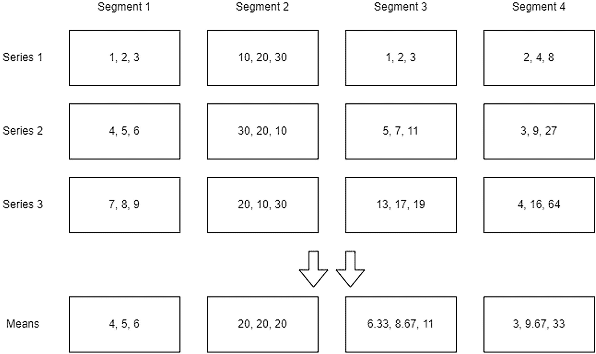
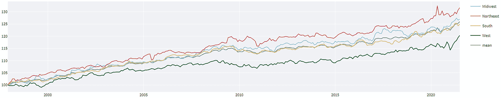
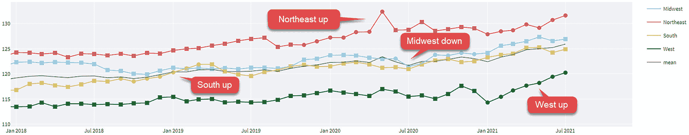

# 差异标准差 (DIFFSTD)

在上一章中，我们学习了几种可用于执行多序列时间序列分析的两两比较技术。在本章中，我们将介绍另一种此类技术，并将其用作多序列时间序列集成中的第一种方法。

## 什么是 DIFFSTD？

差异标准差 (DIFFSTD) 是一种两两时间序列比较技术，这意味着我们可以用它来比较两个序列之间的行为，并了解这两个序列中的数据运动如何随时间产生差异。正如我们在上一章中学到的，多序列时间序列分析应执行两个操作：离散化和聚合。离散化使我们能够生成更小的数据片段，然后我们可以使用 DIFFSTD 等技术对这些片段进行聚合和比较。在本节中，我们假设已经完成了数据离散化，以便专注于如何计算 DIFFSTD；当我们开始编写实现该函数的代码时，还需要解决离散化和聚合的问题。

### 计算 DIFFSTD

计算 DIFFSTD 相当直接。清单 16-1 显示了比较两个序列中一个片段的公式。

```
dist(X,Y) = sqrt( sum( (delta(t) - mu)² ) / n )
```

**清单 16-1** 计算 DIFFSTD 的公式

在此公式中，`X` 和 `Y` 代表两个独立时间序列中匹配的片段。值 `delta(t)` 表示在时间 `t` 时 `X` 和 `Y` 之间的数值差异。值 `mu` 表示在该片段中我们观察到的所有 `n` 个数据点上 `X` 和 `Y` 之间差异的平均值。

例如，假设我们有一个片段 `X`，其在相关时间范围内的值为 `{ 15.3, 15.8, 16.2, 16.4, 16.5 }`。我们还有一个片段 `Y`，其在相同时间范围内的值为 `{ 26.5, 26.3, 26.0, 25.5, 25.1 }`。在此数据集中，`X` 和 `Y` 之间的差异为 `{ -11.2, -10.5, -9.8, -9.1, -8.6 }`。这些差异的平均值为 -9.84。知道这些值后，我们可以从每个 `delta(t)` 值中减去平均值。例如，对于第一对数据点，`-11.2 - -9.84 = -1.36`。我们对后续每个数据点重复此操作，得到集合 `{ -1.36, -0.66, 0.04, 0.74, 1.24 }`。下一步是将每个结果平方，得到 `{ 1.8496, 0.4356, 0.0016, 0.5476, 1.5376 }`。这五个数据点的总和为 4.372，因此如果我们将其除以数据点的数量（即 5），得到值 0.8744。最后，其平方根为 0.935，这就是我们的结果。

为了解释这个结果，我们首先需要注意到所有 DIFFSTD 结果都大于或等于 0。如果结果等于 0，意味着这两个片段的行为完全没有差异：当一个上升时，另一个以完全相同的方式上升；当一个下降时，另一个以完全相同的方式下降。任何大于 0 的结果都表明行为存在一定程度的差异。我们的示例是两个数据集朝相反方向移动：一个缓慢上升，另一个缓慢下降。这导致我们的 DIFFSTD 值大于 0，但由于这些趋势很小，因此我们的 DIFFSTD 结果也相当小。

### 关键假设

在开始编写代码之前，我们应先明确多序列时间序列分析工作的几个关键假设。这些假设属于简化性假设，但严格来说，并非多序列分析的绝对必要条件。

第一个假设是，每个输入时间序列的长度相同——即每个序列包含相同数量的数值。此外，每个序列中时间点 `t` 的元素都反映同一时间点，无论序列如何。例如，若比较两只股票的每日表现数据，我们要求两个序列拥有相同数量的数据点，且这些数据点对应相同的日期。通过额外开发工作，我们可以放宽这一假设：创建合成时间序列，将两个（或多个）输入序列映射到一组具有共同时间元素的新序列。例如，若某个序列缺少特定日期的数据点，我们可根据周围数据对该日期的值进行插值。之所以能这样做，是因为我们假设每个时间序列都存在自相关性，因此数据点之间具有一定程度的稳定性。

我们将遵循的第二个假设是，所有作为输入接收的时间序列应反映相同的底层现象。例如，若收到代表男性西装销售数量的时间序列和代表职业篮球运动员平均薪资的时间序列，我们假设存在某种底层驱动力或一组共同驱动力作用于这两个序列。这一假设很重要，因为我们的目标是发现显著偏离点。若不存在驱动两个序列的底层因素，我们自然会预期出现偏离。我们仍可绘制偏离增大的区域，但人类无法从中学习或采取行动。这是一个我们无法放宽的假设，因为我们无法编写代码来“确保”时间序列之间确实存在某种关联。

最后一个假设是，序列之间不存在滞后自相关，或至少滞后自相关不是显著因素。前一章我们介绍了滞后自相关的例子：恒温器的温度控制设置与房间温度。在此例中，我们确实知道两者反映相同的底层现象：温度控制传感器管理调节室温的供暖与制冷系统，使房间温度趋近恒温器设定值。然而，我们预期存在滞后，因为房间温度不会仅仅因为有人改变恒温器设定值就下降几度。相反，改变恒温器设定值可能促使温度控制系统启动，向房间吹入更热或更冷的空气，直到其温度传感器显示房间已达到目标温度。若我们分析恒温器设置的时间序列与房间温度的时间序列，可能会因未考虑滞后自相关而得出错误结果。在炎热天气里，即使有人降低了恒温器控制设定的温度值，房间温度仍可能继续上升，因为设备可能需要几分钟才能冷凝并吹入足够空气以开始降温。如果我们知道该时间差（或至少了解其通常时长），可将房间温度序列向左平移该量以控制滞后，从而获得更优结果。对于通用异常检测引擎，我们无法获知滞后的具体细节，为简化起见，我们假设不存在滞后。

若您确实希望引入追踪数据集中滞后的功能，最终用户需要更了解其数据的分布情况。假设如此，且不失一般性地，我们称序列 `Y` 滞后序列 `X` 两步，则可将序列 `Y` 向左平移两步，使时间点 `t` 的测量值对应到时间点 `t-2`，因为此时 `X` 的变化引发了 `Y` 的变化。这样做会导致序列开头有两个 `Y` 数据点没有对应的 `X` 值，序列末尾有两个数据点没有对应的 `Y` 值。随后我们将移除这些不匹配的起点和终点数据点，分析剩余部分。此问题的另一种解决方案是让用户自行执行去滞后操作，前提是他们了解滞后情况。

现在我们已经介绍了本章将遵循的三个关键假设，接下来开始编写代码。

## 编写 `DIFFSTD`

本节我们将整合多序列时间序列分析的解决方案。由于没有现成的库包含 `DIFFSTD` 的实现，我们需要自行编写。我们将像其他检测方法一样，从构建 `run_tests()` 函数开始，该函数接收 `src\app\models\multi_timeseries.py` 文件中的 `DataFrame`。

### 序列处理

用户将向我们发送一个包含所有数据点的单一列表，通过某个 `series_key` 进行键控。我们首先需要拆分出每个序列，以便单独操作。清单 16-2 展示了如何使用 Python 的列表推导式实现此操作。

```python
series = [y for x, y in df.groupby("series_key", as_index=False)]
num_series = len(series)
l = len(series[0])
```

清单 16-2 用于检索每个序列数据的列表推导式

在此列表推导式中，我们按序列键对数据进行分组，并设置 `as_index=False` 以确保在生成的 `DataFrame` 列表中获得序列键。由此，我们得知有多少个独立序列以及第一个序列的长度。这直接源于我们遵循的第一个假设：每个序列拥有数量完全相同且对应相同日期和时间的数据点。我们未执行任何长度或日期检查来确保这一点，因此没有内置的错误修正机制。

### 分段

将序列拆分出来后，下一步是将每个序列拆分为大约七个数据点的分段。我们选择七作为序列长度的原因是，这能保证每个序列至少有两个分段，因为每个序列必须至少有 15 个数据点。在将数据拆分为分段时，我们需要留意每个分段中包含的数据点数量。这有两个原因。首先，根据 `DIFFSTD` 公式，任何给定分段中至少需要三个数据点；如果最终某个分段只包含一两个数据点，该公式将失去意义。其次，我们希望确保每个分段在数据点数量上保持相对均衡。例如，我们不希望出现一个分段有 4 个数据点而另一个分段有 16 个数据点的情况。尽管 `DIFFSTD` 公式并未要求分段长度相同，但确保分段大小大致相等对最终用户来说会更直观。

清单 16-3 展示了我们创建分段的过程，以及对每个时间序列分段总数（`segments`）的检查。

```python
series_segments = [np.array_split(series[x], (l // 7)) for x in range(num_series)]
num_segments = len(segments[0])
```

Listing 16-3 将每个序列拆分为大小为 6–10 的分段

在第一行中，我们使用 NumPy 将每个序列拆分为一个分段数组。我们获取序列的长度（变量 `l`），并执行整数除法（`//`），将序列总长度除以 7。这告诉 NumPy 我们想要创建的分段数量，它会据此分配结果。通过这个结果，对于任何长度 `l >= 15`，我们都能得到一组稳定的分段，并且保证每个分段的数据点数量既不会少于六个，也不会超过十个。然后我们计算每个序列内的分段数量。

### 比较基准

生成分段后，我们可以对每个分段运行`DIFFSTD`公式。下一个挑战是，如何将像`DIFFSTD`这样的成对处理过程转化为支持两个以上序列的方法？我们可以进行所有成对比较并将结果聚合在一起，但为了简化问题，我们将创建一个新序列，该序列代表每个时间点上所有数据点的均值。然后，我们可以将每个序列与新生成的均值序列进行比较。这种方法效果不错，这得益于我们做出的第二个假设：每个序列都反映相同的底层现象，并且我们预期各序列会大致同步变化。因此，即使各序列的值量级不同，我们也能追踪每个序列相对于均值的变化，并观察各元素是否朝大致相同的方向移动。

清单 16-4 展示了生成分段均值的过程。我们希望创建一个均值数组，每个分段对应一个均值。以下代码遍历每个分段，计算出均值。

```
def generate_segment_means(series_segments, num_series, num_segments):
means = []
for j in range(num_segments):
C = [series_segments[i][j]['value'] for i in range(num_series)]
means.append([sum(x)/num_series for x in zip(*C)])
return means
Listing 16-4
为每个分段生成均值的函数
```

图 16-1 展示了该函数在实际中的工作方式。在此例中，`num_series`的值为 3，`num_segments`的值为 4。对于每个分段中的每个数据点，我们将计算所有序列在同一时间点上所有数据点的均值。因此，如果第一个序列的第一个分段的第一个数据点是 1，第二个序列是 4，第三个序列是 7，我们取这三个值的均值，结果为 4。然后我们对每个分段中的每个数据点重复此过程，从而确保我们得到的均值序列与各个序列具有相同的大小和形状。



一个表格示意图，包含 4 列（分段 1 至 4）和 4 行（序列 1 至 3 及均值）。

图 16-1

计算三个序列中每个分段的均值

在代码中，我们将这个结果序列称为`segment_means`。生成该序列后，我们可以对均值与每个序列运行`DIFFSTD`。清单 16-5 提供了`check_diffstd()`函数及其辅助函数`diffstd()`的代码。

```
def diffstd(s1v, s2v):
dt = [x1 - x2 for (x1, x2) in zip(s1v, s2v)]
n = len(s1v)
mu = np.mean(dt)
diff2 = [(d-mu)**2 for d in dt]
return (np.sum(diff2)/n)**0.5
def check_diffstd(series_segments, segment_means, num_series, num_segments):
for i in range(num_series):
for j in range(num_segments):
series_segments[i][j]['segment_number'] = j
series_segments[i][j]['diffstd_distance'] = diffstd(series_segments[i][j]['value'], segment_means[j])
return series_segments
Listing 16-5
对多个时间序列运行 DIFFSTD 的代码
```

第一个函数`diffstd()`允许我们计算两个分段（命名为`s1v`和`s2v`）的`DIFFSTD`。这段代码是清单 16-1 中公式的简单实现，首先计算`s1v`中每个数据点与其在`s2v`中对应位置数据点的差值。然后，我们将所有值代入公式，并返回一个代表该分段`DIFFSTD`的单一数值。

接下来是`check_diffstd()`函数，我们用它来汇总计算出的`DIFFSTD`值。该检查函数会遍历每个时间序列和分段。循环首先设置分段编号（从 0 开始），以便我们能够查看任何特定数据点属于哪个分段。这一点很重要，因为它是我们标记一系列数据点为异常值的主要依据——`DIFFSTD`作用于分段而非单个数据点，因此某些行为看似正常的数据点可能会被标记为异常值，因为它们属于一个显著偏离的分段，即使该分段内的某些数据点可能与其同类数据点偏离不大。

该函数做的第二件事是计算该分段与其对应分段均值之间的`DIFFSTD`。我们将其记录为一个名为`diffstd_distance`的新列。这类似于`anomaly_score`，但我们希望保留该术语，因为下一章我们将扩展多序列时间序列模型，并将`diffstd_distance`作为`anomaly_score`计算的一个组成部分。

一旦我们计算了每个分段的编号和分数，就需要返回一个单一的 DataFrame。目前，我们拥有的是一个由 DataFrame（单个数据点）组成的列表（序列）的列表（分段）。为了将它们合并，我们将遵循清单 16-6 中的两步流程。首先，我们希望展平列表的列表，得到一个简单的 DataFrame 列表。我们可以使用列表推导式来完成此任务，得到一个包含每个分段对应一个 DataFrame 的分段列表。然后，我们使用 Pandas 中的`concat()`函数将 DataFrame 列表合并为一个 DataFrame，并将其返回给调用者。

```
segment_means = generate_segment_means(series_segments, num_series, num_segments)
segments_diffstd = check_diffstd(series_segments, segment_means, num_series, num_segments)
flattened = [item for sublist in segments_diffstd for item in sublist]
df = pd.concat(flattened)
Listing 16-6
将 DataFrame 的列表的列表转换为单个 DataFrame。我们将列表的列表展平为单个列表，然后将列表中的每个 DataFrame 连接起来。
```

一旦我们获得了一个包含每个数据点异常分数的单一 DataFrame，就该确定哪些点（通过其所属的分段）是异常值了。

### 确定异常值

在判断 `DIFFSTD` 的值是否足够大，以至于表明序列行为发生中断时，需要明确的是，并没有硬性规定。我们所能做的最好的办法，就是将各分段的 `DIFFSTD` 与其他分段进行比较，并创建一个相对排名。这与我们在处理诸如 `LOF` 和 `COF` 等多变量分析技术时遇到的情况类似，不过，由于 `DIFFSTD` 的值可能部分取决于用户数据集中数值的大小，我们无法提供一个“足够好”的固定临界值。

我们可以做的是，寻找某个分段的 `DIFFSTD` 与所有分段均值相差足够大的情况。首先，设定一个距离均值的最大距离分数为 `1.5 * 均值`，然后我们可以使用敏感度分数来降低这个距离阈值，即从 `1.5` 中减去敏感度分数（将其缩放至 `0.00` 到 `1.00` 之间的值）。例如，假设 `DIFFSTD` 的均值是 `10.0`。如果敏感度分数为 `0.0`，那么我们需要找到一个分段的 `DIFFSTD` 至少与均值相差 `1.5 * 10.0`，即最小值为 `25.0`。在另一个极端，敏感度分数为 `100.0` 意味着任何高于 `10.0 + (1.5 – 1.0) * 10.0` 即 `15.0` 的值都会触发我们的异常检测器。代码清单 16-7 展示了如何在 `score_results()` 函数中计算敏感度阈值。

``
# 多时间序列异常检测

## 代码实现

```python
def score_results(df, tests_run, sensitivity_score):
    series = [y for x, y in df.groupby("series_key", as_index=False)]
    num_series = len(series)
    diagnostics = { }
    for i in range(num_series):
        diffstd_mean = series[i]['diffstd_distance'].mean()
        diffstd_sensitivity_threshold = diffstd_mean + ((1.5 - (sensitivity_score / 100.0)) * diffstd_mean)
        series[i]['diffstd_score'] = (series[i]['diffstd_distance'] - diffstd_sensitivity_threshold) / diffstd_sensitivity_threshold
        series[i]['anomaly_score'] = series[i]['diffstd_score']
        # diagnostics segments removed
    return (pd.concat(series), diagnostics)
```

`代码清单 16-7：`使用距离均值的距离作为指标，在 Python 中计算敏感度阈值。我们没有使用 `tests_run` 字典，但保留它以用于未来扩展，例如，如果我们决定不将 `DIFFSTD` 作为集成方法的一部分来运行。

第一步是拆分每个序列，因为我们处理的是一个完整的 `DataFrame`。然后，对于每个序列，我们计算该序列中所有数据点的 `DIFFSTD` 值的均值。一旦我们获得了均值，就可以使用前面的公式计算 `DIFFSTD` 敏感度阈值。关于我们的敏感度阈值计算，一个重要的注意事项是：距离均值 `0.5` 到 `1.5` 倍均值距离并非经过学术研究验证的硬性规则；它仅仅是一个合理的起点。我们可以通过计算相对于中位数的 `MAD`、计算相对于某个分位数（如箱线图）的 `MAD`，或者改变距离均值的距离大小来调整这个值。

给定 `DIFFSTD` 敏感度阈值后，我们现在有足够的信息来生成 `diffstd_score`，它表示特定数据点距离该阈值的远近，并相对于阈值进行了归一化处理。我们的报告是针对单个数据点级别的，但我们应该记住，我们是在分段级别计算 `DIFFSTD` 距离的，因此一个分段内的所有数据点具有相同的距离值，因此也会具有相同的分数。由于我们（目前）只使用一种算法进行多序列时间序列检测，我们将把异常分数设置为等于 `DIFFSTD` 分数，并返回所有连接在一起的时间序列。

一旦我们计算了敏感度阈值，就可以使用与其他输入类型类似的技术来跟踪异常值的最大比例，不过我们需要跟踪每个序列的异常值最大比例，而不是整体比例。代码清单 16-8 展示了如何在 `determine_outliers()` 函数中实现这一点。

```python
def determine_outliers(df, max_fraction_anomalies):
    series = [y for x, y in df.groupby("series_key", as_index=False)]
    max_fraction_anomaly_scores = [np.quantile(s['anomaly_score'], 1.0 - max_fraction_anomalies) for s in series]
    # diagnostics information elided
    sensitivity_thresholds = [max(0.01, mfa) for mfa in max_fraction_anomaly_scores]
    for i in range(len(series)):
        series[i]['is_anomaly'] = [score >= sensitivity_thresholds[i] for score in series[i]['anomaly_score']]
    return (pd.concat(series), diagnostics)
```

`代码清单 16-8：`引入异常值的最大比例并做出最终的异常值判定

对于每个序列，我们想要找到与异常值最大比例相对应的百分位数，因此如果 `max_fraction_anomalies` 是 `0.1`，我们想要异常分数的 `1.0 – 0.1 = 90th` 百分位数。然后，我们检查异常分数的最大比例是否至少为 `0.01`。如果低于 `0.01`，我们就使用该临界值，因为敏感度阈值为 `0` 或更低表明根据 `DIFFSTD`，该分段不是异常值。

最后，对于每个序列中的每个数据点，我们检查其分数是否大于该序列的敏感度阈值，如果是，则将 `is_anomaly` 的值设置为 `True`；否则，将其值设置为 `False`。至此，我们已经为多个关联序列实现了时间序列分析。接下来，我们将需要整理一组测试，并更新 Streamlit 网站。

## 测试与网站更新

我们有了一个新的输入类型，因此需要新的测试和网站更新。在本节中，我们将依次介绍单元测试、集成测试和网站更新。

### 单元测试

多时间序列分析的单元测试与单时间序列分析的测试非常相似，我们将重点确保敏感度分数和异常最大比例在边际变化时的行为符合预期：当敏感度分数或异常最大比例上升时，标记的异常值数量应增加；当敏感度分数或异常最大比例下降时，标记的异常值数量应减少。

为了执行这些测试，我们将使用一个包含两个序列数据的样本输入集。每个序列包含 17 个数据点，确保每个序列的数据点数量不同。每个序列的第一段是直接的线性平移：取序列 `s1` 的值并加 10，得到序列 `s2` 的值。第二段在过程中引入了方差，以确保我们的测试中确实会出现一些结果。代码清单 16-9 展示了与敏感度分数测试用例相关的代码。我们包含了一组从 0 到 100 的敏感度分数，并根据敏感度分数预期返回 0 或 16 个结果。我们将异常最大比例固定为 1.0，以确保所有异常值都出现在结果集中。

```python
@pytest.mark.parametrize("df_input, sensitivity_score, number_of_anomalies", [
(sample_input, 100, 16),
(sample_input, 90, 16),
(sample_input, 80, 16),
(sample_input, 70, 16),
(sample_input, 60, 16),
(sample_input, 50, 0),
(sample_input, 40, 0),
(sample_input, 25, 0),
(sample_input, 5, 0),
(sample_input, 1, 0),
(sample_input, 0, 0),
])
def test_detect_multi_timeseries_sample_sensitivity(df_input, sensitivity_score, number_of_anomalies):
    # Arrange
    df = pd.DataFrame(df_input, columns=["key", "series_key", "dt", "value"])
    max_fraction_anomalies = 1.0
    # Act
    (df_out, weights, diagnostics) = detect_multi_timeseries(df, sensitivity_score, max_fraction_anomalies)
    print(df_out.sort_values(by=['dt']))
    # Assert
    assert(number_of_anomalies == df_out[df_out['is_anomaly'] == True].shape[0])
```

`代码清单 16-9：`在保持异常最大比例不变的情况下测试敏感度分数的边际变化

结果从 0 跳到 16 的原因有两个。首先，异常值的数量是被标记为异常值的*数据点*的数量。由于我们在处理多时间序列分析时关注的是数据段，因此我们保证两种情况之一：要么该段中的所有数据点都是异常值，要么该段中没有数据点是异常值。此外，由于我们只有两个序列，它们在偏离均值方面必然相互镜像：均值是这两个序列之间的中点，因此要使一个序列与均值距离足够远而成为异常值，另一个序列也必须如此。一旦我们加入第三个序列，这个说法就不再成立，但在单元测试中我们只处理两个序列。从这组测试结果中，我们可以了解到，当敏感度分数在 0 到 50 到 60 之间的某个值时，没有数据段的 `DIFFSTD` 会高到足以成为异常值。然后，当达到 60 时，每个序列将有一个包含八个数据点的段，该段差异足够大，因此成为异常值。

### 集成测试
``

对于集成测试，我们希望使用一组更真实的数据，这些数据应满足我们的三个假设。简单回顾一下，这三个假设如下：第一，每个时间序列具有相同的长度和相同的测量日期；第二，每个时间序列跟踪相同的底层现象；第三，没有时间序列与任何其他序列存在显著的滞后相关性。我们将在第 16 章的 Postman 测试中使用的数据集是消费者价格指数（CPI）数据，特别是 `Ch16 – Time Series – Multiple – No Debug – CPI Data` 测试中的数据。我们在第 13 章中介绍了 CPI 的概念，但这里将进行回顾。美国劳工统计局负责每月对全国的家庭和企业进行调查，询问一系列关于特定产品价格的问题。他们将这些数据整理成易于分析的形式，称为消费者价格指数，用于追踪价格随时间的变化。追踪价格非常有用，但分析数量级相差很大的产品价格可能很困难：一种产品价格从每单位 1 美元涨到 1.10 美元，涨幅为 10%。如果我们试图将其与一辆新车（价格从 33,000 美元涨到 36,300 美元）绘制在同一张图表上，将很难看出两者实际上都上涨了相同的百分比。这就是劳工统计局以商品价格百分比变化的形式追踪 CPI 的原因之一。另一个原因是，CPI 旨在作为通货膨胀的间接衡量指标，而通货膨胀本身就是一个我们以随时间变化的百分比来理解的概念。

为了将所有内容与百分比联系起来，统计局将特定时间段定为 100.0。这个时间段会因序列而异——例如，许多序列以 1982 年至 1984 年之间的平均值作为 100.0 的基准。具体的基准本身对我们的目的并不重要，因为我们可以使用指数值并观察它们随时间的变化，以此作为市场趋势（针对单一产品或少量产品）或通货膨胀（全面）的指示。在本例中，我们将使用四个 CPI 序列作为测试用例。这四个序列代表了美国劳工统计局使用的全国四个地区（东北部、南部、中西部和西部）城市消费者娱乐服务的非季节性调整价格。每个序列都从 1997 年 12 月开始，初始值为 100.0，并包含截至 2021 年 7 月的月度数据。图 16-2 展示了每个序列随时间的变化。我们可以看到，这四个序列独立变动，但往往朝着相同的总体方向移动。这对我们来说是有利的，因为它支持了这样一个观点：它们都在追踪相同的底层现象：通货膨胀以及娱乐服务中供需的相互作用。



一张折线图展示了序列随时间的变化。图中从原点出发有五条上升的线，分别代表中西部、东北部、南部、西部和均值。

**图 16-2** 娱乐商品和服务的成本随时间变化的价格，按地区细分。这是我们可以使用 `DIFFSTD` 进行分析的数据类型的一个示例。

本章的测试使用敏感度分数 60 和异常最大比例 0.25。除此之外，除了我们发送的 JSON 主体和调用的端点细节不同，这些测试与本书中介绍的其他 API 测试非常相似。

### 网站更新

在更新 Streamlit 网站时，我们会遇到几个挑战。第一个挑战是如何最有效地展示结果。对于单变量数据，我们展示了数值与异常分数的柱状图。对于多变量数据，我们将结果绘制为关键值与异常分数的柱状图。单一时间序列数据则包含一条灰色线条，并点缀着散点，其颜色和形状向我们指示是否遇到了变化点。由于我们有多个数据序列需要展示，我们需要采用另一种方法来解决数据有意义展示的问题。在此之前，我们应该先做一些清理工作，将列表转换为 JSON。代码清单 16-10 展示了一个将多序列时间序列 Python 列表转换为 JSON 的新函数。

```python
@st.cache
def convert_multi_time_series_list_to_json(time_series_str):
    mv_ast = ast.literal_eval(time_series_str)
    return json.dumps([{"key": k, "series_key":sk, "dt":dt, "value": v} for idx,[k,sk,dt,v] in enumerate(mv_ast)])
```

代码清单 16-10 将多序列时间序列数据数组转换为 JSON 以便处理。

这个函数看起来与单序列时间序列的函数非常相似，只是我们多了解析一个参数：序列键。现在我们已经为四种输入类型都配备了转换器，就可以移除 `main()` 函数中那个仅为特定输入类型显示复选框的条件块，而直接包含该复选框，无论用户选择哪种数据类型。我们还需要布置一个示例起始数据集，这在 `site.py` 文件的第 124 到 176 行完成。在这里，我们构建了三个数据序列，并特意设计使得序列 1 和序列 2 的第二段可能是异常值，但序列 3 不是。这有助于用户理解我们是按序列（*by series*）来判定段落的异常状态，而不仅仅是按段落。

一旦数据准备就绪，我们就需要展示结果。代码清单 16-11 包含了展示结果的代码。在此，我们希望将每个序列作为独立的线条，并赋予其独立的颜色。由于我们不知道需要用到多少种颜色，我们将使用 `px.colors.qualitative.Safe` 来定义调色板。这些颜色对于各种形式的色觉缺陷都是安全的，并且只要我们需要绘制的序列数量不是极端多，大多数观看者应该不会遇到视觉重叠问题。

> **注意**
> Safe 调色板中的颜色并非全部对单色显示安全，这意味着您可能难以在这本灰度印刷的书籍中区分颜色。为帮助读者，后续依赖区分不同序列的图像将包含适当的指示符。

```python
st.header('每个段落的异常分数')
df_mean = df.groupby("dt", as_index=False).mean("value")
df_mean['series_key'] = "mean"
ml = px.line(df_mean, x=df_mean["dt"],y=df_mean["value"],
             color=df_mean["series_key"], markers=False)
ml.update_traces(line=dict(color = 'rgba(20,20,20,0.45)'))
l = px.line(df, x=df["dt"], y=df["value"],
            color=df["series_key"], markers=False,
            color_discrete_sequence=px.colors.qualitative.Safe)
s = px.scatter(df,
               x=df["dt"],
               y=df["value"],
               color=df["series_key"],
               symbol=df["is_anomaly"],
               symbol_sequence=['square', 'circle'],
               hover_data=["key", "anomaly_score", "segment_number", "is_anomaly"],
               render_mode="svg",
               color_discrete_sequence=px.colors.qualitative.Safe)
s.update_traces(marker_size=9, showlegend=False)
g = go.Figure(data=l.data + s.data + ml.data)
st.plotly_chart(g, use_container_width=True)
```

代码清单 16-11 展示多序列时间序列分析的结果，包括每个时间点的平均值。

我们在代码块中做的第一件事是计算每个日期和时间的平均值。这将允许我们绘制一条灰色的平均值线。我们选择灰色作为颜色，因为平均值线本身并不存在，不应比实际数据更引人注目，但我们确实需要一些指示，以便了解特定序列在多大程度上偏离了其他序列。

在追踪平均值之后，我们使用 Plotly 定性调色板列表中的 Safe 调色板，为每个序列创建一条线。最后，我们用一个散点图覆盖这些线条，以指示数据点是否为异常值。与单序列时间序列数据一样，我们将使用方块表示数据点不是异常值，使用圆圈表示数据点是异常值。如需更多信息，用户可以悬停在特定点上，查看关于键、异常分数、段落编号以及数据点是否为异常值的详细信息。图 16-3 展示了我们 2018 年 1 月至 2021 年 7 月 CPI 数据的放大视图。在此图中，我们可以看到四个异常段落，每个区域一个。在其中三个异常段落中，我们看到该区域的上升速度快于其他区域。然而，中西部地区在 2020 年中期经历了比其他地区更急剧的价格下跌，尽管它在几个月内确实恢复到了之前的趋势线。



一个散点图展示了 2018 年 1 月至 2021 年 7 月 CPI 数据的放大视图。它包含五条上升的线条，分别代表中西部、东北部、南部、西部和平均值。

**图 16-3**

每个序列在 2018 年至 2020 年间都表现出异常行为，这使得情况更加有趣，因为在 23 年的时间里，总共只有 11 个值得关注的异常段落。

## 结论

在本章中，我们开始组装异常检测套件的最后一部分，引入了多序列时间序列分析。我们创建了自己的 `DIFFSTD` 实现，并像在前几章中使用预构建库一样使用它。为了支持 `API` 的这一部分，我们还加入了单元测试和集成测试。最后，我们更新了 `Streamlit` 网站，允许用户尝试多序列时间序列分析。

在下一章中，我们将介绍另一种用于多序列时间序列分析的技术：符号聚合近似法。我们将了解它与 `DIFFSTD` 等技术有何不同，并将其整合到我们的多序列引擎中。