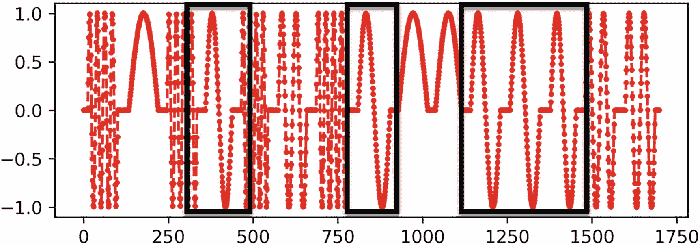
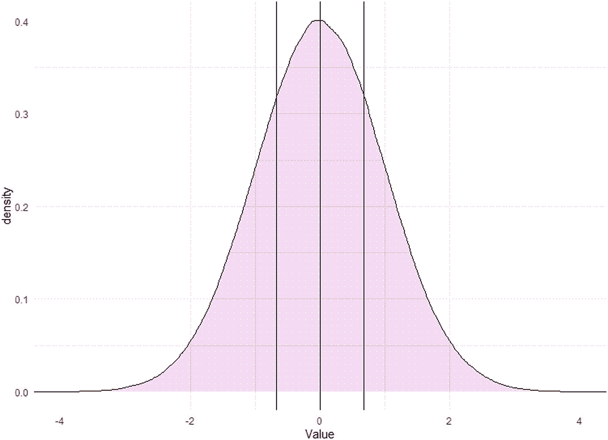
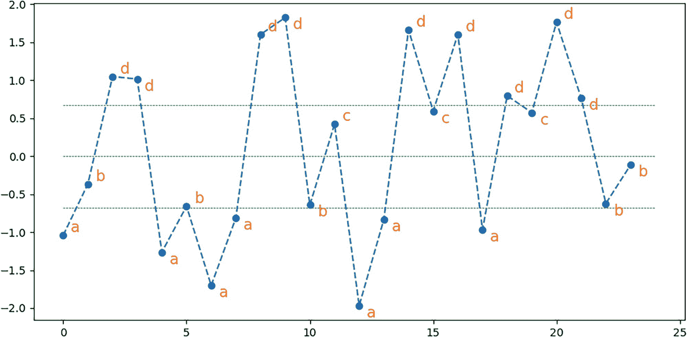
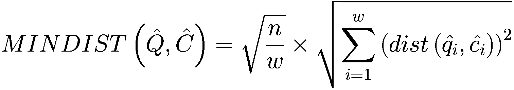
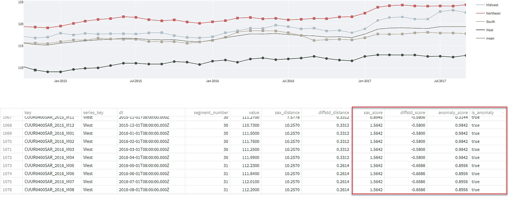

# 17. 符号聚合近似法 (`SAX`)

前两章介绍了各种计算方法，旨在比较两个时间序列，并了解这两个序列偏离对齐的程度。随后，我们通过在大约七个数据点的较短段落上寻找平均行为，将这一概念扩展到处理多个序列。这就是我们实现的多序列分析技术。在本章中，我们将采用一种最初设计用于在单个序列中寻找重复模式的技术，并将其用于扩展我们的多序列时间序列异常检测引擎。在此过程中，我们将再次创建一个结果集成，并用它来指导我们的异常评分。

## 什么是 `SAX`？

符号聚合近似法（`SAX`）是一种由杰西卡·林（Jessica Lin）和埃蒙·基奥（Eamonn Keogh）与当时在加州大学河滨分校的其他研究人员共同开发的技术。在他们 2002 年的原始论文中，林等人阐述了如何在时间序列中找出相似的行为模式，即使这些数值的具体大小因趋势和季节性等因素而有所不同。换句话说，`SAX` 能够潜在地从经典时间序列分解中视为噪声的部分发现模式，因为这些模式并非规律出现，也不属于趋势或季节性行为。

图 17-1 展示了 `SAX` 能够找到的模式类型示例。在这个序列中，我们可以五次发现相同的模式，其中三次是连续出现的。尽管这是一个简单的场景，我们看不到任何趋势、季节性或噪声，但 `SAX` 能够穿过这些干扰因素找到共同模式。



一个点图展示了在时间序列数据集过程中出现的模式。图中包含三个垂直矩形框。估计值分别为 (300 到 490, 1.0)、(780 到 900, 1.0)、(1150 到 1450, 1.0)。

图 17-1

一个在时间序列数据集过程中多次出现的模式示例。尽管这是一个人工生成的数据集，但像 `SAX` 这样的工具使我们能够对复杂的真实世界时间序列数据执行此类分析。

## 基序与异常序列

我们在图 17-1 中描述的内容，林等人（2002）称之为`基序`。在文学或音乐术语中，`基序`是一个反复出现的主导主题。同样的概念也适用于此：`基序`是在时间序列过程中多次出现的模式。该模式不需要以完全相同的幅度、完全相同的数据点数量或完全相同的运动方式重复，只要整体上“足够接近”即可。这样，`基序`的概念与我们第 2 章学到的格式塔原则非常吻合，因为我们正试图以编程方式识别模式，而人眼可以自动完成。区别在于，人类会疲劳，并且难以从大量数据中解析细微差别，而计算机在这方面则表现出色。

与`基序`相反的是`异常序列`，这是基奥和林在基奥等人（2005）中定义的概念。`异常序列`是一个与其他序列足够不同、值得特别提及的序列。`异常序列`分析最适合高度季节性的数据，但不需要精确的周期性。例如，假设我们跟踪某个给定 `API` 端点的响应时间。在夜间，当调用者较少且系统负载较低时，我们可能会发现响应时间的第 95 百分位数为 20 毫秒。随着更多用户登录开始新的一天并使用我们的系统，该响应时间可能会在一天中增加到每次调用 200 毫秒，在午餐时间下降，下午晚些时候回升，并在傍晚逐渐减少。假设我们有一个涵盖数月、每十分钟周期记录的长时间响应时间序列。我们期望看到一个相当一致的模式，但有时我们看不到这种模式。我们可能会看到整天的响应时间都是 20 毫秒，后来发现节假日的工作量只是总量的一小部分。我们可能会看到，在某个负载均衡服务器发生故障、我们不得不仅靠一台服务器维持的那一天，每次调用的响应时间飙升至远高于 200 毫秒。`异常序列`的主要好处是，它们让我们有机会问：“那个时间段有什么特别之处？是什么导致了这种行为差异？”当我们确实期望出现重复模式时，我们也可以轻松地将`异常序列`的概念应用于单序列异常值检测。

## 子序列与匹配

`SAX` 背后的直觉相当直接。给定一个时间序列，我们可以定义某个`子序列`长度，其中子序列是时间序列中远小于整个序列长度的一段。这些子序列与我们前一章创建的分段并不完全相同——分段的目的是将每个时间序列分割成可管理的块，并比较同一块内的序列行为。我们的分段也遵循滚动窗口模式：如果我们的分段长度为 8，则前 8 个数据点形成一个分段；然后，接下来的 8 个形成下一个分段；依此类推，直到我们遍历整个数据集。相比之下，子序列*不必*遵循滚动窗口模式。

然而，它们之间确实需要保持某个最小距离，我们才能认为存在匹配。这一直觉在`平凡匹配`的概念中得到了阐述。假设我们在时间序列中有一个从点 80 到 150 的模式，我们将其定义为 `p`。假设我们有另一个子序列 `q`，它也覆盖从点 80 到 150 的范围，因此 `p = q`。那么 `p` 与 `q` 匹配是显然成立的，因为它们都覆盖完全相同的数据点序列。现在让 `q` 的范围变为 81 到 151。这仍然是一个极其接近的匹配，但它同样没有为我们提供任何有用的信息。

因此，一个`非平凡匹配`必须与原始子序列保持某个最小距离，这样 `p` 和 `q` 之间就不会有重叠。这意味着在实践中，子序列是互斥的，尽管其原始定义并未要求如此（林等人，第 2 页）。

`SAX` 的常规用途是寻找 `1-基序`，即具有最多相似子序列的基序，因此也是单个时间序列中最常重复出现的模式。顺便提一下，这意味着也可以存在 `2-基序`、`3-基序`，等等。在我们的场景中，我们将较少关注时间序列内部`基序`的概念，而是使用 `SAX` 来比较多个时间序列的部分以寻找共性。为了延伸音乐类比，我们关注的不是一场表演中的常见`基序`，而是乐队是否在合奏。

### 数据离散化

`SAX` 首先采用一种称为`分段聚合近似`（`PAA`）的技术。其原理是将一组数据点分解为固定宽度的帧，这与我们在 `DIFFSTD` 中对数据分段的方式非常相似。然后，我们计算每一帧的均值，从而减少需要关注的数据点数量。除了 `PAA`，我们还需要确保对数据集进行归一化，使其服从高斯分布。之所以要服从高斯分布，是因为这样我们可以在分布中创建任意数量的断点，其理念是每个区间在曲线下包含的面积相等，因此任意一个数据点出现在任何区间的概率都是相等的。图 17-2 展示了这一过程的一个示例。



一个线图绘制了密度与值的关系。它呈现钟形曲线，由三条垂直线在值 (-0.67, 0, 0.67) 处分割。

图 17-2

该图将正态分布划分为四个区域，每个区域在曲线下拥有相等的面积。分割点位于 -0.67、0 和 0.67。

Lin 等人展示了将高斯分布划分为三到十个等概率区域的断点，但后续研究表明，通常只需要三到五个区域，而 `SAX` 的“行业标准”是使用四个区域，正如我们在图 17-2 中所见。

一旦你拥有了一个服从正态分布（即均值为 0，标准差为 1）的数据集，我们就可以将每个区域定义为一个字母，并实现我们的“字母表”。换句话说，对于四个区域，我们需要四个字母，通常称为 A、B、C 和 D。这些字母使我们能够将 `PAA` 帧组合起来。例如，图 17-3 展示了一个实际示例，我们使用 `PAA` 对一组归一化数据点进行平均。然后，根据每个数据点对应的区域，为其分配一个字母。



一个点图将数据划分为等概率区域，并为每个区域分配一个标签。一些估计值为 (3, 1.0)、(9, 1.8)、(12, -2.0) 和 (20, 1.9)。

图 17-3

`SAX` 将数据划分为等概率区域，并为每个区域分配一个标签。

一旦我们拥有了一组帧，我们就可以定义由一定数量字母组成的“单词”。假设我们定义一个单词包含八个字母。在图 17-3 中，第一个单词是 `abddabaa`。然后，我们可以将这个单词与其他单词进行比较，并根据距离度量来查看它们的相似程度。让我们将第一个单词与第二个单词 `ddbcaadc` 进行比较。我们一眼就能看出两者实际上是不同的，但如何计算一个合适的距离呢？答案来自区域之间断点的值。使用四个字母的字母表，我们需要定义三个断点，它们分别代表正态分布累积分布函数（`CDF`）的第 25、50 和 75 百分位数。跳过涉及的数学计算，这三个断点位于 -0.67、0 和 0.67。换句话说，对于我们的四字母字母表，如果某个点的值小于 -0.67，我们将其标记为 A。如果其值在 -0.67 到 0（不含）之间，则标记为 B；如果在 0 到 0.67（不含）之间，则标记为 C；如果至少为 0.67，则标记为 D。通过这样做，每个区域将大约包含 25% 的数据点。

我们还可以使用这些断点来创建距离计算。表 17-1 展示了我们为执行距离计算而需要构建的矩阵。

表 17-1

定义两个数据点之间的距离。如果移动不超过一个字母，则得分为 0

```
|   | A | B | C | D |
|---|---|---|---|---|
| **A** | 0 | 0 | 0.67 | 1.34 |
| **B** | 0 | 0 | 0 | 0.67 |
| **C** | 0.67 | 0 | 0 | 0 |
| **D** | 1.34 | 0.67 | 0 | 0 |
```

移动超过一个字母时，距离会增加断点距离，每步为 0.67。这意味着从 A 到 D（或从 D 到 A）的移动构成了 1.34 的差异。然后，Lin 等人定义了一个称为 `MINDIST` 的最小距离度量，其公式见代码清单 17-1。



```
代码清单 17-1
两个单词之间最小距离的计算
```

在代码清单 17-1 中，`n` 表示每个单词的数据点数量。为了举例说明，我们假设每个字母代表四个数据点的平均值，这是通过 PAA 计算得出的。每个单词有八个字母，因此每个单词总共有 32 个数据点。接下来，`w` 表示单词的长度，即 8。对于每一对比较，我们从表中计算距离度量，对结果进行平方，然后对总和取平方根。然后，将其乘以 `n` 除以 `w` 的平方根，从而得到 `MINDIST` 的最终定义。

在比较这两个单词时，我们有两个实例中字母相差三个位置（即 `a–d` 或 `d–a`），三个实例中字母相差两个位置，以及三个实例中字母相差不超过一个位置。对距离的平方求和，我们得到 `2 * 1.34² + 3 * 0.67² = 4.9379`。对这个结果取平方根，得到 2.222。同时，`32 / 8 = 4`，4 的平方根是 2，因此如果将 2.222 乘以 2，我们最终得到 `MINDIST` 值为 4.444。`MINDIST` 值在具有相同数据点数和每单词字母数的单词之间是可比较的，`MINDIST` 值越高，表示两个单词比 `MINDIST` 值更低的单词“差异更大”。

现在我们已经了解了 SAX 背后的思想，接下来看看如何将其整合到多序列时间序列分析中。

## 实现 SAX

有几个 Python 包提供了 SAX，包括 `tslearn`、`saxpy` 和 `pyts`。在本节中，我们将使用 `tslearn` 包来实现 SAX，因为它提供了一些功能，使我们更容易将 SAX 扩展到多序列时间序列分析，包括内置的距离计算。

我们需要做的第一件事是更新用于多序列时间序列分析的 `run_tests()` 函数，以整合 SAX。在上一章中，我们使用列表推导式将输入的 DataFrame 分解为每个单独的时间序列。然后，我们将每个序列分割成大约七个数据点一段的片段，并对每个片段调用 `DIFFSTD`，将一个片段与对应序列所有片段的均值进行比较。然而，对于 SAX，我们不会使用相同的分割过程，因为我们有另一种可用的方法。

### 分段与分块

在 `tslearn` 包中，`SymbolicAggregateApproximation()` 类接受三个参数：分段数（`n_segments`）、字母表大小（`alphabet_size_avg`）以及是否在处理前对数据进行归一化（`scale`）。对于后两个参数，我们将硬编码字母表大小为 4 并强制进行归一化，因为根据现有的 SAX 文献，这些是强烈推荐的做法。我们需要考虑的主要参数是分段数。需要注意的一点是，我们不能传入自己的数据分段机制，因此不应假设 `DIFFSTD` 中某个分段内的数据点必然属于 SAX 中的同一个分段。总体而言，这反而是一件好事，因为它使我们能够微调异常值检测过程。假设数据点 1–7 和 8–15 构成了 `DIFFSTD` 的两个分段。与此同时，SAX 使用 1–5、6–10 和 11–15 作为分段。此外，对于某些序列，假设我们发现 `DIFFSTD` 对点 1–7 的评分非常高，而对点 8–15 的评分很低，这表明第一个分段是异常值。与此同时，运行 SAX 后，我们发现点 1–5 没有异常值迹象，点 6–10 存在异常值，而点 11–15 没有异常值。由此我们可以得出结论：点 6 和点 7 是最可能的异常值点。因此，我们的不同方法使用不同大小和形状的分段是有益的。

**注意：** 同样的逻辑也意味着，我们可能可以通过使用不同大小的分段执行 `DIFFSTD` 并将得分合并来获益，类似于我们在最近邻确定和 COF 中所做的操作。将 `DIFFSTD` 扩展为它自己的集成方法对读者来说可能是一个有趣的练习。

在确定 SAX 的分段大小时，我们应注意：每个分段将输出一个字母，我们希望一定数量的字母构成一个单词，并且我们需要足够多的单词以便在序列之间进行充分的比较。因此，我根据每个时间序列的长度选择分段大小，并随数量级递增。对于少于 100 个数据点的情况，我们让每个分段包含两个数据点，这是计算非平凡分段平均值的最小值。如果数据点至少为 100 但少于 1000，则每个分段包含三个数据点。最后，对于 1000 个或更多数据点，每个分段将包含五个数据点。

清单 17-2 展示了如何在 `check_sax()` 函数中执行这些计算，该函数需要三个参数：`series`，代表输入的时间序列；`num_series`，告诉我们有多少个独立的时间序列；以及 `l`，代表每个时间序列中的数据点数量。我们还需要将每个序列转换为仅包含值的列表，以便匹配输入所需的形状。

```python
def check_sax(series, num_series, l):
    if (l < 100):
        segment_split = 2
    elif (l < 1000):
        segment_split = 3
    else:
        segment_split = 5
    sax = SymbolicAggregateApproximation(n_segments= l//segment_split, alphabet_size_avg=4, scale=True)
    slist = [series[i]['value'].tolist()
             for i in range(num_series)]
```

**清单 17-2** 计算分段拆分并以 SAX 所需的方式塑造数据

准备好数据集后，我们需要确定单词的大小。对此没有通用的答案，但我选择 4 作为单词大小，原因有三点，相当简单。首先，我们希望单词大小足够大，以便能够体现合理的变化可能性。其次，我们希望单词大小不要过长，以免掩盖变化。最后，我们知道序列中数据点的最小数量是 15，因此单词大小为 4、分段大小为 2 意味着我们始终至少有两个单词可以进行比较。这意味着每个单词将包含 8 个（如果总数据点少于 100）、12 个（总数据点为 100–999）或 20 个数据点。清单 17-3 继续 `check_sax()` 函数，执行转换并拟合到 `sax_data` 数组中。生成的数组实际上是一个包含列表的列表的数组。分解来看，我们有一个元素数组。每个元素是一个列表，每个序列对应一个。在该列表中，每个字母都在其自己的列表中，`tslearn` 将四个字母表示为数字 0、1、2 和 3，而不是字母 A、B、C 和 D。

```python
#### array([ [[1],[1],[1]], [[1],[0],[2]], [[2],[2],[1]] ])
sax_data = sax.fit_transform(slist)
word_size = 4
num_words = len(sax_data[0])//word_size
```

**清单 17-3** 拟合、转换并准备将结果转换为单词以进行比较的过程。结果示例显示在拟合和转换函数上方的注释中。

在清单 17-3 的示例数组中，每个序列有三个字母，尽管 `tslearn` 将字母显示为 0–3 而不是 A–D。接下来，我们希望将内容组合成大小为 4 的单词，这意味着我们需要知道要创建多少个这样的单词。为了得到这个数字，我们执行整数除法，将字母总数除以单词大小，并返回需要创建的单词数量。

**注意：** 在上述简单示例中，我们会遇到一个问题，因为没有足够的数据点来构成一个完整的单词。然而，这实际上并不是我们在实践中会遇到的问题，因为我们有一个所需的最小数据点数量，这保证了至少会有四个字母。

### 构建多序列 SAX

到目前为止，我们对 SAX 的描述都局限于单个时间序列的语境。其“模体”和“异常子序列”概念仅能指示单一序列中的模式（及模式偏离）。要让 SAX 适用于我们的多序列问题，还需要做一些额外工作。我们手头有两个关键资源：首先，我们拥有大小相同且应代表同一潜在现象的多个序列；其次，`tslearn` 提供了 `distance_sax()` 函数，该函数使用清单 17-1 中的 `MINDIST` 公式计算两个词之间的成对距离。利用这两个事实，我们可以将每个序列拆分为一组词，并对每个词与其他序列中对应匹配的词进行成对比较。根据得到的距离度量，我们可以计算一个词与其对应词的平均距离，并将其存储在一个矩阵中，如清单 17-4 所示。

```markdown
```
m = np.empty((num_series, num_words))
for i in range(num_series):
for j in range(num_words):
m[i][j] = sum(sax.distance_sax(
sax_data[i][j*word_size:(1+j)*word_size],
sax_data[k][j*word_size:(1+j)*word_size])
for k in range(num_series))/(num_series-1)
for i in range(num_series):
series[i]['sax_distance'] = [m[i][min(j//(word_size*segment_split), num_words-1)]
for j,val in enumerate(series[0].index)]
```
清单 17-4
计算每个词的成对比较结果，并将结果应用于每个序列的数据点

首先要创建一个数组，每个序列对应一行，每个词对应一列。为了填充该数组，我们使用推导式计算 SAX 距离：对于每个序列`k`，我们将从`j * word_size`到`(1+j) * word_size`范围内的词与序列`i`中的对应词进行比较。词大小从 0 开始，因此第一次比较将针对`sax_data[i][0:4]`与每个`sax_data[k][0:4]`。这将比较元素 0、1、2 和 3，然后除以比较序列的数量。下一次运行将比较`sax_data[i][4:8]`与每个`sax_data[k][4:8]`，比较元素 4、5、6 和 7，然后除以比较序列的数量。我们重复此过程，直到所有词都比较完毕。需要注意的是，如果将一个序列与自身比较，距离始终为 0，因此我们无需担心从分子中剔除该比较；只需从分母中减去 1，表示我们不希望将序列自身纳入比较。

一旦矩阵的所有元素就位，最后的命令会遍历每个序列，并将`sax_distance`列添加到序列的 DataFrame 中，将其值设置为矩阵中对应词的值。如果存在少量无法明确归属于某个词的数据点（例如，当段大小为 2、词大小为 4 时，有 19 个数据点），我们会将这些数据点的值设置为该序列中最终的平均距离，这就是为什么在计算中需要使用`min()`函数。这些数据点曾用于生成最后一个词的距离，因此我们希望确保它们获得相同的权重。

现在，每个数据点都有一个 SAX 距离。在下一步中，我们将修改异常值评分机制，使其同时纳入 SAX 距离和 DIFFSTD 距离。

### 评分异常值

既然我们的多序列时间序列集成中有了另一种算法，就需要增强两个异常值判定函数：`score_results()` 和 `determine_outliers()`。清单 17-5 展示了新的 `score_results()` 函数，该函数接收一个 DataFrame 和敏感度评分。

```python
def score_results(df, tests_run, sensitivity_score):
    series = [y for x, y in df.groupby("series_key", as_index=False)]
    num_series = len(series)
    for i in range(num_series):
        diffstd_mean = series[i]['diffstd_distance'].mean()
        diffstd_sensitivity_threshold = diffstd_mean +
            ((1.5 - (sensitivity_score / 100.0)) * diffstd_mean)
        series[i]['diffstd_score'] = (series[i]['diffstd_distance'] -
            diffstd_sensitivity_threshold) / diffstd_sensitivity_threshold
        sax_sensitivity_threshold =
            max(100.0 - sensitivity_score, 25.0)
        series[i]['sax_score'] = ((series[i]['sax_distance'] * 15.0)–
            sax_sensitivity_threshold) / sax_sensitivity_threshold
        series[i]['anomaly_score'] = series[i]['sax_score'] +
            series[i]['diffstd_score']
    return (pd.concat(series), diagnostics)
```
清单 17-5
一个更新后的函数，用于基于 DIFFSTD 和 SAX 距离生成评分。为简化代码清单，已移除诊断代码。

该函数首先按序列拆分数据，然后独立处理每个序列。DIFFSTD 评分的计算方式与前一章相同：我们测量与均值 1.5 倍距离处的距离，如果超过该值，则 DIFFSTD 评分为正。

接下来的两行涉及 SAX。与 DIFFSTD 一样，SAX 也没有一个硬性的截止点，这意味着我们没有任何可靠的指导来确定多大的距离足以表明包含该数据点的词是异常值。不过在实践中，当词距离约为 2.5 时，我们可以看到一定程度的偏离，而当距离达到 3 或 4 时，这种偏离就变得显著了。将其纳入我们范围从 0 到 100 的敏感度评分尺度中，我们可以将 SAX 距离乘以 15，这样距离 2.5 就变成了 37.5。然后我们将其与 `100.0 – sensitivity score` 的值进行比较，因此如果敏感度评分为 60，我们的阈值将是 40。从阈值 40 中减去增强后的距离 37.5，再除以敏感度阈值，我们得到 -2.5 / 40，即 SAX 评分为 -0.0625。提高敏感度评分会降低阈值，因此敏感度评分为 75 时，我们的 SAX 评分将从 -0.0625 变为 `(37.5 – 25) / 25 = 0.5`，一个正评分表示异常值。请注意，我们将最小敏感度阈值限制在 25，以防止出现荒谬的结果，例如 SAX 评分达到数百万。因此，在这种情况下，即使敏感度评分高于 75，我们返回的 SAX 评分仍为 0.5。

最后，我们将 SAX 和 DIFFSTD 评分相加，并将结果返回用于异常值判定。清单 17-6 展示了我们如何进行此判定。

```python
def determine_outliers(
    df,
    max_fraction_anomalies
):
    series = [y for x, y in
        df.groupby("series_key", as_index=False)]
    max_fraction_anomaly_scores = [np.quantile(
        s['anomaly_score'], 1.0 - max_fraction_anomalies)
        for s in series]
    sensitivity_thresholds = [max(0.01, mfa)
        for mfa in max_fraction_anomaly_scores]
    for i in range(len(series)):
        series[i]['is_anomaly'] = [score >= sensitivity_thresholds[i]
            for score in series[i]['anomaly_score']]
    return (pd.concat(series), diagnostics)
```
清单 17-6
根据评分和最大异常值比例判定哪些数据点是异常值。为简化代码清单，已移除诊断代码。

由于我们已经处理了敏感度评分的概念，此函数无需敏感度评分即可做出判定；它只需要我们增强后的 DataFrame 和最大异常值比例设置。该函数的第一步，与前一章一样，是找到最大异常值比例的截止点。例如，如果用户发送值为 0.15，我们就是在寻找评分的第 85 个百分位数，确保异常值检测引擎标记为异常值的结果不超过 15%。然后，我们计算敏感度阈值。我们将敏感度阈值下限设为 0.01，因为我们认为任何评分小于或等于 0 的点都不是异常值。只有当 SAX 或 DIFFSTD 中至少有一个判定该点的距离小于我们使用敏感度评分设定的阈值时，才可能出现负评分，因此我们可以专注于评分至少为 0.01 的点。最后，我们将所有评分达到或超过敏感度阈值标准的数据点标记为异常值。

完成所有计算后，我们可以更新 Streamlit 网站，并确保测试仍按预期工作。

## 测试与网站更新

在本节中，我们将简要回顾单元测试和集成测试，然后介绍一些小的网站更新。

### 单元测试与集成测试
```

# 第十七章：符号聚合近似（SAX）与多序列时间序列分析

通过将 SAX 引入组合中，我们可以预期异常值的数量会发生变化，SAX 有时会起到抑制作用，有时则会增强边缘异常信号。在我们的单元测试场景中，SAX 起到了轻微的抑制作用。仅使用 DIFFSTD 时，`test_detect_multi_timeseries_sample_sensitivity()` 函数在敏感度评分为 60 时返回 16 个异常值。引入 SAX 后，阈值略有提高，使得 60 的敏感度不足以将这些数据点标记为异常值。敏感度测试用例中的所有其他测试，以及最大异常值比例测试用例中的所有测试，结果保持不变。

就集成测试而言，在审查 CPI 数据集时，我们确实看到这里的异常值数量比第 16 章要多。在第 16 章中，我们看到 77 个数据点被标记为异常值，但现在我们有 134 个。在这种情况下，SAX 捕捉到了 DIFFSTD 不够敏感而无法捕捉到的较小行为变化。这些异常值绝大多数发生在西部地区，这有助于解释为什么在整个数据集中该地区始终低于其他地区。图 17-4 展示了 2016 年和 2017 年的一个示例，在近两年的时间里，我们每个月都将西部地区标记为异常值。



一个点图，横轴表示月份和年份。东北部和西部的趋势是上升的。平均值和南部的趋势是稳定的。中西部呈下降趋势。其下方还有一个表格，突出显示了 sax 评分、diff S T D 评分、异常值评分和 I S 评分。

图 17-4：从 2015 年到 2017 年，美国西部休闲活动成本的变化趋势与美国其他地区并不相同

### 网站更新

与测试一样，本章对网站的改动也相对较少。最大的改动是在结果表中添加了 SAX 和 DIFFSTD 距离及评分等特征。

### 结论

在本章中，我们将符号聚合近似（SAX）的概念进行了调整，使其适用于多序列时间序列分析。尽管 SAX 通常用于单序列分析，但我们创建了一个流程，用于跨每个序列执行单词比较——即数据点片段的比较。这是因为我们在前一章中提出的三个核心假设之一：同一集合中的所有时间序列应代表相同的底层现象。

随着 SAX 的加入，我们的异常值检测引擎现已完成！我们至少拥有一种方法来分析异常值检测中最常见的四种用例：单变量场景、多变量场景、单序列时间序列分析和多序列时间序列分析。我们当然可以调整代码以使其运行更快，并优化本书中为简化而使用的一些模糊且任意截断点背后的逻辑。不过，这些改动更多属于微调，而非对底层架构的全面更改。

既然我们有了一个产品，就有必要将其与竞品进行对比测试，特别是当我们拥有已知异常值信息的数据集时。这将让我们更好地了解自己的表现以及仍需改进之处。随着本书第四部分的结束并进入第五部分，我们将看到我们的检测引擎与现成的商业产品相比如何。