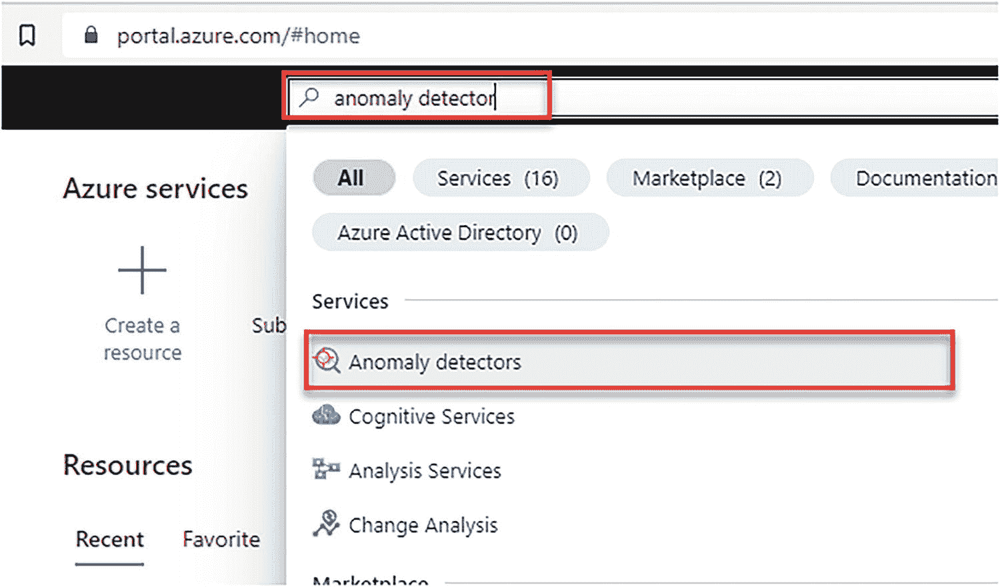
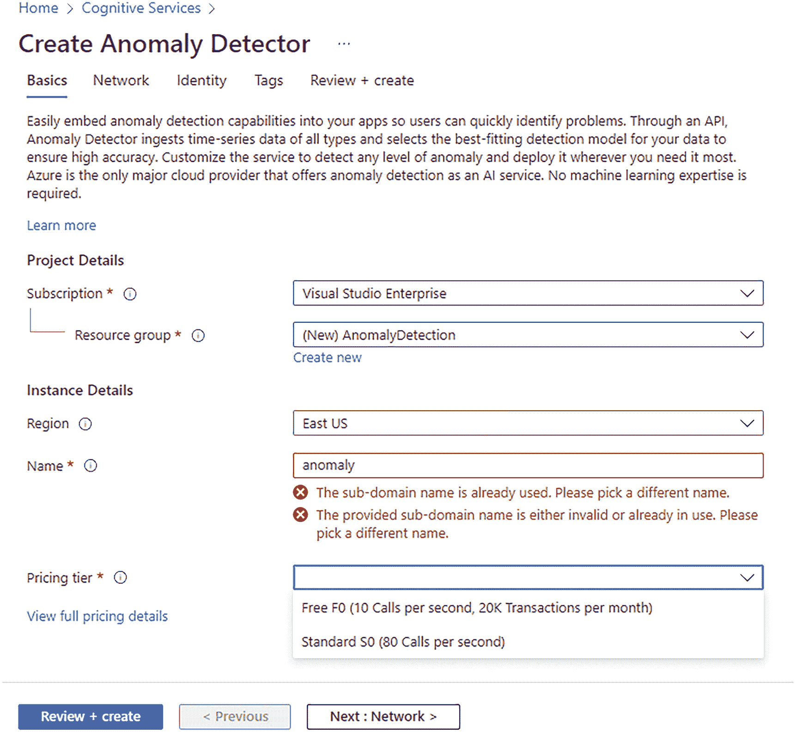
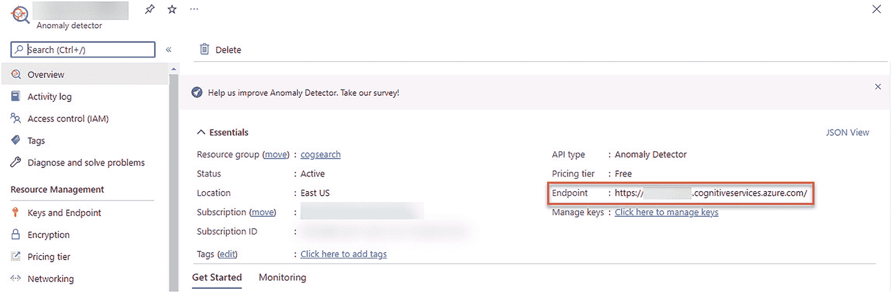
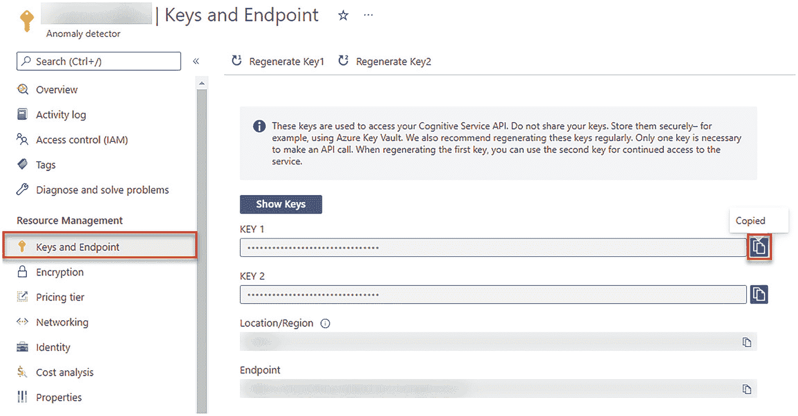
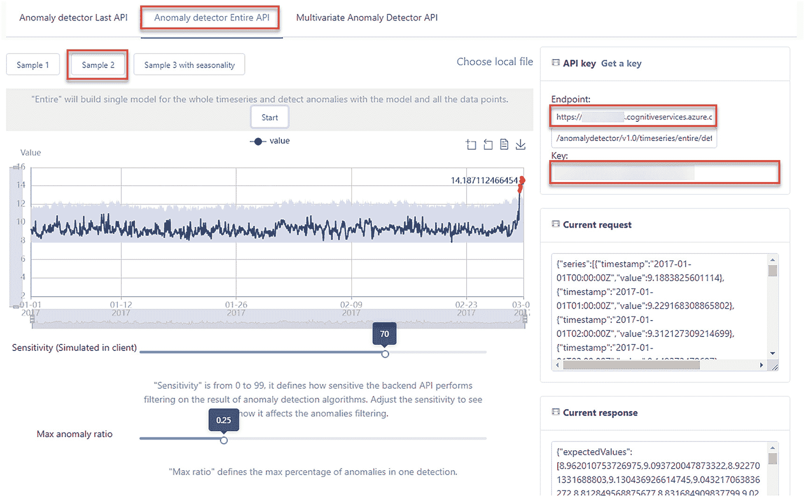
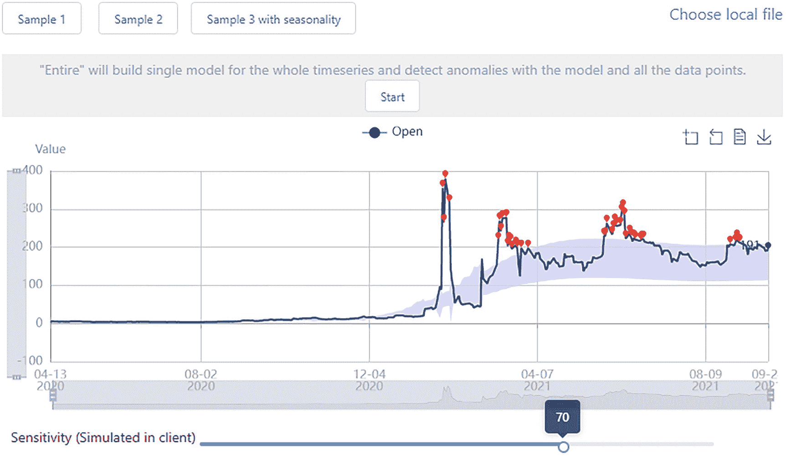
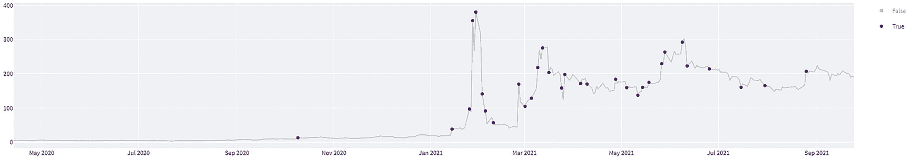

# 18. 配置 Azure 认知服务异常检测器

在过去的十几章中，我们创建了一个相当完整的异常值检测引擎。有了这个引擎，我们有必要将我们的成果与当今市场上一些最好的通用异常值检测引擎进行比较。在本章中，我们将回顾众多通用异常值检测选项中的一部分，重点关注云平台提供商。然后，我们将配置其中一个供我们自己使用：微软的 Azure 认知服务异常检测服务。

## 收集市场情报

目前有多种异常值检测引擎可供我们使用。在本节中，我们将快速回顾三大公共云提供商提供的选项。本节的一个重要因素是，我们只涵盖服务中明确的异常值检测功能。例如，我们将回顾的所有主要云托管提供商都包含通用机器学习功能，因此你可以在我们即将考察的任何云平台上编写和部署自己的异常值检测服务——包括我们在本书中构建的那个。相反，我们将重点关注它们预构建的异常值检测产品的功能。

### 亚马逊云服务：SageMaker

截至撰写本文时，亚马逊云服务（AWS）仍然是全球最大的公共云提供商。因此，首先考察其异常检测产品是合理的。这些产品被整合到其 SageMaker 服务中，该服务为数据科学家和开发人员提供完全托管的机器学习服务。SageMaker 为数据科学家提供了多种算法，使他们能够在 AWS 计算资源上高效地训练和评分模型，然后将这些模型部署供其他服务和应用程序使用。

SageMaker 中用于异常值检测的主要算法称为 `随机切割森林`（RCF），该算法与我们在第 9 章中提到的孤立森林概念有些相似。简单回顾一下，像孤立树这样的基于树的方法擅长指示某事物是否看起来像异常值，但不一定能提供可直接比较的分数。SageMaker 中的 RCF 通过提供异常分数（可用于比较）以及指示某事物是否为异常值的标签来缓解这一问题。

SageMaker 中 RCF 的主要用例是执行单序列时间序列异常值检测，特别是来自 Amazon Kinesis 数据流的流式数据。不过，它也可以处理非时间序列分析。截至撰写本文时，它尚未涵盖多序列时间序列场景。

### Microsoft Azure：认知服务

全球第二大公有云是 Microsoft Azure。Azure 提供了多种可供公众使用的机器学习服务，但其中最令我们感兴趣的是 `Azure 认知服务` 中的 `异常检测器` 服务。`Azure 认知服务` 是一组 API，提供涵盖语音、语言、视觉和决策等多个领域的预训练人工智能服务，其中决策领域就包含了它们的 `异常检测器` 服务。

微软的 `异常检测器` 服务专注于时间序列数据，这意味着它不处理任何类型的非序列数据，无论是单变量还是多变量。在时间序列分析领域，我们有两种选择。第一种是单变量时间序列，我们将其标记为单序列时间序列。与单变量时间序列分析相结合，`认知服务` 还提供了多变量时间序列分析，即多个数据序列的结合。重要的是，这与我们处理过的多序列时间序列分析并不完全相同。我们多序列时间序列分析的一个关键假设是，每个序列都描述了相同的潜在现象。相比之下，`认知服务` 中的多变量异常检测假设多个序列以共同的方式相互作用。为了阐明差异，我们以美国不同地区休闲服务的消费者价格指数变动为例。这帮助我们理解了共同的潜在现象：通货膨胀、服务供给变化以及服务需求变化。每个序列都是独立的，但我们期望每个序列都以与其他序列相似的方式变动，当某个序列的变动与其他序列不一致时，我们将其视为异常值。

与此同时，`认知服务` 中的多变量异常检测并不期望每个序列都以相同的方式变动，而是期望序列以相关的方式变动。与跨区域查看 CPI 不同，多变量异常检测更合适的用例是一组传感器提供关于工厂设备的信息，查看核心温度、油压、油粘度、油温和每分钟转数等各种因素，以确定该设备的健康状况。在正常情况下，某些指标会朝同一方向变动，但其他指标可能朝相反方向变动：当油温较低时，油压和油粘度的测量值较高，因此当我们的工厂设备发动机升温时，这些数值会下降。在这种情况下，`认知服务` 追踪的是值的组合是否超出正常范围，而不是某个序列是否超出所有序列的正常范围。

除了 `Azure 认知服务` 之外，`Azure 流分析` 还内置了使用两种技术对时间序列数据执行异常检测的能力。我们已经熟悉其中一种技术：变点检测。另一种技术则关注时间序列数据中的尖峰和低谷。这两种技术也可以在 `ML.NET` 库中脱离 `Azure 流分析` 使用。后两种服务超出了本书的范围，因此我们不会进一步详细讨论，而是将重点放在 `认知服务` 上。

### Google Cloud：AI 服务

第三大重要的云服务商是 Google Cloud。虽然其规模远不及 AWS 甚至 Azure，但它仍在公有云基础设施市场中占据了可观份额。Google 的异常检测产品通常是其他服务的特性，例如 `Google Analytics` 或 Google 的 API 管理解决方案 `Apigee`。即便如此，Google 的 `BigQuery ML` 也包含了检测时间序列和非序列异常的能力。对于非序列数据，`BigQuery ML` 有两种选择。第一种是 K-means 聚类模型，它将距离任何聚类中心足够远的点识别为异常值。另一种方法涉及自编码器，它构建一个模型并比较预测值与实际值之间的距离。如果该距离足够大，则该点成为异常值。

对于时间序列数据，`BigQuery ML` 支持一种 ARIMA 的变体，他们称之为 `ARIMA_PLUS`。该时间序列模型利用 ARIMA 的能力来分解季节性和趋势，并处理时间序列数据中的节假日。与非序列数据集类似，该技术构建一个模型，并将与模型预期结果距离足够远的点描述为异常值。

现在我们已经了解了三大主要公有云服务商，让我们聚焦于其中一个解决方案：`Azure 认知服务` 及其 `异常检测器` 服务。

## 配置 Azure 认知服务

在本节中，我们将逐步介绍配置 `Azure 认知服务` 并使用其 `异常检测器` 服务的过程。到本章结束时，我们将准备好所有必要的组件，以便将我们的异常检测引擎与 `认知服务` 中的引擎进行比较。

### 设置账户

`Azure Cognitive Services` 需要一个 Microsoft Azure 订阅。如果你还没有 Azure 订阅，可以在 [`https://azure.microsoft.com/free/`](https://azure.microsoft.com/free/) 注册一个免费的一个月试用期，并获得 200 美元额度的一个月分配。请注意，免费订阅需要提供有效的电子邮件地址和信用卡号。试用期结束后，你可以保留对某些 Azure 服务的免费访问权限，包括 `Azure Cognitive Services Anomaly Detector`。免费的 `F0` 定价层允许你访问单变量时间序列异常检测，并且每月可进行 20,000 次交易。另一个可用的定价层是 `S0`，它允许你进行无限次数的单变量时间序列异常检测调用，费用为每 1000 次交易 0.314 美元（截至撰写本文时——Azure 定价可能会随时间变化）。`S0` 层还允许你访问多变量时间序列异常检测的公开预览版。公开预览版中的 Azure 服务通常是免费访问的，多变量时间序列异常检测也不例外。一旦该功能正式发布，微软将公布定价详情，但截至撰写本文时，具体的成本细节尚未公开。

拥有 Azure 订阅后，请导航至 Azure 门户 [`https://portal.azure.com`](https://portal.azure.com)。在 Azure 搜索栏中输入“anomaly detector”，然后从结果列表中选择 *Anomaly detectors* 条目，如图 18-1 所示。

一张桌面截图，突出显示了搜索栏中的异常检测器以及下方 Azure 服务选项列表中的异常检测器。

图 18-1

从 Azure 服务列表中选择“Anomaly detectors”

接下来，选择 *+ Create* 选项以创建新服务。选择你想要用于托管 `Cognitive Services Anomaly Detector` 服务实例的 Azure 订阅和资源组。你还需要选择一个区域并为你的服务命名。图 18-2 显示了服务创建界面的示例，包括两个定价层的细分，以及如果你尝试使用已被他人占用的名称时会收到的错误消息示例。所有 `Anomaly Detector` 服务名称必须是全局唯一的，因此你需要输入一个唯一的名称。

一张创建异常检测器页面的桌面截图。实例详细信息部分中的名称输入框被高亮显示，因为输入的名称“anomaly”已被使用，并且输入框下方有两个警告错误。

图 18-2

创建 `Anomaly Detector` 服务。名称必须是全局唯一的，因此请选择“anomaly”以外的名称

# Azure 认知服务异常检测配置与使用

填写完表单的第一页后，你可以选择 `Review + create` 来完成服务的创建。创建表单上的其他选项卡允许你控制服务的基础设施细节，例如将访问权限限制为仅限指定的 Azure 虚拟网络，或为服务提供访问某些其他 Azure 资源的权限。为了将我们的异常检测服务与此服务进行比较，我们将保持网络部分不变，这意味着该服务不限于特定的 IP 地址或仅限 Azure 网络上的机器。即便如此，你的服务也不会向更广泛的世界开放以供滥用，我们稍后会看到这一点。

创建服务后，从认知服务网格中选择它。如果你在查找服务时遇到困难，请在 Azure 搜索栏中再次搜索“anomaly detector”，你应该能够找到它。在你的服务的 `Overview` 选项卡上，你应该能够看到端点，这是访问你的异常检测器服务的 URL。复制此 URL 并将其保存在方便的地方，因为你稍后会用到它。图 18-3 显示了在哪里可以找到此端点信息。

一张异常检测器页面的桌面截图。左上角的搜索栏和右侧的端点 URL 被高亮显示。
图 18-3

复制你在 `Overview` 选项卡上看到的端点 URL

除了端点 URL，我们还需要一个 API 密钥。你可以在 `Keys and Endpoint` 选项卡中找到你的 API 密钥，如图 18-4 所示。为了防止未经授权的服务使用（和费用支出），访问异常检测器服务需要 API 密钥。认知服务会为你生成两个密钥，允许你在不中断服务的情况下轮换密钥。现在，将两个密钥中的一个复制到你保存端点 URL 的同一位置。

一张密钥和端点页面的桌面截图。左侧的密钥和端点选项以及右侧的密钥 1，已复制选项被高亮显示。
图 18-4

有两个 API 密钥可供使用

有了端点和 API 密钥，我们就有了足够的细节来尝试微软的异常检测演示应用程序。

## 使用演示应用程序

微软提供了一个异常检测器演示应用程序，供用户评估其服务。你可以通过 [`https://algoevaluation.azurewebsites.net`](https://algoevaluation.azurewebsites.net) 访问该网站。此服务要求你在右侧的输入框中输入端点（endpoint）和 API 密钥。然后，你可以选择本地文件或尝试其预注册的示例之一。图 18-5 展示了该服务运行的一个示例。在屏幕顶部，我们看到三个 API 使用选项：`Last API`、`Entire API` 和 `Multivariate API`。`Last API` 选项对数据窗口执行异常值检测，而 `Entire API` 则一次性查看整个数据流。在此案例中，我们查看的是 `Entire API` 选项卡和样本 2。Azure 认知服务包含两个输入参数：`sensitivity` 和 `max anomaly ratio`，它们分别对应于我们的敏感度分数和最大异常比例。

一张异常检测器 Entire API 的桌面截图。左侧突出显示了样本 2 选项，右侧突出显示了端点 URL 和密钥。
**图 18-5** 使用 Azure 认知服务进行单变量时间序列异常检测的示例

除了可用的样本数据集外，我们还可以上传小文件并对数据执行异常值检测。在本书配套代码仓库的 `/data/` 文件夹中，有一个 `GME.csv` 文件，其中包含我们在第 14 章中使用过的 GameStop Corp 的部分股票价格数据。Azure 认知服务异常检测器可以读取此 CSV 数据，解析日期和开盘价（文件中日期之后的第一个特征），并对该数据集执行异常值检测。查看图 18-6，我们可以看到认知服务使用基于模型的方法进行异常值检测，当数据点超出预测边界时，会将其标记为异常值。

一张包含季节性特征的样本 1、2 和 3 的桌面截图。下方的折线图呈现上升趋势，并配有敏感度标尺。
**图 18-6** 回顾 GameStop Corp (`GME`) 股票从 2020 年 4 月到 2021 年 9 月的开盘价。图中的阴影区域代表模型对收盘价的预期。`GME` 股票价格波动性的增加在模型的预期中显而易见

这与我们的异常检测引擎形成对比，我们的引擎侧重于变化点，而非偏离常态的单个值。图 18-7 展示了使用 `GME_array.csv` 文件中相同的 `GME` 开盘价数据时，我们的异常检测引擎得到的结果。

一张折线图。线条大致从（2020 年 5 月，0）开始，上升，在（2021 年 2 月，380）处达到峰值，并在（2021 年 10 月，200）处结束。数值为估算值。
**图 18-7** 我们的异常检测引擎侧重于变化点，而非超出预期模型的值，因此它得到的结果集与认知服务不同

我们将把对这两个引擎的进一步分析留到下一章。

## 结论

在本章中，我们研究了三大主流云服务提供商提供的异常检测服务。在此基础上，我们学习了如何配置 Azure 认知服务异常检测器，并使用一个网站来试用该服务，通过比较一个真实数据集，理解了不同服务如何对异常值的定义产生差异。

在下一章中，我们将深入探讨使用 Azure 与我们的异常检测服务进行单序列时间序列异常检测的比较，从而更好地了解我们的服务表现如何。