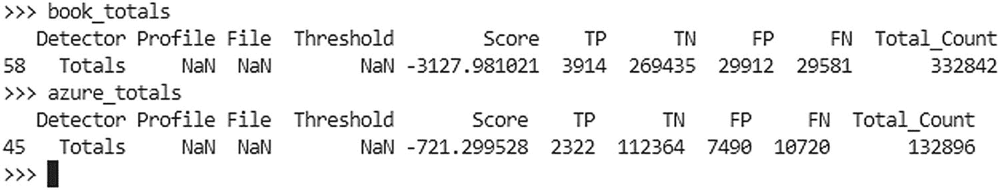

# 19. 进行性能对比

在本书的最后一章中，我们将把我们的异常检测器服务与 Azure 认知服务异常检测器服务进行比较。重要的是，本章的目的并非要最终证明哪个更好；而是提供一个机会，看看两种服务如何相互比较，并检验我们的服务是否能够与商业化的选项竞争。我们将首先列出比较的参数。然后，我们将进行性能对比，比较两种服务如何处理相同的数据集。最后，我们将就如何改进我们的异常检测引擎提出一些想法。

## 准备比较

在编写代码比较 Azure 认知服务异常检测器服务与我们的服务之前，我们希望尽可能进行合理的比较。这意味着我们要找到适合比较的数据集，同时要知道认知服务异常检测器不处理非时间序列数据。此外，在数据方面，有一个重要问题需要提出：我们是针对有监督还是无监督的比较集？

### 有监督学习 vs. 无监督学习

*有监督学习*意味着我们的训练数据不仅包含我们希望输入模型进行预测的信息，还包含代表正确值的*标签*。相比之下，*无监督学习*发生在只有输入而没有正确输出的情况下。在异常检测方面，我们通常解决的是一个无监督学习问题：人类通常没有时间、意愿或能力将序列中的每个数据点分类为异常或非异常。因此，我们通常没有足够的信息来确认我们的引擎发现的异常值究竟是真正的异常还是仅仅是噪声——这种判断最终需要由我们的调用者根据他们的技能和经验来做出。让一个人充当特定数据点是否异常的仲裁者的缺点是，与事先定义正确答案相比，这会在判断中引入偏差。换句话说，如果我们在执行异常检测之前碰巧有预定义的标签，我们就消除了因特定引擎将特定数据点选为异常值或正常值而导致评判者偏向某一方的偏差。即便如此，我们仍应理解，在标记过程中可能存在一定程度的偏差。这种偏差并非源于希望某个特定引擎表现更好的愿望，但仍可能存在于某人做出的选择中。例如，如果我将一篇新闻文章归类为体育类或财经类，我的分类行为本身就带有一定程度的偏差。如果文章是关于一支棒球队昨晚在加时赛中击败对手，这种偏差可能不会显现；如果文章是关于两家零售公司的合并，偏差也不会显现。然而，如果文章是关于一支棒球队的老板与市政府就新体育场租约进行谈判，偏差就可能显现出来。当选择存在一定程度的模糊性时，我的个人偏好和内置的决策机制可能会改变分类结果，决定它属于体育类（因为与体育特许经营权有关）还是财经类（因为与公共收入和财务谈判有关）。简而言之，完全避免偏差是不可能的，但我们至少可以利用带标签的比较数据来最小化根据我们偏好的引擎而非其他标准来评判结果的风险。因此，我们将重点使用带有异常点标签的数据集。两个引擎都不会看到任何数据点是如何被标记的，但我们将使用这些标签来帮助我们评分结果。


### 选择数据集

认知服务异常检测器处理的是时间序列数据，因此我们需要将范围限定于带标签的时间序列数据集。幸运的是，Numenta 异常检测基准（NAB）提供了多种带标签的单变量时间序列数据集供我们使用。您可以通过 [`https://github.com/numenta/NAB`](https://github.com/numenta/NAB) 访问 NAB，查看各类数据集以及其他检测引擎的评分。可用的数据源包括人工数据集、股票价格、网络流量数据以及亚马逊云服务内部指标。对我们而言最重要的是，这些数据的形态既要符合我们自己的异常检测引擎需求，也要符合认知服务的要求：一个特征用于时间，一个特征用于数值。

### 评分结果

我们需要考虑的最后一个问题是如何对结果进行评分。每个被比较的数据点都有四种可能的结果。第一种是异常检测引擎判定某个数据点为离群点，且它确实是异常点。我们可以称之为*真正例*。第二种结果是异常检测引擎判定某个数据点不是离群点，且它确实不是异常点，即*真负例*。我们可以将这两种情况赋予相同权重，表明正确回答的价值始终相等。或者，我们也可以对异常点的正确预测赋予比非异常点更高的权重。这样做有两个原因：首先，根据定义，异常点发生的概率低于非异常点；其次，我们对异常点的关注度远高于非异常点。基于这些原因，我们将对这两种结果区别对待：正确预测异常点得+3 分，正确预测非异常点得 0 分。

另外两种可能的结果是负面结果。第一种是我们判定某个数据点为离群点，但结果它并非异常点。这也被称为*假正例*，长期来看会使我们的异常检测引擎产生噪声。噪声引擎的弊端在于，当引擎声称某数据点是离群点时，人们会下意识地将离群点指示与实际异常区分开，从而降低对引擎的信任度。最后一种结果是我们判定某个数据点不是离群点，但结果它却是异常点。这也被称为*假负例*，可能引发虚假的安全感，让人们以为一切正常，而实际上存在问题。与正面结果类似，我们可以对这两种负面结果赋予相同权重，但我们不会这样做。相反，我们将假负例的权重设为-5，因为我们希望避免这种情况。而假正例的得分为-1，表明它们是负面结果，但严重程度低于假负例。换句话说，我们更关心异常检测引擎能否找出所有实际异常点，即使这意味着它会在某些非异常点上触发警报。

总结本节内容如下：

*   真正例异常 = +3
*   真负例异常 = 0
*   假正例异常 = -1
*   假负例异常 = -5

**注意**

我们选择的这些具体评分值具有一定的主观性，并非最佳或唯一的评分方式。我是在审阅任何数据集或通过任一异常检测引擎运行任何数据集之前就选定了这些数值。本练习的目的是在进行数据分析之前记录我的信念和偏好。您的情况（包括每种结果的相对权重）可能大不相同；即便如此，您仍然可以在定义自己的评分标准时沿用这里的基本概念。

现在我们已经了解了评分规则，接下来进行一些比较。

## 执行对比测试

在本节中，我们将创建一个简单的 Python 脚本来调用每个服务。该脚本位于源代码仓库的 `src\comp\` 文件夹中，名为 `compare_engines.py`。清单 19-1 展示了我们将用于处理我们引擎以及认知服务异常检测器结果的 `main()` 函数。此脚本的主要目标是读取一组符合已知格式的文件，处理每个文件，并以规定方式将文件写入相应的结果目录。`data_folder` 和 `results_folder` 变量分别代表数据集的位置以及我们应写入结果的位置。如果您想跟着操作，请克隆位于 [`https://github.com/numenta/NAB/`](https://github.com/numenta/NAB/) 的 NAB Git 仓库，并将这些变量更改为适合您环境的正确值。

```
def main():
data_folder = "D:\\SourceCode\\NAB\\data\\"
results_folder = "D:\\SourceCode\\NAB\\results\\"
process_azure(data_folder, results_folder)
process_book(data_folder, results_folder)
清单 19-1
驱动输出文件生成的主函数
```


### 通过 Python 访问认知服务

Azure 认知服务提供了适用于 Python 的异常检测器库，你可以使用命令 `pip install azure-ai-anomalydetector` 进行安装。你还需要创建两个环境变量，一个名为 `ANOMALY_DETECTOR_KEY`，另一个名为 `ANOMALY_DETECTOR_ENDPOINT`。这些变量的值应与你在第 18 章中用于连接 Azure 认知服务异常检测器演示网站的值相同。

> **注意**  
> 鉴于我们在本节中将处理大量数据集和数据点，你可能无法在 Azure 认知服务异常检测器的 F0 层上运行以下代码。在进行分析时，我已经有一个可用的 S0 层服务并使用了它，因此我无法确认以下代码是否也能在免费层上运行。

完成所有设置后，我们将调用几个函数来处理文件。第一个是 `process_azure()`，我们可以在代码清单 19-2 中看到它。这是我们流程的控制方法。创建异常检测器客户端后，该函数会遍历数据目录中的每个 CSV 文件。对于每个文件，我们需要知道三件事：其绝对路径（`input_file`）、相对于基础数据目录的路径（`file_location`）以及文件名（`file_name`）。

```python
def process_azure(data_folder, results_folder):
    ANOMALY_DETECTOR_KEY = os.environ["ANOMALY_DETECTOR_KEY"]
    ANOMALY_DETECTOR_ENDPOINT = os.environ["ANOMALY_DETECTOR_ENDPOINT"]
    client = AnomalyDetectorClient(AzureKeyCredential(ANOMALY_DETECTOR_KEY), ANOMALY_DETECTOR_ENDPOINT)
    for input_file in glob.iglob(data_folder + '**\\*.csv', recursive=True):
        file_location = input_file.replace(data_folder, "")
        file_name = Path(input_file).name
        df = read_file_azure(input_file)
        try:
            response = detect_outliers_azure(client, df)
            df['is_anomaly'] = [v for i,v in enumerate(response.is_anomaly)]
            df['anomaly_score'] = 1.0 * df['is_anomaly']
            df['label'] = 1 * df['is_anomaly']
            df = df.drop('is_anomaly', axis=1)
            output_file = results_folder + "azure\\" + file_location.replace(file_name, "azure_" + file_name)
            write_file_azure(df, output_file)
            print('Completed file ' + file_name)
        except Exception as e:
            print('Skipping this file because Cognitive Services failed to return a result. {}'.format(file_location), 'Exception: {}'.format(e))
```
*代码清单 19-2 — 通过 Azure 认知服务异常检测器处理数据集的函数*

有了路径信息后，我们尝试将文件读取到 Pandas DataFrame 中。代码清单 19-3 展示了 `read_file_azure()` 函数的代码。

```python
def read_file_azure(input_file):
    input_df = pd.read_csv(input_file)
    input_df['timestamp'] = pd.to_datetime(input_df['timestamp'])
    return input_df
```
*代码清单 19-3 — 将文件读取到 DataFrame 中*

一旦我们有了 DataFrame，就会调用 `detect_outliers_azure()` 函数，该函数负责整理数据并调用异常检测器服务。代码清单 19-4 展示了 `detect_outliers_azure()` 函数的内容。我们将敏感度设置为 55，最大异常率设置为 0.25。然后，我们需要处理 DataFrame 中的每一行，并将每个元素转换为异常检测器服务的 `TimeSeriesPoint()`，其中包含特定格式的时间戳和值。我们将调用 `DetectRequest()` 函数来发起请求，并返回 `detect_entire_series()` 的结果。

```python
def detect_outliers_azure(client, df):
    sensitivity = 55
    max_anomaly_ratio = 0.25
    series = []
    for index, row in df.iterrows():
        series.append(TimeSeriesPoint(timestamp = dt.datetime.strftime(row[0], '%Y-%m-%dT%H:%M:%SZ'), value = row[1]))
    request = DetectRequest(series=series, custom_interval=5, sensitivity=sensitivity, max_anomaly_ratio=max_anomaly_ratio)
    return client.detect_entire_series(request)
```
*代码清单 19-4 — 在 Python 中调用异常检测器服务*

> **注意**  
> Azure 认知服务异常检测器服务不会处理单个序列中超过 8640 个数据点。为简化比较，我们将忽略包含超过 8640 个数据点的文件。

假设异常检测调用成功，我们将返回到代码清单 19-2 中的 `process_azure()` 函数，并剥离 `is_anomaly` 值（该值为布尔值 `True` 或 `False`），然后将其附加到我们的 DataFrame 中。接着，我们按照所需格式整理输出数据集：包含时间戳、值、异常分数（0 到 1 之间的浮点数）、标签（0 或 1，其中 1 表示异常值），不包含其他内容。一旦 DataFrame 格式符合要求，我们调用 `write_file_azure()` 函数，将文件写入结果目录。代码清单 19-5 展示了写入文件的代码，确保在尝试写入文件之前所有目录都已存在。同时，我们确保不写入索引，因为我们不需要它。

```python
def write_file_azure(df, output_file):
    output_filepath = Path(output_file)
    output_filepath.parent.mkdir(parents=True, exist_ok=True)
    df.to_csv(output_file, index=False)
```
*代码清单 19-5 — 将文件写入磁盘*


### 通过 Python 访问我们的 API

使用我们的异常检测引擎处理数据的技术非常相似，因为我们拥有一组相同的处理函数，只是它们的行为会略有不同。我们从清单 19-6 开始，其中展示了 `process_book()` 函数。该函数设置了我们的服务器 URL 和方法，并选取了与 Azure 相同的敏感度分数和最大异常比例。我们还设置了调试标志为 `True`，以便能够获取判定异常值的临界点。

```
def process_book(data_folder, results_folder):
server_url = "http://localhost/detect"
method = "timeseries/single"
sensitivity_score = 55
max_fraction_anomalies = 0.25
debug = True
for input_file in glob.iglob(data_folder + '**\\*.csv', recursive=True):
file_location = input_file.replace(data_folder, "")
file_name = Path(input_file).name
input_data = read_file_book(input_file)
df = detect_outliers_book(server_url, method, sensitivity_score, max_fraction_anomalies, debug, input_data)
output_file = results_folder + "book\\" + file_location.replace(file_name, "book_" + file_name)
write_file_book(df, output_file)
print('Completed file ' + file_name)
清单 19-6
使用我们的异常检测引擎处理数据文件的函数
```

对于数据文件夹中的每个文件，我们调用 `read_file_book()` 来返回一个合适的 DataFrame。清单 19-7 包含了该函数的代码。该函数与我们之前看到的 `read_file_azure()` 函数类似，但它添加了一个 `key` 列，并确保我们有一个类型为 datetime 的 `dt` 列。

```
def read_file_book(input_file):
input_df = pd.read_csv(input_file)
input_df['key'] = input_df.index
input_df['dt'] = pd.to_datetime(input_df['timestamp'])
return input_df
清单 19-7
将文件内容读取到 DataFrame 中。
```

获取输入 DataFrame 后，我们将其传递给 `detect_outliers_book()` 函数，该函数负责大部分繁重的工作。清单 19-8 包含了该函数的代码。

```
def detect_outliers_book(server_url, method, sensitivity_score, max_fraction_anomalies, debug, input_df):
input_data_set = input_df[['key', 'dt', 'value']].to_json(orient='records', date_format='iso')
full_server_url = f"{server_url}/{method}?sensitivity_score={sensitivity_score}&max_fraction_anomalies={max_fraction_anomalies}&debug={debug}"
r = requests.post(
full_server_url,
data=input_data_set,
headers={"Content-Type": "application/json"}
)
res = json.loads(r.content)
cutoff = res['debug_details']['Outlier determination']['Sensitivity score']
df = pd.DataFrame(res['anomalies'])
df = df.drop('key', axis=1)
df['anomaly_score'] = 0.5 * df['anomaly_score'] / cutoff
#### 如果异常分数大于 1，则将其设置为 1.0。
df.loc[df['anomaly_score'] > 1.0, 'anomaly_score'] = 1.0
df['label'] = 1 * df['is_anomaly']
df = df.drop('dt', axis=1)
return df
清单 19-8
为单序列时间序列数据调用异常检测引擎，并整理结果以供打印。
```

该函数首先使用 `requests` 库调用我们的异常检测 API。我们将 JSON 结果加载到 `res` 中，然后提取敏感度分数，以查看判定给定数据点是否为异常值的临界点。利用这些信息，我们构建一个粗略的异常分数计算，将临界点归一化为 0.5，如果实际值至少是临界分数的两倍，则范围可达到 1.0。最后，我们删除不需要的列并返回输出的 DataFrame。回到 `process_book()` 函数，我们获取输出的 DataFrame 并调用 `write_path_book()`，将结果写入磁盘，如清单 19-9 所示。

```
def write_file_book(df, output_file):
output_filepath = Path(output_file)
output_filepath.parent.mkdir(parents=True, exist_ok=True)
df.to_csv(output_file, index=False)
清单 19-9
将每个评分后的数据集写入磁盘的相应目录中
```

现在，两个异常检测引擎的所有文件都已就绪，我们可以生成对比结果了。


### 数据集比较

要进行比较，我们需要完成三件事。第一件事是修改 NAB 仓库中的 `config\thresholds.json` 文件。这是一个包含每个测试信息的 JSON 文件。清单 19-10 提供了使 NAB 能够分析两个异常检测引擎所需的 JSON 代码。这些代码无需按字母顺序排列，只需出现在文件中即可。同时，务必将阈值保持在 0.5，因为 NAB 需要知道非异常值与异常值之间的分界点。

```
"azure": {
"reward_low_FN_rate": {
"score": -146.0,
"threshold": 0.5
},
"reward_low_FP_rate": {
"score": -73.0,
"threshold": 0.5
},
"standard": {
"score": -73.0,
"threshold": 0.5
}
},
"book": {
"reward_low_FN_rate": {
"score": -232.0,
"threshold": 0.5
},
"reward_low_FP_rate": {
"score": -116.0,
"threshold": 0.5
},
"standard": {
"score": -116.0,
"threshold": 0.5
}
},
清单 19-10
将这些 JSON 块添加到你的 thresholds.json 文件中。
```

第二件事是修改 NAB 项目中的 `requirements.txt` 文件。该项目发布于 2015 年，这意味着其依赖的软件包版本已有七年或更久的历史。删除所有软件包的具体版本号，只保留包名（例如 `Cython`、`pandas` 和 `simplejson`），这样我们想要使用的 NAB 部分应该仍能在当前版本的 Python 上运行。

之后，清单 19-11 展示了如何运行每个评分命令。这些是命令行操作，应在 NAB 仓库的根目录中执行。

```
python run.py -d book --score --normalize
python run.py -d azure --score --normalize
清单 19-11
对每个异常检测引擎的结果进行评分和归一化。请在 NAB 仓库中运行此命令，而不是在 finding-ghosts-in-your-data 仓库中。
```

这将审查每个结果文件，将检测引擎与实际的异常市场数据点进行比较，并为每个文件生成一组输出，包括真阳性、真阴性、假阳性和假阴性的计数。如果你不想自己运行所有内容，`comp\NAB\results` 文件夹中包含了两个引擎的评分详情。清单 19-12 展示了如何将这些数据加载到 Python 中进行进一步分析。

```
import pandas as pd
book_df = pd.read_csv("book_standard_scores.csv")
azure_df = pd.read_csv("azure_standard_scores.csv")
book_totals = book_df[book_df['Detector'] == "Totals"]
azure_totals = azure_df[azure_df['Detector'] == "Totals"]
清单 19-12
针对 NAB 数据集，汇总两个异常检测服务的结果。请在 finding-ghosts-in-your-data 仓库的 comp\NAB\results\ 目录下运行此命令。
```

图 19-1 展示了我们的异常检测引擎与 Azure 认知服务异常检测器引擎的这些计数对比。



驱动输出文件生成的主函数算法。

图 19-1

审查两个检测引擎的结果

我们可以看到，我们的引擎处理的数据点数量大约是 Azure 引擎的 2.5 倍。原因在于，当向认知服务引擎发出请求时，我们忽略了任何包含超过 8640 个数据点的文件。使用我们的公式（真阳性计 3 分，假阳性扣 1 分，假阴性扣 5 分），我们的引擎每个数据点平均得分为 -0.499。认知服务每个数据点总得分为 -0.407，因此认知服务在此处是更好的选择。如果仅限使用认知服务处理过的文件，我们的得分略有改善，达到每个数据点 -0.484，但仍然不如替代方案。

### 经验教训

将我们的异常检测引擎与付费产品进行比较的机会非常宝贵。我们能够针对人工和真实时间序列数据集的组合进行比较，并且知道我们的引擎从未见过这些数据，因此我们无法作弊以获得更美观的解决方案。回到我们的单序列时间序列解决方案，我们专注于将变化点检测用于异常值检测。这为我们提供了一些推测性的见解，解释了为什么我们的引擎在此测试中表现不佳，因为我们有意设计用于检测趋势变化，而非单个异常数据点。重新审视我们当前的引擎，通过引入其他技术（例如 ARIMA 风格的建模技术或 SAX）到我们的单序列时间序列检测器中，我们有可能显著提升性能。

另一点需要牢记的是，尽管我们的表现不如认知服务，但差距并不巨大。这是一个积极的信号，表明改进我们的异常检测引擎是有价值的，这也是下一节的重点。

## 打造更好的异常检测器

在本书的整个过程中，我们采取了一种有目的性的方法来构建异常检测引擎。我们始终遵循的最重要的原则是确保用户无需对其数据的分布有任何系统性了解，包括数据是否遵循特定的统计分布、可能有多少个（如果有的话）异常值，以及针对其输入数据，各种统计函数的正确分界点是什么。这对我们的方法至关重要，我甚至不认为它是一种限制；相反，它是我们构建的引擎的指导原则。话虽如此，为了提升整体产品质量，我们可以放宽一些限制，并实施一些技术。

### 增强鲁棒性

在开发过程中，我们引入了一些限制，其目的是简化代码并使其更易于理解。这种简化是以牺牲引擎的鲁棒性为代价的。例如，在处理多序列时间序列数据时，我们假设所有序列具有完全相同的时间戳和采集间隔。这个假设并非糟糕透顶，但它确实降低了我们解决方案的鲁棒性，并且如果一个序列具有不同的采集间隔，就会引入问题。一个解决方案可能是构建一个流程，为每个序列合成一个共同的采集间隔。其思路是想象每个数据点出现在时间线上，并在每个序列的数据点之间进行线性插值。然后，我们在每个序列的相同位置切割时间线，并找到每个切割点的合成值。

另一种增强系统鲁棒性的方法是处理不良数据，例如单个数据点具有无效值的情况。目前，检测引擎要求所有数据点的值都是有效的浮点数。然而，有时不良数据会混入：`NULL` 或 `NA` 表示缺失数据，`X` 等字符表示无效样本，或者其他出现在真实世界数据集中的错误。处理不良数据所需的具体技术取决于你公司的具体情况和用例。你可以在运行任何异常值检测测试之前，删除无效行、对结果进行插值（尤其对于时间序列数据）、删除非数字字符，或以其他方式转换数据。


### 扩展集成模型

改进异常检测引擎的下一步是扩展每个集成模型。在本章中，我们仅研究了单序列时间序列分析，这是唯一一个我们没有为其创建显式集成模型的机制。集成模型是一种在不确定性下做出合理推测的绝佳技术，尤其是当集成模型基于不同假设并执行不同统计运算时。正如我们在第 6 章所学到的，精心选择的集成模型能让我们从多个中等有效的测试中最大化收益。此外，对于我们实现的每一类异常检测技术，都有大量我们未纳入集成模型的统计技术和方法。回顾这些其他技术并将其整合进来——无论是单纯添加，还是替换掉某些现有技术——都可能带来整体上更好的结果。

### 训练参数值

改进异常检测引擎的最终方法是更明智地选择各个参数值，例如`COF`、`LOCI`和`SAX`等技术的截断点。做出更明智选择的难点在于，这需要满足以下两个条件之一：要么你的用户足够了解他们的数据，能够提供相关输入；要么你足够了解用户的数据，能够定义相关输入。前者与我们项目的理念相悖，而后者虽然相当困难，但却是可行的。困难的原因在于我们假设这是一个通用型异常检测服务，这意味着我们可以从任何源系统获取数据，并尽最大努力进行处理。然而，如果你对用户将提交的数据集有较好的了解，就可以利用这一知识。例如，假设你拥有标注了异常的公司数据，类似于本章中使用的 NAB 数据集。有了这些标注数据，你可以将本书中硬编码的各种参数视为*超参数*，即在训练模型之前设定其值的参数。你还需要一个评分函数，可以是本章中使用的那个。有了这两者，你就可以找到一组最适合你训练引擎所用数据集的截断点。这里的风险在于，你假设未来数据集在最优截断点方面会遵循旧数据集的规律，但只要这个假设成立，你最终获得的结果就可能显著优于一个需要满足所有可能数据集、且事先对数据一无所知的通用引擎。

## 结论

在本章中，我们了解了我们的异常检测引擎与 Azure 认知服务异常检测器中的商用引擎在一系列人工和真实数据集上的对比情况。虽然商用产品确实胜过了我们的解决方案，但差距并不大。此外，我们还获得了一些关于如何改进引擎的见解。在本章结尾，我们提出了几个关于如何提升引擎质量以及改善用户服务体验的想法。


