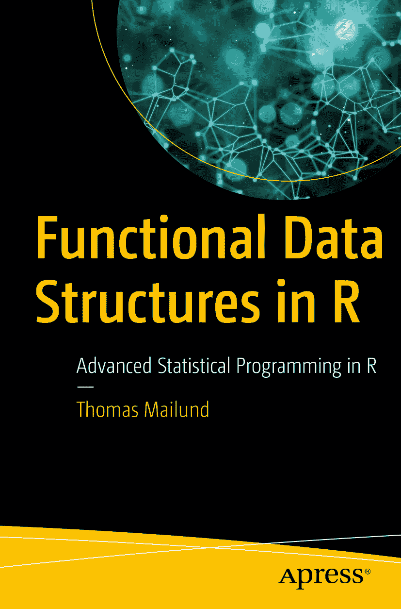

# R 语言函数式数据结构

R 语言高级统计编程

作者在本书中引用的任何源代码或其他补充材料，读者均可通过 GitHub 在本书的产品页面（位于 [www.apress.com/9781484231432](http://www.apress.com/9781484231432)）上获取。如需了解更多详细信息，请访问 [www.apress.com/source-code](http://www.apress.com/source-code)。

ISBN 978-1-4842-3143-2 e-ISBN 978-1-4842-3144-9  
[`doi.org/10.1007/978-1-4842-3144-9`](https://doi.org/10.1007/978-1-4842-3144-9)

美国国会图书馆控制号：2017960831

© 托马斯·梅隆德 2017

本作品受版权保护。出版商保留所有权利，包括全部或部分材料的翻译、重印、插图复用、朗诵、广播、微缩胶片或其他任何物理形式的复制、传输或信息存储与检索、电子改编、计算机软件，或采用目前已知或未来开发的任何相似或不同方法的权利。

本书中可能出现商标名称、标识和图像。对于每个出现的商标名称、标识或图像，我们不使用商标符号，而仅以编辑方式使用这些名称、标识和图像，并旨在维护商标所有者的权益，绝无侵犯商标权之意。

本出版物中对商品名称、商标、服务标志及类似术语的使用（即使未明确标识）不应被视为关于其是否受专有权保护的表达。

尽管本书中的建议和信息在出版时被认为是真实准确的，但作者、编辑及出版商对可能出现的任何错误或遗漏不承担法律责任。出版商对本书所含内容不作任何明示或暗示的担保。

本书采用无酸纸印刷。

全球图书贸易由 Springer Science+Business Media New York 发行，地址：233 Spring Street, 6th Floor, New York, NY 10013。电话：1-800-SPRINGER，传真：(201) 348-4505，电子邮件：`orders-ny@springer-sbm.com`，或访问 [www.springeronline.com](http://www.springeronline.com)。Apress Media, LLC 是一家加州有限责任公司，其唯一成员（所有者）是 Springer Science + Business Media Finance Inc (SSBM Finance Inc)。SSBM Finance Inc 是一家特拉华州公司。

## 引言

本书介绍了*函数式数据结构*。许多传统数据结构依赖于结构可变性。我们可以更新搜索树、更改链表中的链接、重新排列向量中的值。在函数式语言中，并且一般来说在 `R` 编程语言中，数据是不可变的。你无法更改现有数据。那些用于修改数据结构、为算法编程提供高效构建模块的技术无法使用。

对此有一些变通方法。`R` 并非纯函数式语言，我们可以通过修改环境来改变变量-值的绑定。我们可以利用这一点来模拟指针，并以此实现传统数据结构；或者，我们可以放弃纯 `R` 编程，用 `C`/`C++` 实现数据结构，并编写一些包装代码，以便在 `R` 程序中使用它们。这两种解决方案都允许我们使用传统数据结构，但前者会生成非常非传统的 `R` 代码，而后者对于不熟悉 `R` 以外语言的人来说则毫无用处。

不过，好消息是，如果我们愿意放弃传统数据结构，就不必在实现数据结构时摒弃 `R`。存在一些数据结构，我们可以通过构建其新版本而非修改它们来进行操作。这些数据结构，即所谓的*函数式数据结构*，与你可能了解的传统数据结构有所不同，但如果你计划在诸如 `R` 这样的函数式语言中进行严肃的算法编程，它们值得了解。

并非所有你习惯的数据结构都有现成的替代品，至少在操作运行时性能上未必相同，但你常用的抽象数据结构很可能都有相应的实现。然而，在某些情况下，使用函数式数据结构取代传统数据结构可能会牺牲一点效率，这时你需要考虑：为了获得额外的速度，是否值得花费更多时间去用冷僻的 `R` 方法或完全不同的语言来实现数据结构。

速度问题始终存在一个权衡。提速究竟值得投入多少编程时间？如果你使用 `R` 进行编程，那么很可能你更看重程序员的时间而非计算机的时间。`R` 是一种高级语言，与大多数其他语言相比相对较慢。提供更高表达力需要付出代价。当你选择使用 `R` 时，你就接受了这一点。在选择函数式数据结构而非传统数据结构时，你可能也需要做出同样的选择；或者你可能会得出结论，确实需要额外的速度，因此选择花费更多时间编程，以便在分析时节省时间。只有你才能根据自己的情况做出正确选择。你需要了解所有可行的选择，以便在无法修改数据时能够处理数据结构。