# 目录

- 第 1 章：引言 1
- 第 2 章：抽象数据结构 3
    - 数据结构 4
    - R 语言中的抽象数据结构 6
    - 在 R 中实现具体数据结构 9
    - 渐进运行时间 11
    - 算法的实验评估 15
- 第 3 章：不可变与持久化数据 25
    - 持久化数据结构 26
    - 列表函数 28
    - 树结构 37
    - 随机访问列表 56
- 第 4 章：背包、栈与队列 67
    - 背包 68
    - 栈 73
    - 队列 74
    - 通过环境实现副作用 77
    - 通过闭包实现副作用 79
    - 纯函数式队列 82
    - 时间比较 84
    - 分摊时间复杂性与持久化数据结构 85
    - 双端队列 87
    - 惰性队列 95
    - 实现惰性求值 96
    - 惰性列表 98
    - 分摊常数时间、对数最坏情况的惰性队列 107
    - 常数时间惰性队列 118
    - 显式重建队列 124
- 第 5 章：堆 135
    - 左倾堆 140
    - 二叉堆 144
    - 伸展堆 157
    - 绘制堆结构 178
    - 堆与排序 183
- 第 6 章：集合与搜索树 189
    - 搜索树 190
    - 红黑搜索树 192
    - 插入操作 195
    - 删除操作 203
    - 可视化红黑树 226
    - 伸展树 231
- 结论 247
- 致谢 248
- 参考文献 249
- 索引 251
- 关于作者与技术审校者
    - 关于作者
    - 关于技术审校者

## 1. 引言

本书旨在介绍函数式数据结构。许多传统数据结构都依赖于结构的可变性。我们可以更新搜索树，修改链表中的链接关系，或是重新排列向量中的数值。但在函数式语言中，特别是遵循 R 语言通用规则时，数据是不可变的——你无法修改已有的数据。因此，那些通过修改数据结构来构建高效算法模块的技术便无法使用。

当然也有一些变通方法。R 并非纯函数式语言，我们可以通过修改环境来改变变量与值的绑定关系。利用这一点，我们可以模拟指针机制，以此实现传统数据结构；或者放弃纯 R 编程，通过包装代码在 C/C++中实现数据结构，供 R 程序调用。这两种方案都能让我们使用传统数据结构，但前者会产出非常规的 R 代码，而后者对不熟悉 R 以外语言的用户而言毫无用处。

不过好消息是，如果我们愿意放弃传统数据结构，就无需在实现数据结构时排斥 R 语言。有些数据结构可以通过构建新版本而非修改原版来进行操作。这些所谓的函数式数据结构，与你可能熟悉的传统数据结构有所不同，但如果你计划在 R 这类函数式语言中认真进行算法编程，它们值得深入了解。

这些函数式数据结构未必能完美替代你惯用的所有数据结构（至少在操作运行时性能上可能有所差异），但对于你日常使用的大部分抽象数据结构，很可能都存在对应的实现方案。当你需要牺牲部分效率来使用函数式数据结构替代传统方案时，需要权衡：额外提升的速度是否值得你花费更多时间用生僻的 R 写法或完全不同的语言来实现数据结构？

速度问题始终存在权衡：提升速度究竟需要投入多少编程时间？作为 R 语言使用者，你很可能更看重程序员的时间而非计算机的运行时间。与大多数编程语言相比，R 作为高级语言运行相对较慢——更高的表达能力必然需要付出代价。你在选择使用 R 时就已经接受了这一点。当面临选择函数式数据结构还是传统数据结构时，你可能需要做出同样的取舍，也可能确实需要更高速度，从而选择投入更多编程时间来节省分析时间。只有你能根据自身情况做出正确选择。你需要了解所有可行的选项，才能在无法修改数据结构时有效开展工作。

## 2. 抽象数据结构

在开始介绍具体数据结构之前，我们需要先确立一些术语和符号的规范。我们需要厘清抽象数据结构（相对于具体数据结构）的定义，并统一如何抽象地分析运行时复杂度的方法论。

如果你对算法和数据结构已经有所了解，可以快速浏览本章内容。本章不会涉及你尚未接触的理论知识。但至少还是建议通读一遍，以确保我们后续使用的符号规范达成共识。

若你对本章内容尚不熟悉，建议找一本算法教材仔细研读。本章涵盖的理论知识足以支撑本书后续内容，但数据结构和复杂度的范畴远非单章篇幅所能覆盖。大多数优秀的算法教材能提供更深入的知识，所以如果你对本书感兴趣，继续深入学习应该不会有任何障碍。


### 数据结构

顾名思义，数据结构与结构化数据有关。所谓数据，我们可以将其视为来自某个任意集合的元素。数据本身可能比单个数据点具有更多的结构，当存在这种结构时，我们会将其牢记在心，并可能希望以某种方式加以利用。然而，在最一般的意义上，我们只是拥有一个大型的数据点集合。

因此，一个简单数据处理示例是：假设我们有一组可能的值——例如，某所大学所有可能的学生的姓名——而我对某个子集感兴趣——比如，选修我某门课程的学生。一个班级就是学生的一个子集，我可以将其表示为学生姓名的子集。当我收到一名学生的电子邮件时，我可能想知道发件人是否是我的学生，如果是，又是在哪个班级。因此，我们的数据已经具备了一些结构。不同的班级是学生姓名的不同子集。我们还需要能够对这些班级执行一项操作：检查成员身份。

我们处理的数据可能具有某些固有结构，这些结构可能是诸如姓名按字典顺序排列之类的属性，例如，这使我们能够对学生姓名进行排序。我们在此基础上添加其他结构。我们通过将班级定义为学生姓名的子集来添加结构。甚至还有第三层结构：我们在计算机上如何表示这些班级。

第一层结构——我们处理的数据所固有的——并不是我们能够轻易控制的。我们或许能以各种方式利用它，但除此之外，它就这么存在着。在设计算法和数据结构时，这种结构通常只是简单的信息；例如，如果数据存在某种顺序，我们就可以进行排序。不同的算法和数据结构对底层数据有不同的假设，但大多数通用算法和数据结构的假设很少。当我在本书中做出假设时，我会明确说明这些假设。

第二层结构——我们在所有可能数据点之上添加的结构——是除了现实世界中已存在的信息之外额外添加的信息；这可以像将班级定义为学生姓名的子集一样简单。当然，这是我们出于某种目的为数据添加的结构。我们希望操控这种结构，并在评估程序时利用它来回答问题。就算法理论而言，我们在这一层主要关心的是数据上可执行哪些操作。如果我们将班级表示为学生姓名的集合，那么我们就关心如何测试集合的成员身份。为了构建班级，我们可能还需要能够向现有集合中添加元素。这可能就是我们关心的全部，或者我们还希望能够从集合中删除元素，获取两个集合的交集或并集，或者对集合执行任何其他操作。

程序中我们可以对数据做什么，很大程度上取决于我们能对结构化数据执行哪些操作；如何实现这些操作则不那么重要。这可能会影响操作的效率，从而影响程序的运行效率，但就什么可以编程、什么不可以编程（或者至少什么容易编、什么难编）而言，可执行的操作才是关键。

因为正是我们对数据可执行的操作（而非我们如何表示数据——即我们拥有的第三层结构）最为重要，所以我们将可执行的操作与它们的实现方式区分开来。我们通过可执行的操作来定义抽象数据结构，并称它们的不同实现为具体数据结构。抽象数据结构由我们可以对数据执行哪些操作来定义；而具体数据结构则取决于我们如何表示数据以及如何实现这些操作。

### R 语言中的抽象数据结构

如果我们通过抽象数据结构提供的操作来定义它们，那么很自然地，在 R 语言中可以使用一组泛型函数来表示它们。在本书中，我将使用 S3 对象系统来实现这一点。

假设我们想要一个表示集合的数据结构，并且需要对其执行两个操作：我们希望能够向集合中插入元素，并且能够检查某个元素是否存在于集合中。这样一个数据结构的泛型接口可能如下所示：

```
insert <- function(set, elem) UseMethod("insert")
member <- function(set, elem) UseMethod("member")
```

使用泛型函数，我们可以轻松地将一种实现替换为另一种。我们只需要在一个地方指定我们将为某个对象使用哪种具体实现，而此后我们将仅通过抽象接口来访问该对象。我们编写的每个实现都会有一个用于构造空数据结构的函数。这个空结构设置了具体实现的类，从此以后，我们就可以通过泛型函数来访问该数据结构。我们可以编写一个基于列表的简单集合数据结构实现，如下所示：

```
empty_list_set <- function() {
structure(c(), class = "list_set")
}
insert.list_set <- function(set, elem) {
structure(c(elem, set), class = "list_set")
}
member.list_set <- function(set, elem) {
elem %in% set
}
```

`empty_list_set` 函数是我们创建第一个具体类型集合的方式。当我们向集合中插入元素时，返回的也是正确的类型，但我们不应直接调用 `insert.list_set`。我们应该只使用 `insert` 函数，并让泛型函数机制来选择正确的实现。如果我们确保唯一引用具体实现的地方是空集合的创建，那么替换实现就会变得更容易：

```
s <- empty_list_set()
member(s, 1)
## [1] FALSE
s <- insert(s, 1)
member(s, 1)
## [1] TRUE
```

在 R 语言中实现数据结构时，我们应该遵循一些经验法则，其中有些比另一些更重要。使用单个“空数据结构”构造函数，并在此基础上使用泛型接口，就是其中之一。这并非必不可少，但它确实使得使用抽象接口更加容易。

更重要的是这条规则：将对数据结构的修改操作和查询操作保持为分离的函数。以弹出栈顶元素为例。你可能会认为这是一个从栈中移除第一个元素并将其返回给你的函数。在大多数语言中，以这种方式访问栈并没有错，但在函数式语言中，最好将其拆分为两个不同的操作：一个用于获取栈顶元素，另一个用于从栈中移除该元素。

原因很简单：我们的函数不能有副作用。如果一个“弹出”函数将栈作为参数，它无法修改这个栈。它可以给你栈顶元素，也可以给你一个移除了栈顶元素的新栈，但它不能给你栈顶元素并同时将修改栈作为副作用。每当我们需要修改一个数据结构时，在函数式语言中，我们所要做的是创建一个新的结构来代替。并且我们需要将这个新结构返回给调用者。与其将查询结果和新（或“修改后的”）数据结构包装在列表中以便返回多个值，不如将这两个操作分开更简单。


### 抽象数据结构通用原则

对于接口另一个我将在本书中遵循的惯例（仅有一个例外），是让函数始终将数据结构作为第一个参数。这并非绝对必要，但符合泛型函数的约定，因此更易于处理抽象接口；即便函数并非抽象函数（比如需要某些辅助函数时），记住"第一个参数永远是数据结构"这条规则也能简化操作。唯一的例外是链表的构造——传统做法是使用构造函数`cons`，它将元素作为第一个参数、列表作为第二个参数，构建一个新列表并将该元素置于列表头部。这一构造传统根深蒂固，我不打算打破它，也不会为其编写泛型函数，因此不会与多态处理方式产生冲突。

除此之外，创建抽象数据结构在语言机制层面并无更多要点。我们在抽象数据结构上定义的所有操作都附有特定语义，但无法通过语言强制执行；我们只能确保实现的操作确实完成其应有功能。

### 在 R 中实现具体数据结构

在具体实现数据结构时，我们需要掌握若干技巧才能将数据结构设计转化为 R 代码。具体而言，我们需要能够表示本质上是指针的概念，并且能够表示空数据结构。不同编程语言对这两个问题的处理方式各异。有些语言允许定义递归数据类型，能自然处理空数据结构与指针；有些语言拥有始终表示"空"的特殊值；还有些语言借助静态类型系统辅助。但由于我们使用 R 语言编程，必须在此环境中实现相应功能。

在函数式编程中构建高效数据结构需要递归数据类型，其核心问题归结为指针的表示。R 语言没有指针，因此我们需要变通方案：即利用列表定义数据结构，并将列表中的命名元素作为指针使用。

以人类已知的最简单数据结构之一——链表为例。如果你不熟悉链表，可阅读下一章详细介绍。简而言之，链表由头节点（存储于列表中的元素）和尾节点（短一个元素的子列表）组成。其递归定义可表示为：

```
LIST = EMPTY | CONS(HEAD, LIST)
```

其中`EMPTY`是表示空列表的特殊符号，`CONS`（源自 Lisp 编程语言的传统命名）则是通过`HEAD`元素和作为`LIST`的尾部来构造列表的符号。该定义是递归的——它用同为`LIST`的尾部来定义`LIST`——这原则上允许列表无限延伸。实际应用中，列表最终会终止于`EMPTY`。

我们可以利用 R 内置的`list`数据结构构造链表。该结构并非链表，而是一个固定大小的元素集合（元素可有名称）。我们借助命名元素来构建指针。`CONS`构造可如下实现：

```
linked_list_cons <- function(head, tail) {
  structure(list(head = head, tail = tail),
            class = "linked_list_set")
}
```

我们只需构造一个包含`head`和`tail`两个元素的`list`。它们将作为对其他对象的引用——`head`指向列表中存储的元素，`tail`指向列表的剩余部分——因此我们实质上将其用作指针。接着为列表添加类，使链表成为抽象数据结构的实现。

使用类与泛型函数实现多态抽象数据结构引出了 R 中需要处理的第二个问题：如何表示空列表。空列表的自然选择是`NULL`——该值在内置`list`对象中表示"空"，但无法通过`NULL`实现多态。我们无法为`NULL`赋予类。虽然可以继续用`NULL`表示空列表，仅对非空列表设置类，但这与我们期望的空数据结构需承担决定性角色的目标相悖——即通过它确定具体数据结构而非仅通过抽象接口访问。如果不为空数据结构赋予类型，就需要改用具体更新函数，这会导致不同实现间的切换变得繁琐。因此我们确实需要带有类的空数据结构。

技巧是使用哨兵对象表示空结构。哨兵对象拥有与非空数据结构对象相同的结构（这额外带来简化某些实现的优势），但被识别为"空"的表示。我们像创建普通对象一样创建哨兵，但将其保留供后续引用。当创建空数据结构时，始终返回同一个哨兵对象，并编写检查空性的函数来判定输入是否与该哨兵对象一致。对于链表，这个哨兵技巧实现如下：

```
linked_list_nil <- linked_list_cons(NA, NULL)
empty_linked_list_set <- function() linked_list_nil
is_empty.linked_list_set <- function(x)
  identical(x, linked_list_nil)
```

`is_empty`是一个将用于所有数据结构的泛型函数。

`identical`测试并非完美。它会将任何末尾元素包含`NA`的列表视为哨兵。由于我们不期望有人在链表中存储`NA`（缺失数据在大量分析中有意义，但存储于数据结构中则鲜有道理），这种方案勉强可行。

使用哨兵表示空数据结构偶尔还能在泛型函数调度之外发挥作用。有时我们确实希望将哨兵作为正式对象使用，因为这能简化某些函数。在这些情况下，我们可能会将元数据关联到"空"哨兵对象。在实现红黑搜索树时会看到这样的例子。如果采用这种做法，那么使用`identical`检查空性将失效——因为若修改哨兵的元信息，它将不再与原始空对象相同。此时我们将采用其他方法测试空性。


### 渐近运行时间

尽管我们在抽象数据类型接口中定义的操作决定了如何在程序中使用它们，但程序的效率取决于数据结构操作的效率。因此，我们通常将时间效率视为数据结构接口的一部分——即便它不是抽象数据结构的组成部分，在选择算法的具体数据结构实现时，我们也非常关注它。

谈到算法性能，最终目标始终是减少挂钟时间——即程序实际运行完成所需的等待时间。但这取决于许多我们在设计算法时未必能预知的因素。代码运行的计算机可能在我们编写软件时无法使用，而其内存和 CPU 性能都可能显著影响运行时间。运行时间也可能与将要处理的数据密切相关。如果我们想确切知道分析特定数据集所需的时间，就必须在该数据上运行算法。完成这一步后，我们确实知道了分析数据的耗时，但此时再探索更快完成分析的不同方案已为时过晚。

由于无法通过在实际待分析数据上测量运行时间来切实评估算法和数据结构的效率，我们采用不同的技术来判断问题各种备选方案的质量。

其中一种技术是使用渐近复杂度，也称为大 O 符号。简而言之，我们忽略算法或数据结构操作运行时间的某些细节，根据常数范围内的上界对其运行时复杂度进行分类。

首先，我们将数据简化为其规模大小。我们可能有一个包含`n`个元素的集合，或长度为`n`的字符串。尽管对于相同规模的不同数据，数据结构和算法的实际挂钟时间可能差异很大，但我们只关心数量`n`，而不关注数据细节。当然，相同规模的数据并不完全相同，因此当我们把所有信息简化为单一规模时，必须谨慎表达问题算法复杂度的含义。通常我们采用两种方式之一：讨论最坏情况或平均/期望复杂度。算法的最坏情况运行时复杂度是指在规模为`n`的任何数据上，我们能预期到的最长运行时间。算法的期望运行时复杂度是指在特定数据分布假设下，规模为`n`的数据的平均运行时间。

其次，我们不考虑规模为`n`时的实际运行时间——这需要精确知道算法会执行多少种不同类型的操作，以及每种操作需要多长时间。我们仅计算操作数量并视其为等价。这能得出一个关于`n`的函数，告诉我们算法或操作会执行多少次操作，但无法说明每次操作的耗时。在比较大多数算法时，我们并不关心这些细节，因为在大多数算法分析中，我们只关心渐近行为。

所谓渐近行为，是指当输入数据规模增大时函数的行为。如果存在某个数`N`，使得当`n > N`时恒有`g(n) ≤ f(n)`，那么函数`f(n)`就是函数`g(n)`的渐近上界。我们用大 O 符号表示为`g(n) ∈ O(f(n))`或`g(n) = O(f(n))`（符号选择有一定随意性，取决于你使用的教科书或参考资料）。

使用渐近复杂度的原理在于，我们可以借此推理算法在处理更大数据集时的表现。如果我们需要处理包含数百万个数据点的数据，通过数十或数百个数据点的实验或许能初步感知运行时间，并可能得出某个算法在此范围内优于另一个算法的结论。但这未必能反映两种算法在更大数据量上的对比。如果一个算法在渐近意义上比另一个更快，那么它最终会胜出——我们只需要让`n`足够大。

我们常采用的第三种抽象方法是，不过分追求精确得出以`n`表示的操作数量函数。我们只需要一个上界。大 O 符号允许我们说某个算法运行在任意高于实际运行时复杂度的渐近复杂度上。我们希望尽可能精确地得到这个上界，以便正确评估不同的算法选择，但即使不同算法各有上下界，我们仍然可以进行比较。即使界不够紧凑，只要我们能看出一个算法的上界优于另一个算法的下界，就能基于两者推断解决方案的渐近运行时间。

为了直观展示渐近推理方法，回顾我们之前编写的集合实现：

```
empty_list_set <- function() {
structure(c(), class = "list_set")
}
insert.list_set <- function(set, elem) {
structure(c(elem, set), class = "list_set")
}
member.list_set <- function(set, elem) {
elem %in% set
}
```

该实现将集合表示为向量，当添加元素时，只是将新元素连接到现有集合的前面。在 R 语言中，向量以连续内存表示，因此以这种方式构建新向量时，需要分配一块内存来容纳新向量，将第一个元素复制到第一个位置，然后将整个旧向量复制到新向量的剩余位置。使用此实现，向规模为`n`的集合中插入一个元素需要花费`O(n)`时间——我们需要将`n+1`个集合元素插入到新分配的内存块中。通过重复插入将集合从规模`0`增长到`n`需要花费`O(n²)`时间。

成员资格测试`elem %in% set`会遍历向量，直到发现值`elem`或到达向量末尾。最佳情况是在向量开头就遇到`elem`，但如果考虑最坏情况复杂度，这又是一个`O(n)`运行时间的操作。

另一种实现方式是考虑链表。我们使用`cons`操作将元素插入列表，并通过将`elem`与列表头部进行比较来检查成员资格。如果两者相等，则集合包含该元素。如果不相等，则检查`elem`是否存在于列表的剩余部分。在纯函数式语言中，我们会使用递归进行此搜索，但这里我使用`while`循环实现：

```
insert.linked_list_set <- function(set, elem) {
linked_list_cons(elem, set)
}
member.linked_list_set <- function(set, elem) {
while (!is_empty(set)) {
if (set$head == elem) return(TRUE)
set <- set$tail
}
return(FALSE)
}
```

此实现中的`insert`操作耗时恒定。我们创建一个新的链表节点并设置其头部和尾部，但与向量实现不同，我们不需要复制任何内容。对于链表，插入元素是`O(1)`操作。然而，成员资格检查仍然是`O(n)`运行时间，因为我们仍然需要进行线性搜索。


### 算法实验评估

分析算法和数据结构的渐近性能，是设计处理超大规模数据的程序的唯一实用方法，但在编写高效代码时，它并不能单独作为依据。还需要一定的实验验证。我们应当始终通过实现来开展实验，目的是：1) 了解隐藏在 big-O 表示法背后的性能常数，以及 2) 验证性能是否符合我们的预期。

对于第一点，请记住，两个算法同属一个 big-O 类别（例如，都是 `O(n²)`），并不代表它们具有相同的实际运行时间。这意味着这两个算法在渐近意义上都受限于某个函数 `c·n²`，其中 `c` 是一个常数。即使两者都在以二次方时间运行（即上界是紧的），它们也可能受限于具有截然不同常数的函数。它们可能具有相同的渐近复杂度，但在实践中，其中一个可能比另一个快得多。通过用算法进行实验，我们至少能感受到这些算法在实践中表现如何。

当我们已经分析了算法的最坏情况渐近性能，但实际要处理的数据与最坏情况数据不同时，实验也会有所帮助。如果我们能创建出与要分析的真实数据相似的样本数据，就能感受到当前数据与最坏情况的接近程度，并可能发现，一个最坏情况性能较差的算法，实际上具有更好的平均情况性能。

关于我们为什么要用算法进行实验的第二点，很容易写出运行时复杂度与预期不同的代码，其原因可能是简单的 bug，也可能是因为我们在用 R 这种非常高级的语言编程，其中语言结构可能隐藏了复杂操作。例如，当有多个变量引用同一个向量时，对其赋值就不再是一个简单的常数时间操作。对向量元素的赋值可能涉及复制整个向量。有时它是常数时间操作，有时则是线性时间操作。我们可以通过仔细阅读代码来推导出它属于哪种情况，但人非圣贤孰能无过，因此通过运行实验来验证我们是否达到了预期的复杂度，总是有意义的。

在本书中，我将使用 `microbenchmark` 包来运行性能实验。这个包允许我们多次执行同一操作，并获取以纳秒为单位的耗时。我不需要那么高的精度，但能够获得一系列的时间测量值还是很不错的。我将结果收集在一个 `tibble` 数据框中，以便后续对结果进行汇总和绘图。我用于实验的代码如下：

```
library(tibble)
library(microbenchmark)
get_performance_n <- function(
algo
, n
, setup
, evaluate
, times
, ...) {
config <- setup(n)
benchmarks <- microbenchmark(evaluate(n, config),
times = times)
tibble(algo = algo, n = n,
time = benchmarks$time / 1e9) # time in sec
}
get_performance <- function(
algo
, ns
, setup
, evaluate
, times = 10
, ...) {
f <- function(n)
get_performance_n(algo, n, setup, evaluate,
times = times, ...)
results <- Map(f, ns)
do.call('rbind', results)
}
```

这些性能实验函数让我可以指定一个用于设置实验的函数，以及另一个用于运行实验的函数。如果我想评估构建一个从 1 到 `n` 的数字集合所需的时间，我可以使用 `setup` 函数选择实现方式（基于它们各自的空结构），然后在 `evaluate` 函数中构建集合：

```
setup <- function(empty) function(n) empty
evaluate <- function(n, empty) {
set <- empty
elements <- sample(1:n)
for (elm in elements) {
set <- insert(set, elm)
}
}
ns <- seq(1000, 5000, by = 500)
performance <- rbind(
get_performance("list()", ns,
setup(empty_list_set()), evaluate),
get_performance("linked list", ns,
setup(empty_linked_list_set()), evaluate)
)
```

我对插入到集合中的元素进行打乱，以避免数据添加方式对集合产生任何系统性偏差。对于我们这里的两种实现方式来说，不存在这种偏差，但对于许多数据结构来说，这是存在的，因此这是一种获取平均情况复杂度（而非最佳情况或最坏情况性能）的方法。

使用这两个函数以及两种集合实现来运行性能测量代码，我得到了绘在图 2-1 中的结果：

```
library(ggplot2)
ggplot(performance, aes(x = n, y = time, colour = algo)) +
geom_jitter() +
geom_smooth(method = "loess",
span = 2, se = FALSE) +
scale_colour_grey("Data structure", end = 0.5) +
xlab(quote(n)) + ylab("Time (sec)") + theme_minimal()
```

在这张图中，我们可以看到与渐近运行时分析预期一致的结果。在集合规模较小时，两种方法差别不大，但随着数据规模的增长，`list` 实现构建集合所需的时间相对比链表实现更长。

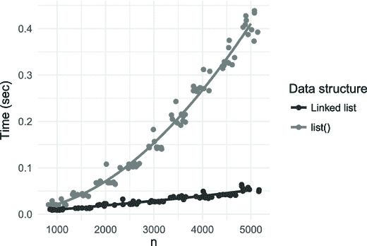

*图 2-1：两种集合构建实现的直接比较*

我们无法直接从图 2-1 看出一种数据结构是线性时间而另一种是二次方时间。仅从时间图中很难看出这一点。为了更容易观察，我们可以将实际运行时间除以预期的渐近运行时间。如果我们得到了正确的渐近运行时间，那么时间消耗除以预期时间后的结果应该会稳定在渐近函数要乘的那个常数附近。所以，如果实际运行时间是 `c·n²`，那么将运行时间除以 `n²`，应该会看到图像在 `y = c` 附近趋于平坦。

在图 2-2 中，我们看到时间除以集合规模的结果，而在图 2-3 中，则是时间除以集合规模的平方的结果：

```
ggplot(performance, aes(x = n, y = time / n, colour = algo)) +
geom_jitter() +
geom_smooth(method = "loess",
span = 2, se = FALSE) +
scale_colour_grey("Data structure", end = 0.5) +
xlab(quote(n)) + ylab("Time / n") + theme_minimal()
ggplot(performance, aes(x = n, y = time / n**2, colour = algo)) +
geom_jitter() +
geom_smooth(method = "loess",
span = 2, se = FALSE) +
scale_colour_grey("Data structure", end = 0.5) +
xlab(quote(n)) + ylab(expression(Time / n**2)) + theme_minimal()
```

在图 2-2 中，我们看到链表沿着一条水平线趋于平稳，而 `list` 实现则在持续增长；在图 2-3 中，我们看到 `list` 实现趋于平稳，而链表则缓慢地向零渐近。这表明我们之前所做的性能分析很可能是正确的。

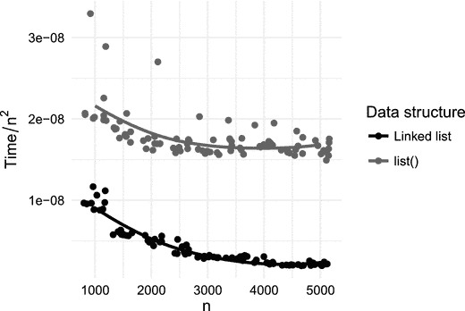

*图 2-3：两种集合构建实现，时间除以输入规模的平方*

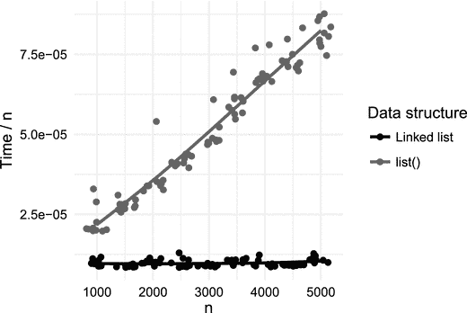

*图 2-2：两种集合构建实现，时间除以输入规模*

如果对 `setup` 和 `evaluate` 函数稍作修改，我们也可以测量成员资格查询的时间消耗。这里，我们将在 `setup` 函数中构建一个集合，然后在 `evaluate` 函数中查找一个随机成员：


```r
setup <- function(empty) function(n) {
  set <- empty
  elements <- sample(1:n)
  for (elm in elements) {
    set <- insert(set, elm)
  }
  set
}
evaluate <- function(n, set) {
  member(set, sample(n, size = 1))
}
ns <- seq(10000, 50000, by = 10000)
performance <- rbind(
  get_performance("linked list", ns,
                  setup(empty_linked_list_set()), evaluate),
  get_performance("list()", ns,
                  setup(empty_list_set()), evaluate))
```

图 2-4 绘制了结果：

```r
ggplot(performance, aes(x = n, y = time / n, colour = algo)) +
  geom_jitter() +
  geom_smooth(method = "loess",
              span = 2, se = FALSE) +
  scale_colour_grey("Data structure", end = 0.5) +
  xlab(quote(n)) + ylab("Time / n") + theme_minimal()
```

我将时间消耗除以 `n` 来进行绘制，是因为我们预期两种实现都具有线性时间的成员查询特性。这也正是我们所看到的，但同时我们也发现链表的速度更慢，且其性能方差更大。尽管两种数据结构都具有线性时间的成员查询特性，但在实践中，`list` 的实现速度更快。正如我们所见，对于成员查询而言，在逐个元素构建集合时，它显然并不更快。

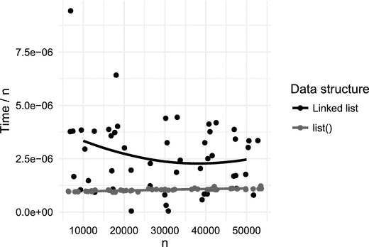

**图 2-4**  
两种集合实现的成员查询对比；时间除以输入规模 脚注 1

如果你不熟悉泛型函数和 S3 系统，可以查阅我的书 *《R 高级面向对象编程》*（Apress，2017），我在书中详细解释了这一切。

## 3. 不可变与持久化数据

阻碍我们在 R 中实现传统命令式语言数据结构的原因，在于数据的**不可变性**。通常来说，你可以修改环境——即可以给变量赋值——但无法修改实际数据。每当 R 表现得像是你在修改数据时，它其实是在“说谎”。当你给向量中的一个元素赋值时：

```r
x[i] <- v
```

向量看起来像是被修改了，但在幕后，R 实际上是将 `x` 所引用的向量替换成了一个新副本，除了第 `i` 个元素之外，这个副本与旧的 `x` 完全相同。R 会尽量高效地完成这一操作，因此只有在存在其他引用时才会复制向量，但从概念上讲，它仍然会进行一次复制。

现在，你可能会合理地争辩说，实际修改数据与仅仅产生修改数据的幻觉之间并没有什么区别，而你是对的——只不过这种幻觉只停留在表面。因为 R 是通过复制数据并将副本赋值给本地环境中的变量来制造这种幻觉的，所以它不会影响对原始数据的其他引用。作为参数传递给函数的数据会被一个局部函数变量引用。如果我们“修改”了这样的数据，我们实际上是在改变本地环境——函数的调用者持有对该数据的不同引用，而这个引用指向的是原始数据，它无论如何都不会受到我们在本地函数环境中所做操作的影响。作为一种编程语言，R 并非完全没有副作用，但副作用仅限于 I/O、随机数生成以及影响环境中变量-值的绑定。我们无法通过函数的副作用来修改实际数据。¹ 如果我们想要更新一个数据结构，就必须像 R 在试图修改数据时所做的那样：我们需要构建一个全新的数据结构，使其看起来像是我们希望将旧数据结构变成的样子。那些应该更新数据结构的函数需要构造新版本并将其返回给调用者。

### 持久化数据结构

当我们更新一个命令式数据结构时，通常默认该数据结构的旧版本将不再可用；但当我们更新一个函数式数据结构时，我们期望数据结构的旧版本和新版本都能用于后续处理。支持多个版本的数据结构称为**持久化**数据结构，而一次只允许一个版本的数据结构称为**临时性**数据结构。我们从不可变数据中得到的是持久化数据结构；这些是 R 中自然存在的数据结构。

并非所有类型的数据结构都有其持久化版本，有些持久化数据结构的效率可能低于对应的临时性版本，但构建持久化数据结构是一个活跃的研究领域，因此当你需要时，有足够多的数据结构可供选择。不过，当没有好的持久化数据结构可选时，如果我们利用可变的环境，仍然可以实现临时性结构。

为了理解我所说的“数据结构在 R 中是持久化的”是什么意思，让我们再次看看简单的链表。我使用了比之前稍短的名称来定义它，既然我们不再需要提醒自己这是一个链表，并且我使用了哨兵技巧来创建“空”链表：

```r
is_empty <- function(x) UseMethod("is_empty")
list_cons <- function(elem, lst)
  structure(list(item = elem, tail = lst), class = "linked_list")
list_nil <- list_cons(NA, NULL)
is_empty.linked_list <- function(x) identical(x, list_nil)
empty_list <- function() list_nil
list_head <- function(lst) lst$item
list_tail <- function(lst) lst$tail
```

通过这些定义，我们可以像下面这样创建三个链表：

```r
x <- list_cons(2, list_cons(1, empty_list()))
y <- list_cons(3, x)
z <- list_cons(4, empty_list())
```

这些链表在内存中的表示如图 3-1 所示。在图中，我用白色方框显示了每个链表头部的内容，用灰色方框和箭头显示了尾部指针。我在本图中明确显示了空链表哨兵，但在后续的图中，我会将其省略。变量 `x`、`y` 和 `z` 显示为指向链表的指针。对于 `x` 和 `z`，链表是通过更新空链表创建的；对于 `y`，链表是通过更新 `x` 创建的。但我们可以清楚地看到，更新后的链表仍然存在。我们只需要保留一个指向它们的指针就能找回它们。这就是持久化数据结构的本质，也是我们在 R 中处理数据结构所需的方式。

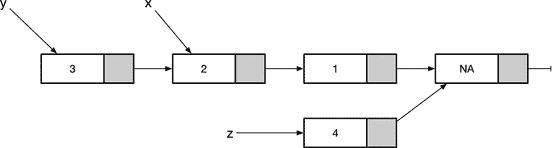

**图 3-1**  
链表的内存布局


### 列表函数

在之前通过链表实现集合时，我们已经了解了如何在列表中添加和搜索。为了深入体验不可变数据结构的使用，我们将尝试实现更多操作列表的函数。我们可以从编写一个反转列表的函数开始。这比在列表中搜索要稍微复杂一些，因为可以说我们必须从错误的一端开始构建反转后的列表。我们需要先构建一个包含输入列表最后一个元素和空列表的列表，然后将倒数第二个元素放在这个列表的头部，依此类推。

在编写操作持久化数据的函数时，我总觉得用递归来思考是最容易的。不过，如何将列表反转写成递归函数可能并不那么显而易见。如果我们一直递归到列表的末尾，就能获取到反转列表中应该出现的第一个元素，但如何在递归回溯的过程中将其正确地放入我们正在构建的列表中呢？没有简单的方法可以做到这一点。不过，我们可以利用一个技巧：在递归调用中携带一个累加器（accumulator），并使用它来构建反转后的列表。如果你不熟悉递归函数中的累加器，我在我的书*《R 语言高级面向对象编程》*（Apress, 2017）中有详细介绍，但你可能能通过以下代码理解其思路。其核心思想是：变量 `acc` 包含了我们迄今为止已构建好的反转列表。当递归到达末尾时，整个反转后的列表就在 `acc` 中，因此我们可以直接返回它。否则，我们对剩余的列表进行递归，但将当前的头元素放入累加器的顶部。使用递归辅助函数，列表反转的实现如下所示：

```
list_reverse_helper <- function(lst, acc) {
if (is_empty(lst)) acc
else list_reverse_helper(list_tail(lst),
list_cons(list_head(lst), acc))
}
list_reverse_rec <- function(lst)
list_reverse_helper(lst, empty_list())
```

这个函数的运行时间是线性的——我们需要遍历整个原始列表，但在构建新列表过程中执行的每一项操作都是常数时间的。

图 3-2 展示了反转一个长度为三的列表的迭代过程。在这个图中，我没有显示空的哨兵字符串——只是将空字符串显示为一个指向空值的指针。但你会看到，随着我们递归，变量 `lst` 如何指向原始列表中的不同位置，而原始列表完全不变，同时我们构建了一个由 `acc` 指向的新列表。

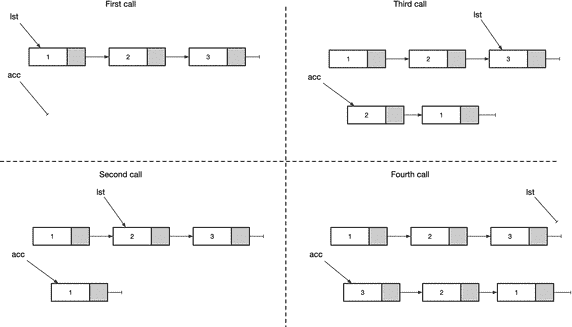

图 3-2 —— 递归列表反转中的迭代过程

在纯函数式编程语言中，这可能是反转列表的最佳方法。该函数使用了尾递归（同样，你可以在我的另一本书中读到这一点），所以它本质上就是一个我们编写的循环。不幸的是，R 语言并没有实现尾递归优化，因此我们面临一个潜在的问题。如果我们有一个非常长的列表，在完成反转之前可能会耗尽栈空间。不过，我们几乎可以自动地将尾递归函数转换为循环，用于反转列表的循环版本如下所示：

```
list_reverse_loop <- function(lst) {
acc <- empty_list()
while (!is_empty(lst)) {
acc <- list_cons(list_head(lst), acc)
lst <- list_tail(lst)
}
acc
}
```

我们可以进行一些实验来探索这两种方案的性能。使用第 2 章中描述的性能测量函数，我们可以这样设置实验：

```
setup <- function(n) {
lst <- empty_list()
elements <- sample(1:n)
for (elm in elements) {
lst <- list_cons(elm, lst)
}
lst
}
evaluate_rec <- function(n, lst) {
list_reverse_rec(lst)
}
evaluate_loop <- function(n, lst) {
list_reverse_loop(lst)
}
```

我们在 `setup` 函数中构建两种类型的列表，然后在 `evaluate` 函数中反转它们。我们这样运行实际的实验：

```
ns <- seq(100, 500, by = 50)
performance <- rbind(
get_performance("recursive", ns, setup, evaluate_rec, times = 25),
get_performance("loop", ns, setup, evaluate_loop, times = 25)
)
```

然后，我们可以使用 `ggplot2` 绘制结果，如下所示：

```
library(ggplot2)
ggplot(performance, aes(x = n, y = time / n, colour = algo)) +
geom_jitter() +
geom_smooth(method = "loess", se = FALSE, span = 2) +
scale_colour_grey("Data structure", end = 0.5) +
xlab(quote(n)) + ylab("Time / n") + theme_minimal()
```

结果如图 3-3 所示。

如果列表很短，使用哪种解决方案并无明显优势。函数调用有一些开销，但循环也有开销，这两种方案对于短列表效果相同。只要条件允许，我更喜欢递归解决方案——我发现它们更容易实现且更易于理解——但循环版本能够处理比递归版本长得多的列表。

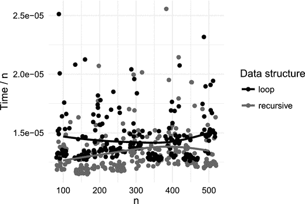

图 3-3 —— 循环与递归反转列表的对比

我们可能还想对列表执行的另一项操作是拼接两个列表。如果使用可变指针，并且有指向链表头部和尾部的指针，那么这是一项可以在常数时间内完成的操。但使用不可变数据，这就变成了一个线性时间函数——我们需要在不修改两个原始列表的情况下构建新的拼接后的列表，因此需要移动到第一个列表的末尾，然后创建一个包含相同元素并紧接着第二个列表的新列表。严格来说，这不是一个关于两个列表长度的线性时间算法，但它关于第一个列表的长度是线性的。

同样，最容易的方法是递归地构建这个函数。这里，基本情况是当第一个列表为空时，那么两个列表的拼接结果就是第二个列表。否则，我们必须将第一个列表的头元素放在第一个列表的尾部与整个第二个列表拼接结果的前面。作为一个 R 函数，我们可以这样实现这个思路：

```
list_concatenate <- function(l1, l2) {
if (is_empty(l1)) l2
else list_cons(list_head(l1),
list_concatenate(list_tail(l1), l2))
}
```

我们构建的新列表包含了 `l2` 作为其最后一部分。我们不需要复制 `l2`——毕竟它是一个不可变的数据结构，所以未来没有改变的可能——但我们是在它前面放置了 `l1` 的一份新副本。拼接后列表的结构如图 3-4 所示。两个原始列表完好无损，我们得到了一个新的拼接版本。

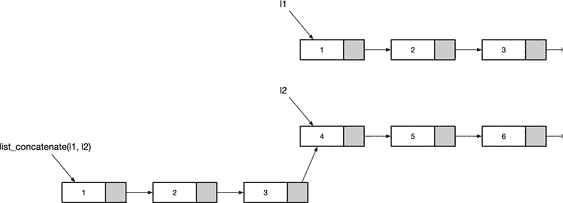

图 3-4 —— 列表拼接中的持久化列表

不使用递归来实现拼接要稍微困难一些。我们在从递归调用返回时构建新列表，因此如果我们想迭代地实现这个功能，就需要模拟调用栈。然而，我们可以按照实现列表反转的方式来完成：向下遍历第一个列表来构建它的反转版本，一旦到达第一个列表的末尾，就可以通过将头元素放在新列表的前面来构建拼接的结果。我们可以这样实现一个循环版本：

```
list_concatenate_loop <- function(l1, l2) {
rev_l1 <- empty_list()
while (!is_empty(l1)) {
rev_l1 <- list_cons(list_head(l1), rev_l1)
l1 <- list_tail(l1)
}
result <- l2
while (!is_empty(rev_l1)) {
result <- list_cons(list_head(rev_l1), result)
rev_l1 <- list_tail(rev_l1)
}
result
}
```

为了进行拼接实验，我们可以使用与之前相同的 `setup` 函数，但将 `evaluate` 函数修改如下：


```r
evaluate_rec <- function(n, lst) {
list_concatenate(lst, lst)
}
evaluate_loop <- function(n, lst) {
list_concatenate_loop(lst, lst)
}
```

实际的性能测试和绘图代码与之前类似。

循环版本首先需要构建第一个列表的逆序列表，然后构建拼接后的列表，因此它比递归版本做了更多的工作，所以速度更慢（图 3-5）。我想你也会同意循环版本比递归版本复杂得多。然而，它能处理更长的列表，因为它不需要深层调用栈。不过，除非我们在递归函数中耗尽栈空间，否则递归版本可能是更好的选择。

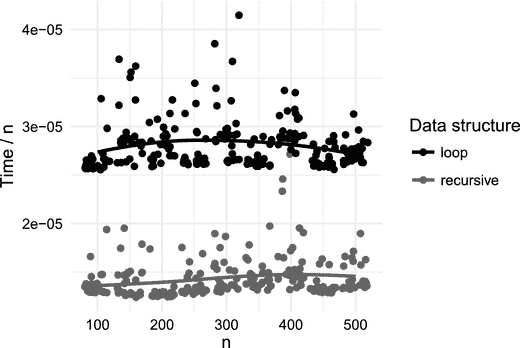

图 3-5

两个拼接函数的时间对比

那么从列表中删除元素呢？同样，我们无法修改列表，因此“删除”意味着构建一个新列表，同样，解决这个问题最简单的方法是编写一个递归函数。基本情况是从空列表中删除一个元素。这很容易做到，因为我们只需返回空列表即可。否则，我们有两种情况——假设我们只想删除元素的第一次出现，这里我将以此为前提。如果列表头部等于我们要删除的元素，我们只需返回列表尾部。否则，我们需要将当前头部与递归调用（从列表尾部删除该元素）的结果拼接起来。解决方案如下所示：

```r
list_remove <- function(lst, elm) {
if (is_empty(lst)) lst
else if (list_head(lst) == elm) list_tail(lst)
else list_cons(list_head(lst), list_remove(list_tail(lst), elm))
}
```

通过删除操作构建的新列表示例如图 3-6 所示。

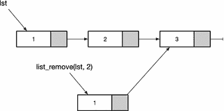

图 3-6

从列表中删除一个元素

我们也可以为删除函数编写一个循环版本，但与拼接函数类似，它比递归解决方案更复杂，这里我就不再费心了。

无论是拼接函数还是删除函数，它们阻止我们编写简单循环版本的普遍问题在于它们不是尾递归的。通常，将尾递归函数转换为循环很容易，但在拼接和删除函数中，我们需要在递归过程中构建新列表，这使得问题变得复杂。有一些通用的方法可以绕过这个问题，将你的函数转换为尾递归函数，使用所谓的 **延续（continuations）** ，但这会在多个方面增加开销，尤其是你仍然需要模拟实际的尾递归来避免达到栈限制。因此，如果递归函数给你带来麻烦，你最好尝试编写一个自定义的循环版本。话虽如此，由于列表函数通常具有线性运行时间，如果你需要担心栈限制，那么无论如何你都应该重新考虑数据结构，并改用更高效的结构。对于函数式数据结构而言，这几乎总意味着使用树而不是列表。

### 树

链表是许多函数式编程的主力，但谈到效率时，树通常是更好的替代方案。事实上，本书后续的大部分章节将使用树的变体来实现各种抽象数据结构。不过，现在我们只考虑如何构建和遍历树。为此，我们实现一个简单的、非平衡的搜索树。搜索树是具有以下性质的树：

1.  树中的每个节点包含一个数字（或任何有序集合中的其他元素）。
2.  每个节点有两个子节点——我们称它们为左子节点和右子节点。这些子节点是子树。
3.  节点左子树中的所有元素都包含比该节点元素小的值。
4.  节点右子树中的所有元素都包含比该节点元素大的值。

包含元素 1、3、4、6 和 9 的搜索树示例如图 3-7 所示。

搜索树的渐近效率源于它们的平衡方式。在搜索树中搜索涉及递归向下遍历树结构，所需时间与搜索的深度成正比。树的最坏情况是它本质上就是一个链表——如果所有节点都只有一个子节点，我们就会得到这样的树——此时搜索时间是线性的，就像在列表中搜索一样。不过，我们通常可以对它们进行平衡，在这种情况下，深度仅与存储在树中的元素数量成对数关系。要理解这一点，考虑一棵二叉树，其中每一层的所有节点都有两个子节点。这将使树中每一层的元素数量翻倍，而我们只能将一个数字翻倍 `log(n)` 次，直到达到 `n` 个元素。

我们本章构建的树不一定是平衡的。我们没有实现任何保持平衡的技巧，因此树的深度将取决于我们插入元素的顺序。

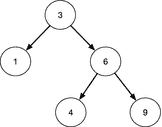

图 3-7

一个搜索树示例

总之，我们用包含一个值以及左右子树引用的节点来构建树。像往常一样，我们创建一个哨兵对象来表示空树。因此，我们的树实现如下所示：

```r
search_tree_node <- function(
value
, left = empty_search_tree()
, right = empty_search_tree()
) {
structure(list(left = left, value = value, right = right),
class = c("unbalanced_search_tree"))
}
empty_search_tree <- function()
search_tree_node(NA, NULL, NULL)
is_empty.unbalanced_search_tree <- function(x)
is.null(x$left) && is.null(x$right)
```

对于空树哨兵，我们不在 `is_empty` 函数中使用 `identical`。这是因为我们希望能够在修改空树后，它仍然被认为是空树。我们稍后会看到它的用途。

我们希望有三个通用的函数来处理集合，因此我们定义了用于在集合中插入和删除元素的函数，以及用于测试集合成员关系的函数。这三个函数都将为我们的搜索树实现，其复杂度与树的深度成正比：

```r
insert <- function(x, elm) UseMethod("insert")
remove <- function(x, elm) UseMethod("remove")
member <- function(x, elm) UseMethod("member")
```

好的，作为高级文档工程师和翻译员，我将严格遵循您提供的注意事项和示例格式，将给定的英文文本翻译成中文。


在这三个函数中，`member`函数是实现搜索树的最简单方法。搜索树的不变量告诉我们，如果我们有一个节点，且要查找的元素小于该节点的值，那么该元素必须存在于左搜索树（如果存在）中；否则，它必然存在于右搜索树中。这自然引出了一个递归函数。基本情况是当我们在空树中搜索时：我们总是回答元素未找到。否则，我们基本上需要检查三种可能性：可能找到了元素所在的节点，或者需要向左搜索，或者需要向右搜索。我们可以这样实现该函数：

```
member.unbalanced_search_tree <- function(x, elm) {
if (is_empty(x)) return(FALSE)
if (x$value == elm) return(TRUE)
if (elm < x$value) member(x$left, elm)
else member(x$right, elm)
}
```

然而，在泛型函数上进行递归调用略显低效。它要求我们在每次递归调用中基于树的参数类别进行动态分发，尽管我们知道类型是搜索树。我们可以通过将递归函数与`member`函数拆分来解决这个问题，如下所示：

```
st_member <- function(x, elm) {
if (is_empty(x)) return(FALSE)
if (x$value == elm) return(TRUE)
if (elm < x$value) st_member(x$left, elm)
else st_member(x$right, elm)
}
member.unbalanced_search_tree <- function(x, elm) {
st_member(x, elm)
}
```

实际上，我们还可以做得更好。在这个解决方案中，如果不在空树处，我们会在每次递归调用时进行两次比较：一次比较与要查找的元素是否相等，另一次检查它是否小于节点中的值。我们可以推迟一次比较，从而将比较次数减半。我们只需记住最后一个可能是我们要查找的元素的值。然后，我们可以在仅检查节点中的元素是否大于要搜索的元素后，递归调用到左子树或右子树。如果我们一直递归到空树，则检查该元素是否是我们之前可能检查过等式的那个元素。该解决方案如下所示：

```
st_member <- function(x, elm, candidate = NA) {
if (is_empty(x)) return(!is.na(candidate) && elm == candidate)
if (elm < x$value) st_member(x$left, elm, candidate)
else st_member(x$right, elm, x$value)
}
member.unbalanced_search_tree <- function(x, elm) {
st_member(x, elm)
}
```

这个解决方案减少了树中每个内部节点的比较次数，但它也存在比必要深度更大的风险，因为它可能会越过我们正在搜索的元素。

我们可以使用以下代码来评估这三种解决方案的实际性能：

```
member.unbalanced_search_tree <- function(x, elm) {
if (is_empty(x)) return(FALSE)
if (x$value == elm) return(TRUE)
if (elm < x$value) member(x$left, elm)
else member(x$right, elm)
}
st_member_slow <- function(x, elm) {
if (is_empty(x)) return(FALSE)
if (x$value == elm) return(TRUE)
if (elm < x$value) st_member_slow(x$left, elm)
else st_member_slow(x$right, elm)
}
st_member_fast <- function(x, elm, candidate = NA) {
if (is_empty(x)) return(!is.na(candidate) && elm == candidate)
if (elm < x$value) st_member_fast(x$left, elm, candidate)
else st_member_fast(x$right, elm, x$value)
}
setup_for_member <- function(n) {
tree <- empty_search_tree()
elements <- sample(1:n)
for (elm in elements) {
tree <- insert(tree, elm)
}
tree
}
evaluate_member <- function(member_func) function(n, tree) {
elements <- sample(1:n, size = 100, replace = TRUE)
for (elm in elements) {
member_func(tree, elm)
}
}
```

我们构建具有随机输入的树，使其大致平衡。结果显示在图 3-8 中。我将运行时间除以`log(n)`，因为这是随机树的预期深度，也是`member`函数的预期运行时间——我们看到时间线是水平的，这与实际运行时间匹配。我们清楚地看到，使用泛型函数的开销使得该解决方案更慢，而其他两个解决方案在实际运行时间上大致相同，其中优化版本可能略好。由于该版本似乎是最好的——至少它从不是最差的——我们应该在搜索树实现中使用它。

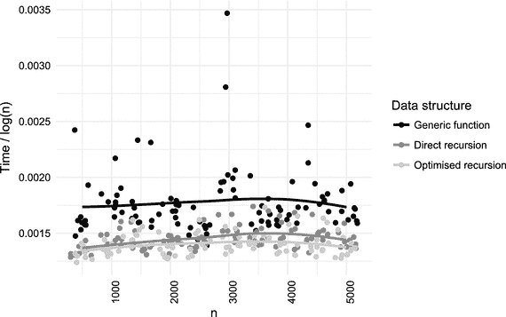

**图 3-8**

搜索树成员函数比较

在搜索树中插入一个元素时，我们必须像往常一样构造一个表示更新后的树的新结构。我们可以通过递归向下搜索树到应该插入元素的位置——如果要插入的元素小于节点中的值则向左，如果要插入的值更大则向右——然后在递归返回时构建新树来实现。递归解决方案将如下工作：如果到达空树，我们已经找到了应该插入元素的位置，因此我们构造一个新叶子并从递归中返回它。否则，我们检查内部节点中的值。如果该值大于我们要插入的元素，我们需要构造一个新树，包含当前值、现有的右子树以及插入元素后的左子树版本。如果节点中的元素小于我们要插入的元素，我们执行对称的构造，将元素插入右子树。如果元素等于节点中的值，则它已存在于树中，因此我们可以直接返回现有树。在 R 代码中，该解决方案可以如下所示：

```
insert.unbalanced_search_tree <- function(x, elm, ...) {
if (is_empty(x)) search_tree_node(elm, empty_search_tree(), empty_search_tree())
else if (elm < x$value)
search_tree_node(x$value, insert(x$left, elm), x$right)
else if (elm > x$value)
search_tree_node(x$value, x$left, insert(x$right, elm))
else
x # the value is already in the tree
}
```

当然，与`member`一样，这里会有泛型函数动态分发的开销，因此更好的解决方案如下：

```
st_insert <- function(tree, elm) {
if (is_empty(tree)) search_tree_node(elm, empty_search_tree(), empty_search_tree())
else if (elm < tree$value)
search_tree_node(tree$value,
st_insert(tree$left, elm),
tree$right)
else if (elm > tree$value)
search_tree_node(tree$value,
tree$left,
st_insert(tree$right, elm))
else
tree
}
insert.unbalanced_search_tree <- function(x, elm, ...) {
st_insert(x, elm)
}
```

`insert`函数递归向下搜索放置新值的位置，然后在递归返回时构造一个新树。我们向下和向上递归时执行的所有操作都是常数时间，并且我们只复制搜索路径上的原始树部分。我们只需保留对树的其他部分的现有引用。在图 3-7 的树中插入 5 后，更新后的树实例如图 3-9 所示。

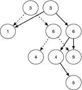

**图 3-9**

在图 3-7 的搜索树中插入 5 的结果

如果我们有一组要构建搜索树的元素，并且以随机顺序插入它们，那么每个元素被放在根左侧或右侧的概率平均相等，因此最终会得到一个相当平衡的树。这就是为什么在我们比较成员测试函数时，除以树大小的对数后得到平坦图的原因。然而，如果我们按递增顺序插入元素，我们总是将下一个元素插入树的最右子节点，最终会得到一个线性深度的树。


好的，作为高级文档工程师和翻译员，我将遵循您的注意事项和示例，将给定的英文文本翻译成中文。


如果通过逐个插入元素来构建搜索树，运行时间将是元素数量乘以平均深度。如果树不平衡，由于平均树深度将为`n/2`，构建时间会变成`O(n²)`。以随机顺序插入元素与以递增顺序插入元素的对比情况如图 3-10 所示。

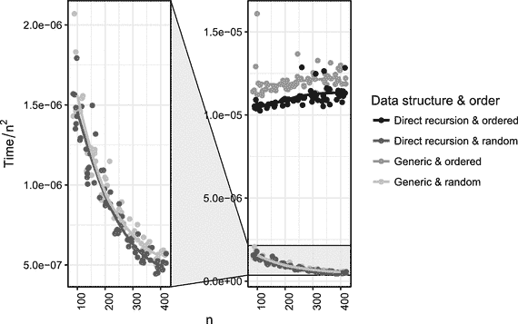

**图 3-10** 平衡搜索树构建与不平衡搜索树构建的对比

在这些实验中，我使用了以下`setup`和`evaluate`函数：

```
setup_for_construction <- function(n) n
evaluate_construction <- function(order, ins) function(n, x) {
tree <- empty_search_tree()
elements <- order(1:n)
for (elm in elements) {
tree <- ins(tree, elm)
}
tree
}
```

`setup`函数并未执行任何实际的设置，它只是返回大小以返回某个值，但`evaluate`函数并未使用它。`evaluate`函数是一个高阶函数，它接受两个函数——一个用于指定数据插入搜索树的顺序，另一个用于执行插入——并返回用于实际运行时评估的函数。我如下所示使用这些函数，其中我使用高阶函数`evaluate_construction`来改变插入顺序和插入函数。这里，我使用了递归调用自身的通用函数`insert`以及前面展示的`st_insert`函数：

```
ns <- seq(100, 400, by = 50)
construction_performance <- rbind(
get_performance("Generic & ordered", ns,
setup_for_construction,
evaluate_construction(identity, insert)),
get_performance("Direct recursion & ordered", ns,
setup_for_construction,
evaluate_construction(identity, st_insert)),
get_performance("Generic & random", ns,
setup_for_construction,
evaluate_construction(sample, insert)),
get_performance("Direct recursion & random", ns,
setup_for_construction,
evaluate_construction(sample, st_insert))
)
```

为了绘制结果，我使用了`ggforce`包中的`facet_zoom`函数来放大显示随机顺序插入的实验。如果不放大，这些实验将难以辨认：

```
library(ggforce)
construction_performance %>%
mutate(is_random = grepl(".*random", algo)) %>%
ggplot(aes(x = n, y = time / n², colour = algo)) +
geom_jitter() +
geom_smooth(method = "loess", se = FALSE, span = 1) +
scale_colour_grey("Data structure & order", end = 0.8) +
xlab(quote(n)) + ylab(expression(Time / n**2)) +
facet_zoom(y = is_random, zoom.size = 1) +
theme_bw() +
theme(axis.text.x = element_text(angle = 90, hjust = 1))
```

同样，我们看到了在通用函数上进行递归的开销——因此我们应该使用调用`st_insert`的非递归通用函数——并且我们看到按顺序插入元素比随机顺序插入慢得多。实际情况甚至比运行时间所暗示的要稍差一些：因为不平衡树的深度可能是线性的，我们用于操作它们的递归函数可能会在远早于其平衡对应物遇到栈深度问题。这就是为什么我只运行了规模达到 450 的实验——在 500 时，我会耗尽栈空间。我们将在第 6 节中回到保持树平衡的技术。现在，我们只继续使用简单的操作，并且我们已经到了需要实现的最后一个函数：删除元素。

删除元素是我们需要为搜索树实现的最复杂函数。其基本模式与插入相同：我们沿递归向下搜索要删除的元素，然后沿递归向上构建更新后的树。复杂性出现在我们实际必须删除元素时。删除叶子节点很容易：在构建更新后的树时，我们可以从递归中返回一个空树。删除只有一个子节点的节点也很简单：这里我们可以直接返回该子节点，它将被插入到我们正在构建的树的正确位置。然而，当我们需要删除的元素位于一个有两个子节点的内部节点时，我们无法轻松地将树更新为一个指向两个子节点但不包含要删除值的内部节点。

我们想要做的是用树中已有的另一个值替换我们要删除的值——这个值要大于左子树中的所有值，并且小于右子树中的所有值。诀窍在于获取右子树中最左侧的节点。该节点包含右子树中的最小值，因此，如果我们将这个值放入新的内部节点，并将其从右子树中删除，那么不变式将得到满足。子树中最左侧的节点大于左子树中的所有值——因为它当前位于右子树中——并且由于它是最左侧的值，它将小于右子树中的所有其他值。此外，删除树中的最左侧节点很容易，因为它最多只有一个（右）子节点，而这些情况我们可以轻松处理。

我们需要一个辅助函数来查找子树中的最左侧节点，但在此之后，我们只需要在处理删除元素时处理不同的情况。如果元素不在树中，我们最终会在搜索过程中遇到空树，直接返回即可。否则，如果我们找到了该元素，我们直接处理它最多只有一个子节点的情况，否则就使用“最左侧技巧”。剩下的情况只是处理我们仍在递归中向下搜索时的情况：我们需要创建一个节点，其中包含原始的左子树或右子树——取决于节点中的值——并使用在另一个子树中删除元素的结果。完整的实现可以如下所示：

```
st_leftmost  tree$value)
search_tree_node(tree$value, tree$left, st_remove(tree$right, elm))
}
remove.unbalanced_search_tree <- function(x, elm, ...) {
st_remove(x, elm)
}
```

这一次，我没有费心编写使用通用函数进行递归的版本——到目前为止我们知道，与从通用函数调用普通函数并由普通函数处理递归相比，这效率更低。

图 3-11 显示了从图 3-7 的树中删除 6 的结果。当搜索找到包含 6 的节点时，它会向下获取右子树中最左侧的节点，即包含 9 的叶子节点。然后它从右子树中删除 9——结果将是一个空树——并构造一个新节点，该节点的值为 9，其左子树是包含 4 的子树，右子树是空子树。然后，它在删除点之上创建节点的副本，沿递归向上构造最终的更新树。

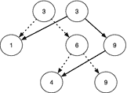

**图 3-11** 从子树中删除元素

出于调试目的，或者仅仅为了理解数据结构如何被各种操作修改，打印或绘制它可能会有所帮助。对于表示顺序数据的简单列表，打印它们包含的元素是最简单的方法，但对于树和更复杂的数据结构，我们需要进行绘制。


一个用于操作图（graph）的强大工具是`tidygraph`包，而用于绘制图的强大工具是`ggplot2`的扩展包`ggraph`。我们还将使用`tibble`包来获得更美观的数据框。我们将使用以下这些包：

```
library(tidygraph)
library(ggraph)
library(tibble)
```

为了将树（例如我们的搜索树）转换为可以用`ggraph`绘制的图，我们需要提取关于边结构的信息。一种方法是将每个节点映射到一个数字，然后创建`from`和`to`节点的列表。为此，我们可以用节点编号来注释树。由于树是不可变的，我们不能简单地给节点添加编号——我们需要创建一个包含这些编号的新树。我们可以通过以下函数来实现：

```
node_number_annotate_tree <- function(tree, i = 1) {
  if (is_empty(tree)) {
    tree$dfn <- i
  } else {
    left <- node_number_annotate_tree(tree$left, i)
    right <- node_number_annotate_tree(tree$right, left$dfn + 1)
    tree$dfn <- right$dfn + 1
    tree$left <- left
    tree$right <- right
  }
  tree
}
```

当然，仅仅为了获得从节点到数字的映射就复制一份数据结构是很浪费的，但我们并不打算绘制巨大的树，所以这不会成为问题。

一旦我们有了节点编号，就可以提取图的信息。对于搜索树，我们想知道节点中存储的值以及边的结构。我们将值收集到一个向量中，将边的结构收集到两个向量中：`from`向量和`to`向量。我们可以用纯函数式的方式收集所有需要的信息，但我们这里将使用`<<-`算子和命令式的方法，因为这样得到的代码更容易理解。无论如何，我们只会在嵌套函数内部使用它，并且提取图信息的函数不会有任何副作用。我们为节点中的`values`以及`from`和`to`向量分配空间（边的数量比节点数量少一，除了根节点有一条指向父节点的边）。对于每个节点，很难知道它在`from`和`to`中应该使用哪个索引，因为这取决于在递归遍历树的过程中之前已经看到了多少个节点。因此，我们使用一个计数器变量来跟踪这一点，并且我们也使用`<<-`算子来处理函数调用之间的这个计数器。我们将所有信息收集起来，并以包含两个`tibble`数据框的列表形式返回：一个用于节点，一个用于边。

```
extract_graph <- function(tree) {
  n <- tree$dfn
  values <- vector("numeric", length = n)
  from <- vector("integer", length = n - 1)
  to <- vector("integer", length = n - 1)
  edge_idx <- 1
  
  extract <- function(tree) {
    # 我们更改索引，使根节点编号为 1
    # 这样更简单
    i <- n - tree$dfn + 1
    values[i] <<- ifelse(is.na(tree$value), "", tree$value)
    
    if (!is_empty(tree)) {
      j <- n - tree$left$dfn + 1
      from[edge_idx] <<- i
      to[edge_idx] <<- j
      edge_idx <<- edge_idx + 1
      
      k <- n - tree$right$dfn + 1
      from[edge_idx] <<- i
      to[edge_idx] <<- k
      edge_idx <<- edge_idx + 1
      
      extract(tree$left)
      extract(tree$right)
    }
  }
  
  extract(tree)
  nodes <- tibble(1:n, value = values)
  edges <- tibble(from = from, to = to)
  list(nodes = nodes, edges = edges)
}
```

我们从`extract_graph`返回的`nodes`和`edges`可以直接提供给`tidygraph`中的`tbl_graph`，以构建一个能与`ggraph`配合使用的结构。我们将绘图代码放在`unbalanced_search_tree`类的`plot`泛型函数中。它不会像基础图形系统（base graphics）的绘图那样工作，因为它基于`ggplot2`，因此基于`grid`系统，但我们还是可以将其函数命名为`plot`。不过，该函数会返回一个图形对象，因此你需要`print`它才能绘图——但在最外层作用域中对树直接调用`plot`就能完成这个操作。绘图函数可以如下所示：

```
plot.unbalanced_search_tree <- function(x, ...) {
  x %>%
    node_number_annotate_tree %>%
    extract_graph %$% tbl_graph(nodes, edges) %>%
    mutate(leaf = node_is_leaf()) %>%
    ggraph(layout = "tree") +
    scale_x_reverse() +
    geom_edge_link() +
    geom_node_point(aes(filter = leaf),
                    size = 2, shape = 21, fill = "black") +
    geom_node_point(aes(filter = !leaf),
                    size = 10, shape = 21, fill = "white") +
    geom_node_text(aes(label = value), vjust = 0.4) +
    theme_graph()
}
```

在这个绘图例程中，我们显式地展示了哨兵节点。如果我们愿意，也可以将它们排除在外。有很多图形参数（例如大小和形状）我们可能想要参数化，但为了保持简单，我将这留给你去处理。

我们可以用它来展示通过以不同顺序插入元素构建的树：

```
tree <- empty_search_tree()
for (x in 1:7)
  tree <- insert(tree, x)
plot(tree) + ggtitle("顺序插入")

tree <- empty_search_tree()
for (x in rev(1:7))
  tree <- insert(tree, x)
plot(tree) + ggtitle("逆序插入")

tree <- empty_search_tree()
for (x in sample(1:7))
  tree <- insert(tree, x)
plot(tree) + ggtitle("随机插入")
```

结果显示在图 [3-12] 中，该图展示了树的形状如何依赖于我们插入元素的顺序。

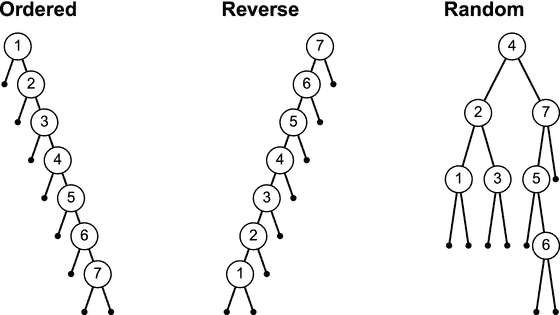

**图 3-12** 不同构造顺序下的非平衡搜索树

列表和树是我们将在本书中研究的所有数据结构的基本构建块，而我们编写函数来更新它们的方式，也将是我们处理所有数据结构的通用方法。我们在本章中看到的方法在大多数情况下效率并不高——尽管如果存储的数据是随机的，搜索树的表现相当不错——但高效的数据结构正是建立在我们现在所熟悉的基础之上。


### 随机访问列表

作为一个小例子，在转向更传统的数据结构之前，我们将考虑如何使用列表和树来构建随机访问列表，如 Okasaki（1995a）所述。随机访问列表的行为类似列表。我们可以在其前端扩展，也可以在常数时间内访问或移除前端元素。然而，它们还有两个额外的操作：我们可以通过索引访问任何元素，也可以通过索引修改任何元素（但不能在任意位置删除元素）。Okasaki（1995a）的数据结构在`O(log(n))`时间内实现了这两个额外操作。

随机访问列表由完全平衡的二叉树构建而成。对于这个数据结构，我们不会实现不同的版本，因此这里我不会纠结于类，而只实现一个精简版本的数据结构，以便能轻松看清其实际结构，而不被接口设计所掩盖。我们将树实现为列表，并使用`NULL`表示空树。我们可以像这样构建一棵树：

```
ral_binary_tree <- function(value, left, right) {
  list(value = value, left = left, right = right)
}
```

由于我们使用树来表示列表，我们需要一种方法将列表中的位置映射到树中的节点。在这个数据结构中，我们会将索引映射到树的中序位置；这意味着树中的第一个元素是根节点的值，然后是左子树中的所有元素，最后是右子树中的所有元素。我们选择这种中序映射是因为这样就能在常数时间内访问列表的前端——即树的根节点。

要在树中查找对应于给定索引的节点，我们需要递归搜索。索引 1 始终是根节点，因此如果要访问这个索引，我们可以立即访问到它。否则，我们必须在左子树或右子树中搜索。如果树的大小为`n`，那么根节点有 1 个元素，每个子树有`(n – 1) / 2`个元素，因为我们操作的所有树都是完全平衡的。如果我们要查找的索引`i`大于 1，我们知道如果`i <= (n – 1) / 2 + 1`，则需要搜索左子树，否则需要搜索右子树。在递归调用中，我们需要修改索引：向左搜索时跳过根节点，或向右搜索时跳过根节点和左子树。基于此算法，我们可以像这样实现查找操作：

```
ral_tree_lookup <- function(tree, tree_size, idx) {
  if (ral_is_leaf(tree)) {
    if (idx == 1) return(tree$value)
    stop("查找时索引错误")
  }
  child_size <- (tree_size - 1) / 2
  if (idx <= child_size + 1)
    ral_tree_lookup(tree$left, child_size, idx - 1)
  else
    ral_tree_lookup(tree$right, child_size, idx - 1 - child_size)
}
```

更新树的操作只是稍微复杂一些。定位需要修改值的位置遵循完全相同的搜索算法；当然，我们只需在递归调用中构造一棵新树。每次进行递归调用时，我们会根据现有的值和树创建一棵新树，但通过递归调用更新操作来修改左子树或右子树：

```
ral_tree_update <- function(tree, tree_size, idx, value) {
  if (ral_is_leaf(tree)) {
    if (idx == 1)
      return(ral_binary_tree(value, NULL, NULL))
    # 是叶子节点但 idx 不是 1！
    stop("索引错误")
  }
  if (idx == 1) {
    ral_binary_tree(value, tree$left, tree$right)
  } else {
    child_size <- (tree_size - 1) / 2
    if (idx <= child_size + 1) {
      ral_binary_tree(tree$value,
                      ral_tree_update(tree$left, child_size,
                                      idx - 1, value),
                      tree$right)
    } else {
      ral_binary_tree(tree$value,
                      tree$left,
                      ral_tree_update(tree$right, child_size,
                                      idx - 1 - child_size, value))
    }
  }
}
```

这些树是完全平衡的，因此大小为`n`的树的最大深度是`O(log n)`，查找和更新操作的时间复杂度都在此范围内。

显然，我们无法用完全平衡的树来表示所有大小为`n`的列表。对于任何具有`n`个节点的平衡树，`n`都必须是`2^k – 1`（对于某个`k`）。因此，完全平衡树与偏斜二进制数之间存在密切对应关系，我们将在该数据结构中利用这一点。偏斜二进制数是一种位置数制——这意味着数字的位置决定了其值，正如你所熟悉的十进制和二进制数一样——其中位置`k`上的数字`d`表示数值`d * 2^(k+1) – 1`。数字`d`可以是 0、1 或 2，但只有当它是最低有效非零位时才允许为 2。前六个数字在十进制、二进制和偏斜二进制表示形式如下表所示。

| 十进制 | 二进制 | 偏斜二进制 |
| ------- | ------ | ----------- |
| 0       | 0      | 0           |
| 1       | 1      | 1           |
| 2       | 10     | 2           |
| 3       | 11     | 10          |
| 4       | 100    | 11          |
| 5       | 101    | 12          |

我们将利用偏斜二进制数的两个重要属性来实现随机访问列表：任何数字`n`可以用`O(log n)`个数字表示（其中最多有一个数字是 2），并且我们可以在这个表示形式中以常数时间递增和递减数字。第一个属性应该很明显：与二进制数相比，偏斜二进制数使用的数字更少，而对于二进制数，表示数字`n`只需要`O(log n)`个数字。常数时间的递增和递减可以通过仅将非零数字表示为链表来实现。我们将数字表示为链表，链表中的元素是非零数字的位置，数字 2 由具有相同位置的两个元素表示，并且我们保持该列表按位置递增顺序排序，如图 3-13 所示。

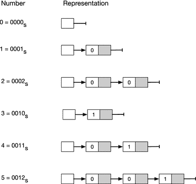

图 3-13 — 偏斜二进制数的表示

要递增一个数字，我们首先检查列表中的前两个元素是否包含相同的位置。如果是，我们不能在位置零处添加元素，因为只有最低有效非零位才能为 2。相反，我们可以将前两个元素合并为一个列表元素，该元素包含数字表示中的下一个位置。因为`2 * (2^(k+1) – 1) + 1 = 2^(k+2) – 1`，如果前两个元素包含位置`k`，那么以此方式合并它们就相当于递增了数字`n`。由于只有前两个元素可能重复，我们以这种方式创建的新数字不会违反不变性——它可能与列表中的下一个元素包含相同的位置，但在合并前两个元素之前，它已经是唯一包含该索引的元素了。如果前两个元素包含不同的位置，我们可以简单地在列表前端添加一个位置为零的元素——这可能会将位置 0 处的 1 变为 2，但这没问题，因为一开始只有一个位置 0 元素。

要递减，我们执行递增操作的逆操作。如果列表前端存在一个位置为零的元素，我们直接移除该元素。否则，我们取出第一个元素，并将其替换为两个包含位置减 1 的元素。

回到列表，我们将这些列表表示为类似于偏斜二进制数表示形式的链表。我们只使用大小为`2^(k+1) – 1`的完全平衡二叉树作为列表元素，而不是位置`k`。我们通过让树的大小对应于`n`的偏斜二进制数表示中的数字，来表示一个包含`n`个元素的列表。该表示形式是一个链表——我们有一个指向列表中下一个元素的`siblings`指针——并且每个元素包含一棵树和树的大小：

```
ral_node <- function(tree, tree_size, siblings) {
  list(tree = tree, tree_size = tree_size, siblings = siblings)
}
```

空列表用`NULL`表示，与空树情况相同：

```
ral_is_empty <- function(ral) is.null(ral)
```


我们将保持树的排序，使得列表中的第一个元素位于第一棵树中，后续元素位于第二棵树，以此类推。由于单棵树中的元素顺序是中序遍历，我们可以从第一棵树的根节点获取列表的头部元素：

```
ral_head <- function(ral) {
ral$tree$value
}
```

其他列表操作——在列表前端追加元素，或移除前端元素——遵循斜二进制数的操作规则。对于`cons`操作，如果前两棵树的大小不同，我们只需在开头添加一棵大小为 1 的树。如果前两棵树大小相同，我们就构建一棵新树，将新的前端元素作为根节点，原来的两棵树分别作为左子树和右子树——第一棵树必须放在左边，第二棵树放在右边——然后用这棵新树替换原来的两棵树。获取列表的尾部操作则是这些操作的逆过程：如果前端树的大小为 1，直接移除它；否则将前端树拆分为两棵，并移除根节点（图 3-14）。

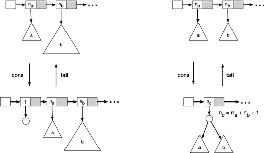

图 3-14

随机访问列表上的列表操作

实现过程就是检查各种情况，并据此执行相应的操作：

```
ral_singleton_node <- function(value, siblings = NULL) {
singleton_tree <- ral_binary_tree(value, NULL, NULL)
ral_node(singleton_tree, 1, siblings)
}
ral_cons <- function(elem, ral) {
if (ral_is_empty(ral) || ral_is_empty(ral$siblings))
return(ral_singleton_node(elem, ral))
first <- ral$tree
first_size <- ral$tree_size
second <- ral$siblings$tree
second_size <- ral$siblings$tree_size
rest <- ral$siblings$siblings
if (first_size < second_size)
ral_singleton_node(elem, ral)
else
ral_node(ral_binary_tree(elem, first, second),
first_size + second_size + 1, rest)
}
ral_is_singleton <- function(ral) {
ral$tree_size == 1
}
ral_tail <- function(ral) {
if (ral_is_singleton(ral))
ral$siblings
else {
left <- ral$tree$left
right <- ral$tree$right
size <- (ral$tree_size - 1) / 2
ral_node(left, size, ral_node(right, size, ral$siblings))
}
}
```

剩下的任务是实现 `lookup` 和 `update` 操作。我们已经有了在树中查找或更新值的函数，因此只需要编写代码，从树列表中选出正确的树即可。这本质上是一个跟踪目标索引的问题。对于 `lookup` 操作，我们遍历所有树，检查当前索引是否小于当前树的大小。如果是，则在树中进行查找。否则，我们递减索引以表示已经越过了部分列表，然后移动到下一棵树：

```
ral_lookup <- function(ral, idx) {
while (!is.null(ral)) {
if (idx <= ral$tree_size)
return(ral_tree_lookup(ral$tree, ral$tree_size, idx))
idx <- idx - ral$tree_size
ral <- ral$siblings
}
stop("索引越界")
}
```

对于 `update` 操作，其本质与 `lookup` 操作相同，但由于我们需要构建一个一直到被修改树的新列表，因此不能使用循环。我们必须通过递归来执行搜索，并在递归过程中构建新列表，因此每次递归调用都需要封装在新节点的构建中：

```
ral_update <- function(ral, idx, value) {
if (idx < 1) stop("索引越界")
if (idx <= ral$tree_size)
ral_node(ral_tree_update(ral$tree, ral$tree_size, idx, value),
ral$tree_size, ral$siblings)
else
ral_node(ral$tree, ral$tree_size,
ral_update(ral$siblings, idx - ral$tree_size, value))
}
```

数据结构的更新方式如图 3-15 所示。这里，我们需要更新的索引位于第三棵树中，因此新列表将由三个新元素组成，其后跟随旧列表中的元素。前两个列表元素仅指向原始的前两棵树，而第三个元素则指向一棵被修改过的树。在图中，原始树和更新后的树被描绘为不相交的，但实际上它们会共享大部分结构；只有从根节点到被更新节点路径上的元素在两棵树中有所不同。

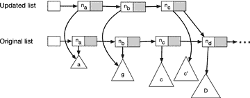

图 3-15

更新随机访问列表

脚注 1

严格来说，我们可以创建影响数据结构的副作用——只需修改环境即可。通过引用类系统 R6，我们可以通过更新环境来模拟具有可变状态的对象，我们也可以通过闭包实现同样的效果。当我们进入第 4 章（将实现队列）时，我将引入成员查询的副作用，届时我们将使用这个技巧。但是，除非我们通过环境集合来表示所有数据结构，否则这种方法只能带我们走到这里。我们仍然需要在不修改数据的情况下构建数据结构——我们只能将结果记住在为此目的构建的环境中。

## 4. 背包、栈和队列

在本章中，我们将开始构建比简单链表和不平衡树更复杂的数据结构，但与后续章节相比仍然相对简单。我们将考虑三种抽象数据结构：背包、列表和队列。背包本质上是一个集合，但我们不重视成员查询的效率——我们只希望能够构建元素集合，以便后续高效地遍历它们。栈是一种后进先出的元素集合，我们可以高效地提取最后添加到栈中的元素。最后，队列是一种先进先出的集合，我们可以高效地获取最先插入队列的元素。

我们希望这三种数据结构具备的抽象数据类型操作，对于背包而言是：

```
is_empty <- function(x) UseMethod("is_empty")
insert <- function(x, elm) UseMethod("insert")
```

有时还包括：

```
merge <- function(x, y) UseMethod("merge")
```

其中 `is_empty` 是我们之前使用过的判空检查，`insert` 向背包中添加单个元素，而 `merge` 用于合并两个背包，类似于对两个集合求并集。

对于栈，我们希望有的操作是：

```
is_empty <- function(x) UseMethod("is_empty")
push <- function(x, elm) UseMethod("push")
pop <- function(x) UseMethod("pop")
top <- function(x) UseMethod("top")
```

其中 `push` 向栈顶添加一个元素，`pop` 移除栈顶元素，`top` 返回栈顶元素。

最后，对于队列，我们希望有以下操作：

```
is_empty <- function(x) UseMethod("is_empty")
enqueue <- function(x, elm) UseMethod("enqueue")
front <- function(x) UseMethod("front")
dequeue <- function(x) UseMethod("dequeue")
```

这里，`enqueue` 在队列尾部插入一个元素，`front` 返回队列头部的元素，`dequeue` 移除队列头部的元素。


### 包

包可能是我们能想象到的最简单的数据结构。它们只是元素的集合。你可以向其中添加元素，也可以合并两个包，但不能移除元素，而且它们不像列表那样有自然的顺序。

我们可以使用列表轻松实现包。我们已经知道如何在恒定时间内向列表插入元素，以及如何遍历列表中的元素。然而，当列表是不可变的时候，`merge`（合并）操作是一个线性时间的函数。

让我们考虑一下包的列表解决方案。要使用列表版本的包，我们需要能够创建一个空包并测试其是否为空。我们可以像创建列表时那样来实现：

```
bag_cons <- function(elem, lst)
structure(list(item = elem, tail = lst),
class = c("list_bag", "linked_list"))
bag_nil <- bag_cons(NA, NULL)
is_empty.list_bag <- function(x) identical(x, bag_nil)
empty_list_bag <- function() bag_nil
```

这里唯一值得注意的是，我将包-列表中元素的类同时设置为 `"list_bag"` 和 `"linked_lists"`。这允许我将我的包当作列表来处理，因为从任何意义上说，它们实际上就是列表。不过，我们需要对此稍加小心，因为如果我们调用了那些设定为返回列表的方法，那么仅仅因为是用包来调用这些方法，结果也不会自动变成包。对于查询操作，使用列表函数是可以接受的，但在修改包时会有问题。无论如何，我们只需要为更新包实现两个操作，所以我们可以处理这个问题。

最简单的操作是 `insert`（插入），我们只需将一个新元素放在列表的头部：

```
insert.list_bag <- function(x, elm) bag_cons(elm, x)
```

`merge`（合并）操作涉及的内容比其他操作更多。如果我们知道正在合并的两个包包含的是互不相交的元素集，我们可以通过简单地连接相应的列表来实现它。我们可以重用之前的 `list_concatenate` 函数，但需要记住设置结果的类。只要我们不获取结果的尾部——由于 `list_concatenate` 的工作方式，那会得到一个列表而不是一个包——那么这个实现就没问题。不过话说回来，获取包的尾部本来也不是包接口的一部分。所以我们可以像这样实现 `merge`：

```
merge.list_bag <- function(x, y) {
result <- list_concatenate(x, y)
class(result) <- c("list_bag", "linked_list")
result
}
```

因为列表连接是一个线性时间操作，所以包合并也是线性时间。然而，我们可以通过使用树来保存包来改进这一点。我们可以利用这样一个事实：有 n 个叶节点的二叉树有 n–1 个内部节点，因此，如果我们将所有值放在二叉树的叶节点中，我们就可以在线性时间内遍历它。

我们可以像这样为树包构造一些用于空树的样板代码：

```
bag_node <- function(elem, left, right)
structure(list(item = elem, left = left, right = right),
class = "tree_bag")
tree_bag_nil <- bag_node(NA, NULL, NULL)
is_empty.tree_bag <- function(x) identical(x, tree_bag_nil)
empty_tree_bag <- function() tree_bag_nil
```

然后，为了插入一个新元素，我们创建一个叶节点。如果我们试图将元素插入空树，我们应该直接返回这个叶节点——如果不这样做，我们最终会得到非二叉的节点，那么运行时间就会失控。否则，我们只需将叶节点放在新根节点的左侧，并将原包放在右侧。没有必要保持树的平衡，因为我们不打算在其中搜索或从中删除元素；对于包，我们只希望能够遍历所有元素：

```
insert.tree_bag <- function(x, elm) {
element_leaf <- bag_node(elm, empty_tree_bag(), empty_tree_bag())
if (is_empty(x)) element_leaf
else bag_node(NA, element_leaf, x)
}
```

图 4-1 展示了一个树包和插入操作。左侧展示了一个包含元素 1、5 和 7 的包，它是通过以下操作创建的：

```
x <- insert(insert(insert(empty_tree_bag(), 7, 5, 1)))
```

在右侧，我们看到运行

```
insert(x, 4)
```

之后的情况。

新元素被添加为新根节点的左子树，而原始的 `x` 包是新根节点的右子树。

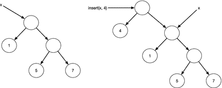

**图 4-1** 在树包中插入元素

现在，合并可以在常数时间内完成。我们需要小心不要创建带有空子树的内部节点，但除此之外，我们可以直接创建一个节点，将要合并的两个包作为其左子树和右子树：

```
merge.tree_bag <- function(x, y) {
if (is_empty(x)) return(y)
if (is_empty(y)) return(x)
bag_node(NA, x, y)
}
```

图 4-2 展示了两个非空包 `x` 和 `y` 的合并。

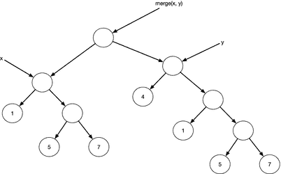

**图 4-2** 合并两个树包。

遍历包中的元素可以通过在树上递归来实现。例如，我们可以编写一个函数，将所有叶节点提取为一个链表。它看起来是这样的：

```
is_leaf <- function(x) {
is_empty(x$left) && is_empty(x$right)
}
bag_to_list <- function(x, acc = empty_list()) {
if (is_leaf(x)) list_cons(x$item, acc)
else bag_to_list(x$right, bag_to_list(x$left, acc))
}
```

这个 `merge`（合并）的实现也假设我们合并的包是互不相交的集合。如果不是这样，我们就有更多工作要做。如果我们不希望有重复元素，我不知道解决这个问题有什么通用的高效方法，但有两种直接的 `nlog(n)` 算法：我们可以对包进行排序然后合并——排序需要 `nlog(n)` 时间，然后合并需要线性时间——或者我们可以简单地将所有包元素放入一棵搜索树中，再从那里提取它们。我们可以使用堆数据结构（在第 5 章讨论）以这种复杂度对元素进行排序，并且我们可以在搜索树中（在第 6 章讨论）构造并提取唯一元素。

### 栈

栈是元素的集合，我们可以按照“后进先出”的顺序插入元素并再次移除它们。如果可以的话，栈比包更容易用链表实现。大多数情况下，我们只需要重命名一些函数；所有操作都作为列表函数现成可用。

我们需要再次编写一些样板代码，以便为空的栈设置正确的类型：

```
stack_cons <- function(elem, lst)
structure(list(item = elem, tail = lst),
class = c("stack", "linked_list"))
stack_nil <- stack_cons(NA, NULL)
is_empty.stack <- function(x) identical(x, stack_nil)
empty_stack <- function() stack_nil
```

之后，我们可以直接重用列表函数：

```
push.stack <- function(x, elm) stack_cons(elm, x)
pop.stack <- function(x) list_tail(x)
top.stack <- function(x) list_head(x)
```

这非常简单。另一方面，队列……则需要更多的工作。


### 队列

栈的实现很简单，因为我们可以将元素压入列表的头部，当需要获取时，它们就在头部位置。而队列则遵循先进先出（FIFO）的语义，因此当我们想要获取队列开头的元素时，如果使用列表来实现队列，该元素会位于列表的末尾，而不是头部。因此，一种直接实现方式虽然能以常数时间入队，但获取队首元素和出队操作却需要线性时间。

然而，有一种技巧可以实现均摊常数时间的队列操作。这意味着每次单独操作的最坏情况用时并非恒定时间，但每完成`n`次操作，总用时为 O(`n`)。这个技巧是：我们维护两个列表，一个表示队列的前端，另一个表示队列的后端。前端的排序方式使得我们能直接获取头部作为队首元素，后端的排序方式则允许我们通过将元素放入其头部来完成入队操作。当执行某些操作时（例如前端列表为空且我们尝试获取队首元素或进行出队），我们就需要将元素从后端列表移动到前端列表。

当然，这意味着某些`front`（获取队首）或`dequeue`（出队）操作会耗费线性时间而非常数时间。每当需要将元素从队列后端移动到前端时，我们必须复制并反转后端列表。但平均来看，一系列线性数量的操作总耗时也是线性的。要理解这一点，可以想象每次`enqueue`（入队）操作实际上花费了两倍于实际所需的时间。当我们入队一个元素时耗时是常数，因此加倍后仍是常数时间，但你可以将这段加倍的时间视为预先支付了入队和后续将该元素从后端移动到前端的时间。第一次入队时立即支付了前半段时间成本；后半段则可以理解为存入了一个“时间银行”。我们在每次向后端添加元素时都在银行中存入时间，因此总有足够的储备来用于后续将元素移动到队列前端。虽然并非所有操作都是常数时间，但操作的代价会在整个操作序列中被均摊，因此平均而言它们是常数时间的。

图 4-3 展示了均摊时间复杂度。实线表示在执行一系列队列操作过程中所执行的列表操作次数。每次调用`enqueue`函数以及仅修改前端列表的`front`和`dequeue`操作各计为一次操作。当将元素从后端列表移动到前端列表时，移动的元素数量也会被计入。虚线表示时间消耗加上银行中存储的操作次数。因此这条线代表 `2e+f+d`，其中 `e` 是`enqueue`操作次数，`f` 是`front`操作次数，`d` 是`dequeue`操作次数。执行`enqueue`时，我们向银行存入值；这些值后来会用于支付代价高昂的`front`或`dequeue`操作。整个运行时间的线性上界就是操作次数的两倍——如点线所示。

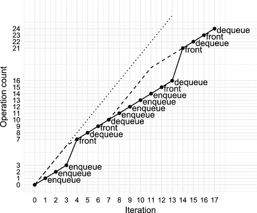

**图 4-3** 队列操作的均摊线性上界。

因此，我们可以用两个列表来实现队列，但这就出现了一个问题。更新和查询数据结构的操作不再完全分离。如果我们尝试获取队列的`front`（队首）元素，可能需要更新队列；如果前端列表为空而后端列表不为空，我们需要先将所有元素从后端列表移动到前端列表，然后才能获取队首元素。这是我们通常希望避免的情况；如果查询数据结构的同时也会修改它，那么在这些操作中，我们既要返回查询结果，又要返回更新后的数据结构，这会破坏清晰的接口并导致代码混乱。不过，数据结构依赖于查询时的修改来实现良好的均摊时间复杂度（即使不是最坏情况复杂度）并不少见。实现这种队列解决方案让我有机会向你展示一个通用技巧：在 R 语言中使用可修改的环境来处理那些会修改数据结构的查询。之后，我还会展示一个更简单的队列实现方法——实际上，我们可以稍加扩展队列的表示方式来避免这个问题，但这并非总是可行，因此了解这个通用技巧是值得的。

本质上，我们希望`front`操作在遇到前端列表为空时，能产生一个将元素从队列后端移动到前端的副作用。对于`dequeue`操作，我们不存在这个问题；该操作在任何情况下都会返回一个更新后的队列。但`front`操作应该仅返回队首元素——它可能需要构建的任何新队列都不会被返回。如果 R 函数完全不可能产生副作用，那么这个策略就到此为止了，但 R 并非纯粹的函式型语言，某些副作用是可行的。我们无法修改数据，但可以修改环境。我们可以更改变量到数据值的绑定。如果我们使用环境来保存需要更新的值，就可以构建一个同时支持查询和修改的队列。我们可以显式地使用环境对象，或者隐式地使用闭包来实现这一点。当然，这两种基于环境的解决方案都不会提供持久化数据结构。因为引入了副作用，我们得到的是更传统的瞬时数据结构——但本章最后你会看到如何实现一个持久化队列，所以不必担心。


#### 通过环境实现副作用

由于我们可以修改环境，因此可以创建一个环境对象并将其用作队列。我们可以像这样构建它，设置类以便将其同时视为环境和队列，并将两个列表存储在其中：

```
queue_environment <- function(front, back) {
e <- new.env(parent = emptyenv())
e$front <- front
e$back <- back
class(e) <- c("env_queue", "environment")
e
}
```

在这里，我们将环境的父级设置为空环境。如果不这样做，默认会以局部闭包作为父级。虽然在这个特定实例中不会造成问题，但没必要对环境进行链式连接，所以我们不这样做。

显然，这不是一个纯函数式数据结构，也不是持久化数据结构，但它能完成任务。

使用这种表示方式，我们不需要哨兵对象来表示空队列。我们可以用两个空列表来构造一个队列，并检查队列中的两个列表是否为空：

```
empty_env_queue <- function()
queue_environment(empty_list(), empty_list())
is_empty.env_queue <- function(x)
is_empty(x$front) && is_empty(x$back)
```

队列的操作相对直接。当我们将元素添加到队列尾部时，只需将其放在后部列表的前端：

```
enqueue.env_queue <- function(x, elm) {
x$back <- list_cons(elm, x$back)
x
}
```

如果前部列表为空，我们需要将其替换为反转后的后部列表，并将后部列表设为空——否则，我们只需取前部列表的头元素：

```
front.env_queue <- function(x) {
if (is_empty(x$front)) {
x$front <- list_reverse(x$back)
x$back <- empty_list()
}
list_head(x$front)
}
```

最后，要从队列前端移除一个元素，我们只需将前部列表替换为其尾部。不过，如果前部列表为空，我们需要像 `front` 函数那样先更新它：

```
dequeue.env_queue <- function(x) {
if (is_empty(x$front)) {
x$front <- list_reverse(x$back)
x$back <- empty_list()
}
x$front <- list_tail(x$front)
x
}
```

严格来说，在 `enqueue` 和 `dequeue` 函数中，我们不必返回更新后的队列，因为我们直接更新了表示队列的环境。不过，如果我们想实现为抽象数据类型指定的接口，还是应该这样做。即使我们实现的不是持久化数据结构，让这两个函数返回更新后的队列，也能使我们在以后替换为不修改数据、而是真正将队列实现为持久化结构的实现。

#### 通过闭包实现副作用

还有一种将队列实现为环境的方法，它使用隐式环境而非显式环境。我个人不认为这种方法像使用显式环境那样可读性强，但在一些我认为它能提高可读性的场景中，我曾使用过这个技巧，并且也在其他地方见过它的使用，所以我想不妨展示给你看看。

如果我们创建闭包——在其他函数内部定义的函数——就会得到一个隐式的封闭环境，我们可以用它来更新数据。我们可以利用这样的闭包来获取一个可更新的队列引用。我们可以创建一个包含前部列表和后部列表的局部环境，并在闭包中更新它们。但为了展示另一种方式，我将改为在闭包环境中保存一个单一的队列对象，并在需要时用更新后的队列替换它。队列对象看起来像这样：

```
queue <- function(front, back)
list(front = front, back = back)
```

现在闭包的工作方式如下：我在另一个函数内部创建一些函数——这个函数有一个局部变量引用一个队列，并返回一个包含这些函数的列表。当函数需要修改队列时，它们使用 `<<-` 赋值运算符将队列的新版本赋值给封闭环境中的变量。所有闭包都引用同一个变量，因此在需要访问队列时，它们都能看到更新后的版本。我将所有闭包收集到一个列表中，从创建闭包的函数中返回，并设置一个类以使其能与泛型函数配合使用。完整的实现如下：

```
queue_closure <- function() {
q <- queue(empty_list(), empty_list())
queue_is_empty <- function()
is_empty(q$front) && is_empty(q$back)
enqueue <- function(elm) {
q <<- queue(q$front, list_cons(elm, q$back))
}
front <- function() {
if (is_empty(q$front)) {
q <<- queue(list_reverse(q$back), empty_list())
}
list_head(q$front)
}
dequeue <- function() {
if (is_empty(q$front)) {
q <<- queue(list_tail(list_reverse(q$back)), empty_list())
} else {
q <<- queue(list_tail(q$front), q$back)
}
structure(list(is_empty = queue_is_empty,
enqueue = enqueue,
front = front,
dequeue = dequeue),
class = "closure_queue")
}
```

队列的基本访问和修改变更与显式环境实现相同，只是我需要为测试队列是否为空的函数使用不同的名称。如果我将该函数命名为 `is_empty`，就会遮蔽全局泛型函数，从而无法在用于实现队列的列表上使用它。不过，在我返回的列表中，我仍然可以将其命名为 `is_empty`。

当我需要创建一个空队列时，只需调用闭包：

```
empty_queue <- function() queue_closure()
```

现在，为了实现队列接口的泛型函数，我们只需将调用分派给相应的闭包：

```
is_empty.closure_queue <- function(x) x$queue_is_empty()
enqueue.closure_queue <- function(x, elm) {
x$enqueue(elm)
x
}
front.closure_queue <- function(x) x$front()
dequeue.closure_queue <- function(x) {
x$dequeue()
x
}
```

我们仍然需要返回修改后的队列——即闭包列表——来实现抽象接口，但除此之外，我们只需在需要时调用闭包来修改队列即可。

正如我所提到的，我认为在这个特定情况下，使用显式环境的实现更简单，但两种实现是等价的，你可以根据自己的喜好选择使用哪一种。


#### 纯函数式队列

我们无法使队列数据结构成为纯函数式的唯一原因在于，访问器函数 `front` 需要获取后列表中的最后一个元素，而这在分摊常量时间内是无法实现的，除非我们在前列表为空时修改队列。不过，我们仅在调用 `front` 的特殊情况下才需要访问这一个元素。因此，只要以一种能在常量时间内获取到该值的方式显式记住它，我们就可以创建一个纯函数式（即真正持久化）的队列。我们可以扩展队列版本，使其包含两个列表（前列表和后列表），以及当前列表为空时调用 `front` 需要返回的元素：

```
queue_extended <- function(x, front, back)
structure(list(x = x, front = front, back = back),
class = "extended_queue")
```

在这种表示法中，我们要求始终满足这样的不变性：当 `back` 列表非空时，`x` 指向 `back` 列表的最后一个元素。如果 `back` 为空，则 `x` 的值无关紧要。

在此队列实现中，我们不需要哨兵对象；检查队列是否为空仍然只需检查两个列表是否均为空即可。我们可以用两个空列表创建空队列，如果它们都为空，则无需为后列表的最后一个元素指定任何特定值——既然已知它为空，那么在任何情况下我们都不应尝试访问队列的头部：

```
empty_extended_queue <- function()
queue_extended(NA, empty_list(), empty_list())
is_empty.extended_queue <- function(x)
is_empty(x$front) && is_empty(x$back)
```

当向队列末尾添加元素时，如果该元素将位于后列表的末尾，我们需要记住它的值。如果 back 队列为空，则该元素会成为末尾，因此若 `back` 为空，我们在 `x` 中记住添加的元素值；否则，继续记住队列中已存储的值：

```
enqueue.extended_queue <- function(x, elm)
queue_extended(ifelse(is_empty(x$back), elm, x$x),
x$front, list_cons(elm, x$back))
```

当需要获取队列头部元素时，有两种情况：如果 `front` 列表为空，则需要返回 `back` 中的最后一个元素，该值已存储在 `x` 中；如果 `front` 非空，则直接返回该列表的头部即可：

```
front.extended_queue <- function(x) {
if (is_empty(x$front)) x$x
else list_head(x$front)
}
```

移除队列头部元素时，通常应移除 `front` 的头部元素，除非 `front` 为空。此时应将 `back` 反转并放入前部，同时当 `back` 被清空后，`x` 不再具有任何特定含义：

```
dequeue.extended_queue <- function(x) {
if (is_empty(x$front))
x <- queue_extended(NA, list_reverse(x$back), empty_list())
queue_extended(x$x, list_tail(x$front), x$back)
}
```

#### 时间比较

图 4-4 比较了三种队列实现在实际使用中的时间消耗（实验中涉及的代码与绘图部分未包含在内，因为它们与已展示的代码非常相似）。两种基于环境的实现在实际运行时间上大致相同，但函数式实现存在额外开销。这是由于每次将新建队列包装在新结构中带来的——更不用说在操作列表时还需要对列表进行结构包装。

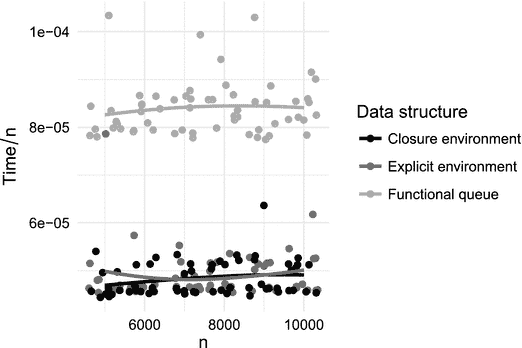

图 4-4  
三种队列实现构建与清空过程的运行时间比较

如果我们愿意放弃将实现包装为抽象数据结构，就可以加快速度。同样地，如果我们不将列表表示为对象，而仅使用头指针和尾指针，也能达到类似效果。然而，通过分摊复杂度构建函数式队列以避免副作用，其实际效果可能并不如听上去那么有用。当我们将队列视为短暂数据结构时，所获得的分摊复杂度表现优异，但对于持久化数据结构而言，实际上并没有想象中那么理想。如果我们希望将队列用作持久化数据结构，这种分摊分析根本行不通。

#### 分摊时间复杂度与持久化数据结构

当处理具有分摊复杂度的数据结构时，我们设想某些廉价操作的实际成本略高于其表面值，这样便有能力为更昂贵的操作买单——通过将调用廉价操作时存入银行的“计算资源”进行支付。考虑一系列操作的平均成本，而不是为每个独立操作提供保证，通常能使数据结构的分析与构造更简单，且往往速度更快，因为我们能采用更简单的实现。这种推理方式在考虑一系列操作时是合理的，前提是每次操作中更新的数据结构是下一次操作的输入。然而，若要将数据结构作为持久化数据使用，这种推理便不成立了。¹

假设我们在队列末尾插入了一些元素，此时该队列有一个完整的“后”列表和一个空的“前”列表。当第一次执行出队操作时，我们已为一次后列表反转付了账，但如果我们将队列视为持久化数据结构，就可能在同一个实例上多次执行出队。通过将插入操作的成本视为实际成本的两倍（如同我们在分析中所做的那样），我们可以支付第一次出队操作（包括列表反转等全部开销），但这仅能支付第一次后列表反转。如果队列是持久化的，没有任何机制能阻止我们在同一个队列上多次调用 `dequeue` 操作。每次 `dequeue` 调用都将成为昂贵操作，其耗时与后列表长度呈线性关系，而我们插入元素时存入银行的“储蓄”仅能支付第一次操作。只有将结构视为短暂数据结构时，分摊分析才真正有效。

我们在此展示的队列实现，若将其视为短暂数据结构，运行速度相当快；但若需要持久化队列，则分摊分析不再适用。分摊分析与持久化数据结构并非不能结合，但这需要换一种思考方式。分摊分析的问题在于，我们必须提前储蓄以支付后续的昂贵操作。而持久化数据结构存在多次花费储蓄的风险。另一种可行方案是，通过惰性求值，将数据结构置于一种包含未求值操作的状态，这些操作需要在未来某个操作中支付——此时不是储蓄，而是产生债务。任何后续针对这种状态下的数据结构的操作序列，都必须先偿还债务，才能看到被延迟操作的效果。我们将在本章最后一节回到这个例子。


#### 双端队列

双端队列（deque）是一种允许从队列两端添加和移除元素的队列。作为抽象数据结构，双端队列的操作如下：

```
enqueue_front <- function(x, elm) UseMethod("enqueue_front")
enqueue_back <- function(x, elm) UseMethod("enqueue_back")
front <- function(x) UseMethod("front")
back <- function(x) UseMethod("back")
dequeue_front <- function(x) UseMethod("dequeue_front")
dequeue_back <- function(x) UseMethod("dequeue_back")
```

我们可以像实现队列那样，使用两个列表（前端列表和后端列表）来实现双端队列。只需将新元素添加到两个列表的头部，就可以轻松地在两端添加元素。如果要获取前端或后端的元素，或者移除前端或后端的元素，只要这两个列表不为空，直接访问列表头部即可。但如果列表为空，就需要更谨慎地处理。

如果完全按照队列的流程操作，当某个列表为空时，我们反转另一个列表并移动其全部元素，这样在前后端交替移除元素时，操作时间复杂度可能会变为线性。这是需要避免的。通过对流程进行小幅修改，可以解决这个问题：不在另一个列表为空时反转并移动整个列表，而是只移动其一半元素。这样，我们最终能获得与队列相同的均摊复杂度——这意味着只要将双端队列实现为瞬态数据结构，就能实现常数时间操作。

复杂度分析稍微复杂一些。我们仍然可以将插入操作视为略昂贵，每次执行消耗一枚“计算币”并存入一枚“计算币”，但此时的银行存款需要被视为前端列表与后端列表的长度之差。如果你熟悉均摊分析，可以考虑一个势函数，即前端列表与后端列表长度之差的绝对值。为简化说明，我们仍以存入银行计算币的方式思考，后续可用这些币支付昂贵操作。不过，插入元素时存入的币，不一定能覆盖某个元素在列表间多次移动的全部消耗。同一个元素可能在列表间被移动多次，导致该元素欠债，但我们可以通过使用其他元素付出的币来偿还债务。

令 `f` 表示前端列表元素数量，`b` 表示后端列表元素数量，我们希望保持的不变量是：银行中有 `abs(f–b)` 枚币，用于支付后续操作。如果在两个列表中较短的那个插入元素，可以认为多存入了一枚计算币，但其实无需满足不变量，这属于用不上的额外存款。但如果在较长的列表中插入元素，则需要额外支付一枚币，以应对列表长度差的增加。这没问题——即使成本是仅插入元素的两倍，它仍然是常数时间操作。

然而，如果某个列表为空，而我们需要从中获取元素，就必须移动一些元素，并从银行中扣除相应成本。但只要不变量得到满足，银行中的币数就与非空列表的长度相等。如果将该列表的一半元素移动到另一个列表，则消耗了银行存款的一半，但剩余部分仍足以维持 `abs(f–b)` 的不变量。如果两个列表最终长度恰好相等，我们只需银行中有非负数量的币——只要只消耗一半存款，这一条件就成立；如果两个列表长度相差一，则需剩下一枚币——同样，只要只消耗一半存款即可满足。因此，方案可行。

为了实现常数时间（均摊）操作复杂度的双端队列，只需在需要移动元素时移动列表的一半，而非整个列表。

要实现双端队列，需要两个操作：获取列表的前半部分，以及获取列表的后半部分。

如果已知列表的一半元素数量，可以使用以下两个函数：

```
list_get_n_reversed <- function(lst, n) {
  if (n <= 0) return(empty_list())
  acc <- empty_list()
  while (n > 0) {
    acc <- list_cons(lst$head, acc)
    lst <- lst$tail
    n <- n - 1
  }
  acc
}
list_drop_n <- function(lst, n) {
  while (n > 0) {
    lst <- list_tail(lst)
    n <- n - 1
  }
  lst
}
```

这两个函数都在 `n` 时间内完成工作，因此如果令 `n` 为待移动元素列表长度的一半，就能在可用时间内将元素从一个列表移动到另一个列表。

获取列表长度的方法如下：

```
list_length <- function(lst) {
  n <- 0
  while (!is_empty(lst)) {
    lst <- lst$tail
    n <- n + 1
  }
  n
}
```

接下来，可以这样实现双端队列：

```
deque_environment <- function(front, back) {
  e <- new.env(parent = emptyenv())
  e$front <- front
  e$back <- back
  class(e) <- c("env_deque", "environment")
  e
}
empty_env_deque <- function()
  deque_environment(empty_list(), empty_list())
is_empty.env_deque <- function(x)
  is_empty(x$front) && is_empty(x$back)
enqueue_back.env_deque <- function(x, elm) {
  x$back <- list_cons(elm, x$back)
  x
}
enqueue_front.env_deque <- function(x, elm) {
  x$front <- list_cons(elm, x$front)
  x
}
front.env_deque <- function(x) {
  if (is_empty(x$front)) {
    n <- list_length(x$back)
    x$front <- list_get_n_reversed(x$back, ceiling(n))
    x$back <- list_drop_n(x$back, ceiling(n))
  }
  list_head(x$front)
}
back.env_deque <- function(x) {
  if (is_empty(x$back)) {
    n <- list_length(x$front)
    x$back <- list_get_n_reversed(x$front, ceiling(n))
    x$front <- list_drop_n(x$front, ceiling(n))
  }
  list_head(x$back)
}
dequeue_front.env_deque <- function(x) {
  if (is_empty(x$front)) {
    n <- list_length(x$back)
    x$front <- list_get_n_reversed(x$back, ceiling(n))
    x$back <- list_drop_n(x$back, ceiling(n))
  }
  x$front <- list_tail(x$front)
  x
}
dequeue_back.env_deque <- function(x) {
  if (is_empty(x$back)) {
    n <- list_length(x$front)
    x$back <- list_get_n_reversed(x$front, ceiling(n))
    x$front <- list_drop_n(x$front, ceiling(n))
  }
  x$back <- list_tail(x$back)
  x
}
```

如果你现在感到有点不安，那是正常的。如果你没有这种感觉，我希望你仔细审视我们目前的解决方案，思考我可能在哪个环节做了点小手脚。

如果你还没看出来，我给你一个提示：我们假设从银行中取出足够支付半个列表元素移动的币，但实际使用的成本是否超过这个数？

现在你看到了吗？我们几乎所有操作都没问题，但**列表长度是如何获取的**？


在实现数据结构时，很容易几乎正确但又不完全正确，但最细微的错误都可能损害性能，所以我在这个数据结构中留下了一个小陷阱，让你们保持警惕。我们目前拥有的几乎正确，但我们在反转一半列表上花费了太多时间。我们只有取出半列表的预算，但为了获取列表长度，却花费了整个列表长度的预算。要计算列表的长度，我之前展示的实现会遍历整个列表，这对于我们的分析来说成本过高。

如果你使用当前实现进行实验并测量运行时间，你就会发现这一点——这也是我鼓励你始终通过测量来测试实现，而不仅仅依赖分析的原因。无论我们在数据结构的设计和分析中多么谨慎，一旦实现细节出现微小错误，一切都会付诸东流。始终检查你期望从分析中得到的性能，是否在真实时间测量中与实际相符。

这个问题的解决方案相当简单。如果我们能在常数时间内计算出两个列表的长度，我们就能在分配的预算内移动它们的一半。在需要时知道列表长度的最简单方法，就是直接记录它。因此，我们可以将列表的长度作为额外信息添加到双端队列中：

```r
deque_environment <- function(front, back,
front_length, back_length) {
  e <- new.env(parent = emptyenv())
  e$front <- front
  e$back <- back
  e$front_length <- front_length
  e$back_length <- back_length
  class(e) <- c("env_deque", "environment")
  e
}
empty_env_deque <- function()
  deque_environment(empty_list(), empty_list(), 0, 0)
```

判空测试无需改变——我们只需检查列表是否为空，如果我们正确记录了长度，那么判空也同样是正确的。

每当向列表添加元素时，我们还需要在长度记录上加一：

```r
enqueue_back.env_deque <- function(x, elm) {
  x$back <- list_cons(elm, x$back)
  x$back_length <- x$back_length + 1
  x
}
enqueue_front.env_deque <- function(x, elm) {
  x$front <- list_cons(elm, x$front)
  x$front_length <- x$front_length + 1
  x
}
```

现在，当修改列表时，我们也需要更新长度。这个操作在多个地方用到，因此我们可以实现两个辅助函数来跟踪它，如下所示：

```r
move_front_to_back <- function(x) {
  n <- list_length(x$front)
  m <- ceiling(n)
  x$back <- list_get_n_reversed(x$front, m)
  x$front <- list_drop_n(x$front, m)
  x$back_length <- m
  x$front_length <- n - m
}
move_back_to_front <- function(x) {
  n <- list_length(x$back)
  m <- ceiling(n)
  x$front <- list_get_n_reversed(x$back, m)
  x$back <- list_drop_n(x$back, m)
  x$front_length <- m
  x$back_length <- n - m
}
```

然后，我们可以这样更新操作：

```r
front.env_deque <- function(x) {
  if (is_empty(x$front)) move_back_to_front(x)
  list_head(x$front)
}
back.env_deque <- function(x) {
  if (is_empty(x$back)) move_front_to_back(x)
  list_head(x$back)
}
dequeue_front.env_deque <- function(x) {
  if (is_empty(x$front)) move_back_to_front(x)
  x$front <- list_tail(x$front)
  x
}
dequeue_back.env_deque <- function(x) {
  if (is_empty(x$back)) move_front_to_back(x)
  x$back <- list_tail(x$back)
  x
}
```

现在，我们只花费与移动元素数量成线性关系的时间，这样均摊分析的不变性就得到了满足。

### 惰性队列

通过利用惰性求值，不仅可以实现均摊的 `O(1)` 操作队列，还可以实现最坏情况下的 `O(1)` 操作队列。接下来，我将描述一种基于 Okasaki (1995b) 的实现。

由于除了函数参数是惰性求值的之外，惰性求值并不是 R 语言中的自然求值策略，我们必须自己实现它。这会给数据结构增加一些额外开销，即额外的函数求值，因此该实现无法在速度上与之前看到的其他数据结构竞争，但这种队列可以持久化使用。

#### 实现惰性求值

R 中的表达式会立即求值，除非是作为函数参数传递的表达式。这意味着像 `1:10000` 这样的表达式会立即创建一个包含一万个元素的向量。然而，如果我们编写一个像下面这样的函数：

```r
f <- function(x, y) x
```

并且我们从未访问 `y`，然后像这样调用它：

```r
f(5, 1:10000)
```

那么向量表达式永远不会被求值。

因此，我们可以将暂时不想求值的表达式包装在 thunk 中——thunk 是不接受任何参数但会求值一个表达式的函数。例如，我们可以编写一个像这样的函数：

```r
lazy_thunk <- function(expr) function() expr
```

它接受表达式 `expr` 并返回一个 thunk，当我们调用这个 thunk 时，它会求值该表达式。但 thunk 只会第一次求值该表达式，因为 R 会记住函数参数一旦被求值后的值。我们可以从以下代码中看到这一点：

```r
library(microbenchmark)
microbenchmark(lazy_vector <- lazy_thunk(1:100000), times = 1)
## Unit: microseconds
##                                expr   min    lq
##  lazy_vector <- lazy_thunk(1:1e+05) 8.244 8.244
##   mean median    uq   max neval
##  8.244  8.244 8.244 8.244     1
microbenchmark(lazy_vector()[1], times = 1)
## Unit: microseconds
##              expr     min      lq    mean  median
##  lazy_vector()[1] 272.457 272.457 272.457 272.457
##       uq     max neval
##  272.457 272.457     1
microbenchmark(lazy_vector()[1], times = 1)
## Unit: microseconds
##              expr   min    lq  mean median    uq
##  lazy_vector()[1] 4.784 4.784 4.784  4.784 4.784
##    max neval
##  4.784     1
```

向量的构造是廉价的，因为当我们构造 thunk 时，向量表达式实际上并未被求值。但第一次访问向量时——注意，我们需要将 `lazy_vector` 作为 thunk 来求值，以获取它包装的表达式——我们将不得不构造实际的向量。这是一个相对昂贵的操作，但第二次访问它时，它已经被构造好了，因此操作将是廉价的。

对于像 `lazy_thunk` 这样的函数，我们需要稍微小心一些。`expr` 参数将在我们第一次调用 thunk 时被求值，并且它会在我们构造 thunk 时的调用作用域内求值，但它会以我们求值 thunk 时的状态来查找变量。如果它依赖于自创建 thunk 以来已经被修改的变量，那么我们得到的表达式可能不是我们想要的那一个。函数 `force` 通常用于缓解这个问题。它会强制求值一个参数，因此在 thunk 构造时，它就会求值与表达式匹配的值。然而，这在这里行不通——我们实现 thunk 正是因为我们不希望表达式被求值。

不过，如果我们小心使用 thunk，并确保提供给它们的表达式中任何变量都已经是被强制的，那么我们就可以利用函数参数的惰性求值来实现惰性表达式。


#### 惰性列表

现在，我们来实现惰性列表，看看如何运用惰性求值。我们将只使用包装在队列中的惰性列表，因此我不会构建带有泛型函数的类，以避免由此产生的开销并简化实现。为了避免与我们在抽象数据类型中使用的函数名混淆，我将使用不同的名称来构造和访问列表：我将采用基于 Lisp 的语言中的术语，使用 `cons` 构造列表，`car` 获取列表头部，`cdr` 获取列表尾部。这些名称并不能很好地暗示函数的功能——它们基于 IBM 704 的汇编代码——但在基于 Lisp 的语言中很常见，因此如果你学习函数式编程，很可能会遇到它们，最好还是习惯一下。

我们将为惰性列表建立以下不变式：一个列表总是一个 thunk，它要么在列表为空时返回 `NULL`，要么返回一个包含 `car` 和 `cdr` 字段的结构体。我们像这样实现列表的构造和访问：

```
nil <- function() NULL
cons <- function(car, cdr) {
force(car)
force(cdr)
function() list(car = car, cdr = cdr)
}
is_nil <- function(lst) is.null(lst())
car <- function(lst) lst()$car
cdr <- function(lst) lst()$cdr
```

这与我们到目前为止实现的链表非常相似，只是我们没有使用多态函数，而是使用 `NULL` 作为空列表，而不是哨兵节点。

我们可以将任何为链表编写的函数通过将其返回值包装在一个 thunk 中来转化为惰性列表。以列表拼接为例。使用惰性列表的函数，我们的实现会像这样：

```
concat <- function(l1, l2) {
rev_l1 <- nil
while (!is_nil(l1)) {
rev_l1 <- cons(car(l1), rev_l1)
l1 <- cdr(l1)
}
result <- l2
while (!is_nil(rev_l1)) {
result <- cons(car(rev_l1), result)
rev_l1 <- cdr(rev_l1)
}
result
}
```

此函数只是执行了之前拼接函数的功能，但使用的是惰性列表。然而，它本身并不是惰性的。它需要线性时间执行，并且立即完成反转操作。

我们可以通过构建一些长列表来测试这个函数，使用这个辅助函数：

```
vector_to_list <- function(v) {
lst <- nil
for (x in rev(v)) lst <- cons(x, lst)
lst
}
l1 <- vector_to_list(1:100000)
l2 <- vector_to_list(1:100000)
```

我们看到拼接操作很慢：

```
microbenchmark(lst <- concat(l1, l2), times = 1)
## Unit: seconds
##                   expr      min       lq     mean
##  lst <- concat(l1, l2) 1.669522 1.669522 1.669522
##    median       uq      max neval
##  1.669522 1.669522 1.669522     1
```

该操作完成需要超过一秒钟。然而，在拼接 `l1` 和 `l2` 之后访问列表很快：

```
microbenchmark(car(lst), times = 1)
## Unit: microseconds
##      expr  min   lq mean median   uq  max neval
##  car(lst) 20.1 20.1 20.1   20.1 20.1 20.1     1
microbenchmark(car(lst), times = 1)
## Unit: microseconds
##      expr   min    lq  mean median    uq   max
##  car(lst) 9.134 9.134 9.134  9.134 9.134 9.134
##  neval
##      1
```

这些操作以微秒为单位运行，并且由于我们没有延迟任何操作，所以两次对 `lst` 调用 `car` 所花费的时间相同。

现在我们可以尝试稍微修改 `concat`，通过将其返回值包装在一个 thunk 中来延迟其求值。我们需要对其参数使用 `force` 以避免它们引用调用环境中的变量而导致的常见问题，但之后我们可以将拼接操作包装在一个 thunk 中：

```
concat <- function(l1, l2) {
do_cat <- function(l1, l2) {
rev_l1 <- nil
while (!is_nil(l1)) {
rev_l1 <- cons(car(l1), rev_l1)
l1 <- cdr(l1)
}
result <- l2
while (!is_nil(rev_l1)) {
result <- cons(car(rev_l1), result)
rev_l1 <- cdr(rev_l1)
}
result
}
force(l1)
force(l2)
lazy_thunk <- function(lst) function() lst()
lazy_thunk(do_cat(l1, l2))
}
```

现在，拼接变得快速：

```
microbenchmark(lst <- concat(l1, l2), times = 1)
## Unit: microseconds
##                   expr    min     lq   mean
##  lst <- concat(l1, l2) 11.153 11.153 11.153
##  median     uq    max neval
##  11.153 11.153 11.153     1
```

然而，第一次访问该列表时，我们需要为拼接操作付出代价，但仅限于第一次：

```
microbenchmark(car(lst), times = 1)
## Unit: seconds
##      expr      min       lq     mean   median
##  car(lst) 1.304761 1.304761 1.304761 1.304761
##        uq      max neval
##  1.304761 1.304761     1
microbenchmark(car(lst), times = 1)
## Unit: microseconds
##      expr   min    lq  mean median    uq   max
##  car(lst) 15.29 15.29 15.29  15.29 15.29 15.29
##  neval
##      1
```

这样做我们并没有取得多大成效。我们只是将拼接的成本从 `concat` 调用转移到了第一次访问列表时。然而，如果我们放弃循环版本的拼接函数，回到递归版本，我们可以得到一个更简单的版本，其中所有操作都是常数时间的：

```
concat <- function(l1, l2) {
force(l1)
force(l2)
if (is_nil(l1)) l2
else {
lazy_thunk <- function(lst) function() lst()
lazy_thunk(cons(car(l1), concat(cdr(l1), l2)))
}
}
```

在这个函数中，我们实际上不需要 `force l1`，因为我们直接使用了它，但为了保持一致性，我总会在返回 thunk 的函数中对参数进行 `force`。

我们之前放弃了这个版本的拼接函数，因为在长列表上我们会递归过深，但是通过将递归调用包装在一个我们惰性求值的 thunk 中，我们就没有这个问题了。当我们评估调用这个 `concat` 得到的结果时，我们只执行拼接递归的一步。现在拼接是一个相对快速的操作——它需要设置 thunk，但不对列表执行任何实际工作：

```
microbenchmark(lst <- concat(l1, l2), times = 1)
## Unit: microseconds
##                   expr    min     lq   mean
##  lst <- concat(l1, l2) 19.118 19.118 19.118
##  median     uq    max neval
##  19.118 19.118 19.118     1
```

第一次访问拼接后的列表时，我们需要评估 thunk。这比实际拼接它们要快，并且是一个常数时间操作：

```
microbenchmark(car(lst), times = 1)
## Unit: microseconds
##      expr    min     lq   mean median     uq
##  car(lst) 50.398 50.398 50.398 50.398 50.398
##     max neval
##  50.398     1
```

后续对列表头部的访问甚至更快。现在 thunk 已经被评估过了，所以我们只需访问列表头部的结构：

```
microbenchmark(car(lst), times = 1)
## Unit: microseconds
##      expr    min     lq   mean median     uq
##  car(lst) 19.423 19.423 19.423 19.423 19.423
##     max neval
##  19.423     1
microbenchmark(car(lst), times = 1)
## Unit: microseconds
##      expr   min    lq  mean median    uq   max
##  car(lst) 8.928 8.928 8.928  8.928 8.928 8.928
##  neval
##      1
```

如果我们能对列表反转做同样的事情，我们就能立即得到一个最坏情况操作时间为常数的队列，但不幸的是我们不能。我们可以尝试这样实现：

```
reverse <- function(lst) {
r <- function(l, t) {
force(l)
force(t)
if (is_nil(l)) t
else {
lazy_thunk <- function(lst) function() lst()
lazy_thunk(r(cdr(l), cons(car(l), t)))
}
}
r(lst, nil)
}
```

然而，这只会构建大量的 thunk，当我们评估第一个 thunk 时——这是在函数末尾进行的——会触发整个递归调用。现在，反转列表和访问列表都将成为慢速操作：


`l <- vector_to_list(1:500)`
```
microbenchmark(lst <- reverse(l), times = 1)
## Unit: microseconds
##               expr    min     lq   mean median
##  lst <- reverse(l) 17.776 17.776 17.776 17.776
##      uq    max neval
##  17.776 17.776     1
microbenchmark(car(lst), times = 1)
## Unit: milliseconds
##      expr      min       lq     mean   median
##  car(lst) 3.365896 3.365896 3.365896 3.365896
##        uq      max neval
##  3.365896 3.365896     1
```

情况甚至更糟。因为我们是递归地反转列表，当我们在长列表上调用该函数时，R 的递归层级会过深。

将递归包装在 thunk 中可能看起来我们没有在递归，但实际上我们正在构建 thunk，这些 thunk 在被求值时，会一路调用计算直到列表末尾。我们实际上只是在实现之前那个递归反转的复杂版本。

我们可以通过将反转包装在 thunk 中来使访问列表变得廉价，但由于我们无法在不遍历到原始列表末尾的情况下获取反转列表的头部，因此我们无法将反转实现为常数时间操作。我们能做的最好的办法就是使用之前提到的迭代反转，并将其包装在 thunk 中，这样至少能让反转调用本身成为一个廉价操作：

```
reverse <- function(lst) {
do_reverse <- function(lst) {
result <- nil
while (!is_nil(lst)) {
result <- cons(car(lst), result)
lst <- cdr(lst)
}
result
}
force(lst)
lazy_thunk <- function(lst) {
function() lst()
}
lazy_thunk(do_reverse(lst))
}
```

通过这种实现，设置反转是廉价的——第一次访问列表时我们为它付出代价，但后续的访问再次变得廉价：

```
l <- vector_to_list(1:10000)
microbenchmark(lst <- reverse(l), times = 1)
## Unit: microseconds
##               expr    min     lq   mean median
##  lst <- reverse(l) 11.879 11.879 11.879 11.879
##      uq    max neval
##  11.879 11.879     1
microbenchmark(car(lst), times = 1)
## Unit: milliseconds
##      expr      min       lq     mean   median
##  car(lst) 38.24003 38.24003 38.24003 38.24003
##      uq      max neval
##  38.24003 38.24003     1
microbenchmark(car(lst), times = 1)
## Unit: microseconds
##      expr   min    lq  mean median    uq   max
##  car(lst) 9.584 9.584 9.584  9.584 9.584 9.584
##  neval
##      1
```

因为反转队列的尾列表是昂贵的操作，并且我们无法通过惰性列表来避免它，所以看起来我们进展不大，但我们确实取得了一点进展。现在可以廉价地设置一个反转，我们只需在以后为它付出代价。我们可以利用这一点来构建一个惰性队列，将这种反转视为一笔债务，必须由所有计划看到其效果的未来使用者来偿还。由于我们记忆了惰性求值的表达式，只有其中一人会实际执行求值，但所有使用者都必须偿还这笔债务，这保证了任何摊还分析给出的时间界，在我们以持久方式使用队列时也同样成立。

#### 摊还常数时间、对数最坏情况、惰性队列

遵循 Okasaki (1995b) 的思路，我们将逐步实现一个具有最坏情况常数时间操作的队列解决方案。首先实现一个版本，即使作为持久化数据结构使用，也具有常数时间的摊还操作，并且任何操作的最坏情况时间都与队列长度成对数关系。与之前的队列相比，这在这两个方面都是改进——至少在我们将其作为持久队列使用，或者需要每个操作都很快的情况下（例如，在交互式代码中使用时）是这样。

我们像之前一样将队列表示为前端列表和尾列表，并且也必须在此数据结构中跟踪列表的长度。这里我们将使用惰性列表，但我们稍后会谈到这一点。队列的构造函数如下所示：

```
lazy_queue <- function(front, back, front_length, back_length) {
structure(list(front = front, back = back,
front_length = front_length,
back_length = back_length),
class = "lazy_queue")
}
```

我们可以像这样构造一个空队列，并检查是否为空：

```
empty_lazy_queue <- function() lazy_queue(nil, nil, 0, 0)
is_empty.lazy_queue <- function(x)
is_nil(x$front) && is_nil(x$back)
```

我们将为队列设置以下不变式：尾列表最多只能比前端列表长一个元素。每当尾列表变得比前端列表长时，我们将把其中的元素移动到前端队列，但我们会惰性地执行此操作。

这种方法背后的思路是：如果我们在前端列表比尾列表长时惰性地进行反转和连接，那么任何未来实际触发该反转的队列使用操作，都必须先从队列前端出列足够多的元素来“支付”反转的开销。与之前的队列实现不同——之前的摊还分析依赖于较早的入队操作为昂贵的反转积蓄时间——这种实现依赖于未来使用者在调用昂贵操作之前，先执行足够多的廉价出队操作。我们不依赖过去已经为昂贵操作节省了时间；我们是在队列上设置了一笔债务——昂贵的反转——但任何想要使用该反转的未来使用者，都必须先偿还这笔债务。只有一个未来使用者会实际调用昂贵操作，其他未来使用者可能也偿还了债务，但这没问题。你不能多次使用同一笔储蓄，但多次偿还同一笔债务是没有问题的。现在这可以作为一个持久化数据结构工作。

队列的实现基于一个名为“rotate”（旋转）的函数，它结合了连接和反转操作。该函数如下所示：

```
rot <- function(front, back, a) {
force(front)
force(back)
force(a)
if (is_nil(front)) cons(car(back), a)
else {
lazy_thunk <- function(lst) function() lst()
lazy_thunk(cons(car(front),
rot(cdr(front), cdr(back), cons(car(back), a))))
}
}
```

它对三个列表进行操作：前端列表、尾列表和一个累加器。旋转函数的思路是，像之前的连接函数一样，通过惰性递归将前端列表连接到尾列表，但同时逐步反转尾列表。我们会在前端列表比尾列表短一个元素时调用它。在连接的每一步中，我们也处理反转的一步。如果前端列表为空，我们将尾列表的第一个元素放在累加器前面。队列不变式保证了如果前端列表为空，尾队列只包含一个元素。递归调用（包装在 thunk 中）将前端列表的第一个元素放在列表的开头，然后让列表的后续部分成为另一个旋转调用。

为了确保我们在需要时调用旋转函数以满足不变式，我们将所有队列构造调用包装在以下函数中：


```r
make_q <- function(front, back, front_length, back_length) {
if (back_length <= front_length)
lazy_queue(front, back, front_length, back_length)
else
lazy_queue(rot(front, back, nil), nil,
front_length + back_length, 0)
}
```

该函数的唯一用途是在必要时调用 `rotate`。否则，它仅用于构造一个队列。

有了这两个函数后，队列抽象接口的实现就相对直接了：

```r
enqueue.lazy_queue <- function(x, elm)
make_q(x$front, cons(elm, x$back),
x$front_length, x$back_length + 1)
front.lazy_queue <- function(x) car(x$front)
dequeue.lazy_queue <- function(x)
make_q(cdr(x$front), x$back,
x$front_length - 1, x$back_length)
```

当我们入队一个元素时，会将其添加到后向列表（back list）；当我们需要前端元素时，则从前向列表（front list）中获取——除非整个队列为空，否则该列表不可能为空；而出队一个元素时，我们只需缩短前向列表。所有这些操作都包装在 `make_q` 的调用中，该函数会在需要时调用 `rot`。

我们可以通过执行几个操作，并观察每次操作后列表的状态，直观地了解队列的工作方式。首先创建一个空队列，它包含两个空列表：

```r
q <- empty_lazy_queue()
前向列表：nil
后向列表：nil
```

如果我们现在添加一个元素，会将其添加到后向列表的前端，然后调用 `make_q`，由于后向列表比前向列表长，因此 `make_q` 会调用 `rot`。在 `rot` 中，我们发现前向列表为空，因此触发了基本情况：直接返回一个包含后向列表中该元素的单例列表：

```r
q < enqueue(q, 1)
前向列表：cons(1, nil)
后向列表：nil
```

如果我们添加第二个元素，在 `make_q` 中会看到前后列表长度相等，因此只需将该元素添加到后向列表的前端：

```r
q < enqueue(q, 2)
前向列表：cons(1, nil)
后向列表：cons(2, nil)
```

插入第三个元素时，会遇到第一次真正的旋转。我们将 3 添加到后向列表前端，此时后向列表包含序列 `(3,2)`，前向列表包含 `(1)`；然后构造一个列表，其头部为 1，尾部是对 `nil`、2 和 3 进行旋转操作的结果，并将这一操作包装在一个 thunk 中：

```r
q < enqueue(q, 3)
前向列表：lazy_thunk(
cons(1, rot(nil, cons(2, nil), cons(3, nil)))
)
后向列表：nil
```

如果我们获取队列的 `front` 或执行 `dequeue`，就会对 thunk 进行求值，从而强制旋转操作执行。由于旋转是在空的前向列表上进行的，它不会产生新的递归旋转，而是直接生成一个 `cons` 调用：

```r
q < front(q)
前向列表：lazy_thunk(
cons(1, cons(2, cons(3, nil)))
)
后向列表：nil
```

此时，整个后向列表已被反转并追加到前向队列中。此后，我们就可以直接出队元素。第一次出队操作会同时移除 thunk 和第一个元素：

```r
q < dequeue(q)
前向列表：cons(2, cons(3, nil))
后向列表：nil
```

后续的 `dequeue` 操作就非常简单了。

让我们回到空列表，插入六个元素：

```r
q <- empty_lazy_queue()
for (x in 1:6)
q <- enqueue(q, x)
前向列表：lazy_thunk(
cons(1, rot(nil, cons(2, nil), cons(3, nil)))
)
后向列表：cons(6, cons(5, cons(4, nil)))
```

现在前后列表长度相等，因此在下一次 `enqueue` 操作时，我们需要插入一个旋转操作。这将强制对作为前向列表的 thunk 进行求值，进而强制如前所述对 `rot` 函数进行求值，随后构造一个新的包装了该操作的 thunk：

```r
q <- enqueue(q, 7)
前向列表：lazy_thunk(
cons(1, rot(cons(2, cons(3, nil)),
cons(6, cons(5, cons(4, nil))),
cons(7, nil)))
)
后向列表：nil
```

访问队列前端会触发对 thunk 的求值，从而调用 `rot` 的一层递归：

```r
front(q)
前向列表：lazy_thunk(
cons(1, cons(2, rot(cons(3, nil)),
cons(5, cons(4, nil)),
cons(6, cons(7, nil))))
)
后向列表：nil
```

出队操作不会添加另一个旋转，因为它被包装在一个 thunk 中——尽管在这里的记法上不太明显，但在第二层存在一个包装了 `rot` 调用的 thunk：

```r
q <- dequeue(q)
前向列表：lazy_thunk(
cons(2, rot(cons(3, nil)),
cons(5, cons(4, nil)),
cons(6, cons(7, nil)))
)
后向列表：nil
```

再次调用该队列的 `front` 会再次强制对 `rot` 进行求值：

```r
front(q)
前向列表：lazy_thunk(
cons(2, cons(3, rot(nil,
cons(4, nil),
cons(5, cons(6, cons(7, nil))))
)
后向列表：nil
```

你可以继续这个示例。如果你真想理解如何通过修改惰性表达式来模拟数据结构，我建议你亲自试一试。

关于摊还复杂度分析，我们可以像之前一样推理：每当我们向后向队列添加一个元素时，它同时也为将来将该元素移动到前向队列支付了成本。因此，任何操作序列的时间复杂度都将受限于常数时间插入操作的次数，与之前相同。由于我们实现的惰性求值机制会记住表达式求值的结果，因此即使我们持久化使用队列，也能获得相同的复杂度。如果我们需要执行昂贵的操作（在从队列前端移除元素时就会遇到），那么对于给定的队列，首次移除元素时可能成本高昂。如果我们再次移除该元素（因为我们在其他地方修改队列后对保存的队列进行操作），那么该操作就会很便宜。

对于最坏情况复杂度分析，我们首先注意到入队操作始终是常数时间的。我们首先将一个元素添加到后向列表前端，这是一个常数时间操作，之后可能会调用 `rot`。不过调用 `rot` 仅仅构造一个 thunk，这同样也是常数时间操作。在我们访问 `rot` 调用所包装的列表之前，旋转操作的成本不会发生。

对于 `front` 和 `dequeue` 操作，我们会访问惰性列表，因此可能真正需要调用旋转操作。该操作看起来像是常数时间操作：

```r
lazy_thunk(cons(car(front),
rot(cdr(front), cdr(back), cons(car(back), a))))
```

然而这只是假象。我们根据 `front` 的第一个元素构造一个新列表，然后在末尾添加一个 thunk，如果 `front` 是一个简单列表，这确实是常数时间操作，但它可能涉及另一个需要递归调用的 `rot` 调用。但如果 `front` 本身是另一个 `rot` 调用，那么该调用中列表的前端长度不可能超过 `front` 长度的一半，因为我们仅在前端列表与后端列表长度相等时才会构造 `rot` thunk。因此我们可能需要多次调用 `rot`，但每次调用中前端列表的长度都是上一次的一半。这意味着最多会有 `log(n)` 次 `rot` 调用，因此每个 `front` 和 `dequeue` 调用最多涉及对数数量的操作。

为了获得常数时间的最坏情况操作，我们需要在入队操作中多做一些旋转工作，以便这些操作为反转操作支付成本。但在深入探讨之前，我想更仔细地审视一下 `rot` 函数，并指出一些 R 特有的技术细节。

在 `rot` 函数中，我们对所有参数都使用了 `force`：

```r
rot <- function(front, back, a) {
force(front)
force(back)
force(a)
if (is_nil(front)) cons(car(back), a)
else {
lazy_thunk <- function(lst) function() lst()
lazy_thunk(cons(car(front),
rot(cdr(front), cdr(back), cons(car(back), a))))
}
}
```

我们通常需要 `force` 参数，以避免当表达式引用调用环境中可能已发生变化的变量时出现问题。但在本队列实现中从未出现这种情况。我们的队列实现纯粹是函数式的，我们从不修改任何变量——理论上，我们不必 `force` 这些参数。但事实证明我们确实需要 `force` 它们；至少我们需要 `force` 累加器（accumulator），探究其原因能让我们更深入了解 R 中的惰性求值。

尝试将函数修改为如下形式：


```r
rot <- function(front, back, a) {
if (is_nil(front)) cons(car(back), a)
else {
lazy_thunk <- function(lst) function() lst()
lazy_thunk(cons(car(front),
rot(cdr(front), cdr(back), cons(car(back), a))))
}
}
```

若接着运行如下代码：

```r
q <- empty_lazy_queue()
for (x in 1:10000) {
q <- enqueue(q, x)
}
for (i in 1:10000) {
q <- dequeue(q)
}
```

你会发现函数调用深度过深。³

根据我们之前对旋转递归深度的分析，这种情况本不应发生。在处理一万次操作序列时，函数调用深度可能只会达到几十层，这完全不是问题。那么问题出在哪里呢？

问题在于累加器的惰性求值。在递归调用中，我们将累加器更新为 `cons(car(back), a)`，这本该能在常数时间内完成求值，但实际上我们并未执行此操作。相反，我们将 `cons` 调用的表达式传递到了递归调用中。直到我们访问累加器时，它才真正被求值。此时，所有 `cons` 调用都需要被求值，这会涉及大量函数调用：`cons` 的调用次数与 `a` 的长度相当。由于没有强制对 `a` 求值，我们延迟了过多的求值过程。

R 语言参数惰性求值最常见的陷阱是变量变更问题。这类问题可能导致函数运行结果错误。而这里遇到的是另一种陷阱：即使最终结果正确，也可能触发远超预期的函数求值次数。避免方法是在返回闭包时始终注意使用 `force` 强制求值参数，但在此场景中，我们也可以显式求值 `cons(car(back),a)` 表达式：

```r
rot <- function(front, back, a) {
if (is_nil(front)) cons(car(back), a)
else {
lazy_thunk <- function(lst) function() lst()
tail <- cons(car(back), a)
lazy_thunk(cons(car(front), rot(cdr(front), cdr(back), tail)))
}
}
```

使用惰性求值就像在充满鲨鱼的水域中游泳，我们必须格外小心。但只要在可能的情况下始终对参数使用 `force` 强制求值，就能避免大部分问题。

#### 常数时间惰性队列

旋转函数在常数时间的插入操作中完成了部分反转工作，因此其最坏情况性能优于线性时间。只要再多做一点优化，我们就能实现常数时间的最坏情况性能。如图 4-5 所示，此版本相比瞬时队列实现仍会有轻微开销。因此，如果不需要队列具备持久化特性或每次操作都达到高速，我们最初提出的解决方案仍然更优。但若需要使用队列作为持久化结构，或需要保证常数时间操作，则应采用这个新变体。

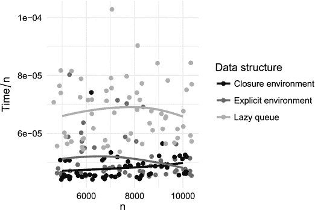

图 4-5

瞬时队列与最坏情况常数时间惰性队列的对比

最坏情况常数时间惰性队列使用与 `log(n)` 最坏情况队列相同的旋转函数，但它借助一个辅助列表，在其他队列操作中逐步求值前向列表的部分内容。通过旋转函数，我们在其他操作中处理连接和反转的组合，将元素从后向列表移至前向列表。我们使用辅助列表来求值构成前向列表的 thunk（延迟计算对象）。如果在其他操作中逐步求值这些 thunk，那么当需要访问前向列表时，惰性表达式已经被求值，我们就可以在常数时间内访问列表。

与在 `lazy_queue` 数据结构中跟踪列表长度不同，我们只需保留额外的辅助列表。在此实现中，我们不需要知道列表的长度，只需检查列表是否为空：

```r
lazy_queue <- function(front, back, helper) {
structure(list(front = front, back = back, helper = helper),
class = "lazy_queue")
}
```

然后将 `make_q` 函数修改为：

```r
make_q <- function(front, back, helper) {
if (is_nil(helper)) {
helper <- rot(front, back, nil)
lazy_queue(helper, nil, helper)
} else {
lazy_queue(front, back, cdr(helper))
}
}
```

并更新构造函数和泛型函数以反映数据结构的变更：

```r
empty_lazy_queue <- function()
lazy_queue(nil, nil, nil)
is_empty.lazy_queue <- function(x)
is_nil(x$front) && is_nil(x$back)
enqueue.lazy_queue <- function(x, elm)
make_q(x$front, cons(elm, x$back), x$helper)
front.lazy_queue <- function(x) car(x$front)
dequeue.lazy_queue <- function(x)
make_q(cdr(x$front), x$back, x$helper)
```

你应该将 `helper` 视为前向列表中的指针，而非独立的列表。其作用是在前向列表的元素中遍历并求值它们，最终只留下一个常规列表。我们操作的惰性列表在概念上是不可变的，但由于惰性求值，有些列表由简单的 `cons` 调用构成，有些则由 `rot` 调用构成。随着 `helper` 函数的推进，我们将递归的 `rot` 调用转换为 `cons` 调用——至少概念上是这样；实际的列表仍然包含 `rot` 调用，但函数的值已被求值。由于 `helper` 在队列操作的任何时刻都指向 `front` 列表的后缀，因此对 `helper` 中表达式的求值效果使得对 `front` 列表的操作变得廉价。

每当我们通过 `make_q` 构造队列时，要么建立前向列表和后向列表的新旋转，要么对 `helper` 列表中的第一个函数进行求值。我们可以通过一个示例来观察这一过程。我们从空列表开始并插入一个元素。这涉及一次 `rot` 调用（与早期惰性队列版本相同），但与此同时，我们也将辅助列表设置为指向前向列表：

```r
q <- empty_lazy_queue()
q <- enqueue(q, 1)
前向列表: cons(1, nil)
辅助列表: cons(1, nil)
后向列表: nil
```


当我们插入第二个元素时，它会被添加到`back`列表的前端，并且我们通过辅助函数执行一步操作，将其移动到空列表：

```
q <- enqueue(q, 2)
Front: cons(1, nil)
Helper: nil
Back: cons(2, nil)
```

插入第三个元素时，由于辅助列表现在为空，我们再次需要进行旋转调用：

```
q <- enqueue(q, 3)
Front: cons(1, rot(nil, cons(2, nil), cons(3, nil)))
Helper: cons(1, rot(nil, cons(2, nil), cons(3, nil)))
Back: nil
```

如果我们继续向队列中插入元素，可以看到辅助函数将遍历`front`队列并评估其中的表达式，同时我们向`back`队列插入新元素，并更新`front`队列：

```
q <- enqueue(q, 4)
Front: cons(1, cons(2, cons(3, nil)))
Helper: cons(2, cons(3, nil))
Back: cons(4, nil)
q <- enqueue(q, 5)
Front: cons(1, cons(2, cons(3, nil)))
Helper: cons(3, nil)
Back: cons(5, cons(4, nil))
q <- enqueue(q, 6)
Front: cons(1, cons(2, cons(3, nil)))
Helper: nil
Back: cons(6, cons(5, cons(4, nil)))
```

当我们插入第七个元素时，再次需要一次旋转，但此时`front`队列中的所有惰性表达式都已被评估：

```
q <- enqueue(q, 7)
Front: cons(1, rot(cons(2, cons(3, nil)),
cons(6, cons(5, cons(4, nil))),
cons(7, nil)))
Helper: cons(1, rot(cons(2, cons(3, nil)),
cons(6, cons(5, cons(4, nil))),
cons(7, nil)))
Back: nil
```

在后续操作中，`helper`将再次遍历`front`队列，并评估函数的尾部：

```
q <- enqueue(q, 8)
Front: cons(1, cons(2, rot(cons(3, nil),
cons(5, cons(4, nil)),
cons(6, cons(7, nil)))))
Helper: cons(2, rot(cons(3, nil),
cons(5, cons(4, nil)),
cons(6, cons(7, nil))))
Back: cons(8, nil)
q <- enqueue(q, 9)
Front: cons(1, cons(2, cons(3,
rot(nil,
cons(4, nil),
cons(5, cons(6, cons(7, nil)))))))
Helper: cons(3, rot(nil,
cons(4, nil),
cons(5, cons(6, cons(7, nil)))))
Back: cons(9, cons(8, nil))
q <- enqueue(q, 10)
Front: cons(1, cons(2, cons(3,
cons(4, cons(5, cons(6, cons(7, nil)))))))
Helper: cons(4, cons(5, cons(6, cons(7, nil))))
Back: cons(10, cons(9, cons(8, nil)))
```

我们不仅在添加元素时推进辅助函数的评估；在移除元素时也会推进它：

```
q <- dequeue(q)
Front: cons(2, cons(3,
cons(4, cons(5, cons(6, cons(7, nil))))))
Helper: cons(5, cons(6, cons(7, nil)))
Back: cons(10, cons(9, cons(8, nil)))
q <- dequeue(q)
Front: cons(3, cons(4, cons(5, cons(6, cons(7, nil)))))
Helper: cons(6, cons(7, nil))
Back: cons(10, cons(9, cons(8, nil)))
q <- dequeue(q)
Front: cons(4, cons(5, cons(6, cons(7, nil))))
Helper: cons(7, nil)
Back: cons(10, cons(9, cons(8, nil)))
q <- enqueue(q, 11)
Front: cons(4, cons(5, cons(6, cons(7, nil))))
Helper: nil
Back: cons(11, cons(10, cons(9, cons(8, nil))))
```

我们不会插入下一次旋转，直到辅助列表为空，此时整个`front`列表已被惰性评估完毕。正是因为辅助函数逐个遍历`front`列表并执行旋转操作，最坏情况下的性能才能保持在常数时间。

稍加努力，可以将此策略也适用于双端队列。关于其构造，我推荐参考 Okasaki (1995b)。

### 显式重建队列

具有常数时间操作的惰性队列通过在其他操作过程中，每次将元素从`back`列表移动一小部分到`front`列表来实现。这个想法也可以在无需惰性评估的情况下实现，通过显式跟踪一些额外的列表来捕获移动元素过程中的中间步骤。

我们会在`enqueue`和`dequeue`操作中重建`front`队列，方法是通过两个或四个其他列表保存一个处于中间状态的副本。我们可以将元素从`back`列表移动到`front`队列的过程分为两个阶段。首先翻转两个列表——翻转`back`列表是因为当我们将其元素放入`front`列表时需要它们的逆序；翻转`front`列表是因为如果先将其翻转，就可以逐个将`front`列表中的元素前置到`back`列表。当翻转列表时，我们将它们表示为四个列表：未按原始顺序翻转的元素位于`front`和`back`列表中，已翻转的元素位于`reversed_front`和`reversed_back`列表中。一次翻转操作包括将一个元素从`front`移动到`reverse_front`，以及将一个元素从`back`移动到`reversed_back`。翻转完成后，我们将部分追加操作表示为两个列表：`front`和`back`，并在每次操作中，将一个元素从`back`移动到`front`。通过翻转和追加这两种操作将 n 个元素从`back`列表移动到`front`列表需要 2n 次操作——n 次翻转操作和 n 次追加操作。如果每当`back`列表的长度与`front`列表相同时，我们开始重建`front`列表，并且在每次`enqueue`和`dequeue`操作中执行两次操作，那么就能保证在现有`front`列表被耗尽之前（如果我们执行 n 次`dequeue`操作，`front`列表会被清空），我们已经构建好一个新的`front`列表。通过这种策略，我们可以在每次修改队列时执行两次额外操作，从而构建一个更新后的`front`列表。

为了跟踪重建`front`列表的进度，我们定义了四种状态：

*   `IDLE`：当我们不需要进行任何更新时使用，因为我们没有在主动移动任何元素。
*   `REVERSING`：当我们正在翻转列表时。
*   `APPENDING`：当我们正在追加列表时。
*   `DONE`：当我们已完成构建新的`front`列表并准备用其更新队列时。

当处于`REVERSING`状态时，我们按照描述跟踪四个额外列表；当处于`APPENDING`状态时，我们跟踪两个额外列表。当处于`IDLE`状态时，我们不需要跟踪任何额外列表；当处于`DONE`状态时，我们需要记住所有操作的结果，直到实际用新的`front`列表更新队列。我们定义以下结构来跟踪这些状态：

```
IDLE <- 0
REVERSING <- 1
APPENDING <- 2
DONE <- 3
idle_state <- function() list(state = IDLE)
reversing_state <- function(
keep
, front
, reverse_front
, back
, reverse_back) {
list(state = REVERSING,
keep = keep,
front = front,
reverse_front = reverse_front,
back = back,
reverse_back = reverse_back)
}
appending_state <- function(
keep
, front
, back) {
list(state = APPENDING,
keep = keep,
front = front,
back = back)
}
done_state <- function(result) {
list(state = DONE, result = result)
}
```

暂时忽略`keep`变量；它是用来跟踪那些不应追加到新`front`列表中的元素的，这些元素在重建列表期间已被`dequeue`出队。它将跟踪应从翻转后的`front`列表移动到翻转后的`back`列表的元素数量。当向翻转后的`front`列表添加元素时，我们增加它；当在追加操作中将元素移动到`back`列表时，我们减少它。如果执行`dequeue`操作，我们也会减少它，从而防止出队的元素被添加到更新后的`front`列表——请参见下面的`invalidate`函数。


数据结构包含前列表和后列表，并跟踪它们的大小，以便知道何时开始将元素移动到新的前列表。它还包含状态，以便知道下一步操作和中间列表。我们这样定义它：

```
rebuild_queue_node <- function(
state
, front_size
, front
, back_size
, back) {
structure(list(state = state,
front_size = front_size,
front = front,
back_size = back_size,
back = back),
class = "rebuild_queue")
}
```

构造空队列并测试是否为空是很直接的。因为我们总是在`front`为空之前（除非整个队列为空）及时开始将元素从`back`移动到`front`，所以我们总是可以从`front`列表中获取队首元素，因此`front`操作也很容易实现：

```
empty_rebuild_queue <- function() {
rebuild_queue_node(state = idle_state(),
front_size = 0,
front = empty_list(),
back_size = 0,
back = empty_list())
}
is_empty.rebuild_queue <- function(x) is_empty(x$front)
front.rebuild_queue <- function(x) {
list_head(x$front)
}
```

执行更新操作时，我们检查当前处于哪种状态，并基于此执行相应操作。对于`REVERSING`状态，我们应该将一个元素从`front`列表移动到`reverse_front`列表，并将一个元素从`back`列表移动到`reverse_back`列表。如果`front`列表为空，则反转完成，应开始追加。开始反转时，队列中的`back`列表比`front`列表长一个元素；因此反转完成后，我们必须记住将`back`列表中的一个元素移动到`reverse_back`列表，以便开始追加。在追加过程中，每一步都需要将一个元素从`front`移动到`back`，当`keep`计数器为零时追加完成。我们需要使用`keep`计数器而不是检查`front`是否为空，因为如果执行了任何`dequeue`操作，那么在`APPENDING`状态下的`front`列表中的某些元素不应被添加到更新后的`front`列表中：

```
exec <- function(state) {
if (state$state == REVERSING) {
if (is_empty(state$front)) {
appending_state(keep = state$keep,
front = state$reverse_front,
back = list_cons(
list_head(state$back),
state$reverse_back)
)
} else {
reversing_state(keep = state$keep + 1,
front = list_tail(state$front),
reverse_front = list_cons(
list_head(state$front),
state$reverse_front),
back = list_tail(state$back),
reverse_back = list_cons(
list_head(state$back),
state$reverse_back))
}
} else if (state$state == APPENDING) {
if (state$keep == 0) {
done_state(result = state$back)
} else {
appending_state(keep = state$keep - 1,
front = list_tail(state$front),
back = list_cons(
list_head(state$front),
state$back))
}
} else {
state
}
}
```

对于每个更新队列的操作，我们需要执行两次更新操作，因此我们将其封装在以下函数中。在这里，我们还检查执行两次操作后是否达到了`DONE`状态，如果是，则将`front`队列替换为此状态中存储的`result`列表，并将新状态设置为`IDLE`：

```
exec2 <- function(x) {
new_state <- exec(exec(x$state))
if (new_state$state == DONE)
rebuild_queue_node(state = idle_state(),
front_size = x$front_size,
front = new_state$result,
back_size = x$back_size,
back = x$back)
else
rebuild_queue_node(state = new_state,
front_size = x$front_size,
front = x$front,
back_size = x$back_size,
back = x$back)
}
```

为了在后列表比前列表长时启动前列表的重建，我们将队列的更新操作封装在对`check`函数的调用中。只要后列表的长度小于或等于前列表的长度，它就会调用`exec2`；否则，它将状态设置为`REVERSAL`。此时，状态中的`front`列表设置为当前队列的`front`列表，`back`列表设置为队列的`back`列表，两个反转列表设置为空列表。`keep`计数器设置为零。由此状态构建的新队列具有空的`back`列表，并且我们将`front`列表的长度设置为更新后`front`列表的长度。实际的`front`列表此时尚未达到此长度，但在后续检查列表长度时我们假装它已达到，并且概念上它确实具有此长度——只是我们尚未完成列表的构建：

```
check <- function(x) {
if (x$back_size <= x$front_size) {
exec2(x)
} else {
# when back gets longer than front, we start reversing
new_state <- reversing_state(keep = 0,
front = x$front,
reverse_front = empty_list(),
back = x$back,
reverse_back = empty_list())
new_queue <- rebuild_queue_node(state = new_state,
front_size = x$front_size + x$back_size,
front = x$front,
back_size = 0,
back = empty_list())
exec2(new_queue)
}
}
```

入队操作不仅仅是简单地将元素添加到`back`列表并调用`check`：

```
enqueue.rebuild_queue <- function(x, elm) {
check(rebuild_queue_node(state = x$state,
front_size = x$front_size,
front = x$front,
back_size = x$back_size + 1,
back = list_cons(elm, x$back)))
}
```

出队操作稍复杂一些。我们需要从实际存储在队列中的列表以及正在重建的列表中移除队首元素。对于后者，我们使用`keep`计数器。出队时，通过调用以下`invalidate`函数使当前状态无效。如果当前正在重建`front`列表，此函数会减少当前状态中的`keep`计数器。如果状态的最后一次更新是一个将`keep`减为零的追加操作，则需将状态设置为`DONE`，并移除已构建结果中的第一个元素：

```
invalidate <- function(state) {
if (state$state == REVERSING) {
reversing_state(keep = state$keep - 1,
front = state$front,
reverse_front = state$reverse_front,
back = state$back,
reverse_back = state$reverse_back)
} else if (state$state == APPENDING) {
if (state$keep == 0) {
done_state(result = list_tail(state$back))
} else {
appending_state(keep = state$keep - 1,
front = state$front,
back = state$back)
}
} else {
state
}
}
```

出队现在简化为：使状态无效，同时移除队列`front`列表中的队首元素，然后调用`check`处理结果，以确保`dequeue`函数中执行了两次更新操作：

```
dequeue.rebuild_queue <- function(x) {
new_queue <- rebuild_queue_node(state = invalidate(x$state),
front_size = x$front_size - 1,
front = list_tail(x$front),
back_size = x$back_size,
back = x$back)
check(new_queue)
}
```

这种重建队列主要具有理论意义。就其实际性能而言，执行的操作带来了较大的开销，使得此队列实现比我们考虑的其他实现更慢，如图 4-6 所示。

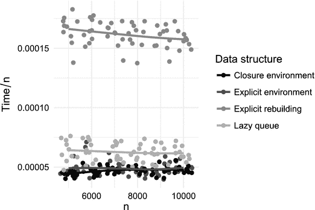

Figure 4-6  
一系列`enqueue`和`dequeue`操作的队列性能比较 脚注 1


### 避免混淆

为了避免任何混淆：一个数据结构可以是不可变的，因此对它的操作没有副作用，但在分析其分摊复杂度时，它仍然可能不是一个持久化数据结构。我们在这里实现的环境队列既是可变的，也是非持久化数据结构，因为访问它们会产生副作用。函数式队列是不可变的——它没有副作用——但分摊分析迫使我们将其视为非持久化的。如果我们只关心它的最坏情况性能，我们可以将其视为持久化的。

2

在本章中，我将使用一个显式函数`lazy_thunk`来包装操作。你也可以直接返回一个匿名函数，但你必须记得将函数体作为函数求值，使其行为类似列表。因此，在`concat`函数中，与其返回`lazy_thunk(do_cat(l1,l2))`，不如返回`function() do_cat(l1,l2)()`。

3

递归的深度取决于你的 R 环境设置，因此你可能需要增加在循环中处理的元素数量，但在标准配置下，这应该足以引发错误。

## 5. 堆

**堆**（或优先队列）是有序集合中元素的集合，除了检查是否为空和插入元素之外：

```
is_empty <- function(x) UseMethod("is_empty")
insert <- function(x, elm) UseMethod("insert")
```

我们还可以访问并删除最小的元素：¹

```
find_minimal <- function(heap) UseMethod("find_minimal")
delete_minimal <- function(heap) UseMethod("delete_minimal")
```

堆不一定包含集合。堆中可能存在多个具有相同值的元素。

除了这些操作，我们还需要能够合并两个堆：

```
merge <- function(x, y) UseMethod("merge")
```

在许多实现中，`merge`函数非常有用，并且我们可以像这样实现一个默认版本：

```
merge.default <- function(x, y) {
  while (!is_empty(y)) {
    x <- insert(x, find_minimal(y))
    y <- delete_minimal(y)
  }
  x
}
```

但是，由于我们已经将`merge`用于包（bags），我们可能不应该为泛型函数创建这个默认实现。相反，我们可以为堆创建一个版本：

```
merge.heap <- function(x, y) {
  while (!is_empty(y)) {
    x <- insert(x, find_minimal(y))
    y <- delete_minimal(y)
  }
  x
}
```

并使我们所有的堆实现都继承自一个通用的`"heap"`类。

这种堆合并方法适用于所有堆，但通常有更高效的合并堆的解决方案。这个默认解决方案所需的`find_minimal`和`delete_minimal`操作次数等于堆`y`的大小，因此至少与`y`的大小成线性关系。正如我们将看到的，我们通常可以做得更好。

堆的一个用途是对元素进行排序。这种方法称为**堆排序**。如果我们有一个堆，可以使用类似于`merge.default`函数的循环，从堆中按逆序构造一个列表：

```
heap_to_list <- function(x) {
  l <- empty_list()
  while (!is_empty(x)) {
    l <- list_cons(find_minimal(x), l)
    x <- delete_minimal(x)
  }
  l
}
```

这个函数从堆创建一个链表，但元素是按递减顺序而非递增顺序添加的，因此要实现完整的排序，我们需要反转它。当然，要对一个元素向量进行排序，我们还需要从元素构造堆。一种通用方法是简单地将所有元素从一个空堆开始插入：

```
vector_to_heap <- function(empty_heap, vec) {
  heap <- empty_heap
  for (e in vec)
    heap <- insert(heap, e)
  heap
}
```

使用`vector_to_heap`和`heap_to_list`函数，我们可以这样对元素进行排序：

```
heap_sort <- function(vec, empty_heap) {
  heap <- vector_to_heap(empty_heap, vec)
  lst <- heap_to_list(heap)
  list_reverse(lst)
}
```

`heap_sort`函数的时间复杂度取决于堆操作的时间复杂度。我们可以在线性时间内反转`lst`。如果`insert`、`find_minimal`和`delete_minimal`都在对数时间内运行，整个排序可以在`O(n log(n))`时间内完成，这对于基于比较的排序是最优的。由于我们知道这是排序的最优时间，这也为我们提供了关于堆数据结构效率的线索。如果我们有一个最优排序算法，那么`vector_to_heap`或`heap_to_list`中至少有一个的时间复杂度必须严格以`O(n log(n))`为上界。

事实证明，我们通常可以在线性时间内从 n 个元素构造一个堆，但再次提取元素需要`O(n log(n))`时间。使用`merge`函数可以在线性时间内构造堆。我们不是一次添加一个元素，而是构造一个堆序列并将它们合并。构造过程如下：


```r
singleton_heap <- function(empty_heap, e) insert(empty_heap, e)
vector_to_heap <- function(vec, empty_heap, empty_queue) {
  q <- empty_queue
  for (e in vec)
    q <- enqueue(q, singleton_heap(empty_heap, e))
  repeat {
    first <- front(q) ; q <- dequeue(q)
    if (is_empty(q)) break
    second <- front(q) ; q <- dequeue(q)
    new_heap <- merge(first, second)
    q <- enqueue(q, new_heap)
  }
  first
}
```

我们首先构建一个仅包含一个输入元素的单例堆。然后将这些堆放入一个队列中，当堆的数量超过一个时，我们从队列中取出前两个堆，合并它们，然后将合并后的堆放回队列末尾。你可以将此视为经历若干个堆的阶段。第一阶段将大小为 1 的堆合并为大小为 2 的堆；第二阶段将大小为 2 的堆合并为大小为 4 的堆，以此类推。由于堆的大小只能以对数级别翻倍，因此我们共有 `log(n)` 个阶段。

在阶段 `m` 中，我们合并的堆大小为 `2^m`。如果能够在对数时间内合并堆，那么以这种方式构建堆的总时间为：

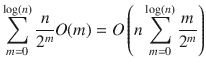

由于级数

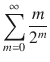

是收敛的，因此总时间复杂度为 `O(n)`。所以，如果能在对数时间内合并堆，我们就能在 `O(n)` 时间内构建一个包含 `n` 个元素的堆。² 这也告诉我们，如果能在对数时间内合并堆，那么获取最小值或删除最小值也必然至少需要对数时间——否则，我们就能以快于 `O(n log(n))` 的速度进行排序，而对于基于比较的排序而言，这是不可能的。

采用这种堆构建方式，我们需要将 `heap_sort` 函数修改为如下形式：

```
heap_sort <- function(vec, empty_heap, empty_queue) {
  heap <- vector_to_heap(vec, empty_heap, empty_queue)
  lst <- heap_to_list(heap)
  list_reverse(lst)
}
```

该函数通过参数接受空堆和空队列，这使我们能够选择所使用的数据结构。我们知道，当不需要队列持久化时，最快的队列实现是基于环境的队列（environment-based queue），因此我们可以将其设为默认的空队列，从而得到一个高效的算法。在本章剩余部分，我们将尝试不同的堆实现，以确定哪种堆可以作为良好的默认选择。

我们将实现的堆基于树结构，因此它们比前一章中使用的列表和队列稍复杂一些——但也只是稍微复杂一点。在处理树时，如果树中每个节点都包含一个值，且所有节点的子节点的值都大于该节点的值，则称该树具有“堆性质”。通过递归推理，这意味着如果一棵树具有堆性质，那么它的所有子树也具有堆性质。这将是我们对所有待处理树所确保的一个不变性。

### 左偏堆

左偏堆是一种经典的堆实现，其核心思想非常简单：用一棵具有堆性质的二叉树来表示堆，并确保左子树始终不小于右子树。³ 这种结构利用了数据结构设计中的一个通用技巧，即“较小半部分技巧”（smaller half trick）。如果需要进行递归计算，但只需对二叉树的两个子节点之一进行操作，那么就选择较小的子树。这样做，每次递归调用都会将树的大小削减一半。⁴ 如果每次递归调用都削减一半数据，那么递归深度永远不会超过完整数据规模的对数。

在左偏堆中，我们并不实际追踪堆的完整大小来利用这个技巧。无需平衡树结构也能高效操作堆。相反，我们关注的是递归中可能达到的总深度。我们始终在堆的右侧进行递归，因此堆中最右侧路径的长度（我们称之为 `rank`）是我们关注的重点，并且我们确保最右侧路径总是最短的。

一种名为“最大叶堆”（maxiphopic heaps，Okasaki 2005）的变体使这一点更加明确，但根本思想相同：最大叶堆只是不要求较大的子树必须是左子树。

为了保持左子树的 `rank` 始终小于右子树的 `rank` 这一不变性，我们记录树的 `rank`。用于表示左偏堆的结构如下：

```
leftist_heap_node <- function(
    value
  , left = empty_leftist_heap()
  , right = empty_leftist_heap()
  , rank = 0
) {
  structure(list(left = left,
                 value = value,
                 right = right,
                 rank = rank),
            class = c("leftist_heap", "heap"))
}
```

该结构的类为 `"leftist_heap"` 和 `"heap"`，以便在需要时使用不特定于左偏堆的通用堆函数。

空列表和判空测试使用了我们之前用过的“哨兵技巧”。不过，我们不针对哨兵进行身份测试来判断是否为空，以避免在以后修改叶子节点时（例如实现绘图代码时）可能引发的问题：

```
empty_leftist_heap_node <- leftist_heap_node(NA, NULL, NULL)
empty_leftist_heap <- function() empty_leftist_heap_node
is_empty.leftist_heap <- function(x)
  is.null(x$left) && is.null(x$right)
```

由于左偏堆具有堆性质，我们总是可以从树的根节点获取最小值：

```
find_minimal.leftist_heap <- function(heap) {
  heap$value
}
```

要删除最小值，需要移除根节点的值。由于根节点的两棵子树都是堆，只需合并这两棵子树，即可创建一个删除了最小值的新堆：

```
delete_minimal.leftist_heap <- function(heap) {
  merge(heap$left, heap$right)
}
```

插入元素同样简单：创建一个单例堆，然后将其合并到现有堆中：

```
insert.leftist_heap <- function(x, elm) {
  merge(x, leftist_heap_node(elm))
}
```

左偏堆的所有复杂性都归结于 `merge` 操作。正是在这里，我们利用“右子树的深度永远不会超过整个堆深度的一半”这一特性。合并两个堆时，我们取出根节点中的最小值，将第一棵树的左子树作为合并结果的左子树，然后在右侧递归地进行合并。由于这样做将问题规模缩减了一半，因此总时间不会超过 `O(log n)`。


```r
build_leftist_heap <- function(value, a, b) {
  if (a$rank >= b$rank) {
    leftist_heap_node(
      value = value,
      left = a,
      right = b,
      rank = b$rank + 1
    )
  } else {
    leftist_heap_node(
      value = value,
      left = b,
      right = a,
      rank = a$rank + 1
    )
  }
}

merge.leftist_heap <- function(x, y) {
  if (is_empty(x)) return(y)
  if (is_empty(y)) return(x)
  if (x$value <= y$value)
    build_leftist_heap(x$value, x$left, merge(x$right, y))
  else
    build_leftist_heap(y$value, y$left, merge(x, y$right))
}
```

`merge`操作的基本情况确保了如果要合并的两个堆中有一个为空，我们就返回另一个。否则，我们递归地在右侧进行调用。我们始终将最小值放在根节点，以保持堆的性质，但在此之后，我们对问题的一半进行递归调用。“较小一半”技巧帮助我们实现了对数级别的复杂度。

由于我们可以立即从左偏堆的根节点获取最小值，因此`find_minimal`操作的时间复杂度为 O(1)。`insert`和`delete_minimal`操作通过`merge`实现，因此这些操作的时间复杂度为 O(log n)。

我希望你认同这种堆的实现方式非常直接。它只有一个技巧——即“较小一半”技巧——剩下的就是记住始终递归到右侧，绝不向左侧递归。“较小一半”技巧的强大程度令人惊讶。我在许多不同的算法中都使用过它，并且始终对这个简单技巧的威力感到敬畏。

但是，仅仅因为我们有了一种堆数据结构的解决方案，并没有理由就此止步。探索其他解决方案是值得的。即使它们效率较低（如果实现起来更复杂，可能会效率更低），但实现它们或许能让我们获得一些洞见。

### 二项堆

对于第二种堆的版本，我们来看二项堆。我对这种数据结构的介绍也基于 Okasaki（1999a）。二项堆基于二项树，二项树是满足堆结构并带有额外不变量的树（见图 5-1）：

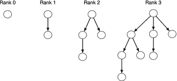

**图 5-1** 二项树

* 秩为 0 的二项树是单节点树。
* 秩为 r 的树有 r 个子节点，t [1]，t [2]，…，t [r]，其中 t [i] 是秩为 r – i 的二项树。

我们不打算将二项树作为抽象数据结构来使用，因此不会为它们创建一个类，而是直接使用`list`来实现：

```r
binomial_tree_node <- function(value, trees) {
  list(value = value, trees = trees)
}
```

我们将通过链接来构建二项树。这是一个只对相同秩的树执行的操作，该操作会将其中一棵树作为另一棵树的最左子树。如果两棵树都有秩 r，那么这将构建一棵秩为 r + 1 的新树。为了保持堆的性质，我们必须确保父树是两棵树中值较小的那棵。我们可以这样实现这个操作：

```r
link_binomial_trees <- function(t1, t2) {
  if (t1$value < t2$value) {
    binomial_tree_node(t1$value, list_cons(t2, t1$trees))
  } else {
    binomial_tree_node(t2$value, list_cons(t1, t2$trees))
  }
}
```

二项树本身并不是构建堆的高效方法。事实上，我们根本无法将它们直接用作堆。当然，我们可以轻松地从根节点获取最小值，但无法在二项树中表示任意数量的元素——由于不变量，它们并不能涵盖所有规模——而且对二项树的操作也不容易支持堆的各项操作。相反，二项堆是一个树的列表，每个树都带有关联的秩，以便我们跟踪这些信息。堆中的最小值将位于这些树的某个根节点上，但由于查找它需要遍历列表，我们将显式地记住它：

```r
binomial_heap_node <- function(rank, tree) {
  list(rank = rank, tree = tree)
}

binomial_heap <- function(min_value, heap_nodes = empty_list()) {
  structure(list(min_value = min_value, heap_nodes = heap_nodes),
            class = c("binomial_heap", "heap"))
}
```

采用这种结构，空的二项堆就是一个没有二项树的堆，我们不需要哨兵来表示这种空堆：

```r
empty_binomial_heap <- function() binomial_heap(NA)
is_empty.binomial_heap <- function(x) is_empty(x$heap_nodes)
```

由于我们显式地表示了堆中的最小值，`find_minimal`函数的实现变得非常简单：

```r
find_minimal.binomial_heap <- function(heap) {
  heap$min_value
}
```

现在，我们坚持对二项堆中二项树的使用施加以下不变量：不能有两棵树的秩相同。这就在堆中二项树的秩与堆中元素数量的二进制表示之间建立了对应关系：对于二进制表示中的每个 1，我们将拥有一棵对应秩的树，如图 5-2 所示。

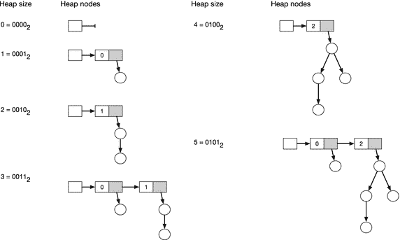

**图 5-2** 大小从 0 到 5 的二项堆

牢记这个不变量，我们可以将插入和合并操作视为二进制加法的一种变体。插入是最简单的情况，所以我们先来处理它。要向堆中插入一个新值，我们首先创建一个单节点堆，其中包含一个秩为 0 且持有该值的二项树：

```r
singleton_binomial_heap_node <- function(value) {
  tree <- binomial_tree_node(value, empty_list())
  binomial_heap_node(0, tree)
}
```


现在我们需要将这个节点插入到列表中。如果列表中还没有 rank 为 0 的节点，我们可以直接将其插入。但如果已有节点占据该槽位，我们就必须另做处理。我们可以将已有的 rank 0 树与新创建的单一节点链接起来，生成一个 rank 为 1 的节点。如果该槽位空闲，就完成操作；如果不空闲，则必须再次链接，以此类推。这类似于我们在二进制加法中处理进位的方式。如果我们始终保持堆中的树按 rank 递增排序，那么这种方法可以这样实现：

```
insert_binomial_node <- function(new_node, heap_nodes) {
  if (is_empty(heap_nodes)) {
    return(list_cons(new_node, empty_list()))
  }
  first_node <- list_head(heap_nodes)
  if (new_node$rank < first_node$rank) {
    list_cons(new_node, heap_nodes)
  } else {
    new_tree <- link_binomial_trees(new_node$tree, first_node$tree)
    new_node <- binomial_heap_node(new_node$rank + 1, new_tree)
    insert_binomial_node(new_node, list_tail(heap_nodes))
  }
}
```

堆上的插入操作现在由两部分组成：必要时更新最小值，以及从单一节点开始插入新值：

```
insert.binomial_heap <- function(x, elm, ...) {
  new_min_value <- min(x$min_value, elm, na.rm = TRUE)
  new_node <- singleton_binomial_heap_node(elm)
  new_nodes <- insert_binomial_node(new_node, x$heap_nodes)
  binomial_heap(new_min_value, new_nodes)
}
```

这里的 `na.rm = TRUE` 是必要的，用于处理堆为空的情况。我们也可以通过将空堆的值设为 `Inf` 来避免使用它，但我认为显式声明空堆实际上没有最小值更为优雅。

合并两个堆的操作也类似于二进制加法。两个堆都以按 rank 递增顺序排列的二叉树列表形式表示，因此我们可以将其实现为列表合并。当一个列表的前端元素的 rank 小于另一个列表的前端元素时，我们可以将该元素插入新列表的前端并进行递归调用；但当两个列表的前端元素 rank 相等时，我们必须链接这两个元素，并将新生成的树合并进去。我们不能简单地将新树放在合并结果的前端，因为现有列表可能已经有该 rank 的槽位，但我们可以将其插入到递归调用的结果中，这类似于加法中的进位操作：

```
merge_heap_nodes <- function(x, y) {
  if (is_empty(x)) return(y)
  if (is_empty(y)) return(x)
  first_x <- list_head(x)
  first_y <- list_head(y)
  if (first_x$rank < first_y$rank) {
    list_cons(first_x, merge_heap_nodes(list_tail(x), y))
  } else if (first_y$rank < first_x$rank) {
    list_cons(first_y, merge_heap_nodes(list_tail(y), x))
  } else {
    new_tree <- link_binomial_trees(first_x$tree, first_y$tree)
    new_node <- binomial_heap_node(first_x$rank + 1, new_tree)
    rest <- merge_heap_nodes(list_tail(x), list_tail(y))
    insert_binomial_node(new_node, rest)
  }
}
```

实际的合并操作除了合并堆节点外，还需要记录新的最小值：

```
merge.binomial_heap <- function(x, y, ...) {
  if (is_empty(x)) return(y)
  if (is_empty(y)) return(x)
  new_min_value <- min(x$min_value, y$min_value)
  new_nodes <- merge_heap_nodes(x$heap_nodes, y$heap_nodes)
  binomial_heap(new_min_value, new_nodes)
}
```

这种情况下我们不需要 `na.rm = TRUE`，因为我们显式处理了空堆的情况。⁵

插入操作实际上只是合并的一种特殊情况，就像在左倾堆中那样，我们本可以通过合并来实现它：

```
insert_binomial_node <- function(new_node, heap_nodes) {
  merge_heap_nodes(list_cons(new_node, empty_list()), heap_nodes)
}
```

这里，我们只需将新节点构造成一个列表，然后将其合并到现有堆节点中即可。

合并操作的复杂度源于其与二进制数的对应关系。要表示一个大小为 `n` 的数，只需要 `log n` 个比特位，因此对于大小为 `n` 的堆，其列表长度不会超过 `log n`。我们不仅仅是简单合并，还增加了处理进位的复杂度，但即使如此（这本质上是二进制加法），其复杂度仍然是 `O(log n)`——与两个以二进制表示的、大小为 `n` 的数相加的复杂度相同。由于插入只是合并的一个特例，我们当然也可以在 `O(log n)` 时间内完成插入。

从二项堆中删除最小值实际上并不复杂，只是涉及更多代码，因为需要操作列表。最小值位于堆中某棵树的根节点处。我们需要找到这棵树，并将其从树列表中删除。我们可以在一个函数中返回两个值来实现，但这会涉及返回值的打包和解包，因此我们将分两步操作。通过堆中保存的最小值，我们知道要在根节点中搜索哪个值，因此找到包含该值的树只需对堆节点进行线性搜索，删除该节点也同样简单：

```
get_minimal_node <- function(min_value, heap_nodes) {
  first_node <- list_head(heap_nodes)
  if (first_node$tree$value == min_value) first_node
  else get_minimal_node(min_value, list_tail(heap_nodes))
}
delete_minimal_node <- function(min_value, heap_nodes) {
  first_node <- list_head(heap_nodes)
  if (first_node$tree$value == min_value) {
    list_tail(heap_nodes)
  } else {
    rest <- delete_minimal_node(min_value, list_tail(heap_nodes))
    list_cons(first_node, rest)
  }
}
```

这些操作在列表长度上是线性时间的，但由于我们操作的列表长度不会超过 `O(log n)`，因此相对于堆的大小，我们可以在对数时间内完成这些操作。

删除包含最小值的树确实会移除该值，但也会移除该树中的其他值。我们需要将这些值重新放回堆中。为此，我们将它们合并到堆节点中。但要做到这一点，我们需要将它们与各自的 rank 关联起来；需要将它们包装在堆节点结构中。如果我们要删除的树的 rank 为 `r`，那么我们知道它的第一个子树 rank 为 `r – 1`，第二个子树 rank 为 `r – 2`，依此类推。因此，我们可以遍历这些子树，同时携带要给前端树的 rank，通过如下递归实现：

```
binomial_trees_to_nodes <- function(rank, trees) {
  if (is_empty(trees)) {
    empty_list()
  } else {
    list_cons(binomial_heap_node(rank, list_head(trees)),
              binomial_trees_to_nodes(rank - 1, list_tail(trees)))
  }
}
```

如果移除的树 rank 为 `r`，这是一个 `O(r)` 操作。但由于树的 rank 不会超过 `O(log n)`——再次以数字的二进制表示来类比——因此这是一个相对于堆大小的对数操作。我们需要将这些节点合并到已移除最小树的原始列表中，但它们的顺序是错误的。二项树的子节点是按 rank 降序排列的，而二项堆中的树是按 rank 升序排列的，因此在合并之前，我们必须反转该列表。我们也可以在 `O(log n)` 时间内完成反转，因为这是一个相对于列表长度的线性时间操作。

如果你想知道为什么我们不从一开始就按升序表示二叉树的子节点，这与我们如何链接两棵树有关。我们可以在常数时间内链接两棵树，因为这只需要将一棵树前置到树的列表前。如果我们想按 rank 升序存储子树，则需要将树附加到列表末尾。这要么需要与树的大小成线性时间，要么需要更复杂的数据结构。所以在此处反转列表要简单得多。


因为我们正在删除堆中的最小值，还需要更新为此存储的值。在这里，我们可以在构建新列表后遍历它，并找出树根中的最小值：

```
binomial_nodes_min_value <- function(heap_nodes, cur_min = NA) {
if (is_empty(heap_nodes)) {
cur_min
} else {
front_value <- list_head(heap_nodes)$tree$value
new_cur_min <- min(cur_min, front_value, na.rm = TRUE)
binomial_nodes_min_value(list_tail(heap_nodes), new_cur_min)
}
}
```

我们将当前最小值作为累加器传递，并为其提供默认值`NA`。因此，在更新时也需要使用`na.rm = TRUE`，但将`NA`作为默认值也确保：如果我们在删除最后一个元素时构建一个空堆，其最小值会被设置为`NA`。

所有这些操作的时间复杂度为`O(log n)`，而`delete_minimal`操作只是将它们组合在一起，因此我们得到一个`O(log n)`的操作，如下所示：

```
delete_minimal.binomial_heap <- function(heap) {
min_node <-
get_minimal_node(heap$min_value, heap$heap_nodes)
other_nodes <-
delete_minimal_node(heap$min_value, heap$heap_nodes)
min_node_nodes <-
binomial_trees_to_nodes(min_node$rank - 1,
min_node$tree$trees)
new_nodes <-
merge_heap_nodes(other_nodes, list_reverse(min_node_nodes))
new_min_value <- binomial_nodes_min_value(new_nodes)
binomial_heap(new_min_value, new_nodes)
}
```

综上所述，我们可以实现一个二项堆，在最坏情况下，其`find_minimal`操作的时间复杂度为`O(1)`，`insert`、`merge`和`delete_minimal`操作的时间复杂度为`O(log n)`。然而，通过考虑堆节点列表的行为与链接操作次数的关系，我们可以证明`insert`实际上的均摊时间复杂度为`O(1)`。如果你仔细查看原始的`insert_binomial_node`实现，很明显我们只在进行链接操作时才会递归，因此该函数的复杂度是链接操作次数加一。你可以将每次链接操作视为将原始堆列表二进制数中的一位从一翻转为零，将递归终止视为将一位从零翻转到一。如果我们现在认为将一位从零翻转到一需要花费两个信用点而不是一个，那么这样的操作也为以后插入时将其再次翻转为零支付了代价。然而，这种分析仅在我们将堆视为瞬时数据结构时有效——如果将其视为持久化数据结构，则无法阻止我们多次花费那些与“1”位相关的信用点。其他最坏情况为`O(log n)`的操作，在均摊分析下仍然为`O(log n)`。

由于插入操作的均摊常数时间复杂度，构建二项堆比构建左偏堆高效得多。图 5-3 展示了使用以下实验代码构建的测试结果：

```
setup <- function(n) n
evaluate <- function(empty) function(n, x) {
elements <- 1:n
heap <- empty
for (elm in elements) {
heap <- insert(heap, elm)
}
}
```

当我们用构建给定大小堆所花费的时间除以该大小时，可以看到二项堆具有平坦的时间曲线，而左偏堆的时间呈对数增长。这表明，在实践中，构建二项堆的运行时间为`O(n)`，而构建左偏堆的运行时间为`O(n log n)`。这证明了与左偏堆相比，二项堆这一更复杂的数据结构的合理性——至少在不需要持久化数据结构时是如此。均摊分析仅在我们将二项堆作为瞬时数据结构处理时才有效。

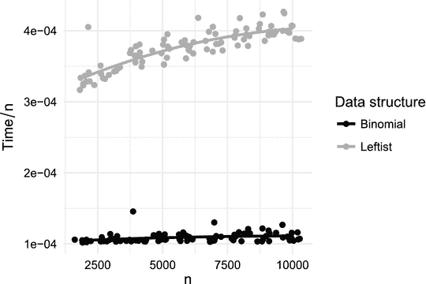

**图 5-3**
逐个插入元素时，左偏堆与二项堆构建时间对比

我还需要强调的是，使用二项堆而非左偏堆的这一优势仅在我们通过逐个插入元素来构建堆时才相关。如果我们使用通过迭代合并越来越大的堆来构建堆的算法，那么二项堆和左偏堆都可以在线性时间内构建完成，并且左偏堆的开销更小，如图 5-4 所示（该图使用以下实验设置构建）：

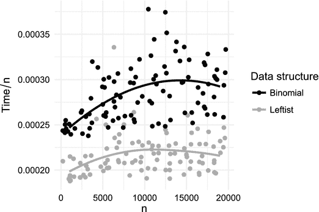

**图 5-4**
使用线性时间算法构建堆

```
setup <- function(n) n
evaluate <- function(empty) function(n, x) {
vector_to_heap(1:n, empty)
}
```

有可能将均摊常数时间插入改进为最坏情况常数时间，方法是将构建方式从基于二进制数改为基于斜二进制数。这种构建方式类似于第 3 章中的随机访问列表，以及我们刚刚实现的二项堆。我们只需要允许堆中具有最小秩的两个二项树拥有相同的秩。如果它们确实相同，那么当我们插入一个新的单元素树时就需要将它们链接起来，但正如我们在随机访问列表中看到的，通过将构建方式基于斜二进制数而非二进制数，永远不会因此触发一连串的链接操作。当然，均摊与最坏情况常数时间操作的区别仅当每个单一操作都需要快速时才相关——例如，对于实时或交互式应用——这在 R 算法中很少成为问题，因此我们在这里不实现该变体。

还可以通过将斜二项堆进一步修改为所谓的 Brodal 堆（Brodal and Okasaki 1996）来实现最坏情况下的合并操作。这涉及两层的堆。Brodal 堆是包含堆（这些堆存储我们实际要存放在堆中的值）的斜二项堆，而不是直接包含值本身。具有两层的堆使得可以在常数时间内进行合并，但当然也增加了一些复杂性。然而，使用 Brodal 堆，除了删除最小值操作仍具有对数复杂度外，所有操作在最坏情况下都是常数时间复杂度。这在理论上是最优的，因为在不增加其他某些操作复杂度的情况下，不可能改善删除最小值操作的复杂度。


### 伸展堆

一种与常规堆略有不同的方法是所谓的伸展树。它们实际上是搜索树，并具有搜索树性质——左子树中的所有值都小于根节点的值，右子树中的所有值都大于根节点的值——而不是堆性质。由于它们是搜索树，我们将在下一章更详细地讨论它们，但在这里我们先用它们来实现一个堆。

伸展树的结构与搜索树相同，我们在第 3 章中见过这种结构。搜索树是递归定义的：它由一个节点（包含一个值）以及左子树和右子树（它们本身也是搜索树）组成。搜索树的不变性质是前面提到的：节点中的值大于左子树中的所有值，且小于右子树中的所有值。我们可以这样实现这个结构：

```
splay_tree_node <- function(value, left = NULL, right = NULL) {
list(left = left, value = value, right = right)
}
```

我们在第 3 章中实现的结构对空树使用了哨兵树。这是因为我们需要对空树进行泛型方法的分派。对于我们现在要实现的伸展堆，我们不会将堆仅仅表示为一棵树，而是将其包装在一个包含树和堆中最小值的结构中，因此，与二项堆一样，我们有一种不依赖哨兵的空堆表示形式。正因如此，我们将简单地使用 `NULL` 来表示空树。⁶ 伸展堆的结构、创建空堆以及判空测试的实现如下：

```
splay_heap <- function(min_value, splay_tree) {
structure(list(min_value = min_value, tree = splay_tree),
class = c("splay_heap", "heap"))
}
empty_splay_heap <- function() splay_heap(NA, NULL)
is_empty.splay_heap <- function(x) is.null(x$tree)
```

我们显式地存储堆中的最小值，以便能在常数时间内返回它：

```
find_minimal.splay_heap <- function(heap) {
heap$min_value
}
```

要在搜索树中实际找到具有最小值的节点，我们需要找到树中最左侧的节点。根据搜索树性质，这就是最小值。我们可以通过向左递归，直到到达一个左子节点为空的节点来定位此节点：

```
splay_find_minimal_value <- function(tree) {
if (is.null(tree)) NA
else if (is.null(tree$left)) tree$value
else splay_find_minimal_value(tree$left)
}
```

这里，当整棵树为空时，我们有一个特殊情况——在这种情况下我们使用 `NA` 来表示最小值。不过，我们只应在整个堆为空时遇到这种情况。类似于查找最小值，我们可以通过向右递归直到右子树为空来查找最大值。

这种搜索所需的时间与树的深度成正比。如果我们保持树的平衡，那么这将是 O(log n)，但对于伸展树，我们不会显式地平衡它们。相反，每当修改树时，我们盲目地重新排列它们。⁷ 每当我们删除或插入值时，我们都会执行一种重平衡操作，将树中已修改的部分拉近到根节点。

在我们用于删除树中最小值的代码中，可以看到一些这种重排列操作。该值位于树的最左侧节点，而删除它的递归有三种情况：两种基本情况（它们仅在最小节点是最左侧路径上唯一的左树，还是左树的左树这一点上有所不同），以及一种递归情况，如图 5-5 所示。在第一种基本情况中，我们只能返回右子树。在第二种基本情况中，我们还将最左侧节点替换为其右子树，因此可以将其视为一种特例。如果只是删除最左侧的树，我们并不需要这个特例——我们只需向左递归，并从递归返回时将结果用作左子树即可。需要它的原因在于递归情况。在这里，我们需要访问一棵树的根节点、其右子树、其左子树以及该左子树的两个子节点。我们将对左子树的左子树进行递归调用，然后旋转树，如图 5-5 所示。正是这种旋转导致了当 x 是树中的最小值时（我们将其作为第二种基本情况处理）的那种特例。

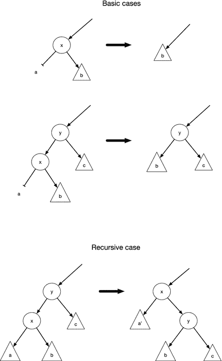

图 5-5

在伸展堆中删除最小节点的递归中的三种情况。在递归情况中，树 a' 表示对树 a 递归调用的结果。

以下是删除伸展树中最小节点的代码：

```
splay_delete_minimal_value <- function(tree) {
if (is.null(tree$left)) {
tree$right
} else {
a <- tree$left$left
x <- tree$left$value
b <- tree$left$right
y <- tree$value
c <- tree$right
if (is.null(a))
splay_tree_node(left = b, value = y, right = c)
else
splay_tree_node(
left = splay_delete_minimal_value(a),
value = x,
right = splay_tree_node(left = b, value = y, right = c)
)
}
}
```

我们在删除最小值时对树执行的旋转操作并不会平衡整棵树，但确实缩短了最左侧路径。现有最左侧路径上的所有节点最终都会处于调用前深度的一半位置。树 `b` 中的节点要么离根节点更近一个节点，要么保持原来的深度；而树 `c` 中的节点要么保持当前深度，要么增加一个节点的深度。我们并非在平衡树，但我们在平均意义上缩短了查找最小值的搜索路径，并且可以证明，如果采用此方法，每次 `delete_minimal` 操作的均摊运行时间为 O(log n)。⁸

要删除伸展堆中的最小值，我们需要将其从底层的伸展树中删除，然后更新存储的最小值。我们可以这样实现此操作：

```
delete_minimal.splay_heap <- function(heap) {
if (is_empty(heap))
stop("Can't delete the minimal value in an empty heap")
new_tree <- splay_delete_minimal_value(heap$tree)
new_min_value <- splay_find_minimal_value(new_tree)
splay_heap(min_value = new_min_value, splay_tree = new_tree)
}
```

当向伸展树中插入一个新元素时，我们总是将其放在根节点。为了确保搜索树性质，我们必须将所有小于新值的元素放入左子树，将所有大于新值的元素放入右子树。为此，我们有一个函数 `partition`，它将所有小于和大于某个“枢轴”元素的元素收集起来，并以伸展树的形式返回。这些“较小”和“较大”的树是根据当前节点及其左子树或右子树中的值递归计算得出的。通过查看这两个值，我们可以确定需要递归的子树，以便对树的更深层部分进行划分，如图 5-6 所示。在图中，`S(x)` 表示通过对树 `x` 进行递归得到的“较小”树，`L(x)` 表示通过对 `x` 进行递归得到的“较大”树。


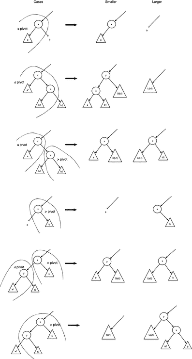

**图 5-6** — 伸展堆分区的情形（树为空的特殊情况已省略）

`partition` 的实现并非特别优雅，但它首先考虑了树为空的情况，然后依次处理了**图 5-6** 中的六种情形：

```
partition <- function(pivot, tree) {
if (is.null(tree)) {
smaller <- NULL
larger <- NULL
} else {
a <- tree$left
x <- tree$value
b <- tree$right
if (x <= pivot) {
if (is.null(b)) {
smaller <- tree
larger <- NULL
} else {
b1 <- b$left
y <- b$value
b2 <- b$right
if (y <= pivot) {
part <- partition(pivot, b2)
smaller <- splay_tree_node(
left = splay_tree_node(
left = a,
value = x,
right = b1
),
value = y,
right = part$smaller
)
larger <- part$larger
} else {
part <- partition(pivot, b1)
smaller <- splay_tree_node(
left = a,
value = x,
right = part$smaller
)
larger <- splay_tree_node(
left = part$larger,
value = y,
right = b2
)
}
}
} else {
if (is.null(a)) {
smaller <- NULL
larger <- tree
} else {
a1 <- a$left
y <- a$value
a2 <- a$right
if (y <= pivot) {
part <- partition(pivot, a2)
smaller <- splay_tree_node(
left = a1,
value = y,
right = part$smaller
)
larger <- splay_tree_node(
left = part$larger,
value = x,
right = b
)
} else {
part <- partition(pivot, a1)
smaller <- part$smaller
larger <- splay_tree_node(
left = part$larger,
value = y,
right = splay_tree_node(
left = a2,
value = x,
right = b
)
)
}
}
}
}
list(smaller = smaller, larger = larger)
}
```

不幸的是，在数据结构操作中，为匹配不同情形而编写如此冗长且不优雅的函数并非罕见。这些情形本身并不复杂——我们识别出给定的树形状，然后将其转换为另一种形状——但实现这些测试和转换可能非常繁琐且容易出错。

我们可以通过将每种情形的测试和转换移至独立的函数中，来在一定程度上提高函数的可读性。我们可以为每种情形编写一个谓词函数，并在谓词满足时调用相应的转换：

```
is_case_1 <- function(pivot, tree) {
# 仅在树非空时调用
x <- tree$value
!is.null(tree$right) && x <= pivot && tree$right$value <= pivot
}
transform_case_1 <- function(pivot, tree) {
# 仅在 is_case_1 满足时调用
a <- tree$left
x <- tree$value
b1 <- tree$right$left
y <- tree$right$value
b2 <- tree$right$right
part <- partition(pivot, b2)
smaller <- splay_tree_node(left = splay_tree_node(left = a, value = x, right = b1),
                           value = y, right = part$smaller)
larger <- part$larger
list(smaller = smaller, larger = larger)
}
is_case_2 <- function(pivot, tree) {
# 仅在树非空时调用
x <- tree$value
!is.null(tree$right) && x <= pivot && tree$right$value > pivot
}
transform_case_2 <- function(pivot, tree) {
# 仅在 is_case_2 满足时调用
a <- tree$left
x <- tree$value
b1 <- tree$right$left
y <- tree$right$value
b2 <- tree$right$right
part <- partition(pivot, b1)
smaller <- splay_tree_node(left = a, value = x, right = part$smaller)
larger <- splay_tree_node(left = part$larger, value = y, right = b2)
list(smaller = smaller, larger = larger)
}
is_case_3 <- function(pivot, tree) {
# 仅在树非空时调用
x <- tree$value
is.null(tree$right) && x <= pivot
}
transform_case_3 <- function(pivot, tree) {
# 仅在 is_case_3 满足时调用
smaller <- tree
larger <- NULL
list(smaller = smaller, larger = larger)
}
is_case_4 <- function(pivot, tree) {
# 仅在树非空且左子树非空时调用
x <- tree$value
y <- tree$left$value
x > pivot && y <= pivot
}
transform_case_4 <- function(pivot, tree) {
# 仅在 is_case_4 满足时调用
a1 <- tree$left$left
y <- tree$left$value
a2 <- tree$left$right
x <- tree$value
b <- tree$right
part <- partition(pivot, a2)
smaller <- splay_tree_node(left = a1, value = y, right = part$smaller)
larger <- splay_tree_node(left = part$larger, value = x, right = b)
list(smaller = smaller, larger = larger)
}
is_case_5 <- function(pivot, tree) {
# 仅在树非空且左子树非空时调用
x <- tree$value
y <- tree$left$value
x > pivot && y > pivot
}
transform_case_5 <- function(pivot, tree) {
# 仅在 is_case_5 满足时调用
a1 <- tree$left$left
y <- tree$left$value
a2 <- tree$left$right
x <- tree$value
b <- tree$right
part <- partition(pivot, a1)
smaller <- part$smaller
larger <- splay_tree_node(left = part$larger, value = y,
                          right = splay_tree_node(left = a2, value = x, right = b))
list(smaller = smaller, larger = larger)
}
is_case_6 <- function(pivot, tree) {
# 仅在树非空且左子树为空时调用
tree$value > pivot && is.null(tree$left)
}
transform_case_6 <- function(pivot, tree) {
# 仅在左子树非空时调用
a1 <- tree$left$left
y <- tree$left$value
a2 <- tree$left$right
x <- tree$value
b <- tree$right
part <- partition(pivot, a1)
smaller <- part$smaller
larger <- splay_tree_node(left = part$larger, value = y,
                          right = splay_tree_node(left = a2, value = x, right = b))
list(smaller = smaller, larger = larger)
}
```

这种方法效率稍低，因为我们在测试和转换中反复提取树的各个部分，并且在不同的谓词中重复测试。但代码更清晰且更易于管理。清晰的代码优于复杂的 if 语句序列，因此除非性能真的成为问题，否则更清晰的版本是更好的选择。⁹ 有了这些谓词和转换函数后，`partition` 函数只需要进行测试和转换：

```
partition <- function(pivot, tree) {
if (is.null(tree))
list(smaller = NULL, larger = NULL)
else if (is_case_1(pivot, tree))
transform_case_1(pivot, tree)
else if (is_case_2(pivot, tree))
transform_case_2(pivot, tree)
else if (is_case_3(pivot, tree))
transform_case_3(pivot, tree)
else if (is_case_4(pivot, tree))
transform_case_4(pivot, tree)
else if (is_case_5(pivot, tree))
transform_case_5(pivot, tree)
else if (is_case_6(pivot, tree))
transform_case_6(pivot, tree)
else stop("Unknown case")
}
```

有了 `partition` 函数后，实现 `insert` 就很简单了：我们在要插入的元素上进行分区，将较小的值放在堆的左侧，较大的元素放在右侧，新元素放在根节点，如果新元素小于之前的最小值，则更新最小值：

```
insert.splay_heap <- function(x, elm) {
part <- partition(elm, x$tree)
new_tree <- splay_tree_node(
value = elm,
left = part$smaller,
right = part$larger
)
new_min_value <- min(x$min_value, elm, na.rm = TRUE)
splay_heap(min_value = new_min_value, splay_tree = new_tree)
}
```

合并伸展堆的效率低于我们见过的其他堆。要合并两个伸展堆，我们在其中一棵树的根节点上进行分区，将该根节点放在新树的根节点，然后递归地将左右子树合并到分区的较小和较大部分。整个操作的最坏情况运行时间为 `O(n)`：

```
merge_splay_trees <- function(x, y) {
if (is.null(x)) return(y)
if (is.null(y)) return(x)
a <- x$left
val <- x$value
b <- x$right
part <- partition(val, y)
splay_tree_node(left = merge_splay_trees(part$smaller, a),
value = val,
right = merge_splay_trees(part$larger, b))
}
merge.splay_heap <- function(x, y, ...) {
if (is_empty(x)) return(y)
if (is_empty(y)) return(x)
new_tree <- merge_splay_trees(x$tree, y$tree)
new_min_value <- min(x$min_value, y$min_value, na.rm = TRUE)
splay_heap(min_value = new_min_value, splay_tree = new_tree)
}
```

插入和合并的最佳性能都发生在 `partition` 提前完成的情况下，比如当我们按顺序向伸展堆插入元素，或者合并两个堆，其中一个堆的所有元素都大于另一个堆的所有元素时。如果从已排序的元素或逆序排列的元素开始，逐个插入元素来构建堆，伸展堆的性能优于二项堆，如**图 5-7** 所示。如果通过迭代合并较小的堆来构建堆，并且从有序元素开始，伸展堆与左偏堆相比具有竞争力，如**图 5-8** 所示。

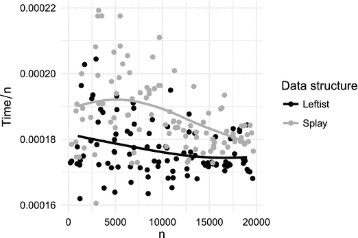

**图 5-8** — 通过迭代合并堆来构建伸展堆

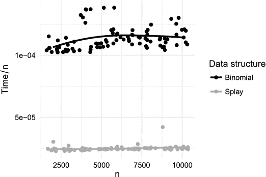

**图 5-7** — 逐个元素构建伸展堆

然而，在这两种构建算法中，从随机排列的元素序列构建堆时，性能明显差于排序或逆序元素的最佳情况，如**图 5-9** 和**图 5-10** 所示。

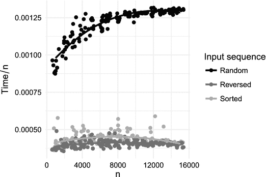

**图 5-10** — 针对不同类型的输入，通过迭代合并构建伸展堆

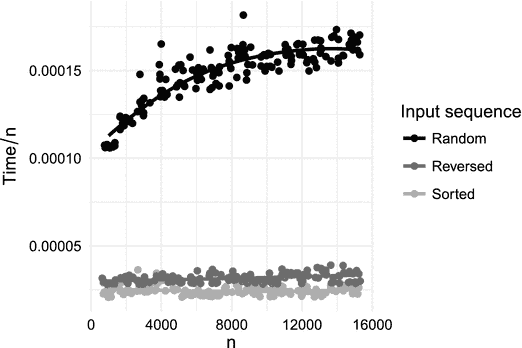

**图 5-9** — 针对不同类型的输入，逐个元素构建伸展堆

这些实验表明，伸展堆非常适合处理几乎有序的序列，并且在构建堆的性能方面确实如此。然而，这是有代价的。我们可以非常快速地构建伸展堆，因为我们不进行平衡。这将在之后我们不得不向下搜索堆时带来成本。伸展操作会在我们进行搜索时重新平衡堆，因此我们不会因为缺乏平衡而产生巨大的开销——在删除几次最小元素后，堆就会变得平衡——但这可能会给递归函数带来问题。在 R 耗尽栈空间并放弃之前，函数的调用深度是有限制的。这通常约为 1000 次函数实例化，因此大约一千个元素是不平衡伸展堆能容纳的上限。其他两种保持平衡的堆在处理更大的堆时不会遇到此类问题。

有一些方法可以绕过这个递归问题（参见 Mailund 2017a 中基于所谓蹦床的通用方法），但这些方法会带来额外的开销，我在此不再进一步讨论。


