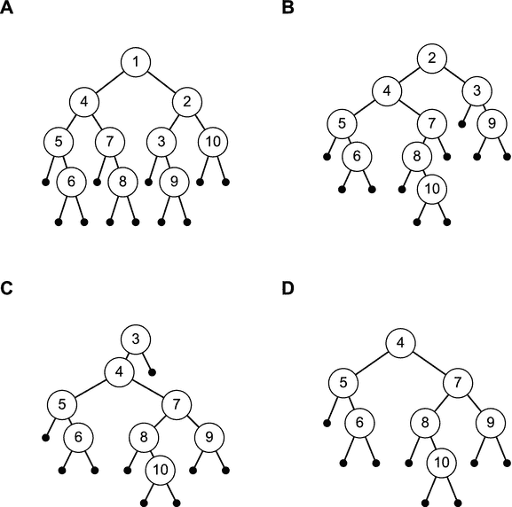
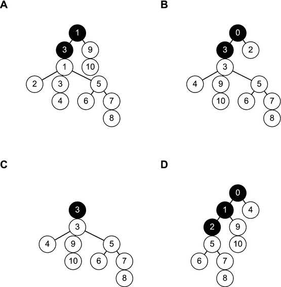
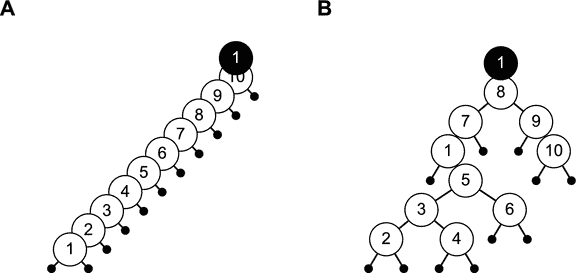
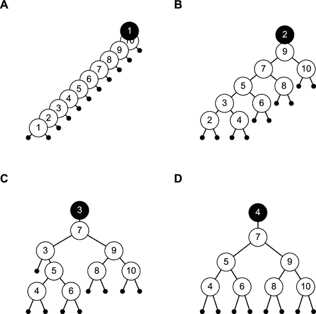
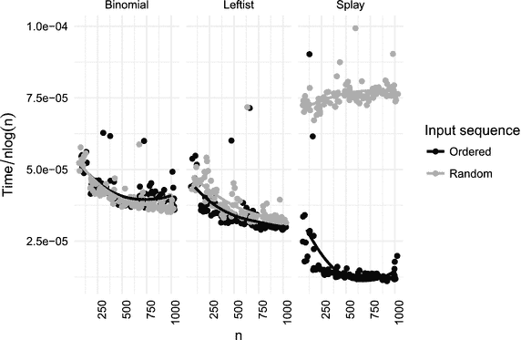

## 引言

本书介绍了*函数式数据结构*。许多传统数据结构依赖于结构可变性。我们可以更新搜索树、更改链表中的链接、重新排列向量中的值。在函数式语言中，并且一般来说在 `R` 编程语言中，数据是不可变的。你无法更改现有数据。那些用于修改数据结构、为算法编程提供高效构建模块的技术无法使用。

对此有一些变通方法。`R` 并非纯函数式语言，我们可以通过修改环境来改变变量-值的绑定。我们可以利用这一点来模拟指针，并以此实现传统数据结构；或者，我们可以放弃纯 `R` 编程，用 `C`/`C++` 实现数据结构，并编写一些包装代码，以便在 `R` 程序中使用它们。这两种解决方案都允许我们使用传统数据结构，但前者会生成非常非传统的 `R` 代码，而后者对于不熟悉 `R` 以外语言的人来说则毫无用处。

不过，好消息是，如果我们愿意放弃传统数据结构，就不必在实现数据结构时摒弃 `R`。存在一些数据结构，我们可以通过构建其新版本而非修改它们来进行操作。这些数据结构，即所谓的*函数式数据结构*，与你可能了解的传统数据结构有所不同，但如果你计划在诸如 `R` 这样的函数式语言中进行严肃的算法编程，它们值得了解。

并非所有你习惯的数据结构都有现成的替代品，至少在操作运行时性能上未必相同，但你常用的抽象数据结构很可能都有相应的实现。然而，在某些情况下，使用函数式数据结构取代传统数据结构可能会牺牲一点效率，这时你需要考虑：为了获得额外的速度，是否值得花费更多时间去用冷僻的 `R` 方法或完全不同的语言来实现数据结构。

速度问题始终存在一个权衡。提速究竟值得投入多少编程时间？如果你使用 `R` 进行编程，那么很可能你更看重程序员的时间而非计算机的时间。`R` 是一种高级语言，与大多数其他语言相比相对较慢。提供更高表达力需要付出代价。当你选择使用 `R` 时，你就接受了这一点。在选择函数式数据结构而非传统数据结构时，你可能也需要做出同样的选择；或者你可能会得出结论，确实需要额外的速度，因此选择花费更多时间编程，以便在分析时节省时间。只有你才能根据自己的情况做出正确选择。你需要了解所有可行的选择，以便在无法修改数据时能够处理数据结构。

# 绘制堆结构

正如我们在第 3 章中为搜索树编写显示代码一样，我们也可以编写代码来展示不同的堆结构。其方法与搜索树非常相似：我们需要收集图结构，然后进行展示。甚至还可以复用部分代码；第 3 章中搜索树的绘制代码可推广至所有二叉树，并能复用于左倾堆和伸展堆，再稍加改造还能推广至二项堆。然而，这类绘制代码大多遵循相同模式，且与数据结构本身无直接关联，因此本书不再赘述。有兴趣的读者可参考[`https://github.com/mailund/ralgo`](https://github.com/mailund/ralgo)，其中包含了数据结构的实现及配套显示代码。下一章中，我将展示如何扩展搜索树的绘制代码，为树添加附加信息标注。对于堆结构，我将直接展示某些操作的结果，若想自行实验，需下载`ralgo`包：

```
if(!require(devtools)) install.packages("devtools")
devtools::install_github("mailund/ralgo")
```

对我们实现的三种堆，我将各构建一个容量为 10 的堆，然后删除三个元素，并沿途绘制结果：

```
heap <- empty_leftist_heap()
for (i in 1:10)
heap <- insert(heap, i)
plot(heap)
heap <- delete_minimal(heap)
plot(heap)
heap <- delete_minimal(heap)
plot(heap)
heap <- delete_minimal(heap)
plot(heap)
```

左倾堆的结果如图 5-11 所示。其结构相对直观，可以看到该堆在所有四张图中均保持平衡，且树满足堆性质。



图 5-11：左倾堆

二项堆如图 5-12 所示。图中黑色节点显示的是堆中树的链表结构，黑色节点中的数字表示这些链接中树的秩（rank），而非堆中的数值。



图 5-12：二项堆

伸展堆并未显式保持平衡，因此初始堆的结构取决于元素的插入顺序。图 5-13 展示了按递增顺序插入元素

```
for (i in 1:10)
heap <- insert(heap, i)
```

与随机顺序插入

```
for (i in sample(1:10))
heap <- insert(heap, i)
```

之间的差异。在伸展堆中，黑色节点包含堆中最小值的对象及树的链接，黑色节点中的数字是各自堆中的最小值。



图 5-13：按递增顺序与随机顺序构建的伸展堆

在图 5-14 中，我们可以看到伸展堆的平衡机制。按递增顺序插入元素后，堆处于最不平衡状态，但随着删除操作，伸展操作会将树转化为更平衡的结构。



图 5-14：伸展堆

### 堆与排序

为了观察堆的实际应用，我们可以重温本章前面讨论的堆排序算法。其思路非常简单：若要对元素序列进行排序，可先构建一个堆，然后迭代式地提取最小元素。如果使用本章前面实现的`vector_to_heap`函数，堆排序算法可如下实现：

```
heap_sort <- function(x, empty_heap) {
  n <- length(x)
  # 构建堆
  heap <- vector_to_heap(x, empty_heap, empty_env_queue())
  # 按递增顺序提取元素
  result <- vector(typeof(x), length = n)
  for (i in seq_along(result)) {
    result[i] <- find_minimal(heap)
    heap <- delete_minimal(heap)
  }
  result
}
```

在这个变体中，我构建了一个输出向量并直接更新它，而不是像之前版本那样通过链表操作。

该实现适用于所有三种堆：

```
(x <- sample(10))
##  [1]  3  7  8  2  1  4 10  5  9  6
heap_sort(x, empty_leftist_heap())
##  [1]  1  2  3  4  5  6  7  8  9 10
heap_sort(x, empty_binomial_heap())
##  [1]  1  2  3  4  5  6  7  8  9 10
heap_sort(x, empty_splay_heap())
##  [1]  1  2  3  4  5  6  7  8  9 10
```

然而，它们之间的运行时间存在差异。对于左倾堆和二项堆，我们可以在线性时间内构建堆，然后花费`O(n log n)`的时间逐个提取元素。但在`vector_to_heap`中迭代合并伸展堆最坏情况下是`O(n²)`算法，而逐个插入元素的预期时间复杂度则为`O(n log n)`。事实证明，构建伸展堆本质上比另外两种堆更复杂，其速度不可能快于`O(n log n)`。要理解这一点，需要知道：基于比较来确定顺序的排序算法，最快不可能超过`O(n log n)`。此外，对于搜索树，我们可以通过深度优先遍历在线性时间内按顺序提取元素。我们可以修改针对伸展树的排序算法使其按此方式提取元素，这样构建`result`的时间复杂度为`O(n)`。这立即告诉我们，构建堆至少需要`O(n log n)`的时间，否则我们可以实现更快速度的排序。

针对伸展堆定制的排序函数可以如下实现：

```
splay_heap_sort <- function(x) {
  n <- length(x)
  heap <- empty_splay_heap()
  for (element in x)
    heap <- insert(heap, element)
  result <- vector(typeof(x), length = n)
  i <- 1
  recurse <- function(tree) {
    if (!is_empty(tree)) {
      recurse(tree$left)
      result[i] <<- tree$value
      i <<- i + 1
      recurse(tree$right)
    }
  }
  recurse(heap$tree)
  result
}
splay_heap_sort(x)
##  [1]  1  2  3  4  5  6  7  8  9 10
```

对`result`的命令式访问以及变量`i`的使用并不优雅，但由于函数参数的不可变性，在递归树遍历中如果不采用类似方法，很难操作向量。我们也可以通过遍历时构建链表来避免这一问题——并改用右递归而非左递归遍历树，从而使链表按正确顺序构建——但这只是将问题转移到了将链表转换为向量时仍需更新索引变量的函数上。无论如何，我们已将这种不优雅之处封装在函数内部，因此至少`splay_heap_sort`的使用者看不到递归中的副作用。

在图 5-15 中，我们比较了三种堆排序变体在已排序数据或随机排序数据（在调用排序函数之前）上的表现。左偏堆和二项堆的运行时间几乎相同，但伸展堆对输入序列的顺序非常敏感。如果序列已经有序，它可以非常快速地构建堆，然后利用仅需线性时间遍历树的特性；如果输入是随机顺序，它会在堆构建过程中因不平衡而受到影响。对于有序输入序列，伸展堆中的递归调用会阻止我们插入超过约一千个元素，因此，尽管这种伸展堆与序列顺序的组合在性能上表现优越，但除非你注意避免函数栈问题，否则它确实存在一些缺陷。



图 5-15 堆排序运行时间

脚注 1：
在本章中，我将实现所有堆，使其能够访问最小元素。将其修改为访问最大元素是一个微不足道的改动。

2：
这里的符号使用略显松散。我们不能直接求和到`log(n)`，除非它是一个整数，严格来说，应该是`⌊log(n)⌋`。这并不改变复杂度分析，而在一本主要关于 R 编程的书中，我不想对数学过于严格。

3：
我对左偏堆的描述基于 Okasaki (1999a)。该数据结构的原始描述可在 Crane (1972)中找到。

4：
“较小的一半”这个名字本身是矛盾的。如果我们真的将数据分成两半，那么两半的大小应该相同。我们实际上的意思是，在每次递归中，我们切掉至少一半的数据。这个名称并非我提出，但它是我所知道的这个技巧的通用叫法。

5：

如果有人将`NA`插入堆中，这当然会破坏逻辑，但如果有谁这么做，那他应该去检查一下自己是否正常。由于`NA`没有顺序性，优先队列的整个目的就失去了意义。

6：  

使用`NULL`来表示空树是一种直接的解决方案，但它确实增加了一些操作树的风险。在 R 中，如果你访问列表中不存在的命名值，你会得到`NULL`。这意味着，例如，如果你拼错了一个变量名，比如写了`x$lfet`而不是`x$left`，你在运行代码时不会收到任何报错，但你总是会得到`NULL`而不是真正的左子树。将你在犯错时获得的默认值解释为空树的有效表示是有风险的。我们必须格外小心。

7：  

对于一个完整的伸展树实现，我们在搜索树时也会修改树。对于堆变体（我们显式存储最小值）来说，我们不需要这样做，因此对于伸展堆，我们只在插入或删除元素时修改树。

8：  

证明这一点主要是一个算术练习，我在此不再重复分析。如果你感兴趣，可以查阅 Okasaki (1999a)或任何介绍伸展树的教科书。

9：  

如果性能问题严重到需要`partition`的长版本，那么通过将部分代码迁移到 C/C++来实现可能比使用复杂的`partition`函数获得更好的性能。


