## 6. 集合与搜索树

我们之前了解了如何表示元素集合，以便能够高效地遍历它们以及高效地合并两个这样的集合。在本章中，我们通过考虑允许高效插入、删除和检查元素成员关系的数据结构，将“背包”转变为“集合”：

```
insert <- function(x, elm) UseMethod("insert")
remove <- function(x, elm) UseMethod("remove")
member <- function(x, elm) UseMethod("member")
```

我们通过所谓的搜索树来实现这一点——搜索树具有以下性质：一个节点左子树中的所有元素的值都小于该节点中的元素值，而右子树中的所有元素的值都大于该节点中的元素值。这一性质使得在树中搜索任何给定元素并测试其成员关系变得容易。它也为我们提供了一种实现从键到值的映射的方法：我们只需要为键维护一棵搜索树，并在节点中与键一起存储对应的值。

### 搜索树

在第 3 章中，我们实现了一个基本的、不平衡的搜索树，如下所示：

```
search_tree_node <- function(
value
, left = empty_search_tree()
, right = empty_search_tree()
) {
structure(list(left = left, value = value, right = right),
class = c("unbalanced_search_tree"))
}
empty_search_tree <- function()
search_tree_node(NA, NULL, NULL)
is_empty.unbalanced_search_tree <- function(x)
is.null(x$left) && is.null(x$right)
```

配合这个直接的成员关系测试：

```
member.unbalanced_search_tree <- function(x, elm) {
if (is_empty(x)) return(FALSE)
if (x$value == elm) return(TRUE)
if (elm < x$value) member(x$left, elm)
else member(x$right, elm)
}
```

或稍微复杂一些的版本：

```
st_member <- function(x, elm, candidate = NA) {
if (is_empty(x)) return(!is.na(candidate) && elm == candidate)
if (elm < x$value) st_member(x$left, elm, candidate)
else st_member(x$right, elm, x$value)
}
member.unbalanced_search_tree <- function(x, elm) {
st_member(x, elm)
}
```

以及一个简单的插入函数，它仅执行搜索并沿途创建一棵更新后的树：

```
insert.unbalanced_search_tree <- function(x, elm) {
if (is_empty(x)) return(search_tree_node(elm))
if (elm < x$value)
search_tree_node(x$value, insert(x$left, elm), x$right)
else if (elm > x$value)
search_tree_node(x$value, x$left, insert(x$right, elm))
else
x # the value is already in the tree
}
```

删除函数稍微复杂一些。删除叶子节点或只有一个子节点的元素很简单，但大多数元素并非以这种方式存储。因此，我们使用了一个技巧：将待删除的元素替换为右子树中最左边的元素——替换值比删除值容易得多——然后删除右子树中的最左树。因为最左边的值要么是根节点，要么只有一个右子树，这样就将删除操作简化为我们可以直接处理的简单情况之一：

```
st_leftmost <- function(x) {
if (is_empty(x$left)) x$value
else st_leftmost(x$left)
}
remove.unbalanced_search_tree <- function(x, elm) {
if (elm < x$value)
search_tree_node(x$value, remove(x$left, elm), x$right)
else if (elm > x$value)
search_tree_node(x$value, x$left, remove(x$right, elm))
else {
if (is_empty(x$left)) return(x$right)
if (is_empty(x$right)) return(x$left)
search_tree_node(st_leftmost(x$right), x$left, remove(x$right, st_leftmost(x$right)))
}
}
```

搜索树上的操作所花费的时间与在操作中需要达到的深度成正比，因此它们受限于树的深度。如果我们不做任何平衡操作，树的深度可能是`O(n)`。然而，对于平衡树，操作的运行时复杂度仅为`O(n log n)`，因此保持树的平衡是值得的，而这正是我们在本章中需要解决的技巧。

### 红黑搜索树

红黑搜索树通过设想我们将所有节点染成红色或黑色，并保持以下不变性来保持平衡：

1. 没有红色节点有红色父节点。
2. 从根节点到叶节点的每条路径都具有相同数量的黑色节点。

第二个不变性保证了，如果我们只考虑黑色节点，树是平衡的。从根节点到叶节点的任何路径都会经过恰好相同数量的黑色节点，因此以黑色节点的深度来衡量，树的深度不会超过 `O(logn)`。并非所有从根到叶的路径都必须有完全相同的长度，因为还有红色节点，但第一个不变性保证了沿路径的红色节点数量不会超过黑色节点数量。因此，从根到叶的最长路径不超过最短路径长度的两倍，所以我们仍然保证了所有叶节点具有对数级别的深度。

为了保证这些不变性，我们需要修改插入和删除操作。搜索操作可以保持不变。对于插入，这被证明是一个简单的修改（Okasaki 1999b），而删除则稍微复杂一些（Germane and Might 2014）。

我们通过在节点中存储每个节点的颜色来实现该数据结构，并使用一个哨兵来表示空树：

```
### 颜色
RED <- 1
BLACK <- 2
### 辅助函数
red_black_tree_node <- function(
colour
, value
, left = empty_red_black_tree()
, right = empty_red_black_tree()
) {
structure(list(colour = colour,
left = left,
value = value,
right = right),
class = "red_black_tree")
}
empty_red_black_tree <- function()
red_black_tree_node(BLACK, NA, NULL, NULL)
is_empty.red_black_tree <- function(x)
is.null(x$left) && is.null(x$right)
```

我们将空树作为叶节点的子节点，或作为只有一个子节点的节点的子节点之一，并随意将这些空树指定为黑色。所有通向空树的路径都会以一个黑色节点结束，因此这不会影响第二个不变性——它只是使所有路径的黑色节点数增加一个——并且避免了需要担心插入的红色叶子会成为红色空树的父节点。

# 红黑搜索树的实现

红黑搜索树的结构与不平衡树相同，只是增加了颜色信息。因此，在树中搜索的工作方式完全相同。因为两者可以使用相同的方法，我们可以为其超类 `search_tree` 实现该方法，并让它们都继承它：

```
member.search_tree <- function(x, elm) {
  st_member(x, elm)
}
```

此方法使用了我们在第 3 章中看到的略快的成员函数。

我们只需为这两个类赋予这个超类，因此我们如下修改它们的构造函数：

```
search_tree_node <- function(
  value
  , left = empty_search_tree()
  , right = empty_search_tree()
) {
  structure(list(left = left, value = value, right = right),
            class = c("unbalanced_search_tree", "search_tree"))
}
red_black_tree_node <- function(
  colour
  , value
  , left = empty_red_black_tree()
  , right = empty_red_black_tree()
) {
  structure(list(colour = colour,
                 left = left,
                 value = value,
                 right = right),
            class = c("red_black_tree", "search_tree"))
}
```

## 插入

现在，插入元素并保持树平衡的技巧是在插入后重新排列树。我们插入新元素的方式与不平衡树完全相同：我们在树中向下搜索，直到找到新节点应插入的位置，然后为该元素插入一个新的红色叶子节点。在递归过程中，沿着搜索路径向下遍历树时，我们调用一个负责重新平衡树的函数；该函数查看树的局部部分并重新排列它以保持不变性。插入操作如下所示：

```
rbt_insert <- function(tree, elm) {
  if (is_empty(tree)) {
    red_black_tree_node(RED, elm)
  } else if (elm < tree$value) {
    rbt_balance(tree$colour,
                tree$value,
                rbt_insert(tree$left, elm),
                tree$right)
  } else if (elm > tree$value) {
    rbt_balance(tree$colour,
                tree$value,
                tree$left,
                rbt_insert(tree$right, elm))
  } else
    tree # 该值已在此层级的树中
         # 因此直接返回
}
insert.red_black_tree <- function(x, elm, ...) {
  # 在树中插入值并将根节点设为黑色
  new_tree <- rbt_insert(x, elm)
  new_tree$colour <- BLACK
  new_tree
}
```

在 `insert` 函数中，我们调用 `rbt_insert` 并将树的根节点染成黑色。如果根节点的子节点满足不变性，那么将根节点颜色改为黑色将自动满足两个不变性，因为它可能为所有路径增加一个黑色节点，这满足了第一个不变性，并且即使根节点的子节点是红色，也不会使第二个不变性失效。

`rbt_insert` 函数会在搜索到达末端时插入一个红色叶子节点，在其他情况下则递归搜索，确保在沿搜索路径向下遍历每个节点时调用一个用于平衡的函数 `rbt_balance`。

至于平衡函数，我们通过考虑更新后树的结构可能出现的各种情况来处理树的局部部分。当我们插入新叶子时，我们将其插入为红色。这不会使第二个不变性失效，但可能使第一个不变性失效。当从递归返回时，我们会处理红色父节点有红色子节点的情况，并通过重新排列树来避免这种情况，同时保证不改变任何路径上的黑色节点数量。

在平衡过程中需要执行的变换如图 6-1 所示。存在四种可能的情况，其中红色节点有一个红色父节点，如图中边缘的四棵树所示，在所有情况下，我们都将树变换为图中间所示的结构。如果两个不变性在树的其他所有部分都有效，那么变换后它们也将有效，并且我们将消除具有红色父节点的红色节点。要理解这一点，我们可以观察到中间树中消除了具有红色父节点的红色节点，并且如果我们考虑经过树这一部分的任何路径，在变换前所有树的根节点处有一个黑色节点。由于我们将黑色根节点替换为红色，并将其两个子节点变为黑色，所有经过树这一部分的路径也将只看到一个黑色节点。变换后，我们可能已将一个新的红色节点放置为另一个红色节点的子节点——我们已将此子树的根节点变为红色——但当我们继续向上递归时，这种情况将得到处理。

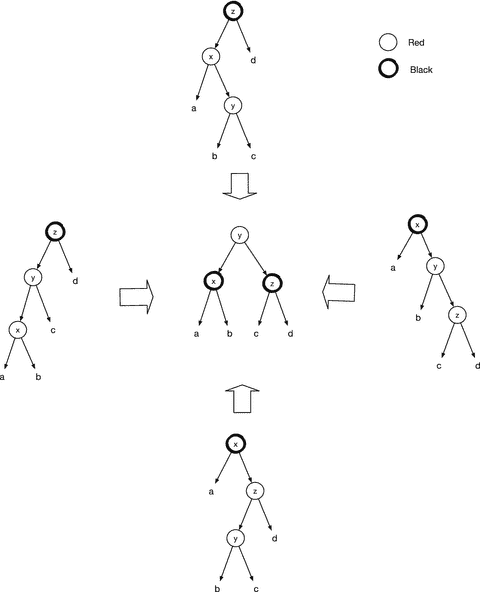

**图 6-1** 红黑搜索树平衡的变换

## 红黑树平衡实现

`rbt_balance` 函数仅检查四种情况，然后执行相应的变换。在实现伸展堆时，我们针对每种情况使用了两个函数来进行检查：一个用于判断情况，另一个用于执行变换。对于红黑搜索树，变换稍微简单一些：所有情况都会变换成同一种形式，因此如果我们像图中那样用变量来命名节点和子树，就可以复用变换逻辑——但当然，这需要变换能够访问由情况测试所定义的变量。在我们实现`rbt_balance`时，将采用一种与伸展堆不同的策略来进行情况分析。这种技巧的实现比简单的函数检查要技术性得多，但使用起来也相应地更简单，因此在实现变换时值得考虑。而且你可以直接复用本章的实现到未来的项目中——只要你遵循一些规则，它应该可以推广到其他情况分析中。

我们将使用一种非标准评估（non-standard evaluation）的技巧，在检查局部树结构的同时，将节点和子树绑定到变量上。如果你对此不熟悉，可以在我的书《R 语言元编程》（Apress, 2017）或 Hadley Wickham 的《高级 R 编程》（Chapman & Hall, 2014）中了解更多。这个诀窍在于，我们提供给函数的参数会被评估，如果参数是有名称的，就当作赋值操作；如果参数是位置参数，就当作逻辑表达式。

这个函数名为 `pattern_match`，在下面的代码块中展示。它首先使用表达式 `eval(substitute(alist(...)))` 来获取所有参数，这是获取未求值参数列表的标准方法，然后通过 `parent.frame()` 获取调用作用域。我们需要在调用作用域中评估参数，而不是在 `pattern_match` 的局部作用域中，这样我们才能引用使用该函数的作用域中的变量。

接下来，我们获取参数绑定的名称。当提供命名参数时，这些名称是非空字符串，否则是空字符串。然后我们遍历函数的所有参数，并在调用作用域中评估提供给这些参数的表达式。如果任何值评估为 `NULL`，我们就终止函数并返回 `FALSE`。如果参数是命名的，我们将该值赋给调用作用域中的该名称；如果参数未命名，则检查它是否评估为真值。如果不是，我们同样终止并返回 `FALSE`。如果我们遍历完所有参数都没有遇到 `NULL` 或 `FALSE` 值，就返回 `TRUE`：

```
pattern_match <- function(...) {
  params <- eval(substitute(alist(...)))
  scope <- parent.frame()
  names <- names(params)
  for (i in seq_along(params)) {
    name <- names[i]
    val <- eval(params[[i]], envir = scope)
    if (is.null(val)) return(FALSE)
    if (name != "") {
      assign(name, val, envir = scope)
    } else if (!val) {
      return(FALSE)
    }
  }
  return(TRUE)
}
```

如果你不理解这个函数的所有细节，不必担心。使用这个函数比理解它的细节要容易得多。

我们使用它的方式是：通过评估提取子树的表达式，同时将这些子树赋值给变量，从而检查树的结构；并通过逻辑表达式检查节点的颜色。例如，为了检查图 6-1 中最上面那种情况，我们会在根节点颜色存储在变量 `colour`、顶层节点值由 `value` 引用、左右子树分别存储在变量 `left` 和 `right` 中的上下文里，使用下面代码块中的表达式。变量 `a`、`b`、`c` 被赋值为图中所示的子树，变量 `x`、`y`、`z` 将被赋值为图中节点的值。函数调用的最后三个参数是逻辑表达式，仅用于检查节点的颜色是否与图中的一致：

## 模式匹配与删除操作

这个函数正确运行的重要一点是：我们不能像在伸展堆中那样，用`NULL`来表示空树。当使用诸如`left$left`这样的表达式时，如果列表`left`没有名为`left`的索引，那么表达式会返回`NULL`。如果我们用`NULL`表示空树，就无法区分一个真正的空树与一个因通过不包含该命名树的列表进行引用而不存在的树。在我们的红黑搜索树实现中，我们使用哨兵对象来表示空树，这样就能区分空树和不存在的树，并利用这一点：将`NULL`视为我们所检查的树不具有正确结构的指示。

我们可以在`rbt_balance`函数中看到这个函数的具体应用。它检查当前树是否匹配我们需要变换的四种模式中的任何一种。如果匹配，则根据图 6-1 中的规则进行变换。如果不匹配，则保持树不变：

```
rbt_balance <- function(colour, value, left, right) {
  # 设置这些变量以避免警告
  a <- b <- c <- d <- x <- y <- z <- NULL
  if (pattern_match(a = left$left, b = left$right$left,
                    c = left$right$right, d = right,
                    x = left$value, y = left$right$value,
                    z = value,
                    colour == BLACK, left$colour == RED,
                    left$right$colour == RED)
      || pattern_match(a = left$left$left, b = left$left$right,
                       c = left$right, d = right,
                       x = left$left$value, y = left$value,
                       z = value,
                       colour == BLACK, left$colour == RED,
                       left$left$colour == RED)
      || pattern_match(a = left, b = right$left,
                       c = right$right$left, d = right$right$right,
                       x = value, y = right$value,
                       z = right$right$value,
                       colour == BLACK, right$colour == RED,
                       right$right$colour == RED)
      || pattern_match(a = left, b = right$left$left,
                       c = right$left$right, d = right$right,
                       x = value, y = right$left$value,
                       z = right$value,
                       colour == BLACK, right$colour == RED,
                       right$left$colour == RED)
  ) {
    left <- red_black_tree_node(colour = BLACK, value = x,
                                left = a, right = b)
    right <- red_black_tree_node(colour = BLACK, value = z,
                                 left = c, right = d)
    red_black_tree_node(colour = RED, value = y, left, right)
  } else {
    red_black_tree_node(colour, value, left, right)
  }
}
```

是更喜欢伸展堆中那种使用函数进行情况分析和变换的方式，还是更喜欢这里使用的模式匹配，这取决于个人品味。由于在这里，实际变换对所有四种情况都是相同的，唯一区别是变换中使用的变量在变换前对应于树中不同的子树和值，我个人倾向于在这个函数中使用模式匹配的方式。

## 删除操作

在红黑搜索树中删除元素时，维持不变性所需的变换次数会有所增加。删除操作的基本思想与不平衡搜索树相同：删除叶子节点或只有一个子节点的节点很容易，因此这类节点可以直接删除。对于内部节点，我们将该节点的值与其在树中的后继节点（即右子树中最左侧的节点）进行交换，然后从右子树中删除该值。如果删除的节点是红色的，则不会破坏任何不变性。但如果是黑色节点，则意味着我们从某条到根节点的路径上移除了一个黑色节点，这会破坏第二个不变性。为了解决这个问题，我们需要对树进行类似于 `rbt_balance` 的变换。

当我们删除一个带有零个或一个子节点的黑色节点时，实际上是从根节点到某个（或多个）叶子节点的路径上移除了一个黑色节点——这个路径要么穿过被删除节点所在的子树，要么（如果该节点现在成为叶子节点）穿过其父节点。这会破坏第一个不变性，但我们无法仅在删除节点所在的局部子树中解决此问题。相反，我们会引入一种额外的颜色——称之为“双黑”——其作用相当于在路径经过时视为有两个黑色节点。当我们删除一个黑色节点时，会使用这种颜色，然后让它向根节点方向“上浮”，直到找到一种局部树结构，能够将其子节点在树中比其他路径多放置一个黑色节点，从而平衡树的结构。我们接下来将具体介绍这一过程：

```
DOUBLE_BLACK <- 3
```

首先，我们处理可以直接删除节点的情况。这些情况如图 6-2 所示，其中 v 表示要删除的值。这里明确展示了用作哨兵的空树。为了让 `double-black` 颜色发挥作用，我们需要显式地考虑这些空树。共有四种情况：`v` 位于红色叶子节点中、`v` 位于带有一个红色子节点的黑色节点中（两种对称情况）、以及 `v` 位于黑色叶子节点中。前三种情况可以毫无问题地处理；最后一种情况中，我们移除了一个黑色节点，因此会留下一个双黑色的空树。

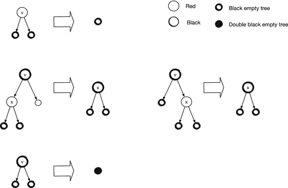

图 6-2

红黑搜索树中的简单删除操作

现在我们需要消除双黑节点。我们通过考虑该节点在树中可能出现的各种情况来实现：要么直接消除它，要么将其向树的上方移动——如果它最终到达根节点，我们总可以将其着色为黑色从而消除它。我们将这些操作称为 `rotate`，以区别于插入元素时使用的平衡函数。

由于我们已经处理了节点至少有一个子节点为空的情况，所有需要处理的情况都是节点拥有两个子节点的情况。第一个不变性保证不会出现连续两个红色节点，而双黑节点作为子节点之一，因此所有情况如图 6-3 所示——不过，图中带有双黑根的子树允许为空，因此其子节点实际上可能是 `NULL`。非双黑子树则不能为空。当我们将黑色叶子节点转换为双黑空树时，该黑色叶子节点必须有一个黑色兄弟节点——否则就会违反第二个不变性。只要我们将双黑节点向树的上方移动，不变性就会被违反，并且双黑节点的兄弟子树中所有路径上必须多出一个黑色节点，因此该兄弟子树不能为空。

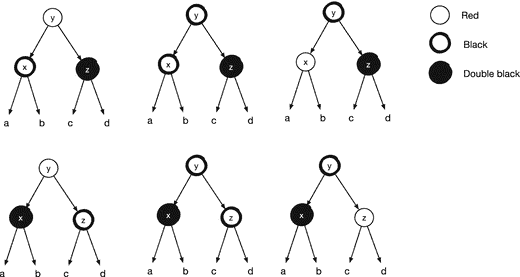

图 6-3

红黑搜索树 `rotate` 的各种情况

实际的旋转操作如图 6-4 所示。注意，带有双黑节点的子树从未被重新排列。双黑节点的颜色可能会改变，但该子树始终保留其两个子节点。这意味着在进行模式匹配时，我们无需访问其子节点。因此，当双黑节点是空树的根（其子节点为`NULL`）时，我们不会遇到`pattern_match`认为其不匹配模式的问题。我们会修改双黑节点兄弟子树的结构，但正如刚才所述，这个兄弟子树永远不会是空树。

共有三种类型的重排，由于对称性，共有六条规则。在第一种变换中，我们考虑的子树根节点为红色，而双黑节点的兄弟节点（必然）为黑色。在这种情况下，我们可以将黑色节点提升到子树的根节点，并将双黑节点着色为黑色。通过使黑色节点成为双黑节点的祖父节点，我们在向下通往该子树叶子节点的所有路径上增加了一个黑色节点，从而补偿了由双黑节点表示的那个缺失的黑色节点。通过这类旋转，我们消除了双黑节点。

在第二种情况下，根节点和兄弟节点均为黑色。这种情况下我们无法消除双黑节点，但可以将其向上推至树的更高层。我们将黑色节点向上移动到根节点，将之前的根节点着色为红色，并将之前的双黑节点着色为黑色。这样做的效果是，当将双黑节点计为两个黑色节点时，所有经过该子树的路径看到的黑色节点数量将保持相同。

对于第三种情况，仅凭这三个节点我们无法获得足够的信息来完成旋转。然而，我们知道双黑节点的兄弟节点非空，并且由于它是红色节点，这意味着它必须拥有黑色的子节点。根据第二个不变性，它不能同时有一个黑色子节点和一个空树，因此我们还知道它必须拥有两个子节点且其根节点均为黑色。因此，我们可以扩展所观察的模式，将其一个子节点也包含进来，如图 6-4 所示。通过这类旋转，我们消除了双黑节点。要验证旋转的正确性，我们只需确认子树和节点的中序顺序与之前相同，并且如果计算从第一棵树中任意路径经过双黑节点（计为两个黑色节点）到达`a`到`e`子树之一时看到的黑色节点数量，与从根节点沿路径到达第二棵树中相同`a`到`e`子树时看到的黑色节点数量一致。

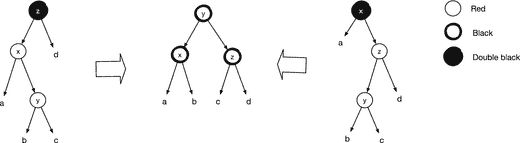

**图 6-5**

红黑搜索树平衡的额外规则

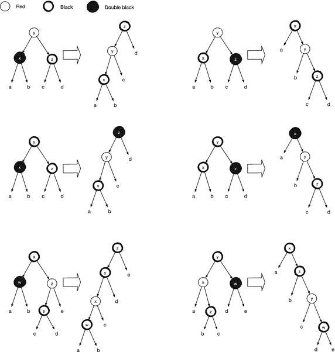

**图 6-4**

红黑搜索树中的子树旋转

旋转操作会保留红黑搜索树的第二不变量，但在创建或移动红色节点时可能违反第一不变量。为此，我们需要在旋转后对适当的树使用`rbt_balance`函数——前四种旋转后对旋转结果的根调用，第五和第六种旋转后分别对左子树或右子树调用。对于旋转五和六，最多只需一次重新平衡，因为旋转结果的根是黑色。无论重新平衡后树的根是红色还是黑色，我们都可以将其作为这个黑色根的子节点。对于旋转三和四，我们遇到一个问题：`rbt_balance`函数不了解双黑节点，因此无法处理这些旋转中创建的树。不过，我们可以为`rbt_balance`添加一条规则（如图 6-5 所示），在一次重新平衡中消除第一不变量违例。对于旋转一和二，我们消除了双黑节点，且在重新平衡前拥有一个黑色根。如果重新平衡后得到红色根，我们可能会担心第一不变量被违反。然而，考虑到旋转前的树中有一个红色节点，其父节点不可能是红色，因此如果重新平衡后得到红色根，我们仍然符合不变量。总而言之，这意味着每次旋转最多需要一次重新平衡，我们可以在旋转函数中调用它。

我们将首先实现更新后的`remove`函数，然后是`rbt_rotate`和更新后的`rbt_balance`函数。`remove`函数如下所示：

```
remove.red_black_tree <- function(x, elm, ...) {
new_tree <- rbt_remove(x, elm)
new_tree$colour <- BLACK
new_tree
}
```

实际工作由辅助函数`rbt_remove`完成：

```
rbt_remove <- function(tree, elm) {
  if (is.null(tree)) return(NULL)
  if (elm < tree$value) {
    rbt_rotate(tree$colour, tree$value,
               rbt_remove(tree$left, elm), tree$right)
  } else if (elm > tree$value) {
    rbt_rotate(tree$colour, tree$value,
               tree$left, rbt_remove(tree$right, elm))
  } else {
    # 找到要删除的元素
    if (is.null(tree$left) || is.null(tree$right)) {
      # 有一个或两个空子节点
      child <- if (is.null(tree$left)) tree$right else tree$left
      if (tree$colour == RED) {
        return(child)  # 红色节点可直接删除
      } else {
        # 黑色节点：将子节点标记为双黑
        if (is.null(child)) {
          # 子节点为空，返回一个双黑节点
          return(DOUBLE_BLACK_NODE)
        } else {
          child$colour <- DOUBLE_BLACK
          return(child)
        }
      }
    } else {
      # 有两个非空子节点，使用后继节点替换
      succ <- find_min(tree$right)
      tree$value <- succ$value
      tree$right <- rbt_remove(tree$right, succ$value)
      return(tree)
    }
  }
}
```

与不平衡的`st_remove`相比，区别在于当我们遇到有一个或两个空子节点的情况时进行重新着色，并且将对递归`rbt_remove`的调用封装在`rbt_rotate`调用中。

实际工作由`rbt_rotate`函数完成，该函数实现了图 6-4 中的转换。这通过一系列的模式匹配和转换实现：


```r
rbt_rotate <- function(colour, value, left, right) {
  # 第一种情况
  if (pattern_match(a_x_b = left, c = right$left, d = right$right,
                    y = value, z = right$value,
                    a_x_b$colour == DOUBLE_BLACK,
                    colour == RED,
                    right$colour == BLACK)) {
    a_x_b$colour <- BLACK
    rbt_balance(BLACK, z,
                red_black_tree_node(RED, y, a_x_b, c),
                d)
  } else if (pattern_match(a = left$left, b = left$right,
                           c_z_d = right,
                           y = value, x = left$value,
                           left$colour == BLACK,
                           colour == RED,
                           c_z_d$colour == DOUBLE_BLACK)) {
    c_z_d$colour <- BLACK
    rbt_balance(BLACK, x,
                a,
                red_black_tree_node(RED, y, b, c_z_d))
  # 第二种情况
  } else if (pattern_match(a_x_b = left, c = right$left, d = right$right,
                           y = value, z = right$value,
                           colour == BLACK,
                           a_x_b$colour == DOUBLE_BLACK,
                           right$colour == BLACK)) {
    a_x_b$colour <- BLACK
    new_left <- red_black_tree_node(RED, y, a_x_b, c)
    rbt_balance(DOUBLE_BLACK, z, new_left, d)
  } else if (pattern_match(a = left$left, b = left$right,
                           y = value, c_z_d = right,
                           left$colour == BLACK,
                           colour == BLACK,
                           c_z_d$colour == DOUBLE_BLACK)) {
    c_z_d$colour <- BLACK
    new_right <- red_black_tree_node(RED, y, b, c_z_d)
    rbt_balance(DOUBLE_BLACK, x, a, new_right)
  # 第三种情况
  } else if (pattern_match(a_w_b = left,
                           c = right$left$left,
                           d = right$left$right,
                           e = right$right,
                           x = value, z = right$value,
                           y = right$left$value,
                           a_w_b$colour == DOUBLE_BLACK,
                           colour == BLACK,
                           right$colour == RED)) {
    a_w_b$colour <- BLACK
    new_left_left <- red_black_tree_node(RED, x, a_w_b, c)
    new_left <- rbt_balance(BLACK, y, new_left_left, d)
    red_black_tree_node(BLACK, z, new_left, e)
  } else if (pattern_match(a = left$left,
                           b = left$right$left,
                           c = left$right$right,
                           d_w_e = right,
                           z = left$right$value,
                           x = left$value,
                           y = value,
                           left$colour == RED,
                           colour == BLACK,
                           d_w_e$colour == DOUBLE_BLACK)) {
    d_w_e$colour <- BLACK
    new_right_right <- red_black_tree_node(RED, y, c, d_w_e)
    new_right <- rbt_balance(BLACK, z, b, new_right_right)
    red_black_tree_node(BLACK, x, a, new_right)
  } else {
    red_black_tree_node(colour, value, left, right)
  }
}
```

注意在构建某些树时使用了`rbt_balance`。这将修复第一不变量的任何违例，并在可能违反该不变量的树上调用。更新后的`rbt_balance`版本（包含图[6-5]（#A457411_1_En_6_Chapter.html#Fig5）中的规则）如下所示：


要了解平衡如何影响搜索树，我们可以计算红黑树的最小和最大深度，并与不平衡树进行比较。下面的函数递归计算树中节点的最小和最大深度：

```
min_max_depth <- function(tree) {
  if (is.empty(tree))
    return(c(0, 0))
  left_min_max <- min_max_depth(tree$left)
  right_min_max <- min_max_depth(tree$right)
  min_depth <- min(left_min_max[1], right_min_max[1]) + 1
  max_depth <- max(left_min_max[2], right_min_max[2]) + 1
  c(min = min_depth, max = max_depth)
}
```

我们可以在一个实验设置中使用它，处理从 `1` 到 `n` 的数字——我们可以让它们保持有序或进行随机排列——然后使用两种不同的搜索树结构为多个 `n` 值构建树，并将结果收集在一个数据框中：

```
library(tibble)
measure_depth <- function(process, empty_tree, ns) {
  measure_depth <- function(n) {
    tree <- empty_tree
    for (x in process(1:n))
      tree <- insert(tree, x)
    c(n = n, min_max_depth(tree))
  }
  measure_depth <- Vectorize(measure_depth)
  measurements <- measure_depth(ns)
  as_tibble(t(measurements))
}
```

对于有序列表，实验是确定性的，但对于随机排列，我们将重复实验十次以观察变化。

# 搜索树深度与构建时间分析

## 深度测量与可视化

我们可以首先测量并绘制不同数据结构和输入顺序下的树深度。

```r
ns <- seq(1, 50, by = 5)
ns_rep <- rep(ns, times = 10)
depth <- rbind(
cbind(data_structure = "Unbalanced",
data = "Ordered",
measure_depth(identity, empty_search_tree(), ns)),
cbind(data_structure = "Red-black",
data = "Ordered",
measure_depth(identity, empty_red_black_tree(), ns)),
cbind(data_structure = "Unbalanced",
data = "Random",
measure_depth(sample, empty_search_tree(), ns_rep)),
cbind(data_structure = "Red-black",
data = "Random",
measure_depth(sample, empty_red_black_tree(), ns_rep))
)
```

然后我们可以绘制结果：

```r
library(ggplot2)
ggplot(depth, aes(x = n, colour = data_structure)) +
geom_jitter(aes(y = min)) +
geom_smooth(aes(y = min), method = "loess",
span = 2, se = FALSE) +
geom_jitter(aes(y = max)) +
geom_smooth(aes(y = max), method = "loess",
span = 2, se = FALSE) +
facet_grid(. ~ data) +
scale_colour_grey("Data structure", end = 0.5) +
xlab(quote(n)) + ylab("Tree depth") +
theme_minimal() +
theme(axis.text.x = element_text(angle = 90, hjust = 1))
```

该图如图 6-6 所示。当我们按递增顺序插入元素时，不平衡树将达到最大不平衡。最大深度接近`n`，而最小深度为`1`或`2`。对于红黑树，最小深度与最大深度之间的差距保证不超过两倍。如果元素以随机顺序插入，“不平衡”树实际上会变得平衡——虽然不如红黑树那样平衡，但最大与最小深度之间的差异不会线性增长。

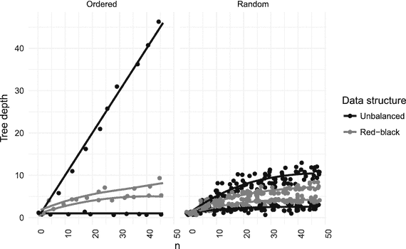

**图 6-6** 平衡（红黑）树和不平衡树的搜索树深度

## 构建时间分析

接下来，我们可以探索这如何影响构建搜索树所需的时间。为了运行树构建的时间实验，我们可以使用以下函数：

```r
setup_for_construction <- function(n) n
evaluate_construction <- function(empty, process) function(n, x) {
tree <- empty
elements <- process(1:n)
for (elm in elements) {
tree <- insert(tree, elm)
}
tree
}
```

在这些实验中，我们希望同时变化数据和数据结构，因此我们对性能测量函数稍作修改以包含数据信息：

```r
get_performance_n <- function(
algo
, data
, n
, setup
, evaluate
, times
, ...) {
config <- setup(n)
benchmarks <- microbenchmark(evaluate(n, config), times = times)
tibble(algo = algo, data = data,
n = n, time = benchmarks$time / 1e9)
}
get_performance <- function(
algo
, data
, ns
, setup
, evaluate
, times = 10
, ...) {
f <- function(n)
get_performance_n(algo, data, n,
setup, evaluate,
times = times, ...)
results <- Map(f, ns)
do.call('rbind', results)
}
```

对于不平衡树，插入函数在处理较大树时会耗尽栈空间，因此我们将实验分为小规模和中规模树，并仅对有序输入的小规模情况构建不平衡树：

```r
ns <- seq(100, 450, by = 50)
performance_small <- rbind(
get_performance("Unbalanced", "Increasing order", ns,
setup_for_construction,
evaluate_construction(empty_search_tree(), identity)),
get_performance("Unbalanced", "Random order", ns,
setup_for_construction,
evaluate_construction(empty_search_tree(), sample)),
get_performance("Red-black", "Increasing order", ns,
setup_for_construction,
evaluate_construction(empty_red_black_tree(), identity)),
get_performance("Red-black", "Random order", ns,
setup_for_construction,
evaluate_construction(empty_red_black_tree(), sample))
)
ns <- seq(500, 1000, by = 50)
performance_medium <- rbind(
get_performance("Unbalanced", "Random order", ns,
setup_for_construction,
evaluate_construction(empty_search_tree(), sample)),
get_performance("Red-black", "Increasing order", ns,
setup_for_construction,
evaluate_construction(empty_red_black_tree(), identity)),
get_performance("Red-black", "Random order", ns,
setup_for_construction,
evaluate_construction(empty_red_black_tree(), sample))
)
```

为了构建大小为`n`的树，我们预期如果树不平衡，时间将为`O(n²)`；如果平衡，则为`O(n log n)`。我们将绘制时间除以`O(n log n)`的结果：如果树是平衡的，图应该会趋于平坦的直线。

```r
performance <- rbind(performance_small, performance_medium)
ggplot(performance,
aes(x = n, y = time / (n*log(n)), colour = algo)) +
geom_jitter() +
geom_smooth(method = "loess",
span = 2, se = FALSE) +
facet_grid(. ~ data) +
scale_colour_grey("Data structure", end = 0.5) +
xlab(quote(n)) + ylab(expression(Time / n*log(n))) +
theme_minimal() +
theme(axis.text.x = element_text(angle = 90, hjust = 1))
```

结果如图 6-7 所示。正如预期，当输入为递增顺序时，不平衡树迅速变慢，而红黑树在有序和随机输入下运行时间大致相同。然而，这是有代价的：我们可以清楚地看到，对于随机排序的输入，没有变换规则的不平衡树如果恰巧输入使其平衡，则速度快得多。如果可能的话，随机化输入似乎比在构建过程中平衡树是更好的策略。顺便说一句，这在算法中并不少见。最快的排序算法之一——快速排序——最坏情况运行时间为`O(n²)`，但期望情况为`O(n log n)`，并且仅凭其简单性就优于最坏情况为`O(n log n)`的算法。

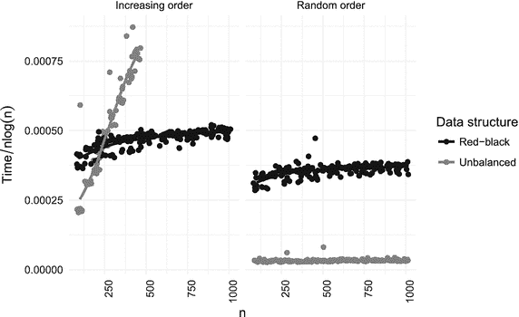

**图 6-7** 平衡树和不平衡树的构建时间

我们还可以验证成员测试的运行时间。两种实现使用完全相同的成员测试函数，但运行时间将取决于树的深度。我们可以设计一个实验，构建不同大小的树，并在所有实验中测量搜索固定数量元素（这里使用 `100` 个元素）所需的时间：

```r
setup_for_member <- function(empty, process) function(n) {
tree <- empty
elements <- process(1:n)
for (elm in elements) {
tree <- insert(tree, elm)
}
tree
}
evaluate_member <- function(n, tree) {
elements <- sample(1:n, size = 100, replace = TRUE)
for (elm in elements) {
member(tree, elm)
}
}
```

同样，我将实验分成了两部分，以避免出现过大且不平衡的树（评估代码与构造代码类似，此处未显示）。结果如图 6-8 所示，右侧展示了完整实验，左侧则放大了快速操作部分。我们清楚地看到，不平衡树在最坏情况下（即按递增顺序构建元素时）的速度显著慢于平衡树；但我们也看到，红黑树稍好的平衡性意味着它在成员查询方面优于更简单的树。红黑树在成员查询时增加的复杂性是无关紧要的——这两种树使用完全相同的函数——它只影响插入和删除操作。

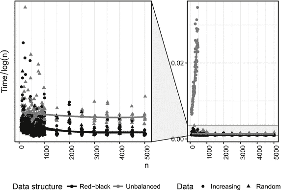

**图 6-8** 不平衡树与红黑搜索树的成员运行时间

说到删除，我们也可以对该操作进行实验。设置方式与 `member` 性能实验类似。我们构建一个大小为 `n` 的树，然后从中删除 `100` 个元素——当 `n` 小于 `100` 时，这当然会留下一个空树。但这没关系——我们主要关注的是较大的树，在这些树中，平衡性更为重要：

```r
setup_for_remove <- function(empty, process) function(n) {
tree <- empty
elements <- process(1:n)
for (elm in elements) {
tree <- insert(tree, elm)
}
tree
}
evaluate_remove <- function(n, tree) {
elements <- sample(1:n, size = 100, replace = TRUE)
for (elm in elements) {
tree <- remove(tree, elm)
}
}
```

实验结果如图 6-9 所示。结果表明，与构造结果类似，不平衡树在最坏情况下的性能表现极差。我们甚至无法处理包含大约 `500` 个以上元素的树，否则就会遇到递归深度问题。然而，对于按随机顺序构建数据的树而言，更简单的树在平均性能上要好得多。

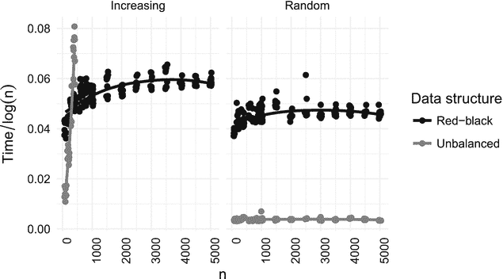

**图 6-9** 搜索树中元素的删除

### 可视化红黑树

为了可视化红黑树，我们可以编写一个类似于第 3 章中编写的 `plot.unbalanced_search_tree` 函数的 `plot.red_black_tree` 函数，但这会重复大量代码。相反，我们可以利用两种搜索树现在共享一个抽象超类 `search_tree` 的事实，并将部分功能移至该类。我们可以按原样复用第 3 章中的 `node_number_annotate_tree` 函数，但我们将重构树遍历，将其拆分为一个负责递归遍历树的函数和另一个从每个节点提取所需信息的函数。遍历函数如下所示：

```r
# 用于遍历树的辅助函数
depth_first_visit_binary_tree <- function(tree, visitor) {
if (!is_empty(tree)) {
depth_first_visit_binary_tree(tree$left, visitor)
depth_first_visit_binary_tree(tree$right, visitor)
}
visitor(tree)
}
```

我们将通过编写 `visitor` 函数来使用此函数，然后利用这些函数从树中提取信息。我们通过一个通用方法 `extract_graph` 来实现：

```r
# 用于从树中提取图形的函数
extract_graph <- function(tree) UseMethod("extract_graph")
```

`search_tree` 类的 `extract_graph` 方法提取基本的树拓扑结构以及非空节点中的值：

```r
extract_graph.search_tree <- function(tree) {
n <- tree$dfn
values <- vector("numeric", length = n)
from <- vector("integer", length = n - 1)
to <- vector("integer", length = n - 1)
edge_idx <- 1
extract <- function(tree) {
# 修改索引使根节点编号为 1
i <- n - tree$dfn + 1
values[i] <<- ifelse(is.na(tree$value), "", tree$value)
if (!is_empty(tree)) {
j <- n - tree$left$dfn + 1
from[edge_idx] <<- i
to[edge_idx] <<- j
edge_idx <<- edge_idx + 1
k <- n - tree$right$dfn + 1
from[edge_idx] <<- i
to[edge_idx] <<- k
edge_idx <<- edge_idx + 1
}
}
depth_first_visit_binary_tree(tree, extract)
nodes <- tibble(value = values)
edges <- tibble(from = from, to = to)
list(nodes = nodes, edges = edges)
}
```

这足以绘制基本树：

```r
plot.search_tree <- function(x, ...) {
x %>%
node_number_annotate_tree %>%
extract_graph %$% tbl_graph(nodes, edges) %>%
mutate(leaf = node_is_leaf()) %>%
ggraph(layout = "tree") +
scale_x_reverse() +
geom_edge_link() +
geom_node_point(aes(filter = leaf),
size = 2, shape = 21,
fill = "black") +
geom_node_point(aes(filter = !leaf),
size = 10, shape = 21,
fill = "white") +
geom_node_text(aes(label = value),
vjust = 0.4) +
theme_graph()
}
```

不平衡树中没有额外的元信息，因此我们可以直接让 `unbalanced_search_tree` 继承这些方法。

然而，对于红黑树，我们还需要显示每个节点的颜色。因此，我们需要一个专门的 `extract_graph` 方法来提取这些颜色，以及一个专门的 `plot` 方法来显示它们。

对于 `extract_graph`，我们将调用超类方法获取拓扑信息，然后用颜色信息扩展 `nodes` tibble：

```r
extract_graph.red_black_tree <- function(tree) {
graph <- NextMethod()
colours <- integer(0)
RB <- c("red", "black", "double black")
extract <- function(tree) {
colours <<- c(colours, tree$colour)
}
depth_first_visit_binary_tree(tree, extract)
nodes <- graph$nodes %>%
add_column(colour = RB[colours])
edges <- graph$edges
list(nodes = nodes, edges = edges)
}
```

对于绘图，我们调用超类方法，然后在返回前修改绘图：

```r
plot.red_black_tree <- function(x, ...) {
NextMethod() +
scale_fill_manual("Colour",
values = c("Red" = "white",
"Black" = "black",
"Double black" = "lightgray")) +
geom_node_point(aes(filter = leaf, fill = colour),
size = 2, shape = 21) +
geom_node_point(aes(filter = !leaf, fill = colour),
size = 10, shape = 21) +
geom_node_text(aes(filter = colour == "Black",
label = value),
colour = 'white', vjust = 0.4) +
geom_node_text(aes(filter = colour == "Double black",
label = value),
colour = 'black', vjust = 0.4) +
geom_node_text(aes(filter = colour == "Red",
label = value),
colour = 'black', vjust = 0.4)
}
```

红黑树的绘图包含了双重黑节点的可能性。我们绝不应该在一致的树中看到双重黑节点——这些节点只应在删除过程中向上冒泡处理之前存在——但为了调试目的，将其包含在内是有帮助的。我选择将黑节点绘制为黑色——在转换图中我使用了更粗的笔触来保留黑色供双重黑节点使用——当然我们也可以将红节点绘制为红色而不是白色，但由于本书是黑白印刷，我坚持使用白色。

我们可以这样绘制一棵树：

```r
rb_tree <- empty_red_black_tree()
for (i in 1:10)
rb_tree <- insert(rb_tree, i)
plot(rb_tree)
```

结果如图 6-10 所示。

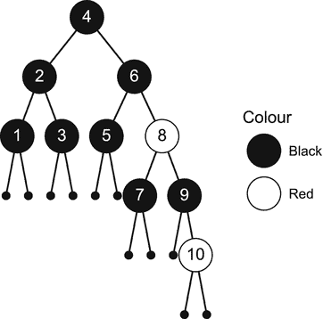

**图 6-10** 在 R 中绘制的红黑搜索树

### 伸展树

我们在上一章用于实现堆的伸展树结构实际上是一种搜索树，如果实现搜索树的操作，我们就可以将其用作搜索树。不过，我们需要做一些修改才能让它作为搜索树正常工作。

对于伸展树，其核心理念是每当搜索某个成员时，我们都会修改树。在堆版本中，我们仅在删除最小元素时这样做，但将伸展树用作搜索树时，我们希望在调用`member()`时也这样做。这会产生问题，因为我们希望`member()`返回一个布尔值，而不是一棵修改后的树，所以我们无法在保持`member()`函数接口不变的同时，实现一个纯函数式的伸展树版本。我们可以创建一个返回修改后树的`member()`函数，但我们将打破纯函数式的方法，在访问时直接修改树。这会使数据结构变为瞬时的，但如果你需要它持久化，你可以修改`member()`函数使其返回修改后的树，并基于此进行后续操作。我相信在我们了解了如何创建该数据结构的瞬时版本后，你能够做到这一点。

伸展树作为搜索树的工作方式是，每当我们对某个值调用`member()`时，我们都会将该值移动到树的根节点。我们通过模式匹配来实现这一点，识别特定的树结构，并针对这些结构重新排列树。这些重新排列操作被称为`splay()`操作，在伸展操作结束时，如果我们在`member()`中搜索的元素存在于树中，它将会成为根节点。之后，我们可以通过查看树根节点的值来检查成员资格。为了能够将修改树作为成员查询的副作用，我们将树存储在一个环境中——毕竟，这是在数据结构中引入副作用的唯一方式。我们像这样实现数据结构：

```
empty_splay_tree <- function() {
  ref <- new.env(parent = emptyenv())
  ref$tree <- empty_splay_node()
  structure(ref, class = c("splay_tree", "search_tree"))
}
is_empty.splay_tree <- function(x)
  is_empty(x$tree)
```

这复用了我们为伸展堆实现的结构和空值检测。

向伸展树中插入元素的操作与伸展堆相同。我们将现有元素划分为比新元素小的和比新元素大的两部分，然后将新元素作为树的根插入，该树的左子树是所有较小元素，右子树是所有较大元素。为此，我们复用了伸展堆中的`partition()`函数。不过，我们需要对`insert()`函数做一处修改。对于堆，我们允许树包含同一个值的多个副本——毕竟，如果我们想用堆进行排序，这是必要的。对于搜索树，我们希望将结构视为一个集合，因此如果元素已经存在于树中，我们就不想再插入它。我们可以通过在插入元素之前检查成员资格来处理这个问题。这还有一个额外的好处，即它会重新组织树的结构，使得被查找的元素（或与之接近的元素）位于根节点，从而加速分区操作，但这是一个不影响功能的微小细节。修改后的`insert()`函数如下所示：

```
insert.splay_tree <- function(x, elm) {
  if (member(x, elm))
    return(x) # 如果元素已存在，则不插入
  part <- partition(elm, x$tree)
  x$tree <- splay_tree_node(
    value = elm,
    left = part$smaller,
    right = part$larger
  )
  x
}
```

删除元素时，我们可以像处理非平衡搜索树一样处理伸展树。我们可以尝试在删除操作中平衡树，但这并不能保证能提高后续操作的性能，所以我们不打算这样做。我们将使用与非平衡树相同的删除逻辑。不过，我们需要一个新的函数来实现它，因为在递归过程中，我们需要构建一个具有正确类对象的伸展树，但逻辑与我们之前看到的完全相同：

```
splay_remove <- function(tree, elm) {
  if (is_empty(tree)) return(empty_splay_node())
  if (elm < tree$value)
    splay_tree_node(tree$value, splay_remove(tree$left, elm), tree$right)
  else if (elm > tree$value)
    splay_tree_node(tree$value, tree$left, splay_remove(tree$right, elm))
  else
    remove_root(tree)
}
remove_root <- function(tree) {
  if (is_empty(tree$left)) return(tree$right)
  if (is_empty(tree$right)) return(tree$left)
  # 找到右子树中的最小元素
  next_elm <- find_min(tree$right)
  splay_tree_node(next_elm, tree$left, remove_min(tree$right))
}
find_min <- function(tree) {
  if (is_empty(tree$left)) tree$value
  else find_min(tree$left)
}
remove_min <- function(tree) {
  if (is_empty(tree$left)) tree$right
  else splay_tree_node(tree$value, remove_min(tree$left), tree$right)
}
remove.splay_tree <- function(x, elm) {
  x$tree <- splay_remove(x$tree, elm)
  x
}
```

伸展树的平衡魔法发生在`member()`函数中。每当我们测试成员资格时，我们首先对树进行`splay()`操作，如果被查找的元素在树中，该操作会将其移动到根节点；之后，测试成员资格就简化为查看根节点的值：

```
member.splay_tree <- function(x, elm) {
  x$tree <- splay(x$tree, elm)
  # 如果 elm 在树中，它现在就在根节点
  !is.na(x$tree$value) && x$tree$value == elm
}
```

这样就剩下 `splay()` 函数了。这个函数应该将我们正在查找的元素移动到根节点，并同时平衡树。伸展操作所涉及的操作如图 6-11 所示，该函数的完整实现如下。与许多其他树操作一样，它主要是对树结构进行模式匹配，为此，我们复用了之前的 `pattern_match()` 函数。不同的操作会检查树的不同深度。如果我们仅仅旨在将伸展的元素旋转到树的根节点，我们可以只使用 `Zig` 和 `Zag` 操作，并且只查看树的一层。但这不会像使用其他操作那样达到相同的平衡程度，因此无法实现预期的均摊对数深度。

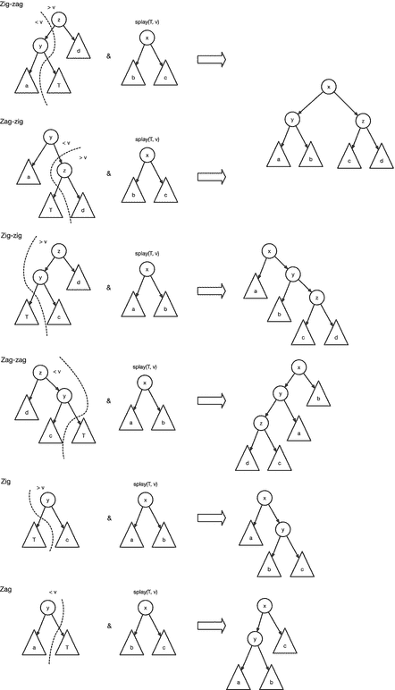

**图 6-11** 伸展操作

```
splay <- function(tree, v) {
  if (is_empty(tree)) return(empty_splay_node())
  
  # -- Zig-zig (左左情况) --------------------------------
  if (pattern_match(z = tree$value,
                    y = tree$left$value,
                    z > y && y > v,
                    s = splay(tree$left$left, v),
                    x = s$value,
                    a = s$left,
                    b = s$right,
                    c = tree$left$right,
                    d = tree$right)) {
    splay_tree_node(
      value = x,
      left = a,
      right = splay_tree_node(
        value = y,
        left = b,
        right = splay_tree_node(
          value = z,
          left = c,
          right = d)))
  # -- Zag-zag (右右情况) ---------------------------
  } else if (pattern_match(z = tree$value,
                           y = tree$right$value,
                           z < y && y < v,
                           s = splay(tree$right$right, v),
                           x = s$value,
                           a = tree$left,
                           b = tree$right$left,
                           c = s$left,
                           d = s$right)) {
    splay_tree_node(
      value = x,
      left = splay_tree_node(
        value = y,
        left = splay_tree_node(
          value = z,
          left = a,
          right = b),
        right = c),
      right = d)
  # -- Zig-zag (左右情况) ----------------------------
  } else if (pattern_match(z = tree$value,
                           y = tree$left$value,
                           z > y && y < v,
                           s = splay(tree$left$right, v),
                           x = s$value,
                           a = tree$left$left,
                           b = s$left,
                           c = s$right,
                           d = tree$right)
             ||
             pattern_match(y = tree$value,
                           z = tree$right$value,
                           y < z && z > v,
                           s = splay(tree$right$left, v),
                           x = s$value,
                           a = tree$left,
                           b = s$left,
                           c = s$right,
                           d = tree$right$right)) {
    splay_tree_node(
      value = x,
      left = splay_tree_node(
        value = y,
        left = a,
        right = b),
      right = splay_tree_node(
        value = z,
        left = c,
        right = d))
  # -- Zig (左子节点情况) --------------------------------
  } else if (pattern_match(y = tree$value,
                           y > v,
                           s = splay(tree$left, v),
                           x = s$value,
                           a = s$left,
                           b = s$right,
                           c = tree$right)) {
    splay_tree_node(
      value = x,
      left = a,
      right = splay_tree_node(
        value = y,
        left = b,
        right = c))
  # -- Zag (右子节点情况) --------------------------------
  } else if (pattern_match(y = tree$value,
                           y < v,
                           s = splay(tree$right, v),
                           x = s$value,
                           a = tree$left,
                           b = s$left,
                           c = s$right)) {
    splay_tree_node(
      value = x,
      left = splay_tree_node(
        value = y,
        left = a,
        right = b),
      right = c)
  } else {
    # 如果递归的 splay 操作返回一棵空树，
    # 这可能在 v 不在树中时发生，我们会到达这里，
    # 此时我们放弃并直接返回原树。
    tree
  }
}
```

## 伸展树的实现与分析

# 伸展树的实现与性能评估

为完整起见，我们可以实现这个 `plot` 函数。这非常简单，因为我们已经为堆实现了伸展树的绘图功能（虽然本书未列出该实现，你可以在 [`http://github.com/mailund/ralgo`](http://github.com/mailund/ralgo) 找到它），因此我们可以复用该实现：

```r
plot.splay_tree <- function(x) {
  plot(x$tree)
}
```

我们可以利用这个绘图函数来探索当对伸展树调用 `member` 函数时，平衡行为是如何变化的。如果运行以下代码，我们将得到图 6-12 所示的树：A 展示按顺序插入数字 1 到 10 后构建的树，B 是查询 4 后的结果，C 是查询 8 后的结果，D 是查询 6 后的结果。请注意，我们查询的元素会移动到树的根节点，而且最近查询过的元素会保持在靠近根的位置。在搜索模式中，常常会出现一段时间内反复查询某个小子集，之后再转向另一个子集的情况。在这种情况下，伸展树的平衡机制会将这个子集移向树根，从而比不根据实际查询调整树结构时处理得更快。

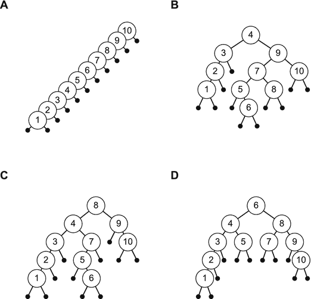

**图 6-12** 平衡后的伸展树

```r
tree <- empty_splay_tree()
for (x in 1:10)
  tree <- insert(tree, x)
plot(tree)
member(tree, 4)
plot(tree)
member(tree, 8)
plot(tree)
member(tree, 6)
plot(tree)
```

我们可以通过复用构建实验的代码来评估伸展树的性能。结果如图 6-13 所示。对于较大的树，我只为随机顺序的输入构建了伸展树和不平衡树。对于有序输入，不平衡树和伸展树都会产生非常深的树。对于伸展树而言，这不会成为性能问题——即使输入无序，我们也能高效地构建它们——但由于递归调用会超过栈深度，我们将无法对位于树很深位置的元素进行成员查询。因为我们在插入新元素之前会显式检查成员关系，所以即使 `partition` 函数本身不会进行深层递归，这也会阻止我们构建很深的伸展树。要解决这个问题，就需要使用 thunk 和 trampoline 技术，或者像前一章讨论的那样，在插入过程中进行某种重平衡。

如图所示，在处理有序输入时，伸展树的表现优于红黑树和不平衡树——在其能处理的规模范围内——但在从随机顺序元素构建树时，其速度慢于不平衡树。它胜过红黑搜索树是因为 `splay` 函数虽然看起来有些复杂，但实际上并未执行比红黑搜索树插入函数更复杂的变换，同时树的节点更简单，需要设置的数值也更少。在随机顺序数据上的速度仅比有序数据稍慢，这是因为在这两种情况下我们都首先在 `member` 调用中对元素进行伸展，但当输入数据随机化时，`partition` 函数需要比数据按顺序输入时递归得更深。`member` 和 `partition` 调用使得伸展树的 `insert` 比不平衡树的 `insert` 函数稍复杂，这就是它在随机数据上较慢的原因。

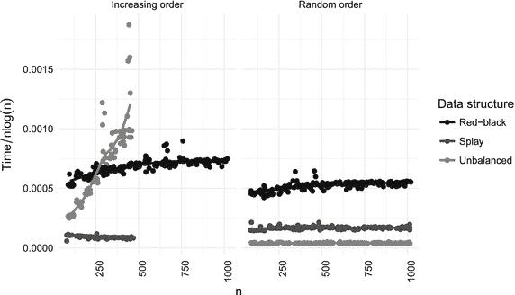

**图 6-13** 搜索树构建性能比较

对于成员测试，我们可以像之前一样，测量在不同大小的树中搜索 100 个随机元素所需的时间。结果如图 6-14 所示。由于伸展树在插入元素时的 `member` 检查中会平衡树，因此在有序输入上其性能优于不平衡树。但是，由于作为成员测试一部分的 `splay` 操作比不平衡树和红黑树执行的简单递归搜索要复杂得多，因此当其他树（如总是平衡的红黑树，以及在随机顺序输入下构建时也保持平衡的“不平衡”树）处于平衡状态时，伸展树的成员检查速度会慢得多。

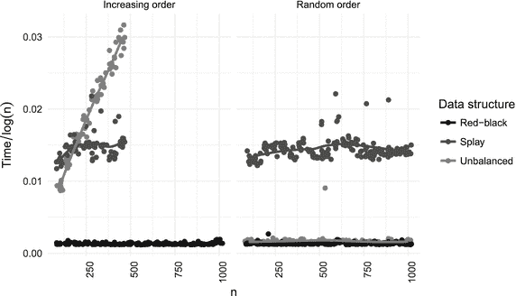

**图 6-14** 搜索树中成员测试性能比较

如果我们使用以下函数进行性能评估，对少量相同元素进行重复的成员调用：

```r
evaluate_member <- function(n, tree) {
  elements <- rep(sample(1:n, size = 10, replace = TRUE), 100)
  for (elm in elements) {
    member(tree, elm)
  }
}
```

我们会看到成员测试的性能有所提升，如图 6-15 所示，但 `splay` 函数带来的开销仍然使得伸展树的成员测试速度慢于其他两种树。因此，对于特定应用而言，哪种树最好取决于我们插入元素的顺序（如果可以随机化顺序，“不平衡”树将变得平衡，并胜过其他两种树）、构建的树的大小以及我们执行的成员测试次数——伸展树构建更快，但红黑树在成员测试方面表现更优。

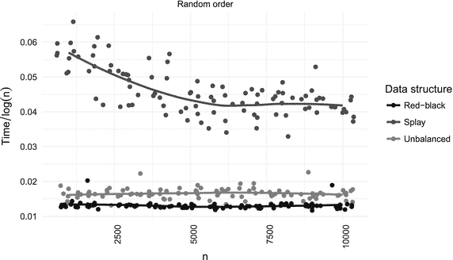

**图 6-15** 对少量元素子集的重复成员测试

