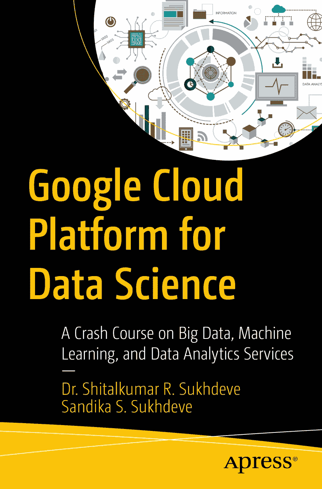

ISBN 978-1-4842-9687-5 电子书 ISBN 978-1-4842-9688-2 [`doi.org/10.1007/978-1-4842-9688-2`](https://doi.org/10.1007/978-1-4842-9688-2) © Shitalkumar R. Sukhdeve and Sandika S. Sukhdeve 2023 本作品受版权保护。所有权利均独家授权给出版商，无论涉及材料的全部或部分，特别是翻译、重印、重用插图、朗诵、广播、以缩微胶片或任何其他物理方式复制、传输或信息存储与检索、电子改编、计算机软件，或现在已知或以后开发的类似或不同方法的权利。本出版物中使用通用描述性名称、注册商标、商标、服务标志等，即使没有明确声明，也不意味着这些名称不受相关保护法律和法规的约束，因此可供一般使用。出版商、作者和编辑可以合理假设，本书中的建议和信息在出版之日是真实准确的。出版商、作者或编辑均不对本文所含材料或可能存在的任何错误或遗漏提供明示或暗示的保证。出版商对已出版地图和机构归属中的管辖权主张保持中立。

本 Apress 印记由注册公司 APress Media, LLC（Springer Nature 的一部分）出版。

注册公司地址为：1 New York Plaza, New York, NY 10004, U.S.A.

*献给我的父母、家人和朋友。*

