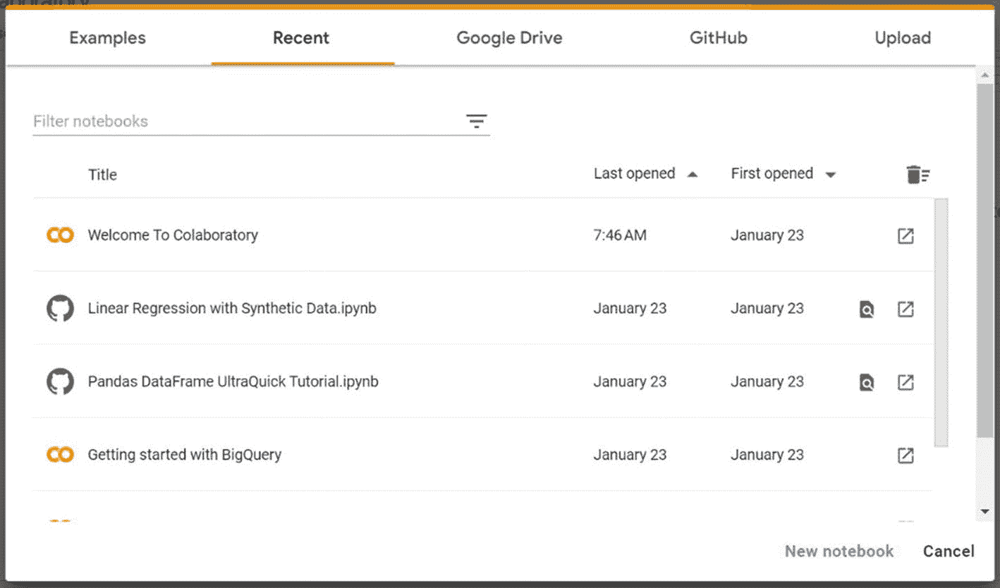
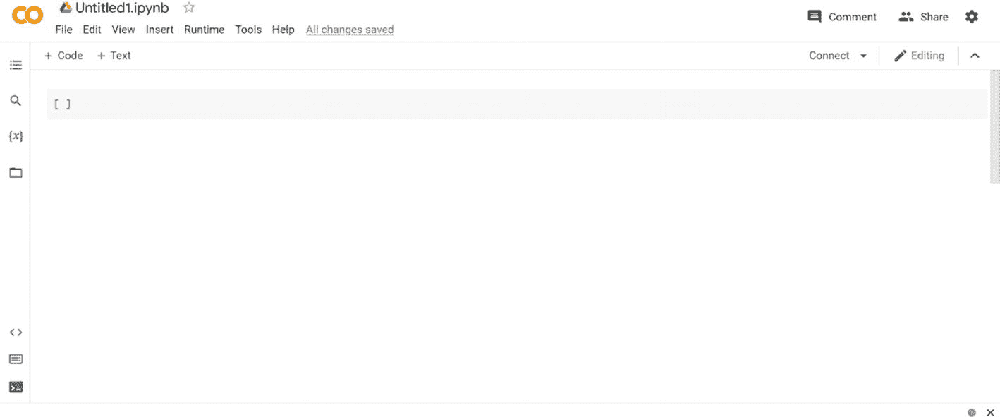
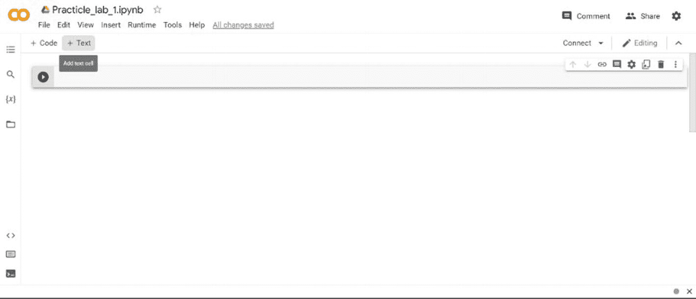
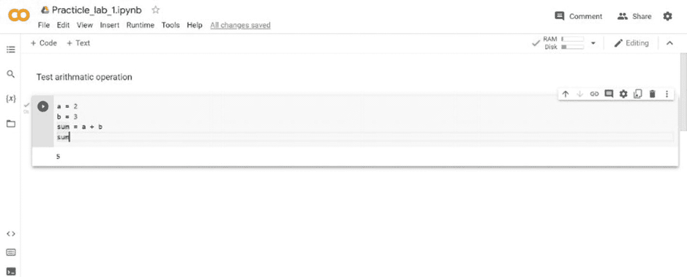
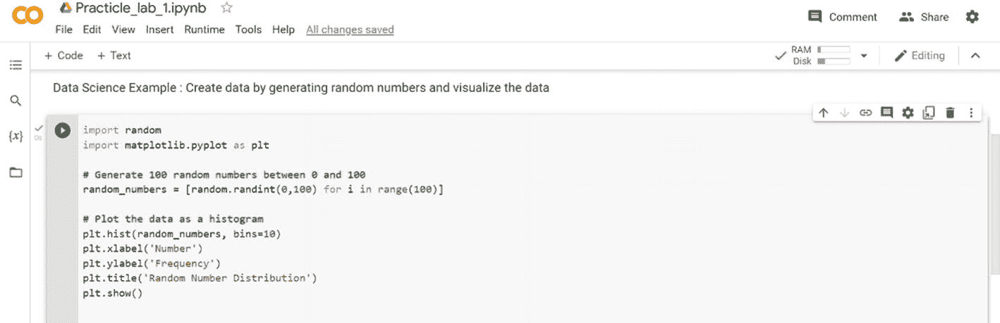
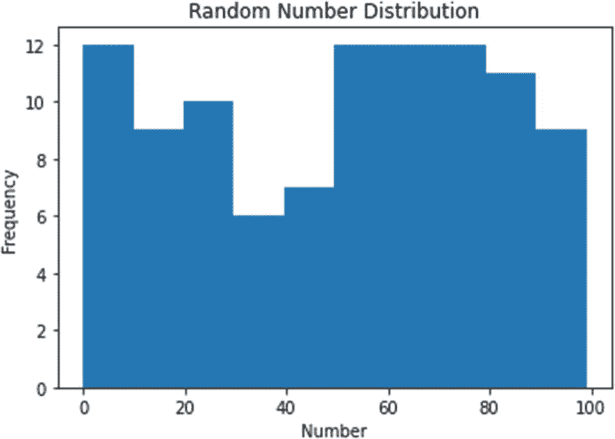
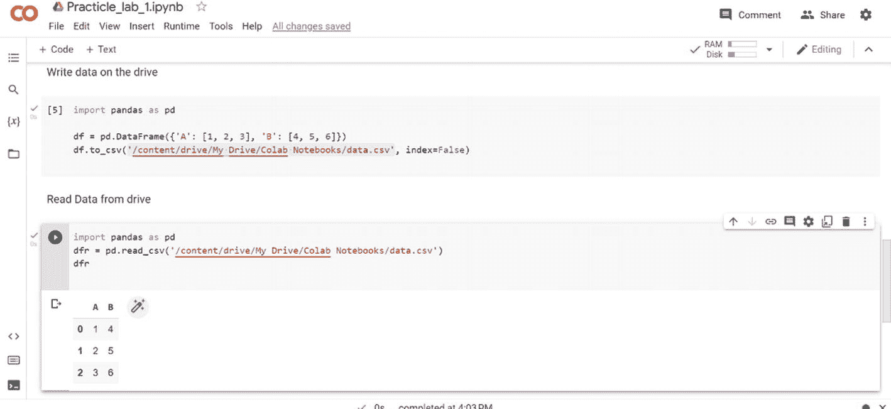
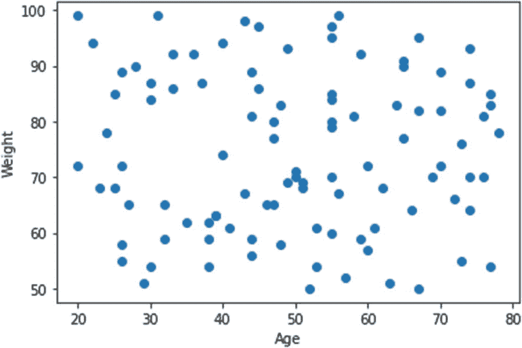

## 2. Google Colaboratory

Google Colaboratory 是 Google 提供的一个免费的、基于云的 Jupyter Notebook 环境。它允许个人使用 Python 和其他编程语言编写和运行代码，并执行数据分析、数据可视化和机器学习任务。该平台设计为易于访问、使用简单且便于协作，使其成为数据科学家、软件工程师和学生中流行的工具。

# 本章将指导您完成开始使用 Colab 的过程，从访问平台到了解其功能并有效利用其能力。我们将介绍如何创建和运行 Jupyter notebook、运行机器学习模型，以及从 Colab 访问 GCP 服务和数据。

## Colab 的功能

`基于云的环境`：Colaboratory 在 Google 的服务器上运行，无需用户在设备上安装软件。

`易于使用`：Colaboratory 提供了一个用户友好的界面来处理 Jupyter notebook，使编程经验有限的个人也能轻松上手。

`访问 GCP 服务`：Colaboratory 与 Google Cloud Platform (GCP) 服务集成，允许用户从 notebook 环境中访问和使用 GCP 资源，例如 `BigQuery` 和 `Cloud Storage`。

`共享与协作`：Colaboratory 允许用户共享 notebook 并与他人协作完成项目，使其成为团队工作的绝佳工具。

`GPU 和 TPU 支持`：Colaboratory 提供对 GPU 和 TPU 的访问，用于运行计算密集型任务，例如深度学习和高性能计算。

Google Colaboratory 为数据科学、机器学习和其他技术任务提供了一个强大而灵活的平台，使其成为希望使用基于云的工具的个人和团队的热门选择。

## 在 Colaboratory 上创建并运行 Jupyter Notebook

要开始你的 Colab 之旅，请按照以下步骤访问该平台：


*一张谷歌登录页面的截图，包含用于填写电子邮件或手机号码的输入框，以及一个用于找回遗忘邮箱的链接。底部有两个按钮，分别是“创建账户”和“下一步”。*

1. **打开网页浏览器**：在你的电脑或移动设备上启动你常用的网页浏览器。
2. **注册谷歌账户**：在使用 Colaboratory 之前，你必须拥有一个谷歌账户。如果你还没有，请注册一个免费的谷歌账户（图 2-1）。


*一张截图展示了一个包含 5 列的表格，例如“最近使用”、“Google 云端硬盘”、“GitHub”和“上传”。其中“最近使用”被选中，显示了一个标题列表及其详细信息，包括“上次打开”和“首次打开”。右下角有 2 个按钮，分别是“新建笔记本”和“取消”。*

3. **导航到 Colaboratory**：访问 Google Colaboratory 网站（[`https://colab.research.google.com/`](https://colab.research.google.com/)）并使用你的谷歌账户登录。登录后，你应该会看到一个类似图 2-2 所示的对话框。


*一张名为“Untitled1.ipynb”的新笔记本截图。*

4. **Colab 界面概览**：
    - **菜单栏**：Colab 界面的顶部是菜单栏。它包含用于文件操作、运行时配置等的各种选项。花点时间探索一下可用的菜单选项。
    - **工具栏**：工具栏位于菜单栏正下方。它提供了常用操作的快速访问，例如运行、插入新单元格和更改单元格类型。
    - **代码单元格**：Colab 界面的主要区域由代码单元格组成。这些单元格允许你编写和执行 Python 代码。默认情况下，新笔记本从一个代码单元格开始。你可以根据需要添加更多单元格。
    - **文本单元格（Markdown 单元格）**：除了代码单元格，Colab 还支持文本单元格，也称为 Markdown 单元格。文本单元格允许你向笔记本中添加解释性文本、标题、项目符号和其他格式化内容。它们有助于为你的代码提供文档、解释和上下文。

5. **创建新笔记本**：要创建一个新的 Colaboratory 笔记本，请点击右上角或右下角的 **新建笔记本** 按钮，如图 2-2 所示。
6. **选择运行时类型**：创建新笔记本时，你需要指定运行时类型。选择 **Python 3** 以便在 Colaboratory 中使用 Python。
7. **开始编码**：现在你已经准备好开始用 Python 编码了。你可以通过点击左上角写着“Untitled1.ipynb”的位置来更改笔记本的名称（图 2-3）。点击笔记本中的第一个代码单元格以选中它。在代码单元格中输入一个简单的 Python 语句，例如 `print("Hello, Colab!")`。按 `Shift+Enter` 执行代码。代码的输出将出现在单元格下方。

## 动手实践示例

通过点击 **+ 文本** 按钮，在笔记本中插入文本来描述代码。


*一张浏览器窗口的截图。页面标题是“Practical_lab_1.ipynb”。浏览器窗口分为两部分：左侧边栏和主区域。*

执行两个数的求和。


*一张名为“practical_lab_1.ipynb”的笔记本截图，显示了用于测试算术运算的 5 行文本。*

从上图可以看出，`a = 2`，`b = 3`，并且 `sum = a + b`，输出结果为 `5`。

以下是一个 Python 示例，演示如何使用 `random` 库生成随机数，并使用 Matplotlib 可视化数据。


*一张名为“practical_lab_1.ipynb”的笔记本截图，展示了一段用于数据科学示例的代码片段，该示例通过生成随机数来创建数据并可视化数据。*

以下代码演示了如何使用 Python 库 `random` 和 `matplotlib.pyplot` 生成随机数、创建直方图并可视化数据：

```python
import random
import matplotlib.pyplot as plt
#### 生成 100 个介于 0 和 100 之间的随机数
random_numbers = [random.randint(0,100) for i in range(100)]
#### 将数据绘制为直方图
plt.hist(random_numbers, bins=10)
plt.xlabel('数值')
plt.ylabel('频率')
plt.title('随机数分布')
plt.show()
```

以下是代码的详细说明：
- `import random` 和 `import matplotlib.pyplot as plt`：这两行导入了生成随机数和使用 Matplotlib 创建可视化所需的库。
- `random_numbers = [random.randint(0,100) for i in range(100)]`：这行代码生成一个名为 `random_numbers` 的列表，其中包含 100 个介于 0 和 100 之间的随机整数。`random` 库中的 `random.randint()` 函数在列表推导式中用于生成这些随机数。
- `plt.hist(random_numbers, bins=10)`：这行代码使用 `matplotlib.pyplot` 中的 `hist()` 函数创建一个直方图。它以 `random_numbers` 列表作为输入，并指定直方图的组数（10 组）。`hist()` 函数计算每个组内值的频率并绘制直方图。
- `plt.xlabel('数值')`、`plt.ylabel('频率')`、`plt.title('随机数分布')`：这些行分别设置 x 轴和 y 轴的标签以及图的标题。
- `plt.show()`：这行代码在屏幕上显示图形。调用 `matplotlib.pyplot` 中的 `show()` 函数来渲染直方图。

通过在 Colaboratory 笔记本或 Python 环境中执行此代码，你将看到一个类似图 2-7 的直方图可视化，它展示了随机生成数的分布。x 轴表示数值范围（0–100），y 轴表示数据集中每个数值的频率。


*一张随机数分布图，包含一个频率从 0 到 12 的垂直轴，以及一个数值从 0 到 100 的水平轴。图形呈现出波动趋势。*

此示例展示了 Python 以及 `random` 和 Matplotlib 等库生成和可视化数据的能力，提供了关于如何使用随机数和直方图的基本理解。

## 导入库

以下是将库导入笔记本的示例代码。如果库尚未安装，请使用 `!pip install` 命令后跟库名进行安装：


```
#### 导入 Pandas 库
import pandas as pd
#### 导入 Numpy 库
import numpy as np
#### 导入 Matplotlib 库
import matplotlib.pyplot as plt
#### 导入 Seaborn 库
import seaborn as sns
```

此示例中导入了 `Pandas`、`Numpy`、`Matplotlib` 和 `Seaborn` 库。`import` 语句用于导入库，`as` 关键字用于为库指定别名以便于访问。例如，`Pandas` 被赋予别名 `pd`，`Numpy` 被赋予别名 `np`。这允许你使用更短、更易输入的别名来访问库的函数和方法。你可以在 Colaboratory 笔记本中运行此代码，并在代码中使用导入的库。

### 处理数据

Colaboratory 与 Google Drive 和 Google Cloud Storage 集成，使您能够轻松地从这些服务导入和处理数据。

您可以使用 `google.colab` 库在 Colaboratory 中存储或访问 Google Drive 中存储的数据。例如，要将您的 Google Drive 挂载到 Colaboratory，可以运行以下代码：

```
from google.colab import drive
drive.mount('/content/drive')
```

执行代码后，会出现一个提示，要求您登录 Google 帐户并授予 Colaboratory 访问您 Google Drive 的必要权限。

授权 Colaboratory 后，您可以通过在 Colaboratory 文件浏览器中导航到 `/content/drive` 来访问您的 Google Drive 数据。

要向 Google Drive 写入数据，您可以使用 Python 内置的 `open` 函数。例如，要将 Pandas DataFrame 写入 Google Drive 中的 CSV 文件，可以使用以下代码：

```
import pandas as pd
df = pd.DataFrame({'A': [1, 2, 3], 'B': [4, 5, 6]})
df.to_csv('/content/drive/My Drive/Colab Notebooks/data.csv', index=False)
```

此代码会在 Google Drive 的 `My Drive/Colab Notebooks/` 文件夹中创建一个新的 CSV 文件，其中包含 `Pandas DataFrame` 中的数据。

请注意，您也可以使用其他库，例如 `gspread` 将数据写入 Google Sheets，或使用 `google.cloud` 将数据写入其他 GCP 服务。您选择的方法将根据所需的数据格式和写入目标而有所不同。

您可以像使用 Colaboratory 中的任何其他数据一样使用 Google Drive 中的数据。例如，您可以使用以下代码读取存储在 Google Drive 中的 CSV 文件并将其加载到 Pandas DataFrame 中：

```
import pandas as pd
df = pd.read_csv('/content/drive/My Drive/Colab Notebooks/data.csv')
```



一个名为 `practicle lab 1.ipynb` 的笔记本截图，展示了用于向驱动器写入数据和从驱动器读取数据的代码片段。

**图 2-8** Colab 上 Python 的截图

### 可视化数据

要在 Colaboratory 中可视化数据，您可以使用 `Matplotlib` 或 `Seaborn` 等库来创建图表。

使用以下代码通过 `Pandas` 库在 Python 中创建一个数据框：

```
import pandas as pd
import numpy as np
df = pd.DataFrame({'age': np.random.randint(20, 80, 100),
'weight': np.random.randint(50, 100, 100)})
```

这将创建一个包含 100 行和 2 列（名为“age”和“weight”）的数据框，其中填充了年龄在 20 到 80 之间、体重在 50 到 100 之间的随机整数值。

使用 Python 中的 `Matplotlib` 库可视化 `Pandas` 数据框中的数据。以下是一个绘制年龄和体重列散点图的示例：

```
import matplotlib.pyplot as plt
plt.scatter(df['age'], df['weight'])
plt.xlabel('Age')
plt.ylabel('Weight')
plt.show()
```

提供的代码使用 Python 中的 `Matplotlib` 库创建散点图。让我们逐行分析代码：

*   `import matplotlib.pyplot as plt`：此行导入 `Matplotlib` 库，特别是 `pyplot` 模块。`plt` 是一个别名或简写，允许我们在调用其函数时引用该模块。

*   `plt.scatter(df['age'], df['weight'])`：此行使用 `Matplotlib` 的 `scatter()` 函数创建散点图。它接受两个参数：`df['age']` 和 `df['weight']`。假设 `df` 是一个 `Pandas DataFrame`，此代码将“age”列的值绘制在 x 轴上，将“weight”列的值绘制在 y 轴上。

*   `plt.xlabel('Age')`：此行设置散点图 x 轴的标签。在此例中，标签设置为“Age”。

*   `plt.ylabel('Weight')`：此行设置散点图 y 轴的标签。在此例中，标签设置为“Weight”。

*   `plt.show()`：此行在屏幕上显示散点图。必须包含此行才能在单独的窗口或 Jupyter 笔记本中看到渲染的图表。

这将创建一个以年龄值为 x 轴、体重值为 y 轴的散点图。您还可以使用其他类型的图表，如直方图、折线图、条形图等，来可视化 `Pandas` 数据框中的数据。



一张体重与年龄的散点图，显示了几个散落的点。

**图 2-9** 生成的年龄-体重分布图

### 在 Colaboratory 上运行机器学习模型

以下是一个使用 Python 和 `scikit-learn` 库构建机器学习模型的示例。首先，如果你没有数据，可以使用以下代码生成数据。该代码会生成随机特征和随机目标数组，然后将它们合并成一个 `Pandas DataFrame`，以便进行进一步的分析或建模：

```
import pandas as pd
import numpy as np
#### 生成随机特征
np.random.seed(0)
n_samples = 1000
n_features = 5
X = np.random.randn(n_samples, n_features)
#### 生成随机目标
np.random.seed(1)
y = np.random.randint(0, 2, n_samples)
#### 将特征和目标合并成一个数据框
df = pd.DataFrame(np.hstack((X, y[:, np.newaxis])), columns=["feature_1", "feature_2", "feature_3", "feature_4", "feature_5", "target"])
```

现在，我们将逐行分析这段代码：

1. `import pandas as pd` 和 `import numpy as np`：这两行导入了 `Pandas` 和 `Numpy` 库，它们常用于 Python 中的数据操作和分析。

2. `np.random.seed(0)`：这行代码为 `Numpy` 设置了随机种子，以确保生成的随机数具有可重复性。通过设置特定的种子值（此处为 0），每次运行代码时都会生成相同的随机数集合。

3. `n_samples = 1000`：这行代码将生成的样本数量设置为 1000。

4. `n_features = 5`：这行代码将生成的特征数量设置为 5。

5. `X = np.random.randn(n_samples, n_features)`：这行代码使用 `Numpy` 的 `np.random.randn()` 函数生成一个形状为 (`n_samples`, `n_features`) 的随机数组。数组中的每个元素都来自标准正态分布（均值为 0，标准差为 1）。

6. `np.random.seed(1)`：这行代码为生成随机目标值设置了一个不同的随机种子值（1）。这确保了目标值与之前生成的特征值不同。


# 使用scikit-learn训练和部署随机森林分类器

## 数据准备与模型训练

7. `y = np.random.randint(0, 2, n_samples)`：这行代码使用 `np.random.randint()` 函数生成了一个长度为 `n_samples` 的随机整数数组，整数范围在 0 到 1 之间（不含 2）。这代表了分类任务的目标值，每个目标值要么是 0，要么是 1。
8. `df = pd.DataFrame(np.hstack((X, y[:, np.newaxis])), columns=["feature_1", "feature_2", "feature_3", "feature_4", "feature_5", "target"])`：这行代码将特征数组 (`X`) 和目标数组 (`y`) 合并成一个 Pandas DataFrame。`np.hstack()` 函数将 `X` 和 `y` 数组水平堆叠，然后将合并后的数组传递给 `pd.DataFrame()` 函数以创建一个 DataFrame。`columns` 参数用于为 DataFrame 指定列名，即特征和目标变量的名称。

现在，我们可以使用以下代码生成一个机器学习模型。该代码从 CSV 文件加载数据集，将其拆分为训练集和测试集，训练一个随机森林分类器，对测试集进行预测，并通过计算准确率来评估模型的性能：

```python
from sklearn.model_selection import train_test_split
from sklearn.ensemble import RandomForestClassifier
from sklearn.metrics import accuracy_score
#### 加载数据集
df = pd.read_csv("data.csv")
#### 将数据拆分为特征 (X) 和目标 (y)
X = df.drop("target ", axis=1)
y = df["target "]
#### 将数据拆分为训练集和测试集
X_train, X_test, y_train, y_test = train_test_split(X, y, test_size=0.2)
#### 训练一个随机森林分类器
clf = RandomForestClassifier(n_estimators=100)
clf.fit(X_train, y_train)
#### 对测试集进行预测
y_pred = clf.predict(X_test)
#### 评估模型性能
accuracy = accuracy_score(y_test, y_pred)
print("Accuracy:", accuracy)
```

让我们逐行分析这段代码：
1. `from sklearn.model_selection import train_test_split`：这行代码从 `scikit-learn` 库的 `model_selection` 模块中导入了 `train_test_split` 函数。该函数用于将数据集拆分为训练子集和测试子集。
2. `from sklearn.ensemble import RandomForestClassifier`：这行代码从 `scikit-learn` 的 `ensemble` 模块中导入了 `RandomForestClassifier` 类。该类代表一个随机森林分类器，这是一种基于决策树的集成模型。
3. `from sklearn.metrics import accuracy_score`：这行代码从 `scikit-learn` 的 `metrics` 模块中导入了 `accuracy_score` 函数。该函数用于计算分类模型的准确率。
4. `df = pd.read_csv("data.csv")`：这行代码使用 Pandas 库的 `read_csv` 函数读取名为 `"data.csv"` 的 CSV 文件。CSV 文件的内容被加载到一个名为 `df` 的 Pandas DataFrame 中。
5. `X = df.drop("target", axis=1)`：这行代码通过从原始 DataFrame `df` 中删除 `"target"` 列，创建了一个新的 DataFrame `X`。这个 DataFrame 包含了用于训练模型的特征。
6. `y = df["target"]`：这行代码通过从原始 DataFrame `df` 中选择 `"target"` 列，创建了一个 Series `y`。这个 Series 代表了目标变量或与特征对应的标签。
7. `X_train, X_test, y_train, y_test = train_test_split(X, y, test_size=0.2)`：这行代码使用 `train_test_split` 函数将数据拆分为训练集和测试集。特征 `X` 和目标 `y` 作为参数传入，同时还有 `test_size` 参数，该参数指定了用于测试的数据比例（此处为 20%）。
8. `clf = RandomForestClassifier(n_estimators=100)`：这行代码创建了一个包含 100 棵决策树的 `RandomForestClassifier` 类的实例。`n_estimators` 参数决定了随机森林中树的数量。
9. `clf.fit(X_train, y_train)`：这行代码在训练数据（`X_train` 和 `y_train`）上训练随机森林分类器（`clf`）。分类器学习数据中的模式和关系，以便进行预测。
10. `y_pred = clf.predict(X_test)`：这行代码使用训练好的分类器（`clf`）对测试数据（`X_test`）进行预测。预测的标签存储在 `y_pred` 变量中。
11. `accuracy = accuracy_score(y_test, y_pred)`：这行代码通过比较预测标签（`y_pred`）与测试集的真实标签（`y_test`）来计算模型的准确率。准确率得分存储在 `accuracy` 变量中。
12. `print("Accuracy:", accuracy)`：这行代码在控制台打印准确率得分，表明模型在测试数据上的表现如何。

## 在生产环境中部署模型

如果你想部署一个 `scikit-learn` 模型，可以使用 `joblib` 库来保存模型，然后通过 REST API 来提供模型服务。以下代码安装了 `joblib` 和 `Flask` 库，使用 `joblib` 将训练好的模型保存到文件，并设置了一个 `Flask` 应用来提供模型预测服务。代码定义了 `/predict` 端点，当向该端点发送请求时，模型会被加载，进行预测，并将结果以 JSON 响应形式返回。

你可以使用诸如 Google Cloud Platform 或 Amazon Web Services 之类的云服务来托管 REST API，并使你的应用程序能够获取预测结果。以下是具体操作示例：

### 1. 安装 joblib 库

```shell
!pip install joblib
```

### 2. 保存模型

```python
import joblib
model = clf # 你训练好的模型
#### 保存模型
joblib.dump(model, '/content/drive/My Drive/Colab Notebooks/model.joblib')
```

### 3. 使用 Flask 提供模型服务

```python
!pip install flask
from flask import Flask, request
import joblib
app = Flask(__name__)
@app.route("/predict", methods=["POST"])
def predict():
    data = request.json[X_test]
    model = joblib.load('/content/drive/My Drive/Colab Notebooks/model.joblib')
    predictions = model.predict(data)
    print(predictions)
    return {'predictions': predictions.tolist()}
if __name__ == "__main__":
    app.run()
```

此示例使用 `Flask` 库将模型作为 REST API 提供服务。你可以通过向 `/predict` 端点发送一个包含输入数据的 POST 请求来测试该 API。

现在，我们逐行分析代码：
1. `!pip install joblib`：此行使用 `pip` 包管理器安装 `joblib` 库。`joblib` 是一个 Python 库，用于 Python 对象（包括模型）的序列化和反序列化。
2. `import joblib`：此行导入 `joblib` 模块，该模块提供了保存和加载模型的函数。

3.  `model = clf`：此行将训练好的模型（`clf`）赋值给 `model` 变量。它假设 `clf` 是训练好的模型对象。

4.  `joblib.dump(model, '/content/drive/My Drive/Colab Notebooks/model.joblib')`：此行使用 `joblib.dump()` 函数将模型保存到名为 `model.joblib` 的文件中。该文件将保存在指定的目录路径 `/content/drive/My Drive/Colab Notebooks/` 下。

5.  `!pip install flask`：此行使用 `pip` 包管理器安装 `Flask` Web 框架。`Flask` 是一个流行的用于构建 Web 应用的 Python 框架。

6.  `from flask import Flask, request`：此行从 `flask` 模块导入 `Flask` 类。同时导入了 `request` 对象，它允许访问传入 HTTP 请求中的数据。

7.  `app = Flask(__name__)`：此行创建了一个名为 `app` 的 `Flask` 应用实例。

8.  `@app.route("/predict", methods=["POST"])`：此行装饰了接下来的函数，使其能够处理对 `/predict` 端点发起的 HTTP POST 方法请求。

9.  `def predict():`：此行定义了一个名为 `predict` 的函数，当向 `/predict` 端点发起请求时，该函数将被执行。

10. `data = request.json[X_test]`：此行从发送到 `/predict` 端点的请求中检索 JSON 数据。它假设 JSON 数据包含 `X_test` 键。

11. `model = joblib.load('/content/drive/My Drive/Colab Notebooks/model.joblib')`：此行使用 `joblib.load()` 函数从文件 `model.joblib` 中加载模型。

12. `predictions = model.predict(data)`：此行使用加载的模型对从请求中获取的数据进行预测。

13. `print(predictions)`：此行将预测结果打印到控制台。

14. `return {'predictions': predictions.tolist()}`：此行返回一个包含预测结果列表的 JSON 响应。

15. `if __name__ == "__main__":`：此行检查脚本是否作为主模块直接运行。

16. `app.run()`：此行启动 `Flask` 开发服务器来运行应用程序。

### 从 Colaboratory 访问 GCP 服务和数据

**连接到 GCP**：Colaboratory 是 Google Cloud Platform (GCP) 的一部分，因此你可以轻松地从 Colaboratory 访问其他 GCP 服务和数据。要连接到 GCP，你需要设置一个 Google Cloud 项目，并授予 Colaboratory 访问你 Google Cloud 资源的权限。

**使用 Google Cloud 进行身份验证：** 要使用 Google Cloud 进行身份验证，你需要在 Colaboratory 单元格中运行以下命令：

```
!gcloud auth login
```

执行此命令后，将启动一个 Web 浏览器窗口，使你能够登录到你的 Google 帐户并授权 Colaboratory 访问你的 Google Cloud 资源。

**访问 GCP 服务：** 你可以使用 Colaboratory 访问和使用其他 GCP 服务，例如 Google Cloud Storage、Google BigQuery 和 Google Cloud AI Platform。

**访问 GCP 数据：** 你还可以使用 Colaboratory 访问和处理存储在 GCP 中的数据，例如存储在 Google Cloud Storage 或 Google BigQuery 中的数据。你需要使用诸如 `Pandas` 和 Google Cloud API 之类的 Python 库来访问这些数据。

**从 GCP 导入数据：** 你可以使用 Colaboratory 从其他 GCP 服务导入数据，并将其存储在 `Pandas` DataFrame 中。例如，你可以选择从 Google BigQuery 导入数据，并利用 BigQuery API 的功能将其存储在 DataFrame 中。

**将数据导出到 GCP：** 你还可以使用 Colaboratory 将数据导出到其他 GCP 服务。例如，你可以将 `Pandas` DataFrame 导出到 Google Cloud Storage 或 Google BigQuery。

Colab 与其他 Google Cloud 服务的集成将在后续章节中详细讨论。

## 总结

在本章中，我们了解了 Google Colaboratory，这是 Google 提供的一个免费的基于云的 Jupyter Notebook 环境。我们发现了它的主要特性，包括其基于云的特性、用户友好的界面、与 Google Cloud Platform (GCP) 服务的集成、共享和协作能力，以及对 GPU 和 TPU 计算的支持。这些特性使 Colaboratory 成为数据科学家、软件工程师和学生都能使用的强大工具。

我们探讨了在 Google Colaboratory 上创建和运行 Jupyter notebook 的过程。我们学习了如何访问该平台、注册 Google 帐户以及浏览 Colab 界面。我们还学习了如何创建新的 Colaboratory notebook、选择运行时类型以及开始使用 Python 编写代码。通过动手实践示例，我们练习了插入文本、执行算术运算、生成随机数以及使用 `Matplotlib` 和 `Seaborn` 等库进行数据可视化。

此外，我们深入研究了如何将库导入 Colab notebook，以及如何使用 `google.colab` 库处理存储在 Google Drive 中的数据。我们学习了如何从 Google Drive 导入数据以及将数据写入 Google Drive，以及如何通过 Colaboratory 访问 Google Drive 中的数据。此外，我们还简要介绍了在 Google Colaboratory 上运行机器学习模型，并提到了强大的机器学习工具和库（如 `TensorFlow` 和 `Keras`）的可用性。我们甚至探索了一个使用 `scikit-learn` 库构建机器学习模型的示例。

总而言之，本章概述了 Google Colaboratory 及其特性，指导我们完成了访问和使用 Colab 的过程，并教我们在 Colaboratory 环境中进行各种编码、数据处理和可视化技术。


