## 4. 数据可视化与商业智能

在本章中，我们将聚焦于数据可视化领域及其与商业智能的交汇点。我们尤其会关注`Looker Studio`和`Colab`，它们作为制作引人入胜的可视化图表和综合报告的有力工具。

我们的旅程将从探索`Looker Studio`的功能开始，这是一个用于数据调查和可视化的强大工具。通过它，我们将揭示其一系列特性，这些特性使我们能够将原始数据转化为有意义的见解。

随后，我们将深入探讨通过`Looker Studio`制作和发布数据可视化图表及报告的细节。这一教学环节将提供关于如何连接多种数据源、设计可视化图表以及创建可轻松与相关方共享的交互式报告的见解。

接着，我们的探索将转向`BigQuery`与`Looker`的融合，阐明这两个工具如何协同工作，以剖析和可视化大规模数据集。我们将培养对`BigQuery`强大的查询能力与`Looker`用户友好界面之间协同作用的理解。

更进一步，我们将专注于使用`Looker Studio`构建仪表板的艺术。这一阶段将揭示制作定制化仪表板背后的技巧，这些仪表板能够整合多种可视化元素，提供关键指标和绩效指标的全景快照。

在旅程的尾声，我们将通过`Colab`（一个协作式笔记本环境）来深入探讨数据可视化。通过这一部分，我们将学习如何熟练运用诸如`pygwalker`、`panda`和`numpy`等Python库，在`Colab`框架内生成视觉上引人入胜的图表和图形。

在本章的推进过程中，数据可视化的重要性将被阐明，尤其是其在引导商业智能方面所起的关键作用。我们将熟练地利用`Looker Studio`及相关工具，将复杂的数据转化为可操作的见解，并以引人入胜且易于理解的方式有效地传达给利益相关者。

### Looker Studio及其特性

Google `Looker Studio`是一个与Google Cloud集成的数据分析和商业智能平台。它提供了一个统一的界面，用于探索、可视化和与他人共享数据见解。

`Looker Studio`的主要特性如下：

1.  **数据建模**：`Looker Studio`允许你通过定义数据表之间的关系并创建自定义计算来构建数据模型。
2.  **交互式数据可视化**：该平台提供了广泛的交互式数据可视化图表，包括条形图、折线图、饼图和热力图。
3.  **仪表板和报告**：`Looker Studio`允许你创建交互式仪表板和报告，以便与利益相关者共享数据见解。
4.  **SQL编辑器**：`SQL`编辑器提供了一个用户友好的界面，用于编写和执行`SQL`查询，从而更轻松地从数据库中提取数据并对其进行操作。
5.  **协作与共享**：`Looker Studio`拥有强大的协作和共享功能，允许你与他人共享仪表板和报告，并进行实时更改。
6.  **集成**：`Looker Studio`集成了多种数据源，包括Google `BigQuery`、Amazon `Redshift`、Snowflake等。
7.  **可定制的LookML**：`Looker Studio`使用`LookML`（一种专有的建模语言）来定义数据模型。`LookML`高度可定制，允许你创建自定义计算并构建自己的数据模型。
8.  **高级安全性**：为了保护你的数据，`Looker Studio`提供了一套高级安全功能，包括数据加密、访问控制和用户管理。这些措施协同工作，以确保你宝贵数据的保护和完整性。

以上是Google `Looker Studio`的一些主要特性。凭借其强大的数据建模、交互式数据可视化以及协作功能，`Looker Studio`使得探索、理解和与他人共享数据见解变得更加容易。

### 使用Looker Studio创建和共享数据可视化与报告

以下是使用Looker Studio的分步教程。

注册Looker账户：如果你还没有Looker账户，请在Looker网站上注册一个。

1. **登录Looker**：拥有账户后，使用链接[`https://lookerstudio.google.com/navigation/reporting`](https://lookerstudio.google.com/navigation/reporting)登录你的Looker账户。你将看到以下界面。

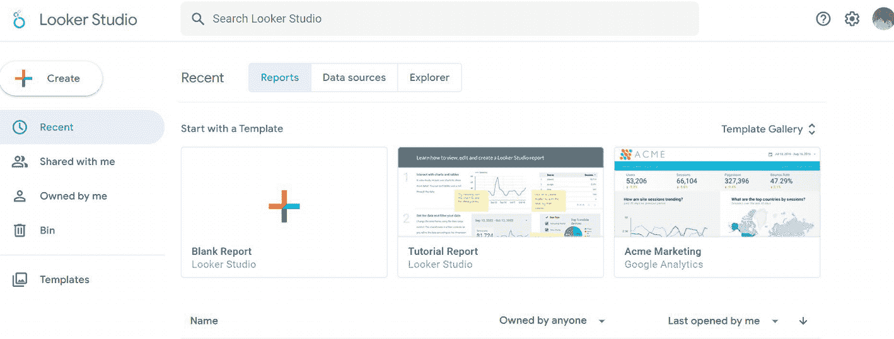

Looker Studio欢迎页面截图，左侧面板选中了“最近”选项卡，右侧显示了页面内容。其中“报告”选项卡被选中，展示了标记为“空白报告”、“教程报告”和“acme marketing”的模板。

图4-1 Looker Studio欢迎界面

点击`Create`并选择`Report`。

2. **连接数据源**：Looker Studio需要访问你的数据才能构建报告和可视化。前往`Data`选项卡并点击`Connections`，将数据源连接到Looker。按照说明添加你的数据源。

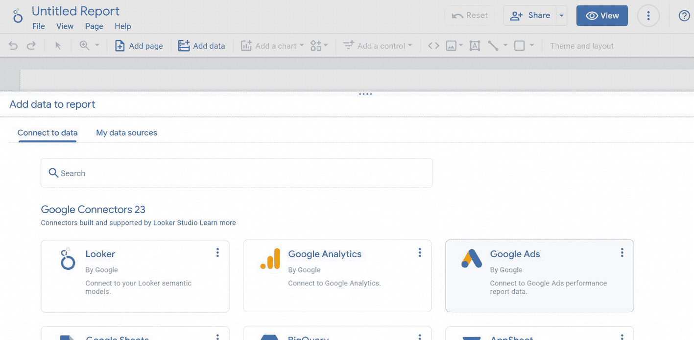

未命名报告页面截图，选中了“连接到数据”标签，提供了诸如Looker、Google Analytics和Google Ads等模板。页面右上角的“查看”按钮已被选中。

图4-2 新建报告

在本示例中，我们可以前往`My data sources`并选择`[Sample] World Population Data 2005 - 2014`，该数据可免费使用。点击`Add to report`。将出现以下界面。

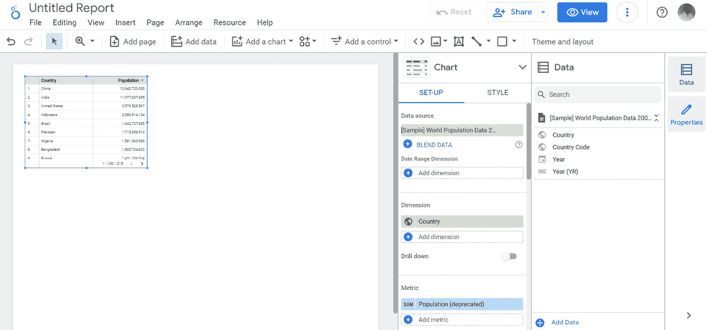

未命名报告页面截图，右侧面板显示了图表和数据面板，文件已从中选定。左侧窗格中的报告以表格格式列出了国家与人口。页面右上角的“查看”按钮已被选中。

图4-3 数据已导入报告

3. **探索数据**：连接数据源后，你可以探索数据。点击`Chart`，你将看到许多图表类型选项。选择条形图，并查看下图。

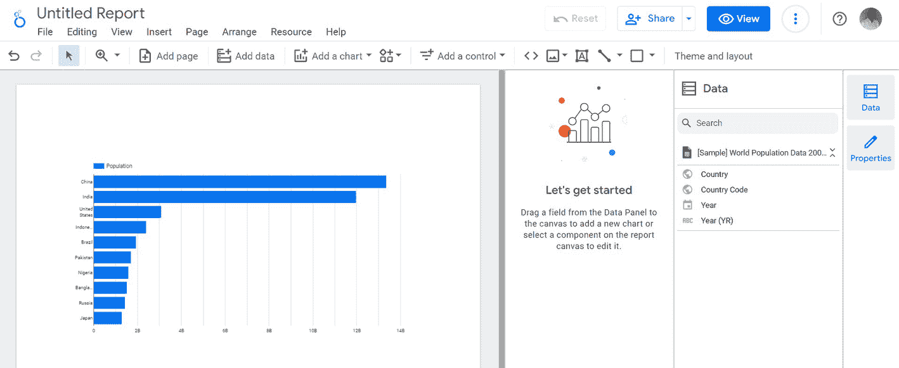

未命名报告页面截图，右侧面板显示了图表和数据面板，其中图表选项已被选中。左侧窗格中，一个水平条形图展示了人口数据。页面右上角的“查看”按钮已被选中。

图4-4 数据可视化

4. **创建外观**：点击上述界面右上角的`View`按钮，即可查看最终输出。

5. **保存并共享工作**：构建好可视化后，你可以保存并共享工作。前往`Share`选项卡，选择共享方式。通过多种方式（包括共享链接、嵌入网站或导出为不同格式）共享数据可视化或报告变得轻而易举。这些选项为向他人传播你的工作提供了灵活性。

6. **与他人协作**：Looker Studio集成了协作功能，可实现团队在报告和可视化上的无缝协作。你可以与他人共享工作，授予他们编辑或查看内容的权限，从而促进团队成员之间的有效协作。

**以下是如何从Excel添加数据并进行探索：**

1. **准备文件：** Excel文件应采用适当格式。请参见以下示例。标题应从第一行第一列开始，其上方不得有空行。

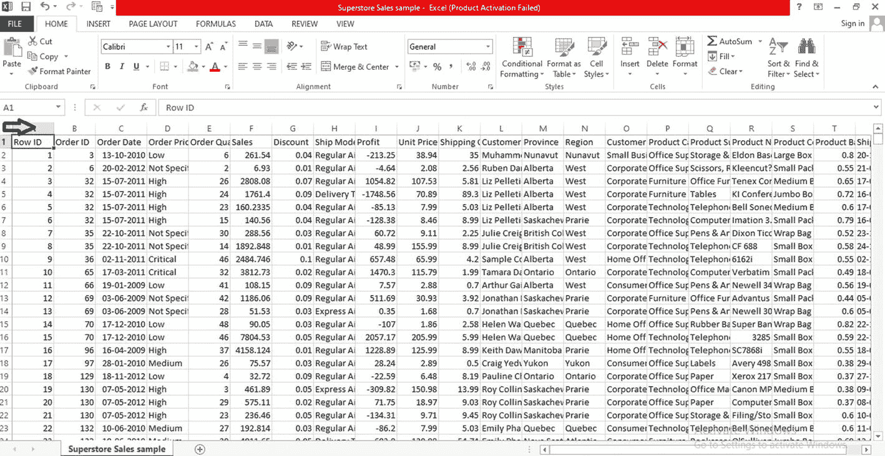

示例Excel工作表截图。此处，标题从第一行第一列开始，其上方没有任何空行，这一点由向右的箭头指示。

图4-5 示例Excel文件

2. 选中整个标题行，并将其保存为CSV文件。


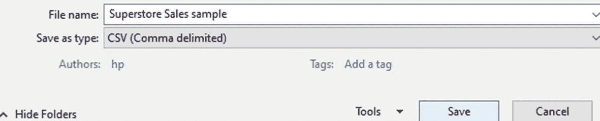


# 排版后的内容

截图展示了一个窗口的局部内容，其中包含文件名和保存类型的输入字段。保存类型显示为“CSV（逗号分隔）”。页面底部的“保存”按钮已被选中。

**图 4-6** 以 CSV 格式保存文件

1.  前往 `Looker`。
2.  点击 `Create` 创建新报告。

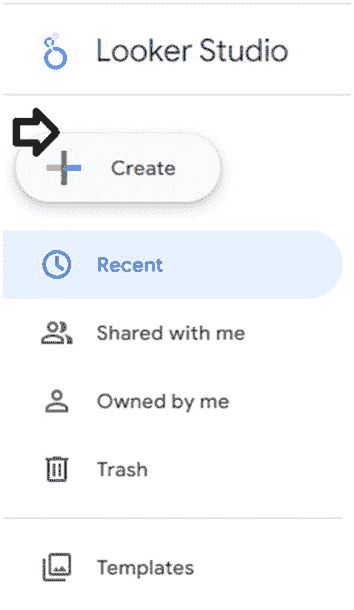
**图 4-7** 创建新的 Looker 报告

1.  前往 `Data source`。

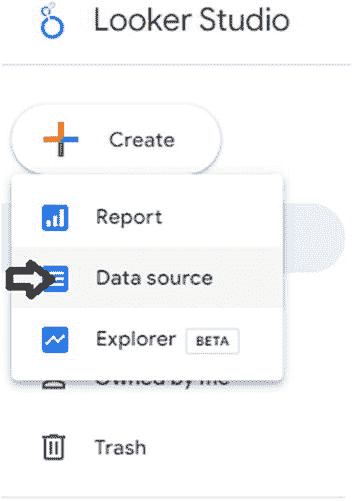
**图 4-8** 数据源选项卡

1.  滚动到 `File Upload` 并点击它。

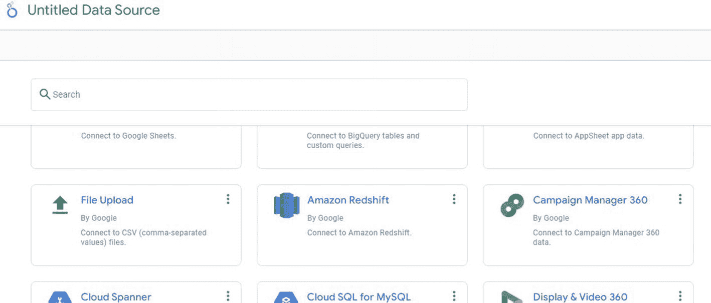
**图 4-9** 选择文件上传

1.  上传文件。

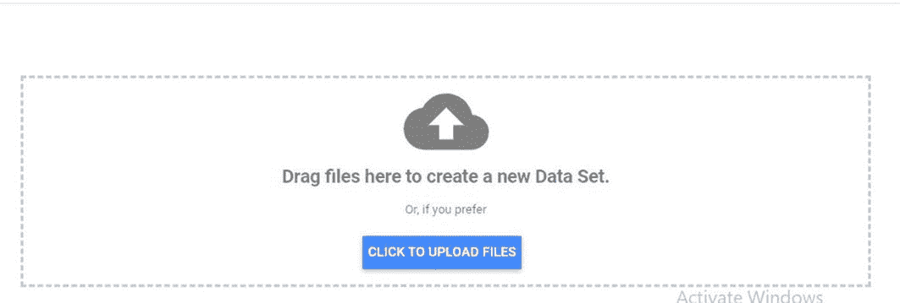
**图 4-10** 上传数据

1.  重命名当前标题为 `Data Source` 的文件。

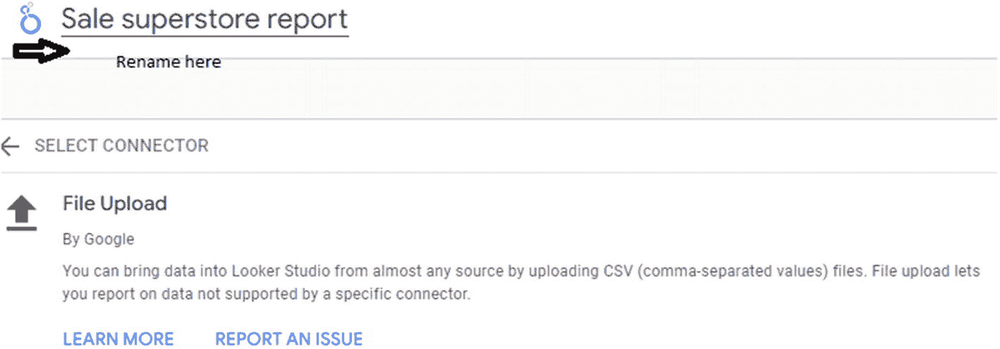
**图 4-11** 重命名数据源标题

1.  文件应显示  一个带阴影的圆圈，表示已上传。

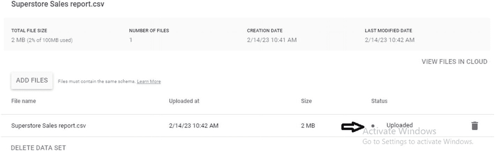
**图 4-12** 数据上传状态

1.  使用位于右上角的 `CONNECT` 按钮连接文件。

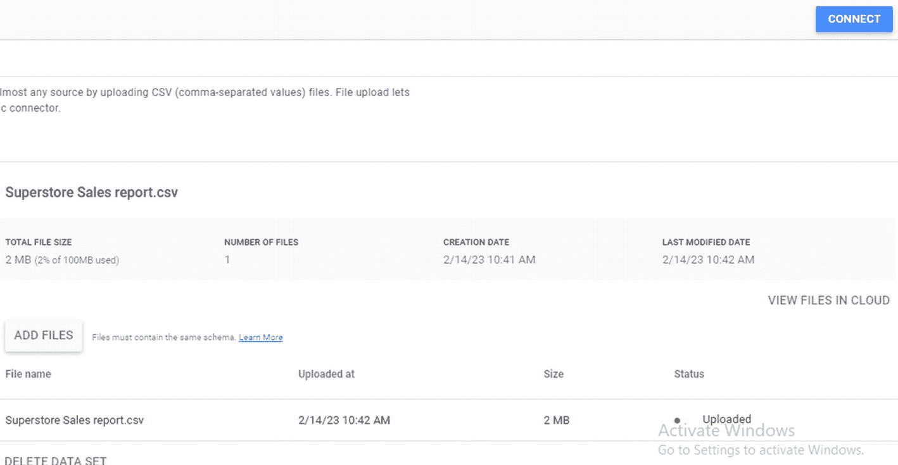
**图 4-13** 连接数据

1.  文件连接成功后，您将看到如下截图所示的视图。然后检查维度的确切格式。例如，`Customer Name` 是 `Text` 类型，`Order Date` 是 `Date` 类型，`Order Quantity` 是 `Number` 类型，等等。

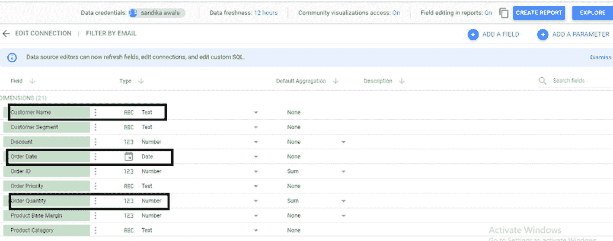
**图 4-14** 数据视图

1.  然后点击 `CREATE REPORT`。它将带您进入一个新视图。您将看到以下屏幕。

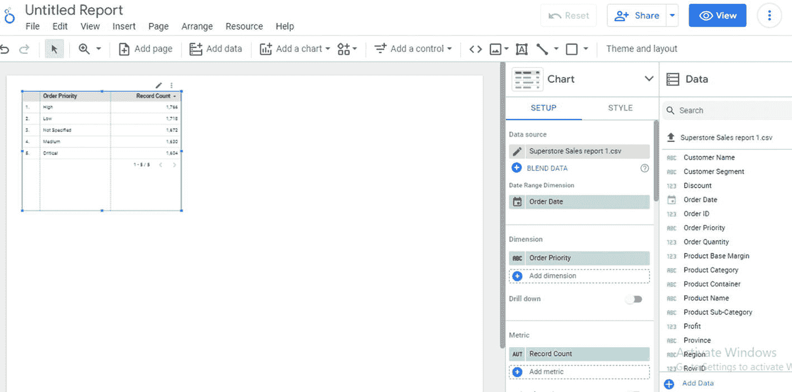
**图 4-15** 创建报告后的首次显示

1.  为未命名的报告文件命名。

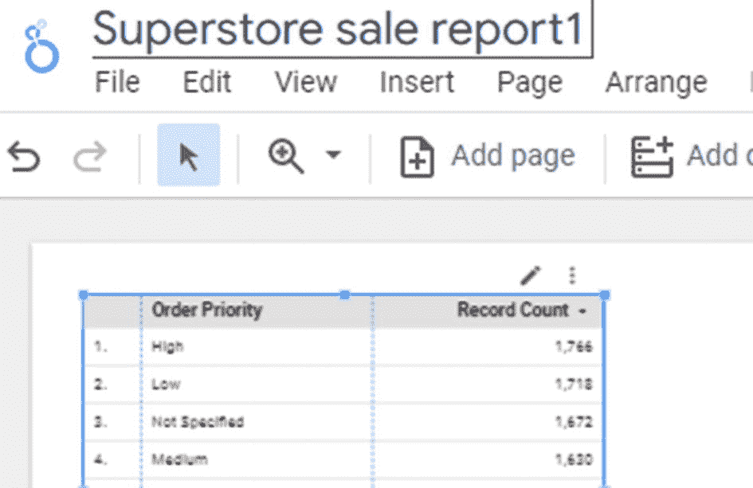
**图 4-16** 为报告命名

这就是创建报告并可视化数据的方法。

1.  您可以在查看模式下看到表格。

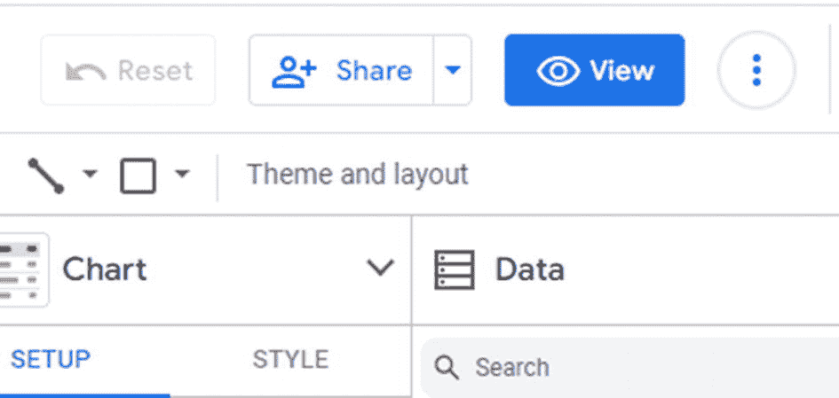
**图 4-17** 查看模式

它看起来像这样。

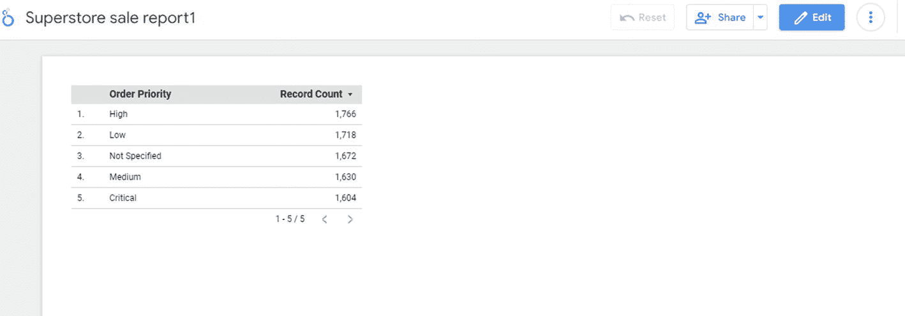
**图 4-18** 查看数据

1.  点击右上角的 `Share` 按钮，与团队成员共享报告。将弹出一个共享窗口。在 `Add people and groups` 中，添加人员或群组的电子邮件 ID/名称并保存。点击 `Done`。
    *   您可以通过点击右上角的 `Edit` 按钮来编辑文件。它将再次返回到查看模式之前的原始形式。

这就是使用 Looker Studio 文件上传连接器创建报告、可视化数据并共享报告的方法。

## BigQuery 和 Looker

由于我们已经学习了 BigQuery 并创建了一些表，我们可以在 Looker 中使用这些表进行可视化。

1.  前往 Looker 中的 `Report` 并点击 `Add data`。
2.  前往 `Connect to data` 并选择 `BigQuery`，然后授权。

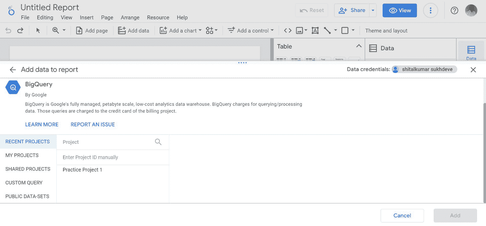
**图 4-19** BigQuery 和 Looker

1.  选择上一屏幕中显示的项目 `Practice Project 1`。
2.  您将看到与您的项目关联的数据集列表。如果您使用的是免费提供的 Looker 以及 BigQuery Sandbox 中的数据集，则不会计入计费（请查看最新的 Google 指南以了解定价）。
3.  点击一个数据集并选择一个表。您将能够在报告中看到您的数据。
    *   您应该能够看到此处描绘的屏幕。由于我们已经在之前的章节中创建了项目，我们可以使用同一个项目，或者如果您还没有创建，请遵循最后几章的说明。

### 构建仪表板

本节将指导您使用 Looker Studio 开发一个自定义仪表板。首先，使用您的 Gmail 账户登录 Looker Studio。如前一节所述，您已经上传了一个 Excel 表格并将其连接到 Looker Studio。现在，我们就从这个报告开始。

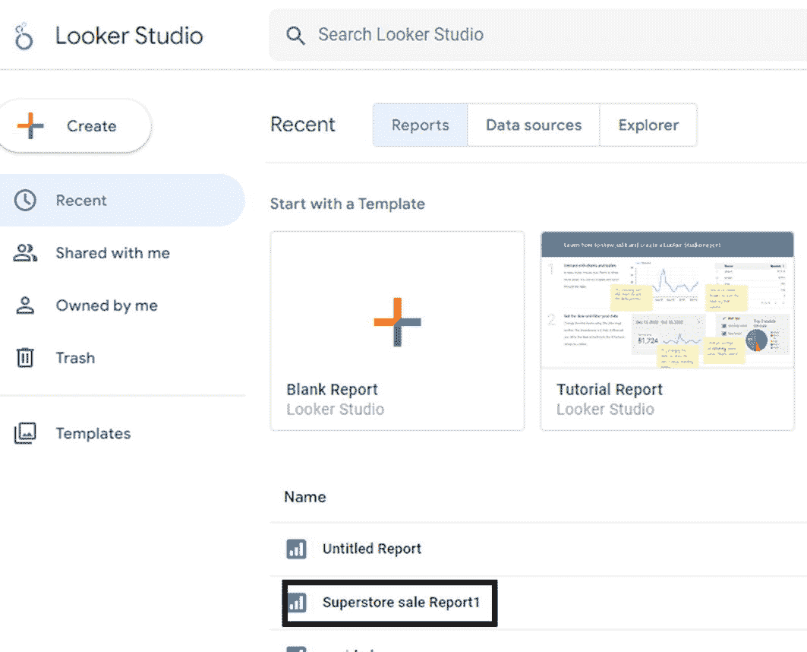
**图 4-20** 选择报告

返回您之前的报告，点击标题中的 `Page` 选项。然后，选择 `New page` 来创建一个供您操作的空白报告。

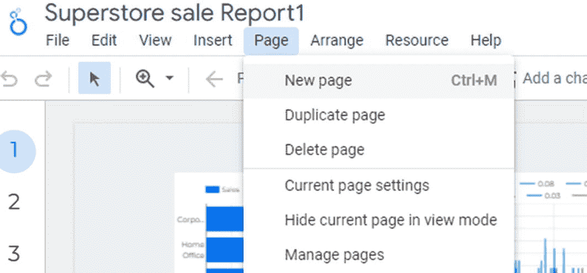
**图 4-21** 插入新页面

根据您的喜好更改主题和布局。

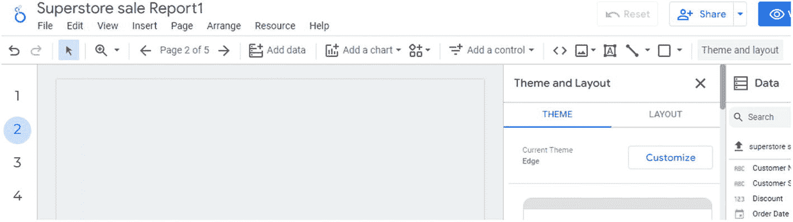
**图 4-22** 选择主题和布局

现在，我们可以开始添加不同的图表来构建仪表板：

1.  **评分卡**：点击 `Add a chart` 按钮，然后点击评分卡 `Total`。通过添加更多评分卡或复制粘贴现有评分卡来创建多个评分卡。按照页面右侧的 `Setup` 部分所示，更改每个评分卡的指标。

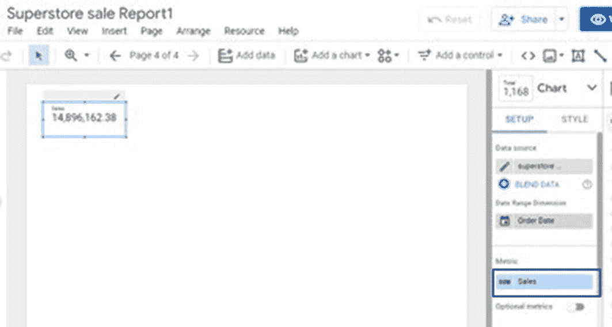
**图 4-23** 创建评分卡

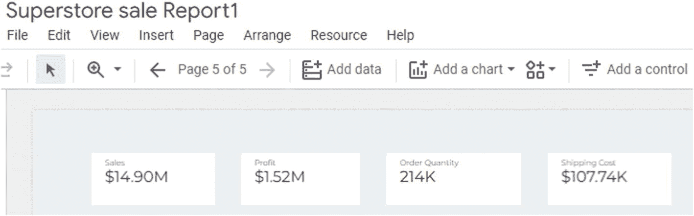
**图 4-24** 用于构建仪表板的评分卡

# Colab 上的数据可视化

`PyGWalker` 是一个 Python 库，它简化了 Jupyter Notebook 中的数据分析与数据可视化工作流程。它提供了一个类似 Tableau 的用户界面，用于对 Pandas 数据框进行可视化探索。借助 `PyGWalker`，数据科学家可以通过简单的拖放操作，快速轻松地分析数据并可视化数据模式。

`PyGWalker` 构建于开源软件 Graphic Walker 之上，后者是 Tableau 的一个替代方案。Graphic Walker 提供了一个可视化界面，允许用户探索实时数据。它还支持多种图表类型和数据操作功能。

要开始使用 `PyGWalker`，你需要使用 `pip` 进行安装。打开一个 Jupyter Notebook，并按如下方式安装该库：

```
!pip install pygwalker
```

接下来，我们可以导入 `PyGWalker` 以及其他所需的库：

```
import pandas as pd
import numpy as np
import pygwalker as pyg
```

在本教程中，我们将创建一个包含一些随机数据的示例数据集：

```
data = {
    'age': np.random.randint(18, 65, 100),
    'gender': np.random.choice(['Male', 'Female'], 100),
    'income': np.random.normal(50000, 10000, 100),
    'state': np.random.choice(['CA', 'NY', 'TX'], 100)
}
df = pd.DataFrame(data)
```

现在，让我们使用 `PyGWalker` 来可视化这个数据集：

```
pyg.walk(df)
```

你将看到以下输出。

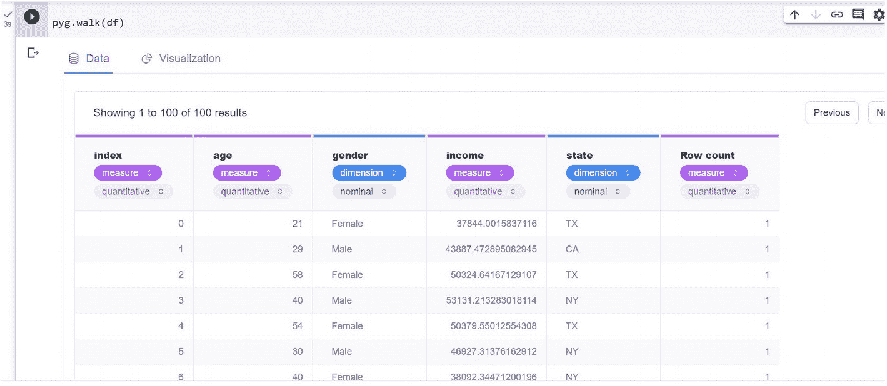

PyGWalker 页面截图，选中了数据选项卡。数据页面列出了索引、年龄、性别、收入、州和行数等详细信息。

**图 4-32** PyGWalker 数据选项卡

`PyGWalker` 会自动检测数据类型并创建一个类似 Tableau 的界面。

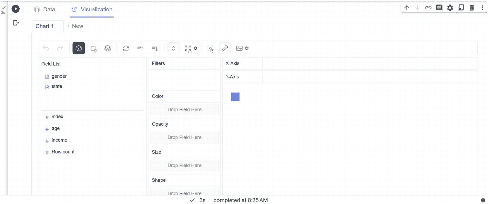

PyGWalker 页面截图，选中了可视化选项卡。可视化选项卡展示了字段列表、索引、年龄、性别、收入、州、行数、筛选器、颜色、不透明度、大小和形状等详细信息。

**图 4-33** PyGWalker 可视化选项卡

我们可以使用拖放操作来探索和可视化数据。例如，我们可以将 `age` 列拖到 x 轴，将 `income` 列拖到 y 轴来创建一个散点图。在此之前，首先点击 `age`，会出现分箱建议，点击它。对 `income` 也执行相同操作。现在将 `bin(age)` 和 `bin(income)` 分别拖放到 x 轴和 y 轴上。你将看到以下输出。

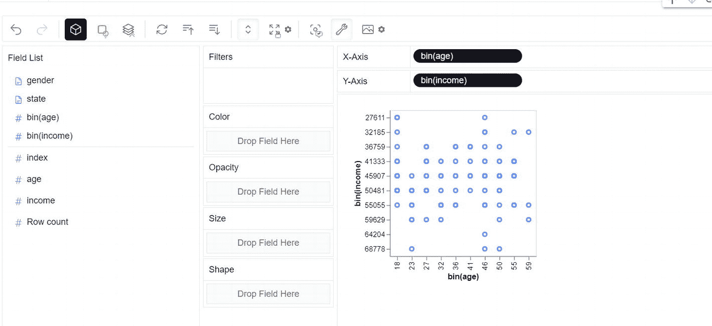

可视化页面截图，展示了字段列表、索引、年龄、性别、收入、州、行数、筛选器、颜色、不透明度、大小和形状等详细信息。在页面右侧，一个散点图展示了收入与年龄之间的关系。

**图 4-34** 散点图

我们还可以通过将其他列拖到颜色或大小区域来为可视化添加更多维度。例如，我们可以将 `gender` 列拖到颜色区域，创建一个按性别显示不同颜色的散点图。

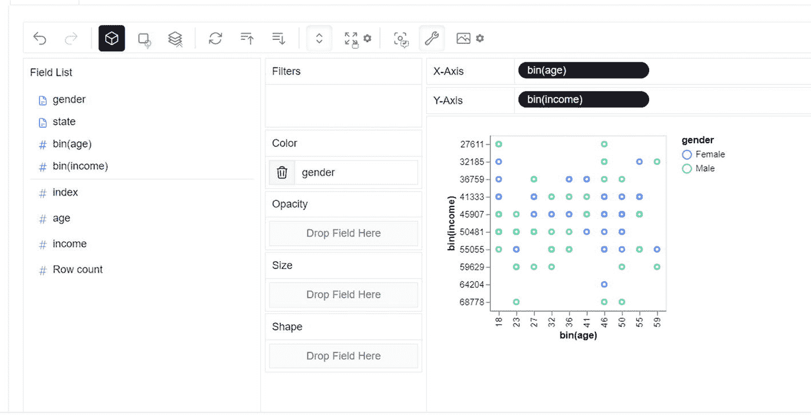

可视化页面局部截图，展示了字段列表、筛选器、颜色、不透明度、大小和形状等详细信息。在页面右侧，一个散点图展示了收入与年龄之间的关系，其中包含男性和女性的数据点。

**图 4-35** 为散点图添加另一个维度

你也可以点击 `聚合` 将其关闭，从而创建无需分箱的图表，如下所示。

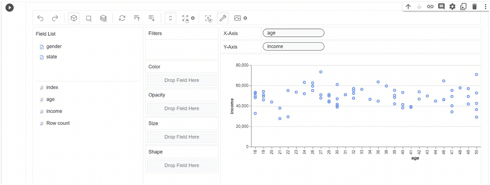

可视化页面局部截图，展示了字段列表、索引、年龄、性别、收入、州、行数、筛选器、颜色、不透明度、大小和形状等详细信息。在页面右侧，一个散点图展示了收入与年龄之间的关系。

**图 4-36** 无聚合

你也可以像下面这样更改图表类型。

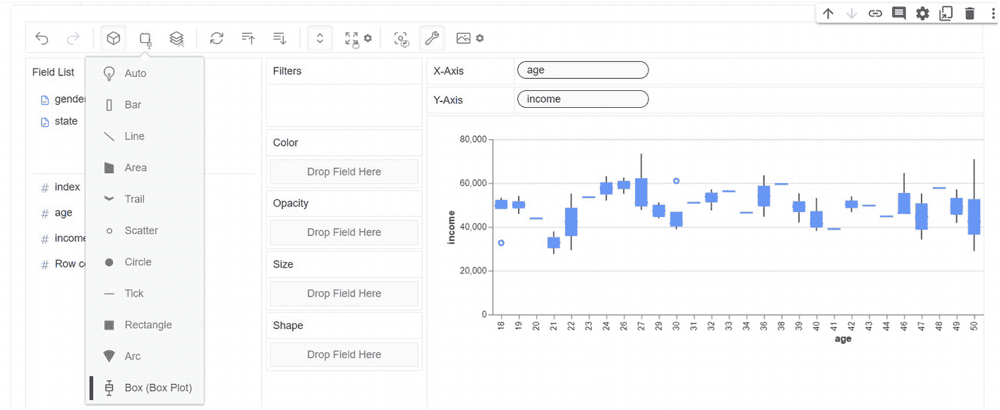

可视化页面局部截图，展示了一个下拉菜单，其中选中了箱形图选项。在页面右侧，一个箱形图展示了收入与年龄的关系。趋势呈现波动模式。

**图 4-37** 更改图表类型

## 创建 Looker Studio 仪表板

在 Looker Studio 中创建仪表板的步骤如下。

1.  **时间序列图**：点击 `Add a chart` 按钮，然后从选项中选择 `Time series`。将图表拖到“销售额”评分卡下方。自定义图表以显示特定时间段内的销售趋势。为此，请转到 `Setup` 选项，选择 `Default date range`，然后选择 `Custom` 选项。接着，选择销售趋势的开始和结束日期。请参见以下示例。

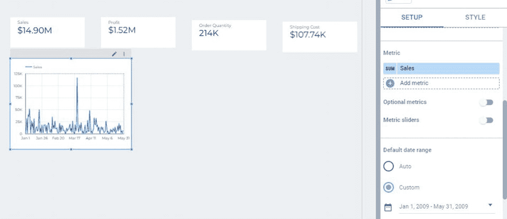

截图展示了网页的部分内容，页面右侧有图表面板，其中选中了“设置”选项卡。在“设置”选项卡下，选中了“销售额”选项，左侧窗格中呈现了销售额的折线图，显示波动趋势。

图 4-25 折线图

1.  **条形图**：点击 `Add a chart` 按钮，然后从选项中选择 `Bar`。将图表拖到页面上，放在之前的时间序列图旁边。向图表添加另一个指标，例如利润。请参见以下示例。

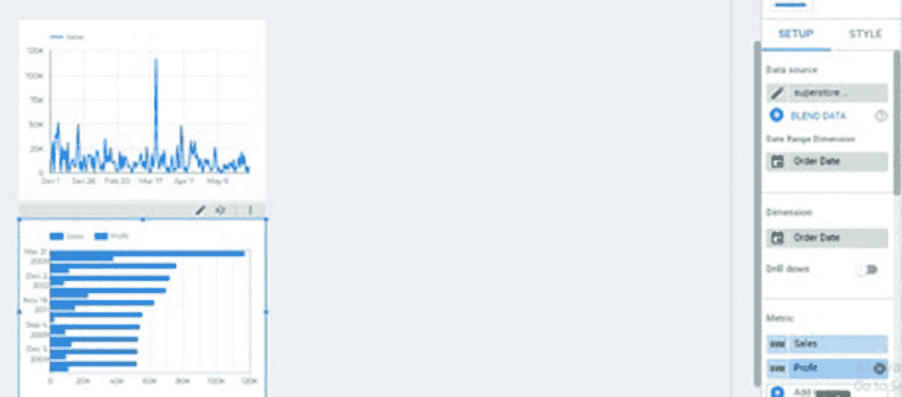

截图展示了网页的部分内容，右侧有图表面板，其中选中了“设置”选项卡。在“设置”选项卡下，选中了“销售额”和“利润”选项。页面左侧呈现了销售额和利润的折线图及水平双柱图。

图 4-26 条形图

1.  **饼图**：点击 `Add a chart` 按钮，然后从饼图选项中选择 `Donut`。在 `Setup` 部分，更改维度以显示产品类别。请参见以下示例。

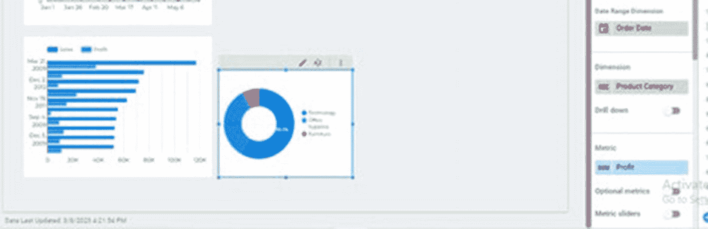

截图展示了网页的部分内容，页面右侧有图表面板。从图表面板中选中了“利润”选项，页面左侧呈现了利润的水平双柱图和环形图。

图 4-27 环形图

1.  **表格**：从 `Add a chart` 按钮中选择 `Table` 选项。创建一个显示每个产品类别销售额和利润的表格。

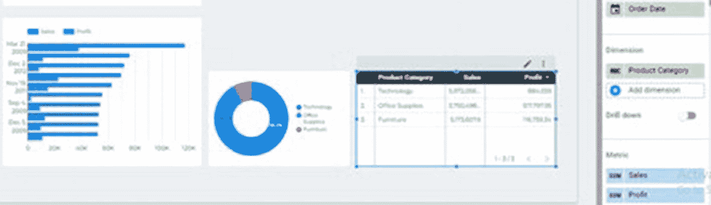

截图展示了网页的部分内容，右侧窗格中有图表面板。从图表面板中选中了“销售额”和“利润”选项。左侧窗格中有一个水平双柱图、一个环形图和一个提供产品类别、销售额和利润详细信息的表格。

图 4-28 表格

1.  **气泡图**：点击 `Add a chart` 按钮，然后从 Google 地图选项中选择 `Bubble Map`。通过拖拽将地图与折线图一起放置在页面上。调整设置：选择 `Location` 并选择 `Region`，设置 `Tooltip` 显示 `Province`，选择 `Region` 作为 `Color dimension`，并使用 `Sales` 或 `Profit` 作为 `Size`。

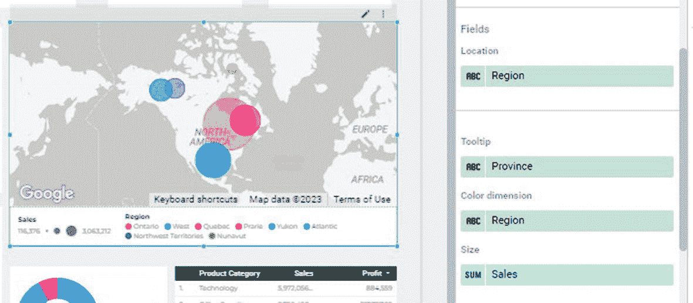

截图展示了网页的部分内容，右侧窗格中有字段面板。字段面板显示了位置、工具提示、颜色维度和大小等详细信息。左侧是北美地区的气泡图，显示了不同州的销售额。

图 4-29 气泡图

1.  **日期范围**：点击 `Add a control` 选项，然后选择 `Date range control`。将控件拖到页面右上角。选择日期范围的开始和结束日期，这将相应地调整仪表板上所有图表的值。

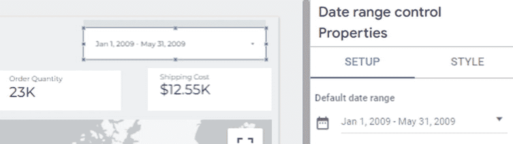

截图展示了网页的部分内容，页面右侧有日期范围控件属性面板，其中选中了“设置”选项卡。页面左侧，一个框提供了如下详细信息：2009 年 1 月 1 日至 2009 年 5 月 31 日，该日期范围被高亮显示。

图 4-30 日期范围控件

完成的仪表板如下所示。

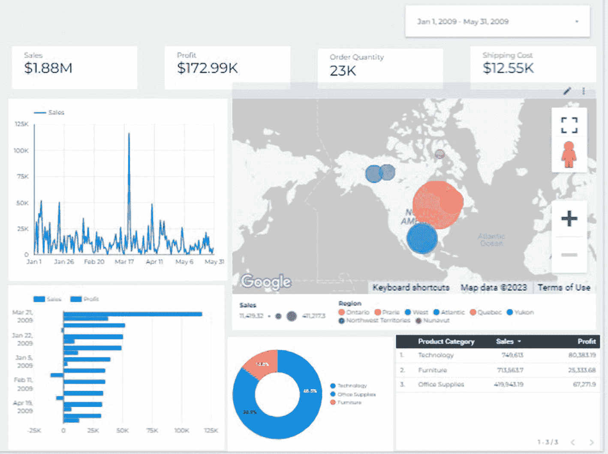

仪表板截图提供了销售额、利润、订单数量和运费的值。下方是一个折线图、一个水平双柱图、一个气泡图、一个环形图和一个表格。

图 4-31 仪表板

# 总结

在本章中，我们探索了数据可视化和商业智能的世界，重点介绍了如何使用 Looker Studio 和 Colab 创建引人注目的可视化效果和报告。

我们首先介绍了 Looker Studio，这是一个强大的数据探索和可视化工具。我们了解了它用于将原始数据转化为有意义见解的特性和能力。

接着，我们深入探讨了使用 Looker Studio 创建和共享数据可视化及报告的过程。我们学习了如何连接到各种数据源、设计可视化效果以及生成可轻松与利益相关者共享的交互式报告。

然后，我们探索了BigQuery与Looker之间的集成，理解了如何将这两个工具结合使用来分析和可视化大型数据集。我们了解了利用BigQuery强大的查询能力和Looker直观的界面进行数据探索的好处。

接下来，我们重点介绍了使用Looker Studio构建仪表板。我们学习了如何创建自定义仪表板，以整合多个可视化效果，并提供关键指标和绩效指标的全面视图。

最后，我们探索了使用Colab（一个协作式笔记本环境）进行数据可视化。我们学习了如何利用像`pygwalker`、`pandas`和`numpy`这样的Python库，在Colab笔记本中创建视觉上吸引人的图表和图形。

在本章中，我们深入了解了数据可视化的重要性及其在推动商业智能中的作用。我们学习了如何有效地使用Looker Studio和其他工具，将复杂数据转化为可操作的见解，并以引人注目且易于理解的方式传达给利益相关者。这些知识使我们掌握了通过数据可视化和商业智能做出明智决策并推动业务成功的技能。


