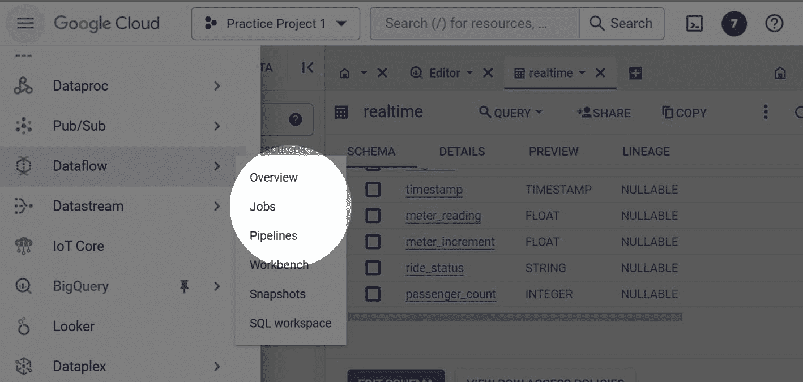
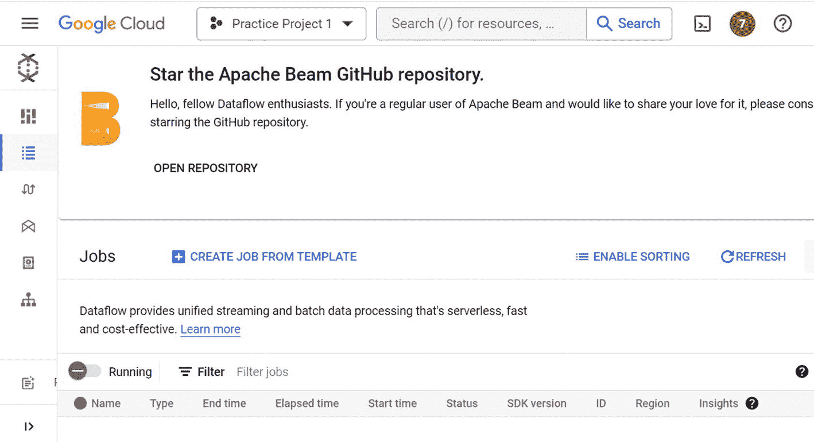
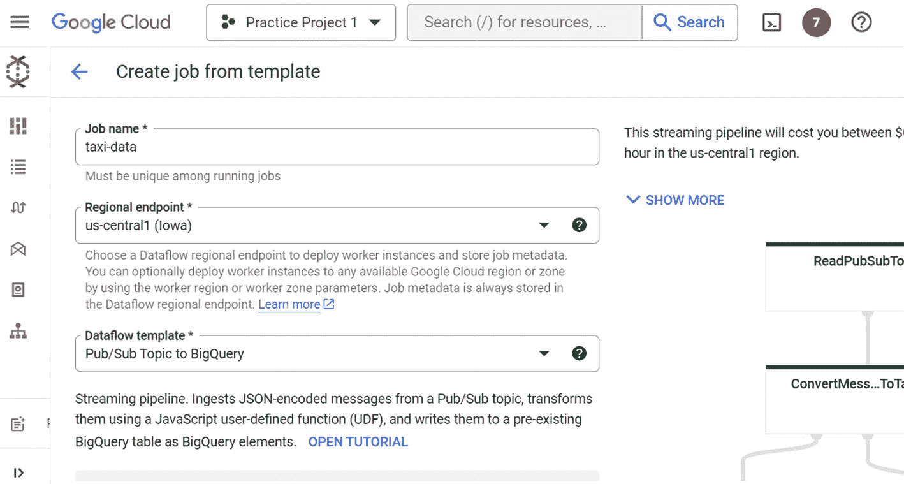
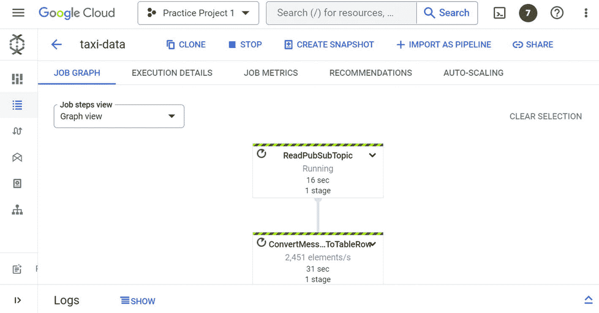
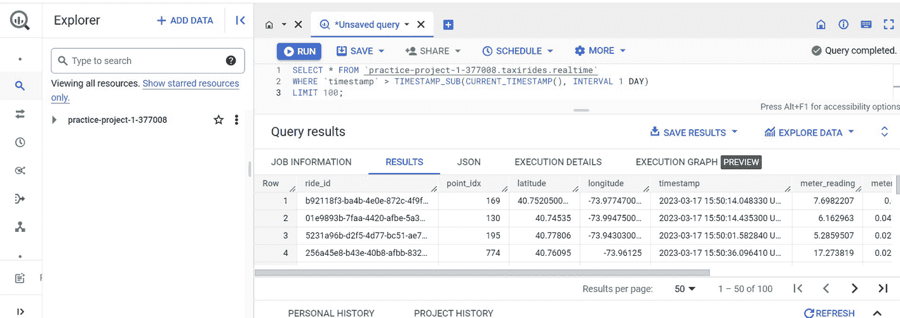

## 5. 数据处理与转换

在本章中，我们将探索数据操作与转换的领域，重点关注`Google Cloud Dataflow`和`Google Cloud Dataprep`。

我们的旅程始于对`Google Cloud Dataflow`的介绍，这是一项专为批处理和流数据处理而设计的有影响力的服务。我们将深入探讨Dataflow表现出色的各种场景，包括实时分析、ETL（提取、转换、加载）管道以及事件触发处理。这将有助于理解Dataflow在促进可扩展且高效的数据操作方面所扮演的角色。

继续前进，我们将沉浸于在Cloud Dataflow中执行数据操作管道。这一阶段涉及理解管道的概念，这是一种能够定义处理和重塑数据所需的一系列步骤的框架。我们将研究Dataflow如何熟练地支持批处理和流数据操作，并深入探讨其与其他Google Cloud服务（尤其是BigQuery和Cloud Pub/Sub）的无缝集成。

接下来，我们的探索将转向`Google Cloud Dataprep`，这是一项专为数据精炼和转换而量身定制的服务。我们将探讨Dataprep证明其效用的各种场景，包括数据清洗、标准化和数据精炼。Dataprep用户友好的可视化界面将被揭示，展示其无需复杂编码即可轻松进行数据探索和操作的能力。

本章的全部内容将让我们深入了解数据操作与转换在数据生命周期中的关键作用。通过`Google Cloud Dataflow`和`Google Cloud Dataprep`的视角，我们将掌握可用于大规模处理和精炼数据的强大工具。这种能力将使我们能够发掘宝贵的见解，并引导做出明智的决策。

通过利用Dataflow和Dataprep的功能，我们将培养在设计和执行简化数据操作管道方面的专业知识和熟练度。这种熟练度确保了原始数据转换为可用格式，保证了数据的完整性和一致性。这种赋能使我们能够充分探索数据的潜力，提取出能够催化业务扩张和成功的宝贵见解。

### Google Cloud Dataflow 简介及其在批处理和流数据处理中的应用场景

`Google Cloud Dataflow`是一项全面的托管云服务，有助于开发和执行多种数据处理模式，包括批处理和流处理。它通过提供统一的编程模型来简化流程，使用户能够专注于构建业务逻辑，而无需处理基础设施管理的复杂性。

使用`Google Cloud Dataflow`进行批处理的一些常见用例包括数据仓库、ETL（提取、转换、加载）处理和分析。例如，您可以使用Dataflow从多个来源提取数据，清洗和转换数据，然后将其加载到像BigQuery这样的数据仓库解决方案中进行分析。

对于流处理，Dataflow可用于实时分析、欺诈检测、物联网数据处理和点击流分析。例如，您可以使用Dataflow处理来自物联网设备的实时数据，并分析这些数据以实时获取见解并做出决策。

总体而言，`Google Cloud Dataflow`是一个高度可扩展且灵活的数据处理解决方案，能够处理批处理和流处理工作负载，使其成为数据工程师和数据科学家的宝贵工具。

#### 在 Cloud Dataflow 上运行数据处理管道

有多种方式可以利用Dataflow满足您的数据处理需求。您可以使用云控制台UI、`gcloud` CLI或API创建Dataflow作业，所有这些都提供了多种作业创建选项。此外，Dataflow模板提供了一系列预构建模板供轻松使用，您还可以创建自定义模板并与同事共享。

借助Dataflow SQL，您可以直接从BigQuery Web UI利用SQL技能开发流式管道，从而能够连接来自各种来源的数据，将结果写入BigQuery，并在实时仪表板中可视化它们。此外，Dataflow界面还提供对Vertex AI Notebooks的访问，允许您使用最新的数据科学和机器学习框架构建和部署数据管道（Vergadia，2021）。最后，Dataflow内联监控允许您直接访问作业指标，为在步骤级别和工作节点级别排查管道问题提供有用的见解。

### Google Cloud Dataprep 简介及其在数据准备中的应用场景

`Google Cloud Dataprep`是一项由Google管理的全方位数据准备服务。它使用户能够以可视化方式探索、清理和准备数据，以便用于分析或机器学习。凭借其直观的界面，用户无需编写代码即可交互式地深入研究和修改数据，从而简化了数据准备流程。

以下是`Google Cloud Dataprep`在数据准备方面的一些应用场景：

- **数据清洗**：Cloud Dataprep提供了一套全面的工具来清理和标准化数据，确保数据的一致性、准确性和完整性。它提供了去重、文本解析、正则表达式、数据格式化和规范化等功能。这些功能使您能够有效地处理和增强数据，从而提高分析的可靠性和质量。

- **数据转换**：Cloud Dataprep允许您将数据转换为下游分析或机器学习所需的格式。它包括数据透视、聚合和数据集合并等功能。

- **数据丰富**：您可以使用Cloud Dataprep通过将数据与外部数据源（如数据库或API）连接来丰富数据。这有助于您更深入地了解数据，并进行更全面的分析。

- **数据探索**：Cloud Dataprep允许您使用其可视化界面快速探索数据。您可以使用数据剖析功能来了解数据的分布情况，并识别异常值、离群点或缺失值。

- **协作**：Cloud Dataprep为团队提供了一个协作环境，以便共同处理数据准备项目。它允许多个用户同时处理同一个项目，从而更轻松地分享想法、数据和见解。

总之，`Google Cloud Dataprep`是一个强大的数据准备工具，可以帮助您简化数据准备工作流程，减少准备数据所需的时间和精力，并提高分析的准确性和质量。

1.  在Google Cloud项目中启用Dataflow和所需的API：

    - `Dataflow API`
    - `Compute Engine API`
    - `Cloud Logging API`
    - `Cloud Storage`
    - `Google Cloud Storage JSON API`
    - `BigQuery API`
    - `Cloud Pub/Sub API`
    - `Cloud Resource Manager API`

2.  创建一个Cloud Storage存储桶：

    - 登录Google Cloud控制台，网址为`https://console.cloud.google.com/`。
    - 选择您的项目，如果尚未创建，请创建一个新项目。
    - 从主菜单中打开Cloud Storage页面。
    - 点击`Create bucket`按钮。
    - 在`Create a bucket`对话框中，为您的存储桶输入一个唯一的名称。
    - 选择您希望存储数据的区域。
    - 为您的存储桶选择默认存储类别。您也可以根据需求选择不同的存储类别。
    - 选择存储桶的访问控制设置。您可以选择将存储桶设为私有或公开访问。
    - 点击`Create`以创建您的新存储桶。

3.  创建一个BigQuery数据集。

4.  创建一个BigQuery表：

    - 在导航窗格中，展开您的项目，然后选择要创建新表的数据集。
    - 点击`Create table`按钮。
    - 在`Create table`对话框中，为您的新表输入一个名称。
    - 选择您的数据来源。您可以从头开始创建新表，或使用现有表作为模板。
    - 在`Schema`部分，通过指定每个字段的名称、数据类型和模式来定义表的列。
    - 如果您的数据源是CSV或JSON文件，请指定文件格式和文件位置。
    - 配置表的高级选项，例如分区和聚簇。

- 点击`Create table`以创建您的新 BigQuery 表。

5.  运行管道。

一张 Google Cloud 窗口的截图，用于实践项目 1。左侧窗格中选中了`dataflow`选项卡，下拉菜单列出了 6 个选项，包括`overview`、`jobs`、`pipelines`、`workbench`、`snapshots`和`SQL workspace`。

`图 5-1` Dataflow

1.  点击`CREATE JOB FROM TEMPLATE`。

一张 Google Cloud 窗口的截图，用于实践项目 1。中央的横幅显示“Star the Apache Beam GitHub repository”，并带有一个`Open repository`按钮。横幅下方的`jobs`部分有一个包含 10 列的空表和一个`Create job from template`按钮。

`图 5-2` 为 Apache Beam GitHub 仓库加星标

1.  运行管道。

一张 Google Cloud 中`Create job from template`页面的截图。输入的作业名称为`taxi data`，区域端点为`us-central1 (Iowa)`，`Dataflow template`为`Pub/Sub Topic to BigQuery`。底部有一个`Tutorial`按钮。右侧是管道的示意图。

`图 5-3` 从模板创建作业

1.  运行管道后，您将看到以下界面。

一张 Google Cloud 中`taxi data`作业页面的截图。选项卡包括`Job graph`、`Execution details`、`Job metrics`、`Recommendations`和`Auto-scaling`。`Job graph`有一个`Job steps view`的下拉选项，其中选中了`Graph view`。管道图中`Read PubSub Topic`步骤正在运行。

`图 5-4` 管道执行后

1.  查看您的结果。

一张`Explorer`窗口的截图。左侧窗格中选中了`practice-project-1`。查询屏幕上有一个来自`taxi-rides`的`SELECT`查询。查询结果部分列出了表中的数据，列包括`ride_id`、`point_index`、`latitude`、`longitude`、`timestamp`和`meter_reading`。

`图 5-5` 查看写入实时表的数据

您已成功设置了一个流式处理流程，该流程从`Pub/Sub`主题检索 JSON 格式的消息，并将其传输到`BigQuery`表中。

**清理工作：**

1.  打开 Google Cloud 控制台，导航至`Dataflow Jobs`页面。

2.  从作业列表中找到您的流式作业并选中它。

3.  点击导航栏中的`Stop`以停止作业。

4.  在出现的`Stop job`对话框中，选择取消或排空您的管道，然后选择`Stop job`。

5.  转到 Google Cloud 控制台中的`BigQuery`页面。

6.  在`Explorer`面板中，展开您的项目以查看关联的数据集。

7.  在要删除的数据集旁边，点击三个垂直点（更多视图操作），然后选择`Open`。

8.  在`Details`面板中，点击`Delete dataset`并按照说明确认删除。

9.  接下来，转到 Google Cloud 控制台中的`Cloud Storage`浏览器页面。

10. 选中要删除的存储桶旁边的复选框。要删除存储桶，请点击`Delete`并按照说明完成删除过程。

## 总结

在本章中，我们深入探讨了数据处理与转换领域，重点关注了 Google Cloud Dataflow 和 Google Cloud Dataprep。

我们首先介绍了 Google Cloud Dataflow，这是一项用于批处理和流数据处理的强大服务。我们探讨了 Dataflow 表现出色的各种用例，例如实时分析、ETL（提取、转换、加载）管道以及事件驱动处理。我们理解了 Dataflow 如何实现可扩展且高效的数据处理。

接下来，我们深入研究了在 Cloud Dataflow 上运行数据处理管道。我们学习了管道的概念，它允许我们定义处理和转换数据所需的一系列步骤。我们探讨了 Dataflow 如何支持批处理和流处理，并发现了它与其他 Google Cloud 服务（如 BigQuery 和 Cloud Pub/Sub）的集成。

随后，我们探索了 Google Cloud Dataprep，这是一项数据准备和转换服务。我们了解了 Dataprep 可应用的多种用例，例如数据清洗、规范化和数据整理。我们发现了 Dataprep 直观的可视化界面，它允许用户无需编写复杂代码即可轻松探索和转换数据。

在本章中，我们深入了解了数据处理和转换在数据生命周期中的重要性。我们学习了 Google Cloud Dataflow 和 Google Cloud Dataprep 如何提供强大的工具来大规模处理和准备数据，使我们能够提取有价值的见解并推动明智的决策。

通过利用 Dataflow 和 Dataprep 的潜力，我们获得了设计和执行高效数据处理管道的专业知识和熟练度。我们可以无缝地将原始数据转换为可用格式，确保数据质量和一致性。这使我们能够释放数据的全部潜力，并提取推动业务增长和成就的宝贵见解。

