## 6. 数据分析与存储

本章深入探讨数据分析与存储，重点介绍 Google Cloud Storage、Google Cloud SQL 和 Google Cloud Pub/Sub。我们从 Google Cloud Storage 开始，这是一种可扩展的对象存储解决方案。它在数据归档、网站托管和备份方面具有实用性。我们探讨了其特性以及与其他 Google 服务的兼容性。

接下来是 Google Cloud SQL，这是一种托管式关系数据库服务。它擅长存储关系数据，具有自动备份、可扩展性以及与 MySQL 和 PostgreSQL 等引擎的兼容性。其应用范围涵盖 Web 应用、内容管理和分析。

接着，Google Cloud Pub/Sub 实现了实时数据流传输。我们学习了其核心概念以及在事件驱动系统、实时分析和物联网中的应用。还探讨了与 Cloud Functions 和 Dataflow 的集成。

最后，我们通过 Cloud Pub/Sub 掌握了数据流。我们理解了主题、消息发布和订阅者设置。对可扩展性和可靠性的关注使我们能够构建强大的数据流管道。

本章强调了数据的重要性，以及 Google Cloud Storage、Cloud SQL 和 Cloud Pub/Sub 提供的用于获取见解和做出明智决策的工具。这些知识使我们能够有效地设计存储解决方案、管理数据库并利用实时数据。

### Google Cloud Storage 简介及其在数据存储方面的用例

Google Cloud Storage 是 Google Cloud Platform (GCP) 提供的一种高度可扩展且可靠的对象存储服务。它为可通过互联网从世界任何地方访问的非结构化数据提供持久且高可用的存储。以下是 Google Cloud Storage 的一些常见用例：

1.  **数据备份和灾难恢复**：Google Cloud Storage 可用于存储关键数据的备份，并为组织提供灾难恢复解决方案。

2.  **数据归档**：Google Cloud Storage 为长期保留大量不常访问的数据提供了一种经济高效的解决方案。

3.  **为网站和移动应用提供静态内容**：Google Cloud Storage 可以为网站和移动应用提供图像、视频和音频文件等静态内容。

4.  **内容分发和媒体流**：Google Cloud Storage 可用于分发和流式传输媒体文件，从而实现更快的下载速度和更好的用户体验。

5.  **数据分析和机器学习**：Google Cloud Storage 可以与 BigQuery 和 TensorFlow 等其他 GCP 服务集成，以存储、处理和分析大量数据。

6.  **协作工作流**：Google Cloud Storage 可用于文件的共享访问，使团队能够协作处理项目，并在不同设备和位置之间存储和共享数据。

Google Cloud Storage 为存储和访问非结构化数据提供了高度可扩展且可靠的解决方案，使其成为适用于各种用例的理想选择。

#### 主要特性


# Google Cloud Storage

Google Cloud Storage 是一种高度可扩展、持久且安全的对象存储服务，提供一系列功能来帮助用户存储、管理和访问其数据。以下是 Google Cloud Storage 的一些主要特性：

`可扩展性`：Google Cloud Storage 提供几乎无限的存储容量，允许用户存储和管理 PB 级的数据。

`持久性`：Google Cloud Storage 通过在多个地理位置自动复制数据来提供高持久性，确保数据免受硬件故障和其他类型灾难的影响。

`安全性`：Google Cloud Storage 提供多层安全保护，包括静态和传输中加密、细粒度访问控制以及身份和访问管理 (IAM)。

`性能`：Google Cloud Storage 提供高性能的数据访问，支持任何大小对象的快速上传和下载速度。

`与其他 Google Cloud Platform 服务的集成`：Google Cloud Storage 与 `Compute Engine`、`App Engine` 和 `BigQuery` 等其他 GCP 服务无缝集成，以支持广泛的用例。

`多区域和区域存储选项`：Google Cloud Storage 提供多区域和区域存储选项，以满足不同的数据存储和访问需求。

`对象生命周期管理`：Google Cloud Storage 支持对象生命周期管理，允许用户定义规则以自动执行数据保留、删除或归档策略。

`成本效益`：Google Cloud Storage 提供灵活的定价模式，允许用户仅为其使用量付费，使其成为存储和访问数据的经济高效选择。

Google Cloud Storage 提供广泛的功能，使其成为一种高度可扩展、持久且安全的对象存储服务，适用于各种用例。

## 存储选项

Google Cloud Storage 提供多种存储选项，以满足不同的数据存储和访问需求。以下是 Google Cloud Storage 提供的一些存储类别：

1.  **标准**：此存储类别适用于频繁访问的数据，例如活跃的应用数据和用户数据，具有低延迟和高持久性。
2.  **近线**：此存储类别适用于访问频率较低但必须在几秒钟内可用的数据，例如月度财务报告或大型媒体文件。
3.  **冷线**：此存储类别专为极少访问但需要在几分钟内可用的数据而设计，例如灾难恢复数据或长期归档。
4.  **归档**：此存储类别适用于极少访问且保留期较长的数据，例如监管归档或合规记录。

## 存储位置

除了上述存储类别，Google Cloud Storage 还提供两种存储位置：

1. **区域存储**：此选项将数据存储在特定区域，可实现该区域内数据的低延迟访问。建议对性能要求较高的应用使用区域存储。
2. **多区域存储**：此选项将数据存储在多个地理位置，提供高可用性和全球数据访问。建议需要全球数据访问的应用使用多区域存储。

Google Cloud Storage 提供的多种存储选项，使用户能够选择满足其数据存储和访问需求的合适存储类别和位置，并优化其存储成本。

## 使用 Google Cloud Storage 创建分析用数据湖

这是一个直接的过程，包含以下步骤：

1.  **创建 Google Cloud Storage 存储桶**：存储桶是用于存储对象（如文件或数据）的容器。您可以在 GCP 控制台中或使用 `gsutil` 命令行工具创建存储桶。打开 Cloud Console 导航菜单，然后选择 Cloud Storage。

    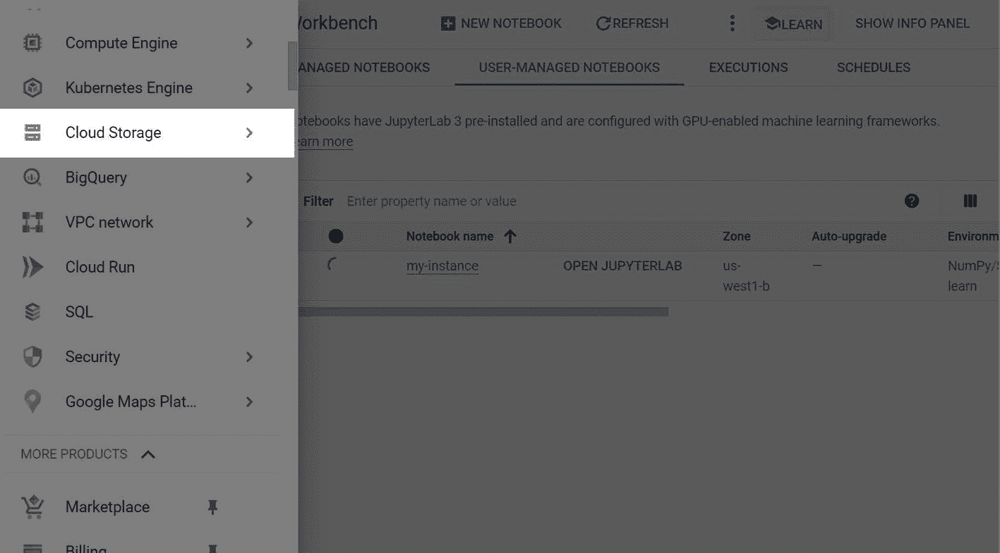

    *一个界面截图，突出显示了左侧面板上的云存储选项。*

    **图 6-1** Cloud Storage

    您将看到以下屏幕。

    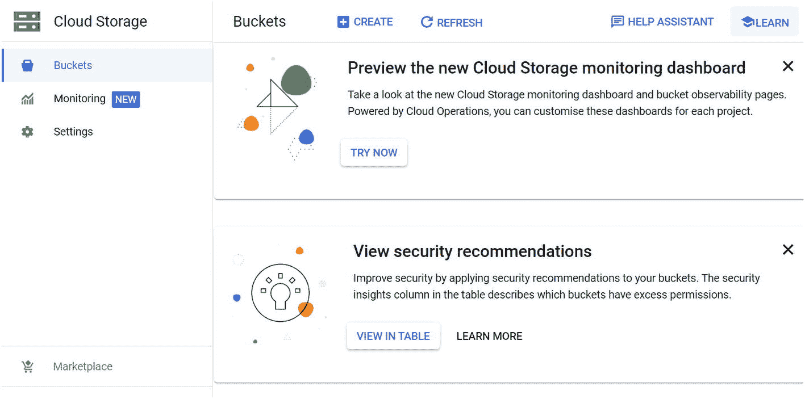

    *一个界面截图，显示了在云存储下选择存储桶选项。它列出了存储桶下的云存储预览和安全建议。*

    **图 6-2** 存储桶

    接下来，点击“创建”。

    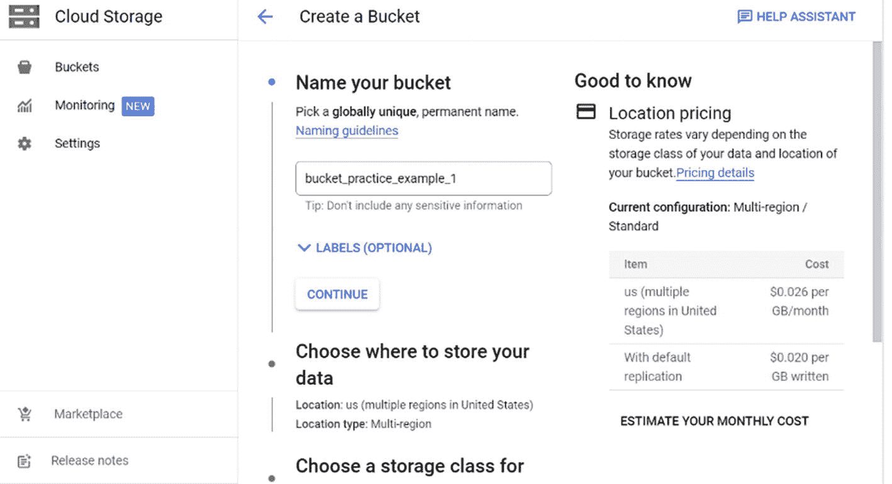

    *一个云存储界面的截图，显示了 3 个选项。它列出了用于创建存储桶的菜单。内容包含名称、存储位置和存储类别。*

    **图 6-3** 新建存储桶

    为存储桶提供一个唯一的名称，选择首选区域，并选择所需的存储类别，例如标准存储或低频访问存储。调整任何其他配置，例如版本控制和生命周期规则。最后，点击“创建”按钮开始创建存储桶。

    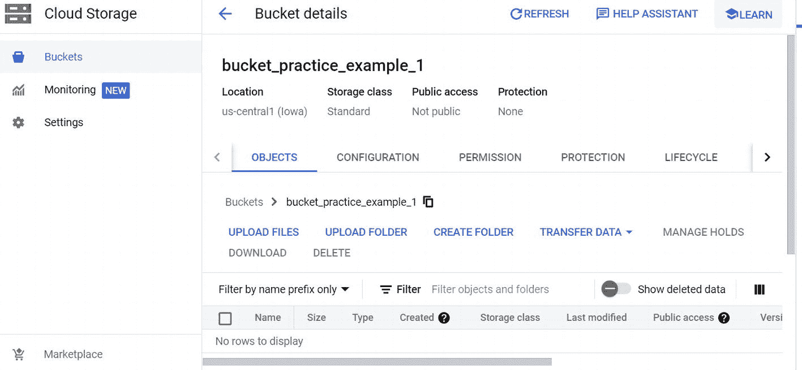

    *一个云存储界面的截图，显示了存储桶选项的选择。它列出了包含对象、配置、权限、保护和生命周期的存储桶详细信息。*

    **图 6-4** 存储桶详细信息

    成功创建存储桶后，您就可以开始在其中上传和访问数据。

2. **选择存储类别**：选择最适合您数据湖需求的存储类别。例如，对于频繁访问的数据，您可能希望使用标准存储类别；对于不频繁访问的数据，则使用近线和冷线存储类别。

3. **配置访问控制**：使用 `IAM`（身份与访问管理）为您的数据湖设置访问控制策略并管理权限。

4. **将数据摄取到数据湖**：您可以使用 GCP 控制台、`gsutil` 命令行工具或其他支持的数据摄取工具将数据上传到您的存储桶。

5. **在数据湖中组织数据**：使用目录结构或对象命名约定来组织存储桶内的数据。这将使执行分析时更容易搜索和访问数据。

6. **使用 GCP 分析和 AI 工具**：使用 GCP 的分析和 AI 工具套件，例如 `BigQuery`、`Cloud Dataflow` 和 `AI Platform`，来摄取和处理来自数据湖的数据。这些工具可以帮助您分析存储在数据湖中的大量数据并获得洞察。

7. **确保安全性和合规性**：使用 GCP 的安全性和合规性工具，例如 `Cloud Audit Logs` 和 `Security Command Center`，确保您的数据湖安全且符合行业法规。

使用 Google Cloud Storage 创建分析用数据湖涉及设置存储桶、配置访问控制、摄取和组织数据，以及使用 GCP 的分析和 AI 工具从数据中获取洞察。通过遵循这些说明，您可以建立一个强大的数据湖，使您能够基于数据做出明智的决策，并在您的行业中获得竞争优势。

# Google Cloud SQL 简介及其在关系数据库中的用例

Google Cloud SQL 是 Google Cloud Platform (GCP) 提供的一种完全托管的关系数据库服务，使用户能够在云中创建、配置和使用数据库。借助 Google Cloud SQL，用户可以充分利用流行的关系数据库管理系统（如 `MySQL`、`PostgreSQL` 和 `SQL Server`）的强大功能和灵活性，而无需管理底层基础设施、补丁或备份。

Google Cloud SQL 提供了多项功能，使其成为一个强大且灵活的数据库解决方案，包括以下内容：

`自动备份和时间点恢复`：Google Cloud SQL 自动备份数据库并支持时间点恢复，使用户能够轻松地将数据库恢复到特定时间点。

`高可用性和持久性`：Google Cloud SQL 提供高可用性和持久性的数据库解决方案，具有自动故障转移和跨多个区域和区域的內建复制功能。

`可扩展性`：Google Cloud SQL 允许用户根据需要向上或向下扩展其数据库资源，提供灵活性和成本效益。

`兼容性`：Google Cloud SQL 与流行的开源和商业关系数据库管理系统兼容，使现有数据库迁移到云端变得容易。

`安全性`：Google Cloud SQL 提供多层安全性，包括静态和传输中加密、基于 `IAM` 的访问控制以及网络安全（Secureicon，2022）。

`与其他 GCP 服务的集成`：Google Cloud SQL 与其他 GCP 服务（如 `Compute Engine`、`App Engine` 和 `Kubernetes Engine`）无缝集成，使用户能够在云中构建和部署强大的应用程序。

总体而言，Google Cloud SQL 提供了一个完全托管、高可用且可扩展的数据库解决方案，使用户能够轻松地在云中部署、管理和使用流行的关系数据库管理系统。

## 使用 Cloud SQL 创建 MySQL 实例

1.  要开始操作，请访问 Google Cloud 控制台 [`https://console.cloud.google.com/`](https://console.cloud.google.com/) 并登录。然后，选择您打算在其中创建 MySQL 实例的所需项目。

2.  启用 API：

    - `Compute Engine API`
    - `sqladmin API (prod)`

3.  进入项目后，点击左上角的导航菜单，然后选择 `SQL`。

    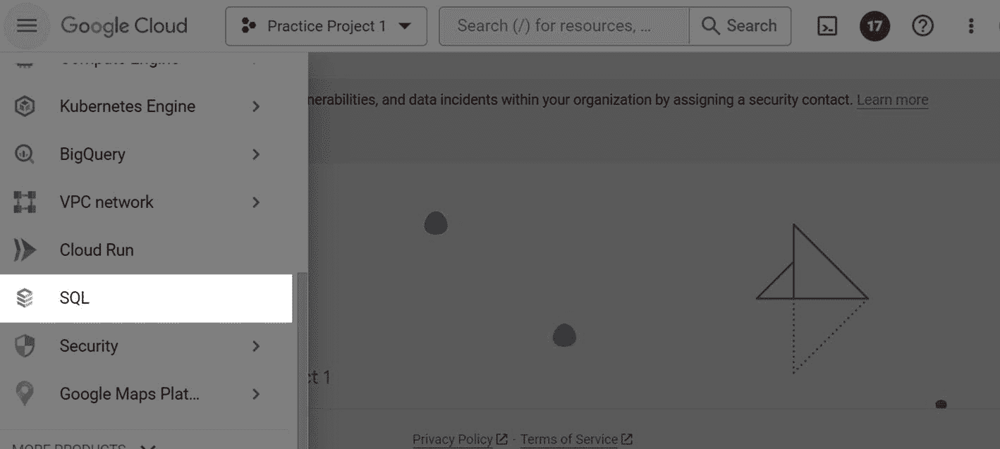

    *一张 Google Cloud 界面的截图，突出显示了 `SQL` 选项。*


**图 6-5** SQL 菜单项

4.  在 Cloud SQL 页面上，点击`CREATE INSTANCE`按钮。

    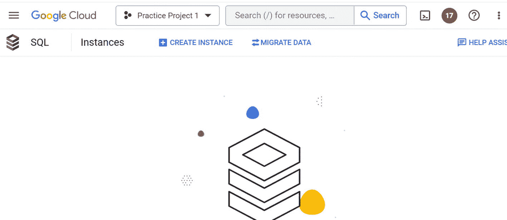
    一张 Google Cloud 界面的截图，显示了创建实例工作区下的实例列表。
    **图 6-6** 创建实例

5.  在“创建实例”页面上，选择您要使用的 MySQL 版本。

    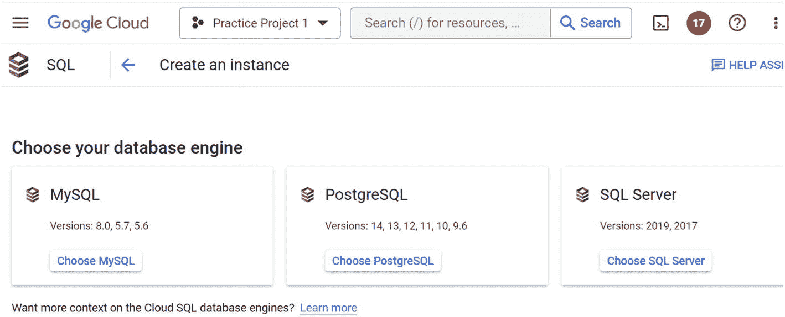
    一张 Google Cloud 界面的截图，显示了“创建实例”下的选项。它列出了数据库引擎：`MySQL`、`PostgreSQL` 和 `SQL server`。
    **图 6-7** 创建实例页面

6.  选择实例类型并根据您的要求配置实例设置。您可以设置实例 ID、区域以及您希望创建实例的可用区。

    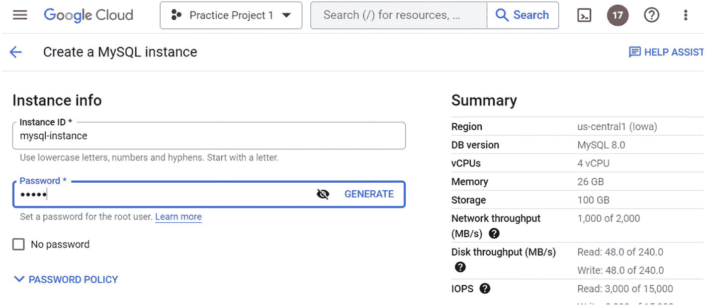
    一张 Google Cloud 界面的截图，显示了创建 MySQL 实例下的选项。它列出了包含实例 ID 和密码的实例信息。右侧面板显示摘要。
    **图 6-8** 配置实例设置

7.  接下来，配置实例的机器类型和存储类型。您还可以设置存储容量。

8.  在“连接”部分下，您可以选择如何连接到您的实例。您可以选择公共或私有 IP 地址，并配置用于访问的授权网络。

9.  在“附加配置”部分下，您可以配置高级选项，例如数据库标志、备份设置和维护设置。

10. 配置完所有设置后，点击页面底部的`CREATE INSTANCE`按钮来创建 MySQL 实例。

    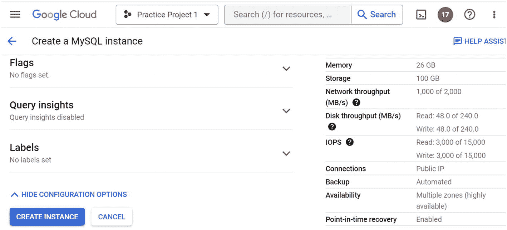
    一张 Google Cloud 界面的截图，显示了创建 MySQL 实例下的选项。它列出了标志、查询洞察和标签，右侧显示属性。
    **图 6-9** 创建 MySQL 实例

11. 实例创建过程可能需要几分钟，具体取决于配置和分配的资源。实例创建完成后，使用任何 MySQL 客户端连接到它并开始使用。

    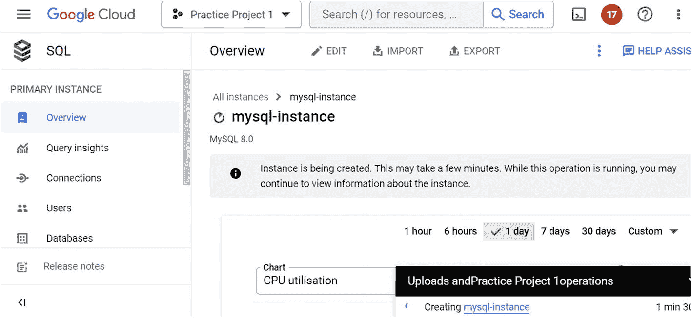
    一张 Google Cloud 界面的截图，显示了一个下拉菜单，其中选择了“概览”。它列出了 MySQL 实例概览以及 CPU 利用率图表。
    **图 6-10** MySQL 实例概览

就是这样！您现在已经成功使用 Cloud SQL 创建了一个 MySQL 实例。

### 连接到 MySQL 实例

1.  点击“激活 Cloud Shell”。

2.  使用以下命令连接到您的 MySQL 实例：

    ```
    gcloud sql connect mysql-instance --user=root
    ```

    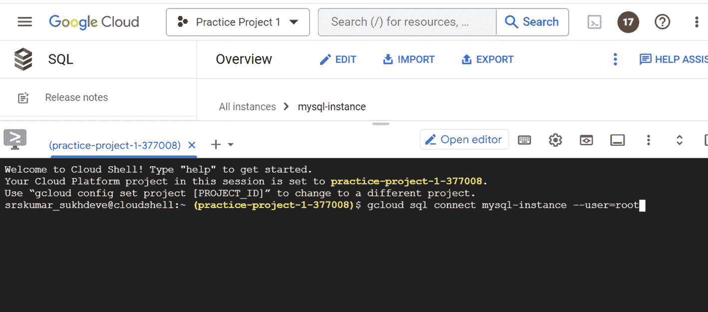
    一张 Google Cloud 界面的截图，显示了 SQL 选项。它列出了概览，并带有一个包含代码的工作区，该代码显示了连接到 MySQL 实例的欢迎消息。
    **图 6-11** 连接到 MySQL 实例

3.  授权。

    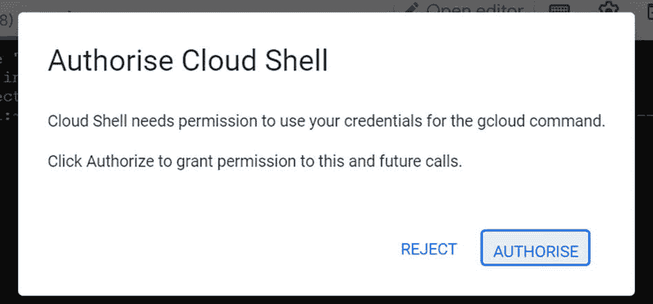
    一张弹出框的截图，显示了授权 Cloud Shell 消息，并带有“拒绝”和“授权”按钮。
    **图 6-12** 授权 Cloud Shell

4.  输入创建 SQL 实例时设置的密码，您将看到 MySQL 提示符（`mysql>`）。

### 在 SQL 中创建数据库并上传数据

1.  此代码将创建一个名为`college`的新数据库。您可以将`college`替换为您想要给数据库起的名称：

    ```
    CREATE DATABASE college;
    ```

    请记住为您的数据库使用适当的命名约定，以便于识别并避免与其他数据库发生命名冲突。

2.  以下代码将首先使用`USE`语句选择`college`数据库，然后创建一个名为`students`的新表，该表包含三列：`id`、`name` 和 `age`。`id` 列是一个自增整数，用作该表的主键：

    ```
    USE college;
    CREATE TABLE students (
    id INT NOT NULL AUTO_INCREMENT,
    name VARCHAR(50) NOT NULL,
    age INT NOT NULL,
    PRIMARY KEY (id)
    );
    ```

    您可以修改列名、数据类型和约束以满足您的特定需求。`CREATE TABLE` 语句在定义数据库表结构方面提供了很大的灵活性。

3.  以下代码将向`students`表中插入五行数据，并为`name`和`age`列提供值。未指定`id`列，因为它是一个自增主键，将由 MySQL 自动生成：

    ```
    INSERT INTO students (name, age) VALUES
    ('John Smith', 20),
    ('Jane Doe', 21),
    ('Bob Johnson', 19),
    ('Samantha Lee', 22),
    ('Chris Brown', 18);
    ```

    您可以修改示例数据以满足您的特定需求，并根据需要插入任意多行。请记住为所有未定义为`AUTO_INCREMENT`或`DEFAULT NULL`的列提供值，否则您将收到错误。

    请注意，`INSERT INTO`语句也可用于一次向多个表插入数据，或使用子查询从另一个表插入数据。

    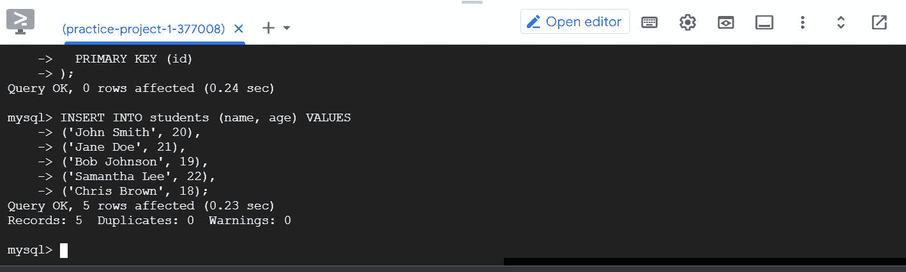
    一张 Google Cloud 界面的截图，显示了工作区并将学生数据上传到数据库中。
    **图 6-13** 插入数据

4.  查看表中的数据：

    ```
    SELECT * FROM students;
    ```

    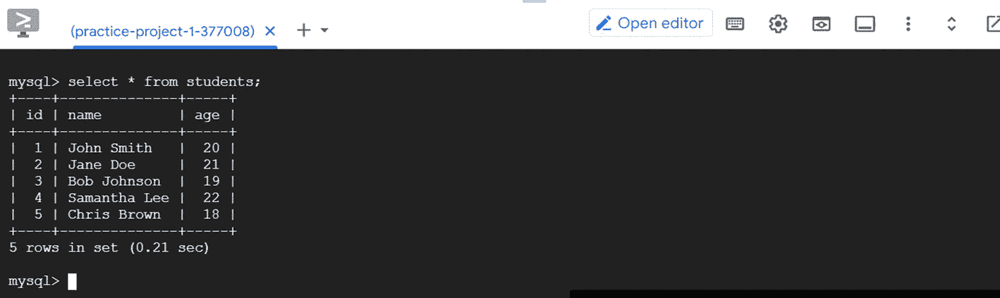
    一张 Google Cloud 界面的截图，显示了工作区以及已上传到数据库中的数据（ID、姓名和年龄）。
    **图 6-14** 查询

5.  清理。

    使用以下代码删除数据库：

    ```
    DROP DATABASE college;
    ```

6.  使用`exit`命令断开与 MySQL 实例的连接，并关闭 Shell。

7.  删除实例。如果删除选项未启用，请转到“数据保护”部分并禁用删除保护。

### Google Cloud Pub/Sub 简介及其在实时数据流中的应用场景

Google Cloud Pub/Sub 是 Google Cloud Platform 提供的一项消息传递服务，可实现应用程序之间的异步通信。它允许开发者构建高度可扩展且可靠的消息传递系统，以解耦且容错的方式在应用程序的不同组件之间交换消息。

Pub/Sub 的基本理念是：发布者（publishers）将消息发送到主题（topics），而订阅者（subscribers）则从这些主题接收消息。主题是消息可以发送到的虚拟通道，订阅者可以关联一个或多个主题以从中接收消息。消息可以采用任何格式，包括 JSON、XML 或二进制数据，最大可达 10 MB。

Google Cloud Pub/Sub 提供了一系列功能，简化了开发者对消息传递系统的使用和扩展。例如，它提供了 REST API 以及多种编程语言的客户端库，包括 Java、Python 和 Go。它还提供了持久化的消息存储，允许消息被存储并在订阅者离线或不可用时也能投递给他们。

Pub/Sub 还与其他 Google Cloud 服务集成，例如 Google Cloud Functions、Google Cloud Dataflow 和 Google Cloud Storage，为构建云原生应用的开发者提供了无缝体验。此外，Pub/Sub 具有高度可扩展性，每秒可处理数百万条消息，使其成为高吞吐量消息传递场景的理想选择。

Google Cloud Pub/Sub 广泛应用于实时数据流场景，例如：

1.  **物联网数据采集**：Pub/Sub 可用于采集和处理物联网设备产生的大量实时数据。设备可以将数据发布到主题，订阅者可以消费这些数据以执行实时分析或根据数据触发操作。

2.  **点击流处理**：Pub/Sub 可用于实时处理网站或移动应用产生的点击流数据。数据可以流式传输到 Pub/Sub 主题，订阅者可以消费这些数据来分析用户行为并做出实时决策。

3.  **金融交易**：Pub/Sub 可用于将实时股票报价、财经新闻和其他市场数据流式传输给订阅者，使他们能够快速响应市场变化并实时执行交易。


4. 游戏：Pub/Sub 可用于流式传输实时游戏事件，例如玩家移动、游戏状态变化和游戏内购买。这使得开发者能够构建实时多人在线游戏，并为用户提供个性化的游戏体验。

5. 实时分析：Pub/Sub 可用于将实时数据流式传输到 `Google Cloud Dataflow` 或 `Apache Beam` 等分析平台，从而实现实时分析和决策。

总之，`Google Cloud Pub/Sub` 提供了一种可靠且可扩展的消息传递服务，可用于物联网、金融、游戏和分析等多个行业的实时数据流场景。

#### 使用 Cloud Pub/Sub 设置和消费数据流

动手实践 `Pub/Sub` 的逐步指南：

1.  项目设置：为确保您拥有必要的权限，请创建一个新项目，或选择一个您已拥有权限的现有项目。

2.  创建主题：前往 `Pub/Sub` 浏览器创建一个主题。

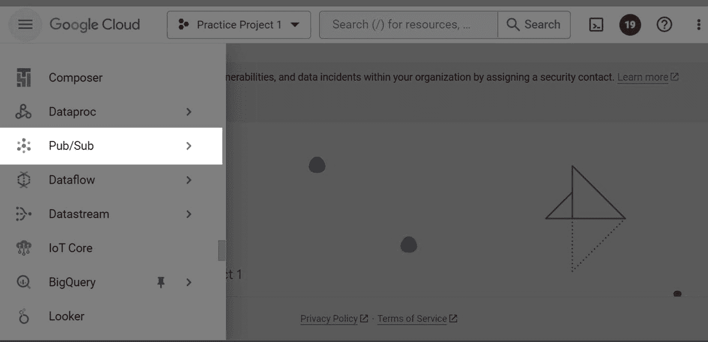

一张 Google Cloud 界面的截图，突出显示了 `Pub` 或 `Sub` 菜单。

图 6-15 `Pub/Sub`

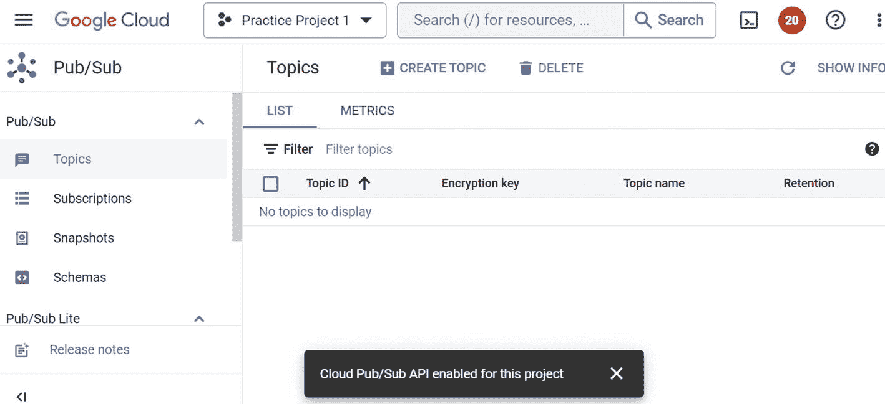

一张 Google Cloud 界面的截图，显示了一个下拉菜单，其中选择了 `Pub` 或 `Sub` 菜单。它列出了要在列表和指标下创建的文件。

图 6-16 `Pub/Sub`——创建主题

点击 `CREATE TOPIC`。填写必要信息，然后点击 `CREATE TOPIC`。

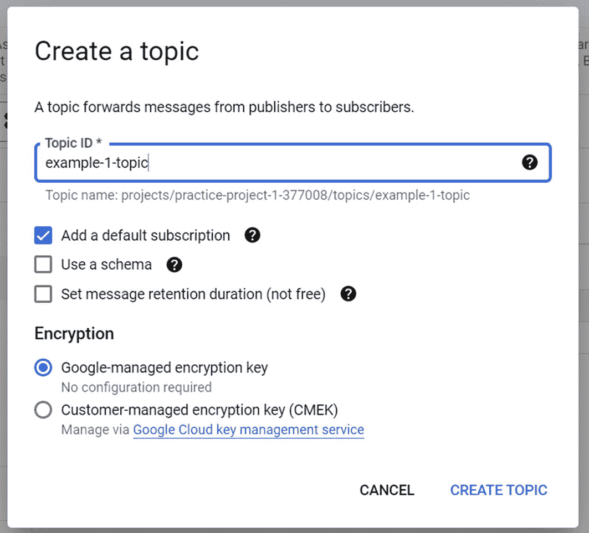

一张标题为“创建主题”的对话框截图。它包含主题 ID 字段以及添加默认订阅和加密的选项。

图 6-17 `Pub/Sub`——主题信息

3.  添加订阅：您必须创建订阅才能接收消息。一个主题必须与一个订阅匹配。当您在上一步创建主题时，`Pub/Sub` 会自动创建一个同名的订阅。按照页面上的步骤创建另一个订阅。

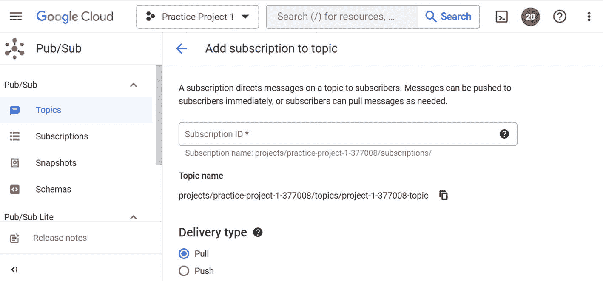

一张 Google Cloud 界面的截图，显示了一个下拉菜单，其中选择了 `Pub` 或 `Sub` 菜单。选择了“主题”选项，并且将要添加该主题的订阅。

图 6-18 创建订阅

向下滚动页面，填写必要信息后点击 `Create`。

4.  返回主题页面并点击该主题。向下滚动，您应该能够看到已创建的订阅。

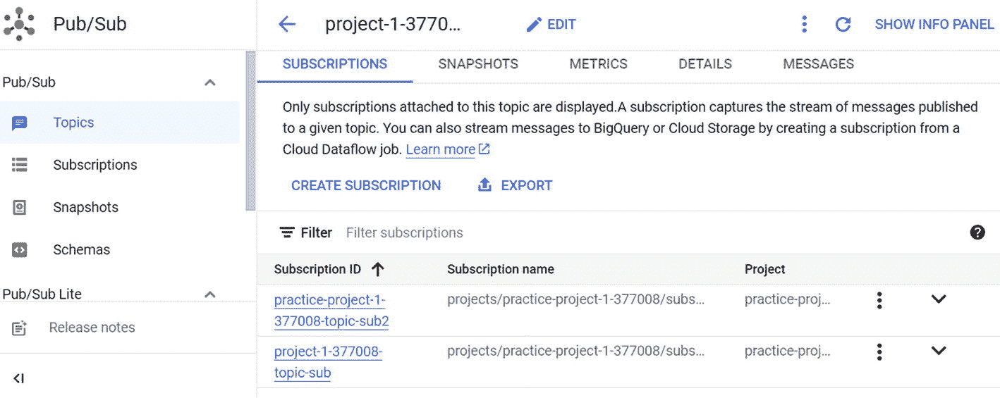

一张 Google Cloud 界面的截图，显示了一个下拉菜单，其中选择了 `Pub` 或 `Sub` 菜单。它列出了已创建的订阅及其详细信息、快照、指标和消息。

图 6-19 `Pub/Sub`——创建订阅

5.  在该主题上发布两条消息。

点击 `MESSAGES` 标签页，您可以找到 `PUBLISH MESSAGE` 标签页。点击它。

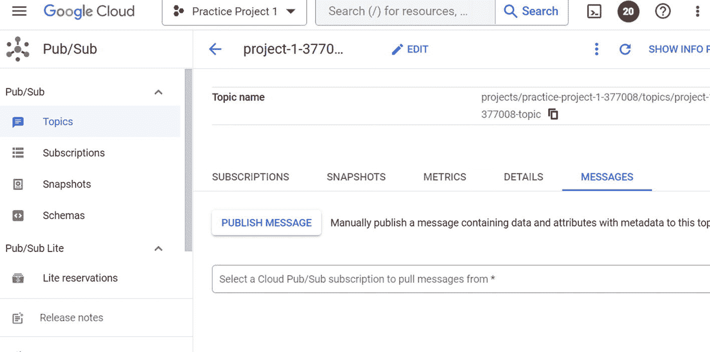

一张 Google Cloud 界面的截图，显示了一个下拉菜单，其中选择了 `Pub` 或 `Sub` 菜单。选择了“消息”标签页，其中显示了“发布消息”按钮。

图 6-20 发布消息

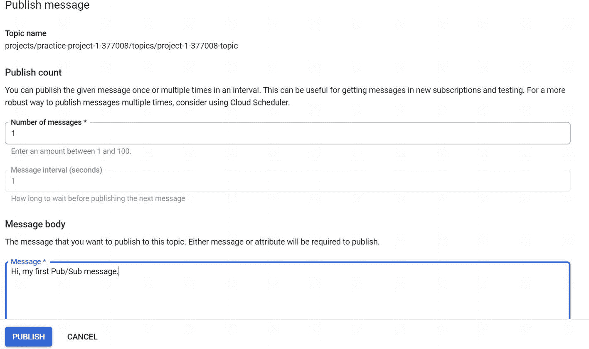

一张 Google Cloud 界面的截图，显示了发布消息页面。它列出了主题名称、发布计数、消息数量和消息正文。

图 6-21 发布一条消息

在消息正文中输入一条消息。

6.  前往订阅页面并点击该订阅。转到 `MESSAGES`。如果您没有找到任何消息，请点击 `PULL` 直到您获取到消息。您应该能够在消息正文中看到该消息。

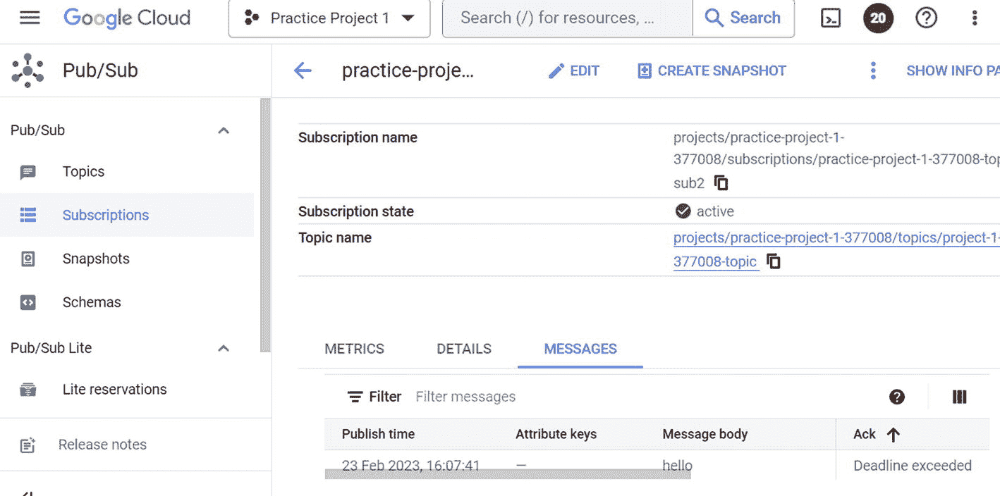

一张 Google Cloud 界面的截图，显示了一个下拉菜单，其中选择了订阅菜单。它列出了已创建的订阅及其名称、状态和主题名称。

图 6-22 拉取消息

`Pub/Sub` 不保证消息的时间顺序。您可能只注意到了一条消息。如果是这样，请继续点击 `PULL`，直到另一条通知出现。

7.  清理：如果您想清理在本教程中创建的 `Pub/Sub` 资源，可以删除您创建的主题。再次访问“主题”标签页。选中主题旁边的框，然后点击 `DELETE`。

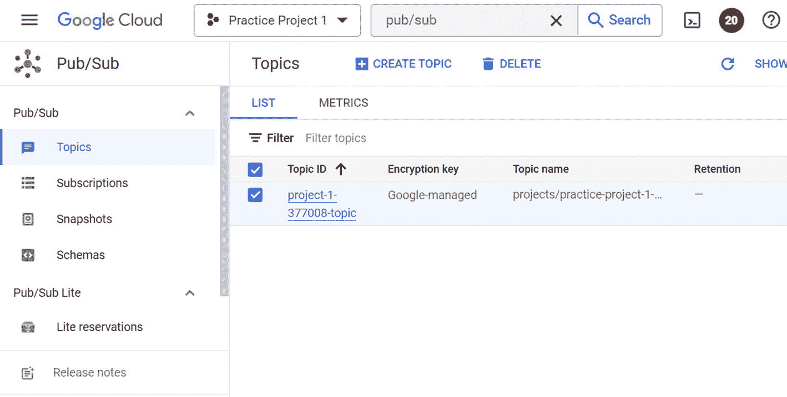

一张 Google Cloud 界面的截图，显示了一个下拉菜单，其中选择了主题菜单。它列出了已创建的主题，可以通过选择特定主题并点击删除按钮来删除。

图 6-23 删除主题

同样地，您也可以清理您的订阅。

## 总结

本章探讨了数据分析和存储的世界，重点介绍了 `Google Cloud Storage`、`Google Cloud SQL` 和 `Google Cloud Pub/Sub`。

我们首先介绍了 `Google Cloud Storage`，这是一种高度可扩展且持久的对象存储服务。我们讨论了 `Cloud Storage` 适用的各种用例，例如存储和归档数据、托管静态网站以及作为备份和恢复解决方案。我们探讨了 `Cloud Storage` 的主要特性，包括其存储类别、访问控制以及与其他 Google Cloud 服务的集成。

接下来，我们深入研究了 `Google Cloud SQL`，这是一种全托管的关系型数据库服务。我们讨论了使用 `Cloud SQL` 存储和管理关系数据的优势，包括其自动备份、可扩展性以及与 `MySQL` 和 `PostgreSQL` 等流行数据库引擎的兼容性。我们探讨了 `Cloud SQL` 适用的用例，例如 Web 应用程序、内容管理系统和数据分析。

随后，我们将注意力转向 `Google Cloud Pub/Sub`，这是一种用于实时数据流传输的消息传递服务。我们学习了 `Pub/Sub` 的核心概念，包括主题、发布者和订阅者。我们发现了 `Pub/Sub` 表现出色的用例，例如事件驱动架构、实时分析和物联网数据处理。我们还探讨了 `Pub/Sub` 与其他 Google Cloud 服务（如 `Cloud Functions` 和 `Dataflow`）的集成。

最后，我们学习了如何使用 `Cloud Pub/Sub` 设置和消费数据流。我们探讨了创建主题、发布消息以及创建订阅者以接收和处理流式数据所涉及的步骤。我们深入了解了 `Pub/Sub` 的可扩展性和可靠性，使其成为构建健壮且可扩展的数据流管道的理想选择。

通过本章的学习，我们更深入地理解了数据存储和分析在现代数据领域中的重要性。我们了解到 `Google Cloud Storage`、`Cloud SQL` 和 `Cloud Pub/Sub` 如何提供强大的工具和服务来大规模地存储、管理和分析数据。通过利用这些服务，组织可以释放其数据的价值，获得有意义的见解，并做出数据驱动的决策。

凭借本章获得的知识和技能，我们能够设计和实现健壮的数据存储解决方案，利用关系型数据库进行高效的数据管理，并利用实时数据流传输的强大功能进行实时分析和事件驱动架构。


