# 引言

欢迎阅读《谷歌云平台数据科学：大数据、机器学习与数据分析服务速成课程》。在本书中，我们将踏上一段激动人心的旅程，探索用于数据科学的谷歌云平台（GCP）世界。GCP 是一个尖端的云计算平台，它彻底改变了我们处理和分析数据的方式，使其成为企业在现代数字格局中解锁宝贵见解和推动创新不可或缺的工具。

作为公认的云计算领导者，GCP 提供了一套专门为数据科学和机器学习任务量身定制的全面服务。本书提供了一种渐进且全面的方法，仅利用平台提供的免费层级服务来掌握 GCP 的数据科学服务。无论你是经验丰富的数据分析师、初露头角的数据科学家、软件工程师还是学生，本书都将为你提供利用 GCP 进行数据科学所需的技能和知识。

## 第 1 章：“GCP 简介”

本章探讨了数据科学和机器学习给商业格局带来的变革性转变。我们强调了云计算平台在处理和分析海量数据集方面的关键作用。然后，我们介绍了 GCP 作为一个领先的云计算平台，以其专门为数据科学和机器学习任务设计的全面服务套件而闻名。

## 第 2 章：“Google Colaboratory”

Google Colaboratory（简称 Colab）是一个用于数据科学的强大云平台。在本章中，我们将深入探讨 Colab 的特性和功能。你将学习如何创建和运行 Jupyter 笔记本，包括机器学习模型，并利用 Colab 与 GCP 服务的无缝集成。我们还将讨论使用 Colab 进行协作数据分析和实验的好处。

## 第 3 章：“大数据与机器学习”

本章探讨了 GCP 上的大数据和机器学习世界。我们深入研究了可扩展的数据仓库`BigQuery`及其实际用例。接下来，我们重点介绍`BigQuery ML`，它使你能够直接在`BigQuery`中构建机器学习模型。然后，我们聚焦于 Google Cloud AI Platform，你将学习如何训练和部署机器学习模型。此外，我们还介绍了`TensorFlow`，这是一个在 GCP 上进行深度学习的流行框架。最后，我们探讨了 Google Cloud Dataproc，它有助于高效处理大规模数据集。

## 第 4 章：“数据可视化与商业智能”

有效的数据可视化和商业智能对于传达见解和推动明智决策至关重要。在本章中，我们将深入探讨 Looker Studio，这是一个用于创建和共享数据可视化图表及报告的强大工具。你将学习如何构建能够吸引受众并促进数据驱动决策的交互式仪表板。我们还将探索 Colab 中的数据可视化，使你能够创建引人注目的数据视觉呈现。

## 第 5 章：“数据处理与转换”


本章强调了数据处理与转换在数据科学工作流中的重要性。我们将介绍 Google Cloud Dataflow，这是一项批处理和流数据处理服务。你将学习如何使用 Cloud Dataflow 设计和执行数据处理管道。此外，我们还会介绍 Google Cloud Dataprep，这是一个用于数据准备和清洗的工具，能够确保数据的质量和完整性。

## 第 6 章：“数据分析与存储”

数据分析与存储在数据科学中扮演着关键角色。本章将深入探讨 Google Cloud Storage 及其在存储和管理数据方面的应用场景。接下来，我们将探索 Google Cloud SQL，这是一种关系型数据库服务，能够实现对结构化数据的高效查询和分析。最后，我们将介绍 Google Cloud Pub/Sub，一项实时数据流服务，并指导你如何设置和消费数据流。

## 第 7 章：“高级主题”

在最后一章中，我们将探讨高级主题，以提升你在 GCP 上开展数据科学的专业能力。我们将学习如何使用身份与访问管理（IAM）来保护和管理 GCP 资源，确保数据的机密性和完整性。我们还会介绍 Google Cloud Source Repositories，这是一个用于代码的版本控制系统。最后，我们将涉及 Dataplex 和 Cloud Data Fusion 等创新技术，拓展你的数据科学视野。

通过阅读本书，你将全面掌握利用 GCP 进行数据科学的知识和实践技能。你将学会使用各种工具和技术，从海量数据集中提取有价值的见解，训练和部署机器学习模型，并创建富有影响力的数据可视化和报告。

此外，你在 GCP 数据科学领域获得的新专业知识将为你带来众多职业发展机会。无论你是数据分析师、数据科学家、软件工程师还是学生，通过本书获得的技能都将使你成为当今数据驱动世界中的宝贵人才。你可以利用 GCP 强大的服务来开发端到端的数据解决方案，并将其无缝集成到任何组织的技术生态系统中。

那么，请准备好踏上这段变革之旅，释放 Google Cloud Platform 在数据科学领域的全部潜力吧。让我们一起深入探索，共同塑造数据驱动创新的未来！

## 致谢

我们衷心感谢所有在本书写作过程中给予我们支持的人。你们的鼓励、指导以及对我们能力的坚定信念，共同促成了这个项目的完成。

首先，我们要向父母表达最深切的感激之情。是你们无条件的爱、坚定的支持和牺牲，让我们得以追求自己的热爱。你们对我们的坚定信念，一直是我们前进的动力。

我们感谢家人在我们无数个小时的研究、写作和编辑本书期间所给予的理解和耐心。你们的爱与鼓励是我们源源不断的灵感来源。

特别感谢我们的朋友们，感谢你们在这一旅程中给予的鼓励、激励和持续支持。你们对我们的信任，以及在迷茫时刻愿意倾听，都是无比宝贵的财富。

我们还要向导师和同事们表达谢意，他们慷慨地分享了自己的知识和专长，提供了宝贵的见解和反馈，极大地丰富了本书的内容。

最后，我们要向本书的读者致以最深切的感谢。你们对这个主题的兴趣和参与，让我们的所有努力都变得有价值。我们真诚地希望本书能成为你理解和利用技术力量之旅中的宝贵资源。

再次感谢你们坚定不移的支持、爱与鼓励。没有你们每一个人，这本书就不可能问世。

此致，

Shitalkumar 和 Sandika

## 关于作者 关于技术审校者


## 1. GCP 简介

在过去的几年里，数据科学的格局在组织管理数据的方式上经历了显著的变革。大数据和机器学习的兴起，使得企业需要存储、处理和分析海量数据。因此，对像 Google Cloud Platform (GCP) 这样的基于云的数据科学平台的需求激增。

根据 IDC 的一份报告，全球公有云服务市场在 2021 年预计增长 18.3%，达到 3049 亿美元。GCP 在该市场中获得了显著的发展势头，成为第三大云服务提供商，市场份额为 9.5%（IDC，2021）。这一增长可归因于 GCP 提供强大基础设施、数据分析和机器学习服务的能力。

GCP 提供各种数据科学服务，包括数据存储、处理、分析和机器学习。它还提供用于构建和部署应用程序、管理数据库以及保护资源的工具。

让我们看几个迁移到 GCP 并取得显著成果的商业案例：

1.  **家得宝**：家得宝是一家领先的家居装修零售商，希望改善客户的在线搜索体验。他们将搜索引擎迁移到 GCP，搜索结果速度提升了 50%。这带来了客户满意度 10% 的提升和在线销售额 20% 的增长（Google Cloud，*家得宝*，无日期）。

2.  **Spotify**：流行的音乐流媒体服务 Spotify 将其数据基础设施迁移到 GCP，以应对不断增长的用户群。通过此举，Spotify 的基础设施成本降低了 75%，并且每秒处理的用户请求更多（Google Cloud，*Spotify*，无日期）。

3.  **尼尔森**：领先的市场研究公司尼尔森希望提高其数据处理速度和准确性。他们将数据处理迁移到 GCP，处理时间减少了 60%，从而能够更快地获得洞察并做出更好的决策（Google Workspace，无日期）。

除了上述例子，其他组织也从 GCP 的数据科学服务中受益，包括可口可乐、PayPal、汇丰银行和威瑞森。

借助 GCP，数据科学家可以专注于解决复杂的业务问题，而无需担心管理基础设施。例如，考虑一家希望分析客户行为以改进营销策略的零售公司。该公司拥有数百万客户，并从社交媒体、在线购买和调查等各种来源收集海量数据。为了分析这些数据，公司需要一个强大的、基于云的平台来高效地存储和处理数据。GCP 可以通过提供可扩展的数据存储（`Google Cloud Storage`）、数据处理（`Google Cloud Dataflow`）和数据分析（`Google BigQuery`）来帮助公司实现这一目标。该公司还可以利用机器学习（`Google Cloud AI Platform`）构建能够预测客户行为的模型，并使用 `Google Cloud AutoML` 来自动化机器学习过程。

GCP 的数据科学服务为从事数据科学领域的个人提供了宝贵的支持。随着对数据科学家需求的持续增长，掌握像 GCP 这样的云平台的专业知识变得至关重要。根据 Glassdoor 的数据，美国数据科学家的平均年薪为 113,309 美元。此外，Burning Glass Technologies 最近的一份报告指出，在过去一年中，明确要求具备 GCP 技能的职位发布数量显著增加了 67%。因此，获取 GCP 知识可以为那些寻求数据科学领域就业机会的人提供显著优势。

本章将介绍 GCP 及其数据科学产品，并引导您完成创建 GCP 账户和项目的过程。

### GCP 及其数据科学服务概览

Google Cloud Platform (GCP) 的架构旨在为用户提供一个高可用、可扩展且可靠的云计算环境。它基于一个跨越多个地理区域和可用区的分布式基础设施，从而在系统故障或灾难发生时提供冗余和故障转移能力（Sukhdeve，2020）。

在高层面上，GCP 的架构包含以下几个层次：

1.  **基础设施层**：该层包括构成 GCP 数据中心的物理硬件和网络基础设施。它包含运行和管理云服务所需的服务器、存储设备、网络设备和其他组件。

2.  **计算层**：该层包括运行用户应用程序和服务的虚拟机 (VM) 和容器实例。它包含诸如 `Compute Engine`、`Kubernetes Engine` 和 `App Engine` 等服务。

3.  **存储层**：该层包括 GCP 提供的各种存储服务，例如 `Cloud Storage`、`Cloud SQL` 和 `Cloud Bigtable`。它为多种类型的数据提供可扩展且持久的存储选项。

4.  **网络层**：该层包括 GCP 提供的各种网络服务，例如 `Virtual Private Cloud (VPC)`、`负载均衡` 和 `Cloud CDN`。它为用户的应用程序和服务提供安全可靠的网络选项。

5.  **管理与安全层**：该层包括 GCP 提供的各种管理和安全服务，例如 `Identity and Access Management (IAM)`、`安全指挥中心` 和 `Stackdriver`。它提供了用于管理和保护在 GCP 上运行的应用程序和服务的工具。

通过这种方式，GCP 的架构旨在提供一个灵活且可定制的云计算环境，以满足从初创公司到大型企业的广泛用户需求。

GCP 是一套云计算服务，运行在与 Google 为其终端用户产品（如 Google 搜索和 YouTube）相同的基础设施上（Google Cloud，2023）。

对于数据科学，它提供了多项服务，包括：

*   `BigQuery`：一个完全托管、无服务器的数据仓库解决方案
*   `Cloud AI Platform`：一套机器学习工具，包括 `TensorFlow`、`scikit-learn` 和 `XGBoost`
*   `Cloud Dataflow`：一个用于转换和分析数据的完全托管服务
*   `Cloud DataLab`：一个用于机器学习和数据科学的交互式开发环境
*   `Cloud Dataproc`：一个托管的 `Apache Hadoop` 和 `Apache Spark` 服务
*   `Cloud Storage`：一个可扩展、完全托管的对象存储服务
*   `Cloud Vision API`：一个预训练的图像分析 API

这些服务可以组合使用，以构建完整的数据科学解决方案，从数据摄取到模型训练再到部署。教学大纲中提到的许多 GCP 数据科学服务都提供免费套餐，可以免费有限度地使用这些服务。以下是这些服务及其各自免费套餐产品的列表：

*   `Google Colaboratory`：完全免费。
*   `BigQuery`：每月免费处理 1 TB 数据。
*   `Cloud AI Platform`：免费访问 `AI Platform Notebooks`，其中包括 `Colaboratory`。
*   `Looker Studio`：完全免费。
*   `Cloud Dataflow`：每天免费两个作业小时。
*   `Cloud Dataprep`：每月免费试用 200 万条记录。
*   `Cloud Storage`：每月免费 5 GB 标准存储。
*   `Cloud SQL`：免费试用第二代实例，最高 125 MB 存储。
*   `Cloud Pub/Sub`：免费套餐包括每月 100 万次操作。

**注意**

免费套餐产品可能会发生变化，超出免费套餐的使用量将产生费用。建议查看 GCP 定价页面以获取有关免费套餐产品的最新信息。

GCP 的各种服务可以分类如下：


1. **计算**：此类别包括用于运行虚拟机（VM）和容器的服务，例如 `Compute Engine`、`Kubernetes Engine` 和 `App Engine`。

2. **存储**：此类别包括用于存储和管理不同类型数据的服务，例如 `Cloud Storage`、`Cloud SQL` 和 `Cloud Datastore`。

3. **网络**：此类别包括用于管理网络资源的服务，例如 `Virtual Private Cloud (VPC)`、`Cloud Load Balancing` 和 `Cloud DNS`。

4. **大数据**：此类别包括用于处理和分析大型数据集的服务，例如 `BigQuery`、`Cloud Dataflow` 和 `Cloud Dataproc`。

5. **机器学习**：此类别包括用于构建和部署机器学习模型的服务，例如 `Cloud AI Platform`、`AutoML` 和 `AI Building Blocks`。

6. **安全**：此类别包括用于管理和保护 GCP 资源的服务，例如 `Identity and Access Management (IAM)`、`Cloud Key Management Service (KMS)` 和 `Cloud Security Command Center`。

7. **管理工具**：此类别包括用于管理和监控 GCP 资源的服务，例如 `Stackdriver`、`Cloud Logging` 和 `Cloud Monitoring`。

8. **开发者工具**：此类别包括用于在 GCP 上构建和部署应用程序的服务，例如 `Cloud Build`、`Cloud Source Repositories` 和 `Firebase`。

9. **物联网 (IoT)**：此类别包括用于管理和分析物联网数据的服务，例如 `Cloud IoT Core` 和 `Cloud Pub/Sub`。

### 设置 GCP 账号和项目

以下是设置 Google Cloud Platform (GCP) 账号和项目的步骤：

-   访问 GCP 网站：[`https://cloud.google.com/`](https://cloud.google.com/)。
-   点击**免费试用**按钮。
-   使用您现有的 Google 账号登录，如果没有账号，请创建一个新账号。
-   填写 GCP 账号所需的信息。
-   账号设置完成后，点击**控制台**按钮以访问 GCP 控制台。
-   在 GCP 控制台中，点击顶部导航栏中的**项目**下拉菜单。
-   点击**新建项目**按钮。
-   为您的项目输入名称和 ID，如果您有多个结算账号，请选择一个结算账号。
-   点击**创建**按钮。

您的项目现已设置完成，可以开始使用 GCP 服务。

**注意**：如果您使用的是免费套餐，请务必监控您的使用情况以避免产生费用，因为某些服务存在限制。此外，您可能需要为项目启用特定服务才能使用它们。

## 总结

Google Cloud Platform (GCP) 提供了一套全面的云计算服务，这些服务利用了与 Google 产品相同的基础设施。本章介绍了 GCP，重点介绍了其基本服务及其与数据科学的相关性。

我们探讨了数据科学中几个重要的 GCP 服务，包括 `BigQuery`、`Cloud AI Platform`、`Cloud Dataflow`、`Cloud DataLab`、`Cloud Dataproc`、`Cloud Storage` 和 `Cloud Vision API`。这些服务中的每一个在数据科学工作流程中都扮演着特定的角色，涵盖从数据存储和处理到机器学习模型开发和部署的各个环节。

此外，我们还讨论了各种 GCP 数据科学服务提供的免费套餐，使用户能够免费开始使用并探索这些功能。通过参考 GCP 定价页面，及时了解免费套餐和定价的最新信息非常重要。

按照概述的步骤，用户可以设置自己的 GCP 账号并创建项目，从而为其数据科学项目访问一个强大的云计算平台。

GCP 强大的基础设施、广泛的服务范围以及与流行数据科学工具的集成，使其成为希望利用云技术进行数据驱动项目的组织和个人极具吸引力的选择。借助 GCP，用户可以充分利用 Google 基础设施的可扩展性、可靠性和性能，来应对复杂的数据挑战并解锁有价值的见解。

随着本指南的深入，我们将更详细地探讨特定的 GCP 服务，并研究如何将它们有效地用于各种数据科学任务。

## 2. Google Colaboratory

Google Colaboratory 是 Google 提供的一个免费的、基于云的 Jupyter Notebook 环境。它允许个人使用 Python 和其他编程语言编写和运行代码，并执行数据分析、数据可视化和机器学习任务。该平台设计为易于访问、使用简单且便于协作，使其成为数据科学家、软件工程师和学生中流行的工具。

本章将指导您完成开始使用 Colab 的过程，从访问平台到了解其功能并有效利用其能力。我们将介绍如何创建和运行 Jupyter notebook、运行机器学习模型，以及从 Colab 访问 GCP 服务和数据。

### Colab 的功能

**基于云的环境**：Colaboratory 在 Google 的服务器上运行，无需用户在设备上安装软件。

**易于使用**：Colaboratory 提供了一个用户友好的界面来处理 Jupyter notebook，使编程经验有限的个人也能轻松上手。

**访问 GCP 服务**：Colaboratory 与 Google Cloud Platform (GCP) 服务集成，允许用户从 notebook 环境中访问和使用 GCP 资源，例如 `BigQuery` 和 `Cloud Storage`。

**共享与协作**：Colaboratory 允许用户共享 notebook 并与他人协作完成项目，使其成为团队工作的绝佳工具。

**GPU 和 TPU 支持**：Colaboratory 提供对 GPU 和 TPU 的访问，用于运行计算密集型任务，例如深度学习和高性能计算。

Google Colaboratory 为数据科学、机器学习和其他技术任务提供了一个强大而灵活的平台，使其成为希望使用基于云的工具的个人和团队的热门选择。


### 在 Colaboratory 上创建并运行 Jupyter Notebook

要开始你的 Colab 之旅，请按照以下步骤访问该平台：


一张谷歌登录页面的截图，包含用于填写电子邮件或手机号码的输入框，以及一个用于找回遗忘邮箱的链接。底部有两个按钮，分别是“创建账户”和“下一步”。

**图 2-1** 注册谷歌账户

1. **打开网页浏览器**：在你的电脑或移动设备上启动你常用的网页浏览器。
2. **注册谷歌账户**：在使用 Colaboratory 之前，你必须拥有一个谷歌账户。如果你还没有，请注册一个免费的谷歌账户（图 2-1）。

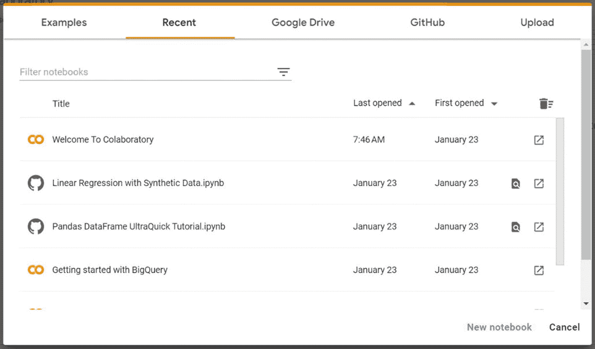

一张截图展示了一个包含 5 列的表格，例如“最近使用”、“Google 云端硬盘”、“GitHub”和“上传”。其中“最近使用”被选中，显示了一个标题列表及其详细信息，包括“上次打开”和“首次打开”。右下角有 2 个按钮，分别是“新建笔记本”和“取消”。

**图 2-2** 登录后的 Colaboratory

3. **导航到 Colaboratory**：访问 Google Colaboratory 网站（[`https://colab.research.google.com/`](https://colab.research.google.com/)）并使用你的谷歌账户登录。登录后，你应该会看到一个类似图 2-2 所示的对话框。

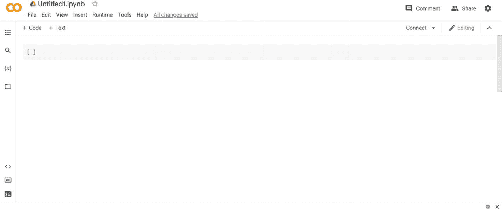

一张名为“Untitled1.ipynb”的新笔记本截图。

**图 2-3** 新笔记本

4. **Colab 界面概览**：
   - **菜单栏**：Colab 界面的顶部是菜单栏。它包含用于文件操作、运行时配置等的各种选项。花点时间探索一下可用的菜单选项。
   - **工具栏**：工具栏位于菜单栏正下方。它提供了常用操作的快速访问，例如运行、插入新单元格和更改单元格类型。
   - **代码单元格**：Colab 界面的主要区域由代码单元格组成。这些单元格允许你编写和执行 Python 代码。默认情况下，新笔记本从一个代码单元格开始。你可以根据需要添加更多单元格。
   - **文本单元格（Markdown 单元格）**：除了代码单元格，Colab 还支持文本单元格，也称为 Markdown 单元格。文本单元格允许你向笔记本中添加解释性文本、标题、项目符号和其他格式化内容。它们有助于为你的代码提供文档、解释和上下文。

5. **创建新笔记本**：要创建一个新的 Colaboratory 笔记本，请点击右上角或右下角的 **新建笔记本** 按钮，如图 2-2 所示。

6. **选择运行时类型**：创建新笔记本时，你需要指定运行时类型。选择 **Python 3** 以便在 Colaboratory 中使用 Python。

7. **开始编码**：现在你已经准备好开始用 Python 编码了。你可以通过点击左上角写着“Untitled1.ipynb”的位置来更改笔记本的名称（图 2-3）。点击笔记本中的第一个代码单元格以选中它。在代码单元格中输入一个简单的 Python 语句，例如 `print("Hello, Colab!")`。按 `Shift+Enter` 执行代码。代码的输出将出现在单元格下方。

### 动手实践示例

通过点击 **+ 文本** 按钮，在笔记本中插入文本来描述代码。

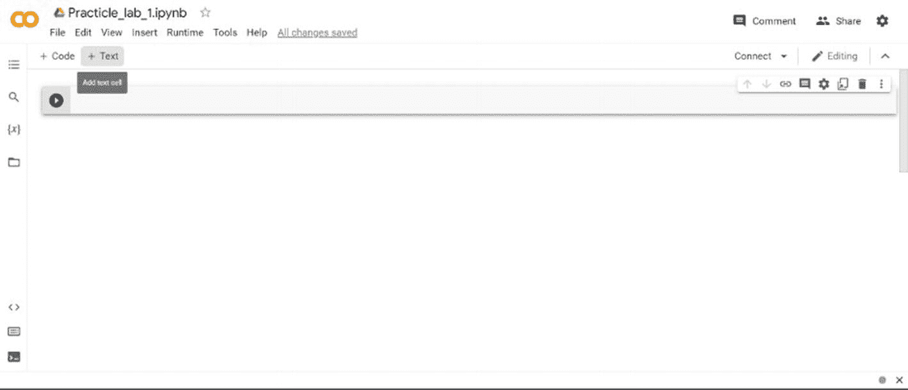

一张浏览器窗口的截图。页面标题是“Practical_lab_1.ipynb”。浏览器窗口分为两部分：左侧边栏和主区域。

**图 2-4** 在笔记本中插入文本

执行两个数的求和。

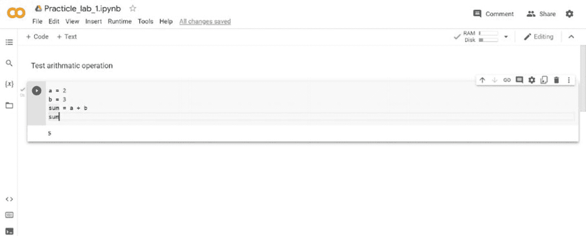

一张名为“practical_lab_1.ipynb”的笔记本截图，显示了用于测试算术运算的 5 行文本。

**图 2-5** 算术示例

从上图可以看出，`a = 2`，`b = 3`，并且 `sum = a + b`，输出结果为 `5`。

以下是一个 Python 示例，演示如何使用 `random` 库生成随机数，并使用 Matplotlib 可视化数据。

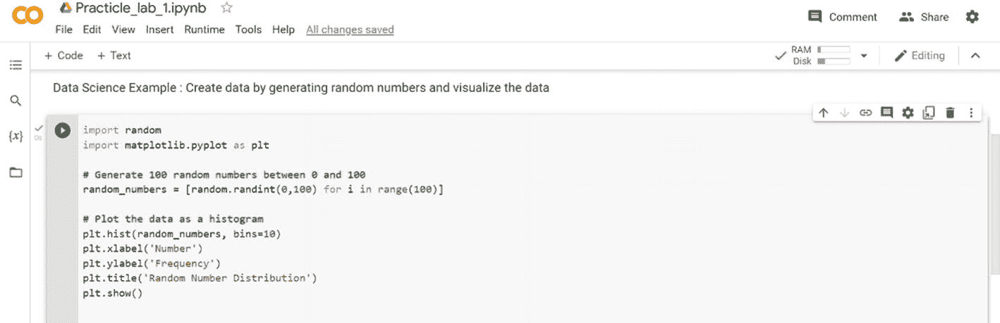

一张名为“practical_lab_1.ipynb”的笔记本截图，展示了一段用于数据科学示例的代码片段，该示例通过生成随机数来创建数据并可视化数据。

**图 2-6** 数据科学示例

以下代码演示了如何使用 Python 库 `random` 和 `matplotlib.pyplot` 生成随机数、创建直方图并可视化数据：

```
import random
import matplotlib.pyplot as plt
#### 生成 100 个介于 0 和 100 之间的随机数
random_numbers = [random.randint(0,100) for i in range(100)]
#### 将数据绘制为直方图
plt.hist(random_numbers, bins=10)
plt.xlabel('数值')
plt.ylabel('频率')
plt.title('随机数分布')
plt.show()
```

以下是代码的详细说明：

- **`import random` 和 `import matplotlib.pyplot as plt`**：这两行导入了生成随机数和使用 Matplotlib 创建可视化所需的库。
- **`random_numbers = [random.randint(0,100) for i in range(100)]`**：这行代码生成一个名为 `random_numbers` 的列表，其中包含 100 个介于 0 和 100 之间的随机整数。`random` 库中的 `random.randint()` 函数在列表推导式中用于生成这些随机数。
- **`plt.hist(random_numbers, bins=10)`**：这行代码使用 `matplotlib.pyplot` 中的 `hist()` 函数创建一个直方图。它以 `random_numbers` 列表作为输入，并指定直方图的组数（10 组）。`hist()` 函数计算每个组内值的频率并绘制直方图。
- **`plt.xlabel('数值')`、`plt.ylabel('频率')`、`plt.title('随机数分布')`**：这些行分别设置 x 轴和 y 轴的标签以及图的标题。
- **`plt.show()`**：这行代码在屏幕上显示图形。调用 `matplotlib.pyplot` 中的 `show()` 函数来渲染直方图。

通过在 Colaboratory 笔记本或 Python 环境中执行此代码，你将看到一个类似图 2-7 的直方图可视化，它展示了随机生成数的分布。x 轴表示数值范围（0–100），y 轴表示数据集中每个数值的频率。

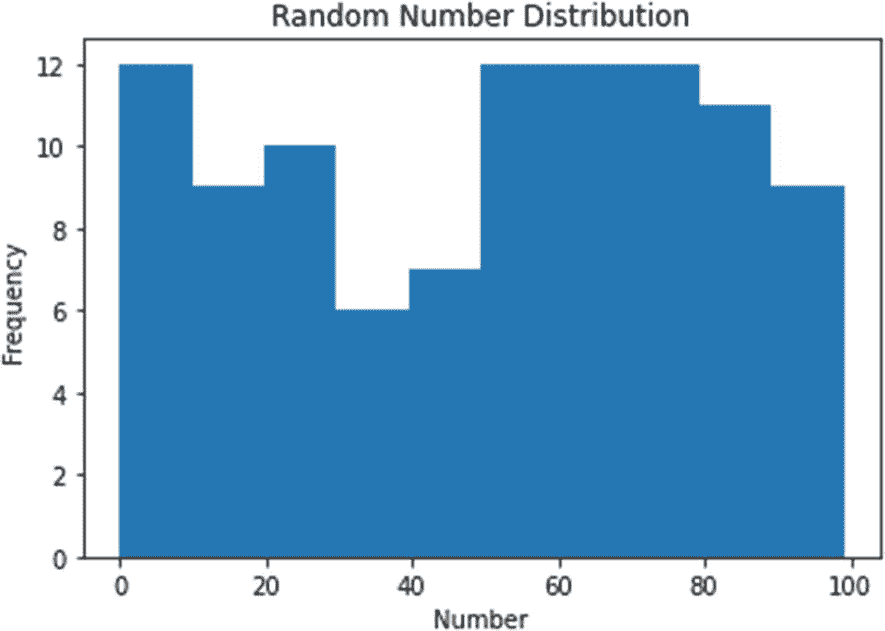

一张随机数分布图，包含一个频率从 0 到 12 的垂直轴，以及一个数值从 0 到 100 的水平轴。图形呈现出波动趋势。

**图 2-7** 输出随机数分布

此示例展示了 Python 以及 `random` 和 Matplotlib 等库生成和可视化数据的能力，提供了关于如何使用随机数和直方图的基本理解。

### 导入库

以下是将库导入笔记本的示例代码。如果库尚未安装，请使用 `!pip install` 命令后跟库名进行安装：

```
#### 导入 Pandas 库
import pandas as pd
#### 导入 Numpy 库
import numpy as np
#### 导入 Matplotlib 库
import matplotlib.pyplot as plt
#### 导入 Seaborn 库
import seaborn as sns
```

此示例中导入了 Pandas、Numpy、Matplotlib 和 Seaborn 库。`import` 语句用于导入库，`as` 关键字用于为库指定别名以便于访问。例如，Pandas 被赋予别名 `pd`，Numpy 被赋予别名 `np`。这允许你使用更短、更易输入的别名来访问库的函数和方法。你可以在 Colaboratory 笔记本中运行此代码，并在代码中使用导入的库。


### 处理数据

Colaboratory 与 Google Drive 和 Google Cloud Storage 集成，使您能够轻松地从这些服务导入和处理数据。

您可以使用 `google.colab` 库在 Colaboratory 中存储或访问 Google Drive 中存储的数据。例如，要将您的 Google Drive 挂载到 Colaboratory，可以运行以下代码：

```
from google.colab import drive
drive.mount('/content/drive')
```

执行代码后，会出现一个提示，要求您登录 Google 帐户并授予 Colaboratory 访问您 Google Drive 的必要权限。

授权 Colaboratory 后，您可以通过在 Colaboratory 文件浏览器中导航到 `/content/drive` 来访问您的 Google Drive 数据。

要向 Google Drive 写入数据，您可以使用 Python 内置的 `open` 函数。例如，要将 Pandas DataFrame 写入 Google Drive 中的 CSV 文件，可以使用以下代码：

```
import pandas as pd
df = pd.DataFrame({'A': [1, 2, 3], 'B': [4, 5, 6]})
df.to_csv('/content/drive/My Drive/Colab Notebooks/data.csv', index=False)
```

此代码会在 Google Drive 的 `My Drive/Colab Notebooks/` 文件夹中创建一个新的 CSV 文件，其中包含 Pandas DataFrame 中的数据。

请注意，您也可以使用其他库，例如 `gspread` 将数据写入 Google Sheets，或使用 `google.cloud` 将数据写入其他 GCP 服务。您选择的方法将根据所需的数据格式和写入目标而有所不同。

您可以像使用 Colaboratory 中的任何其他数据一样使用 Google Drive 中的数据。例如，您可以使用以下代码读取存储在 Google Drive 中的 CSV 文件并将其加载到 Pandas DataFrame 中：

```
import pandas as pd
df = pd.read_csv('/content/drive/My Drive/Colab Notebooks/data.csv')
```

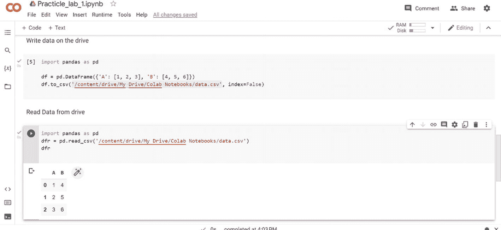

一个名为 `practicle lab 1.ipynb` 的笔记本截图，展示了用于向驱动器写入数据和从驱动器读取数据的代码片段。

**图 2-8** Colab 上 Python 的截图

### 可视化数据

要在 Colaboratory 中可视化数据，您可以使用 Matplotlib 或 Seaborn 等库来创建图表。

使用以下代码通过 Pandas 库在 Python 中创建一个数据框：

```
import pandas as pd
import numpy as np
df = pd.DataFrame({'age': np.random.randint(20, 80, 100),
'weight': np.random.randint(50, 100, 100)})
```

这将创建一个包含 100 行和 2 列（名为“age”和“weight”）的数据框，其中填充了年龄在 20 到 80 之间、体重在 50 到 100 之间的随机整数值。

使用 Python 中的 Matplotlib 库可视化 Pandas 数据框中的数据。以下是一个绘制年龄和体重列散点图的示例：

```
import matplotlib.pyplot as plt
plt.scatter(df['age'], df['weight'])
plt.xlabel('Age')
plt.ylabel('Weight')
plt.show()
```

提供的代码使用 Python 中的 Matplotlib 库创建散点图。让我们逐行分析代码：

*   `import matplotlib.pyplot as plt`：此行导入 Matplotlib 库，特别是 `pyplot` 模块。`plt` 是一个别名或简写，允许我们在调用其函数时引用该模块。

*   `plt.scatter(df['age'], df['weight'])`：此行使用 Matplotlib 的 `scatter()` 函数创建散点图。它接受两个参数：`df['age']` 和 `df['weight']`。假设 `df` 是一个 Pandas DataFrame，此代码将“age”列的值绘制在 x 轴上，将“weight”列的值绘制在 y 轴上。

*   `plt.xlabel('Age')`：此行设置散点图 x 轴的标签。在此例中，标签设置为“Age”。

*   `plt.ylabel('Weight')`：此行设置散点图 y 轴的标签。在此例中，标签设置为“Weight”。

*   `plt.show()`：此行在屏幕上显示散点图。必须包含此行才能在单独的窗口或 Jupyter 笔记本中看到渲染的图表。

这将创建一个以年龄值为 x 轴、体重值为 y 轴的散点图。您还可以使用其他类型的图表，如直方图、折线图、条形图等，来可视化 Pandas 数据框中的数据。

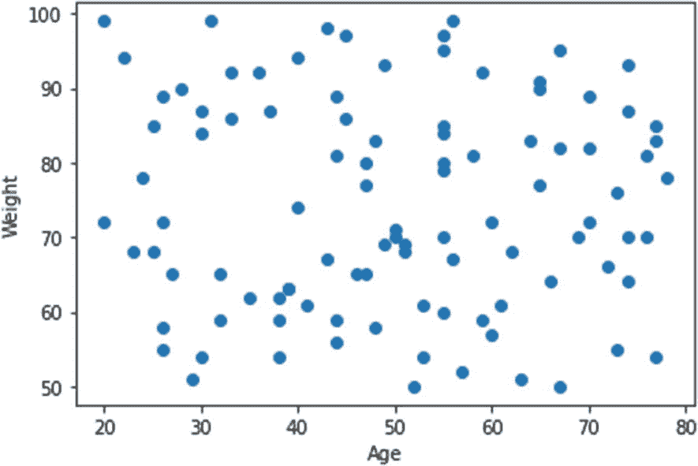

一张体重与年龄的散点图，显示了几个散落的点。

**图 2-9** 生成的年龄-体重分布图


### 在 Colaboratory 上运行机器学习模型

以下是一个使用 Python 和 `scikit-learn` 库构建机器学习模型的示例。首先，如果你没有数据，可以使用以下代码生成数据。该代码会生成随机特征和随机目标数组，然后将它们合并成一个 Pandas DataFrame，以便进行进一步的分析或建模：

```
import pandas as pd
import numpy as np
#### 生成随机特征
np.random.seed(0)
n_samples = 1000
n_features = 5
X = np.random.randn(n_samples, n_features)
#### 生成随机目标
np.random.seed(1)
y = np.random.randint(0, 2, n_samples)
#### 将特征和目标合并成一个数据框
df = pd.DataFrame(np.hstack((X, y[:, np.newaxis])), columns=["feature_1", "feature_2", "feature_3", "feature_4", "feature_5", "target"])
```

现在，我们将逐行分析这段代码：

1. `import pandas as pd` 和 `import numpy as np`：这两行导入了 Pandas 和 Numpy 库，它们常用于 Python 中的数据操作和分析。

2. `np.random.seed(0)`：这行代码为 Numpy 设置了随机种子，以确保生成的随机数具有可重复性。通过设置特定的种子值（此处为 0），每次运行代码时都会生成相同的随机数集合。

3. `n_samples = 1000`：这行代码将生成的样本数量设置为 1000。

4. `n_features = 5`：这行代码将生成的特征数量设置为 5。

5. `X = np.random.randn(n_samples, n_features)`：这行代码使用 Numpy 的 `np.random.randn()` 函数生成一个形状为 (`n_samples`, `n_features`) 的随机数组。数组中的每个元素都来自标准正态分布（均值为 0，标准差为 1）。

6. `np.random.seed(1)`：这行代码为生成随机目标值设置了一个不同的随机种子值（1）。这确保了目标值与之前生成的特征值不同。

7. `y = np.random.randint(0, 2, n_samples)`：这行代码使用 `np.random.randint()` 函数生成了一个长度为 `n_samples` 的随机整数数组，整数范围在 0 到 1 之间（不含 2）。这代表了分类任务的目标值，每个目标值要么是 0，要么是 1。

8. `df = pd.DataFrame(np.hstack((X, y[:, np.newaxis])), columns=["feature_1", "feature_2", "feature_3", "feature_4", "feature_5", "target"])`：这行代码将特征数组 (`X`) 和目标数组 (`y`) 合并成一个 Pandas DataFrame。`np.hstack()` 函数将 `X` 和 `y` 数组水平堆叠，然后将合并后的数组传递给 `pd.DataFrame()` 函数以创建一个 DataFrame。`columns` 参数用于为 DataFrame 指定列名，即特征和目标变量的名称。

现在，我们可以使用以下代码生成一个机器学习模型。该代码从 CSV 文件加载数据集，将其拆分为训练集和测试集，训练一个随机森林分类器，对测试集进行预测，并通过计算准确率来评估模型的性能：

```
from sklearn.model_selection import train_test_split
from sklearn.ensemble import RandomForestClassifier
from sklearn.metrics import accuracy_score
#### 加载数据集
df = pd.read_csv("data.csv")
#### 将数据拆分为特征 (X) 和目标 (y)
X = df.drop("target ", axis=1)
y = df["target "]
#### 将数据拆分为训练集和测试集
X_train, X_test, y_train, y_test = train_test_split(X, y, test_size=0.2)
#### 训练一个随机森林分类器
clf = RandomForestClassifier(n_estimators=100)
clf.fit(X_train, y_train)
#### 对测试集进行预测
y_pred = clf.predict(X_test)
#### 评估模型性能
accuracy = accuracy_score(y_test, y_pred)
print("Accuracy:", accuracy)
```

让我们逐行分析这段代码：

1. `from sklearn.model_selection import train_test_split`：这行代码从 `scikit-learn` 库的 `model_selection` 模块中导入了 `train_test_split` 函数。该函数用于将数据集拆分为训练子集和测试子集。

2. `from sklearn.ensemble import RandomForestClassifier`：这行代码从 `scikit-learn` 的 `ensemble` 模块中导入了 `RandomForestClassifier` 类。该类代表一个随机森林分类器，这是一种基于决策树的集成模型。

3. `from sklearn.metrics import accuracy_score`：这行代码从 `scikit-learn` 的 `metrics` 模块中导入了 `accuracy_score` 函数。该函数用于计算分类模型的准确率。

4. `df = pd.read_csv("data.csv")`：这行代码使用 Pandas 库的 `read_csv` 函数读取名为 `"data.csv"` 的 CSV 文件。CSV 文件的内容被加载到一个名为 `df` 的 Pandas DataFrame 中。

5. `X = df.drop("target", axis=1)`：这行代码通过从原始 DataFrame `df` 中删除 `"target"` 列，创建了一个新的 DataFrame `X`。这个 DataFrame 包含了用于训练模型的特征。

6. `y = df["target"]`：这行代码通过从原始 DataFrame `df` 中选择 `"target"` 列，创建了一个 Series `y`。这个 Series 代表了目标变量或与特征对应的标签。

7. `X_train, X_test, y_train, y_test = train_test_split(X, y, test_size=0.2)`：这行代码使用 `train_test_split` 函数将数据拆分为训练集和测试集。特征 `X` 和目标 `y` 作为参数传入，同时还有 `test_size` 参数，该参数指定了用于测试的数据比例（此处为 20%）。

8. `clf = RandomForestClassifier(n_estimators=100)`：这行代码创建了一个包含 100 棵决策树的 `RandomForestClassifier` 类的实例。`n_estimators` 参数决定了随机森林中树的数量。

9. `clf.fit(X_train, y_train)`：这行代码在训练数据（`X_train` 和 `y_train`）上训练随机森林分类器（`clf`）。分类器学习数据中的模式和关系，以便进行预测。

10. `y_pred = clf.predict(X_test)`：这行代码使用训练好的分类器（`clf`）对测试数据（`X_test`）进行预测。预测的标签存储在 `y_pred` 变量中。

11. `accuracy = accuracy_score(y_test, y_pred)`：这行代码通过比较预测标签（`y_pred`）与测试集的真实标签（`y_test`）来计算模型的准确率。准确率得分存储在 `accuracy` 变量中。

12. `print("Accuracy:", accuracy)`：这行代码在控制台打印准确率得分，表明模型在测试数据上的表现如何。


### 在生产环境中部署模型

如果你想部署一个 `scikit-learn` 模型，可以使用 `joblib` 库来保存模型，然后通过 REST API 来提供模型服务。以下代码安装了 `joblib` 和 `Flask` 库，使用 `joblib` 将训练好的模型保存到文件，并设置了一个 `Flask` 应用来提供模型预测服务。代码定义了 `/predict` 端点，当向该端点发送请求时，模型会被加载，进行预测，并将结果以 JSON 响应形式返回。

你可以使用诸如 Google Cloud Platform 或 Amazon Web Services 之类的云服务来托管 REST API，并使你的应用程序能够获取预测结果。以下是具体操作示例：

1.  **安装 joblib 库：**

```
!pip install joblib
```

2.  **保存模型：**

```
import joblib
model = clf # 你训练好的模型
#### 保存模型
joblib.dump(model, '/content/drive/My Drive/Colab Notebooks/model.joblib')
```

3.  **使用 Flask 提供模型服务：**

```
!pip install flask
from flask import Flask, request
import joblib
app = Flask(__name__)
@app.route("/predict", methods=["POST"])
def predict():
    data = request.json[X_test]
    model = joblib.load('/content/drive/My Drive/Colab Notebooks/model.joblib')
    predictions = model.predict(data)
    print(predictions)
    return {'predictions': predictions.tolist()}
if __name__ == "__main__":
    app.run()
```

此示例使用 `Flask` 库将模型作为 REST API 提供服务。你可以通过向 `/predict` 端点发送一个包含输入数据的 POST 请求来测试该 API。

现在，我们逐行分析代码：

1.  **`!pip install joblib`**：此行使用 `pip` 包管理器安装 `joblib` 库。`joblib` 是一个 Python 库，用于 Python 对象（包括模型）的序列化和反序列化。

2.  **`import joblib`**：此行导入 `joblib` 模块，该模块提供了保存和加载模型的函数。

3.  **`model = clf`**：此行将训练好的模型 (`clf`) 赋值给 `model` 变量。它假设 `clf` 是训练好的模型对象。

4.  **`joblib.dump(model, '/content/drive/My Drive/Colab Notebooks/model.joblib')`**：此行使用 `joblib.dump()` 函数将模型保存到名为 `model.joblib` 的文件中。该文件将保存在指定的目录路径 `/content/drive/My Drive/Colab Notebooks/` 下。

5.  **`!pip install flask`**：此行使用 `pip` 包管理器安装 `Flask` Web 框架。`Flask` 是一个流行的用于构建 Web 应用的 Python 框架。

6.  **`from flask import Flask, request`**：此行从 `flask` 模块导入 `Flask` 类。同时导入了 `request` 对象，它允许访问传入 HTTP 请求中的数据。

7.  **`app = Flask(__name__)`**：此行创建了一个名为 `app` 的 `Flask` 应用实例。

8.  **`@app.route("/predict", methods=["POST"])`**：此行装饰了接下来的函数，使其能够处理对 `/predict` 端点发起的 HTTP POST 方法请求。

9.  **`def predict():`**：此行定义了一个名为 `predict` 的函数，当向 `/predict` 端点发起请求时，该函数将被执行。

10.  **`data = request.json[X_test]`**：此行从发送到 `/predict` 端点的请求中检索 JSON 数据。它假设 JSON 数据包含 `X_test` 键。

11.  **`model = joblib.load('/content/drive/My Drive/Colab Notebooks/model.joblib')`**：此行使用 `joblib.load()` 函数从文件 `model.joblib` 中加载模型。

12.  **`predictions = model.predict(data)`**：此行使用加载的模型对从请求中获取的数据进行预测。

13.  **`print(predictions)`**：此行将预测结果打印到控制台。

14.  **`return {'predictions': predictions.tolist()}`**：此行返回一个包含预测结果列表的 JSON 响应。

15.  **`if __name__ == "__main__":`**：此行检查脚本是否作为主模块直接运行。

16.  **`app.run()`**：此行启动 `Flask` 开发服务器来运行应用程序。

### 从 Colaboratory 访问 GCP 服务和数据

**连接到 GCP**：Colaboratory 是 Google Cloud Platform (GCP) 的一部分，因此你可以轻松地从 Colaboratory 访问其他 GCP 服务和数据。要连接到 GCP，你需要设置一个 Google Cloud 项目，并授予 Colaboratory 访问你 Google Cloud 资源的权限。

**使用 Google Cloud 进行身份验证：** 要使用 Google Cloud 进行身份验证，你需要在 Colaboratory 单元格中运行以下命令：

```
!gcloud auth login
```

执行此命令后，将启动一个 Web 浏览器窗口，使你能够登录到你的 Google 帐户并授权 Colaboratory 访问你的 Google Cloud 资源。

**访问 GCP 服务：** 你可以使用 Colaboratory 访问和使用其他 GCP 服务，例如 Google Cloud Storage、Google BigQuery 和 Google Cloud AI Platform。

**访问 GCP 数据：** 你还可以使用 Colaboratory 访问和处理存储在 GCP 中的数据，例如存储在 Google Cloud Storage 或 Google BigQuery 中的数据。你需要使用诸如 `Pandas` 和 Google Cloud API 之类的 Python 库来访问这些数据。

**从 GCP 导入数据：** 你可以使用 Colaboratory 从其他 GCP 服务导入数据，并将其存储在 `Pandas` DataFrame 中。例如，你可以选择从 Google BigQuery 导入数据，并利用 BigQuery API 的功能将其存储在 DataFrame 中。

**将数据导出到 GCP：** 你还可以使用 Colaboratory 将数据导出到其他 GCP 服务。例如，你可以将 `Pandas` DataFrame 导出到 Google Cloud Storage 或 Google BigQuery。

Colab 与其他 Google Cloud 服务的集成将在后续章节中详细讨论。

## 总结

在本章中，我们了解了 Google Colaboratory，这是 Google 提供的一个免费的基于云的 Jupyter Notebook 环境。我们发现了它的主要特性，包括其基于云的特性、用户友好的界面、与 Google Cloud Platform (GCP) 服务的集成、共享和协作能力，以及对 GPU 和 TPU 计算的支持。这些特性使 Colaboratory 成为数据科学家、软件工程师和学生都能使用的强大工具。

我们探讨了在 Google Colaboratory 上创建和运行 Jupyter notebook 的过程。我们学习了如何访问该平台、注册 Google 帐户以及浏览 Colab 界面。我们还学习了如何创建新的 Colaboratory notebook、选择运行时类型以及开始使用 Python 编写代码。通过动手实践示例，我们练习了插入文本、执行算术运算、生成随机数以及使用 `Matplotlib` 和 `Seaborn` 等库进行数据可视化。

此外，我们深入研究了如何将库导入 Colab notebook，以及如何使用 `google.colab` 库处理存储在 Google Drive 中的数据。我们学习了如何从 Google Drive 导入数据以及将数据写入 Google Drive，以及如何通过 Colaboratory 访问 Google Drive 中的数据。此外，我们还简要介绍了在 Google Colaboratory 上运行机器学习模型，并提到了强大的机器学习工具和库（如 `TensorFlow` 和 `Keras`）的可用性。我们甚至探索了一个使用 `scikit-learn` 库构建机器学习模型的示例。

总而言之，本章概述了 Google Colaboratory 及其特性，指导我们完成了访问和使用 Colab 的过程，并教我们在 Colaboratory 环境中进行各种编码、数据处理和可视化技术。


## 3. 大数据与机器学习

Google Cloud Platform 提供了多种服务，用于管理大数据以及执行提取、转换、加载（ETL）操作。此外，它还提供了用于训练和部署机器学习模型的工具。在本章中，我们将深入探讨 `BigQuery` 及其查询执行。此外，我们还将了解如何使用 `BigQuery ML` 来开发机器学习模型。探索还将延伸到 Google Cloud AI Platform，我们将通过 `Vertex AI` 获得训练和部署机器学习模型的实践经验。

随着学习的深入，我们将介绍 `Dataproc` 及其在数据处理中的应用。本章最后将介绍 `TensorFlow`。

### BigQuery

`BigQuery` 是 Google Cloud Platform (GCP) 提供的一种无服务器、高度可扩展且经济高效的云数据仓库。它允许您使用类似 SQL 的查询来存储和分析大量结构化和半结构化数据。使用 `BigQuery`，您可以在几秒钟内对数 TB 的数据运行临时查询，而无需任何设置或维护。

`BigQuery` 适用于多种用例，包括：

*   **数据仓库：** `BigQuery` 通常用作存储和分析大量数据的数据仓库。要创建完整的数据分析管道，您可以将 `BigQuery` 与其他 GCP 工具（例如 `Google Cloud Storage` 和 `Google Looker Studio`）集成。

*   **分析：** `BigQuery` 适用于运行大规模分析项目，例如商业智能、预测建模和数据挖掘。

*   **机器学习：** `BigQuery` 提供了训练机器学习模型和执行可扩展预测的能力。它为 `TensorFlow` 和其他流行的机器学习框架提供了全面支持。

*   **流式数据：** `BigQuery` 支持实时数据流，允许您近乎实时地处理和分析数据。

*   **地理空间数据分析：** `BigQuery` 支持地理空间数据分析，允许您执行复杂的地理计算和可视化。

`BigQuery` 的无服务器架构、可扩展性和成本效益使其成为从初创公司到大型企业等各种规模组织的理想解决方案。

### 在 BigQuery 数据上运行 SQL 查询

开始使用 `BigQuery` 非常简单，包括以下步骤：

**设置 Google Cloud 账户：** 要使用 `BigQuery`，您必须注册一个 Google Cloud 账户。您可以从免费试用开始，然后选择满足您需求的付费计划。

**创建项目：** 拥有 Google Cloud 账户后，在 Google Cloud Console 中创建一个新项目。这将是您 `BigQuery` 数据的存放位置。

**加载数据：** 您可以通过多种方式将数据加载到 `BigQuery` 中，包括上传 CSV 或 JSON 文件、使用基于云的数据源（例如 `Google Cloud Storage`）或实时流式传输数据。

**运行查询：** 数据加载完成后，您可以使用 `BigQuery` 的 Web UI 或命令行界面开始查询数据。`BigQuery` 使用类似 SQL 的语法，因此如果您熟悉 SQL，会发现它很容易使用。

**分析结果：** 运行查询后，您可以在 Web UI 中查看结果，或将其导出到文件以进行进一步分析。

**可视化数据：** 您还可以使用 `Google Looker Studio` 等工具，基于 `BigQuery` 数据创建可视化和报告。

`BigQuery` 提供了详细的文档和教程来帮助您入门。此外，GCP 还提供了一个免费的社区支持论坛，如果您有付费计划，还可以获得技术支持。

在跳转到生产环境并使用信用卡之前，您可以尝试 `BigQuery Sandbox`。

**BigQuery Sandbox** 是 Google Cloud Platform (GCP) 提供的一个免费的交互式学习环境，旨在帮助用户探索和学习 `BigQuery`。使用 `BigQuery Sandbox`，您可以在公共数据集上运行查询并测试 `BigQuery` 的功能，而无需支付任何费用。

`BigQuery Sandbox` 提供了一个用户友好的、基于 Web 的界面，便于对 `BigQuery` 数据执行类似 SQL 的查询。它提供了无忧的体验，无需任何设置或安装。这使其成为数据分析师、数据科学家和开发人员等刚接触 `BigQuery` 并希望获得该工具的动手学习经验，同时探索其功能的人员的宝贵资源。

`BigQuery Sandbox` 不适用于生产环境，并且存在一些限制，例如数据大小限制较小，性能低于完全配置的 `BigQuery` 实例。但是，这是在将 `BigQuery` 用于生产环境之前，开始使用并熟悉其功能的好方法。

以下是使用 `BigQuery Sandbox` 的分步教程：

**打开 BigQuery Sandbox 网站：** 访问 `BigQuery Sandbox` 网站：`https://console.cloud.google.com/bigquery`。

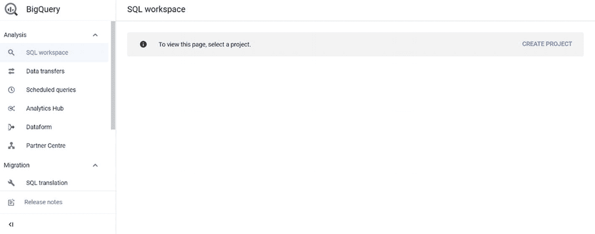

Big Query Sandbox 窗口的屏幕截图显示分析下的一个下拉菜单，其中选择了 S Q L 工作区菜单。它显示了 S Q L 工作区。

图 3-1

Google Cloud 的 BigQuery 控制台

**登录您的 Google 账户：** 如果您目前没有 Google 账户，则需要创建一个。然后，您可以登录您的账户以访问 `BigQuery Sandbox` 环境。按照提示创建一个 Google Cloud 项目。要使用 `BigQuery Sandbox`，您必须创建一个 Google Cloud 项目。如下图所示。

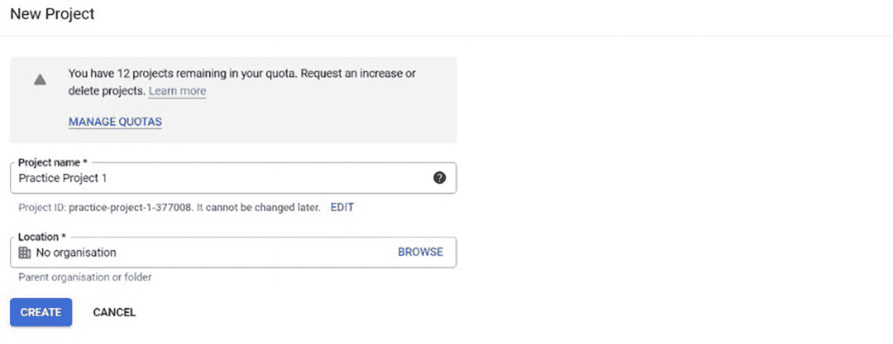

新项目页面的屏幕截图。它显示了项目名称和位置的字段，并带有一个创建按钮。

图 3-2

创建新项目

创建项目后，您将看到以下屏幕。

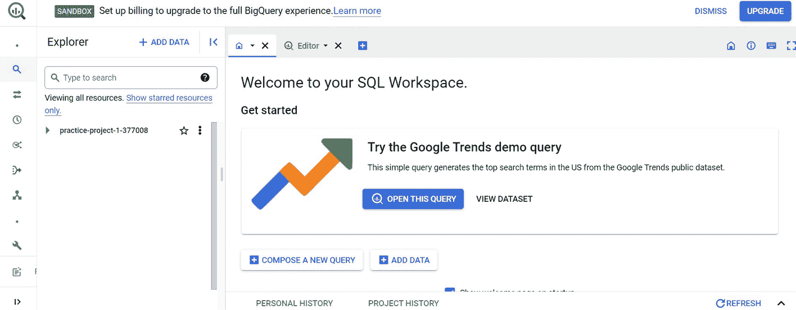

沙盒界面的屏幕截图。它显示了在 S Q L 工作区下创建的项目。

图 3-3

创建新项目后的屏幕


**探索可用数据集：** BigQuery 沙盒提供了对多个公共数据集的访问权限，您可以使用这些数据集来练习运行查询。要查看可用数据集列表，请点击屏幕左侧导航菜单中的 `Datasets` 选项卡。

从上述界面中，您可以看到可以尝试 Google Trends 演示查询。点击 `OPEN THIS QUERY` 按钮后，您将看到以下结果。

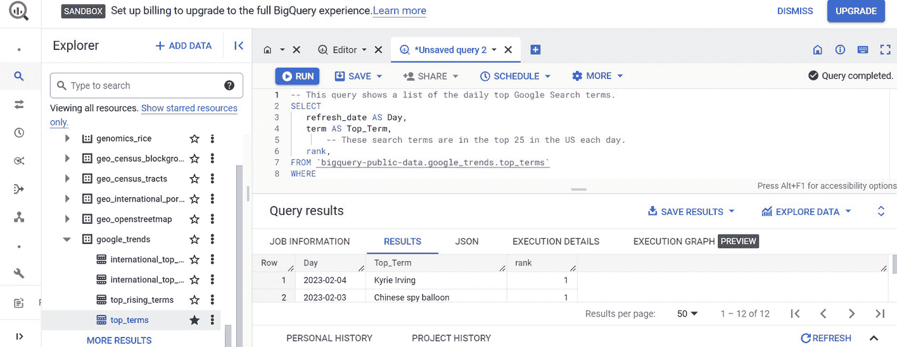

沙盒页面的截图。它显示了点击 `open this query` 按钮后的 Google Trends 演示查询。

**图 3-4** Google Trends 演示查询

**选择数据集：** 点击数据集的名称以选择它，并查看其架构和表。在此示例中，使用了 `bigquery-public-data.google_trends.top_terms` 表。

**编写查询：** 要编写查询，请点击导航菜单中的 `Query Editor` 选项卡。在查询编辑器中，使用 BigQuery 的类 SQL 语法编写查询，然后点击 `Run Query` 按钮来执行它。以下查询使用 `bigquery-public-data.google_trends.top_terms` 表中的数据，检索每日热门 Google 搜索词列表：

```
-- 此查询显示每日热门 Google 搜索词列表。
SELECT
refresh_date AS Day,
term AS Top_Term,
-- 这些搜索词每天在美国排名前 25。
rank,
FROM `bigquery-public-data.google_trends.top_terms`
WHERE
rank = 1
-- 仅选择每天排名第一的搜索词。
AND refresh_date >= DATE_SUB(CURRENT_DATE(), INTERVAL 2 WEEK)
-- 筛选最近两周的数据。
GROUP BY Day, Top_Term, rank
ORDER BY Day DESC
-- 按日期倒序显示。
```

以下是该查询的分解说明：

`SELECT` 语句指定了结果集中要包含的列。它选择了 `refresh_date` 列并将其别名为“Day”，`term` 列别名为“Top_Term”，以及 `rank` 列。

`FROM` 子句指定了要从中检索数据的表 `bigquery-public-data.google_trends.top_terms`。

`WHERE` 子句根据特定条件过滤数据。在此例中，它仅包含 `rank` 列等于 1 的行，表示每天的排名第一的搜索词。它还通过将 `refresh_date` 列与 `DATE_SUB(CURRENT_DATE(), INTERVAL 2 WEEK)` 的结果进行比较，来过滤数据以仅包含过去两周的记录，该函数从当前日期减去两周。

`GROUP BY` 子句按“Day”、“Top_Term”和 `rank` 列对结果集进行分组。这确保了这些列的每个组合在结果集中只出现一次。

`ORDER BY` 子句根据“Day”列按降序对结果集进行排序。这意味着最近的日期将首先显示。

简而言之，该查询检索了过去两周内每天的排名第一的 Google 搜索词，并按时间倒序呈现，首先显示最近的日期。

**查看查询结果：** 查询执行后，您将在 `Results` 选项卡中看到结果。您也可以通过点击 `Save` 按钮来保存查询。

**重复此过程：** 您可以多次重复此过程，尝试不同的数据集并编写多样化的查询，以深入探索 BigQuery 提供的强大功能。

**探索数据：** 在查询结果中，有保存结果和探索数据的选项。

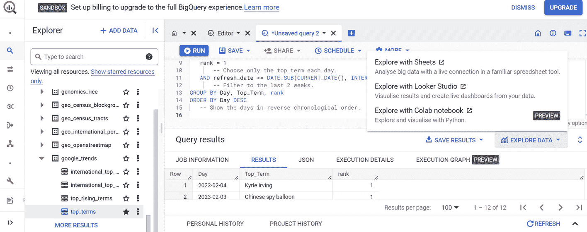

沙盒页面的截图。它显示了点击 `open this query` 按钮后的 Google Trends 演示查询，并显示了带有保存和探索数据选项的查询结果。

**图 3-5** 使用 BigQuery 探索数据

**使用 Colab 探索数据：** 点击 `Explore with Colab Notebook` 按钮后，您将看到以下界面。

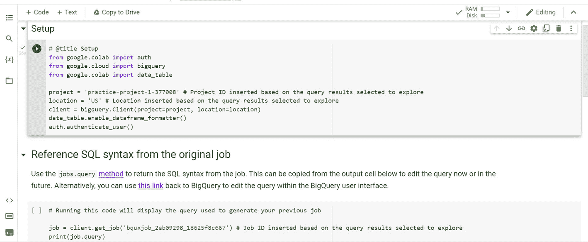

页面的截图，显示了点击 `Explore with Colab Notebook` 按钮后的设置界面，并显示了一组程序代码作为 Colab 工作表，其中包含参考的 SQL 语法。

**图 3-6** Colab 工作表

按照第 2 章中使用 Colab 的相同流程，开始探索数据。

**使用 Looker Studio 探索数据：** 点击 `Explore with Looker Studio` 后，可以看到以下界面。

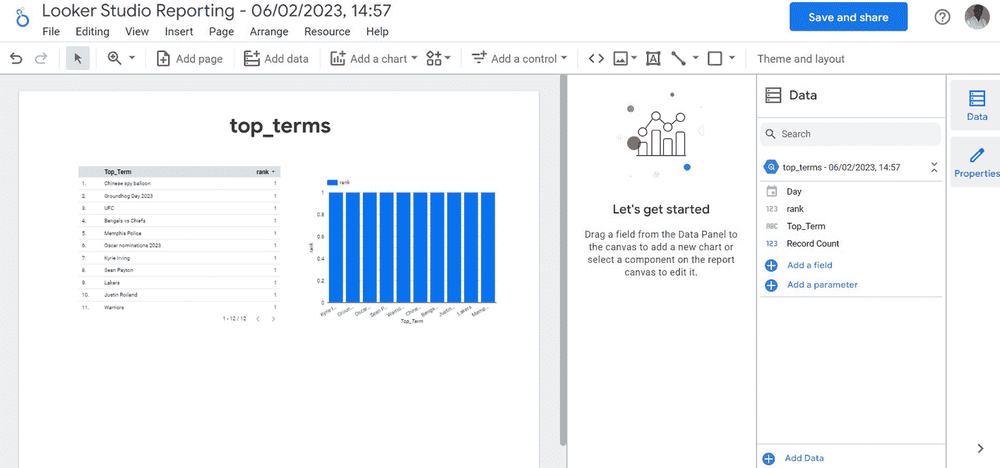

截图显示了点击 `Explore with Looker Studio` 按钮后的 Looker Studio 报告页面，并在热门搜索词下方显示了一个带有相应数据的条形图。

**图 3-7** 使用 Looker Studio 进行数据探索

BigQuery 沙盒是一个简单直观的工具，为开始使用 BigQuery 并熟悉其功能提供了绝佳途径。基于 Web 的界面和公共数据集使得开始运行查询和学习该工具变得非常容易。


### BigQuery ML

`BigQuery ML` 是 Google Cloud 的 `BigQuery` 中的一项功能，它允许您直接在 `BigQuery` 内构建机器学习模型，而无需将数据移出 `BigQuery`。这意味着您可以使用 `BigQuery ML` 对存储在 `BigQuery` 中的大型数据集进行机器学习模型训练。

`BigQuery ML` 支持多种类型的机器学习模型，包括线性回归、逻辑回归、K-Means 聚类和矩阵分解。您可以使用 `BigQuery` 中的 SQL 语法来创建和评估您的机器学习模型，这使得已经熟悉 SQL 的数据分析师和开发人员能够轻松上手。

与需要将数据移出 `BigQuery` 的传统机器学习方法相比，使用 `BigQuery ML` 的好处包括更快的训练时间、更低的成本以及更高的准确性。此外，由于 `BigQuery ML` 运行在 Google 的基础设施上，它可以处理非常大的数据集，因此对于拥有大量数据的组织来说是一个不错的选择。

总的来说，`BigQuery ML` 提供了一种快速且经济高效的方式，在完全托管的环境中构建和部署机器学习模型。

接下来，您将找到一个全面的教程，该教程将引导您完成使用 `BigQuery ML` 的每一步，以利用之前在 Colab 中创建的 `Pandas DataFrame` 生成一个分类模型。要重新生成数据集，请在 Colab 上执行提供的代码：

```
import pandas as pd
import numpy as np
#### Generate random features
np.random.seed(0)
n_samples = 1000
n_features = 5
X = np.random.randn(n_samples, n_features)
#### Generate random target
np.random.seed(1)
y = np.random.randint(0, 2, n_samples)
#### Combine the features and target into a data frame
df = pd.DataFrame(np.hstack((X, y[:, np.newaxis])), columns=["feature_1", "feature_2", "feature_3", "feature_4", "feature_5", "target"])
#### Save the data to a CSV file
df.to_csv("data.csv", index=False)
```

您可以在 Colab 文件中找到 `data.csv`。下载该文件并将其保存到您的计算机上。

**创建 BigQuery 数据集：** 转到 Google Cloud 控制台，选择 `BigQuery`，然后创建一个新的 `BigQuery` 数据集。

**将数据上传到 BigQuery：** 转到 `BigQuery 编辑器` 并创建一个新表。然后，通过点击“创建表”并选择“上传”来将数据上传到此表。选择包含数据的文件，并为列选择适当的选项。

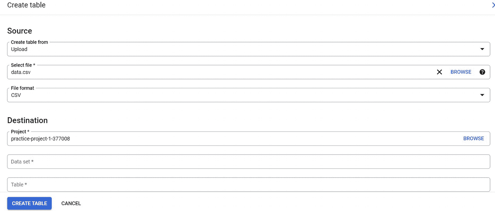

一张截图显示了“创建表”下的选项。它列出了“来源”和“目标”下的字段，并带有“创建表”按钮。

图 3-8

在 BigQuery 上创建表

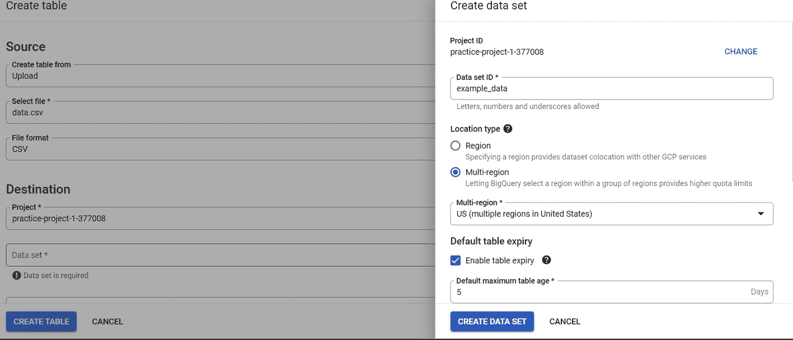

一张截图显示了“创建数据集”下的选项。它列出了“项目 ID”、“位置类型”和“默认表过期时间”下的字段，并带有“创建数据集”按钮。

图 3-9

在 BigQuery 上创建表——设置各种选项

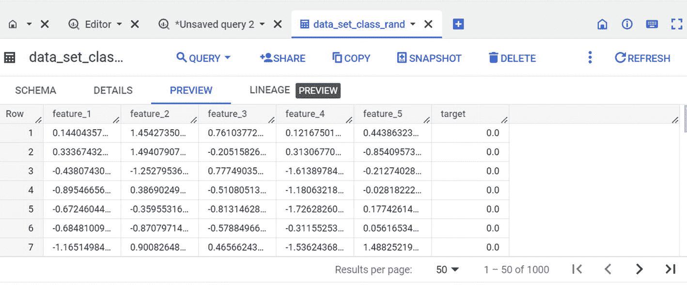

一张截图显示了“预览”选项卡下表中已上传的数据。

图 3-10

表上传后，预览该表

**创建 BigQuery ML 模型：** 在 `BigQuery 编辑器` 中，创建一个新的 SQL 查询。使用 `CREATE MODEL` 语句来创建一个 `BigQuery ML` 模型。示例如下：

```
CREATE MODEL your_model_name
OPTIONS (model_type='logistic_reg', input_label_cols=['target']) AS
SELECT *
FROM your_dataset_name.your_table_name
```

在上述语法中，将 `your_model_name` 和 `your_dataset_name.your_table_name` 填入（``）。对于已上传的数据集，请参考以下代码：

```
CREATE MODEL `example_data.data_set_class_rand_model`
OPTIONS (model_type='logistic_reg', input_label_cols=['target']) AS
SELECT *
FROM `practice-project-1-377008.example_data.data_set_class_rand`
```

这里，模型名称是 `example_data.data_set_class_rand_model`，表名称是 `practice-project-1-377008.example_data.data_set_class_rand`。要查找表名称，请点击该表并转到“详细信息”选项。将出现以下屏幕。找到“表 ID”并复制它，然后将其粘贴到占位符 `your_dataset_name.your_table_name` 中。

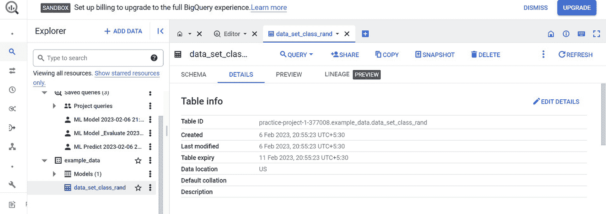

一张沙盒页面的截图显示了已创建表的“详细信息”选项卡下的表信息。

图 3-11

查找表名称

现在，您的编辑器应该看起来像这样。如果一切正常，您将能够在右上角找到一个绿色的勾号，如下所示。继续运行查询。

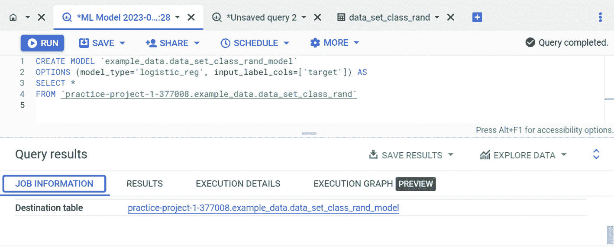

一张截图显示了运行查询以创建模型的工作区。它列出了查询结果以及“作业信息”下的详细信息。

图 3-12

BigQuery ML

转到“结果”并点击“转到模型”。对于模型评估，可以看到以下结果。

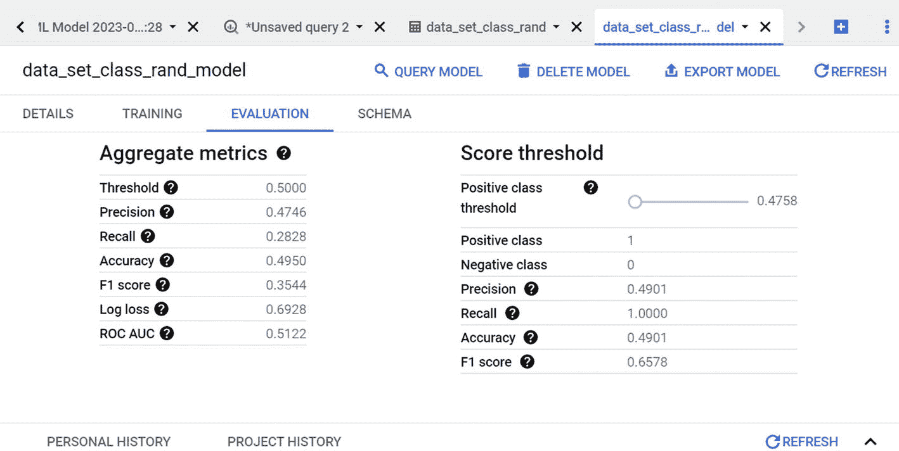

一张截图显示了在“评估”选项卡下创建的聚合指标以及分数阈值。

图 3-13

训练后的模型评估

**评估模型：** 在 `BigQuery 编辑器` 中，创建一个新的 SQL 查询。使用 `ML.EVALUATE` 函数来评估模型。以下是操作方法示例：

```
SELECT *
FROM ML.EVALUATE(MODEL your_model_name, (
SELECT *
FROM your_dataset_name.your_table_name
))
```

在上述语法中，像之前一样填入所有详细信息，您的查询应该如下所示：

```
SELECT *
FROM ML.EVALUATE(MODEL `example_data.data_set_class_rand_model`, (
SELECT *
FROM `practice-project-1-377008.example_data.data_set_class_rand`
))
```

运行查询，您将找到以下结果。

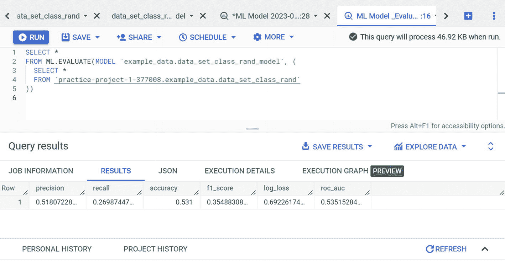

一张页面截图显示了运行查询以评估模型的工作区，并列出了查询结果以及个人和项目历史记录。

图 3-14

模型评估

**进行预测：** 在 `BigQuery 编辑器` 中，创建一个新的 SQL 查询。使用 `ML.PREDICT` 函数进行预测。以下是操作方法示例：

```
SELECT *
FROM ML.PREDICT(MODEL your_model_name, (
SELECT *
FROM your_dataset_name.your_table_name
))
```

再次像之前一样插入所有信息，您的查询应该如下所示：

```
SELECT *
FROM ML.PREDICT(MODEL `example_data.data_set_class_rand_model`, (
SELECT *
FROM `practice-project-1-377008.example_data.data_set_class_rand`
))
```

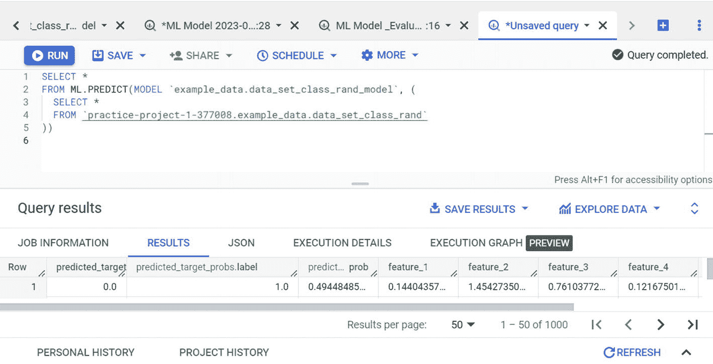

一张页面截图显示了运行查询以预测模型的工作区，并列出了查询结果以及个人和项目历史记录。

图 3-15

预测

这是使用 `BigQuery ML` 通过 `BigQuery 编辑器` 创建分类模型的高级概述。有关不同功能和选项的更详细说明，请参阅 `BigQuery ML` 文档。


### Google Cloud AI 平台及其功能

Google Cloud AI 平台是一个先进的云原生平台，专为机器学习模型的开发、部署和管理而设计。它提供了一系列全面的工具和服务，用于促进机器学习模型的训练和部署，同时还具备监控和优化模型性能的功能。其显著能力包括：

-   **模型训练：** Google Cloud AI 平台提供了多种用于训练机器学习模型的工具，例如 `TensorFlow`、`PyTorch` 和 `scikit-learn`。
-   **模型部署：** 模型训练完成后，可以将其部署到平台上以提供预测服务。它支持部署到多种环境，包括 Google Cloud、本地服务器和边缘设备。
-   **机器学习工作流：** Google Cloud AI 平台提供了多种用于自动化机器学习工作流的工具，例如构建、训练和部署模型。
-   **监控与管理：** Google Cloud AI 平台提供了用于监控已部署模型性能以及管理模型所用资源的工具。
-   **协作与共享：** 该平台提供了用于共享和协作处理机器学习模型的功能，包括版本控制、团队管理和访问控制。

总而言之，Google Cloud AI 平台为大规模构建、部署和管理机器学习模型提供了一套全面的解决方案。

以下是关于如何使用 Google Cloud AI 平台的分步教程：

-   **设置 Google Cloud 账户：** 如果您还没有 Google Cloud 账户，请创建一个。这将使您能够访问 Google Cloud AI 平台及其所有其他服务。
-   **创建项目：** 在 Google Cloud 控制台中，为您的机器学习模型创建一个新项目。这里将是您存储模型及其所有相关资源的地方。
-   **上传数据：** 将您的数据上传到 Google Cloud Storage。您的机器学习模型将在此处存储和访问数据。
-   **创建训练作业：** 转到 Google Cloud 控制台的 AI Platform 部分，创建一个新的训练作业。选择您要训练的模型类型，并配置训练参数，例如迭代次数和批次大小。
-   **启动训练作业：** 点击“训练”按钮启动训练作业。训练作业将在云端运行，并使用您的数据来训练机器学习模型。
-   **监控训练作业：** 您可以从 Google Cloud 控制台的 AI Platform 部分监控训练作业的进度。这将向您展示模型的准确率如何随时间提升。
-   **评估模型：** 训练作业完成后，可以通过评估各种指标（包括准确率、精确率和召回率）来评估其性能。这有助于全面了解模型的表现。
-   **部署模型：** 一旦您对模型的性能感到满意，就可以将其部署到 Google Cloud AI 平台。这将允许您向用户提供来自该模型的预测服务。
-   **监控已部署的模型：** Google Cloud AI 平台提供了用于监控已部署模型性能的工具。可以利用这些工具来验证模型性能是否符合预期，并据此进行必要的修改。
-   **维护模型：** 随着时间的推移，随着新数据的出现，您的模型可能需要重新训练或更新。Google Cloud AI 平台提供了用于更新和维护模型的工具，以确保其持续良好运行。

以上信息提供了关于 Google Cloud AI 平台使用的广泛概述。但请注意，具体步骤和过程的细节可能会因所构建的模型类型以及所使用的数据而异。

Google Cloud AI 平台提供了多种用于与其服务交互的工具：

-   **Google Cloud 控制台：** 该控制台是一个基于 Web 的图形用户界面，用于有效管理您的 Google Cloud 资源，包括 AI Platform。它使您能够轻松创建、管理和监控各种 AI Platform 服务和资源，例如 AI 模型和数据集。
-   **Google Cloud SDK：** 一个用于管理 Google Cloud 资源（包括 AI Platform）的命令行界面。您可以使用 SDK 来自动化常见任务，例如部署 AI 模型和管理资源。
-   **REST API：** 一个使用 HTTP 请求与 AI Platform 进行交互的编程接口。REST API 允许您以编程方式访问 AI Platform 服务和资源，从而轻松地将 AI Platform 集成到您现有的工作流中。
-   **Google Cloud 客户端库：** 用于以流行编程语言（如 Python 和 Java）访问 AI Platform 服务的预编写代码库。客户端库简化了与 AI Platform 集成的过程，并使构建使用 AI Platform 服务的应用程序更加容易。
-   **Jupyter Notebook：** 一个用于编写和运行代码的基于 Web 的交互式环境。您可以使用 Jupyter Notebook 来探索和分析数据、构建和测试 AI 模型，以及执行其他数据科学任务。Jupyter Notebook 与 AI Platform 集成，使得使用 AI Platform 服务和资源变得容易。
-   **Google Cloud AI Platform Notebooks：** 一个在 Google Cloud 上运行的托管式 Jupyter Notebook 环境。借助 AI Platform Notebooks，您可以轻松访问和运行 AI Platform 服务和资源，而无需设置自己的 Jupyter Notebook 环境。
-   **Vertex AI Workbench：** 一个基于 Web 的集成开发环境 (IDE)，用于在 Google Cloud 上构建和部署机器学习模型。Vertex AI Workbench 为构建和训练模型提供了用户友好的界面，并支持流行的机器学习框架，如 `TensorFlow` 和 `PyTorch`。
-   **Deep Learning VM：** 一个预配置的虚拟机镜像，为开发和部署深度学习模型提供了完整的环境。Deep Learning VM 包含流行的深度学习框架，如 `TensorFlow` 和 `PyTorch`，以及一系列用于数据处理和分析的工具。

借助您可用的多样化工具集，您可以根据个人和团队的需求，以适合自己的方式与 AI Platform 进行交互。这些工具提供了多种选择，使您能够根据具体需求和个人偏好选择最合适的工具。


### 使用 Vertex AI 训练和部署机器学习模型

`Vertex AI` 由 OpenAI 开发，是一个用于构建和启动机器学习模型的综合性平台。它通过抽象底层技术的复杂性，为数据科学家、工程师和开发者简化了流程。`Vertex AI` 提供了一个用户友好的界面，简化了机器学习模型的使用，并集成了预构建模型和工具，用于数据准备、模型选择、训练和部署等关键任务。利用 `PyTorch` 和 `TensorFlow` 等流行的机器学习框架，`Vertex AI` 促进了跨多种应用的模型开发，包括图像分类、自然语言处理和推荐系统。

它取代了多项旧版服务，包括：

- **Cloud AutoML**：如前所述，`Cloud AutoML` 正被 `Vertex AutoML` 取代。`Vertex AutoML` 为构建和部署机器学习模型提供了更精简、更集成的体验。
- **Cloud ML Engine**：`Vertex AI` 平台正在取代 `Cloud ML Engine`。`Vertex AI` 平台提供与 `Cloud ML Engine` 类似的功能，但拥有更友好的用户界面和高级特性。
- **Cloud AI Platform Notebooks**：`Cloud AI Platform Notebooks` 正被 `Vertex AI Notebooks` 取代。`Vertex AI Notebooks` 提供与 `Cloud AI Platform Notebooks` 相同的功能，但拥有更强大的硬件选项以及与其它 `Vertex AI` 服务的改进集成。

Google Cloud 此前提供了 `AutoML Tables`，这是一项机器学习服务，使用户无需丰富的编程或数据科学专业知识即可生成自定义模型。然而，旧版 `AutoML Tables` 已被淘汰，自 2024 年 1 月 23 日起将无法在 Google Cloud 上访问。

好消息是，旧版 `AutoML Tables` 中所有可用的特性和功能，以及新增内容，现在都可以在 `Vertex AI` 平台上访问。

`Vertex AI` 平台通过以下几种关键方式与机器学习工作流集成：

- **数据准备**：`Vertex AI` 提供了准备和清理数据以用于机器学习模型的工具。这包括数据加载、拆分和预处理。
  - 利用 `Vertex AI Workbench` 笔记本的功能，有效地探索和可视化数据。`Vertex AI Workbench` 与 `Cloud Storage` 和 `BigQuery` 无缝集成，提供对数据的快速访问和处理。
- 对于大型数据集，从 `Vertex AI Workbench` 笔记本中使用 `Dataproc Serverless Spark` 来运行 Spark 工作负载，而无需管理您的 `Dataproc` 集群（Google Cloud，2023）。
- **模型选择**：在 `Vertex AI` 中，您会找到一系列预构建模型，用于处理常见的机器学习任务，如图像分类、自然语言处理和推荐系统。此外，还可以使用 `AutoML` 来训练模型，而无需手动编写代码（Blog, Neos Vietnam, n.d.）。这些模型可以直接使用，也可以根据需要进行定制。此外，`Vertex AI` 还提供了从头开始创建自定义模型的能力。
- **训练**：`Vertex AI` 提供了在您的数据上训练机器学习模型的工具。训练过程在平台内进行管理，并且 `Vertex AI` 提供了监控和早停功能，以确保模型高效且有效地进行训练。
- **模型评估**：`Vertex AI` 提供了评估已训练模型性能的工具。这包括性能指标，如准确率、精确率和召回率，以及可视化工具，帮助您了解模型的运行情况。
- **部署**：`Vertex AI` 提供了将训练好的模型部署到生产环境的工具，使您能够使用模型对新数据进行预测。`Vertex AI` 提供了多种部署选项，包括将模型作为 REST API 提供服务、将其作为函数部署在云平台上，或将其集成到现有应用程序中。

通过以这些关键方式与机器学习工作流集成，`Vertex AI` 使数据科学家、工程师和开发者能够更轻松、更高效地构建、训练和部署机器学习模型。

### MLOps，即机器学习运维

`MLOps`，即机器学习运维，指的是在生产环境中管理和扩展机器学习模型的过程。`Vertex AI` 通过提供多种工具和功能来帮助管理机器学习模型的部署和操作，从而为 `MLOps` 提供支持。`Vertex AI` 上用于 `MLOps` 的一些关键功能包括：

1. **部署**：`Vertex AI` 提供了将机器学习模型部署到生产环境的工具，使您能够使用模型对新数据进行预测。`Vertex AI` 提供了多种部署选项，包括将模型作为 REST API 提供服务、将其作为函数部署在云平台上，或将其集成到现有应用程序中。
2. **监控**：`Vertex AI` 提供了监控已部署模型性能的工具。这包括性能指标，如准确率、精确率和召回率，以及可视化工具，帮助您了解模型在实际使用中的表现。
3. **版本控制**：`Vertex AI` 提供了版本控制功能，允许您管理模型的多个版本并随时间跟踪更改。这使得在需要时可以回滚到以前的版本，并有助于确保您在模型演变过程中保持对其的控制。
4. **扩展**：`Vertex AI` 提供了扩展机器学习模型的工具，使其能够处理不断增加的数据量和流量。这包括跨多个 GPU 或云实例部署模型，以及根据需要调整分配给模型的资源的能力。

通过提供这些以及其它用于 `MLOps` 的功能，`Vertex AI` 有助于简化在生产环境中部署和管理机器学习模型的过程。这使得数据科学家、工程师和开发者能够更轻松地专注于开发和改进模型的重要工作，同时仍能保持对模型在实际使用中的控制和可见性。

要使用 `Vertex AI`，您必须选择免费套餐或全服务账户。完成后，您可以点击链接 `https://console.cloud.google.com/` 访问控制台。

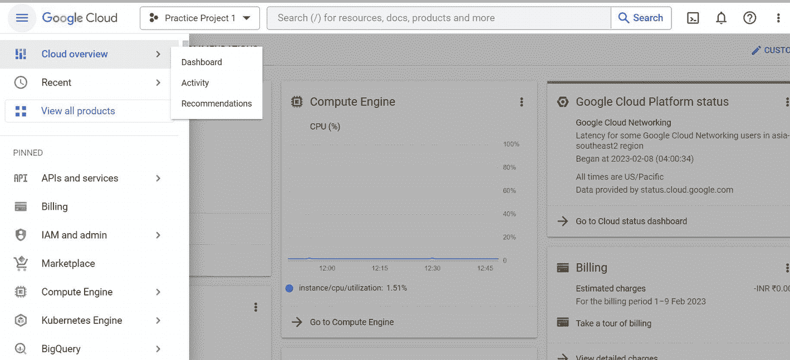

**图 3-16** 控制台

现在您可以访问 Google Cloud 服务了。转到搜索框并输入 `Vertex AI`，您将看到以下屏幕。

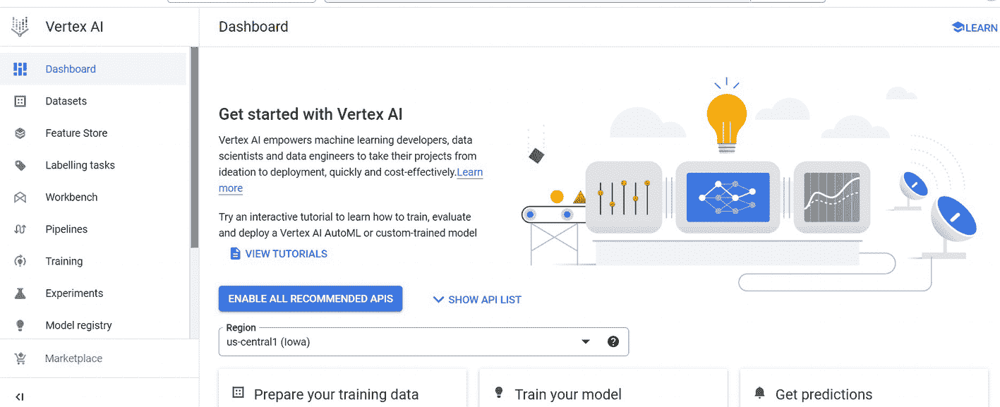

**图 3-17** Vertex AI 仪表板

### Vertex AI 中的用户管理型笔记本实例

`Vertex AI` 中的用户管理型笔记本实例提供了一个专用且可定制的环境，用于运行数据科学和机器学习任务。此类实例的主要用途是为数据科学家和机器学习工程师提供一个独立且可扩展的环境，用于开发和试验他们的模型。

在 `Vertex AI` 中使用用户管理型笔记本实例的一些好处包括：

1. **可定制性**：用户对实例拥有完全控制权，可以安装和配置其工作所需的工具和软件包。


2. **可扩展性**：可根据用户任务的计算需求调整实例大小。

3. **协作**：多个用户可以访问并操作同一实例，从而更轻松地协作完成项目。

4. **可移植性**：实例可以保存和导出，使用户能够将工作迁移到不同平台或与他人共享。

5. **与其他 Vertex AI 服务集成**：用户管理的笔记本实例可以轻松与 Vertex AI 的其他服务（如存储和部署）集成，从而构建完整的机器学习工作流。

Vertex AI 中的用户管理笔记本实例为运行数据科学和机器学习任务提供了灵活而强大的环境。

**以下是创建用户管理笔记本实例的方法。**

以下是创建用户管理笔记本实例的逐步方法。

1. 创建一个新项目，或选择一个您拥有相关权限的现有项目。

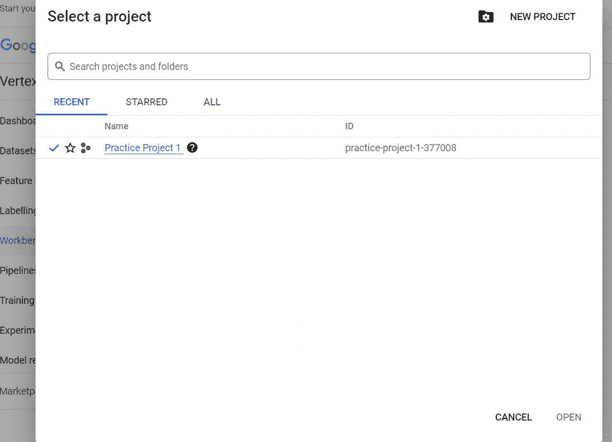

Google Cloud 页面的屏幕截图被一个选择项目窗口覆盖。它显示了可用实践项目的列表。

图 3-18

选择项目

1. 启用 `Notebooks API`。


屏幕截图显示了 `Notebook API` 的产品详情，其中“启用”按钮被高亮显示。

图 3-19

启用 `Notebook API`

1. 启动 `Vertex AI Workbench`。

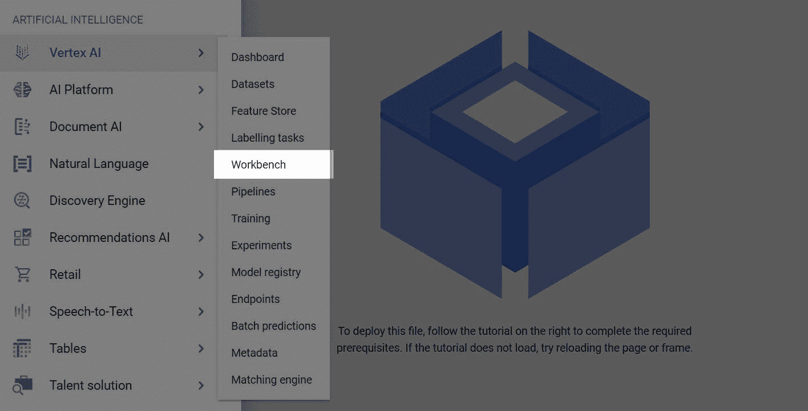

窗口屏幕截图高亮显示了人工智能下的 `Vertex AI` 选项。它显示了一个下拉菜单，其中选择了 `Workbench`。

图 3-20

启动 `Vertex AI Workbench`

1. 导航到 `Vertex AI Workbench` 用户管理的笔记本。

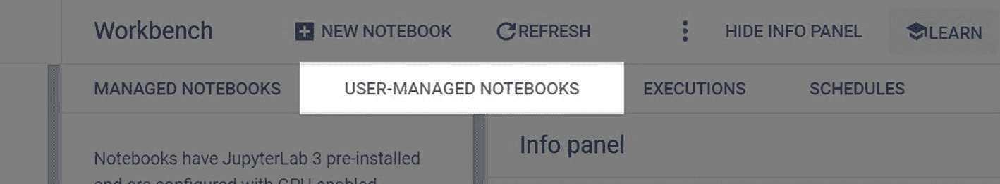

Big Sandbox 窗口的屏幕截图被用户管理的笔记本选项覆盖。

图 3-21

用户管理的笔记本

1. 创建一个实例。

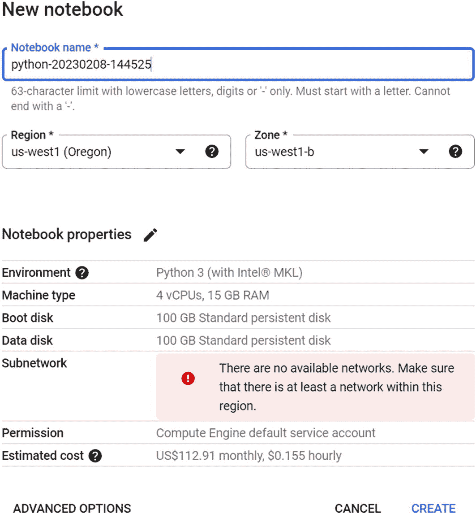

页面屏幕截图显示了新的笔记本界面。它列出了新笔记本名称、区域、可用区和笔记本属性，其中“创建”按钮被高亮显示。

图 3-22

创建新的笔记本实例

您应该能够看到以下窗口。

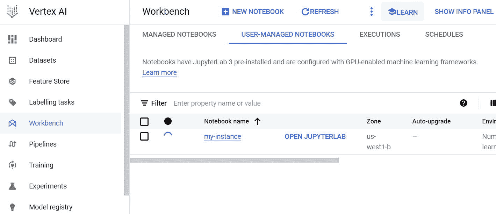

页面屏幕截图显示了 `Vertex AI` 下的一个下拉菜单，其中选择了 `Workbench`。它显示了用户管理的笔记本下的选项。

图 3-23

已创建用户管理的笔记本实例

1. 点击 `OPEN JUPYTERLAB`。

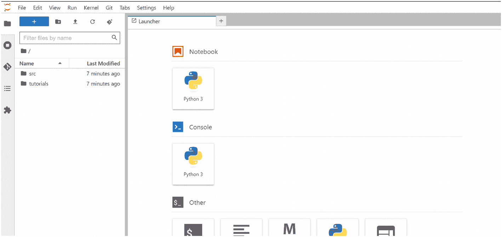

窗口屏幕截图显示了一个启动器框，其中包含笔记本、控制台和其他选项。

图 3-24

打开新的 Jupyter 实例

**Cloud Storage 存储桶** 是用于在云端存储数据的容器。它是一个中央存储库，可用于从多个位置和应用程序存储和访问数据。

在 Vertex AI 中，Cloud Storage 存储桶用于存储训练机器学习模型所需的数据，并在模型部署后存储模型本身。Cloud Storage 存储桶在 Vertex AI 中的一些常见用例包括：

1. **存储训练数据**：用于训练机器学习模型的数据集可以存储在 Cloud Storage 存储桶中，以便于访问和管理。

2. **保存模型输出**：训练模型的输出，例如训练好的权重和模型工件，可以保存在 Cloud Storage 存储桶中供将来使用。

3. **提供模型服务**：部署的模型可以存储在 Cloud Storage 存储桶中，并通过 `REST API` 提供给最终用户。

4. **协作**：通过能够在多个用户之间共享 Cloud Storage 存储桶，项目协作变得更加方便。

Cloud Storage 存储桶在 Vertex AI 的机器学习工作流中扮演着至关重要的角色，作为存储和检索数据及模型的集中式存储库。它们是机器学习过程顺利运行中不可或缺的组成部分。

**以下是创建 Cloud Storage 存储桶的方法：**

1. 打开 Google Cloud 控制台导航菜单，然后选择 `Cloud Storage`。

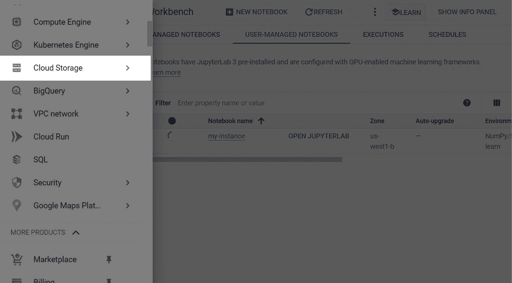

窗口屏幕截图高亮显示了 `Cloud Storage` 选项。

图 3-25

`Cloud Storage`

1. 点击 `CREATE`。

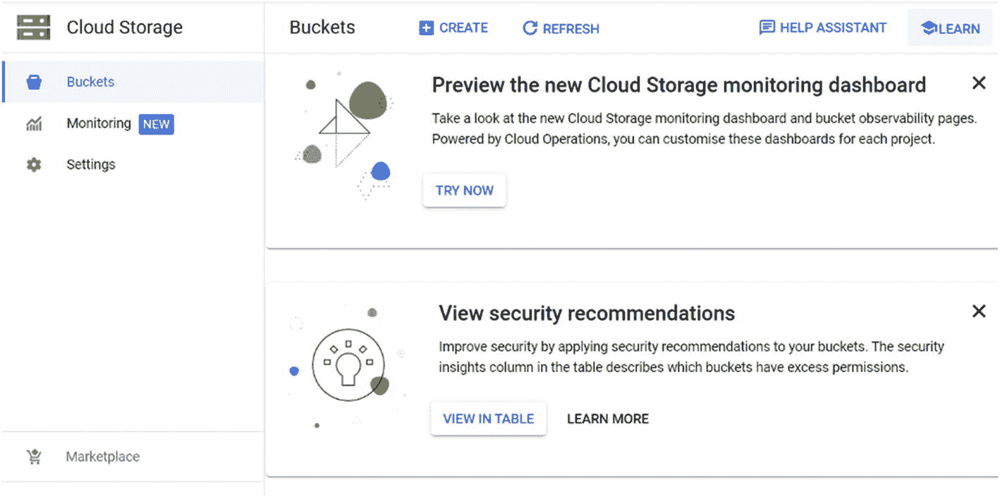

窗口屏幕截图显示了存储桶选项的选择。它显示了云存储的预览和安全建议。

图 3-26

存储桶

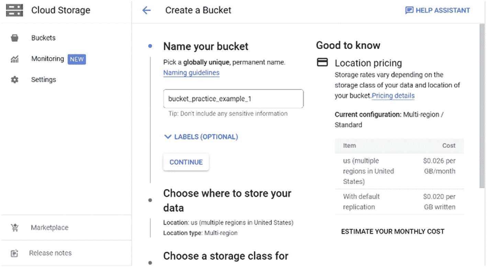

窗口屏幕截图显示了带有 3 个选项的云存储。它显示了创建存储桶页面，包含名称、位置和存储类别。

图 3-27

新建存储桶

1. 为存储桶输入一个唯一名称，选择所需的区域，并选择所需的存储类别，例如标准存储或低频访问存储。配置任何其他设置，例如版本控制和生命周期规则。点击 `Create` 按钮创建存储桶。

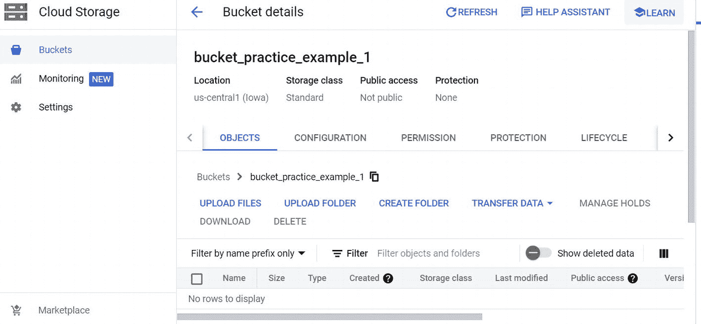

窗口屏幕截图显示了存储桶选项的选择。它在对象选项卡下显示了已创建的存储桶详情。

图 3-28

`Cloud Storage` — 新建存储桶

1. 创建存储桶后，您可以开始上传和访问其中的数据。

**自定义训练模型** 是一种机器学习模型，它根据自定义数据专门训练以执行特定任务，例如图像分类、目标检测或自然语言处理。

自定义训练模型通常是为了解决预训练模型无法满足的特定业务需求，或为了提高现有模型的性能而创建的。它们使用大量相关数据进行训练，这些数据用于训练模型如何执行所需任务。

在 Vertex AI 中，可以使用多种机器学习框架（例如 `TensorFlow`、`PyTorch` 和 `scikit-learn`）创建自定义训练模型。该过程通常涉及定义模型架构、准备训练数据，以及使用梯度下降或反向传播等算法训练模型。

创建自定义训练模型后，可以将其部署并集成到应用程序中，以执行所需任务，例如对新数据进行预测或识别模式。

自定义训练模型是 Vertex AI 中机器学习工作流的重要组成部分，为解决特定业务问题提供了灵活而强大的解决方案。

**以下是创建自定义训练模型的方法：**

1. 项目设置。

2. 设置 Vertex AI。

3. 要创建 `AutoML` 机器学习模型，请开启 `Vertex AI API`。

4. 转到 `Vertex AI 模型注册表`。

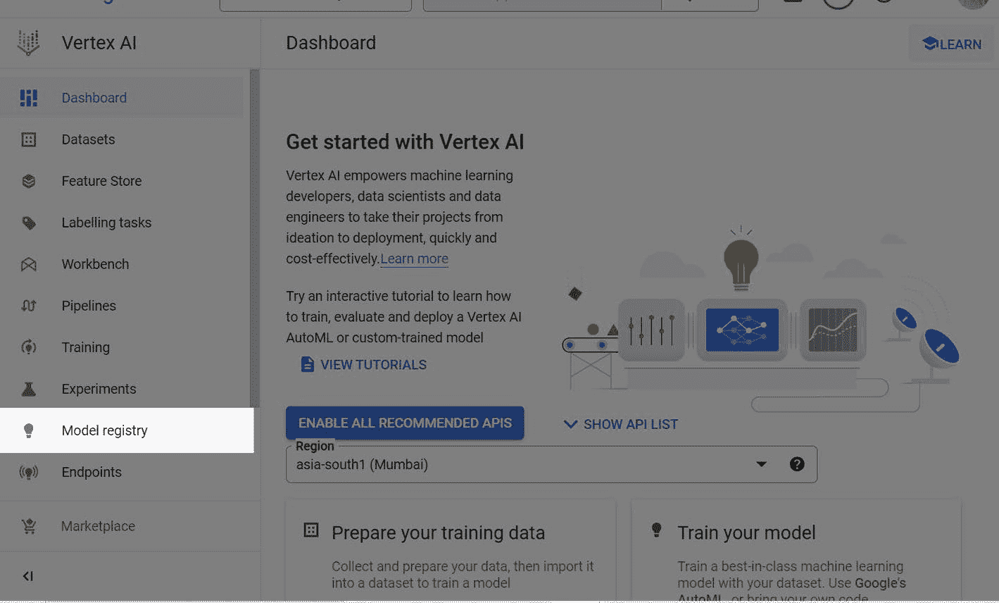

屏幕截图高亮显示了 `Vertex AI` 下的 `model registry` 选项。

图 3-29

`Vertex AI 模型注册表`

1. 创建一个自定义训练模型。

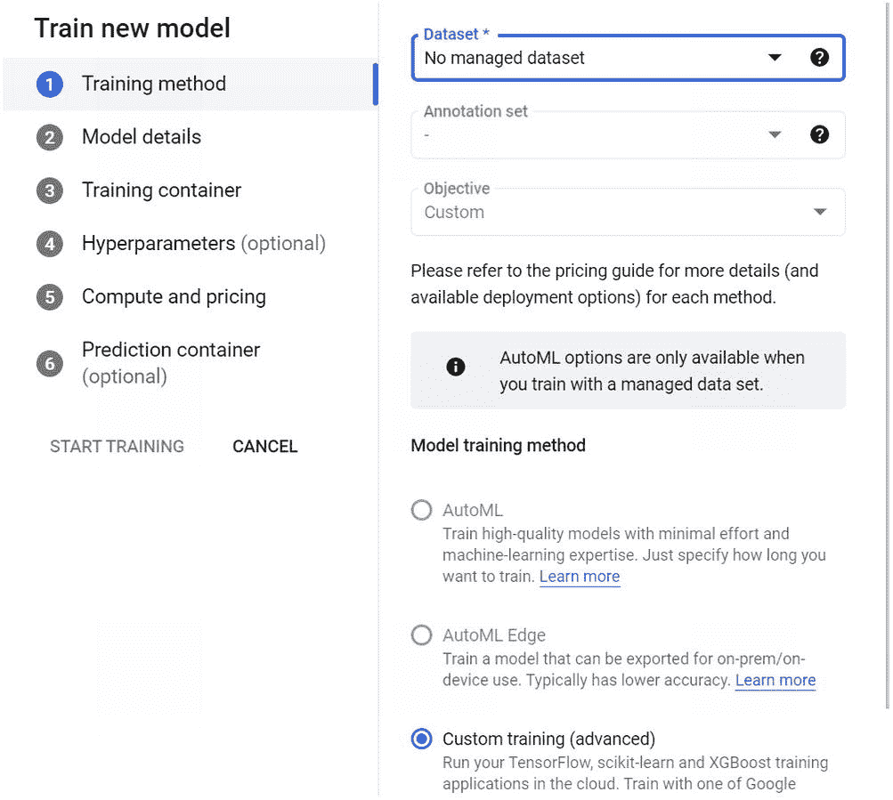

Big Query Sandbox 窗口的屏幕截图显示了 `train new model` 下的一个下拉菜单，其中选择了训练方法选项。它列出了训练新模型需要填写的字段。

图 3-30

训练新模型

1. 点击 `Continue`。

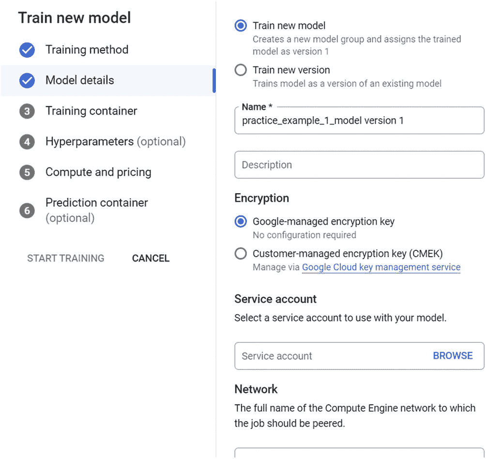

Big Query Sandbox 窗口的屏幕截图显示了 `train new model` 下的一个下拉菜单，其中选择了模型详情选项。它列出了创建新项目时需要填写的字段。

图 3-31

模型详情

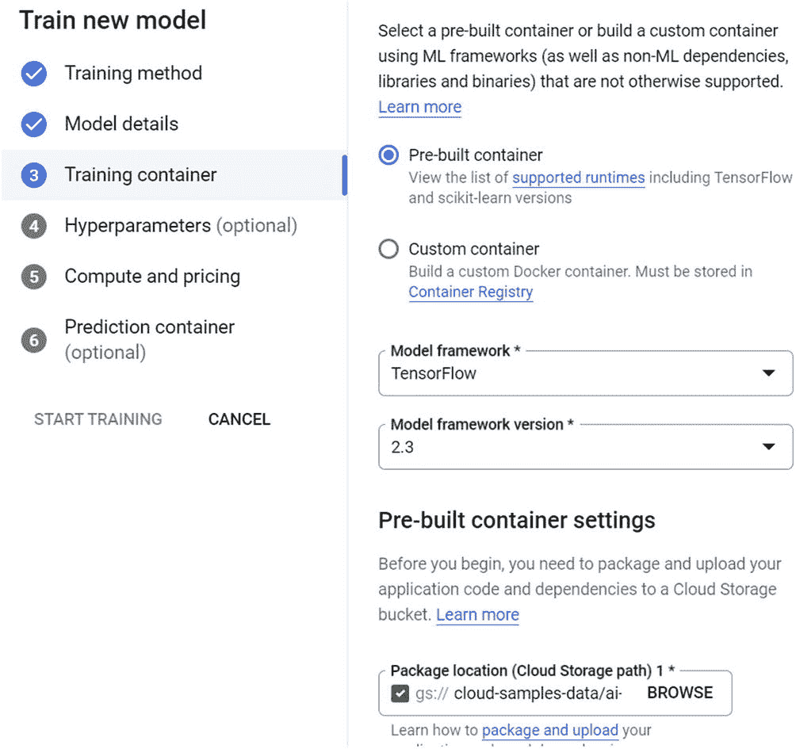


### BigQuery Sandbox 训练容器

BigQuery Sandbox 窗口的截图显示“训练新模型”下的下拉菜单，其中选择了“训练容器”选项。它列出了预构建的容器设置。

**图 3-32** 训练容器

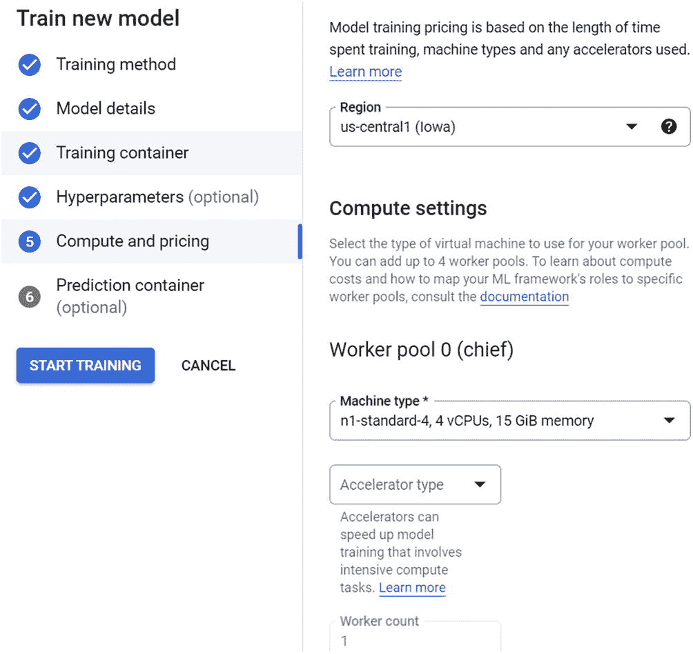

BigQuery Sandbox 窗口的截图显示“训练新模型”下的下拉菜单，其中选择了“计算和定价”选项。它列出了计算设置。

**图 3-33** 计算和定价

如果一切顺利，一段时间后，模型将出现在“训练”菜单中，如下所示。

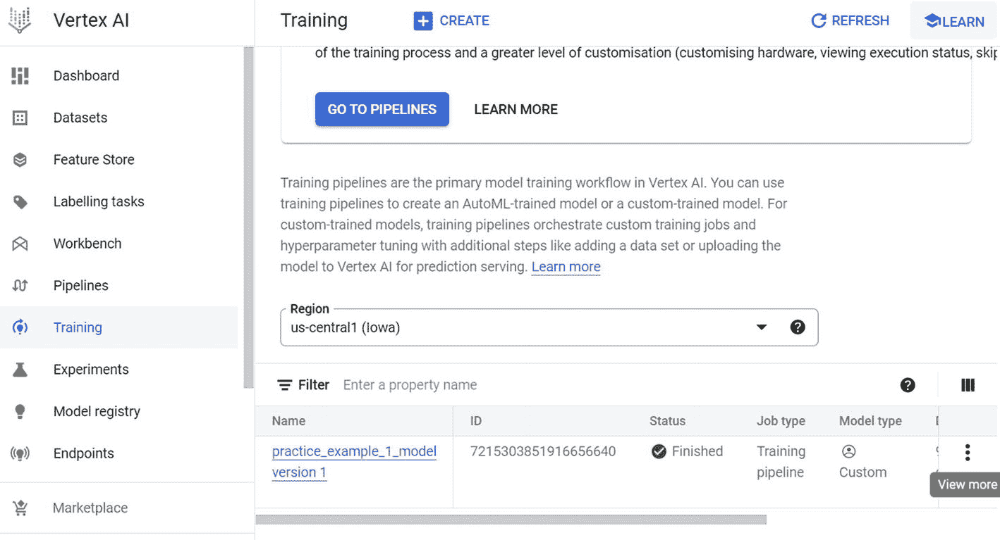

BigQuery Sandbox 窗口的截图显示“Vertex AI”下的下拉菜单，其中选择了“训练”选项。它列出了模型训练窗口，并突出显示了“转到流水线”按钮。

**图 3-34** 模型训练窗口

1.  要部署和测试自定义训练的模型，请打开 Cloud Shell。

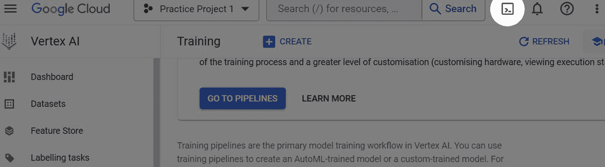

Google Cloud 窗口的截图突出显示了右上角的“打开 Cloud Shell”图标。

**图 3-35** 打开 Cloud Shell

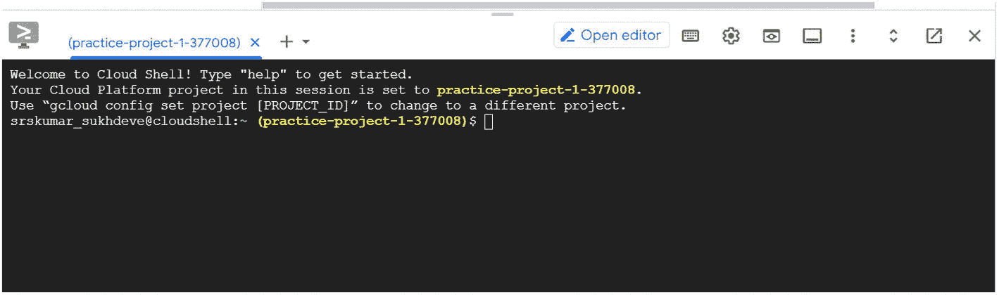

创建的 Cloud Shell 工作区截图显示了一组程序代码，这些代码显示一条消息，表明练习项目文件已创建。

**图 3-36** Cloud Shell

2.  转到“模型注册表” → “部署和测试”。

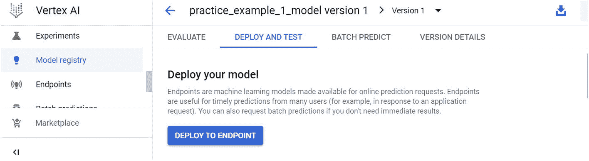

BigQuery Sandbox 窗口的截图显示“Vertex AI”下的下拉菜单，其中选择了“模型注册表”选项。它显示了创建的查询，并在“部署和测试”选项卡下突出显示了“部署到端点”按钮。

**图 3-37** 部署和测试

3.  在以下位置填写必要的详细信息。

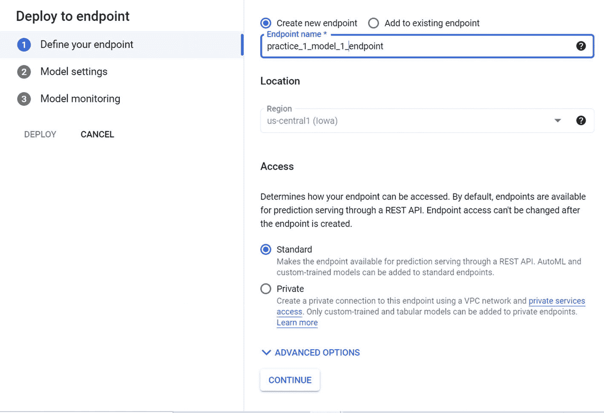

窗口的截图显示“部署到端点”下的下拉菜单，其中选择了“定义你的端点”选项。它显示了位置和访问设置。

**图 3-38** 部署到端点

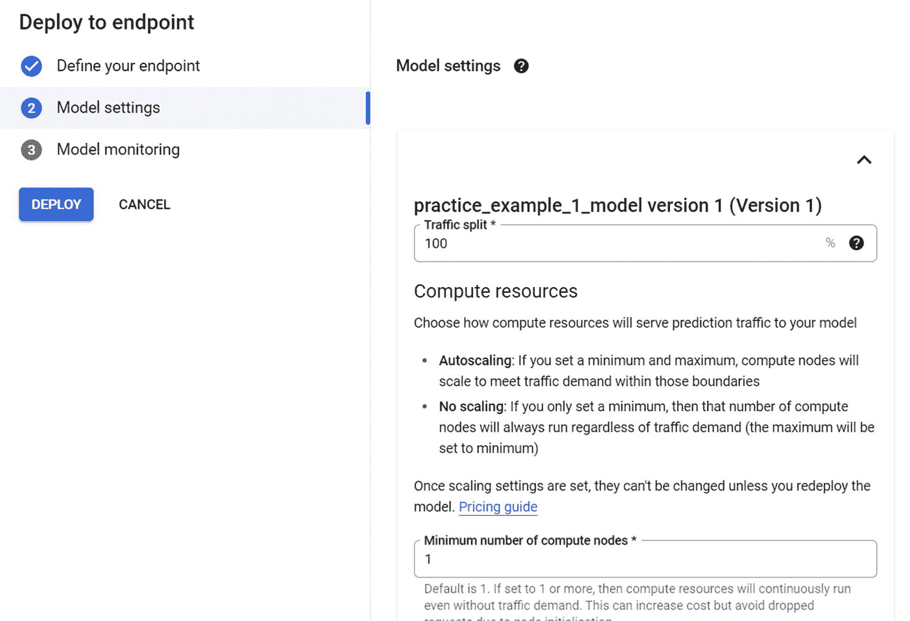

窗口的截图显示“部署到端点”下的下拉菜单，其中选择了“模型设置”选项。它显示了模型设置。

**图 3-39** 模型设置

4.  一旦成功，您将看到以下窗口。

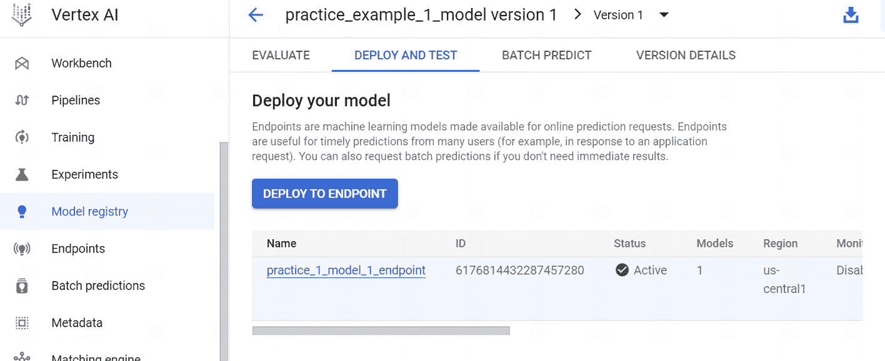

窗口的截图显示“Vertex AI”下的下拉菜单，其中选择了“模型注册表”选项。它显示了创建的查询，并在“部署和测试”选项卡下突出显示了“部署到端点”按钮。

**图 3-40** 模型部署到端点

5.  转到“示例请求”。

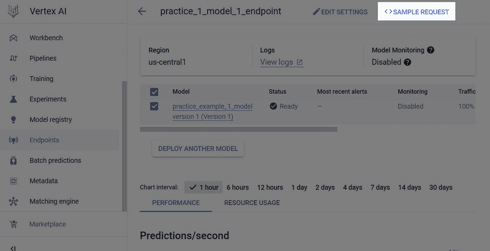

Google Cloud 窗口的截图突出显示了右上角的“示例请求”按钮。

**图 3-41** 导航到“示例请求”

您将看到以下窗口。

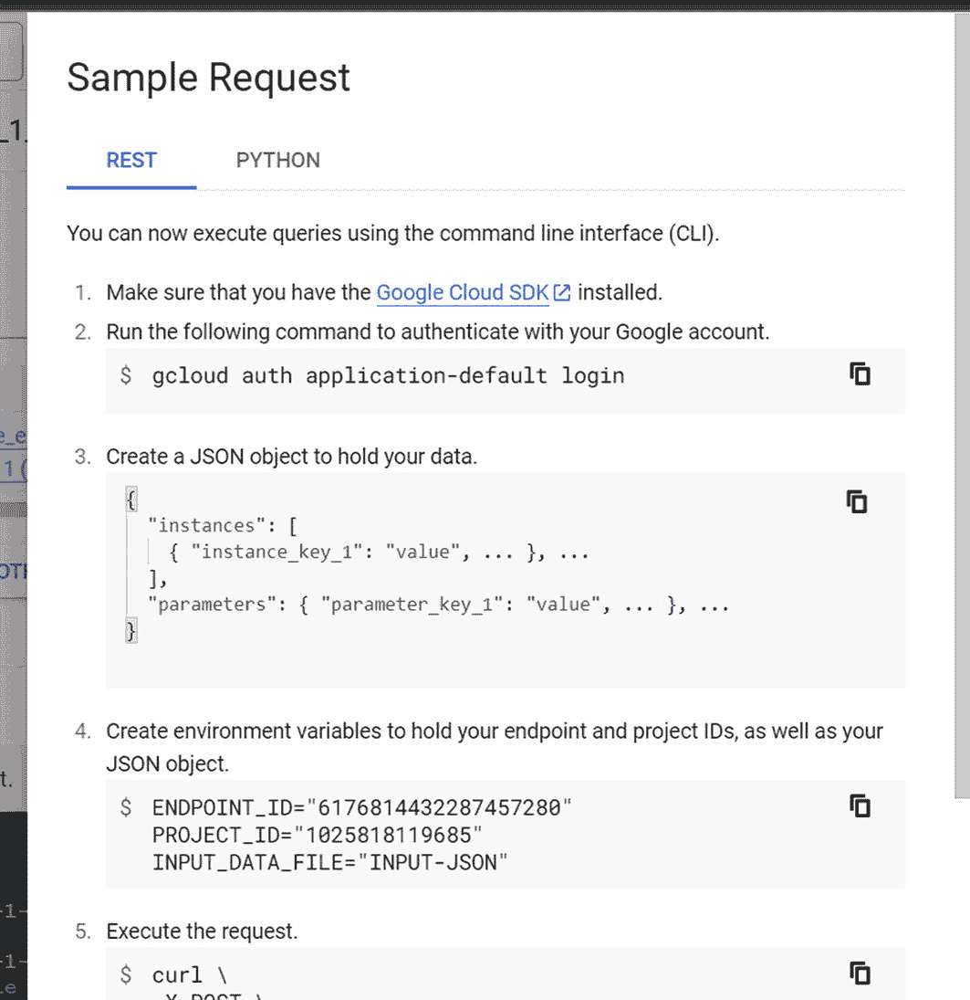

窗口的截图被“示例请求”弹出框覆盖。它列出了“REST”选项卡下的选项，用于在命令行界面下执行查询。

**图 3-42** 示例请求

6.  通过单击复制图标复制上图中的第 4 点内容，并将其粘贴到 Shell 窗口中，如下所示。

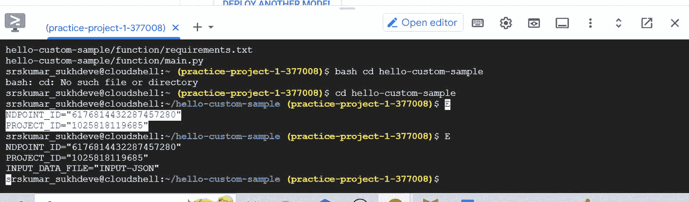

Shell 窗口的截图显示了一组程序代码，这些代码运行查询，并突出显示了创建的端点和项目 ID。

**图 3-43** 带有环境变量的 Shell 窗口

完成此步骤后，您的模型将部署在端点，并准备好与任何应用程序连接以共享预测。

**注意**

本章中使用的所有服务都是收费的。如果您不再需要这些资源，请检查您的账单并释放资源。

### 使用 Vertex AI 和 Python SDK 训练模型

在这里，我们将使用 Vertex AI SDK for Python 创建一个自定义训练的机器学习模型。本节适用于喜欢使用笔记本、Python 和机器学习工作流的数据科学家。要使用 Vertex AI 和 Python SDK 训练机器学习模型，您需要满足以下先决条件：

1.  **Google Cloud 账户**：要继续，必须拥有一个 Google Cloud 账户。如果您没有，可以通过访问以下链接创建账户或登录：[`https://console.cloud.google.com/`](https://console.cloud.google.com/)。如果您需要有关如何创建 Google Cloud 账户的指导，请参考本材料的早期章节。

2.  **Google Cloud 项目**：如果您没有项目，请使用链接 [`https://console.cloud.google.com/cloud-resource-manager`](https://console.cloud.google.com/cloud-resource-manager) 创建一个。按照前面章节的讨论填写详细信息。如果您已经创建了项目，请转到控制台欢迎屏幕并找到项目 ID，以便稍后在此实验中使用。

3.  **Vertex AI JupyterLab 笔记本**：按照前面提供的步骤创建用户管理的笔记本实例。

4.  **打开您的笔记本**：如果您在 Google Cloud 控制台中，请在搜索框中搜索 `Vertex AI`。


Google Cloud 窗口的截图显示了 `Vertex AI` 的搜索结果。

**图 3-44** 搜索 `Vertex AI`

单击 `Vertex AI`。进入 `Vertex AI` 后，转到 **Workbench**。


Google Cloud 窗口的截图列出了 `Vertex AI` 下的下拉菜单，其中选择了 `Workbench` 选项。它在“用户管理的笔记本”选项卡下显示了创建的实例。

**图 3-45** 打开“用户管理的笔记本”

单击 **OPEN JUPYTERLAB**，您将看到以下屏幕。


Sandbox 窗口的截图被启动器窗口覆盖，该窗口显示了笔记本、控制台和其他应用程序。

**图 3-46** JupyterLab

现在，在笔记本下，单击 `Python 3`。您可以根据自己的喜好重命名笔记本。


Sandbox 窗口的截图显示了创建的笔记本，可以通过单击 `Python 3` 选项来重命名。

**图 3-47** Python 笔记本

要使用 Vertex AI 和 Python SDK 训练机器学习模型，您需要执行以下步骤：

1.  **安装 Vertex AI Python 包**：在笔记本中使用以下代码：

```python
#### 安装 Vertex AI SDK
! pip3 install --upgrade --quiet google-cloud-aiplatform
```

执行上述代码后，Vertex AI Python SDK 及其所有依赖项也会被安装。其中两个依赖项是 Cloud Storage 和 BigQuery。`--quiet` 标志用于抑制输出，以便仅在有错误时显示错误。感叹号（`!`）是 shell 命令的指示符。

您可以通过使用“运行所选单元格并前进”或使用键盘快捷键 `Shift+Enter` 来运行代码。

2.  **设置项目 ID**：第一行代码为 Vertex AI 平台设置项目 ID。项目 ID 是 Google Cloud 控制台中项目的唯一标识符。项目 ID 使用以下代码设置：

```python
import os
project_id = " MY_PROJECT_ID "
os.environ["GOOGLE_CLOUD_PROJECT"] = project_id
```

在这里，项目 ID 存储在 `project_id` 变量中，并设置为 `gcloud` 环境中的活动项目。

3.  **设置区域**：下一行代码为 Vertex AI 平台设置区域。这是 Vertex AI 资源将被创建和存储的位置。区域使用以下代码设置：

```python
region = "us-central1"
```


### 4. **创建存储桶**：随后，代码会为 Vertex AI 平台创建一个新的 Google Cloud Storage 存储桶，用于存储其数据。代码提供了一个默认名称，但会使用时间戳来确保名称的唯一性，以防默认名称已被占用。创建存储桶的代码如下：

```
bucket_name = "bucket-name-placeholder"  # @param {type:"string"}
bucket_uri = f"gs://{bucket_name}"
from datetime import datetime
timestamp = datetime.now().strftime("%Y%m%d%H%M%S")
if bucket_name == "" or bucket_name is None or bucket_name == "bucket-name-placeholder":
    bucket_name = project_id + "aip-" + timestamp
    bucket_uri = "gs://" + bucket_name
from google.cloud import storage
client = storage.Client(project=project_id)
# Create a bucket
bucket = client.create_bucket(bucket_name, location=region)
print("Bucket {} created.".format(bucket.name))
```

此处定义了 `bucket_name` 和 `bucket_uri`，并使用时间戳为存储桶创建唯一名称。然后，使用项目 ID 创建一个 Google Cloud Storage 客户端，并通过该客户端以及指定的名称和区域创建新的存储桶。

### 初始化 Vertex AI SDK for Python。

以下代码初始化了 Vertex AI SDK，该 SDK 提供了对 Vertex AI 平台及其功能的访问：

```
from google.cloud import aiplatform
# Initialize the Vertex AI SDK
aiplatform.init(project=project_id, location=region, staging_bucket=bucket_uri)
```

第一行从 `google.cloud` 库中导入了 `aiplatform` 模块，该模块提供了对 Vertex AI API 的访问。

随后，使用三个参数调用了 `aiplatform.init` 方法：`project`、`location` 和 `staging_bucket`。`project` 参数是用于访问 Vertex AI 平台的 Google Cloud 项目 ID。`location` 参数是创建 Vertex AI 平台资源的地理位置。`staging_bucket` 参数是 Google Cloud Storage 存储桶的 URI，用于在模型训练和部署期间存储中间数据。

此代码建立了与 Vertex AI 平台的连接，并为其在您的应用程序中使用做好了准备。

### 初始化 BigQuery。

以下代码设置了一个 BigQuery 客户端，用于访问指定项目中的 BigQuery 数据存储和分析服务：

```
from google.cloud import bigquery
# Set up BigQuery client
bq_client = bigquery.Client(project=project_id)
```

第一行从 `google.cloud` 库中导入了 `bigquery` 模块，该模块提供了对 BigQuery API 的访问。

然后，使用 `project_id` 变量作为参数，将 `bq_client` 变量定义为 `bigquery.Client` 类的一个实例。这将创建一个客户端对象，用于与指定项目的 BigQuery API 进行交互。

提供的代码建立了 BigQuery 客户端，从而能够访问和操作存储在 BigQuery 中的数据。它赋予了执行查询、执行数据分析操作以及在 BigQuery 环境中执行与数据管理相关的各种任务的能力。

### 创建 Vertex AI 表格数据集。

以下代码正在对来自 BigQuery 的数据集进行预处理。它首先从 BigQuery 源数据集（`BQ_SOURCE`，即 `"bigquery-public-data.ml_datasets.penguins"`）中检索一个表。然后，将数据加载到一个 Pandas DataFrame（`df`）中。

接下来，代码将数据集中与 `NA_VALUES` 列表（`"NA"`、`"."`）中定义的值匹配的任何值替换为 `NaN`，并删除所有包含 `NaN` 值的行。此步骤用于清理数据并移除不可用的行。

下一步涉及将分类列转换为数值。对于三个分类列（`island`、`species` 和 `sex`），代码使用 Pandas 的 `factorize` 方法将这些列中的字符串转换为整数。`factorize` 方法为每一列返回一个新的序列和一个唯一值数组。

然后，数据被分成两个独立的数据帧：`df_train` 和 `df_for_prediction`。`df_train` 包含 80% 的数据，用于训练目的；而 `df_for_prediction` 包含剩余的 20% 数据，用于预测。

最后，代码为这三个列分别创建了一个字典，将数值映射回其字符串表示形式。这些字典分别是 `index_to_island`、`index_to_species` 和 `index_to_sex`。然后打印这些字典以验证其值：

```
import numpy as np
import pandas as pd
LABEL_COLUMN = "species"
# Define the BigQuery source dataset
BQ_SOURCE = "bigquery-public-data.ml_datasets.penguins"
# Define NA values
NA_VALUES = ["NA", "."]
# Download a table
table = bq_client.get_table(BQ_SOURCE)
df = bq_client.list_rows(table).to_dataframe()
# Drop unusable rows
df = df.replace(to_replace=NA_VALUES, value=np.NaN).dropna()
# Convert categorical columns to numeric
df["island"], island_values = pd.factorize(df["island"])
df["species"], species_values = pd.factorize(df["species"])
df["sex"], sex_values = pd.factorize(df["sex"])
# Split into a training and holdout dataset
df_train = df.sample(frac=0.8, random_state=100)
df_for_prediction = df[~df.index.isin(df_train.index)]
# Map numeric values to string values
index_to_island = dict(enumerate(island_values))
index_to_species = dict(enumerate(species_values))
index_to_sex = dict(enumerate(sex_values))
# View the mapped island, species, and sex data
print(index_to_island)
print(index_to_species)
print(index_to_sex)
```

### 创建 BigQuery 数据集。

在以下代码片段中：

1.  代码行 `bq_dataset_id = f"{project_id}.dataset_id_unique"` 通过连接 `project_id` 变量和字符串 `".dataset_id_unique"` 创建了一个表示 BigQuery 数据集 ID 的字符串。
2.  代码行 `bq_dataset = bigquery.Dataset(bq_dataset_id)` 使用数据集 ID 字符串创建了一个 BigQuery 数据集对象。
3.  代码行 `bq_client.create_dataset(bq_dataset, exists_ok=True)` 使用 BigQuery 客户端 `bq_client` 在 BigQuery 上创建数据集。`exists_ok` 参数设置为 `True`，这意味着如果具有相同 ID 的数据集已存在，该方法不会引发错误；相反，它会继续执行代码：

```
# Create a BigQuery dataset
bq_dataset_id = f"{project_id}.dataset_id_unique"
bq_dataset = bigquery.Dataset(bq_dataset_id)
bq_client.create_dataset(bq_dataset, exists_ok=True)
```

#### 创建 Vertex AI 表格数据集

以下代码使用 `df_train` Pandas DataFrame 创建了一个 Vertex AI 表格数据集。`df_train` DataFrame 中的数据将用于创建该表格数据集。该数据集将存储在一个标识符为 `"bq://{bq_dataset_id}.table-unique"` 的 BigQuery 表中，其显示名称为 `"sample-penguins"`。

使用 `aiplatform.TabularDataset.create_from_dataframe` 方法从 `df_train` DataFrame 创建表格数据集。该方法接受三个参数：

- `df_source`：包含用于创建表格数据集的数据的 Pandas DataFrame。
- `staging_path`：数据将存储到的 BigQuery 表的路径。
- `display_name`：表格数据集的显示名称。

`bq_dataset_id` 变量用于创建 BigQuery 数据集的标识符。该标识符是一个格式为 `"{project_id}.dataset_id_unique"` 的字符串。使用 `bigquery.Dataset` 类创建一个 BigQuery 数据集对象，并使用 `bq_client.create_dataset` 方法通过 `bq_dataset` 对象在 BigQuery 中创建数据集。向 `bq_client.create_dataset` 方法传递了 `exists_ok=True` 参数，以指示如果数据集已存在，则不应引发错误，而应直接返回现有数据集。


#### 创建 Vertex AI 表格数据集
```python
dataset = aiplatform.TabularDataset.create_from_dataframe(
    df_source=df_train,
    staging_path=f"bq://{bq_dataset_id}.table-unique",
    display_name="sample-penguins",
)
```

### 创建训练脚本

1. `import argparse` 导入 `argparse` 模块，用于解析传递给脚本的命令行参数。
2. `import numpy as np` 导入 `numpy` 模块，并为了方便将其重命名为 `np`。
3. `import os` 导入 `os` 模块，该模块提供了与底层操作系统交互的方法。
4. `import pandas as pd` 导入 `pandas` 模块，并为了方便将其重命名为 `pd`。
5. `import tensorflow as tf` 导入 `tensorflow` 模块，并为了方便将其重命名为 `tf`。
6. `from google.cloud import bigquery` 从 `google.cloud` 包中导入 `bigquery` 模块。
7. `from google.cloud import storage` 从 `google.cloud` 包中导入 `storage` 模块。
8. `training_data_uri = os.getenv("AIP_TRAINING_DATA_URI")` 获取 `AIP_TRAINING_DATA_URI` 环境变量的值，并将其赋值给 `training_data_uri` 变量。
9. `validation_data_uri = os.getenv("AIP_VALIDATION_DATA_URI")` 获取 `AIP_VALIDATION_DATA_URI` 环境变量的值，并将其赋值给 `validation_data_uri` 变量。
10. `test_data_uri = os.getenv("AIP_TEST_DATA_URI")` 获取 `AIP_TEST_DATA_URI` 环境变量的值，并将其赋值给 `test_data_uri` 变量。
11. `parser = argparse.ArgumentParser()` 创建一个 `argparse.ArgumentParser` 类的实例。
12. `parser.add_argument('--label_column', required=True, type=str)` 添加一个必需的命令行参数 `--label_column`，其类型为 `str`。
13. `parser.add_argument('--epochs', default=10, type=int)` 添加一个命令行参数 `--epochs`，默认值为 10，类型为 `int`。
14. `parser.add_argument('--batch_size', default=10, type=int)` 添加一个命令行参数 `--batch_size`，默认值为 10，类型为 `int`。
15. `args = parser.parse_args()` 解析命令行参数，并将它们存储在 `args` 变量中。
16. `LABEL_COLUMN = args.label_column` 将 `LABEL_COLUMN` 变量设置为 `--label_column` 参数的值。
17. `PROJECT_NUMBER = os.environ["CLOUD_ML_PROJECT_ID"]` 获取 `CLOUD_ML_PROJECT_ID` 环境变量的值，并将其赋值给 `PROJECT_NUMBER` 变量。
18. `bq_client = bigquery.Client(project=PROJECT_NUMBER)` 创建一个 `bigquery.Client` 类的实例，并将 `PROJECT_NUMBER` 作为项目参数。

```python
%%writefile task.py
import argparse
import numpy as np
import os
import pandas as pd
import tensorflow as tf
from google.cloud import bigquery
from google.cloud import storage

#### 读取环境变量
training_data_uri = os.getenv("AIP_TRAINING_DATA_URI")
validation_data_uri = os.getenv("AIP_VALIDATION_DATA_URI")
test_data_uri = os.getenv("AIP_TEST_DATA_URI")

#### 读取参数
parser = argparse.ArgumentParser()
parser.add_argument('--label_column', required=True, type=str)
parser.add_argument('--epochs', default=10, type=int)
parser.add_argument('--batch_size', default=10, type=int)
args = parser.parse_args()

#### 设置训练变量
LABEL_COLUMN = args.label_column

# 关于权限问题，请参阅 https://cloud.google.com/vertex-ai/docs/workbench/managed/executor#explicit-project-selection
PROJECT_NUMBER = os.environ["CLOUD_ML_PROJECT_ID"]
bq_client = bigquery.Client(project=PROJECT_NUMBER)
```

接下来，以下代码执行以下步骤：

1. 它定义了一个函数 `download_table`，该函数接受一个 BigQuery 表 URI 作为参数。
2. 在函数内部，第一步是移除 `bq_table_uri` 中可能存在的 `"bq://"` 前缀。
3. 然后，它将 BigQuery 表下载为 Pandas DataFrame。
4. 之后，它使用 `download_table` 函数下载三个独立的数据集 `df_train`、`df_validation` 和 `df_test`。
5. 随后，定义了一个名为 `convert_dataframe_to_dataset` 的函数，该函数接受两个 DataFrame 作为参数。第一个 DataFrame 对应训练数据，第二个 DataFrame 代表验证数据。
6. 在函数内部，第一步是分离输入数据和标签数据。这是通过使用 `.pop` 方法完成的。
7. 然后将输入数据转换为 Numpy 数组，并使用 `tf.keras.utils.to_categorical` 将标签数据转换为独热表示。
8. 最后，使用 `tf.data.Dataset.from_tensor_slices` 将训练数据和验证数据都转换为 TensorFlow 数据集。
9. 最终，该函数返回训练数据和验证数据的 TensorFlow 数据集。
10. 代码随后调用 `convert_dataframe_to_dataset` 函数，并将 `df_train` 和 `df_validation` 作为参数，以创建 `dataset_train` 和 `dataset_validation` 数据集。

```python
#### 下载一个表
def download_table(bq_table_uri: str):
    # 如果存在，移除 bq:// 前缀
    prefix = "bq://"
    if bq_table_uri.startswith(prefix):
        bq_table_uri = bq_table_uri[len(prefix) :]

    # 将 BigQuery 表下载为 dataframe
    # 这需要在自定义训练服务账号上拥有 "BigQuery Read Session User" 角色。
    table = bq_client.get_table(bq_table_uri)
    return bq_client.list_rows(table).to_dataframe()

#### 下载数据集拆分
df_train = download_table(training_data_uri)
df_validation = download_table(validation_data_uri)
df_test = download_table(test_data_uri)

def convert_dataframe_to_dataset(
    df_train: pd.DataFrame,
    df_validation: pd.DataFrame,
):
    df_train_x, df_train_y = df_train, df_train.pop(LABEL_COLUMN)
    df_validation_x, df_validation_y = df_validation, df_validation.pop(LABEL_COLUMN)

    y_train = np.asarray(df_train_y).astype("float32")
    y_validation = np.asarray(df_validation_y).astype("float32")

    # 转换为 numpy 表示
    x_train = np.asarray(df_train_x)
    x_test = np.asarray(df_validation_x)

    # 转换为独热表示
    num_species = len(df_train_y.unique())
    y_train = tf.keras.utils.to_categorical(y_train, num_classes=num_species)
    y_validation = tf.keras.utils.to_categorical(y_validation, num_classes=num_species)

    dataset_train = tf.data.Dataset.from_tensor_slices((x_train, y_train))
    dataset_validation = tf.data.Dataset.from_tensor_slices((x_test, y_validation))

    return (dataset_train, dataset_validation)

#### 创建数据集
dataset_train, dataset_validation = convert_dataframe_to_dataset(df_train, df_validation)
```

接下来，以下代码是一个用于训练机器学习模型的脚本。它包含以下步骤：

1. **打乱训练集**：使用 `tf.data.Dataset` 类的 `shuffle` 函数对 `dataset_train` 进行打乱。`shuffle` 的参数是 `df_train` 数据框中的元素数量。
2. **创建模型**：`create_model` 函数使用 TensorFlow 的 `Sequential` 类创建模型架构。该架构包含五个使用 ReLU 激活函数的全连接层和一个 softmax 输出层。第一层有 100 个神经元，第二层有 75 个神经元，第三层有 50 个神经元，第四层有 25 个神经元，输出层有三个神经元，代表类别数量。模型使用 `Sequential` 类的 `compile` 函数进行编译，使用分类交叉熵损失、准确率指标和 RMSprop 优化器。
3. **批量处理数据集**：使用 `tf.data.Dataset` 类的 `batch` 函数，以指定的批次大小对 `dataset_train` 和 `dataset_validation` 数据集进行分批处理。批次大小通过 `args.batch_size` 参数指定。
4. **训练模型**：使用 `Sequential` 类的 `fit` 函数在 `dataset_train` 数据上训练模型，使用指定的训练轮数 `args.epochs`，并将 `dataset_validation` 作为验证数据。


5. **保存模型**：使用 TensorFlow 的 `tf.saved_model.save` 函数将训练好的模型保存到磁盘，保存路径由 `os.getenv("AIP_MODEL_DIR")` 环境变量指定。

```
#### 打乱训练集
dataset_train = dataset_train.shuffle(len(df_train))
def create_model(num_features):
#### 创建模型
Dense = tf.keras.layers.Dense
model = tf.keras.Sequential(
[
Dense(
100,
activation=tf.nn.relu,
kernel_initializer="uniform",
input_dim=num_features,
),
Dense(75, activation=tf.nn.relu),
Dense(50, activation=tf.nn.relu),
Dense(25, activation=tf.nn.relu),
Dense(3, activation=tf.nn.softmax),
]
)
#### 编译 Keras 模型
optimizer = tf.keras.optimizers.RMSprop(lr=0.001)
model.compile(
loss="categorical_crossentropy", metrics=["accuracy"], optimizer=optimizer
)
return model
#### 创建模型
model = create_model(num_features=dataset_train._flat_shapes[0].dims[0].value)
#### 设置数据集
dataset_train = dataset_train.batch(args.batch_size)
dataset_validation = dataset_validation.batch(args.batch_size)
#### 训练模型
model.fit(dataset_train, epochs=args.epochs, validation_data=dataset_validation)
tf.saved_model.save(model, os.getenv("AIP_MODEL_DIR"))
```

输出将是 `Writing task.py`。

**为训练脚本定义参数。**

以下代码设置了机器学习训练任务的配置：

- 第一行 `JOB_NAME` 将训练任务的名称设置为 `"custom_job_unique"`。
- 接下来的两行 `EPOCHS` 和 `BATCH_SIZE` 指定了训练过程中要使用的轮数和批次大小。
- `CMDARGS` 变量是一个列表，包含将传递给训练脚本的命令行参数。本例中传递了三个命令行参数：
  1. `"--label_column=" + LABEL_COLUMN`：指定包含标签数据的列名。该参数的值取自 `LABEL_COLUMN` 变量。
  2. `"--epochs=" + str(EPOCHS)`：设置训练过程中要使用的轮数。该值取自 `EPOCHS` 变量。
  3. `"--batch_size=" + str(BATCH_SIZE)`：设置训练过程中要使用的批次大小。该值取自 `BATCH_SIZE` 变量。

```
JOB_NAME = "custom_job_unique"
EPOCHS = 20
BATCH_SIZE = 10
CMDARGS = [
"--label_column=" + LABEL_COLUMN,
"--epochs=" + str(EPOCHS),
"--batch_size=" + str(BATCH_SIZE),
]
```

**训练并部署模型。**

以下代码在 Google Cloud AI Platform 上创建了一个自定义训练任务——使用 `aiplatform.CustomTrainingJob` 类来指定训练任务的详细信息。

该训练任务包含以下参数：

- `display_name`：一个字符串，指定训练任务的名称。本例中，值为 `"custom_job_unique"`。
- `script_path`：一个字符串，指定包含训练代码的脚本路径。本例中，值为 `"task.py"`。
- `container_uri`：一个字符串，指定用于训练的 Docker 容器镜像。本例中，值为 `"us-docker.pkg.dev/vertex-ai/training/tf-cpu.2-8:latest"`，这是一个版本为 2.8 的 TensorFlow CPU 镜像。
- `requirements`：一个字符串列表，指定训练所需的 Python 包。本例中，列表包含两个包：`"google-cloud-bigquery>=2.20.0"` 和 `"db-dtypes"`。
- `model_serving_container_image_uri`：一个字符串，指定训练后用于提供模型服务的 Docker 容器镜像。本例中，值为 `"us-docker.pkg.dev/vertex-ai/prediction/tf2-cpu.2-8:latest"`，这是一个用于服务的版本为 2.8 的 TensorFlow CPU 镜像。

代码执行后，`job` 变量将包含 `CustomTrainingJob` 的实例：

```
job = aiplatform.CustomTrainingJob(
display_name=JOB_NAME,
script_path="task.py",
container_uri="us-docker.pkg.dev/vertex-ai/training/tf-cpu.2-8:latest",
requirements=["google-cloud-bigquery>=2.20.0", "db-dtypes"],
model_serving_container_image_uri="us-docker.pkg.dev/vertex-ai/prediction/tf2-cpu.2-8:latest",
)
```

在以下代码片段中，`MODEL_DISPLAY_NAME` 变量被定义为 `"penguins_model_unique"`。此字符串用作训练过程中将创建的 AI Platform 模型的显示名称。

然后，代码调用了 `job` 对象上的 `run` 方法，该对象代表 AI Platform 中的一个自定义训练任务。`run` 方法用于启动训练过程。

传递给 `run` 方法的参数如下：

- `dataset`：一个 BigQuery 数据集对象，代表用于训练的数据。
- `model_display_name`：一个字符串，代表训练期间将创建的 AI Platform 模型的显示名称。此字符串被赋值为 `MODEL_DISPLAY_NAME` 变量的值。
- `bigquery_destination`：一个字符串，代表在 BigQuery 中存储 AI Platform 模型的目标位置。目标位置指定为 BigQuery URI，并使用 `project_id` 变量来构建该 URI。
- `args`：一个字符串列表，代表要传递给自定义训练脚本的命令行参数。此参数的值被赋值为 `CMDARGS` 变量的值，该变量是一个字符串列表，定义了要使用的标签列、训练轮数和批次大小。

```
MODEL_DISPLAY_NAME = "penguins_model_unique"
#### 启动训练并创建模型
model = job.run(
dataset=dataset,
model_display_name=MODEL_DISPLAY_NAME,
bigquery_destination=f"bq://{project_id}",
args=CMDARGS,
)
```

等待直到你看到输出 `CustomTrainingJob run completed`。

以下代码定义了一个变量 `DEPLOYED_NAME`，它被赋值为字符串 `"penguins_deployed_unique"`。这是已部署模型的显示名称。

然后，代码调用了 `model` 对象上的 `deploy` 方法，并将已部署模型的显示名称作为参数传递。`deploy` 方法创建一个端点，用于基于训练好的模型提供预测。该端点以显示名称 `DEPLOYED_NAME` 保存，并作为 `endpoint` 变量返回：

```
DEPLOYED_NAME = "penguins_deployed_unique"
endpoint = model.deploy(deployed_model_display_name=DEPLOYED_NAME)
```

**进行预测。**

**准备预测测试数据**：以下代码从数据框 `df_for_prediction` 中移除了 `"species"` 列。这可能是因为物种列是模型训练要预测的标签或目标列。使用训练好的模型进行预测时不需要物种列。

接下来，代码将数据框 `df_for_prediction` 转换为 Python 列表 `test_data_list`。这可能是为了准备数据以使用部署的模型进行预测。使用数据框的 `values` 属性将数据框转换为 Numpy 数组，然后使用 `tolist()` 方法将 Numpy 数组转换为列表：

```
#### 移除物种列
df_for_prediction.pop(LABEL_COLUMN)
#### 将数据转换为 Python 列表
test_data_list = df_for_prediction.values.tolist()
```

**发送预测请求：** 最后，代码通过调用 `endpoint` 上的 `predict()` 方法并将 `test_data_list` 作为 `instances` 的参数传递来进行预测。预测结果存储在 `predictions` 变量中，可以通过调用 `predictions.predictions` 来访问：

```
# 获取预测结果。
predictions = endpoint.predict(instances=test_data_list)
#### 查看预测结果
predictions.predictions
```

输出应如下所示：

```
[[0.323929906, 0.0947248116, 0.58134526],
[0.300531268, 0.0670630634, 0.632405639],
[0.349939913, 0.146268025, 0.503792107],
```


以下代码使用`Numpy`的`argmax`方法为每组输入数据找到最佳预测。`predictions.predictions`是一个`Numpy`数组，包含每个实例（即每一行）输入数据的预测类别概率。`np.argmax(predictions.predictions, axis=1)`返回沿指定轴（此处`axis=1`表示沿每一行）最高值的索引，从而有效地为每个实例提供预测类别。结果数组`species_predictions`表示基于输入数据的企鹅物种最佳预测：

```
# Get the prediction for each set of input data.
species_predictions = np.argmax(predictions.predictions, axis=1)
# View the best prediction for the penguin characteristics in each row.
species_predictions
```

输出应如下所示：

```
array([2, 2, 2, 2, 2, 2, 2, 2, 2, 2, 2, 2, 2, 2, 2, 2, 2, 2, 2, 2, 2, 2,
2, 2, 2, 2, 2, 2, 2, 2, 2, 2, 2, 2, 2, 2, 2, 2, 2, 2, 2, 2, 2, 2,
2, 2, 2, 2, 2, 2, 2, 2, 2, 2, 2, 2, 2, 2, 2, 2, 2, 2, 2, 2, 2, 2,
2])
```

**清理资源。**

您可以删除项目，这将释放与其关联的所有资源（您可以使用`Google Cloud Console`关闭项目），或者您可以在保留项目的同时使用以下步骤：

1.  转到`Google Cloud Console`。
2.  单击您用于创建资源的项目。
3.  单击导航菜单并转到`AI Platform`。
4.  在`AI Platform`下，选择`Custom Training Jobs`。
5.  单击您创建并想要删除的自定义训练作业的名称。
6.  在作业详情页面上，单击`Delete`按钮。在提示时确认删除。
7.  转到导航菜单中的`AI Platform`并选择`Models`。
8.  选择您要移除的模型名称，并单击它。
9.  在模型详情页面上，单击`Delete`按钮。在提示时确认删除。
10. 转到导航菜单中的`BigQuery`。
11. 单击您为此项目创建并想要删除的数据集名称。
12. 单击右上角的三个点并选择`Delete Dataset`。在提示时确认删除。

对于本教程，您还可以使用以下代码删除资源：

```
Import os
#### Delete the training job
job.delete()
#### Delete the endpoint and undeploy the model from it
endpoint.delete(force=True)
#### Delete the model
model.delete()
#### Delete the storage bucket and its contents
Bucket.delete(force=True)
```

注意

请确保删除与项目关联的所有资源，因为`Google Cloud`会对其资源的使用收费。

### Google Cloud Dataproc 及其在大数据处理中的用例简介

`Google Cloud Dataproc`是一项托管云服务，允许您轻松创建和管理`Hadoop`和`Spark`集群。使用`Dataproc`，您可以快速启动预装了`Hadoop`、`Spark`和其他大数据框架的虚拟机集群。这种能力使得能够以可扩展的方式高效且经济地处理大量数据。

`Dataproc`与其他`Google Cloud Platform`服务（如`Cloud Storage`、`BigQuery`和`Cloud Pub/Sub`）集成，使得可以轻松地将数据导入和导出到您的集群。它还包括用于监控和管理集群的工具，例如`Stackdriver`日志记录和监控以及`Cloud Dataproc Workflow Templates`。

`Dataproc`的关键优势之一是其灵活性。您可以灵活地自定义集群的大小和配置，以符合您的特定工作负载要求。付费结构基于资源使用情况，确保您只需为实际使用的资源付费。

`Dataproc`还支持自定义镜像，允许您将自己的软件和配置带到集群中。

以下是`Google Cloud Dataproc`的一些用例：

1.  **ETL 处理**：`Dataproc`可用于从各种来源（包括日志文件、社交媒体和物联网设备）提取、转换和加载（ETL）数据。
2.  **机器学习**：`Dataproc`可用于使用`TensorFlow`、`PyTorch`和`scikit-learn`等流行工具在大型数据集上训练机器学习模型。
3.  **数据仓库**：`Dataproc`可用于在`Google Cloud Storage`或其他云存储服务之上构建数据仓库，允许您存储、分析和查询大量数据。
4.  **实时数据处理**：`Dataproc`可用于使用`Apache Kafka`、`Apache Flink`和`Apache Beam`等工具实时处理流数据。
5.  **商业智能**：`Dataproc`能够构建商业智能仪表板和生成报告，使您能够从数据中提取有价值的见解并做出明智的决策。

总体而言，`Google Cloud Dataproc`是一种用于在云中处理大数据的多功能且可扩展的工具，可用于广泛的行业和应用，包括金融、零售、医疗保健等。


#### 如何使用 Google Cloud 控制台创建和更新 Dataproc 集群

使用 Google Cloud 控制台创建和更新 Dataproc 集群是一个直接的过程。以下是创建和更新 Dataproc 集群的步骤。

##### 创建 Dataproc 集群

1.  前往 Google Cloud 控制台 (`console.cloud.google.com`)，并导航至 Dataproc 部分。
2.  启用 Dataproc API。
3.  点击 `CREATE CLUSTER` 开始集群创建过程。


Google Cloud 窗口的截图突出显示了 Dataproc 下拉菜单下的集群。

图 3-48

创建 Dataproc 集群 1


Google Cloud 窗口的截图显示了 Dataproc 下的一个下拉菜单，其中选择了集群选项。它显示了 Cloud Dataproc 工作区，并突出显示了创建集群按钮。

图 3-49

创建 Dataproc 集群 2


Google Cloud 窗口的截图被创建 Dataproc 集群的弹出消息覆盖，该消息包含在计算引擎上创建集群和在 GKE 上创建集群的按钮。

图 3-50

创建 Dataproc 集群 3

点击 `Cluster on Compute Engine`。

1.  为你的集群选择一个名称，选择你希望集群所在的区域和可用区，并选择你想要使用的 Hadoop 或 Spark 版本。


Google Cloud 窗口的截图显示了 Dataproc 下的一个下拉菜单，其中选择了集群选项。它显示了在计算引擎上创建 Dataproc 时的设置。已选择设置集群选项。

图 3-51

创建 Dataproc 集群 4

出于概念验证的目的，你可以选择 `Single Node (1 master, 0 workers)` 集群类型。

1.  选择你想要用于集群的节点数量和类型。你可以自定义节点的 CPU、RAM 和磁盘大小。
2.  配置你希望为集群设置的任何其他选项，例如初始化脚本或自定义元数据。
3.  点击 `Create` 开始创建过程。


Google Cloud 窗口的截图显示了 Dataproc 下的一个下拉菜单，其中选择了集群选项。它显示了已创建的集群，包括名称、状态、区域、可用区和总工作节点数。

图 3-52

Dataproc 集群创建状态

##### 更新 Dataproc 集群

1.  前往 Google Cloud 控制台，并导航至 Dataproc 部分。
2.  从集群列表中选择你想要更新的集群。
3.  点击 `EDIT` 按钮开始更新过程。


Google Cloud 窗口的截图显示了 Dataproc 下的一个下拉菜单，其中选择了集群选项。它显示了一个新创建集群的配置设置。

图 3-53

更新 Dataproc 集群

1.  修改你想要更改的设置，例如节点数量、节点类型或初始化操作。
2.  点击 `Save` 以应用你的更改。

##### 提交 Spark 作业


Google Cloud 窗口的截图突出显示了 Dataproc 下拉菜单下的作业选项。

图 3-54

前往作业


Google Cloud 窗口的截图显示了 Dataproc 下的一个下拉菜单，其中选择了作业选项。它显示了 Cloud Dataproc，并突出显示了提交作业按钮。

图 3-55

点击 `SUBMIT JOB`


Google Cloud 窗口的截图显示了 Dataproc 下的一个下拉菜单，其中选择了作业选项。它显示了提交作业下的设置，包括作业 ID、区域、集群和作业类型。

图 3-56

输入作业详情

-   **主类**：`org.apache.spark.examples.SparkPi`
-   **Jar 文件**：`file:///usr/lib/spark/examples/jars/spark-examples.jar`
-   **参数**：`10`

点击 `Submit`。


Google Cloud 窗口的截图显示了 Dataproc 下的一个下拉菜单，其中选择了作业选项。它显示了已创建的作业，包括作业 ID、作业 UUID、类型和状态，并在监控选项卡下显示了输出。

图 3-57

作业详情

在此示例中，Spark 作业使用蒙特卡洛方法来估算 Pi 的值。在此处查看详细信息：[`https://cloud.google.com/architecture/monte-carlo-methods-with-hadoop-spark`](https://cloud.google.com/architecture/monte-carlo-methods-with-hadoop-spark)。

请注意，更新集群可能会导致一些停机或数据丢失，具体取决于你所做的更新类型。请仔细审查更改并相应地进行规划，以尽量减少对数据处理工作流的影响。

##### 清理

1.  在你创建的集群的集群详情页面上，点击 `Delete` 以删除该集群。
2.  要确认删除集群，请点击 `Delete`。


### TensorFlow

`TensorFlow` 是一个流行的开源软件库，用于构建和训练机器学习模型。它起源于 2015 年的谷歌大脑团队，现已发展成为全球应用最广泛的机器学习库之一（Ahmed, 2023）。

该库提供了多种工具和功能，用于构建和训练多种类型的机器学习模型，包括神经网络、决策树和线性回归模型。此外，它还包含大量预构建的模型架构和训练算法，简化了开发者构建和训练机器学习模型的过程。

`TensorFlow` 的一个显著特性是其高效处理大型数据集的能力，以及支持跨多个设备或集群进行分布式训练。这使得开发者能够构建和训练更复杂的模型，以处理更大量的数据并产生更精确的结果。

`TensorFlow` 的多功能性及其与多种平台和编程语言（如 `Python`、`C++` 和 `Java`）的兼容性，为其赢得了显著声誉。这使得将 `TensorFlow` 模型集成到各种应用和工作流程中变得非常容易。

总之，`TensorFlow` 是构建和训练机器学习模型的强大工具，它拥有广泛的特性和功能，这使其成为开发者和数据科学家的首选。

以下是一个简单的 `TensorFlow` 教程，你可以在 `Colab` 上运行。

在本教程中，我们将构建一个简单的 `TensorFlow` 模型来对 `MNIST` 数据集中的图像进行分类。

**步骤 1：设置环境。**

第一步是在 `Colab` 上设置环境。我们将安装 `TensorFlow 2.0` 并导入必要的库：

```
!pip install tensorflow==2.0.0-alpha0
import tensorflow as tf
from tensorflow import keras
```

**步骤 2：加载和预处理数据。**

接下来，我们将加载并预处理数据。我们将使用 `MNIST` 数据集，该数据集包含 60,000 张训练图像和 10,000 张手写数字测试图像（Reis, 2016）。以下代码加载 `MNIST` 数据集，并通过将像素值缩放到 0 到 1 之间以及将标签转换为独热编码来对其进行预处理：

```
(x_train, y_train), (x_test, y_test) = keras.datasets.mnist.load_data()
x_train = x_train.astype('float32') / 255.0
x_test = x_test.astype('float32') / 255.0
y_train = keras.utils.to_categorical(y_train)
y_test = keras.utils.to_categorical(y_test)
```

**步骤 3：构建模型。**

现在，我们将使用 `TensorFlow` 的 `Keras` API 构建模型。我们将使用一个具有两个隐藏层的简单神经网络。以下代码使用 `Keras` API 定义了一个具有两个隐藏层的简单神经网络。该模型由一个将输入图像展平为向量的 `Flatten` 层、两个具有 `ReLU` 激活函数的全连接层，以及一个具有 `softmax` 激活函数并产生输出概率的最终全连接层组成：

```
model = keras.Sequential([
keras.layers.Flatten(input_shape=(28, 28)),
keras.layers.Dense(128, activation='relu'),
keras.layers.Dense(10, activation='softmax')
])
```

**步骤 4：训练模型。**

接下来，我们将使用 `compile` 和 `fit` 方法在训练数据上训练模型。以下代码使用 `Adam` 优化器和分类交叉熵损失函数编译模型，并在训练数据上以 32 的批量大小训练五个周期：

```
model.compile(optimizer='adam',
loss='categorical_crossentropy',
metrics=['accuracy'])
model.fit(x_train, y_train, epochs=5, batch_size=32)
```

**步骤 5：评估模型。**

最后，我们将在测试数据上评估模型并打印准确率：

```
test_loss, test_acc = model.evaluate(x_test, y_test)
print('Test accuracy:', test_acc)
```

就是这样！你已经成功在 `Colab` 上构建并训练了一个 `TensorFlow` 模型。

要在 `Colab` 上运行本教程，只需创建一个新的笔记本并将代码复制粘贴进去。确保选择 GPU 运行时以加快训练速度。

## 总结

在本章中，我们深入探讨了大数据和机器学习的世界，探索了几项谷歌云服务和工具。

我们从介绍 `BigQuery` 开始，这是一个完全托管的数据仓库解决方案，能够存储和查询海量数据集。我们讨论了它的用例以及它如何促进大规模数据分析。我们使用免费的 `Sandbox` 实现了它。

接下来，我们探索了 `BigQuery ML`，这是 `BigQuery` 的一项功能，允许我们直接在 `BigQuery` 环境中构建机器学习模型。我们学习了如何使用 `SQL` 查询创建和部署模型，从而简化了机器学习过程。

接着，我们介绍了谷歌云 AI 平台，这是一个提供一系列机器学习工具和服务的综合性平台。我们发现了它在训练和部署机器学习模型方面的能力，为我们提供了可扩展且灵活的基础设施。

然后，我们重点介绍了 `Vertex AI`，这是一个强大的机器学习平台，为训练和部署模型提供了统一的界面。我们讨论了使用 `Vertex AI` 的好处，例如有效管理和扩展机器学习工作流程。

此外，我们还探索了谷歌云 `Dataproc`，这是一个专为大数据处理设计的托管 `Spark` 和 `Hadoop` 服务。我们了解了它的用例以及它如何简化大数据处理集群的部署和管理。

最后，我们深入研究了 `TensorFlow`，这是一个流行的开源机器学习框架。我们了解了它的基础知识以及它在构建和训练机器学习模型方面的能力。

在本章中，我们了解了谷歌云上可用于处理大数据和机器学习的不同工具和服务。这些知识使我们具备了必要的技能，能够在我们的大数据和机器学习项目中有效利用这些工具。


## 4. 数据可视化与商业智能

在本章中，我们将聚焦于数据可视化领域及其与商业智能的交汇点。我们尤其会关注 `Looker Studio` 和 `Colab`，它们作为制作引人入胜的可视化图表和综合报告的有力工具。

我们的旅程将从探索 `Looker Studio` 的功能开始，这是一个用于数据调查和可视化的强大工具。通过它，我们将揭示其一系列特性，这些特性使我们能够将原始数据转化为有意义的见解。

随后，我们将深入探讨通过 `Looker Studio` 制作和发布数据可视化图表及报告的细节。这一教学环节将提供关于如何连接多种数据源、设计可视化图表以及创建可轻松与相关方共享的交互式报告的见解。

接着，我们的探索将转向 `BigQuery` 与 `Looker` 的融合，阐明这两个工具如何协同工作，以剖析和可视化大规模数据集。我们将培养对 `BigQuery` 强大的查询能力与 `Looker` 用户友好界面之间协同作用的理解。

更进一步，我们将专注于使用 `Looker Studio` 构建仪表板的艺术。这一阶段将揭示制作定制化仪表板背后的技巧，这些仪表板能够整合多种可视化元素，提供关键指标和绩效指标的全景快照。

在旅程的尾声，我们将通过 `Colab`（一个协作式笔记本环境）来深入探讨数据可视化。通过这一部分，我们将学习如何熟练运用诸如 `pygwalker`、`panda` 和 `numpy` 等 Python 库，在 `Colab` 框架内生成视觉上引人入胜的图表和图形。

在本章的推进过程中，数据可视化的重要性将被阐明，尤其是其在引导商业智能方面所起的关键作用。我们将熟练地利用 `Looker Studio` 及相关工具，将复杂的数据转化为可操作的见解，并以引人入胜且易于理解的方式有效地传达给利益相关者。

### Looker Studio 及其特性

Google `Looker Studio` 是一个与 Google Cloud 集成的数据分析和商业智能平台。它提供了一个统一的界面，用于探索、可视化和与他人共享数据见解。

`Looker Studio` 的主要特性如下：

1.  **数据建模**：`Looker Studio` 允许你通过定义数据表之间的关系并创建自定义计算来构建数据模型。

2.  **交互式数据可视化**：该平台提供了广泛的交互式数据可视化图表，包括条形图、折线图、饼图和热力图。

3.  **仪表板和报告**：`Looker Studio` 允许你创建交互式仪表板和报告，以便与利益相关者共享数据见解。

4.  **SQL 编辑器**：`SQL` 编辑器提供了一个用户友好的界面，用于编写和执行 `SQL` 查询，从而更轻松地从数据库中提取数据并对其进行操作。

5.  **协作与共享**：`Looker Studio` 拥有强大的协作和共享功能，允许你与他人共享仪表板和报告，并进行实时更改。

6.  **集成**：`Looker Studio` 集成了多种数据源，包括 Google `BigQuery`、Amazon `Redshift`、Snowflake 等。

7.  **可定制的 LookML**：`Looker Studio` 使用 `LookML`（一种专有的建模语言）来定义数据模型。`LookML` 高度可定制，允许你创建自定义计算并构建自己的数据模型。

8.  **高级安全性**：为了保护你的数据，`Looker Studio` 提供了一套高级安全功能，包括数据加密、访问控制和用户管理。这些措施协同工作，以确保你宝贵数据的保护和完整性。

以上是 Google `Looker Studio` 的一些主要特性。凭借其强大的数据建模、交互式数据可视化以及协作功能，`Looker Studio` 使得探索、理解和与他人共享数据见解变得更加容易。


### 使用 Looker Studio 创建和共享数据可视化与报告

以下是使用 Looker Studio 的分步教程。

注册 Looker 账户：如果你还没有 Looker 账户，请在 Looker 网站上注册一个。

1. **登录 Looker**：拥有账户后，使用链接 [`https://lookerstudio.google.com/navigation/reporting`](https://lookerstudio.google.com/navigation/reporting) 登录你的 Looker 账户。你将看到以下界面。


Looker Studio 欢迎页面截图，左侧面板选中了“最近”选项卡，右侧显示了页面内容。其中“报告”选项卡被选中，展示了标记为“空白报告”、“教程报告”和“acme marketing”的模板。

图 4-1

Looker Studio 欢迎界面

点击 `Create` 并选择 `Report`。

1. **连接数据源**：Looker Studio 需要访问你的数据才能构建报告和可视化。前往 `Data` 选项卡并点击 `Connections`，将数据源连接到 Looker。按照说明添加你的数据源。


未命名报告页面截图，选中了“连接到数据”标签，提供了诸如 Looker、Google Analytics 和 Google Ads 等模板。页面右上角的“查看”按钮已被选中。

图 4-2

新建报告

在本示例中，我们可以前往 `My data sources` 并选择 `[Sample] World Population Data 2005 - 2014`，该数据可免费使用。点击 `Add to report`。将出现以下界面。


未命名报告页面截图，右侧面板显示了图表和数据面板，文件已从中选定。左侧窗格中的报告以表格格式列出了国家与人口。页面右上角的“查看”按钮已被选中。

图 4-3

数据已导入报告

1. **探索数据**：连接数据源后，你可以探索数据。点击 `Chart`，你将看到许多图表类型选项。选择条形图，并查看下图。


未命名报告页面截图，右侧面板显示了图表和数据面板，其中图表选项已被选中。左侧窗格中，一个水平条形图展示了人口数据。页面右上角的“查看”按钮已被选中。

图 4-4

数据可视化

1. **创建外观**：点击上述界面右上角的 `View` 按钮，即可查看最终输出。

2. **保存并共享工作**：构建好可视化后，你可以保存并共享工作。前往 `Share` 选项卡，选择共享方式。通过多种方式（包括共享链接、嵌入网站或导出为不同格式）共享数据可视化或报告变得轻而易举。这些选项为向他人传播你的工作提供了灵活性。

3. **与他人协作**：Looker Studio 集成了协作功能，可实现团队在报告和可视化上的无缝协作。你可以与他人共享工作，授予他们编辑或查看内容的权限，从而促进团队成员之间的有效协作。

**以下是如何从 Excel 添加数据并进行探索：**

1. **准备文件：** Excel 文件应采用适当格式。请参见以下示例。标题应从第一行第一列开始，其上方不得有空行。


示例 Excel 工作表截图。此处，标题从第一行第一列开始，其上方没有任何空行，这一点由向右的箭头指示。

图 4-5

示例 Excel 文件

1. 选中整个标题行，并将其保存为 CSV 文件。


