# 排版后的内容

截图展示了一个窗口的局部内容，其中包含文件名和保存类型的输入字段。保存类型显示为“CSV（逗号分隔）”。页面底部的“保存”按钮已被选中。

**图 4-6**

以 CSV 格式保存文件

1.  前往 `Looker`。
2.  点击 `Create` 创建新报告。

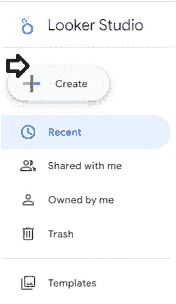

截图展示了 Looker Studio 页面的局部内容。其中包含一个选项列表，并选中了“创建”按钮。

**图 4-7**

创建新的 Looker 报告

1.  前往 `Data source`。

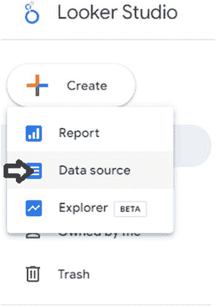

截图展示了 Looker Studio 页面的局部内容。其中包含一个选项列表，并选中了“数据源”选项。

**图 4-8**

数据源选项卡

1.  滚动到 `File Upload` 并点击它。

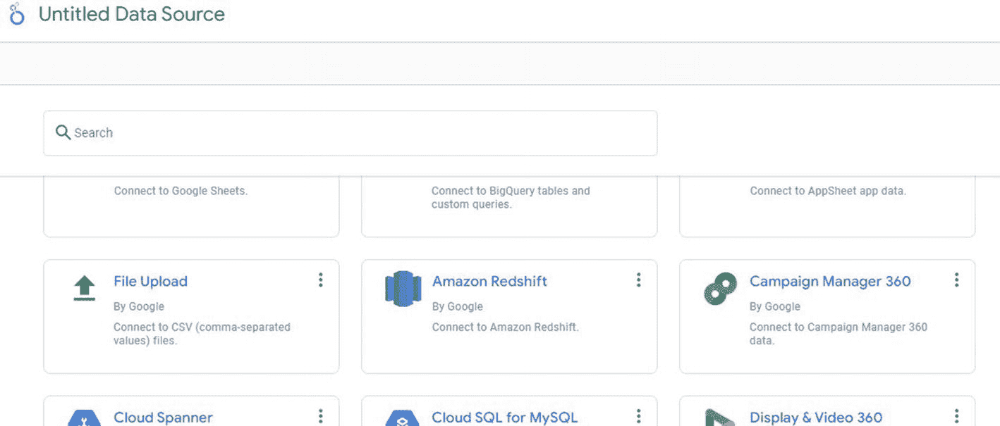

未命名的数据源页面截图，显示了多个模板，其中“文件上传”选项被选中。

**图 4-9**

选择文件上传

1.  上传文件。

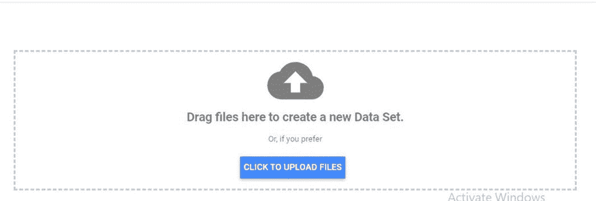

截图展示了一个网页的局部内容，其中显示了一个对话框，提示“将文件拖到此处以创建新数据集”。“点击上传文件”按钮被高亮显示。

**图 4-10**

上传数据

1.  重命名当前标题为 `Data Source` 的文件。

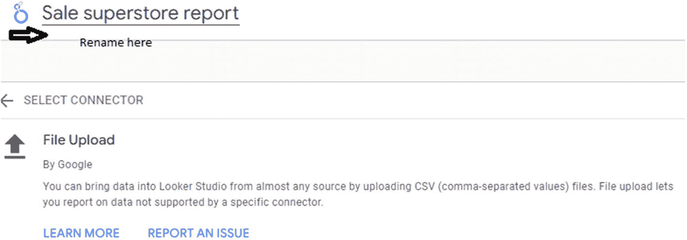

截图展示了一个标题为“Sale Superstore Report”的网页局部内容。页面中有一个用于重命名的输入字段，由一个向右箭头指示。

**图 4-11**

重命名数据源标题

1.  文件应显示  一个带阴影的圆圈。表示已上传。

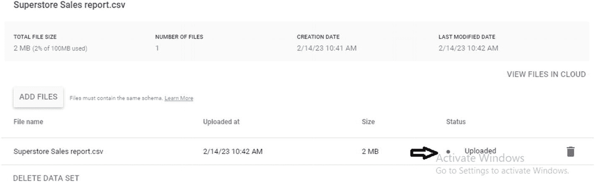

超级商店销售报告页面的截图，列出了文件名、上传日期和时间、大小以及状态等详细信息。数据状态显示为“已上传”。

**图 4-12**

数据上传状态

1.  使用位于右上角的 `CONNECT` 按钮连接文件。

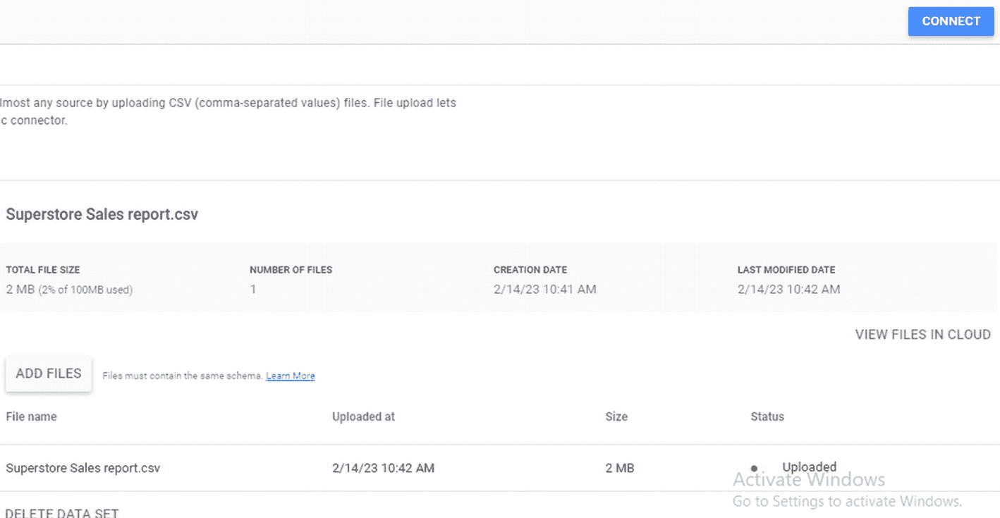

超级商店销售报告页面的截图，列出了文件名、上传日期和时间、大小以及状态等详细信息。页面右上角的“连接”按钮已被选中。

**图 4-13**

连接数据

1.  文件连接成功后，您将看到如下截图所示的视图。然后检查维度的确切格式。例如，`Customer Name` 是 `Text` 类型，`Order Date` 是 `Date` 类型，`Order Quantity` 是 `Number` 类型，等等。

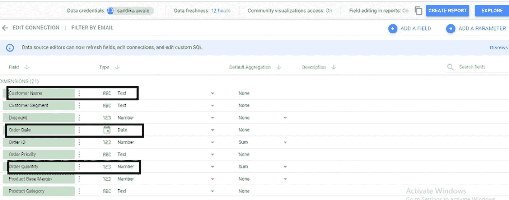

编辑连接页面的截图，列出了字段、类型、详细聚合和描述等信息。字段及其类型（如客户名称、订单日期和订单数量）被框选出来。页面右上角的“创建报告”和“探索”按钮已被选中。

**图 4-14**

数据视图

1.  然后点击 `CREATE REPORT`。它将带您进入一个新视图。您将看到以下屏幕。

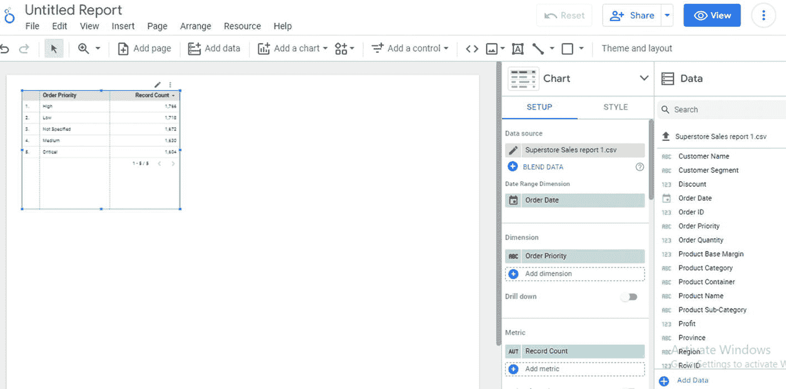

未命名报告页面的截图，右侧窗格显示了图表和数据面板，其中“订单日期”和“订单优先级”选项被选中。左侧窗格以表格形式列出了订单优先级和记录计数。页面右上角的“查看”按钮已被选中。

**图 4-15**

创建报告后的首次显示

1.  为未命名的报告文件命名。

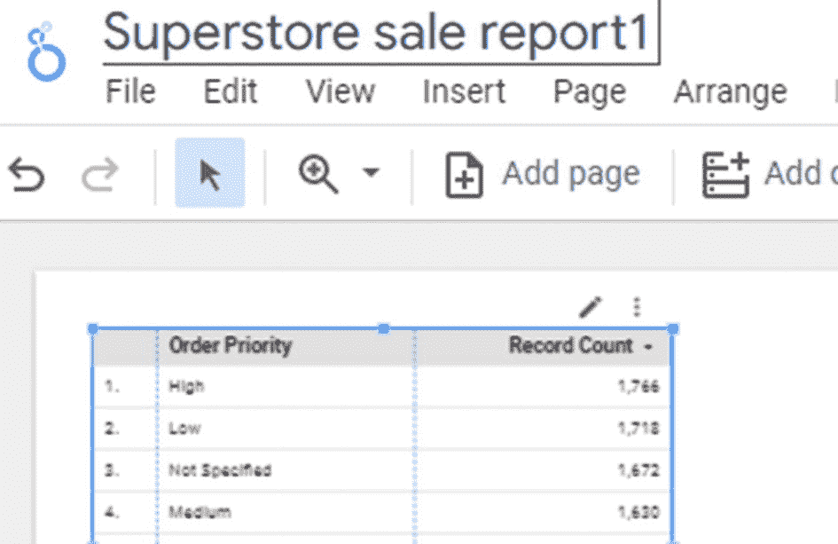

截图展示了超级商店销售报告页面的局部内容，其中有一个表格列出了订单优先级和记录计数数据，并且整个表格被选中。

**图 4-16**

为报告命名

这就是创建报告并可视化数据的方法。

1.  您可以在查看模式下看到表格。

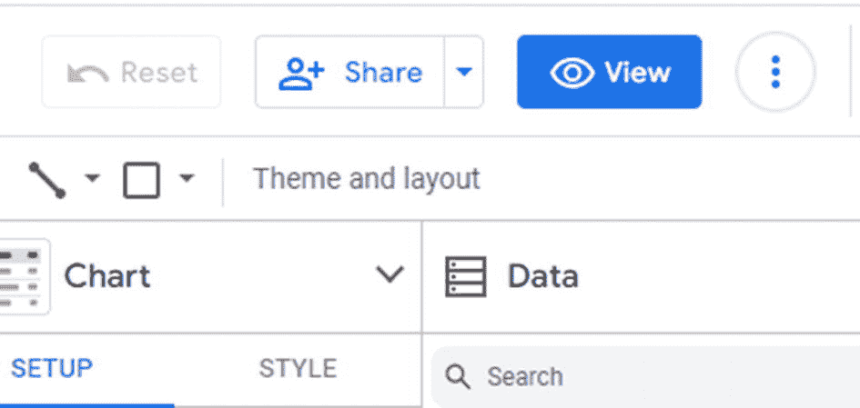

截图展示了网页的局部内容，其中包含图表和数据面板。图表下方的“设置”选项卡被选中。页面顶部的“查看”按钮已被点击。

**图 4-17**

查看模式

它看起来像这样。

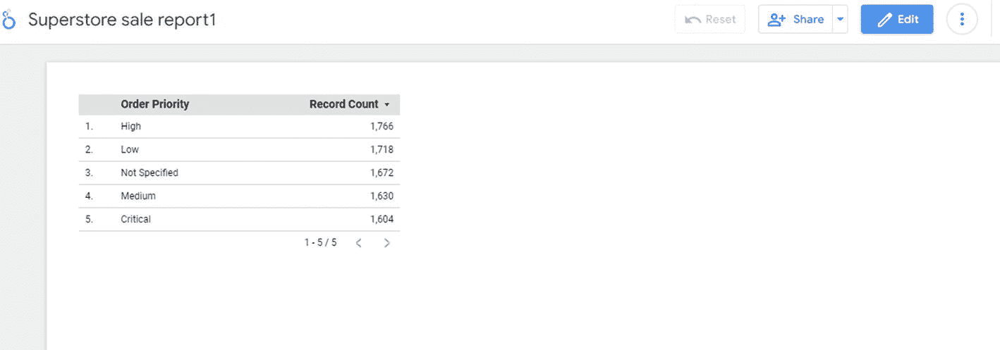

超级商店销售报告 1 页面的截图，有一个表格列出了订单优先级和记录计数数据。页面右上角的“编辑”按钮已被选中。

**图 4-18**

查看数据

1.  点击右上角的 `Share` 按钮，与团队成员共享报告。将弹出一个共享窗口。在 `Add people and groups` 中，添加人员或群组的电子邮件 ID/名称并保存。点击 `Done`。
    *   您可以通过点击右上角的 `Edit` 按钮来编辑文件。它将再次返回到查看模式之前的原始形式。

这就是使用 Looker Studio 文件上传连接器创建报告、可视化数据并共享报告的方法。

### BigQuery 和 Looker

由于我们已经学习了 BigQuery 并创建了一些表，我们可以在 Looker 中使用这些表进行可视化。

1.  前往 Looker 中的 `Report` 并点击 `Add data`。
2.  前往 `Connect to data` 并选择 `BigQuery`，然后授权。

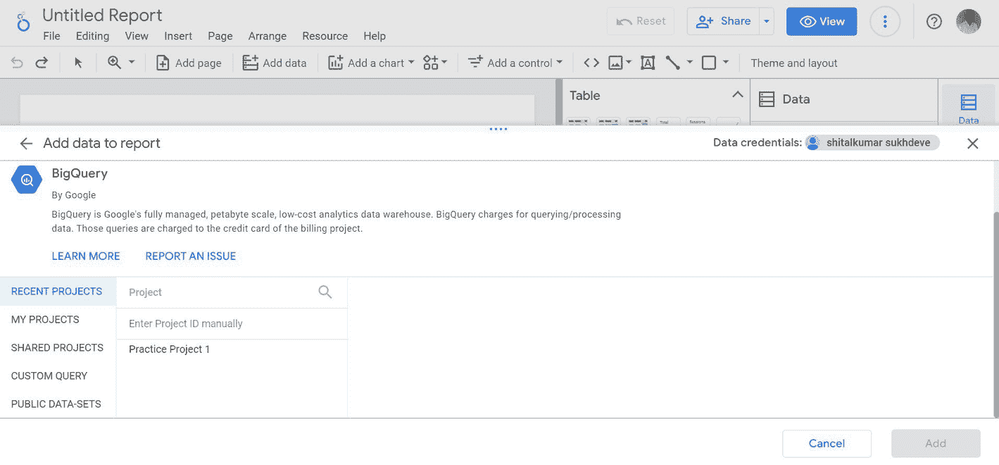

未命名报告页面的截图，在“向报告添加数据”标题下显示了 BigQuery。下方选中了“近期项目”选项卡，其中列出了项目。页面右上角的“查看”按钮已被选中。

**图 4-19**

BigQuery 和 Looker

1.  选择上一屏幕中显示的项目 `Practice Project 1`。
2.  您将看到与您的项目关联的数据集列表。如果您使用的是免费提供的 Looker 以及 BigQuery Sandbox 中的数据集，则不会计入计费（请查看最新的 Google 指南以了解定价）。
3.  点击一个数据集并选择一个表。您将能够在报告中看到您的数据。
    *   您应该能够看到此处描绘的屏幕。由于我们已经在之前的章节中创建了项目，我们可以使用同一个项目，或者如果您还没有创建，请遵循最后几章的说明。


#### 构建仪表板

本节将指导您使用 Looker Studio 开发一个自定义仪表板。首先，使用您的 Gmail 账户登录 Looker Studio。如前一节所述，您已经上传了一个 Excel 表格并将其连接到 Looker Studio。现在，我们就从这个报告开始。

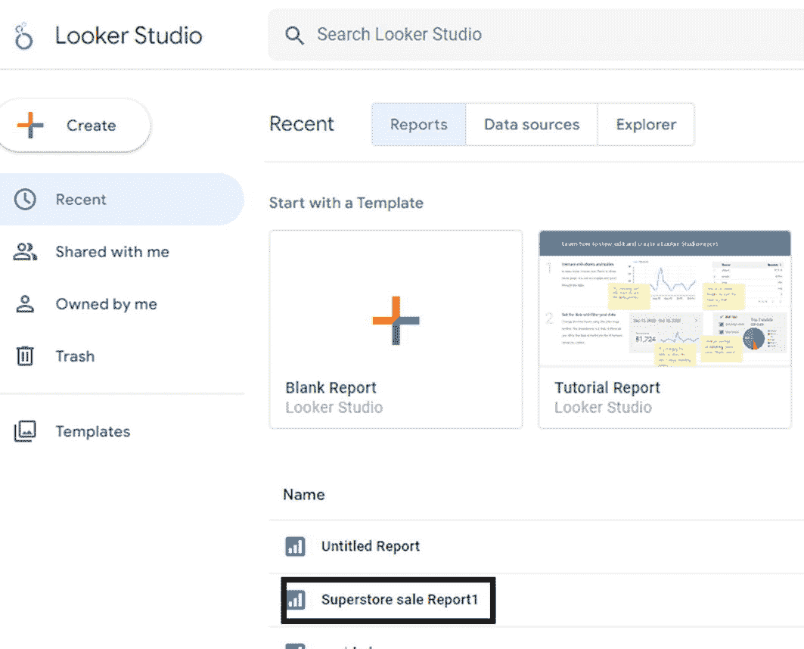

截图展示了 Looker Studio 欢迎页面的部分内容，左侧面板选中了“最近”选项卡，右侧显示了相应页面。右侧选中了“报告”选项卡，其中包含标记为“空白报告”和“教程报告”的模板。已选中“超级商店销售报告 1”文件。

图 4-20

选择报告

返回您之前的报告，点击标题中的 `Page` 选项。然后，选择 `New page` 来创建一个供您操作的空白报告。

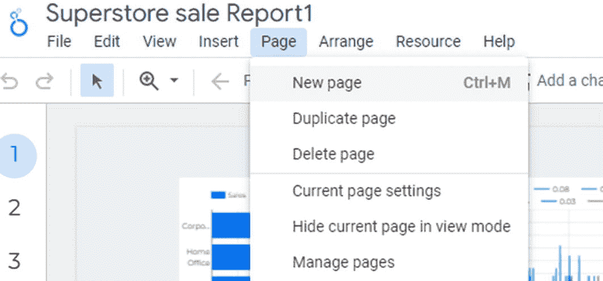

截图展示了“超级商店销售报告 1”页面的部分内容，其中选中了“页面”选项卡，该选项卡列出了下拉菜单。下拉菜单中选中了“新建页面”选项。

图 4-21

插入新页面

根据您的喜好更改主题和布局。

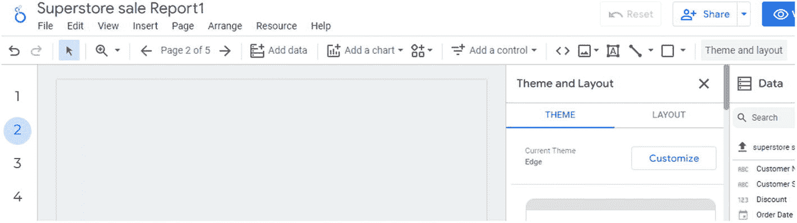

截图展示了“超级商店销售报告 1”页面的部分内容，页面右侧包含主题和布局面板，其中选中了“主题”选项卡。页面右上角的“查看”按钮已被选中。

图 4-22

选择主题和布局

现在，我们可以开始添加不同的图表来构建仪表板：

1.  **评分卡**：点击 `Add a chart` 按钮，然后点击评分卡 `Total`。通过添加更多评分卡或复制粘贴现有评分卡来创建多个评分卡。按照页面右侧的 `Setup` 部分所示，更改每个评分卡的指标。

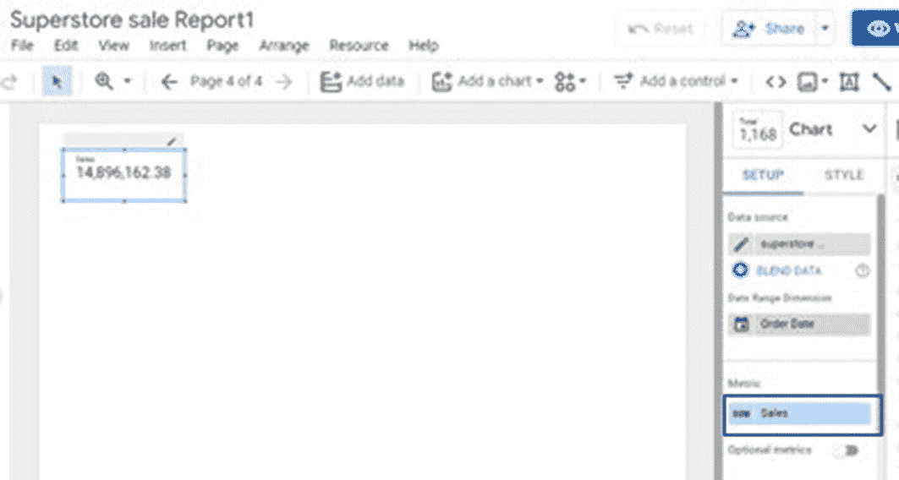

截图展示了“超级商店销售报告 1”页面的部分内容，右侧窗格中有图表面板，其中选中了“设置”选项卡。在“设置”选项卡下，“销售额”选项被框选，其值显示在左侧窗格中。右上角的“查看”按钮已被选中。

图 4-23

创建评分卡

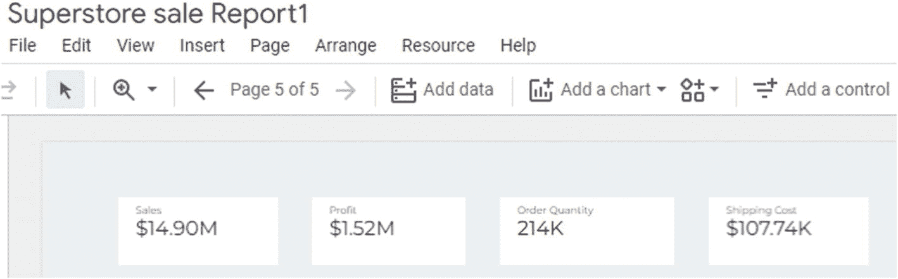

截图展示了“超级商店销售报告 1”页面的部分内容，提供了销售额、利润、订单数量和运费的值。

图 4-24

用于构建仪表板的评分卡

1.  **时间序列图**：点击 `Add a chart` 按钮，然后从选项中选择 `Time series`。将图表拖到“销售额”评分卡下方。自定义图表以显示特定时间段内的销售趋势。为此，请转到 `Setup` 选项，选择 `Default date range`，然后选择 `Custom` 选项。接着，选择销售趋势的开始和结束日期。请参见以下示例。

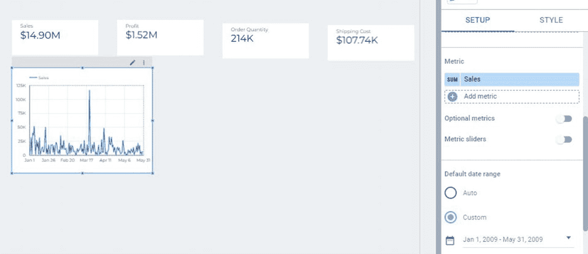

截图展示了网页的部分内容，页面右侧有图表面板，其中选中了“设置”选项卡。在“设置”选项卡下，选中了“销售额”选项，左侧窗格中呈现了销售额的折线图，显示波动趋势。

图 4-25

折线图

1.  **条形图**：点击 `Add a chart` 按钮，然后从选项中选择 `Bar`。将图表拖到页面上，放在之前的时间序列图旁边。向图表添加另一个指标，例如利润。请参见以下示例。

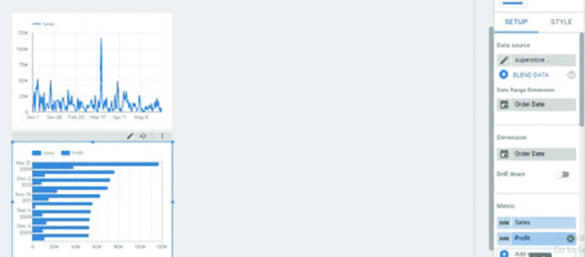

截图展示了网页的部分内容，右侧有图表面板，其中选中了“设置”选项卡。在“设置”选项卡下，选中了“销售额”和“利润”选项。页面左侧呈现了销售额和利润的折线图及水平双柱图。

图 4-26

条形图

1.  **饼图**：点击 `Add a chart` 按钮，然后从饼图选项中选择 `Donut`。在 `Setup` 部分，更改维度以显示产品类别。请参见以下示例。

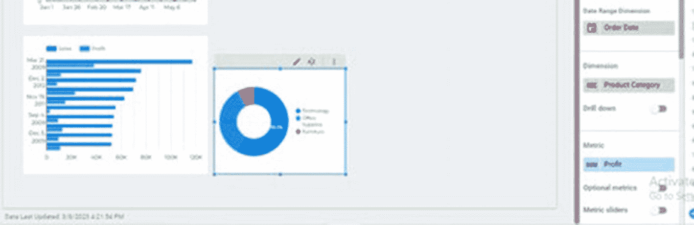

截图展示了网页的部分内容，页面右侧有图表面板。从图表面板中选中了“利润”选项，页面左侧呈现了利润的水平双柱图和环形图。

图 4-27

环形图

1.  **表格**：从 `Add a chart` 按钮中选择 `Table` 选项。创建一个显示每个产品类别销售额和利润的表格。

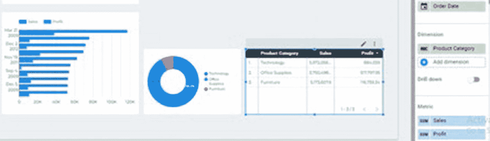

截图展示了网页的部分内容，右侧窗格中有图表面板。从图表面板中选中了“销售额”和“利润”选项。左侧窗格中有一个水平双柱图、一个环形图和一个提供产品类别、销售额和利润详细信息的表格。

图 4-28

表格

1.  **气泡图**：点击 `Add a chart` 按钮，然后从 Google 地图选项中选择 `Bubble Map`。通过拖拽将地图与折线图一起放置在页面上。调整设置：选择 `Location` 并选择 `Region`，设置 `Tooltip` 显示 `Province`，选择 `Region` 作为 `Color dimension`，并使用 `Sales` 或 `Profit` 作为 `Size`。

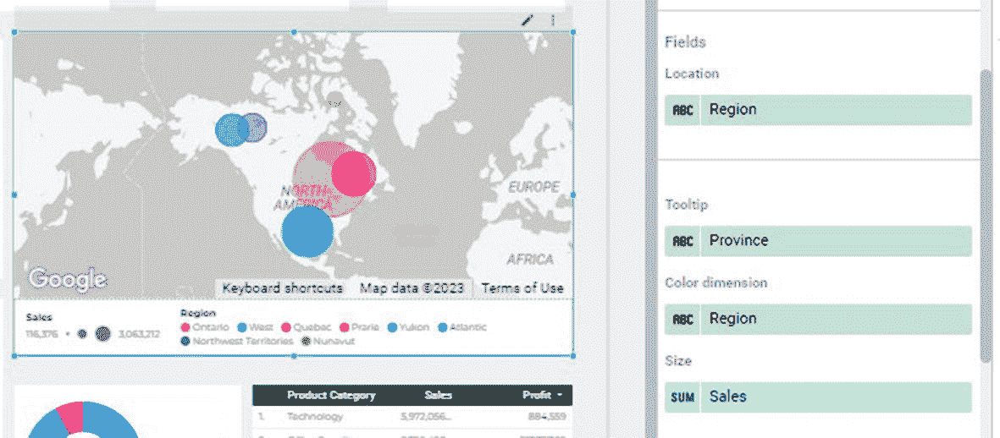

截图展示了网页的部分内容，右侧窗格中有字段面板。字段面板显示了位置、工具提示、颜色维度和大小等详细信息。左侧是北美地区的气泡图，显示了不同州的销售额。

图 4-29

气泡图

1.  **日期范围**：点击 `Add a control` 选项，然后选择 `Date range control`。将控件拖到页面右上角。选择日期范围的开始和结束日期，这将相应地调整仪表板上所有图表的值。

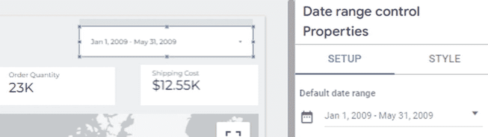

截图展示了网页的部分内容，页面右侧有日期范围控件属性面板，其中选中了“设置”选项卡。页面左侧，一个框提供了如下详细信息：2009 年 1 月 1 日至 2009 年 5 月 31 日，该日期范围被高亮显示。

图 4-30

日期范围控件

完成的仪表板如下所示。

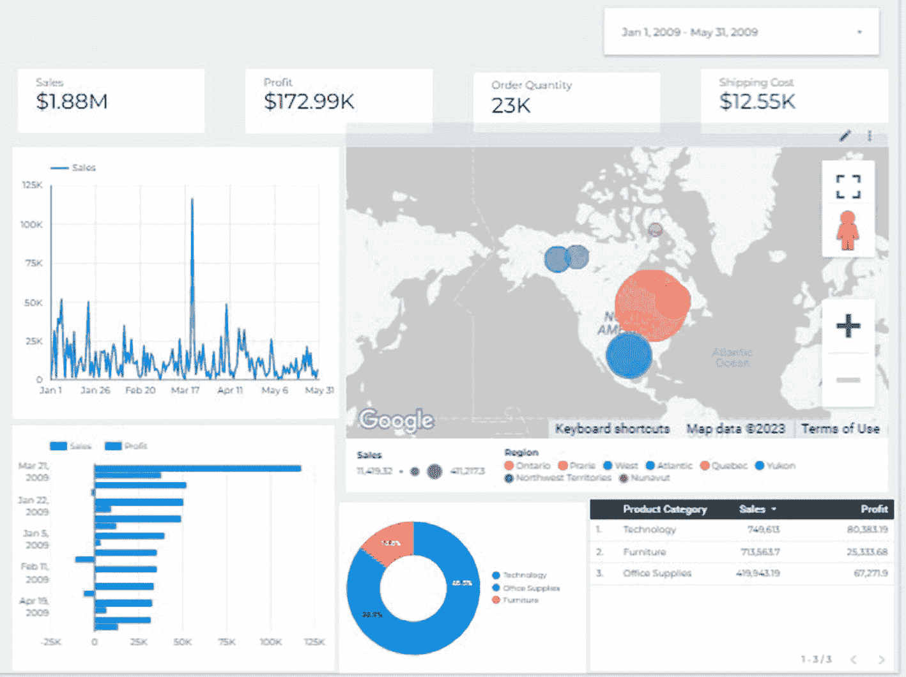

仪表板截图提供了销售额、利润、订单数量和运费的值。下方是一个折线图、一个水平双柱图、一个气泡图、一个环形图和一个表格。

图 4-31

仪表板


### Colab 上的数据可视化

`PyGWalker` 是一个 Python 库，它简化了 Jupyter Notebook 中的数据分析与数据可视化工作流程。它提供了一个类似 Tableau 的用户界面，用于对 Pandas 数据框进行可视化探索。借助 `PyGWalker`，数据科学家可以通过简单的拖放操作，快速轻松地分析数据并可视化数据模式。

`PyGWalker` 构建于开源软件 Graphic Walker 之上，后者是 Tableau 的一个替代方案。Graphic Walker 提供了一个可视化界面，允许用户探索实时数据。它还支持多种图表类型和数据操作功能。

要开始使用 `PyGWalker`，你需要使用 `pip` 进行安装。打开一个 Jupyter Notebook，并按如下方式安装该库：

```
!pip install pygwalker
```

接下来，我们可以导入 `PyGWalker` 以及其他所需的库：

```
import pandas as pd
import numpy as np
import pygwalker as pyg
```

在本教程中，我们将创建一个包含一些随机数据的示例数据集：

```
data = {
'age': np.random.randint(18, 65, 100),
'gender': np.random.choice(['Male', 'Female'], 100),
'income': np.random.normal(50000, 10000, 100),
'state': np.random.choice(['CA', 'NY', 'TX'], 100)
}
df = pd.DataFrame(data)
```

现在，让我们使用 `PyGWalker` 来可视化这个数据集：

```
pyg.walk(df)
```

你将看到以下输出。

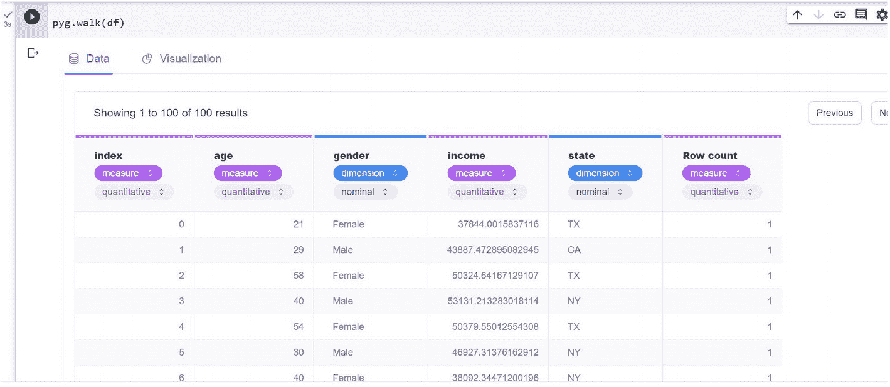

PyGWalker 页面截图，选中了数据选项卡。数据页面列出了索引、年龄、性别、收入、州和行数等详细信息。

**图 4-32** PyGWalker 数据选项卡

`PyGWalker` 会自动检测数据类型并创建一个类似 Tableau 的界面。

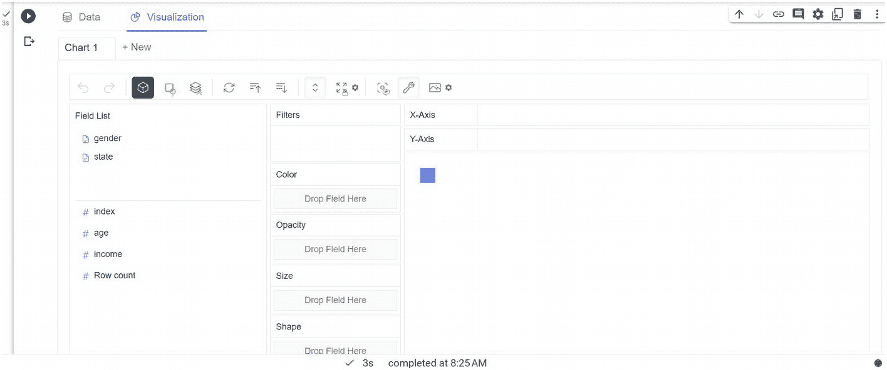

PyGWalker 页面截图，选中了可视化选项卡。可视化选项卡展示了字段列表、索引、年龄、性别、收入、州、行数、筛选器、颜色、不透明度、大小和形状等详细信息。

**图 4-33** PyGWalker 可视化选项卡

我们可以使用拖放操作来探索和可视化数据。例如，我们可以将 `age` 列拖到 x 轴，将 `income` 列拖到 y 轴来创建一个散点图。在此之前，首先点击 `age`，会出现分箱建议，点击它。对 `income` 也执行相同操作。现在将 `bin(age)` 和 `bin(income)` 分别拖放到 x 轴和 y 轴上。你将看到以下输出。

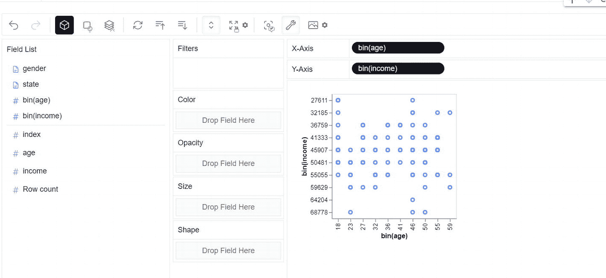

可视化页面截图，展示了字段列表、索引、年龄、性别、收入、州、行数、筛选器、颜色、不透明度、大小和形状等详细信息。在页面右侧，一个散点图展示了收入与年龄之间的关系。

**图 4-34** 散点图

我们还可以通过将其他列拖到颜色或大小区域来为可视化添加更多维度。例如，我们可以将 `gender` 列拖到颜色区域，创建一个按性别显示不同颜色的散点图。

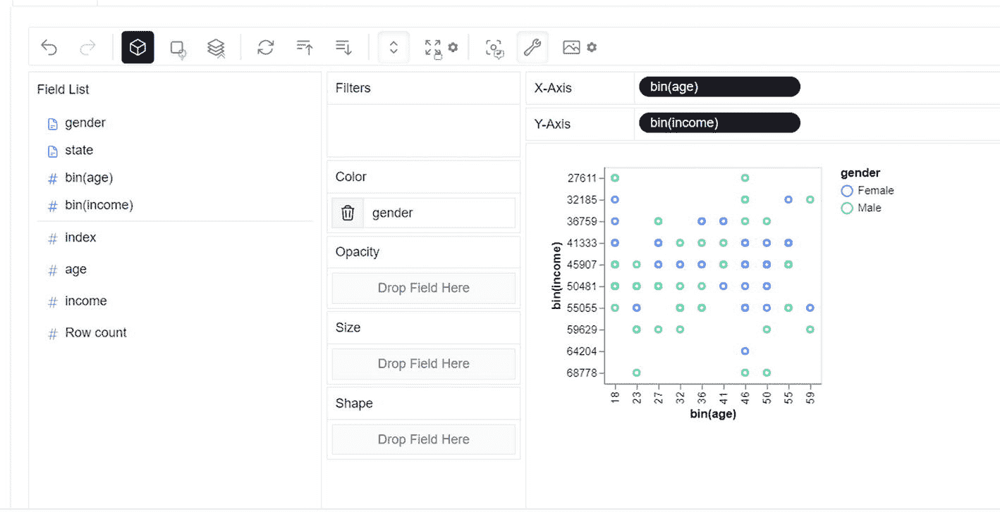

可视化页面局部截图，展示了字段列表、筛选器、颜色、不透明度、大小和形状等详细信息。在页面右侧，一个散点图展示了收入与年龄之间的关系，其中包含男性和女性的数据点。

**图 4-35** 为散点图添加另一个维度

你也可以点击 `聚合` 将其关闭，从而创建无需分箱的图表，如下所示。

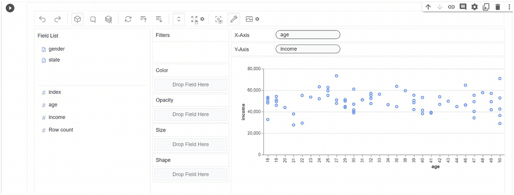

可视化页面局部截图，展示了字段列表、索引、年龄、性别、收入、州、行数、筛选器、颜色、不透明度、大小和形状等详细信息。在页面右侧，一个散点图展示了收入与年龄之间的关系。

**图 4-36** 无聚合

你也可以像下面这样更改图表类型。

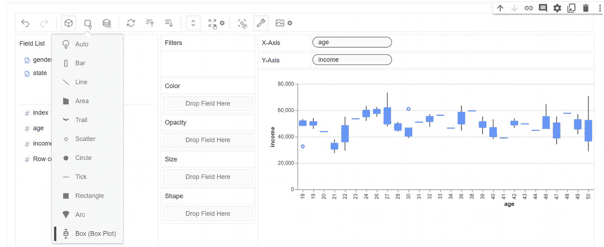

可视化页面局部截图，展示了一个下拉菜单，其中选中了箱形图选项。在页面右侧，一个箱形图展示了收入与年龄的关系。趋势呈现波动模式。

**图 4-37** 更改图表类型

## 总结

在本章中，我们探索了数据可视化和商业智能的世界，重点介绍了如何使用 Looker Studio 和 Colab 创建引人注目的可视化效果和报告。

我们首先介绍了 Looker Studio，这是一个强大的数据探索和可视化工具。我们了解了它用于将原始数据转化为有意义见解的特性和能力。

接着，我们深入探讨了使用 Looker Studio 创建和共享数据可视化及报告的过程。我们学习了如何连接到各种数据源、设计可视化效果以及生成可轻松与利益相关者共享的交互式报告。

然后，我们探索了 BigQuery 与 Looker 之间的集成，理解了如何将这两个工具结合使用来分析和可视化大型数据集。我们了解了利用 BigQuery 强大的查询能力和 Looker 直观的界面进行数据探索的好处。

接下来，我们重点介绍了使用 Looker Studio 构建仪表板。我们学习了如何创建自定义仪表板，以整合多个可视化效果，并提供关键指标和绩效指标的全面视图。

最后，我们探索了使用 Colab（一个协作式笔记本环境）进行数据可视化。我们学习了如何利用像 `pygwalker`、`pandas` 和 `numpy` 这样的 Python 库，在 Colab 笔记本中创建视觉上吸引人的图表和图形。

在本章中，我们深入了解了数据可视化的重要性及其在推动商业智能中的作用。我们学习了如何有效地使用 Looker Studio 和其他工具，将复杂数据转化为可操作的见解，并以引人注目且易于理解的方式传达给利益相关者。这些知识使我们掌握了通过数据可视化和商业智能做出明智决策并推动业务成功的技能。


## 5. 数据处理与转换

在本章中，我们将探索数据操作与转换的领域，重点关注 **Google Cloud Dataflow** 和 **Google Cloud Dataprep**。

我们的旅程始于对 **Google Cloud Dataflow** 的介绍，这是一项专为批处理和流数据处理而设计的有影响力的服务。我们将深入探讨 Dataflow 表现出色的各种场景，包括实时分析、ETL（提取、转换、加载）管道以及事件触发处理。这将有助于理解 Dataflow 在促进可扩展且高效的数据操作方面所扮演的角色。

继续前进，我们将沉浸于在 Cloud Dataflow 中执行数据操作管道。这一阶段涉及理解管道的概念，这是一种能够定义处理和重塑数据所需的一系列步骤的框架。我们将研究 Dataflow 如何熟练地支持批处理和流数据操作，并深入探讨其与其他 Google Cloud 服务（尤其是 BigQuery 和 Cloud Pub/Sub）的无缝集成。

接下来，我们的探索将转向 **Google Cloud Dataprep**，这是一项专为数据精炼和转换而量身定制的服务。我们将探讨 Dataprep 证明其效用的各种场景，包括数据清洗、标准化和数据精炼。Dataprep 用户友好的可视化界面将被揭示，展示其无需复杂编码即可轻松进行数据探索和操作的能力。

本章的全部内容将让我们深入了解数据操作与转换在数据生命周期中的关键作用。通过 **Google Cloud Dataflow** 和 **Google Cloud Dataprep** 的视角，我们将掌握可用于大规模处理和精炼数据的强大工具。这种能力将使我们能够发掘宝贵的见解，并引导做出明智的决策。

通过利用 Dataflow 和 Dataprep 的功能，我们将培养在设计和执行简化数据操作管道方面的专业知识和熟练度。这种熟练度确保了原始数据转换为可用格式，保证了数据的完整性和一致性。这种赋能使我们能够充分探索数据的潜力，提取出能够催化业务扩张和成功的宝贵见解。

### Google Cloud Dataflow 简介及其在批处理和流数据处理中的应用场景

Google Cloud Dataflow 是一项全面的托管云服务，有助于开发和执行多种数据处理模式，包括批处理和流处理。它通过提供统一的编程模型来简化流程，使用户能够专注于构建业务逻辑，而无需处理基础设施管理的复杂性。

使用 Google Cloud Dataflow 进行批处理的一些常见用例包括数据仓库、ETL（提取、转换、加载）处理和分析。例如，您可以使用 Dataflow 从多个来源提取数据，清洗和转换数据，然后将其加载到像 BigQuery 这样的数据仓库解决方案中进行分析。

对于流处理，Dataflow 可用于实时分析、欺诈检测、物联网数据处理和点击流分析。例如，您可以使用 Dataflow 处理来自物联网设备的实时数据，并分析这些数据以实时获取见解并做出决策。

总体而言，Google Cloud Dataflow 是一个高度可扩展且灵活的数据处理解决方案，能够处理批处理和流处理工作负载，使其成为数据工程师和数据科学家的宝贵工具。

#### 在 Cloud Dataflow 上运行数据处理管道

有多种方式可以利用 Dataflow 满足您的数据处理需求。您可以使用云控制台 UI、`gcloud` CLI 或 API 创建 Dataflow 作业，所有这些都提供了多种作业创建选项。此外，Dataflow 模板提供了一系列预构建模板供轻松使用，您还可以创建自定义模板并与同事共享。

借助 Dataflow SQL，您可以直接从 BigQuery Web UI 利用 SQL 技能开发流式管道，从而能够连接来自各种来源的数据，将结果写入 BigQuery，并在实时仪表板中可视化它们。此外，Dataflow 界面还提供对 Vertex AI Notebooks 的访问，允许您使用最新的数据科学和机器学习框架构建和部署数据管道（Vergadia，2021）。最后，Dataflow 内联监控允许您直接访问作业指标，为在步骤级别和工作节点级别排查管道问题提供有用的见解。


### Google Cloud Dataprep 简介及其在数据准备中的应用场景

Google Cloud Dataprep 是一项由 Google 管理的全方位数据准备服务。它使用户能够以可视化方式探索、清理和准备数据，以便用于分析或机器学习。凭借其直观的界面，用户无需编写代码即可交互式地深入研究和修改数据，从而简化了数据准备流程。

以下是 Google Cloud Dataprep 在数据准备方面的一些应用场景：

- **数据清洗**：Cloud Dataprep 提供了一套全面的工具来清理和标准化数据，确保数据的一致性、准确性和完整性。它提供了去重、文本解析、正则表达式、数据格式化和规范化等功能。这些功能使您能够有效地处理和增强数据，从而提高分析的可靠性和质量。
- **数据转换**：Cloud Dataprep 允许您将数据转换为下游分析或机器学习所需的格式。它包括数据透视、聚合和数据集合并等功能。
- **数据丰富**：您可以使用 Cloud Dataprep 通过将数据与外部数据源（如数据库或 API）连接来丰富数据。这有助于您更深入地了解数据，并进行更全面的分析。
- **数据探索**：Cloud Dataprep 允许您使用其可视化界面快速探索数据。您可以使用数据剖析功能来了解数据的分布情况，并识别异常值、离群点或缺失值。
- **协作**：Cloud Dataprep 为团队提供了一个协作环境，以便共同处理数据准备项目。它允许多个用户同时处理同一个项目，从而更轻松地分享想法、数据和见解。

总之，Google Cloud Dataprep 是一个强大的数据准备工具，可以帮助您简化数据准备工作流程，减少准备数据所需的时间和精力，并提高分析的准确性和质量。

1.  在 Google Cloud 项目中启用 Dataflow 和所需的 API：
    - `Dataflow API`
    - `Compute Engine API`
    - `Cloud Logging API`
    - `Cloud Storage`
    - `Google Cloud Storage JSON API`
    - `BigQuery API`
    - `Cloud Pub/Sub API`
    - `Cloud Resource Manager API`

2.  创建一个 Cloud Storage 存储桶：
    - 登录 Google Cloud 控制台，网址为 [`https://console.cloud.google.com/`](https://console.cloud.google.com/)。
    - 选择您的项目，如果尚未创建，请创建一个新项目。
    - 从主菜单中打开 Cloud Storage 页面。
    - 点击 `Create bucket` 按钮。
    - 在 `Create a bucket` 对话框中，为您的存储桶输入一个唯一的名称。
    - 选择您希望存储数据的区域。
    - 为您的存储桶选择默认存储类别。您也可以根据需求选择不同的存储类别。
    - 选择存储桶的访问控制设置。您可以选择将存储桶设为私有或公开访问。
    - 点击 `Create` 以创建您的新存储桶。

3.  创建一个 BigQuery 数据集。

4.  创建一个 BigQuery 表：
    - 在导航窗格中，展开您的项目，然后选择要创建新表的数据集。
    - 点击 `Create table` 按钮。
    - 在 `Create table` 对话框中，为您的新表输入一个名称。
    - 选择您的数据来源。您可以从头开始创建新表，或使用现有表作为模板。
    - 在 `Schema` 部分，通过指定每个字段的名称、数据类型和模式来定义表的列。
    - 如果您的数据源是 CSV 或 JSON 文件，请指定文件格式和文件位置。
    - 配置表的高级选项，例如分区和聚簇。
    - 点击 `Create table` 以创建您的新 BigQuery 表。

5.  运行管道。

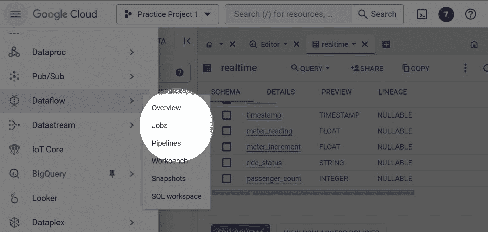

一张 Google Cloud 窗口的截图，用于实践项目 1。左侧窗格中选中了 `dataflow` 选项卡，下拉菜单列出了 6 个选项，包括 `overview`、`jobs`、`pipelines`、`workbench`、`snapshots` 和 `SQL workspace`。

**图 5-1** Dataflow

1.  点击 `CREATE JOB FROM TEMPLATE`。

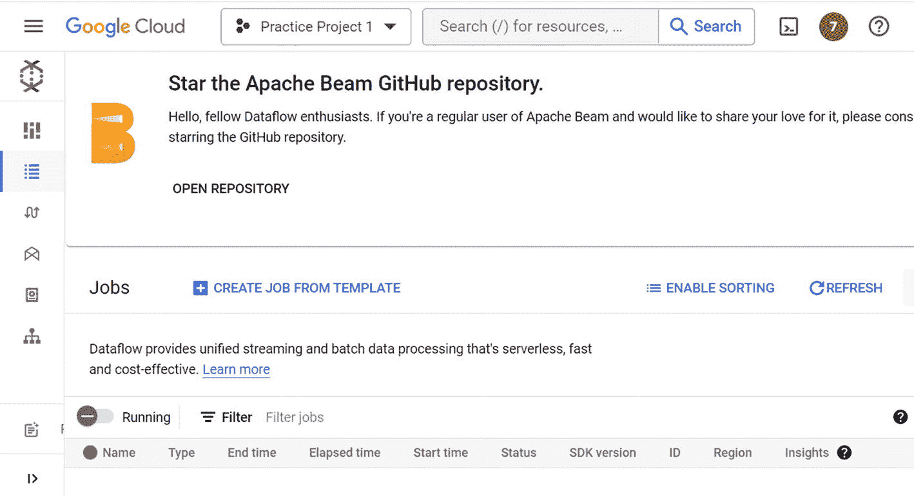

一张 Google Cloud 窗口的截图，用于实践项目 1。中央的横幅显示“Star the Apache Beam GitHub repository”，并带有一个 `Open repository` 按钮。横幅下方的 `jobs` 部分有一个包含 10 列的空表和一个 `Create job from template` 按钮。

**图 5-2** 为 Apache Beam GitHub 仓库加星标

1.  运行管道。

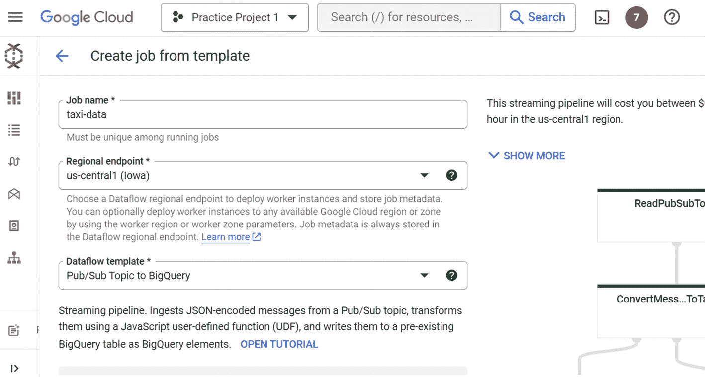

一张 Google Cloud 中 `Create job from template` 页面的截图。输入的作业名称为 `taxi data`，区域端点为 `us-central1 (Iowa)`，`Dataflow template` 为 `Pub/Sub Topic to BigQuery`。底部有一个 `Tutorial` 按钮。右侧是管道的示意图。

**图 5-3** 从模板创建作业

1.  运行管道后，您将看到以下界面。

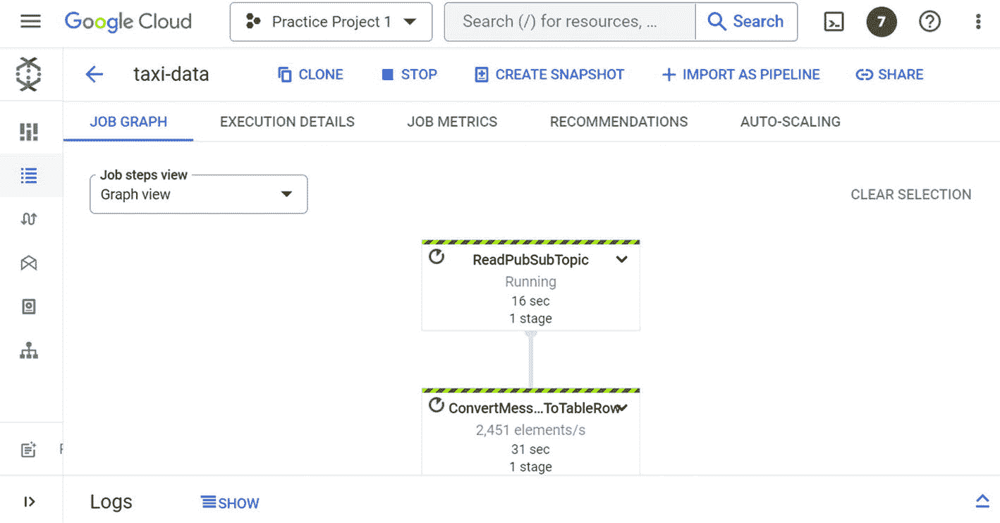

一张 Google Cloud 中 `taxi data` 作业页面的截图。选项卡包括 `Job graph`、`Execution details`、`Job metrics`、`Recommendations` 和 `Auto-scaling`。`Job graph` 有一个 `Job steps view` 的下拉选项，其中选中了 `Graph view`。管道图中 `Read PubSub Topic` 步骤正在运行。

**图 5-4** 管道执行后

1.  查看您的结果。

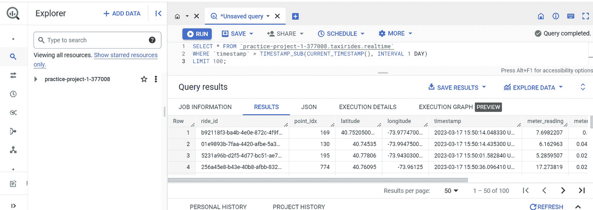

一张 `Explorer` 窗口的截图。左侧窗格中选中了 `practice-project-1`。查询屏幕上有一个来自 `taxi-rides` 的 `SELECT` 查询。查询结果部分列出了表中的数据，列包括 `ride_id`、`point_index`、`latitude`、`longitude`、`timestamp` 和 `meter_reading`。

**图 5-5** 查看写入实时表的数据

您已成功设置了一个流式处理流程，该流程从 `Pub/Sub` 主题检索 JSON 格式的消息，并将其传输到 `BigQuery` 表中。

**清理工作：**

1.  打开 Google Cloud 控制台，导航至 `Dataflow Jobs` 页面。
2.  从作业列表中找到您的流式作业并选中它。
3.  点击导航栏中的 `Stop` 以停止作业。
4.  在出现的 `Stop job` 对话框中，选择取消或排空您的管道，然后选择 `Stop job`。
5.  转到 Google Cloud 控制台中的 `BigQuery` 页面。
6.  在 `Explorer` 面板中，展开您的项目以查看关联的数据集。
7.  在要删除的数据集旁边，点击三个垂直点（更多视图操作），然后选择 `Open`。
8.  在 `Details` 面板中，点击 `Delete dataset` 并按照说明确认删除。
9.  接下来，转到 Google Cloud 控制台中的 `Cloud Storage` 浏览器页面。
10. 选中要删除的存储桶旁边的复选框。要删除存储桶，请点击 `Delete` 并按照说明完成删除过程。


## 总结

在本章中，我们深入探讨了数据处理与转换领域，重点关注了 Google Cloud Dataflow 和 Google Cloud Dataprep。

我们首先介绍了 Google Cloud Dataflow，这是一项用于批处理和流数据处理的强大服务。我们探讨了 Dataflow 表现出色的各种用例，例如实时分析、ETL（提取、转换、加载）管道以及事件驱动处理。我们理解了 Dataflow 如何实现可扩展且高效的数据处理。

接下来，我们深入研究了在 Cloud Dataflow 上运行数据处理管道。我们学习了管道的概念，它允许我们定义处理和转换数据所需的一系列步骤。我们探讨了 Dataflow 如何支持批处理和流处理，并发现了它与其他 Google Cloud 服务（如 BigQuery 和 Cloud Pub/Sub）的集成。

随后，我们探索了 Google Cloud Dataprep，这是一项数据准备和转换服务。我们了解了 Dataprep 可应用的多种用例，例如数据清洗、规范化和数据整理。我们发现了 Dataprep 直观的可视化界面，它允许用户无需编写复杂代码即可轻松探索和转换数据。

在本章中，我们深入了解了数据处理和转换在数据生命周期中的重要性。我们学习了 Google Cloud Dataflow 和 Google Cloud Dataprep 如何提供强大的工具来大规模处理和准备数据，使我们能够提取有价值的见解并推动明智的决策。

通过利用 Dataflow 和 Dataprep 的潜力，我们获得了设计和执行高效数据处理管道的专业知识和熟练度。我们可以无缝地将原始数据转换为可用格式，确保数据质量和一致性。这使我们能够释放数据的全部潜力，并提取推动业务增长和成就的宝贵见解。

## 6. 数据分析与存储

本章深入探讨数据分析与存储，重点介绍 Google Cloud Storage、Google Cloud SQL 和 Google Cloud Pub/Sub。我们从 Google Cloud Storage 开始，这是一种可扩展的对象存储解决方案。它在数据归档、网站托管和备份方面具有实用性。我们探讨了其特性以及与其他 Google 服务的兼容性。

接下来是 Google Cloud SQL，这是一种托管式关系数据库服务。它擅长存储关系数据，具有自动备份、可扩展性以及与 MySQL 和 PostgreSQL 等引擎的兼容性。其应用范围涵盖 Web 应用、内容管理和分析。

接着，Google Cloud Pub/Sub 实现了实时数据流传输。我们学习了其核心概念以及在事件驱动系统、实时分析和物联网中的应用。还探讨了与 Cloud Functions 和 Dataflow 的集成。

最后，我们通过 Cloud Pub/Sub 掌握了数据流。我们理解了主题、消息发布和订阅者设置。对可扩展性和可靠性的关注使我们能够构建强大的数据流管道。

本章强调了数据的重要性，以及 Google Cloud Storage、Cloud SQL 和 Cloud Pub/Sub 提供的用于获取见解和做出明智决策的工具。这些知识使我们能够有效地设计存储解决方案、管理数据库并利用实时数据。

### Google Cloud Storage 简介及其在数据存储方面的用例

Google Cloud Storage 是 Google Cloud Platform (GCP) 提供的一种高度可扩展且可靠的对象存储服务。它为可通过互联网从世界任何地方访问的非结构化数据提供持久且高可用的存储。以下是 Google Cloud Storage 的一些常见用例：

1.  **数据备份和灾难恢复**：Google Cloud Storage 可用于存储关键数据的备份，并为组织提供灾难恢复解决方案。
2.  **数据归档**：Google Cloud Storage 为长期保留大量不常访问的数据提供了一种经济高效的解决方案。
3.  **为网站和移动应用提供静态内容**：Google Cloud Storage 可以为网站和移动应用提供图像、视频和音频文件等静态内容。
4.  **内容分发和媒体流**：Google Cloud Storage 可用于分发和流式传输媒体文件，从而实现更快的下载速度和更好的用户体验。
5.  **数据分析和机器学习**：Google Cloud Storage 可以与 BigQuery 和 TensorFlow 等其他 GCP 服务集成，以存储、处理和分析大量数据。
6.  **协作工作流**：Google Cloud Storage 可用于文件的共享访问，使团队能够协作处理项目，并在不同设备和位置之间存储和共享数据。

Google Cloud Storage 为存储和访问非结构化数据提供了高度可扩展且可靠的解决方案，使其成为适用于各种用例的理想选择。

#### 主要特性

Google Cloud Storage 是一种高度可扩展、持久且安全的对象存储服务，提供一系列功能来帮助用户存储、管理和访问其数据。以下是 Google Cloud Storage 的一些主要特性：

**可扩展性**：Google Cloud Storage 提供几乎无限的存储容量，允许用户存储和管理 PB 级的数据。

**持久性**：Google Cloud Storage 通过在多个地理位置自动复制数据来提供高持久性，确保数据免受硬件故障和其他类型灾难的影响。

**安全性**：Google Cloud Storage 提供多层安全保护，包括静态和传输中加密、细粒度访问控制以及身份和访问管理 (IAM)。

**性能**：Google Cloud Storage 提供高性能的数据访问，支持任何大小对象的快速上传和下载速度。

**与其他 Google Cloud Platform 服务的集成**：Google Cloud Storage 与 Compute Engine、App Engine 和 BigQuery 等其他 GCP 服务无缝集成，以支持广泛的用例。

**多区域和区域存储选项**：Google Cloud Storage 提供多区域和区域存储选项，以满足不同的数据存储和访问需求。

**对象生命周期管理**：Google Cloud Storage 支持对象生命周期管理，允许用户定义规则以自动执行数据保留、删除或归档策略。

**成本效益**：Google Cloud Storage 提供灵活的定价模式，允许用户仅为其使用量付费，使其成为存储和访问数据的经济高效选择。

Google Cloud Storage 提供广泛的功能，使其成为一种高度可扩展、持久且安全的对象存储服务，适用于各种用例。

#### 存储选项

Google Cloud Storage 提供多种存储选项，以满足不同的数据存储和访问需求。以下是 Google Cloud Storage 提供的一些存储类别：

1.  **标准**：此存储类别适用于频繁访问的数据，例如活跃的应用数据和用户数据，具有低延迟和高持久性。
2.  **近线**：此存储类别适用于访问频率较低但必须在几秒钟内可用的数据，例如月度财务报告或大型媒体文件。
3.  **冷线**：此存储类别专为极少访问但需要在几分钟内可用的数据而设计，例如灾难恢复数据或长期归档。
4.  **归档**：此存储类别适用于极少访问且保留期较长的数据，例如监管归档或合规记录。


#### 存储位置

除了上述存储类别，Google Cloud Storage 还提供两种存储位置：

1. **区域存储**：此选项将数据存储在特定区域，可实现该区域内数据的低延迟访问。建议对性能要求较高的应用使用区域存储。
2. **多区域存储**：此选项将数据存储在多个地理位置，提供高可用性和全球数据访问。建议需要全球数据访问的应用使用多区域存储。

Google Cloud Storage 提供的多种存储选项，使用户能够选择满足其数据存储和访问需求的合适存储类别和位置，并优化其存储成本。

#### 使用 Google Cloud Storage 创建分析用数据湖

这是一个直接的过程，包含以下步骤：

1. **创建 Google Cloud Storage 存储桶**：存储桶是用于存储对象（如文件或数据）的容器。您可以在 GCP 控制台中或使用 `gsutil` 命令行工具创建存储桶。打开 Cloud Console 导航菜单，然后选择 Cloud Storage。

   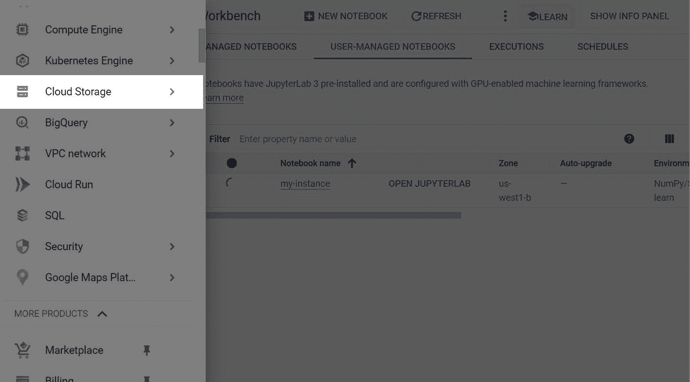

   *一个界面截图，突出显示了左侧面板上的云存储选项。*

   **图 6-1** Cloud Storage

   您将看到以下屏幕。

   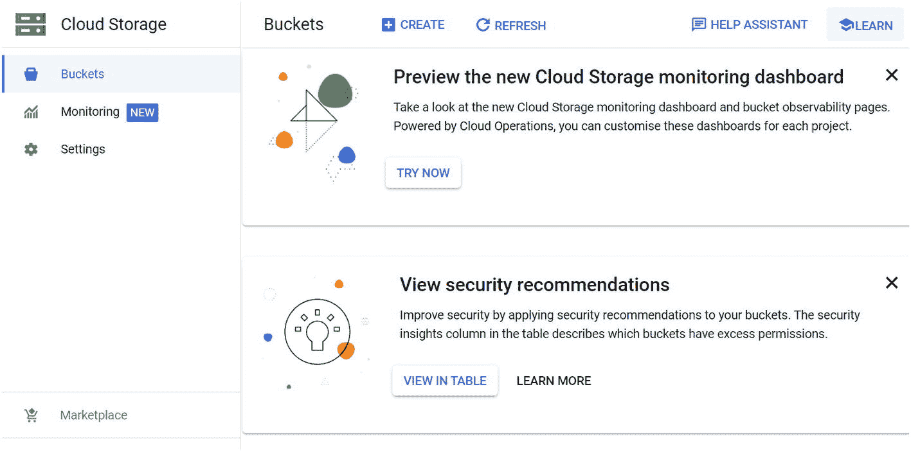

   *一个界面截图，显示了在云存储下选择存储桶选项。它列出了存储桶下的云存储预览和安全建议。*

   **图 6-2** 存储桶

   接下来，点击“创建”。

   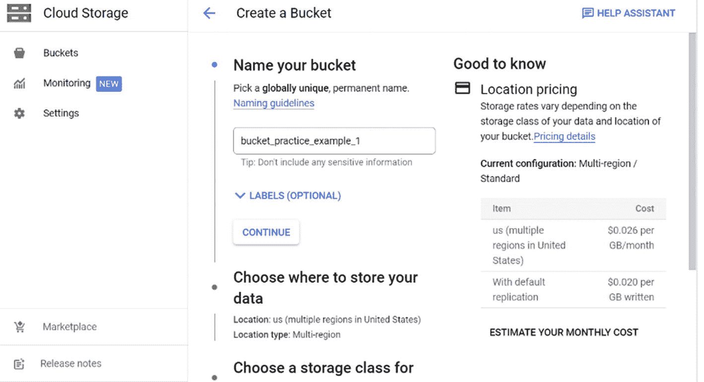

   *一个云存储界面的截图，显示了 3 个选项。它列出了用于创建存储桶的菜单。内容包含名称、存储位置和存储类别。*

   **图 6-3** 新建存储桶

   为存储桶提供一个唯一的名称，选择首选区域，并选择所需的存储类别，例如标准存储或低频访问存储。调整任何其他配置，例如版本控制和生命周期规则。最后，点击“创建”按钮开始创建存储桶。

   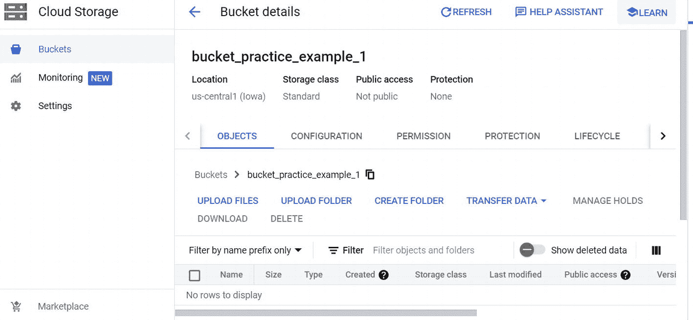

   *一个云存储界面的截图，显示了存储桶选项的选择。它列出了包含对象、配置、权限、保护和生命周期的存储桶详细信息。*

   **图 6-4** 存储桶详细信息

   成功创建存储桶后，您就可以开始在其中上传和访问数据。

2. **选择存储类别**：选择最适合您数据湖需求的存储类别。例如，对于频繁访问的数据，您可能希望使用标准存储类别；对于不频繁访问的数据，则使用近线和冷线存储类别。
3. **配置访问控制**：使用 IAM（身份与访问管理）为您的数据湖设置访问控制策略并管理权限。
4. **将数据摄取到数据湖**：您可以使用 GCP 控制台、`gsutil` 命令行工具或其他支持的数据摄取工具将数据上传到您的存储桶。
5. **在数据湖中组织数据**：使用目录结构或对象命名约定来组织存储桶内的数据。这将使执行分析时更容易搜索和访问数据。
6. **使用 GCP 分析和 AI 工具**：使用 GCP 的分析和 AI 工具套件，例如 `BigQuery`、`Cloud Dataflow` 和 `AI Platform`，来摄取和处理来自数据湖的数据。这些工具可以帮助您分析存储在数据湖中的大量数据并获得洞察。
7. **确保安全性和合规性**：使用 GCP 的安全性和合规性工具，例如 `Cloud Audit Logs` 和 `Security Command Center`，确保您的数据湖安全且符合行业法规。

使用 Google Cloud Storage 创建分析用数据湖涉及设置存储桶、配置访问控制、摄取和组织数据，以及使用 GCP 的分析和 AI 工具从数据中获取洞察。通过遵循这些说明，您可以建立一个强大的数据湖，使您能够基于数据做出明智的决策，并在您的行业中获得竞争优势。

### Google Cloud SQL 简介及其在关系数据库中的用例

Google Cloud SQL 是 Google Cloud Platform (GCP) 提供的一种完全托管的关系数据库服务，使用户能够在云中创建、配置和使用数据库。借助 Google Cloud SQL，用户可以充分利用流行的关系数据库管理系统（如 MySQL、PostgreSQL 和 SQL Server）的强大功能和灵活性，而无需管理底层基础设施、补丁或备份。

Google Cloud SQL 提供了多项功能，使其成为一个强大且灵活的数据库解决方案，包括以下内容：

**自动备份和时间点恢复**：Google Cloud SQL 自动备份数据库并支持时间点恢复，使用户能够轻松地将数据库恢复到特定时间点。

**高可用性和持久性**：Google Cloud SQL 提供高可用性和持久性的数据库解决方案，具有自动故障转移和跨多个区域和区域的內建复制功能。

**可扩展性**：Google Cloud SQL 允许用户根据需要向上或向下扩展其数据库资源，提供灵活性和成本效益。

**兼容性**：Google Cloud SQL 与流行的开源和商业关系数据库管理系统兼容，使现有数据库迁移到云端变得容易。

**安全性**：Google Cloud SQL 提供多层安全性，包括静态和传输中加密、基于 IAM 的访问控制以及网络安全（Secureicon，2022）。

**与其他 GCP 服务的集成**：Google Cloud SQL 与其他 GCP 服务（如 `Compute Engine`、`App Engine` 和 `Kubernetes Engine`）无缝集成，使用户能够在云中构建和部署强大的应用程序。

总体而言，Google Cloud SQL 提供了一个完全托管、高可用且可扩展的数据库解决方案，使用户能够轻松地在云中部署、管理和使用流行的关系数据库管理系统。


#### 使用 Cloud SQL 创建 MySQL 实例

1.  要开始操作，请访问 Google Cloud 控制台 [`https://console.cloud.google.com/`](https://console.cloud.google.com/) 并登录。然后，选择您打算在其中创建 MySQL 实例的所需项目。

2.  启用 API：
    - `Compute Engine API`
    - `sqladmin API (prod)`

3.  进入项目后，点击左上角的导航菜单，然后选择 `SQL`。

    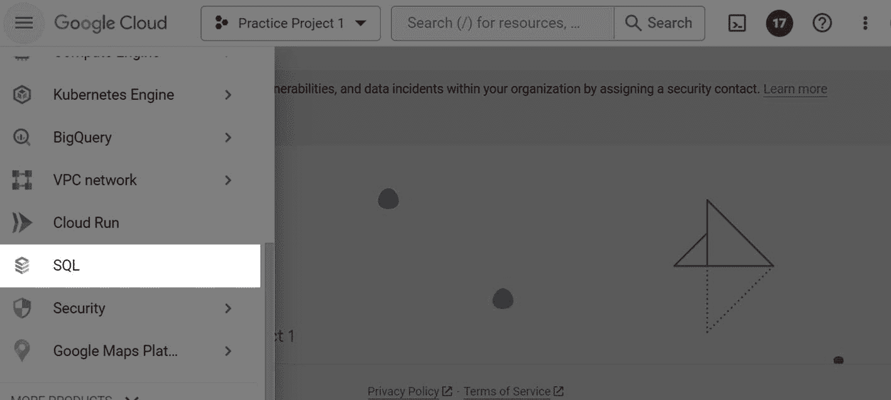
    一张 Google Cloud 界面的截图，突出显示了 `SQL` 选项。
    **图 6-5** SQL 菜单项

4.  在 Cloud SQL 页面上，点击 `CREATE INSTANCE` 按钮。

    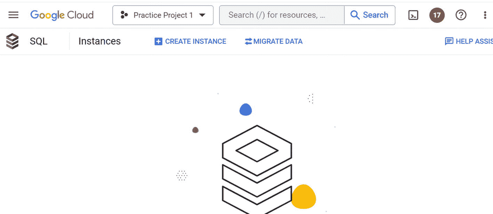
    一张 Google Cloud 界面的截图，显示了创建实例工作区下的实例列表。
    **图 6-6** 创建实例

5.  在“创建实例”页面上，选择您要使用的 MySQL 版本。

    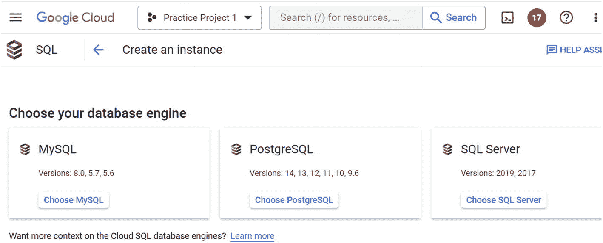
    一张 Google Cloud 界面的截图，显示了“创建实例”下的选项。它列出了数据库引擎：`MySQL`、`PostgreSQL` 和 `SQL server`。
    **图 6-7** 创建实例页面

6.  选择实例类型并根据您的要求配置实例设置。您可以设置实例 ID、区域以及您希望创建实例的可用区。

    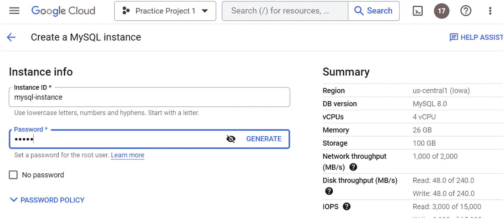
    一张 Google Cloud 界面的截图，显示了创建 MySQL 实例下的选项。它列出了包含实例 ID 和密码的实例信息。右侧面板显示摘要。
    **图 6-8** 配置实例设置

7.  接下来，配置实例的机器类型和存储类型。您还可以设置存储容量。

8.  在“连接”部分下，您可以选择如何连接到您的实例。您可以选择公共或私有 IP 地址，并配置用于访问的授权网络。

9.  在“附加配置”部分下，您可以配置高级选项，例如数据库标志、备份设置和维护设置。

10. 配置完所有设置后，点击页面底部的 `CREATE INSTANCE` 按钮来创建 MySQL 实例。

    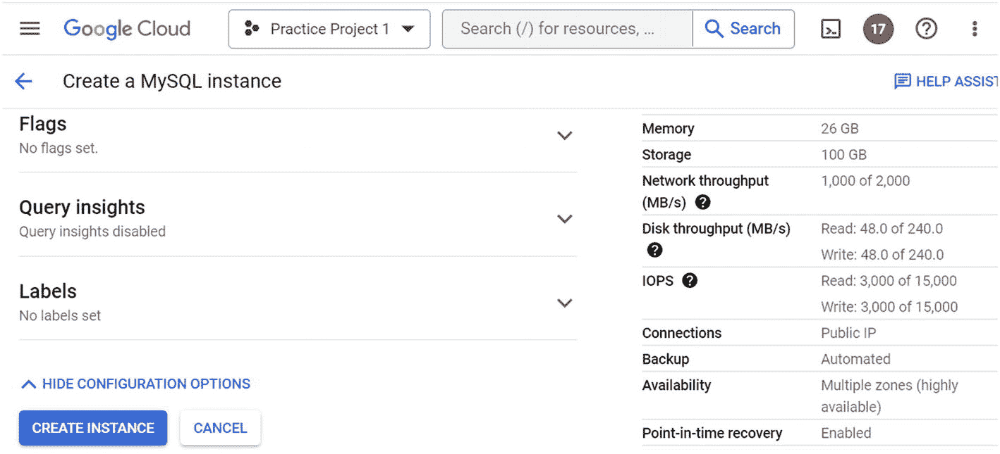
    一张 Google Cloud 界面的截图，显示了创建 MySQL 实例下的选项。它列出了标志、查询洞察和标签，右侧显示属性。
    **图 6-9** 创建 MySQL 实例

11. 实例创建过程可能需要几分钟，具体取决于配置和分配的资源。实例创建完成后，使用任何 MySQL 客户端连接到它并开始使用。

    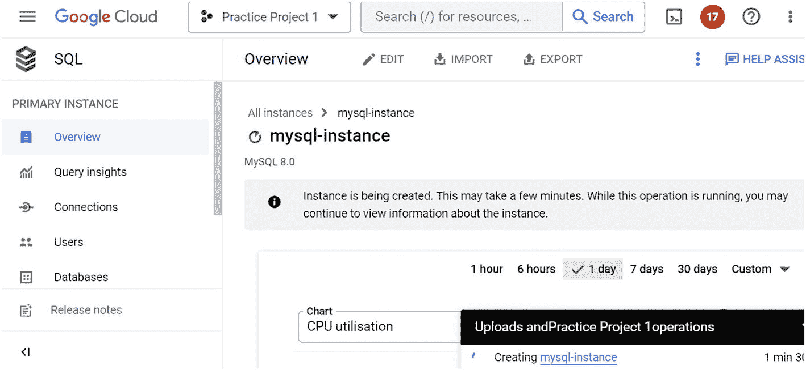
    一张 Google Cloud 界面的截图，显示了一个下拉菜单，其中选择了“概览”。它列出了 MySQL 实例概览以及 CPU 利用率图表。
    **图 6-10** MySQL 实例概览

就是这样！您现在已经成功使用 Cloud SQL 创建了一个 MySQL 实例。

#### 连接到您的 MySQL 实例

1.  点击“激活 Cloud Shell”。

2.  使用以下命令连接到您的 MySQL 实例：

    ```
    gcloud sql connect mysql-instance --user=root
    ```

    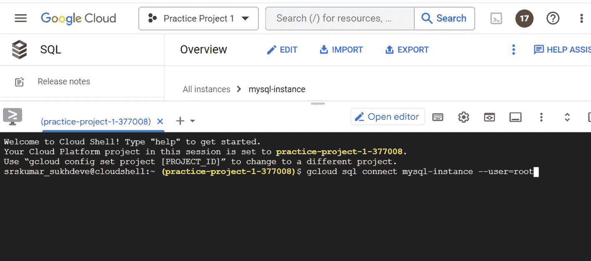
    一张 Google Cloud 界面的截图，显示了 SQL 选项。它列出了概览，并带有一个包含代码的工作区，该代码显示了连接到 MySQL 实例的欢迎消息。
    **图 6-11** 连接到 MySQL 实例

3.  授权。

    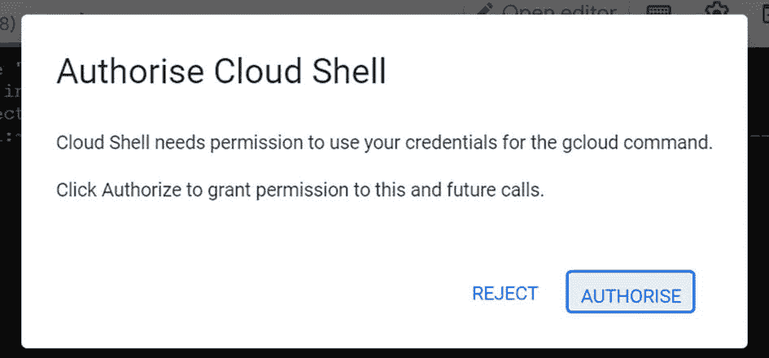
    一张弹出框的截图，显示了授权 Cloud Shell 消息，并带有“拒绝”和“授权”按钮。
    **图 6-12** 授权 Cloud Shell

4.  输入创建 SQL 实例时设置的密码，您将看到 MySQL 提示符 (`mysql>`)。

#### 在 SQL 中创建数据库并上传数据

1.  此代码将创建一个名为 `college` 的新数据库。您可以将 `college` 替换为您想要给数据库起的名称：

    ```
    CREATE DATABASE college;
    ```

    请记住为您的数据库使用适当的命名约定，以便于识别并避免与其他数据库发生命名冲突。

2.  以下代码将首先使用 `USE` 语句选择 `college` 数据库，然后创建一个名为 `students` 的新表，该表包含三列：`id`、`name` 和 `age`。`id` 列是一个自增整数，用作该表的主键：

    ```
    USE college;
    CREATE TABLE students (
    id INT NOT NULL AUTO_INCREMENT,
    name VARCHAR(50) NOT NULL,
    age INT NOT NULL,
    PRIMARY KEY (id)
    );
    ```

    您可以修改列名、数据类型和约束以满足您的特定需求。`CREATE TABLE` 语句在定义数据库表结构方面提供了很大的灵活性。

3.  以下代码将向 `students` 表中插入五行数据，并为 `name` 和 `age` 列提供值。未指定 `id` 列，因为它是一个自增主键，将由 MySQL 自动生成：

    ```
    INSERT INTO students (name, age) VALUES
    ('John Smith', 20),
    ('Jane Doe', 21),
    ('Bob Johnson', 19),
    ('Samantha Lee', 22),
    ('Chris Brown', 18);
    ```

    您可以修改示例数据以满足您的特定需求，并根据需要插入任意多行。请记住为所有未定义为 `AUTO_INCREMENT` 或 `DEFAULT NULL` 的列提供值，否则您将收到错误。

    请注意，`INSERT INTO` 语句也可用于一次向多个表插入数据，或使用子查询从另一个表插入数据。

    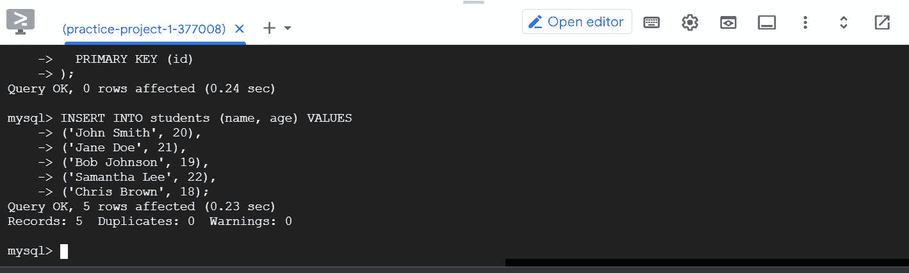
    一张 Google Cloud 界面的截图，显示了工作区并将学生数据上传到数据库中。
    **图 6-13** 插入数据

4.  查看表中的数据：

    ```
    select * from students;
    ```

    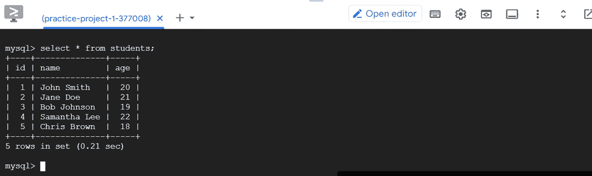
    一张 Google Cloud 界面的截图，显示了工作区以及已上传到数据库中的数据（ID、姓名和年龄）。
    **图 6-14** 查询

5.  清理。

    使用以下代码删除数据库：

    ```
    DROP DATABASE college;
    ```

6.  使用 `exit` 命令断开与 MySQL 实例的连接，并关闭 Shell。

7.  删除实例。如果删除选项未启用，请转到“数据保护”部分并禁用删除保护。


### Google Cloud Pub/Sub 简介及其在实时数据流中的应用场景

Google Cloud Pub/Sub 是 Google Cloud Platform 提供的一项消息传递服务，可实现应用程序之间的异步通信。它允许开发者构建高度可扩展且可靠的消息传递系统，以解耦且容错的方式在应用程序的不同组件之间交换消息。

Pub/Sub 的基本理念是：发布者（publishers）将消息发送到主题（topics），而订阅者（subscribers）则从这些主题接收消息。主题是消息可以发送到的虚拟通道，订阅者可以关联一个或多个主题以从中接收消息。消息可以采用任何格式，包括 JSON、XML 或二进制数据，最大可达 10 MB。

Google Cloud Pub/Sub 提供了一系列功能，简化了开发者对消息传递系统的使用和扩展。例如，它提供了 REST API 以及多种编程语言的客户端库，包括 Java、Python 和 Go。它还提供了持久化的消息存储，允许消息被存储并在订阅者离线或不可用时也能投递给他们。

Pub/Sub 还与其他 Google Cloud 服务集成，例如 Google Cloud Functions、Google Cloud Dataflow 和 Google Cloud Storage，为构建云原生应用的开发者提供了无缝体验。此外，Pub/Sub 具有高度可扩展性，每秒可处理数百万条消息，使其成为高吞吐量消息传递场景的理想选择。

Google Cloud Pub/Sub 广泛应用于实时数据流场景，例如：

1.  **物联网数据采集**：Pub/Sub 可用于采集和处理物联网设备产生的大量实时数据。设备可以将数据发布到主题，订阅者可以消费这些数据以执行实时分析或根据数据触发操作。
2.  **点击流处理**：Pub/Sub 可用于实时处理网站或移动应用产生的点击流数据。数据可以流式传输到 Pub/Sub 主题，订阅者可以消费这些数据来分析用户行为并做出实时决策。
3.  **金融交易**：Pub/Sub 可用于将实时股票报价、财经新闻和其他市场数据流式传输给订阅者，使他们能够快速响应市场变化并实时执行交易。
4.  **游戏**：Pub/Sub 可用于流式传输实时游戏事件，例如玩家移动、游戏状态变化和游戏内购买。这使得开发者能够构建实时多人在线游戏，并为用户提供个性化的游戏体验。
5.  **实时分析**：Pub/Sub 可用于将实时数据流式传输到 Google Cloud Dataflow 或 Apache Beam 等分析平台，从而实现实时分析和决策。

总之，Google Cloud Pub/Sub 提供了一种可靠且可扩展的消息传递服务，可用于物联网、金融、游戏和分析等多个行业的实时数据流场景。

#### 使用 Cloud Pub/Sub 设置和消费数据流

动手实践 Pub/Sub 的逐步指南：

1.  **项目设置**：为确保您拥有必要的权限，请创建一个新项目，或选择一个您已拥有权限的现有项目。
2.  **创建主题**：前往 Pub/Sub 浏览器创建一个主题。


一张 Google Cloud 界面的截图，突出显示了 Pub 或 Sub 菜单。

图 6-15 Pub/Sub


一张 Google Cloud 界面的截图，显示了一个下拉菜单，其中选择了 Pub 或 Sub 菜单。它列出了要在列表和指标下创建的文件。

图 6-16 Pub/Sub——创建主题

点击 `CREATE TOPIC`。填写必要信息，然后点击 `CREATE TOPIC`。


一张标题为“创建主题”的对话框截图。它包含主题 ID 字段以及添加默认订阅和加密的选项。

图 6-17 Pub/Sub——主题信息

3.  **添加订阅**：您必须创建订阅才能接收消息。一个主题必须与一个订阅匹配。当您在上一步创建主题时，Pub/Sub 会自动创建一个同名的订阅。按照页面上的步骤创建另一个订阅。


一张 Google Cloud 界面的截图，显示了一个下拉菜单，其中选择了 Pub 或 Sub 菜单。选择了“主题”选项，并且将要添加该主题的订阅。

图 6-18 创建订阅

向下滚动页面，填写必要信息后点击 `Create`。

4.  返回主题页面并点击该主题。向下滚动，您应该能够看到已创建的订阅。


一张 Google Cloud 界面的截图，显示了一个下拉菜单，其中选择了 Pub 或 Sub 菜单。它列出了已创建的订阅及其详细信息、快照、指标和消息。

图 6-19 Pub/Sub——创建订阅

5.  在该主题上发布两条消息。

点击 `MESSAGES` 标签页，您可以找到 `PUBLISH MESSAGE` 标签页。点击它。


一张 Google Cloud 界面的截图，显示了一个下拉菜单，其中选择了 Pub 或 Sub 菜单。选择了“消息”标签页，其中显示了“发布消息”按钮。

图 6-20 发布消息


一张 Google Cloud 界面的截图，显示了发布消息页面。它列出了主题名称、发布计数、消息数量和消息正文。

图 6-21 发布一条消息

在消息正文中输入一条消息。

6.  前往订阅页面并点击该订阅。转到 `MESSAGES`。如果您没有找到任何消息，请点击 `PULL` 直到您获取到消息。您应该能够在消息正文中看到该消息。


一张 Google Cloud 界面的截图，显示了一个下拉菜单，其中选择了订阅菜单。它列出了已创建的订阅及其名称、状态和主题名称。

图 6-22 拉取消息

Pub/Sub 不保证消息的时间顺序。您可能只注意到了一条消息。如果是这样，请继续点击 `PULL`，直到另一条通知出现。

7.  **清理**：如果您想清理在本教程中创建的 Pub/Sub 资源，可以删除您创建的主题。再次访问“主题”标签页。选中主题旁边的框，然后点击 `DELETE`。


一张 Google Cloud 界面的截图，显示了一个下拉菜单，其中选择了主题菜单。它列出了已创建的主题，可以通过选择特定主题并点击删除按钮来删除。

图 6-23 删除主题

同样地，您也可以清理您的订阅。


## 总结

本章探讨了数据分析和存储的世界，重点介绍了 Google Cloud Storage、Google Cloud SQL 和 Google Cloud Pub/Sub。

我们首先介绍了 Google Cloud Storage，这是一种高度可扩展且持久的对象存储服务。我们讨论了 Cloud Storage 适用的各种用例，例如存储和归档数据、托管静态网站以及作为备份和恢复解决方案。我们探讨了 Cloud Storage 的主要特性，包括其存储类别、访问控制以及与其他 Google Cloud 服务的集成。

接下来，我们深入研究了 Google Cloud SQL，这是一种全托管的关系型数据库服务。我们讨论了使用 Cloud SQL 存储和管理关系数据的优势，包括其自动备份、可扩展性以及与 MySQL 和 PostgreSQL 等流行数据库引擎的兼容性。我们探讨了 Cloud SQL 适用的用例，例如 Web 应用程序、内容管理系统和数据分析。

随后，我们将注意力转向 Google Cloud Pub/Sub，这是一种用于实时数据流传输的消息传递服务。我们学习了 Pub/Sub 的核心概念，包括主题、发布者和订阅者。我们发现了 Pub/Sub 表现出色的用例，例如事件驱动架构、实时分析和物联网数据处理。我们还探讨了 Pub/Sub 与其他 Google Cloud 服务（如 Cloud Functions 和 Dataflow）的集成。

最后，我们学习了如何使用 Cloud Pub/Sub 设置和消费数据流。我们探讨了创建主题、发布消息以及创建订阅者以接收和处理流式数据所涉及的步骤。我们深入了解了 Pub/Sub 的可扩展性和可靠性，使其成为构建健壮且可扩展的数据流管道的理想选择。

通过本章的学习，我们更深入地理解了数据存储和分析在现代数据领域中的重要性。我们了解到 Google Cloud Storage、Cloud SQL 和 Cloud Pub/Sub 如何提供强大的工具和服务来大规模地存储、管理和分析数据。通过利用这些服务，组织可以释放其数据的价值，获得有意义的见解，并做出数据驱动的决策。

凭借本章获得的知识和技能，我们能够设计和实现健壮的数据存储解决方案，利用关系型数据库进行高效的数据管理，并利用实时数据流传输的强大功能进行实时分析和事件驱动架构。

## 7. 高级主题

本章深入探讨了保护和管理 Google Cloud Platform (GCP) 资源的高级方面、使用 Google Cloud Source Repositories 进行版本控制，以及强大的数据集成工具：Dataplex 和 Cloud Data Fusion。

我们首先强调使用身份与访问管理 (IAM) 进行安全的资源管理，涵盖角色、权限以及实现强访问控制的最佳实践。

我们将 Google Cloud Source Repositories 作为一个托管版本控制系统进行探讨，用于可扩展的代码管理和协作。Dataplex 被介绍为一个数据编织平台，有助于数据发现、谱系和治理，而 Cloud Data Fusion 则简化了数据管道的创建和管理。

在整个过程中，我们将获得增强 GCP 安全性、简化代码协作以及优化数据集成以满足各种处理需求的见解。

### 使用 IAM 保护和管理 GCP 资源

IAM（身份与访问管理）是 Google Cloud Platform (GCP) 提供的一项服务，用于简化对 GCP 资源的访问管理。IAM 使您能够控制资源的可访问性，并定义个人可以对这些资源执行的操作。它提供了一个集中管理访问控制的地方，从而更容易实施安全策略并降低未经授权访问的风险。

以下是 IAM 相关的一些关键概念：

1.  **资源**：可以应用 IAM 策略的 GCP 实体，例如项目、存储桶或实例。

2.  **角色**：角色是权限的集合，指定了对特定资源允许执行的操作。这些角色可以分配给用户、组或服务账号，从而确定其操作范围。

3.  **成员**：可以被分配角色的身份。成员可以是用户、组或服务账号。

4.  **策略**：一组角色绑定，定义了谁对资源拥有什么权限。

以下是 IAM 的一些主要特性：

1.  **基于角色的访问控制 (RBAC)**：IAM 使用 RBAC 来控制对资源的访问。RBAC 允许您定义角色并将其分配给用户、组或服务账号。

2.  **自定义角色**：IAM 提供了具有预定义权限的预定义角色，但您可以创建适合您特定需求的自定义角色。这允许您向用户或服务授予更细粒度的权限。

3.  **服务账号**：服务账号是一种特殊类型的账号，可供应用程序或服务用于向 GCP API 进行身份验证。它们可以像人类用户一样被授予权限，但不与特定个人绑定。

4.  **审计日志**：IAM 提供审计日志，允许您跟踪谁有权访问您的资源以及他们执行的操作。

5.  **细粒度访问控制**：IAM 提供对资源的细粒度访问控制。您可以控制对项目内特定资源的访问，甚至可以控制对特定文件夹或组织内资源的访问。

6.  **条件访问**：IAM 提供条件访问，允许您为访问资源的用户或服务设置条件。例如，您可以根据 IP 地址或设备设置条件。

总之，IAM 是一项强大的服务，允许您管理对 GCP 资源的访问。使用 IAM，您可以实施安全策略，降低未经授权访问的风险，并确保您的资源得到良好管理。


#### 使用资源管理器 API 授予和移除 IAM 角色

1.  为确保您拥有必要的权限，请创建一个新项目，或选择一个您已拥有这些权限的现有项目。
2.  启用 API：
    - Identity and Access Management (IAM) API
    - Cloud Resource Manager API
3.  为项目中的一位主账号授予 `Logs Viewer` 角色。


截图显示了 Google Cloud 网站页面的一个片段，左侧面板选中了“IAM 与管理”选项卡，该选项卡下显示了一个子菜单，其中“IAM”选项卡被高亮。

**图 7-1** IAM 与管理

1.  点击 `GRANT ACCESS`。


截图显示了 Google Cloud 网站页面的一个部分，左侧面板选中了“IAM”选项卡，右侧显示 IAM 页面，顶部的 `GRANT ACCESS` 选项卡被高亮。

**图 7-2** `GRANT ACCESS`

1.  输入主账号的电子邮件地址。


截图显示了“授予对实践项目 1 的访问权限”页面，其中包含“资源”、“添加主账号”和“分配角色”等标题，以及相应的输入字段和“IAM 条件”。页面底部的“保存”按钮被选中。

**图 7-3** `GRANT ACCESS` — 信息

1.  从 `Select a role` 菜单中，选择您要授予访问权限的产品或服务。
2.  如果您想撤销访问权限，可以按照以下步骤操作：

**确定要撤销其角色的成员和角色**：在撤销 IAM 角色之前，您需要知道哪个成员被分配了该角色，以及您要撤销哪个角色。

**导航到 IAM 页面**：点击左侧导航菜单中的 `IAM` 选项卡，打开 Google Cloud 控制台中的 IAM 页面。

**查找成员**：使用页面顶部的搜索栏查找被分配了您要撤销的角色的成员。点击该成员的姓名以查看其被分配的角色。

**移除角色**：找到您要撤销的角色，点击 `X` 图标以从该成员处移除该角色。将出现一个确认对话框。点击 `Remove` 以确认您要撤销该角色。

**验证角色已被撤销**：撤销角色后，您应验证该成员不再拥有与该角色关联的资源的访问权限。您可以使用 Google Cloud 控制台或 Cloud Identity and Access Management API 来检查该成员的角色和权限。

需要注意的是，撤销 IAM 角色并不会从您的项目或组织中移除该成员。该成员可能仍被分配有其他角色，并且可能仍能访问某些资源。要完全从您的项目或组织中移除一个成员，您需要移除其所有被分配的角色和权限。

### 使用 Google Cloud Source Repositories 进行版本控制

Google Cloud Source Repositories 是 Google Cloud Platform (GCP) 提供的一项源代码管理服务。它允许您以安全且可扩展的方式存储和管理源代码，并提供高级功能，例如代码搜索、代码审查以及持续集成和持续部署 (CI/CD)。

以下是 Google Cloud Source Repositories 的一些关键特性：

- **可扩展性**：Google Cloud Source Repositories 可以处理任意大小的仓库，并能扩展以满足大型企业的需求。
- **代码搜索**：Google Cloud Source Repositories 提供高级代码搜索功能，允许您跨所有仓库搜索特定的代码片段、文件甚至函数。
- **代码审查**：Google Cloud Source Repositories 使审查代码更改和与其他开发者协作变得容易。您可以创建拉取请求、分配审查者并实时跟踪更改。
- **集成的 CI/CD**：Google Cloud Source Repositories 与 `Cloud Build` 和 `Cloud Functions` 等其他 GCP 服务集成，允许您自动构建和部署代码。
- **安全性**：Google Cloud Source Repositories 提供多层安全保护来保护您的代码，包括静态和传输中加密、基于 IAM 角色的访问控制以及审计日志。
- **灵活性**：Google Cloud Source Repositories 支持广泛的源代码管理工具和协议，包括 `Git`、`Mercurial` 和 `Subversion`。

Google Cloud Source Repositories 与其他 GCP 服务完全集成，允许您将其与其他 GCP 工具和服务无缝结合使用。它是管理源代码、与其他开发者协作以及自动化软件开发工作流的强大解决方案。


### Dataplex

`Dataplex` 是谷歌云于 2021 年推出的一款全新数据平台。它旨在通过提供统一、无服务器且智能化的数据平台，来简化现代数据管理的复杂性。`Dataplex` 允许用户通过单一界面管理跨多云和本地数据存储的数据。

该平台提供了许多关键特性，使其成为数据管理的宝贵工具：

1.  **统一数据架构**：`Dataplex` 提供统一的数据架构，使用户能够管理跨多个数据存储的数据，包括 `Google Cloud Storage`、`BigQuery`、`Cloud Spanner` 和 `Cloud SQL`。这使得用户能够将数据存储和管理在最适合其用例的数据存储中，同时保持数据视图的一致性。

2.  **无服务器架构**：`Dataplex` 构建于无服务器架构之上，这意味着用户无需担心管理基础设施。这使得设置和扩展数据管理系统变得容易，同时降低了成本并提高了敏捷性。

3.  **智能数据管理**：通过采用机器学习算法，`Dataplex` 自动化了多种数据管理任务，包括数据分类、数据沿袭和数据发现。这种自动化增强了数据的有效治理和管理，降低了出错的可能性，并提高了整体效率。

4.  **开放平台**：`Dataplex` 是一个开放平台，允许用户使用他们偏好的工具和技术。这使得它易于与现有系统和工作流程集成，并可通过自定义应用程序和服务扩展平台。

`Dataplex` 是一个强大的数据管理平台，它简化了现代数据管理的复杂性。凭借其多样化的功能，`Dataplex` 被证明是数据科学家、数据工程师以及其他处理海量复杂数据集的专业人士的宝贵工具。

本教程将指导您完成在 `Google Cloud Console` 中配置 `Dataplex` 的基本步骤。

#### 步骤 1：创建 Google Cloud 项目

1.  首先，您必须在 `Google Cloud Console` 中创建一个新项目。但是，如果您已有项目，请继续执行下一步。

2.  转到 [Google Cloud Console](https://console.cloud.google.com/)。

3.  点击页面顶部的项目下拉菜单，然后选择 `NEW PROJECT`。

4.  为您的项目输入一个名称，然后点击 `CREATE`。

#### 步骤 2：启用 Dataplex API

接下来，我们需要为我们的项目启用 `Dataplex API`。

1.  在 `Google Cloud Console` 中，导航到 `APIs and services`。

2.  点击 `+ Enabled APIs and services` 按钮。


一张谷歌云网站页面的截图，左侧面板选中了 `A P Is and Services` 选项卡，该选项卡下显示了一个列出不同选项的子菜单。

图 7-4

`+ Enabled APIs and services`

1.  在搜索栏中搜索 `Dataplex`，然后从结果中选择 `Dataplex API`。


一张截图展示了网页的一部分，搜索栏中填入了单词 `dataplex`，下方显示了搜索结果。

图 7-5

选择 `Dataplex API`

1.  点击 `ENABLE` 按钮以启用该 API。


一张截图展示了谷歌云网页的一个片段，在产品详情标题下显示了 `Cloud Dataplex A P I`。下方的启用按钮已被点击。

图 7-6

启用 `Dataplex`

#### 步骤 3：创建数据湖

1.  在云控制台中转到 `Dataplex`，然后点击 `Explore`。


一张 `Dataplex A P I` 页面的截图，在谷歌云网站上选中了 `create lake` 按钮。

图 7-7

`Dataplex`——创建数据湖

1.  点击 `CREATE LAKE` 后，您可以看到下图。填写所需的详细信息。点击 `CREATE`。


