# Dataplex API 页面的截图，在“创建新湖”选项卡下显示了显示名称、ID 和区域等输入字段。

**图 7-8** 创建数据湖

1. 创建数据湖后，您将看到以下屏幕。

   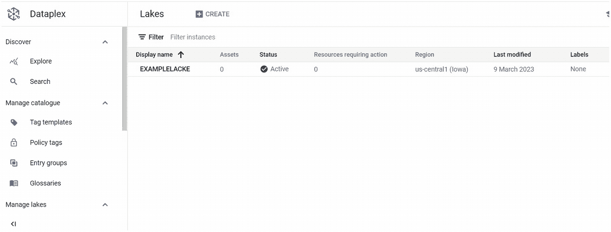

   Dataplex 网页的截图，显示了显示名称、资产、状态、需要操作的资源、区域、上次修改时间和标签等详细信息。屏幕顶部的“创建”按钮被高亮显示。

**图 7-9** 数据湖已创建

1. 创建数据湖后，您可以添加区域。这些区域用于对非结构化和结构化数据进行逻辑分类。点击数据湖的名称，您将看到以下屏幕。

   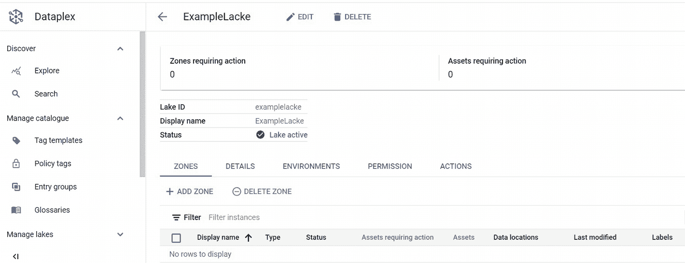

   Dataplex 网页的截图，显示了需要操作的区域、需要操作的资产、湖 ID、显示名称和状态等详细信息。下方选中了“区域”选项卡，其中显示了显示名称、类型、状态、需要操作的资产、资产、数据位置、上次修改时间和标签等详细信息。

**图 7-10** 管理数据湖

1. 点击 `+添加区域`，您将看到以下屏幕。

   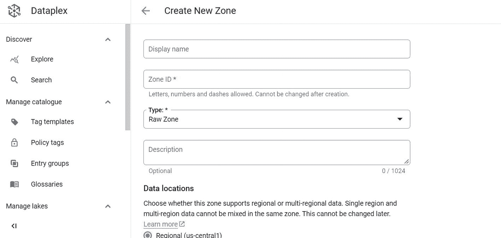

   Dataplex 网页的截图，在“创建新区域”选项卡下显示了显示名称、区域 ID、类型和描述等输入字段。

**图 7-11** 创建区域

1. 添加区域后，我们可以通过点击该区域向数据湖添加资产。

   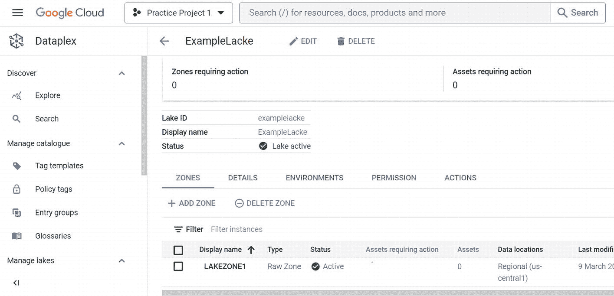

   Dataplex 网页的截图，在标题“示例”下显示了各种详细信息，其中状态通过复选标记指示为“湖已激活”。下方选中了“区域”选项卡，其中显示了不同的详细信息，状态通过复选标记指示为“已激活”。

**图 7-12** 数据湖区域已创建

1. 您将看到以下屏幕。点击 `+添加资产`。

   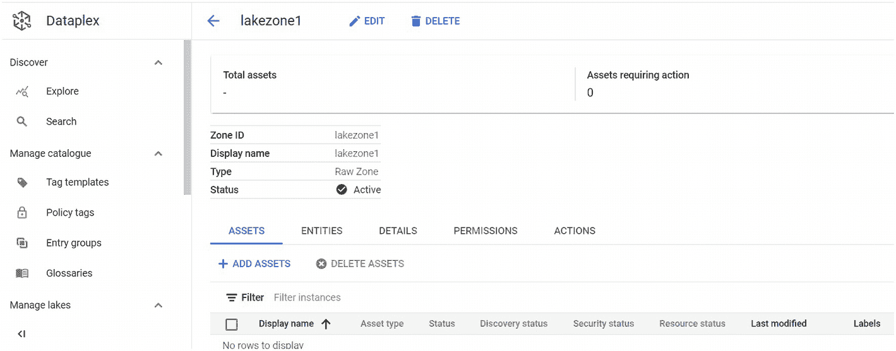

   Dataplex 网页的截图，在标题“湖区域 1”下显示了各种详细信息，其中状态通过复选标记指示为“已激活”。下方选中了“资产”选项卡，其中显示了显示名称、资产类型、状态、发现状态、安全状态、资源状态、上次修改时间和标签等详细信息。

**图 7-13** 添加资产——屏幕 1

1. 从下图，您可以点击 `添加一项资产`。

   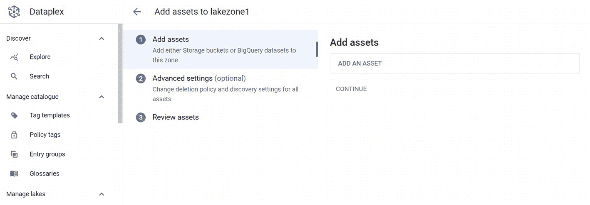

   Dataplex 网页的截图，在标题“向湖区域 1 添加资产”下列出了三个用于添加资产的选项，选中后会在页面右侧显示“添加一项资产”功能，该功能被高亮显示。

**图 7-14** 添加资产——屏幕 2

1. 在以下表单中填写信息。

   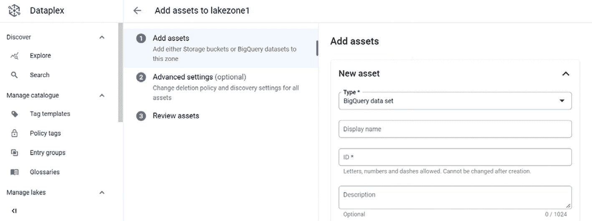

   Dataplex 网页的截图，在标题“向湖区域 1 添加资产”下列出了三个用于添加资产的选项，选中后显示了类型、显示名称、ID 和描述等输入字段。

**图 7-15** 添加资产信息

1. 这里我们正在添加一个 `BigQuery` 数据集。提供一个显示名称，该名称将自动与 ID 保持一致。向下滚动并浏览数据集。将显示一个数据集列表。选择该数据集。点击“完成”，然后点击“继续”。

2. 将出现发现设置。点击“继续”。

3. 检查您的资产，然后点击“提交”。

4. 如果一切顺利，您将看到下图。

   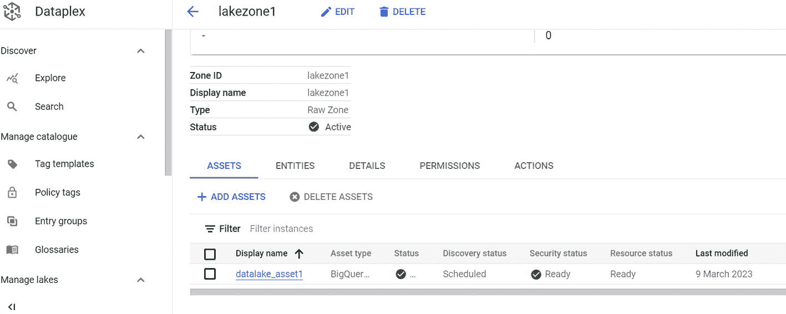

   Dataplex 网页的截图，在标题“湖区域 1”下显示了各种详细信息，其中状态通过复选标记指示为“已激活”。下方选中了“资产”选项卡，其中显示了不同的详细信息，状态和安全状态均通过复选标记指示为“已激活”。

**图 7-16** 资产状态

1. 为了避免产生任何费用，如果您不需要已创建的资源，则应将其删除。首先，删除资产。然后，您可以删除区域，最后删除数据湖。

### Cloud Data Fusion

`Cloud Data Fusion` 是一项完全托管的数据集成服务，允许用户在 `Google Cloud Platform` 上高效地构建和管理 ETL/ELT（提取、转换、加载/提取、加载、转换）管道。该服务旨在让数据分析师和数据工程师无需深厚的技术专业知识即可轻松创建、部署和管理大规模数据管道。

`Cloud Data Fusion` 附带一个基于 Web 的 UI，为构建和管理数据管道提供了图形界面。该 UI 包含一个用于连接源和目标的拖放界面，以及一个包含大量预构建连接器（用于常见数据源和数据接收器）的库。`Cloud Data Fusion` 还支持复杂的数据转换，例如连接、合并和过滤操作。

在底层，`Cloud Data Fusion` 使用 `Apache Spark` 和 `Apache Beam` 这两个开源数据处理框架来执行数据转换并在系统之间移动数据。这使得 `Cloud Data Fusion` 能够支持广泛的数据源，包括关系数据库、NoSQL 数据库和文件系统，并且能够扩展以处理大量数据。

借助 `Cloud Data Fusion`，用户可以轻松创建数据管道，在各种系统之间移动数据，例如从本地数据中心到 `Google Cloud`，或者在 `Google Cloud` 上的不同服务之间移动数据。`Cloud Data Fusion` 与 `BigQuery`、`Cloud Storage` 和 `Cloud Pub/Sub` 等其他 `Google Cloud` 服务集成，使得在这些服务之间移动数据变得容易。

总的来说，`Cloud Data Fusion` 可以简化构建和管理数据管道的过程，使用户能够专注于从数据中提取价值，而不是管理底层基础设施。

#### 启用或禁用 `Cloud Data Fusion`

`Cloud Data Fusion` 可以与现有项目一起使用，也可以创建一个新项目。对于现有项目，需要启用 `Cloud Data Fusion API`。

要启用 `Cloud Data Fusion API` 并创建新项目，请按照以下步骤操作：

1. 在 `Google Cloud Console` 中选择或创建一个项目。

2. 确保已为您的项目启用结算功能。

3. 导航到 `Cloud Data Fusion` 的 API 概览页面。

   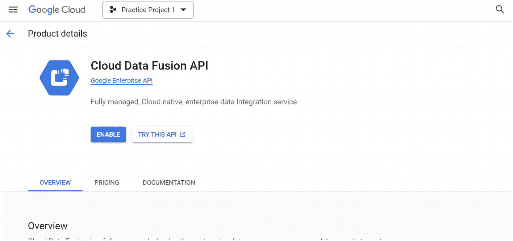

   截图显示了 `Google Cloud` 网站页面的一个片段，在标题“产品详情”下显示了 `Cloud Data Fusion API`。下方的“启用”按钮被选中。

**图 7-17** Cloud Data Fusion

4. 点击 `启用` 按钮以激活 `Cloud Data Fusion API`。

   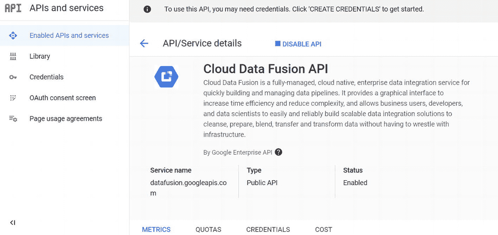

   截图描绘了“API 和服务”页面的一个片段，左侧面板选中了“已启用的 API 和服务”选项卡，页面右侧显示了 `Cloud Data Fusion API`。下方显示了服务名称、类型和状态等详细信息。

**图 7-18** API 已启用

您可以通过完成以下步骤，开始在您的项目中使用 `Cloud Data Fusion`。

#### 创建数据管道

1.  前往创建 `Data Fusion` 实例。

2.  输入一个实例名称。

3.  如果您使用的是 `Cloud Data Fusion` 6.2.3 或更高版本，请从 `授权` 字段中选择一个 `Dataproc` 服务账号，用于在 `Dataproc` 中运行您的管道。默认选项是 `Compute Engine` 账号。

提供所有必要详细信息后，只需点击 `创建` 按钮。请注意，实例创建过程可能需要最多 30 分钟才能完成。当 `Cloud Data Fusion` 正在创建您的实例时，您会在 `实例` 页面上实例名称旁边看到一个进度轮。一旦过程完成，该进度轮将变成一个绿色的勾选标记，表示实例已准备就绪。

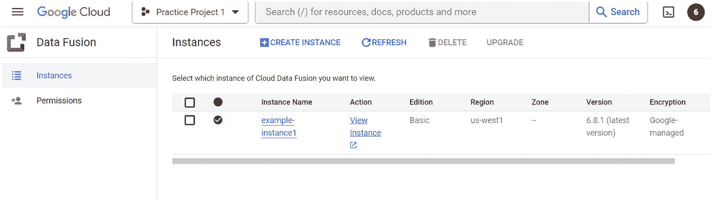

一张截图展示了 `Google Cloud` 网站页面的一个片段，其中从左侧面板选中了“实例”选项卡，该页面显示了实例名称、操作、版本、区域、可用区、版本和加密等详细信息。页面顶部的“创建实例”和“刷新”按钮被高亮显示。

**图 7-19** Data Fusion 实例

4.  点击 `查看实例`。

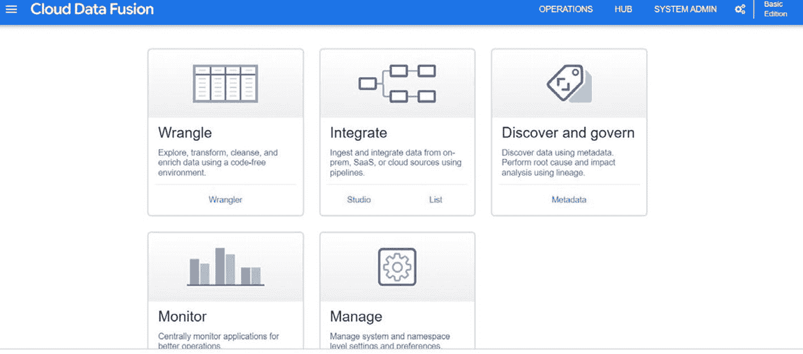

一张 `Cloud Data Fusion` 页面的截图，显示了诸如 `wrangle`、`integrate`、`discover and govern`、`monitor` 和 `manage` 等模板。

**图 7-20** Cloud Data Fusion 用户界面

5.  通过 `Cloud Data Fusion Hub`，您可以在 `Cloud Data Fusion` 用户之间重用和共享示例管道、插件和解决方案。点击 `Hub`。

6.  点击左下角的 `管道`。

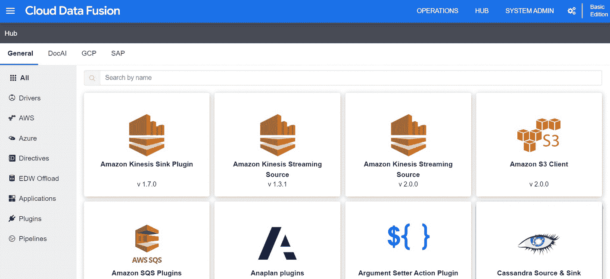

## 操作步骤

1. 点击 `Cloud Data Fusion Quickstart` 管道，然后点击 `完成并自定义`。

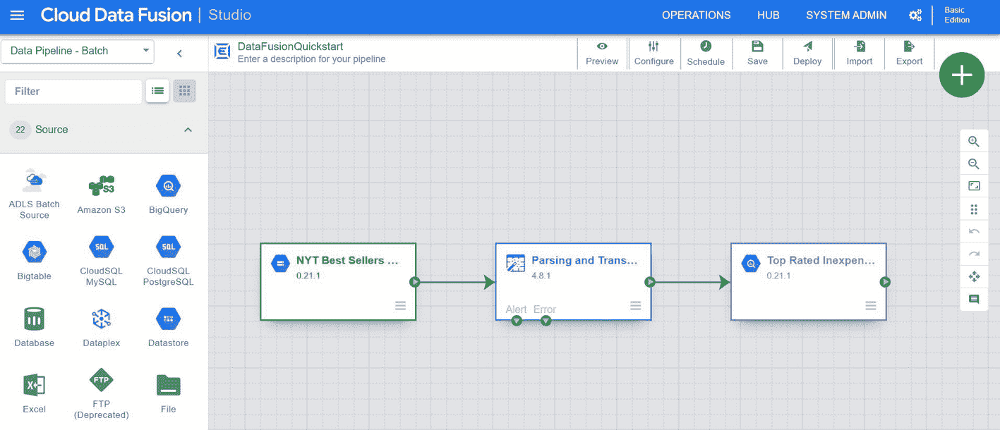

2. 点击 `部署`。

管道部署完成后，您可以访问其详细信息视图，在此视图中您可以执行以下操作：
*   查看管道的结构和配置。
*   手动运行管道，或配置计划或触发器以实现自动运行。
*   查看管道过去执行的摘要，包括执行时间、日志和指标。

3. 点击 `运行` 以执行您的管道。

4. 几分钟后，管道完成并将其状态转换为“成功”。此外，还会显示每个节点处理的记录数。

5. 要查看结果样本，请执行以下步骤：
    *   导航到 `BigQuery` 用户界面。
    *   打开您项目中的 `DataFusionQuickstart` 数据集。
    *   点击 `top_rated_inexpensive` 表。
    *   运行一个基本查询，例如 `SELECT * FROM `PROJECT_ID`.GCPQuickStart.top_rated_inexpensive LIMIT 10`，以查看数据样本。
    *   确保将 `PROJECT_ID` 替换为您项目的唯一标识符。

6. 为防止您的 `Google Cloud` 账户因本页面使用的资源而产生费用，请执行以下操作：
    *   删除您的管道在此快速入门期间写入的 `BigQuery` 数据集。
    *   删除 `Cloud Data Fusion` 实例。
    *   请注意，删除您的实例不会移除与您的项目关联的任何数据。
    *   （可选）如果需要，您也可以删除整个项目。

## 总结

本章探讨了与保护和管理 `Google Cloud Platform` (`GCP`) 资源、使用 `Google Cloud Source Repositories` 进行版本控制，以及两个强大的数据集成和管理工具：`Dataplex` 和 `Cloud Data Fusion` 相关的高级主题。

我们首先讨论了使用 `Identity and Access Management` (`IAM`) 保护和管理 `GCP` 资源的重要性。我们了解了 `IAM` 角色、权限和策略，以及它们如何允许管理员控制对 `GCP` 资源的访问。通过实施强大的 `IAM` 实践，组织可以确保其 `GCP` 资源的安全性和完整性。

接下来，我们深入探讨了 `Google Cloud Source Repositories`，这是一个版本控制系统，提供了一个可扩展且完全托管的仓库，用于存储和管理源代码。

接着，我们探索了 `Dataplex`，这是一个数据编织平台，使组织能够大规模地发现、理解和管理其数据资产。我们讨论了 `Dataplex` 的关键特性，包括数据发现、数据沿袭和数据治理。我们了解了 `Dataplex` 如何与其他 `Google Cloud` 服务（如 `BigQuery` 和 `Cloud Storage`）集成，以提供统一且高效的数据管理解决方案。

最后，我们学习了 `Cloud Data Fusion`，这是一个完全托管的数据集成服务，简化了构建和管理数据管道的过程。我们讨论了 `Cloud Data Fusion` 的功能，包括其用于设计管道的可视化界面、对广泛数据源和数据接收器的支持，以及内置的数据转换和清洗功能。我们还探索了 `Cloud Data Fusion` 与其他 `Google Cloud` 服务（如 `BigQuery` 和 `Dataproc`）的集成，以创建端到端的数据处理工作流。

在本章中，我们深入了解了高级主题，这些主题增强了我们有效保护和管理 `GCP` 资源、使用版本控制系统协作进行代码开发以及利用强大的数据集成和管理工具的能力。通过理解并运用 `IAM`、`Cloud Source Repositories`、`Dataplex` 和 `Cloud Data Fusion`，我们能够应对 `Google Cloud` 环境中与资源管理、版本控制和数据集成相关的复杂挑战。

凭借本章获得的知识和技能，我们可以自信地驾驭 `Google Cloud Platform` 的高级方面，实施稳健的安全措施，简化代码协作，并高效地管理和集成数据，以满足各种数据处理和分析需求。

### Hub 资源管理器

一张 Cloud Data Fusion 网页的截图，其中在 Hub 页面下选中了“常规”选项卡。Hub 资源管理器显示了诸如 `Amazon Kinesis Sink Plugin`、`Amazon Kinesis streaming source`、`Amazon S 3 client`、`Anaplan plugins`、`Argument Setter action plugin` 和 `Cassandra source and sink` 等模板。

一张 Cloud Data Fusion 页面的截图展示了 `Data Fusion Quickstart` 流程图，如下所示：`N Y T best sellers` 指向 `parsing and trans`，再指向 `top-rated items`。

