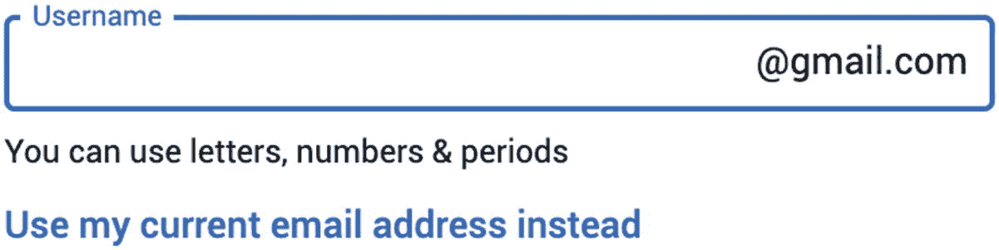
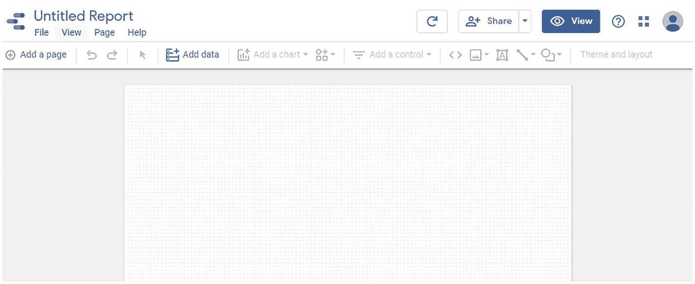
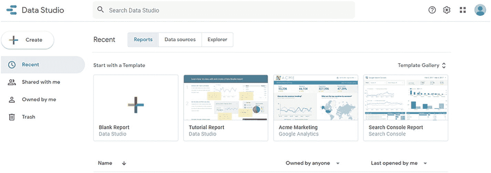
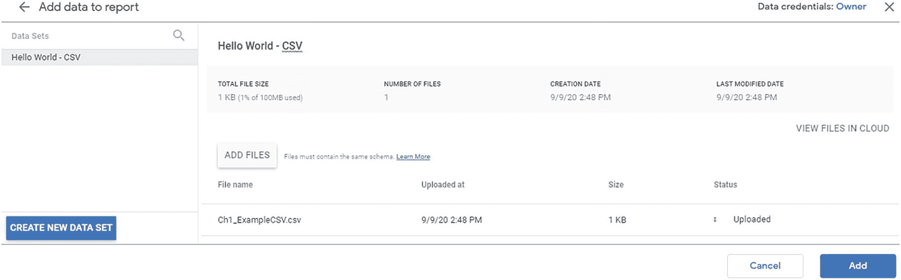
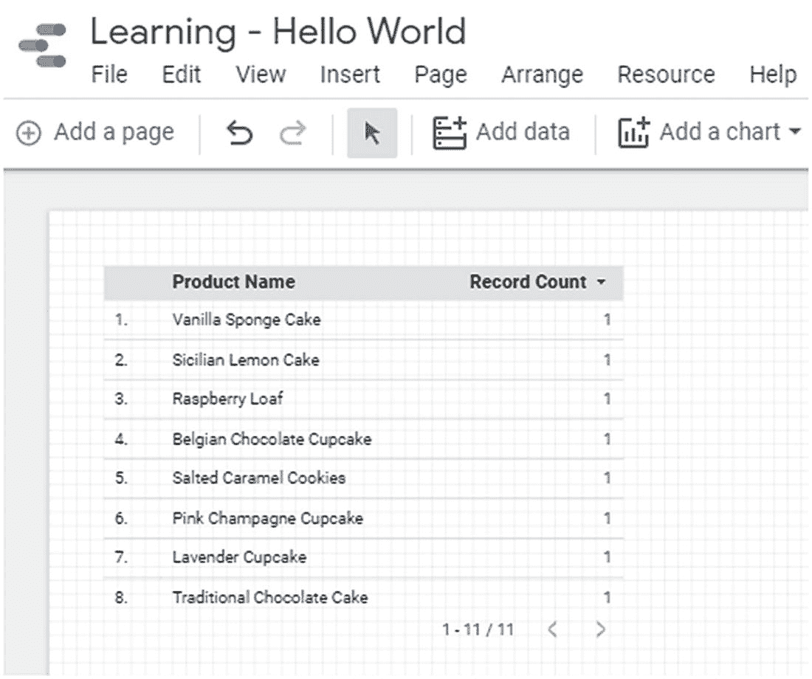

# 开始入门：你好，世界！

每当开发者开始学习一门新的编程语言时，他们通常从编写一个在屏幕上显示“Hello World”的程序开始。既然你们都是新兴的数据可视化开发者，我们将通过使用 Data Studio 向世界问好，来开启我们的旅程。我们将创建一个简单的报告，从 CSV 文件中提取数据。

**注意**：Google Data Studio 在不断进化，并推出新版本和功能。因此，本书中的截图可能与你在屏幕上看到的略有不同。

## 步骤 1：设置 Google 账户

Data Studio 是一款任何人都可以免费使用的工具。要访问 Data Studio，你需要拥有一个支持 Google 服务的账户。好消息！如果你有 Google、Gmail 或 G Suite 企业账户，你已经可以开始了，并可以跳到下一步。

对于那些还没有 Google 账户的人，你可以访问此网址：[`https://accounts.google.com/signup/v2/webcreateaccount`](https://accounts.google.com/signup/v2/webcreateaccount)。

在此页面上，你可以决定是注册一个新的 Gmail.com 地址，还是将现有的电子邮件激活为 Google 账户。输入你想用于新 Gmail 地址的用户名，或点击“改用我的当前电子邮件地址”，如图 1-1 所示。

**图 1-1** 使用新的 Gmail 地址或现有电子邮件地址设置你的新 Google 账户。

填写注册表格中的详细信息以继续。

## 步骤 2：打开 Data Studio

拥有 Google 账户后，前往 [`https://datastudio.google.com`](https://datastudio.google.com) 打开 Data Studio 主屏幕。

Data Studio 主屏幕（图 1-2）是你进入 Data Studio 世界的发射台。在创建第一个仪表板之前，让我们先熟悉一下界面（图 1-3）。它由四个关键部分组成：

**图 1-3** Data Studio 界面

**图 1-2** Data Studio 主页

1.  **模板库** 提供了一种快速开始创建新仪表板的方式。你可以使用空白报告，也可以使用 Data Studio 团队创建的预制模板。要使用预制模板，请点击右上角的“所有模板”按钮。

2.  **报告组织区域** 位于模板栏正下方，是一组用于按以下条件对报告进行排序的组织列或筛选器：
    *   名称
    *   所有者
    *   上次打开时间

3.  **左侧菜单** 让你能够快速进行以下操作：
    *   创建新报告
    *   访问由他人创建并分享给你的报告
    *   访问你创建或从他人处复制的报告
    *   查看已删除报告的回收站

4.  **顶部的搜索栏** 是一个方便的工具，可以让你按名称搜索报告。

## 步骤 3：创建空白报告

要创建空白报告，请点击屏幕左上角的“创建”加号图标，然后选择`报告`，或者点击模板栏中的加号图标。

Data Studio 界面乍一看总是很吓人。别担心。读完本书后，你就会对界面了如指掌，因为你会用到它的所有功能。现在，我们只快速浏览一下界面的主要核心区域：
- 报告标题
- 共享按钮
- 查看/编辑模式按钮
- 主工具栏
- 报告画布
- 配置面板

> **注意**：你可能会看到一个介绍画面，帮助你连接数据源。我们很快就会讲到这一点，但现在先把它关掉，这样你就能进入主界面。

### 步骤 3.1：为报告命名

点击屏幕左上角的“未命名报告”文本，为你的报告重命名。选择一个容易理解的名字，例如“学习 - Hello World”。然后，按`Enter`键或在名称框外点击一下。

保持工作区整洁并保护数据是个好习惯。我学到的一个有用习惯是，在开始新报告时，我总是会先重命名它，而不是使用 Data Studio 给的默认名称。

最好的名字是那些容易记住，并且包含你将来在列表中查找时可能会搜索的术语。为报告选择一个好名字，就像给未来的自己写一封情书。你会很高兴自己花了这点时间，为以后省下了额外寻找的时间。我无法告诉你，仅仅因为起了一个好报告名，我就节省了多少时间。

我最常用的名字是：
- 对于我正在服务的客户或品牌，我会使用`“品牌 - 获客报告”`或`品牌 A - YouTube 周报`。
- 如果我只是创建一个新报告来试用某个功能，我会用`“Playground”`这个词来描述它——例如，`“计算字段 Playground”`。
- 如果我只是创建一个临时报告来试验某些东西，那么最好的名字就是`“delete me”`，这样在我查找重要内容时，它就不会成为另一个需要打开的报告。

## 步骤 4：创建你的第一个数据连接

当我们考虑构建 Data Studio 报告时，这有点像做水管工。我们希望让水从外部流到我们的主水槽，在那里我们可以用它来洗涤、烹饪和饮用。要让这第一个报告工作起来，我们需要连接到我们的主要“数据”水源。在这个例子中，我们将从一个 CSV 文件获取数据。

### 步骤 4.1：下载示例 CSV 文件

我们将直接连接到最基本的数据源：一个 CSV 文件。在本示例中，我们将使用一个我用文本编辑器创建的简单文本文件。该文件采用一种名为“逗号分隔值”文件（简称 CSV）的标准格式。如果有一种通用语言用于系统间交换数据，那么 CSV 很可能就是它。

从本书的源代码中下载示例 CSV 文件（`Ch1_ExampleCSV.csv`），该代码可在 [`www.apress.com/9781484251553`](http://www.apress.com/9781484251553) 获取。

人们使用的大多数平台通常都支持将数据导出为 CSV，因此这个练习将是你会反复使用的一种技术。

### 步骤 4.2：将 CSV 文件上传到 Data Studio

现在我们已经拿到了数据文件，需要把它转换成 Data Studio 可以访问和操作的形式。我们通过点击工具栏中的“添加数据”按钮来实现。然后你会看到一长串不同类型的数据源。在本书编写时，我们有：

- **Google 连接器** – 这包括常见的连接器，如 `Google Ads`、`Google Analytics` 和 `Google Sheets`。我发现这些连接器通常最可靠，因为它们是由 Google 内部团队构建并直接得到 Google 支持的。

- **合作伙伴连接器** – 这些连接器由第三方公司创建，通常需要付费才能使用。这些公司通常直接提供对插件的支持；不过，如果你依赖它们进行报告，体验可能会参差不齐。你通常得依赖创建它们的公司来进行修改，因为你无法看到它们的代码。并非所有这些连接器都有庞大的支持团队，解决你遇到的任何问题可能需要很长时间。话虽如此，其中一些连接器功能非常强大，比如非常流行的`“Supermetrics”`连接器，它可以让你连接到 `Google Search Console`、`Facebook Insights`，甚至像 `Stripe` 这样的支付服务提供商。

- **开源连接器** – 这些数据源通常由更广泛的社区成员构建，并贡献给 Data Studio 以造福他人。它们的优点是你可以直接看到它们的代码，因此如果你的项目相关，你可以对其进行修改。大多数这些连接器都是免费的；但与其他开源项目一样，你需要依赖其他人来修复任何问题。

我们现在要使用的连接器叫做`“文件上传”`。选择它之后，你需要将 CSV 文件拖入上传框，或者点击按钮在你的电脑上浏览该文件。

系统会要求你授权 Data Studio 将此文件上传到你的 `Google Cloud Storage`。本书不会对 `Google Cloud Storage` 进行详细介绍，但你可以把它想象成互联网上某个地方的安全硬盘。Google 负责托管、保护和管理访问权限，因此你无需担心未经授权的人员访问它。点击`授权`和`接受`，以授予 `Google Data Studio` 访问你的存储空间的权限。

一旦你批准 Google 将你的 CSV 文件存储到 `Google Cloud Storage` 中，我们就终于可以上传数据了。

几秒钟后，文件的状态会从`上传中`变为`处理中`，再变为`已上传`。

你会看到页面底部有四个状态字段。它们包括：
- 你上传的文件名
- 文件上传的时间
- 文件大小
- 文件状态

`已上传`状态旁边有一个方便的绿色小点，这表明 Google 对数据满意，你可以继续连接了。

文件上传完成后，你可以通过点击文件名来重命名数据源。你应该始终为你的数据源起一个容易理解的名字。这将有助于你以后识别它。一点前期的清理工作会在后期为你省去很多麻烦，尤其是当你有数百个数据源散落在数据源文件夹中时。对于这个练习，我们将其命名为`“Hello World - CSV”`。参见图 1-4。

*图 1-4 – 上传 CSV 文件数据源*

选择蓝色的`“添加”`按钮，你就可以选择 CSV 文件将其上传到你的账户。

### 步骤 4.3：编辑连接并授权访问 Google 云端硬盘

此时会弹出一个关于向此报告添加数据的小对话框。只需点击“添加到报告”即可。Google 会请求权限，以便在你的 Google 云端硬盘中创建新的 Google Data Studio 报告。

**注意**

我个人觉得这一步有点令人困惑，因为我平时向云端硬盘添加 Google 文档或表格时，并不需要请求权限。我不明白为什么 Google 对 Data Studio 文档的处理方式有所不同。希望 Google 能在未来移除这一步骤，让用户操作更简便。

对话框关闭后，你会返回 Google Data Studio 报告编辑器主界面。恭喜你，现在你已经成功创建了第一个 Data Studio 连接。接下来，我们可以专注于在屏幕上展示数据，让全世界看到你的问候。

## 步骤 5：在 Data Studio 中显示 CSV 数据

现在，我们准备向世界展示你的数据。在菜单栏中，你会看到一个名为“添加图表”的按钮。点击它，你可以从多种数据可视化方式中进行选择。我们稍后会详细介绍这些选项。现在，只需选择第一个图标（简单表格）。屏幕上会出现一个带有小表格图标的大矩形。Data Studio 要求你选择表格的放置位置。目前，只需将其整齐地放置在页面顶部的主要画布区域即可。请参见图 1-5。

**图 1-5** Data Studio 中的第一个表格

仿佛魔法一般，你可以看着第一个数据表格逐渐显现。我相信你之前在很多程序中都见过表格，但 Data Studio 之所以成为数据分析领域的变革者，就在于这个小小表格的强大和灵活性。我觉得它就像公路赛车中的喷气背包——如果你想领先，只需启动火箭引擎，就能超越其他竞争对手。

## 本章小结

在本章中，你从零开始，为 Data Studio 打下了基础。我们从一个文件中提取数据，并在 Data Studio 中建立了连接。然后使用表格控件在屏幕上显示数据，从而向世界发出问候。

在下一章中，你将接到第一个 Data Studio 任务，并为一个小型企业构建基础仪表盘。