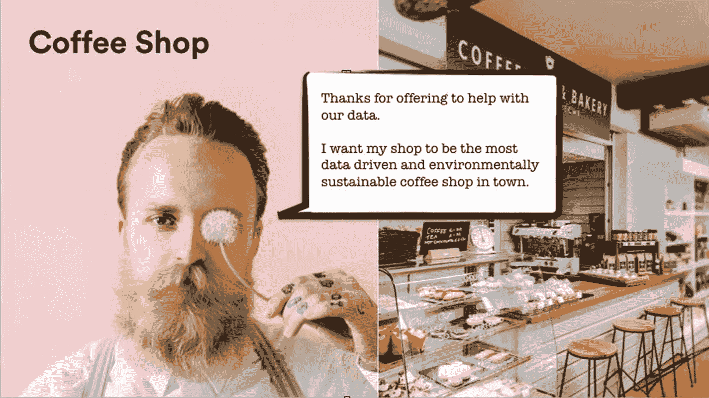
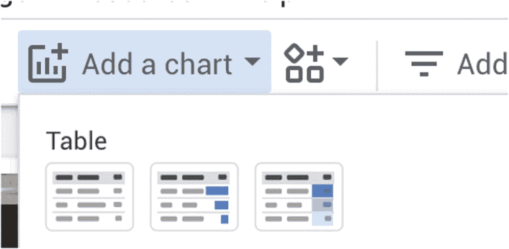
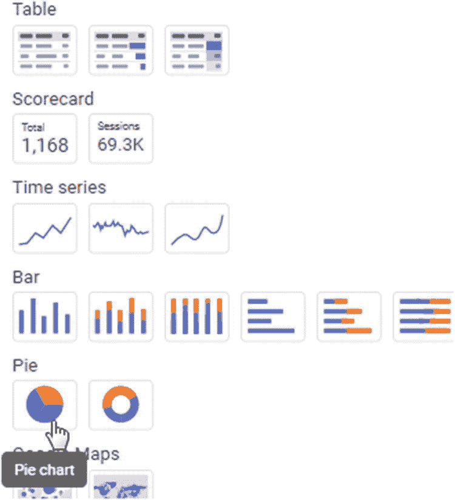
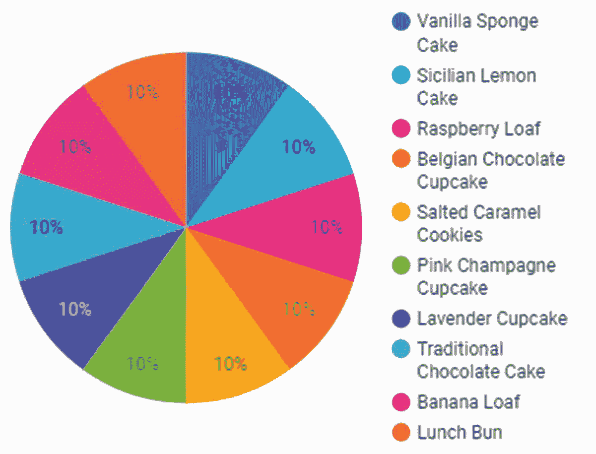
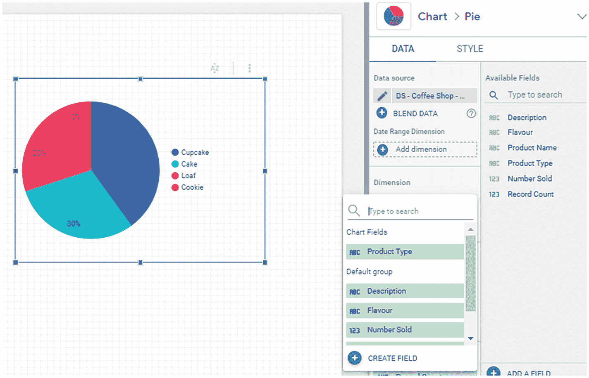
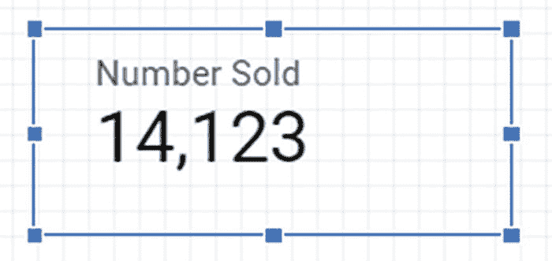
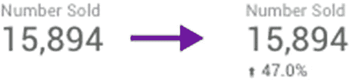

# 2. 报告制作

手动电子表格与 Data Studio 报告

> 我从不教导我的学生，我只尝试提供他们能够学习的条件。
>
> ——阿尔伯特·爱因斯坦，理论物理学家

你在第 1 章中创建的第一个“Hello World” `Data Studio` 报告似乎只是个开始！原本只是个人练习项目，如今已演变为你的第一个仪表盘制作机会。

我发现，分享你热衷的事情总是有益的。如果某件事让你充满热情，那么志同道合的人自然会被你吸引。你还会发现，以前未曾注意的机会也会随之出现。

通过构建一个小项目来学习新技术，是最有效的方法。如果你能在学习项目中有所收获，那你就是极其幸运的少数人。就我而言，我花了很多业余时间学习 `Data Studio`，并且乐在其中，因为我喜欢它处理数据时的创造性。孩子们入睡后，我会坐在厨房桌旁，而不是瘫在电视机前，尝试在 `Data Studio` 中构建一些有趣的东西。

### 提示

花几分钟思考一下，你想用 `Data Studio` 构建什么样的项目。可以是个人用途，比如绘制你一周的运动距离曲线；也可以是工作相关，比如自动化你的报告流程。

那么，让我们开始第一个小项目吧——为我们的朋友赫尔曼制作一份销售报告。

## 帮助赫尔曼的蛋糕与咖啡店

赫尔曼经营自己的咖啡店和面包店已有两年，积累了相当忠实的顾客群。一些老主顾甚至称他为“赫尔曼大叔”，因为他总能娓娓道来，分享故事。

他过去在城中老街区做摩托车修理工，但随着科技公司不断涌入，他发现向他们售卖咖啡和蛋糕能带来丰厚的利润。事实证明，科技从业者非常喜欢有格调、独特的场所来休闲和工作。由于大部分时间与摩托车爱好者为伴，他有很多精彩的故事，常常一边招待顾客享用热饮和糕点，一边娓娓道来。

如今，他曾经投入摩托车生意的热情，已完全转移到咖啡店上。他专注于提供最优质的有机素食，并痴迷于调配咖啡，力求让其味道比街角店铺好上十倍。

**图 2-1** 赫尔曼的咖啡店

你能运用新学的 `Data Studio` 技巧（图 2-1），帮助他更好地了解自己的业务吗？如果你能帮他增加收入，他将以一个月免费咖啡和纸杯蛋糕作为答谢。

### 注意

学习期间免费工作是没问题的。但一旦掌握了技能，就别指望再免费干活了。任何人都不应被期待用免费劳动换取所谓的“未来”收益或晋升机会——那些机会很少能真正转化为实惠。如果有人需要你的技能，他们就该付钱。至于赫尔曼，我们这次就放过他，接受咖啡和蛋糕的报酬吧——毕竟，这是检验 `Data Studio` 能力、为作品集构建第一个项目的绝佳方式。

## 报告中应展示哪些信息？

每当遇到新客户或业务相关方时，我都会花时间通过四个关键问题来了解他们：

1.  **他们当前的目标是什么？** 他们对业务的主要目标是什么？
2.  **他们需要哪些信息？** 哪些信息能帮助他们推动这一目标？
3.  **他们的数据专业水平如何？** 他们在使用和理解数据方面有多熟练？
4.  **应该如何呈现数据？** 以何种最佳方式传递数据，才能让受众清晰理解？

第一个问题是最需要理解的核心。所有人都在努力达成某些目标，因此如果你能与他们建立共识，合作起来就会更加顺畅。

明确哪些具体信息能帮助他们实现目标，这是第二个问题。通常，大多数人会带着他们认为自己需要的需求清单来找你。作为数据相关方，你的职责是理解这些需求，并确保它们确实能助力对方达成目标。如果做不到，很快就会发现——因为根本没人会看你的报告。

随着你产出更多报告，你将积累经验，学会过滤“多余噪音”，并能捕捉到各种信号——这些信号表明对方并不确定自己真正想要什么，只是在凭感觉猜测。这时你便可以介入，引导他们转向更具体、更有帮助的方向。

受众的数据专业水平体现在第三个问题中，但在合作初期极难准确判断。而且，大多数人很少会一开始就如实回答这个问题。当你直截了当地询问他们对数据的了解程度时，人们通常会非常戒备。与其直接提问，不如采用更好的技巧来获取这类信息。

我曾遇到有人告诉我他们“一直在用”`Google Analytics`，但当我查看他们的 `Google Analytics` 账户时，却发现这些账户几乎没怎么使用（而且很多时候数据都不准确）。这种情况不仅限于经理级别；我有过几次与自称专家的高级数据总监共事的经历，结果惊讶地发现他们连用户转化率或跳出率这样简单的概念都不理解。他们虽然身居高位却不了解数据分析的基础知识，但这并不意味着你无法教他们新东西。如果你面对的是数据经验不太丰富的用户，那么用简单清晰的方式给出答案将至关重要。

另一方面，有些用户非常专业，如果你只给他们简单答案而不提供细节，他们很快就会感到沮丧，并且不信任你给出的结果。

第四个问题“应该如何呈现”是最重要的。你构建仪表盘的经验越丰富，就越能有效推动业务进展。

## 了解赫尔曼的需求

> 世界上大多数人做决策时，要么靠猜测，要么凭直觉。他们要么运气好，要么会犯错。
>
> ——苏海尔·多希，`Mixpanel` 首席执行官

当你开始与新客户或利益相关者合作时，需要努力了解他们的需求。对于赫尔曼的咖啡店来说，这一点相当明确。他通过专注于建立客户关系、提供优质的受欢迎产品，实现了店铺的自然增长。在过去，这已经足够，但如今，如果你不用数据来驱动业务，你看到的只是“冰山一角”。

赫尔曼提出的要求是：请你用数据来帮助他赚更多钱。这是一个相当宏大的要求，我们很可能无法完全实现。很多人只是假设在业务上挥舞数据的“魔法棒”就能立刻变出钱来。赫尔曼显然也是这类人。这正是你需要帮助对方理解数据在价值链中位置的关键时刻。

你的回答应该始终如一。你要向赫尔曼解释，通过数据我们能够更好地了解情况，从而为他的决策提供参考。有时这会带来更多利润，有时则不会。

当你告诉大多数企业主可能无法完全满足他们的预期时，他们多少会有点不安，但这没关系。与其试图交付不切实际的结果，不如先管理好对方的期望。重要的是建立良好的成果展示记录，这样你就能在与潜在客户/内部团队合作初期就建立起信任。

你能给任何人的一个保证是：通过让数据可视且易于获取，你可以帮助人们做出更明智的决策，从而推动业务增长。

回到与赫尔曼的会议，根据上一节的内容，你列出了想问他四个关键问题。

### 他当前的目标是什么？

赫尔曼告诉你，他希望能提高咖啡店的销售额。如果他能实现这个目标，就可以在城市的另一个科技区开一家新店。

### 他需要哪些信息？

赫尔曼说，他目前每天用一份简单的 `Excel` 文档记录营业收入，然后发给会计录入财务系统。每周结束时，他会收到一封邮件报告，其中列出了最畅销的产品。他利用这些信息来订购原材料，并规划下周要销售的商品。

### 他的数据专业水平如何？

赫尔曼向你承认，他在数据方面其实力不从心。他知道什么卖得好，但对电子表格中一些常用工具完全没概念。他表示，每周从会计那里收到汇总数据就已经很满意了。

### 数据应以何种形式呈现给他？

找到正确格式的最简单方法是向利益相关者索要他们之前的报告。从他们已知且熟悉的内容入手，只要操作简单即可。

你可能会暗自思考：“等等，用新颖、炫酷又精简的新东西开始不是更好吗？”

诀窍在于：这个步骤的目标不是给他们展示炫酷的东西，而是试图与客户建立信任。

让我用一个小故事来说明这一点。

几年前，我听说了一位专门使用 Adobe Photoshop 的设计师。他曾受邀参加一个市场调研活动，有机会试用一款 Photoshop 的新竞品。对方花了很长时间展示这款产品及其所有功能，包括他们引以为傲的独特全新导航。演示结束后，他们问大家希望看到哪些改进。这位设计师举手说道：

“你们就不能把导航做成跟 Photoshop 一样吗？”

现场一片沉默。按他的要求做会延迟产品发布，也意味着要放弃他们引以为傲的华丽导航功能。他们没有听取他的意见，也没有满足他对延续性的首要需求。这位设计师希望能够交付工作，而不需要经历大量额外的学习过程。

不用说，那款竞品软件如今已不复存在。Adobe 的工具仍然是设计师们最常用的软件。我不禁想，如果那家公司当初听取了目标用户的意见，结果会怎样？

同样地，如果你希望用户通过你的工具建立信任，那么最简单的开始方式就是复制他们熟悉的内容。`Data Studio` 的关键特性之一就是它能非常快速地制作新报告的原型。一旦人们看到屏幕上那熟悉的旧报告，你就能吸引他们的注意力，并可以开始迭代他们的数据报告。

当我们拿到赫尔曼的报告样本时，它看起来像是一个由密密麻麻数字组成的大表格。那是一份产品列表，每个产品旁边列出了销售量。每项旁边还有百分比符号，显示销售额相比前一周是上升还是下降。

## `Data Studio` 如何帮助赫尔曼

在回顾了赫尔曼对四个关键问题的回答后，你很清楚赫尔曼需要哪些帮助。他需要：

1.  **及时的信息** —— 他没有获得做出决策所需的及时信息。他必须等到周末，会计师把数据发回来。
2.  **消除重复劳动** —— 目前赫尔曼需要将销售数据输入电子表格，然后通过邮件发给会计师。会计师再将销售额录入会计程序/电子表格，然后发回销售表现报告。之后赫尔曼还需要审核和分析结果。

如果你能向赫尔曼展示如何使用 Data Studio 获取他的销售数据，自动处理这些数据，并从原始电子表格数据生成报告，那么你就能帮助他更快地做出决策。他也不再需要付钱给会计师来录入数据并把结果返回给他。相反，他可以专注于根据数据推动改进。

你同时猜测，鉴于赫尔曼如此专注于他的产品，如果他能自己掌控数据，他将能够针对数据提出更好的问题。从长远来看，这可能是他最大的收获。

赫尔曼把他最近从会计师那里收到的几份报告转发给你，这样你就能看到报告有什么变化。好消息是，我们肯定能对其加以改进！我们开始工作吧。

## 为赫尔曼的蛋糕咖啡店构建报告

### 步骤 1：将数据上传到 Google 电子表格

第一步是从谷歌表格中获取赫尔曼的数据。

为了完成此练习，你需要从本书的源代码中下载一份赫尔曼蛋糕咖啡店的销售数据（`DS – Coffee Shop.xlsx`）。访问 [`www.apress.com/9781484851553`](http://www.apress.com/9781484851553) 并点击下载源代码按钮。

将你的数据电子表格上传到 Google 云端硬盘。

访问 [`https://docs.google.com/spreadsheets/u/0/?tgif=d`](https://docs.google.com/spreadsheets/u/0/%253Ftgif%253Dd) 打开 Google 表格。

新建一个表格，然后进入：文件 ➤ 导入 ➤ 上传。浏览并上传 `DS – Coffee Shop.xlsx` 文件。

确保电子表格命名为“`DS - Coffee Shop`”。如果需要修改，双击表格左上角的文件名进行更改。完成后按回车键或点击其他位置。

### 步骤 2：清洗数据

接下来，我们需要清洗数据，使其准备好被使用。

清洗过程的目标是：

-   将数据整理成表格形式。
-   确保每一列只包含一类数据。
-   检查没有任何字段存在空白条目。
-   确保所有字段的数据格式正确且一致。例如，确保日期格式为 `dd/mm/yyyy`。

我最喜欢的一位数据团队负责人曾这样告诫那些试图在数据上偷工减料的开发人员，他反复强调一句口头禅：

> *垃圾进……垃圾出*

你应该把 Data Studio 报告想象成办公室里那种高档净水器。如果出水不干净，它会立即停止使用，并需要报修工程师。

同样地，你的 Data Studio 报告也应该是经过过滤和清洗的，以供用户使用。任何包含错误数据的数据源，都应该导致用户呼唤工程师（也就是你！）来调查并解决问题。

> **提示**
> 在制作报告时，请考虑如何让用户在遇到数据问题时向你发出警报。我总是在所有报告的同一位置放置我的联系方式，以便人们有疑问时可以联系我。我们将在后续章节讨论这一点。

#### 应该在何处进行数据清洗？

我认识很多人，他们认为在报告工具中清洗数据就可以了，不需要在数据源中进行。我通常认为这是一种巨大的反模式（一种会让你后悔的不良做法）。

经验法则是：在数据源头修正数据，在 Data Studio 中调整数据。

Data Studio 有许多强大的功能，可以帮你完成部分清洗工作，但我倾向于用它们来做一些小的修正或让数据更易使用。我建议人们尽可能在数据的原始源头完成清洗工作，因为：

-   这能保持事情简单，你只需要在一个地方查找和修复数据问题。
-   这减少了为多个报告重复进行清洗的工作量。

有时我们在 Data Studio 中做了一些调整，如果这些调整很明显将会长期存在，我可能会将这个改动回滚到原始数据源中，以便让 Data Studio 运行得更快。

#### 在专业环境中如何进行数据清洗？

当你在办公室进行数据清洗时，可以直接通过修改电子表格来完成，或者在某些企业中，数据团队会使用名为 `SQL` 的脚本语言来处理包含数百万行数据的数据库。

信不信由你，小型电子表格和大型数据库背后遵循的原理基本相同。由于 `SQL` 和数据库本身是极其庞大的主题（甚至可以写出好几本书），我们将仅限于清洗我们从赫尔曼周销售数据创建的电子表格。幸运的是，这份数据已经很干净了，所以我们可以继续往下进行。

### 第 3 步：创建 Data Studio 报告

打开 Data Studio 并创建一个新的空白报告。将其命名为 `“DS - Coffee Shop.”`。如需复习如何创建新报告，请参阅第 1 章。

### 第 4 步：创建与 Google 表格的数据连接

数据的奇妙之处在于它总是在变化。与上一章中我们创建与文件的静态连接不同，在本章中，我们将建立一个与实时 Google Sheets 文档的动态连接。当 Google Sheets 中的数据发生变化时，我们会看到 Data Studio 的内容也随之改变。要创建与 Google 表格的数据连接，请执行以下操作：

1.  点击 `“添加数据”`。
2.  在“Google 连接器”列表中找到 `“Google Sheets”` 并点击它。如果这是你第一次将 Google 表格连接到 Data Studio，则需要授权。
3.  找到 Hermann 的销售报告：`“DS - Coffee Shop.”`。
4.  选择该文件，然后选择 `“菜单”`（Google 表格中的第一个标签页）。
5.  点击右上角的蓝色“连接”按钮，然后点击 `添加`，再点击 `添加到报告`。

### 第 5 步：创建数据的原始表格视图

每当我开始查看所需数据时，我发现理解数据最简单的方法是使用表格控件来查看原始数据。这在我们深入细节获取所需信息之前，能提供一个数据概览。同时，这也有利于进行初步的质量检查，并再次确认数据存在且格式符合预期。

要创建数据的原始表格视图：

*图 2-2：向 Data Studio 报告添加原始表格*

1.  点击 `“添加图表”`，然后选择顶部行中的第一个表格图标，如图 2-2 所示。
2.  点击您想要放置表格的矩形区域，您将看到来自 Google 表格的数据随之出现。

现在我们已经成功将数据从 Google Sheets 导入表格中，我们可以开始尝试让数据对我们的客户有用。

#### 帮助用户向数据提问

基于这些数据，我们将尝试帮助 Hermann 更详细地了解他的销售数据。一个好的起点是进行一些探索性数据分析，以了解数据的形态。我们可以利用数据回答的一些更简单的问题包括：

-   哪些产品是他的主要销售额来源？
-   顾客购买最多的口味类型是什么？
-   这些产品的销售额与去年相比如何？

数据的原始表格并不能清晰地告诉我们销售情况。它只是向我们展示了一堆文本和数字，这让我们的大脑很难处理和解读。我们希望报告能替我们完成繁重的处理工作，帮助用户理解数据。我们可以通过将原始表格转换为更具视觉化的形式（例如饼图）来实现这一点。通过在 Data Studio 报告中添加饼图，我们为用户提供了一种更轻松的数据解读方式。人类是视觉动物，我们通过感官来理解周围的世界。数据世界也大致相同：通过在报告中添加视觉元素来引导用户了解信息所传达的内容，可以让他们专注于对自己最重要的事情。

#### 添加饼图

要添加饼图以显示销售明细：

*图 2-3：添加饼图*

1.  点击 `“添加图表”`，然后选择第一个饼图控件（图 2-3）。

*图 2-4：按产品名称划分的饼图*

2.  点击您想要放置图表的位置。

当我们首次添加饼图时，Data Studio 默认显示数据集中的第一个字段 `“Product Name”`（产品名称）。它默认还向我们显示今年的数据。如图 2-4 所示：

-   我们的畅销产品是 `“Banana Loaf”`（香蕉面包），紧随其后的是美味的薰衣草纸杯蛋糕。经典的老式巧克力蛋糕位列第三。
-   排名前四的产品约占总销售额的 50%。
-   排名前四的每一款产品的销量大致相当。

## 第 6 步：复制饼图并将维度更改为“产品类型”

让我们通过复制饼图并将维度更改为产品类型，从不同角度查看数据，以获得不同的视角（图 2-5）。为此：

*图 2-5：按产品类型划分的饼图*

1.  右键单击饼图并选择 `复制`。
2.  将复制的饼图拖到原始饼图的正右侧。
3.  选中新的饼图，然后在右侧面板的 `“维度”` 下点击 `“Product Name”`（产品名称），并选择 `“Product Type”`（产品类型）。

当我们选择名为`“Product Type”`（产品类型）的维度时，我们指示 Data Studio 重新处理表格中的数据，不再按产品名称分组，而是按产品类型分组。通过更改所使用的这个`“维度”`，它改变了我们查看数据的视角，并从不同的角度展示数据。维度（和指标）是数据报告的基本构建块，我们将在本书接下来的几章中进一步探讨它们。

现在，让我们欣赏一下饼图的这个小改动如何帮助我们更深入地了解销售数据。当我们通过`“product type”`（产品类型）的视角查看销售数据时，我们可以看到：

-   令人惊讶的是，我们近 50% 的销售额来自纸杯蛋糕。
-   三分之一的销售额来自蛋糕。

### 步骤 7：使用评分卡控件展示销量

所有报告都需要认识到信息存在重要性层级。回想一下学生时代从老师那里收到的成绩单。你最想了解的关键信息是各科目的分数。如果分数被埋没在几段关于学习努力程度的评语底部，你会作何感想？想必会感到非常沮丧和困惑，不明白他们为何要隐藏如此重要的信息。同理，我们需要使用评分卡来向报告读者突出显示最重要的信息。

通常使用评分卡来展示我们常说的“KPI”，即关键绩效指标。

我见过关于 KPI 最精炼的定义来自英国《公司法》，其中将 KPI 定义为“可据此有效衡量公司业务发展、绩效或状况的参考因素”。

要在报告中添加显示已售数量的评分卡：

1.  点击主工具栏中的“添加图表”按钮。
2.  选择“评分卡”字样下方的第一个图标。
3.  点击并拖拽出一个框，指定评分卡的放置位置（理想位置是报告左上角）。
4.  默认情况下，它会显示产品名称的记录计数，因此你需要将维度更改为已售数量。

现在你会看到带有“已售数量”标签的评分卡（图 2-6）。

图 2-6 已售数量评分卡

对于赫尔曼来说，他的 KPI 将是产品销售数量，因此这需要在报告中立即展示。我们使用评分卡控件在报告顶部显示已售产品数量。

> **提示**
>
> 在报告中使用评分卡时，请尽量控制数量。过多的评分卡会使用户感到困惑。如果你发现一张报告上要放置超过五个评分卡，就该考虑是否应该使用表格或条形图等替代展示方式了。

### 步骤 8：为评分卡添加日期对比

我们已经使用饼图展示了每种产品的销售额规模，现在可以进入分析的下一个阶段。数据总是在变化。今天成立的情况，明天不一定依然成立。

> *我不创造趋势。我只是发现趋势并加以利用。*
>
> ——迪克·克拉克，美国电台主持人

人们的时尚、品味和趋势会定期变化，企业需要利用数据来应对这些变化。如果你能够跟踪客户品味的变化，甚至发掘新客户的品味并加以利用，那么你就赢了。

我们将帮助赫尔曼开启了解影响其业务的趋势的旅程，并让他了解销售额随时间的变化情况。希望通过这样做，我们能够识别出他尚未想到的一些机会。

通过检查我们的 Google Sheets 数据，我们知道有一个“日期”字段。使用“日期/时间”数据非常强大，因为我们可以探索去年和今年之间发生了哪些变化。我们将首先向他展示销售额随时间的变化情况。现在我们选择要比较的日期区间。点击“对比数据范围”按钮。我们可以选择与以下项对比：

- 无
- 上一周期
- 去年
- 固定/高级

“上一周期”选项可能是 Data Studio 中最强大的功能之一。它会将你当前查看的时间段与上一个相等时间段进行比较。因此，你可以使用此控件进行周环比、月环比，甚至年同比对比，以查看销售额的变化。

现在我们想保持简单，所以选择“去年”，然后点击“应用”完成我们的“同比评分卡”。

一两秒后，你将看到评分卡下方“47%”旁边出现一个绿色箭头（图 2-7）。这表明自去年以来，产品销量增长了 47%，对赫尔曼来说是一个惊人的成果。

图 2-7 显示对比结果的评分卡

既然你已经学会了如何在评分卡上进行基本的日期范围对比，好消息是，你同样可以对表格进行相同的操作。何不尝试对你已有的数据表格进行年同比对比，看看赫尔曼的哪些产品推动了他自去年以来的销售增长？

## 回归根本

正如本章我们尝试用数据解决“现实”问题一样，这项尝试最有价值的一点是，你会开始意识到知识中存在空白，并且有新的东西需要学习。

从你初次使用 Data Studio 工具的经历来看，你可能已经注意到到处都在使用许多新的概念和术语。别担心，随着我们阅读本书的深入，你会逐渐掌握它们的。

> **提示**
>
> Data Studio 文档团队还维护了一个方便的术语表（[`https://support.google.com/datastudio/topic/6302375`](https://support.google.com/datastudio/topic/6302375)）。

## 小结

做一些简单的事情，比如更深入地了解你的数据，对每个企业都至关重要。在本章中，我们拿了一个简单的 Google Sheets 数据表，没有将其作为静态数据集搁置，而是使用 Data Studio 让数据生动起来。我们能够识别出：

- 客户哪些产品销量最高
- 哪些产品类型最受欢迎
- 销售额随时间的变化情况

我们尝试了一些简单的控件，如表格、评分卡和饼图，甚至还开始进行了一些今年与去年的基本比较。

在接下来的章节中，我们将进一步拓展这些内容。但希望你现在已经对使用 Data Studio 界面探索数据有了良好的感觉。