# 4. 在线调查

案例研究：用户画像分析

> *事实上，现代教学方法尚未完全扼杀神圣的好奇心，这简直就是一个奇迹。*
> 
> ——阿尔伯特·爱因斯坦，理论物理学家

既然我们已经在前几章介绍了一些基础知识，让我们看看如何将 Google Data Studio 应用于另一个真实场景：分析在线调查产生的数据，为一位客户收集客户信息。本章基于我们为一家知名旅行公司所做的真实项目。客户无需昂贵的可视化工具就能获得对其客户数据的交互式分析，这不仅成本效益高，而且极其有用。这为我们的客户提供了洞察力，他们可以利用这些洞察来制定内容和营销策略，从而更精准地定位客户。

## 了解旅行公司的需求

首先，我们需要进一步了解客户的需求。作为一家知名的旅行公司，他们希望我们帮助他们了解他们的客户是谁。

## 收集数据

下一步是收集数据。我们向客户的客户发送了大约一万封电子邮件，邀请他们使用 `SurveyMonkey` 填写一份调查问卷。

问卷询问了关于客户自身的问题：

*   性别
*   年龄段
*   薪资范围
*   婚姻状况
*   子女（及孙辈）情况
*   职位头衔

以及他们对方网站/服务的看法：

*   度假频率
*   度假的原因
*   是否喜欢网站的某些方面
*   是否喜欢服务的某些方面

我们还设置了自由文本问题，即一个文本框，允许他们输入信息，例如他们认为网站是否缺少某些内容，从而对一些关键问题获得更开放的回复。

在收到所有提交结果（约 5,000 份问卷）后，我们准备整理数据以用于报告。

## 准备数据

下一步是在将数据导入 Data Studio 之前对其进行准备。`SurveyMonkey` 能够将结果导出为 `xls` 文件，这是一种我们可以轻松导入 Google Sheets 的格式。将结果上传到 Google Sheets 后，我们开始清理数据。

正如第 2 章所述，清理数据意味着确保数据集中的任何内容都是有效的。例如，尽管我们使用了公司的邮件列表（假设这些人希望收到关于该服务的联系），我们仍然收到了来自不想被打扰的人的“垃圾”回复。我们还必须删除任何被视为 `null` 或空白的回复。我们还需要确保所有列都有唯一的名称。别担心——每个数据集都会有问题。

在这个案例中，我们处理的是一个相对较小的数据集，大约 5,000 份问卷，我们可以直接从 Google Sheets 导入到 Data Studio。如果我们有更大的数据集，可以首先将其上传到 Google BigQuery，然后再以类似的方式导入到 Data Studio。

清理完数据后，我们就准备将其导入 Data Studio。请确保您在同一帐户中有权限访问该 Google Sheets 文件，并且文件名是合适的。

在 Data Studio 中，首先创建一个报告。系统会提示您向报告添加数据源。只需点击 Google Sheets 选项（图 4-1）。

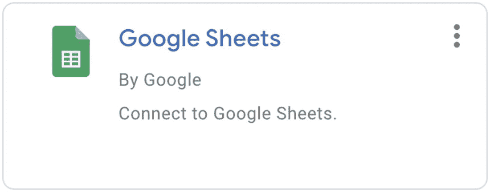

图 4-1

用于选择 Google Sheets 的点击按钮

## 设计报告

接下来，我们需要设计报告，使其既实用又美观。我们可以通过结构化数据呈现方式并保持元素在整个报告中的一致性来实现这一点。

保持报告中元素的一致性始终是件好事。这有助于增强整体连贯性，与公司品牌建立联系，并且视觉上令人愉悦。

让一切看起来一致意味着你的客户会觉得报告更易于阅读。

### 页眉栏

你可以做的一件事是添加一个包含公司徽标的页眉栏。你也可以使用纯文本页眉，但如果你有徽标，使用徽标看起来效果更好。

要上传图片，请点击工具栏中的“图片”图标，并选择“从计算机上传”或“按网址上传”，具体取决于你的实际情况。然后，将徽标放置在报告页面的顶部某处。右键点击徽标并选择“设为报告级别”。这意味着如果你的报告有多页，该徽标将出现在每一页的顶部。

### 配色主题

另一件可以做的事情是为报告设置一个配色主题，使其在整体上保持一致。如果你为其制作报告的公司有配色方案，你可以通过从图像（可以是公司的徽标，甚至是他们网站的截图）中提取配色方案，将其融入到你的报告中。

在工具栏上点击 `主题和布局`，在右侧窗格中点击 `从图像中提取主题`（图 4-2）。你可以从计算机上传图像，也可以按网址上传。

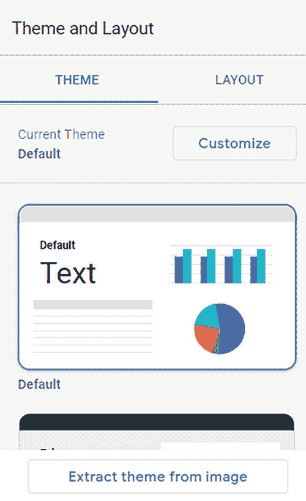

图 4-2

提取图像调色板按钮的截图

然后你可以从生成的三款主题中进行选择。如果喜欢某一款，点击它并按下“应用”。如果你觉得提取结果的颜色多样性或对比度不足，可以手动编辑配色主题，使你的报告更好地符合公司或客户的风格。点击 `主题和布局` 窗格中的 `自定义` 按钮。

### 页脚栏

此外，考虑在报告底部创建一个页脚栏，其中包含如何联系你的信息，或者如果你是一家代理机构或内部团队，可以放置一个链接指向你的联系信息，以便有人需要调整某些内容时可以联系你。

你可以使用文本工具输入这些信息，并将其放置在页面底部。

### 精细到颗粒度

计划在展示数据时，将概览信息置于顶部，然后逐步深入到更详细和颗粒化的数据。通常，从较长的页面开始，然后从中进行精简会更容易。

我还建议对内容采用三分法或五五分原则——这意味着您可以将表格和图表设置为页面宽度的三分之一、三分之二或一半。您可以在报告三分之二和一半的位置画一条线，以此作为版面布局的参考线。您可以使用工具栏中的 `Line` 工具来实现。

## 将数据添加到页面

接下来，我们需要向报告中添加数据。如前所述，最好从概览数据开始，再逐步深入到细节。一个不错的方法是从饼图开始。

尽管饼图通常被认为对用户不太友好，因为难以解读精确的数值，但您仍可以在页面顶部使用它们（或环形图）来表示关键的筛选组。通过启用 `Interactions – Apply Filter` 设置，几乎任何图表都可以与筛选器配合使用。这意味着，如果您点击环形图或饼图中的某个扇区，它将把这个筛选条件应用到数据源。

通常，我们会将此设置应用于所有其他图表和表格——这样，当人们点击数据行或数据切片时，所有这些图表和表格都能对报告进行筛选（见图 4-3）。

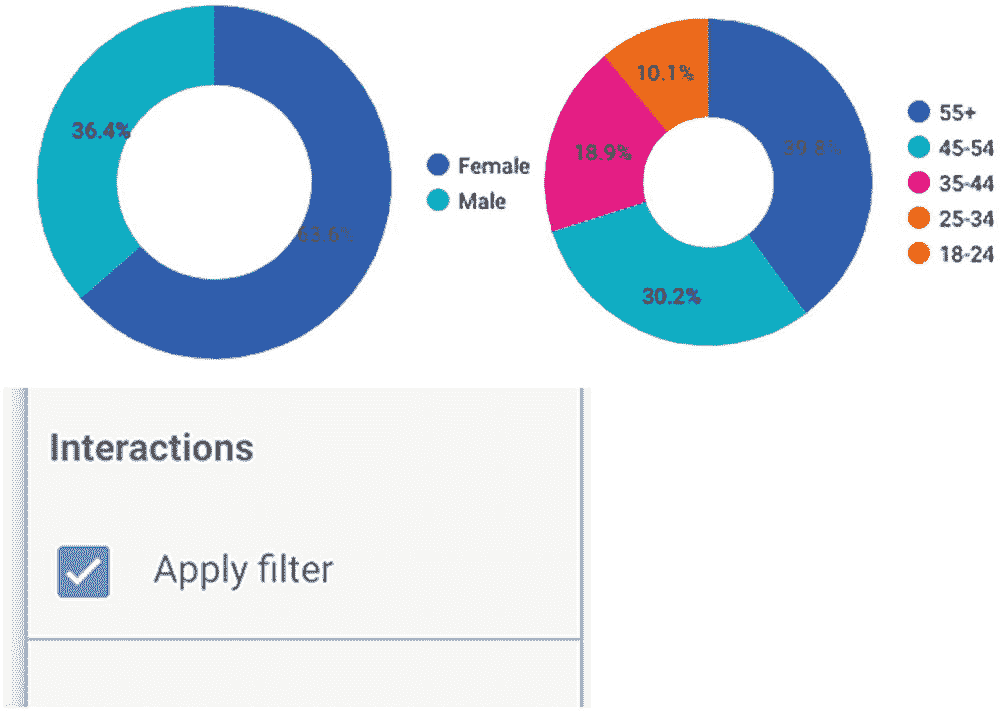

图 4-3：“应用筛选器”按钮

现在，我们拥有了一种非常直观的方式来查看报告中的数据，并且能够快速向下钻取来自同一数据源的所有表格和信息。如果我们有多个数据源，它通常只会应用于来自同一数据源的元素（如果您不希望筛选器应用于整个报告，也可以使用图表组）。

仅凭这些信息列表，对市场经理来说可能是有用的，但他们可能已经知道其中的大部分内容。因此，为了使其更有价值，我们将维度组合在一起；这能让我们获得更深入的洞察。我们可以使用数据透视表，或更图形化地使用堆叠图来实现。例如，如果我们使用堆叠柱状图，可以结合性别、婚姻状况以及是否有孩子等数据。见图 4-4。

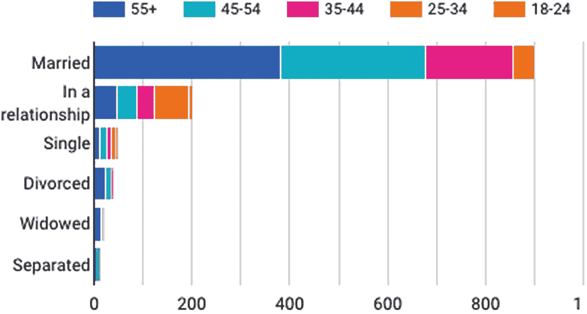

图 4-4：堆叠柱状图

至此，我们可以看到，此表单中的大多数受访者已婚，且年龄大多在 55 岁以上。这促使我们思考：*数据中是否存在任何偏差？这些人是否更有可能填写调查问卷？*

数据透视表也能提供更深入的洞察，尤其是在使用热力图的情况下。这可以与营销人员用于决策的问题结合起来。

数据透视表热力图（图 4-5）将购买频率与人口统计信息结合在了一起。根据此图，营销应针对更成熟的群体，以吸引频繁购买的忠实客户。

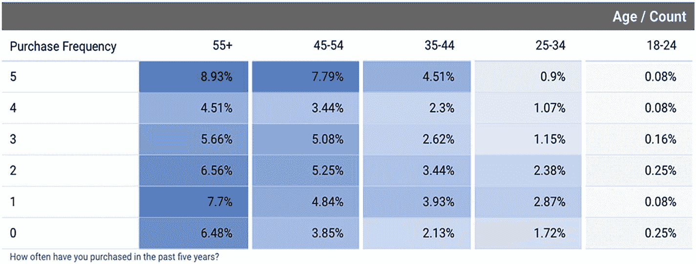

图 4-5：按年龄显示购买频率的数据透视表示例

您可以将此表与其他相关的可视化图表（图 4-6）结合起来，观察与其中一个交互时如何影响另一个。这些数据之间的关系可能非常吸引人，而创建这些交互的最简单可视化工具就是饼图。然而，如前所述，我们应尽量避免使用饼图，因为人类不擅长解读和比较角度。许多专家建议，对于简单的筛选，改用树图或柱状图。尽管如此，饼图仍然是下拉框的一个不错的替代方案。

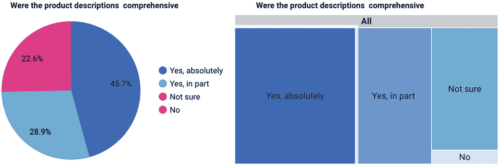

图 4-6：饼图和树图演示如何展示可用作筛选器的数据

两种图表类型都可以设置成应用筛选器，这意味着它们可以与驱动决策的更详细信息一起使用。例如，它们可以用来理解网站上某个特定功能的影响。

## 自由文本分析

调查中有一些自由文本框，我们可以从多个不同的角度进行分析。如果有足够的条目，很可能会出现一些重叠或实质相同的回答。这可能有点挑战性，但通过一些分析，我们可以进一步挖掘数据。

在调查中，我们询问了产品描述中是否有遗漏的内容。图 4-7 显示了最主要的回答。

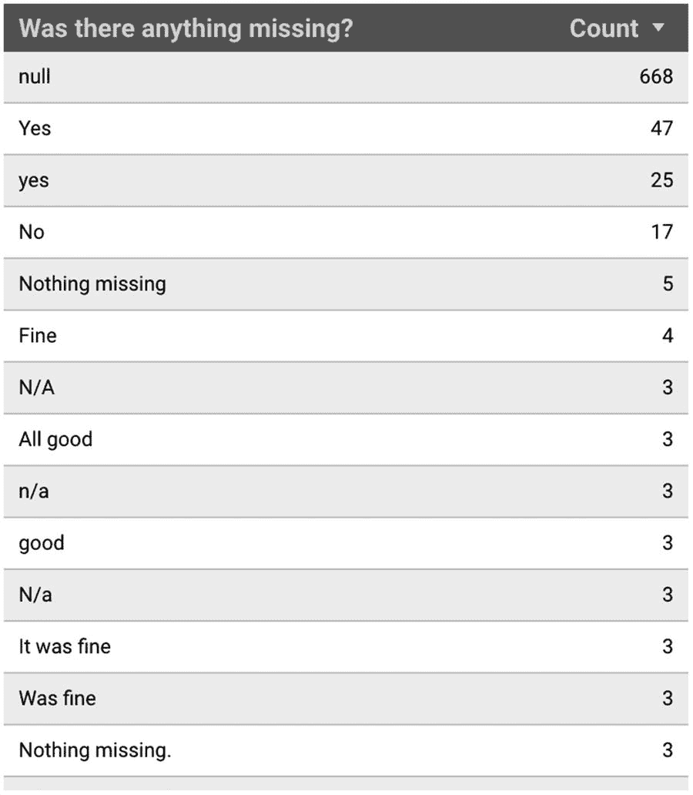

图 4-7：针对问题“产品描述中是否有遗漏？”的自由文本结果表

理想情况下，我们希望整合相似的结果，并移除 `null`，或将其替换为“无回答”。

-   对所有回答执行 `Lowercase`（转换为小写）和 `Trim`（去除空格）操作
-   使用 `Case`（条件判断）语句来整合常见的模式

最终，最好能使用机器学习进行智能提取，这可以低成本且越来越容易地实现，但那是另一本书的主题了。目前，我们可以使用 `Data Studio` 中的工具来处理。

`Null` 可以很容易地在格式设置中（缺失数据）替换为 `no data`，同时，我们还可以改进文本处理，对较长的回答将其更改为 `Wrap Text`（自动换行）。见图 4-8。

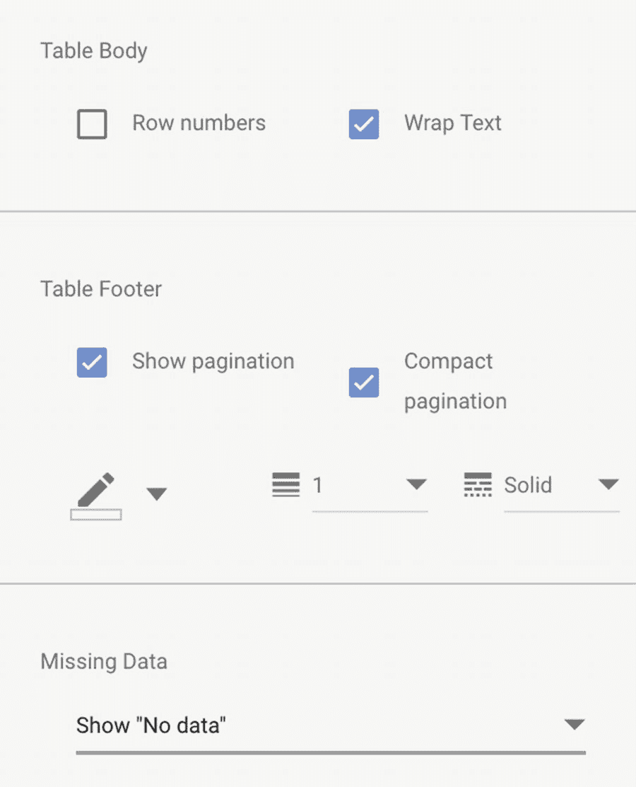

图 4-8：表格的格式选项

我们还可以为常用词添加额外的分类。社区选择器中有一些词云可视化选项，但没有一个完全符合我们的需求。所以，第一部分几乎是手动分析；当我们发现常见模式时，就可以使用 `case` 语句——例如，如果我们想突出特定的主题——有些人提到了图片，有些人提到了游泳池，有些人提到了厨房。

在图 4-9 中，我们可以看到如果文本包含特定单词，我们如何对其进行分类，这允许我们根据输入了特定关键词（如图 4-10 所示）的人员来筛选报告。

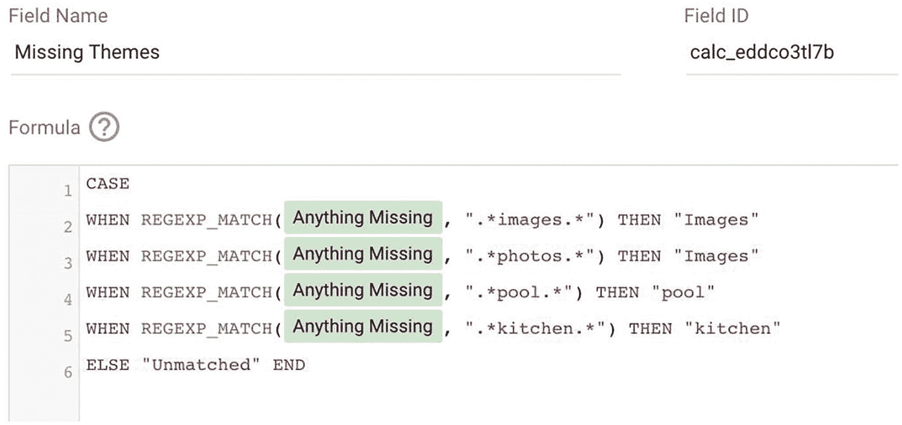

图 4-9：包含条件判断语句的自定义字段

一个小问题是，使用此方法，每个条目只能归入一个主题。因此，如果它提到了照片或图片，就不会再被计入“游泳池”主题；正因如此，`case` 规则的顺序/优先级非常重要。此外，这确实让我们有能力创建一个简单的下拉列表，以便您发现和分析常见主题。当然，此下拉列表也会应用于报告中的所有其他数据。见图 4-10。

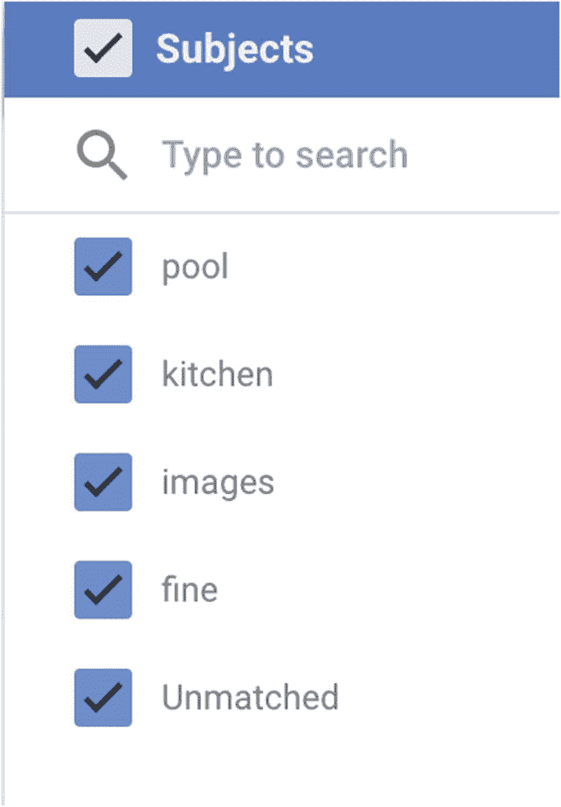

图 4-10：下拉筛选器中的分类文本

## 最终结果

所以，现在我们拥有一个基于调查数据的交互式报告，它允许营销人员深入其中并形成自己的洞察。最棒的是——对其进行调整和改进非常容易。见图 4-11。

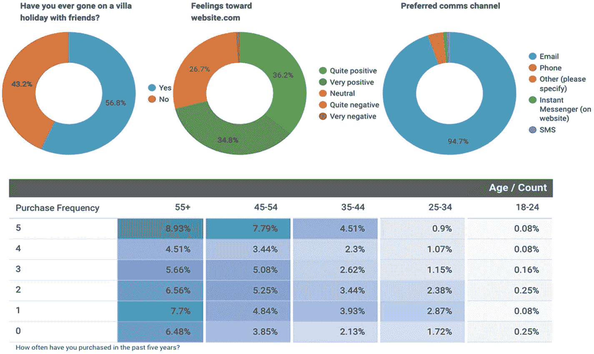

图 4-11：使用热力图数据透视表和环形图输出数据

好的，作为高级文档工程师和翻译员，我将严格按照您的要求，完成以下翻译工作。

## 回顾

Google Data Studio 不仅仅是分析数据的前端工具。它可以作为调查数据的展示层，就像`Excel`这类工具一样，但它能让数据在线化，并可供所有人访问。

我们可以使用简单的字符串函数在工具内改进和清理数据，还可以应用其他转换，基于自由文本或整合某些维度来创建自定义字段。最终，Google Data Studio 是一种将数据集以易于理解的方式呈现出来的强大方法。对某些人来说，这是比 Google Sheets 等复杂后端工具更好的前端，但必须注意确保数据一开始就采用正确的格式。

