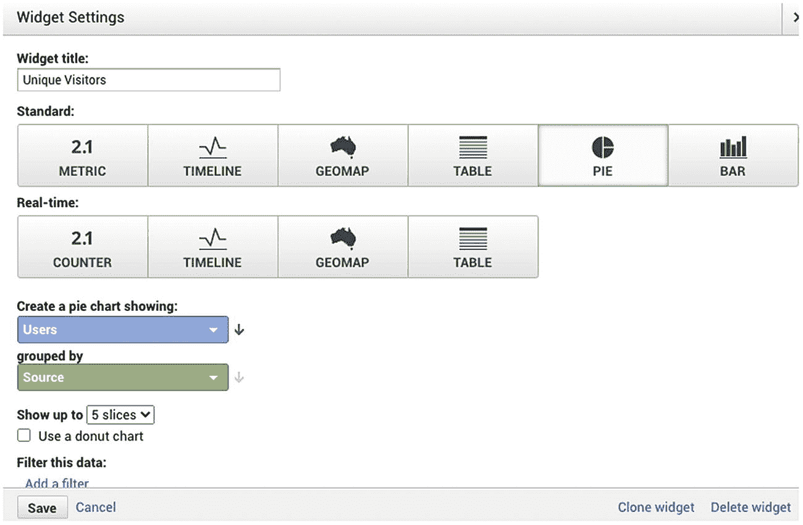
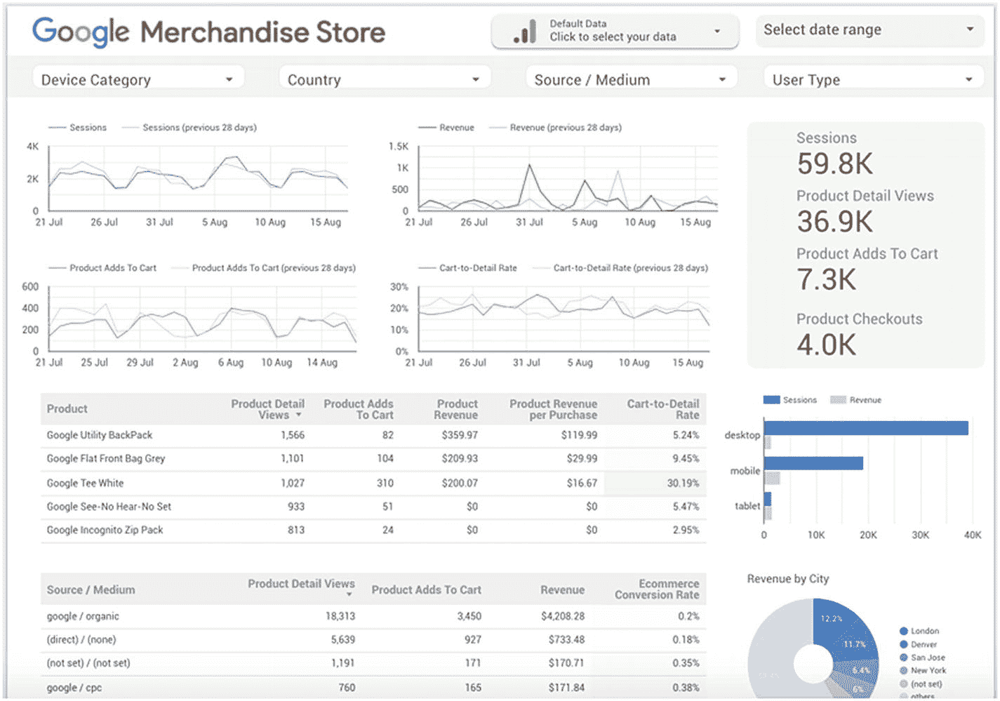
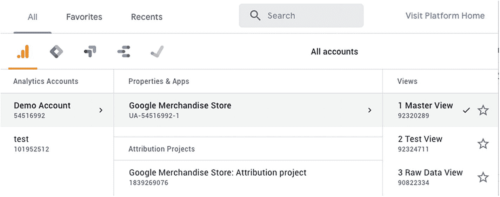
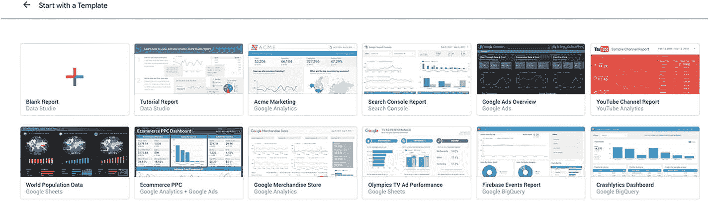
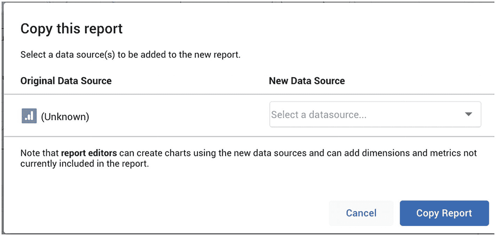
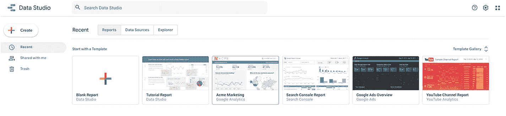

# 5. 市场营销数据可视化

> “请你告诉我，我该走哪条路？”爱丽丝问。
>
> “那很大程度上取决于你想去哪儿。”猫说。
>
> “我去哪儿都无所谓。”爱丽丝说。
>
> “那你走哪条路都无关紧要。”猫说。
>
> —— 《爱丽丝梦游仙境》，刘易斯·卡罗尔

在本章中，我们将聚焦于世界上一些最佳、最具变革潜力的数据源，即网站分析（也称为站点内分析），并学习如何在报告中呈现这些数据。

## 网站分析的价值

大多数企业都是数据工厂，源源不断地输出关于自身运营状况的数据。就像真正的工厂一样，这些数据流永不停歇，除非有人搞砸了或者企业停止交易。数据可视化工程师的职责，就是将这些这些数据流转化为企业可用于驱动价值的洞察。将来自众多数据源的信息进行加工，将是您新掌握的 `Data Studio` 技能所能处理、混合和合并的最有价值的贡献之一，这能带来大量的洞察和影响力。

网络商店现在被视为公司业务的重要组成部分，因此查看网络商店的网络分析很有价值，因为您可以了解网站如何以及为何工作，以及如何改进它以推动更多业务。

网站分析提供了许多从根本上改变企业绩效的绝佳机会，然而许多企业都犯了同样的错误：轻视它，甚至完全忽视它。

对我来说，站点内网站分析的一个简单定义是：
> 我的网站发生了什么？

已经有整本书籍专门论述分析这一主题，内容详尽。我在此不会复述同样的信息，而是会引导您去一个能提供高层总结的资料来源。

请查阅维基百科的网络分析页面，在我看来，那里有着最好的定义之一：[`https://en.wikipedia.org/wiki/Web_analytics#Web_analytics_technologies`](https://en.wikipedia.org/wiki/Web_analytics%2523Web_analytics_technologies)。

我建议您快速浏览一遍，试图为自己建立一些关于分析的背景知识，尤其要阅读一下关于更常见的“站点内网络分析”部分。

### 可视化您的受众规模

网络分析能影响到大量潜在客户，以至于人们很难理解它的强大之处。如果只看数字，3000 人和 30000 人看起来可能非常相似。

这里有一个真实的例子。在为一位客户研究网站分析数据后，我建议我们为一家家具零售商增加一个“推荐朋友”计划。我们不必深究原因，但可以说数据引导我朝那个方向思考。由于他们每月有数百万的访客访问他们的网站，这个推荐计划能够非常迅速地扩展规模。仅过了一两个月，我们就发现他们非常迅速地获得了大量新客户。当我在演示文稿中向他们展示新客户的数量时，我记得反应平淡，因为这仍然被视为公司的一个小型渠道。

几周后，当我再次展示这些数字时，我尝试让报告更具吸引力。我没有报告新客户的实际数量，而是向他们展示了一张特定足球场的图片，并说我们可以用从“推荐朋友”计划来的新客户填满这个球场的两倍。得到的反应是掌声！这是同样的数据，同样的结果，呈现给两个相似的团队，但呈现方式不同。

### Google Analytics

自十多年前首次创建以来，`Google Analytics` 已成为最流行的网站分析选择。现在很难找到一个网站没有使用其代码追踪部分信息。可以说，`Google Analytics` 的一个关键缺点，也是 `Data Studio` 诞生的主要原因之一，就是为了创建简单且引人入胜的仪表盘平台。图 5-1 展示了旧的 `Google Analytics` 仪表盘。

`图 5-1`

`Google Analytics` 多年来一直内置仪表盘功能；然而，在大多数国家，这从未得到广泛应用，因为：
*   它要求用户登录 `Google Analytics`。
*   `Google Analytics` 仪表盘难以共享和更改。
*   您可用的数据控件数量有限。

让我们开始使用 `Google Analytics` 进行数据可视化。

## 开始使用 Google Analytics 进行可视化

要做的第一件事是获取数据进行分析。为了学习，我们将使用一些练习数据，并且为了快速上手，我们将使用模板。

### 获取练习用市场营销数据

在我们开始处理数据之前，我们需要获得一些可以进行练习的数据。`Google Analytics` 团队提供了几个可以在 `Data Studio` 中使用的数据集，以帮助我们所有人学习。

我们将在下一个练习中使用的数据集是 Google 商品商店数据，它包含了访问 [`https://shop.googlemerchandisestore.com/`](https://shop.googlemerchandisestore.com/) 的所有访客和客户。见图 5-2。这些数据的一大优点是，它有效地让我们了解了真实网站数据的样貌，而无需投入巨资建立我们自己的网站。需要注意的一点是，数据中偶尔会出现一些通常不合逻辑的异常情况；不过，我很确定这是因为这些数据是为了演示某些功能而创建的。总的来说，这些数据对于大多数学习目的来说非常合适；但是，在将其与您自己的数据进行比较时要谨慎。另外，不用担心破坏账户的潜在风险。您不会做错任何可能损坏数据的事情。

`图 5-2`

### 获取 Google Analytics 演示数据

可以通过链接访问演示数据。

`图 5-3`

1. 请确保您已注册 `Google Analytics` 账号，方法是访问 [`https://analytics.google.com`](https://analytics.google.com) 并登录或创建账号。
2. 访问演示账号帮助中心文章 ([`https://support.google.com/analytics/answer/6367342`](https://support.google.com/analytics/answer/6367342))。
3. 点击“访问演示账号”按钮。
4. 这会将演示账号添加到您的 `Google Analytics` 账号中。您可以通过点击页面顶部的“账号选择器”，然后选择“演示账号”（如图 5-3 所示）来确认此操作。

如果您使用的是真实的 `Google Analytics` 数据，只需使用真实账号重复上述步骤即可。

### 使用 Data Studio 模板创建报告

在快速开始构建您自己的 `Data Studio` 报告时，模板非常有用。您可以利用它向业内高手学习正确的方法。让我们从学习如何从模板库构建您自己的报告开始。

选择屏幕右侧的 `模板库` 按钮。

当您选择 `模板库` 按钮后，您将看到由 `Google Analytics` 团队制作的各种报告的完整列表（图 5-4）。

`图 5-4`

选择底部行中的 `Google 商品商店` 作为模板。然后点击页面蓝色条中的“使用模板”。

选择相关报告并点击“使用模板”后，您可以选择使用现有数据源或创建自己的数据源。

由于并非所有人都能访问包含实时数据的分析账号，幸运的是，`Google` 设法分享了其 Google 商品商店的数据——这是您在学习过程中尝试的绝佳资源。

接下来，点击“新数据源”下的“选择数据源”。您将看到一个类似于图 5-5 的界面。只需从“数据源”下方的下拉菜单中选择 `Google Analytics 演示` 数据。

`图 5-5`

选择 `复制报告`，然后双击报告名称并将其命名为“GA 学习报告”。

然后您就可以开始探索这份新报告了。我强烈建议大家点击各个报告，并查看它们在“属性面板”中的属性。

现在，您可以使用 `Google` 提供的任何现有模板来创建自己的报告。

### 使用更多演示数据进行练习

学习新技能的最佳方法是足够多次地模仿专家的做法，直到它成为您的第二天性。这将帮助您开始构建 `Data Studio` 技能，使其成为您的本能，从而使您能够更专注于报告的内容，而非报告的创建。

幸运的是，`Data Studio` 有两个主要场所，您可以在那里学习如何可视化那些经常使用数据的人提供的数据：

* 模板库 ([`https://datastudio.google.com/u/0/navigation/reporting`](https://datastudio.google.com/u/0/navigation/reporting))
* Data Studio 报告库 ([`https://datastudio.google.com/gallery`](https://datastudio.google.com/gallery))

现在，我们将重点放在模板库上，以便快速上手。对于那些希望为自己的网站构建报告的用户，Google 团队通过其模板库提供了大量预制报告。模板库如图 5-6 所示。

**图 5-6** 模板库

当您浏览到 Data Studio 主页时，通常可以在页面顶部找到这些模板。

Data Studio 一直在不断发展，并且总有新的改进可以添加到您的报告中。

## 本章小结

在本章中，我们讨论了网站分析的价值，并使用演示账号和模板测试了 Google Analytics 的可视化功能。
