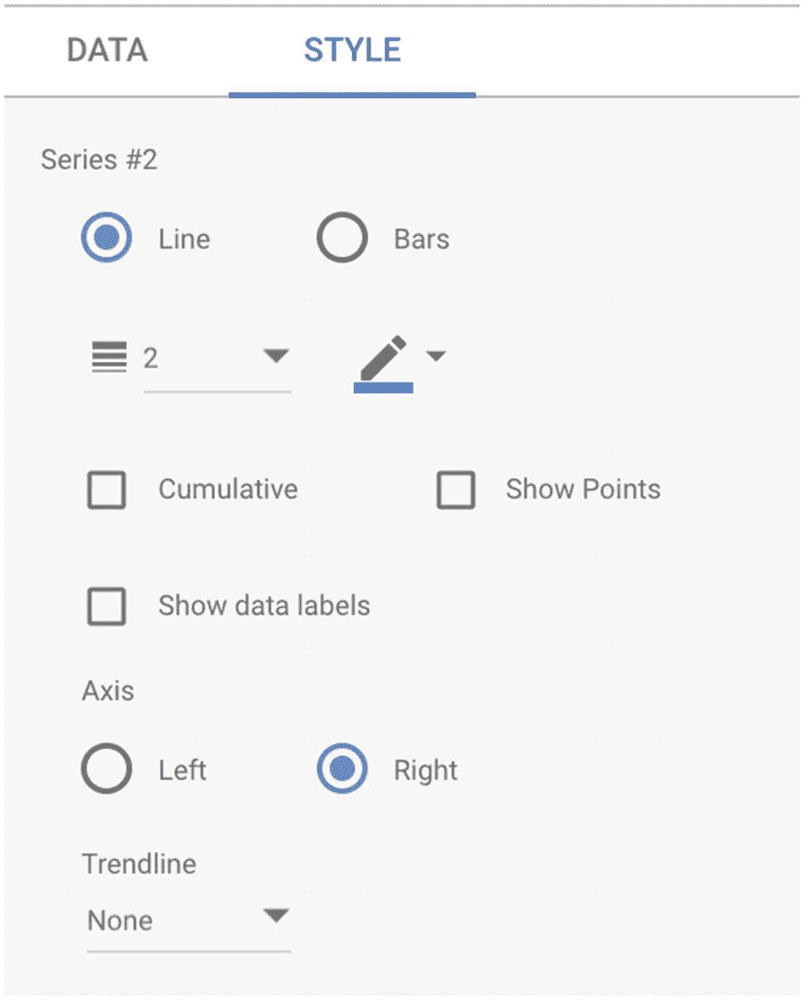
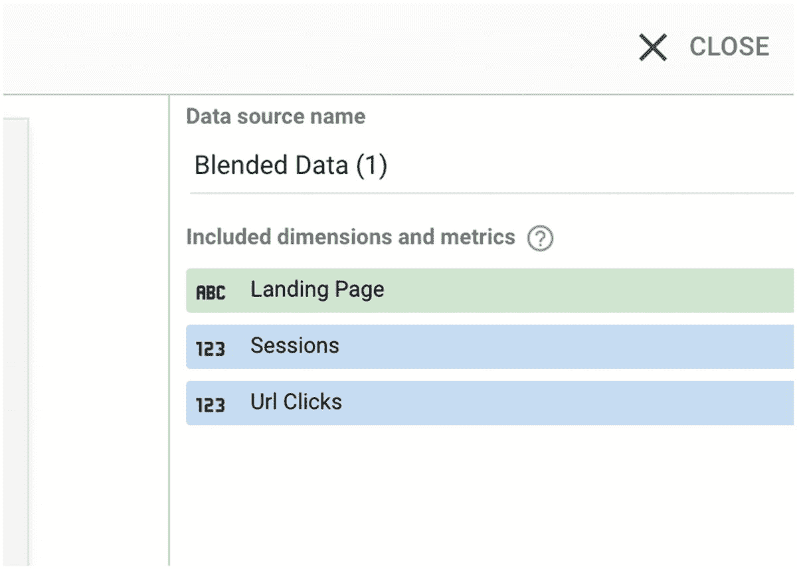
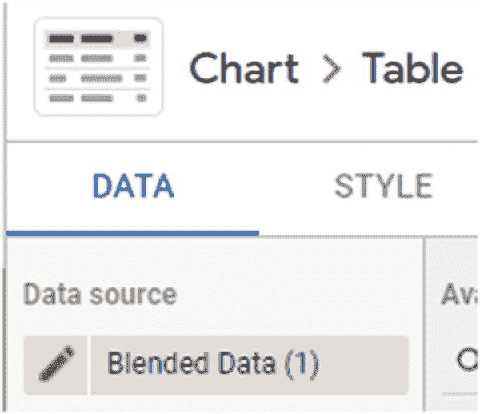
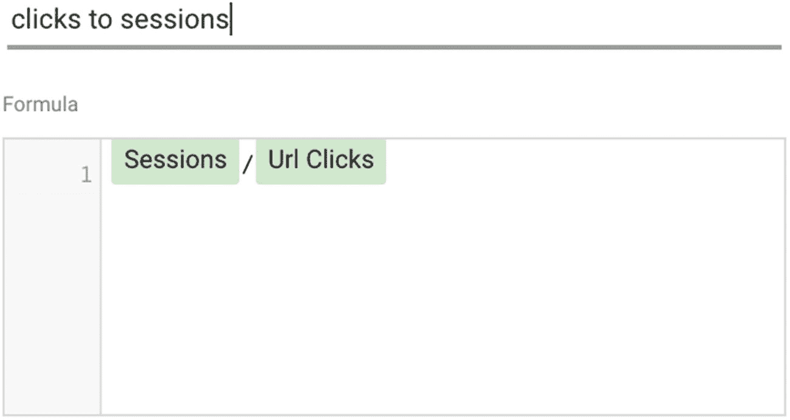
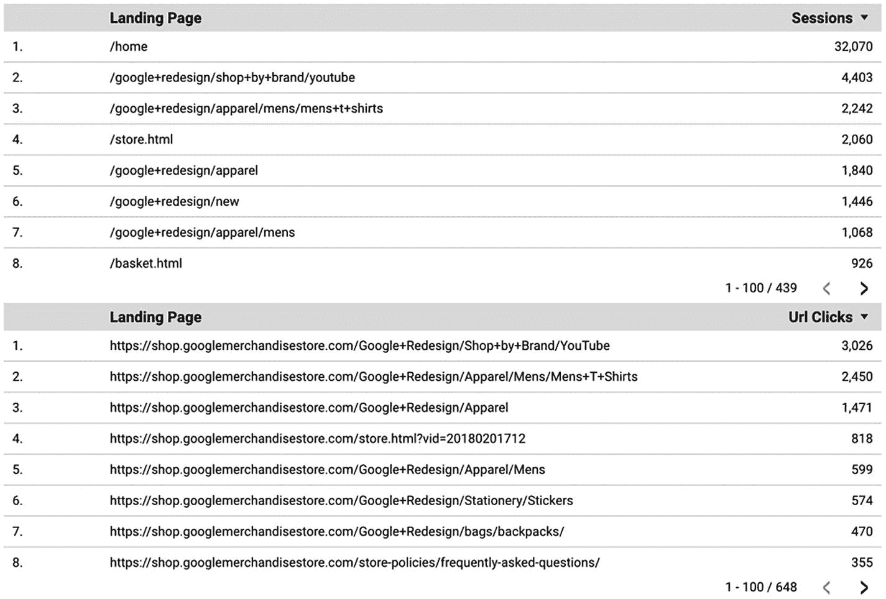
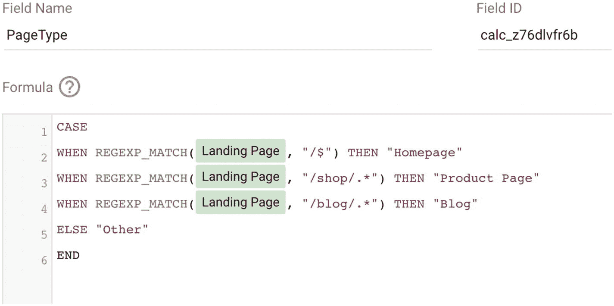
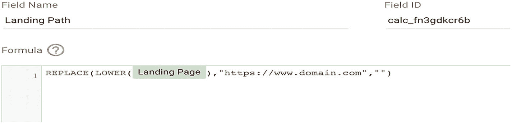
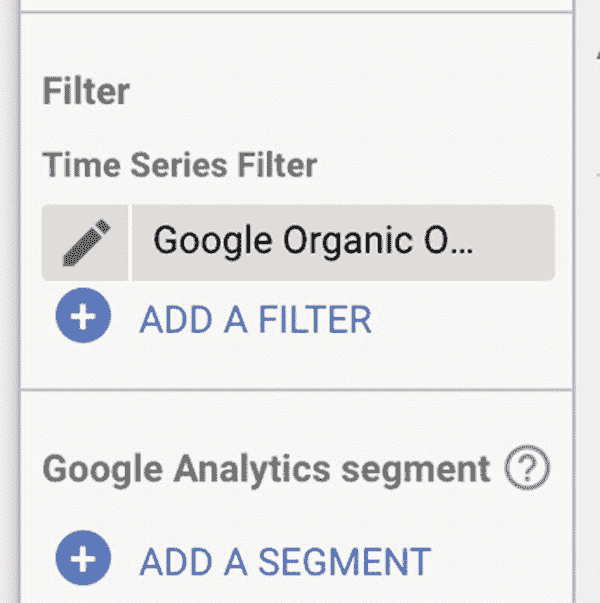
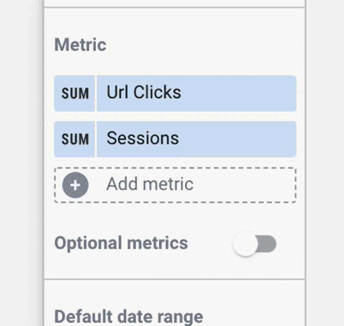
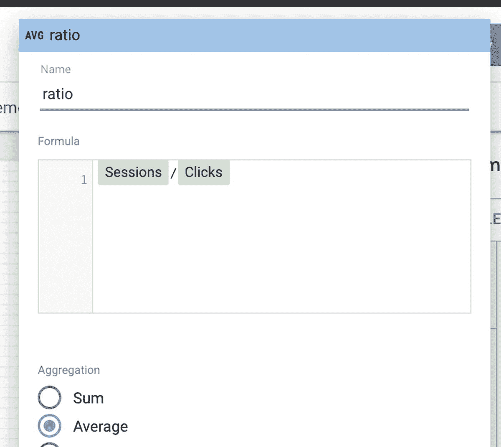

# 6. 数据混合

组合数据源以获得更深入的洞察

> *重要的是不要停止提问。好奇心有其存在的理由。*
>
> ——阿尔伯特·爱因斯坦，理论物理学家

通常，单一数据源能为您提供一些有用的见解。到目前为止，您已经了解到，在报告中包含多个数据源可以让您呈现更全面的图景。但是，当您将多个数据源混合到单个表格、图表或计算中时，这可以带来关于数据关系的更多洞察，并且您可以回答更多的“为什么”问题。

混合数据分析可以回答的一些问题：

- 在炎热晴朗的日子里，我们的商店流量是否在下降？
- 付费品牌流量是否影响了我们的品牌自然流量？
- 能否看到一个按页面显示自然展示次数、点击次数和转化次数的表格？

可以混合的数据想法是无限的。对于数字营销人员，尤其是从事 SEO（搜索引擎优化）的人员来说，这通常会引导您从多个来源提取数据，例如爬虫数据、天气数据、产品库存数据等。

在本章中，我们将逐步创建一些简单的混合数据，看看是否能提供更好的洞察，并解决一些实际问题。

Google Data Studio 混合使用了所谓的左外连接。这意味着，例如，如果您正在组合关于网页的两组数据，第一组将包含所有行，而第二组仅包含两者匹配的行。

例如，您可以混合两个或三个不同的分析账号，这将使您能够查看数据的累积或比较视图。这在迁移过程中或当您在不同的子域上拥有不同账号时非常有用。不过，值得注意的是，如果用户跨越多个媒体资源，某些网站范围的指标可能无法获取。

## 首次混合：选择两个数据源并混合数据

混合数据有两种方法。最简单且通常是入门方式的做法是，直接将两个图表混合在一起。如果你想合并两个图表，只需同时选中这两个图表（先选中第一个，按住`shift`键，再选中第二个），然后右键单击（Mac 系统上按住`control`键单击），选择“混合数据”（Blend data）（图 6-1）。如果 Google 数据洞察能找到一个公共键（例如`date`），它就能神奇地自动完成操作，令人惊叹——突然间，我们就在一个图表上拥有了两个数据源。


**图 6-1** – 通过选中两个图表来混合数据

如果你发现一个数据源与另一个数据源的量级完全不同，例如，我们将网站流量与天气数据合并，我们可以将其中一个系列分配到时间序列图表的右侧 Y 轴，以便两者都能以更合适的比例显示。你可以在`图表` ➤ `表格` ➤ `样式`窗格（图 6-2）中访问这些选项。如此简单，如此强大，并且适用于大多数基于时间的图表。如果你已经合并了两个图表以创建第三个图表，你可以成功删除前两个图表。



**图 6-2** – 将第二个指标移至右侧 Y 轴

## 添加更多数据或更改混合

如果我们使用第一种方法（选中两个图表并点击`混合数据`选项）合并了两个数据源，我们可能会发现想要添加一个过滤器，或者添加一个图表中原本没有的指标，我们可以编辑这个混合。混合后的数据源会像前两个数据源一样被添加到你的数据源列表中——它通常被糟糕地命名为“混合数据 (1)”。让我们先修改它的名称。如果我们点击数据源旁边的铅笔图标（图 6-3），在屏幕右侧窗格中，你可以看到“数据源名称”并进行编辑（图 6-4）。



**图 6-4** – 数据混合的初始名称



**图 6-3** – 编辑数据源名称

只要数据匹配允许，我们可以添加更多的指标和维度；如果数据没有正确的键，或者数据无法匹配，这当然不会生效，或者会给出错误的结果。

一个例子是与`着陆页`匹配的指标，包括转化率和跳出率——但如果我们使用页面浏览量指标，这些数据就不会正确。

我们可以编辑新连接的名称、添加维度、添加指标，还可以添加使用原始两个连接的计算指标——例如，我们可以找出从`Google Search Console`到`Google Analytics`的点击与会话之比，看看自然流量匹配程度如何（图 6-5）。



**图 6-5** – 混合中的计算指标

## 混合的关键

请记住，混合需要一个键来关联——这个键可以像`date`一样简单，如果两个数据源的时间范围重叠且粒度相似，通常可以匹配。对于更复杂的情况，我们可能需要稍微修改数据，以确保双方能够匹配。

一个例子是获取`Google Search Console (GSC)`的页面级数据和`Google Analytics`的数据。我们可以使用 Google 演示帐户进行此示例（图 6-6）。我们可以很快发现两件事：在`Search Console`中，它是完整的 URL，但在`Google Analytics`中，它只跟踪页面路径。



**图 6-6** – 比较将要混合的维度的表格

我们还可以看到，GSC 中的大小写与`Google Analytics`中的不同，这是因为有人对其进行了过滤；这些差异使得混合更具挑战性，但两者都很容易克服。图 6-7 展示了如何编辑一个字段。


**图 6-7** – 编辑字段

我们也可以使用字符串函数将所有内容转换为小写并移除域名，这样两个“着陆页”就相同了。

## 手动创建混合

我们可能想要合并来自`Google Search Console`和`Google Analytics`的某个页面的指标，但这样做时，我们会遇到一些初始问题——首先，将你的第一个数据源——`Google Search Console`添加到页面——我们此处使用 Google 演示帐户。

我们希望在单个表格中看到来自`Google Search Console`的展示次数、点击次数，以及来自`Google Analytics`的跳出率和转化率。

让我们以这个页面为例：

`shop.googlemerchandisestore.com/Google+Redesign/Shop+by+Brand/YouTube`

在`Google Search Console`中，这是`着陆页`URL，但在`Google Analytics`中，`着陆页`看起来像这样：

```
/google+redesign/shop+by+brand/youtube
```

全部小写且没有域名（和子域名），因此我们编辑数据源（尽管我们无法对演示帐户执行此操作，所以请跟随着操作）。首先，点击已添加到报表中的数据源旁边的铅笔图标；其次，我们需要通过点击`添加字段`按钮来添加一个新字段（因为我们无法修改原始数据源）。

我们可以使用`lower`函数将其转换为小写，保存，并给它一个新名称；然而，我们打算一步完成两个操作，以便输出与前面的示例匹配，另一个操作是移除 URL 的域名部分；为此，我使用了`replace`命令，最后为其命名并点击保存。我打算将其命名为`着陆路径 (Landing Path)`，因为这很好地反映了它的本质。

所以现在当我们把它添加回报表时，它会匹配`Google Analytics (GA)`中的数据，这意味着它已经准备好进行混合了！

选中第一个数据源（来自`Google Search Console`）后，点击`混合数据`，然后点击“添加另一个数据源”；现在我们就能得到一个包含来自`Google Analytics`和`Google Search Console`的指标的表格——一个包含所有页面所有指标的单一表格。

我们可以更进一步，对页面进行分组，这对于电子商务网站来说就变得非常激动人心了——有多少流量进入了产品页面、分类页面和博客站点——突然间，我们就对网站的运行方式有了深入的了解；要做到这一点，我们可以使用`case`语句对页面进行分组，但您需要提前对数据进行处理，确保混合双方匹配。见图 6-8 至图 6-12。



# 图 6-9 – 使用 `case` 语句对页面进行分类



# 图 6-8 – 用于将着陆页文本转换为小写并去除域名的公式

这正是营销经理们喜欢的综合性报告，粒度足够细，可以获取洞察，同时又足够宏观，可以看到趋势和变化。

`case` 语句是一种绝佳的方式，可以回顾性地对内容进行分组以进行分析和观察趋势，因为它可以使用正则表达式，这比其他更简单的匹配方式更强大。

## 如何在数据混合中使用计算指标

我（格里）曾参与一个项目，当时我们不确定迁移后谷歌数据的准确性。我们想将自然流量与点击量进行比较，于是按照步骤将点击量与自然流量结合起来——即来自 Google Search Console 的点击量图表和谷歌自然流量图表（通过对会话图表添加过滤器创建）。见图 6-10。



# 图 6-10 对图表应用过滤器

我们同时选中这两个图表并进行混合。生成的图表很完美，但我们希望能计算两者之间的差值——于是我们添加了其他指标。见图 6-11。



# 图 6-11 添加额外指标

添加指标使我们能够纳入基于这两者的全新计算指标。见图 6-12。



# 图 6-12 在混合中计算指标

突然间，我们得到了网站点击量与数据之间的动态关系——理想情况下，如果你已过滤为仅自然流量，该值通常落在 0.5 到 1.5 之间，这也是我在审计网站时经常测试的内容。由于这是一个比率，将聚合设置为`"平均"`很重要；否则，后续显示时可能会变得不准确。

使用图表中的平均值，我通常将其设置在右侧，同时仍显示其他两个数值，并使其更粗体显示；这可以通过点击图表并进入配置的样式选项卡来实现。

混合数据的机会实际上只受限于你的想象力——确保混合准确无误，没有发生任何聚合操作，或没有做出任何导致错误结果的行为总是值得的；但发现数据来源及其对其他数据的影响，是每个营销分析师的梦想。

## 回顾

数据混合一开始可能令人望而生畏，但通过遵循步骤并明确目标，希望你能看到它是一个不错的选择，并没有看上去那么具有挑战性。它功能强大，能为你提供通常无法获得的洞察。

请记住，键必须匹配，并且数据必须能够使用这个键进行匹配，其他一切就会水到渠成。混合两个图表是最简单的入门方式，但从此处开始，可以变得越来越复杂。