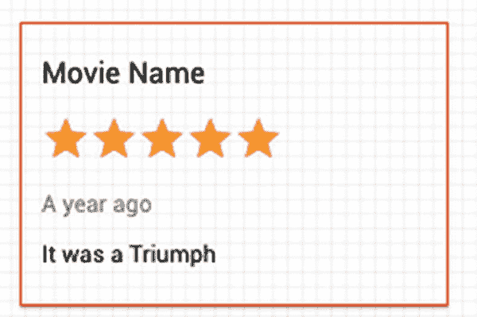
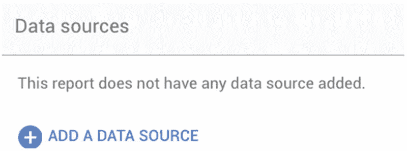
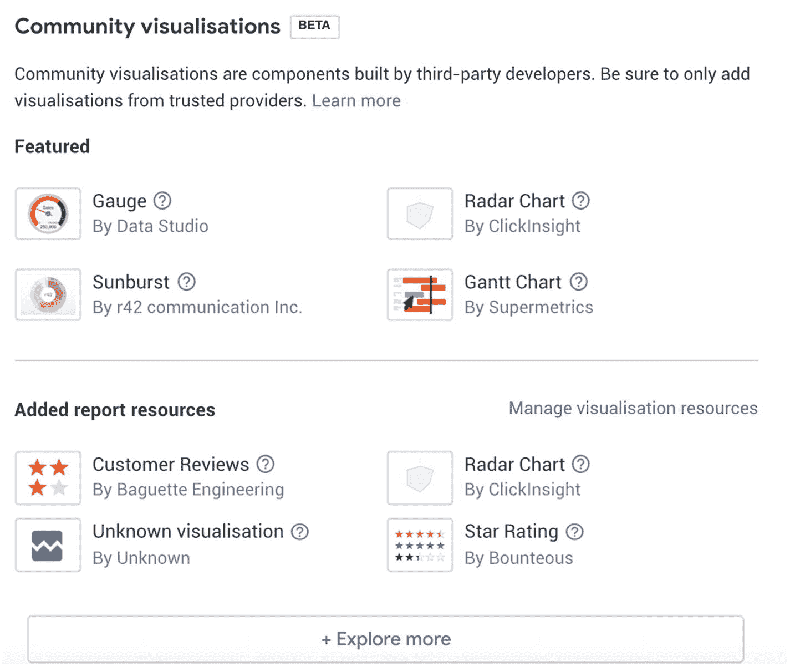
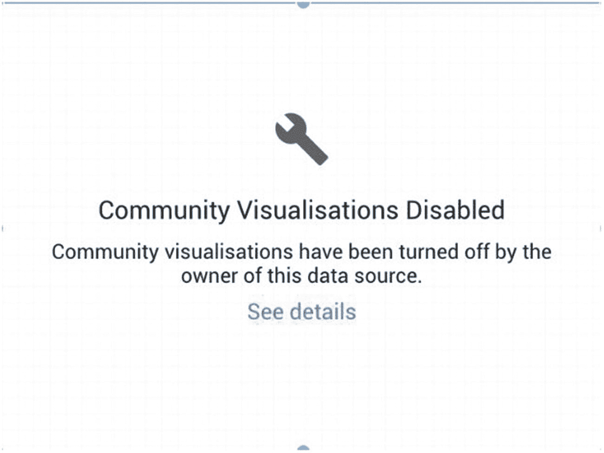
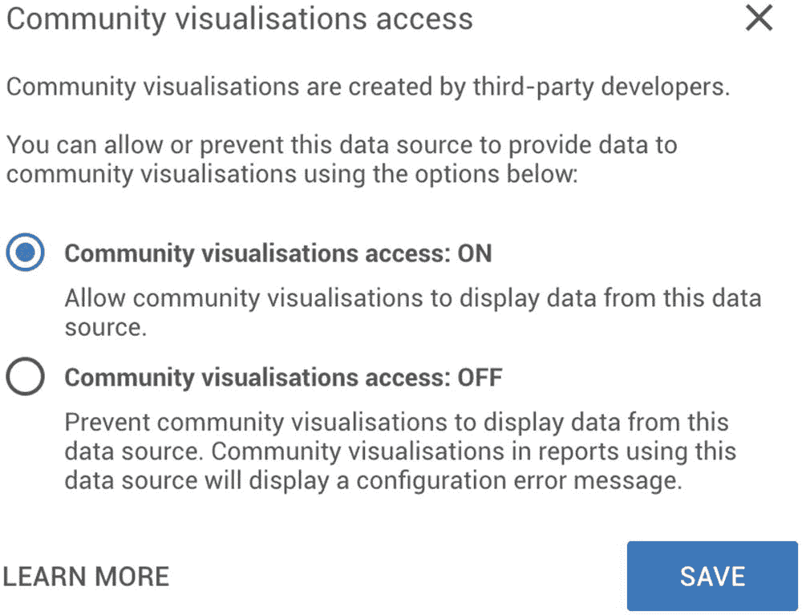
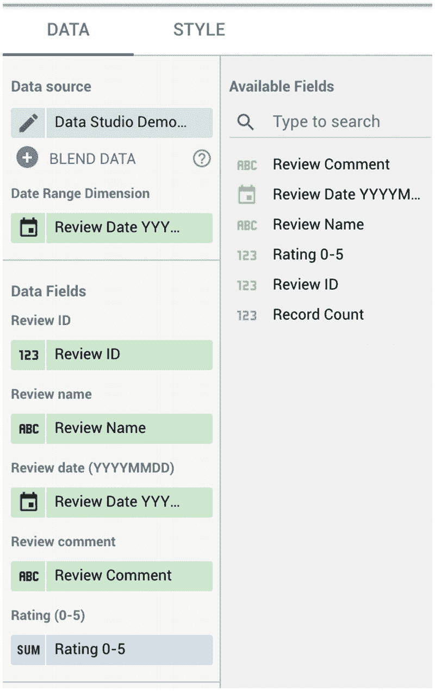
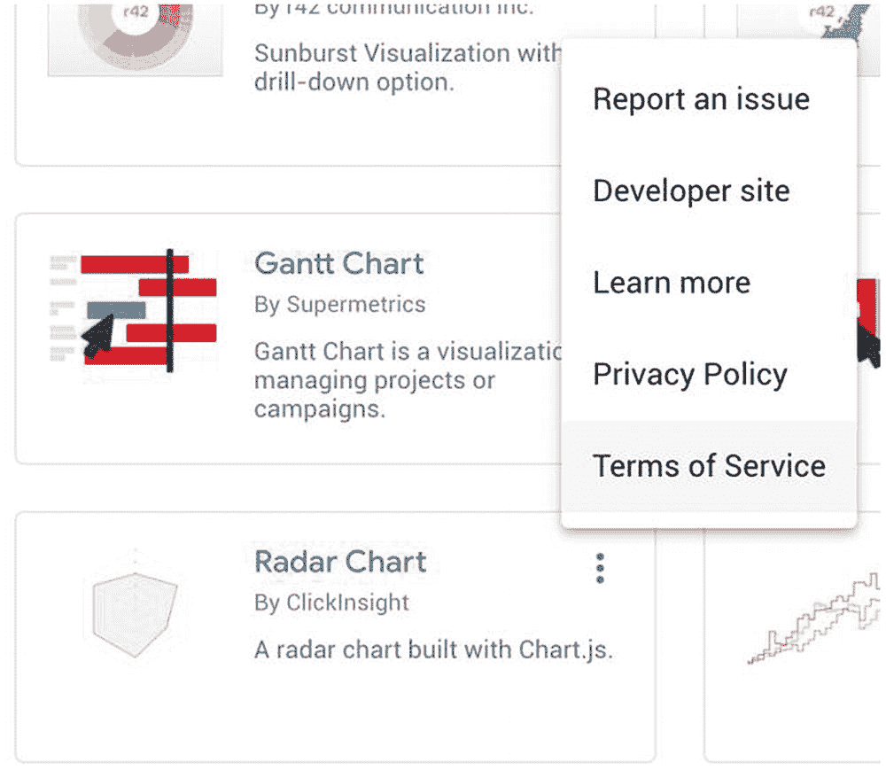
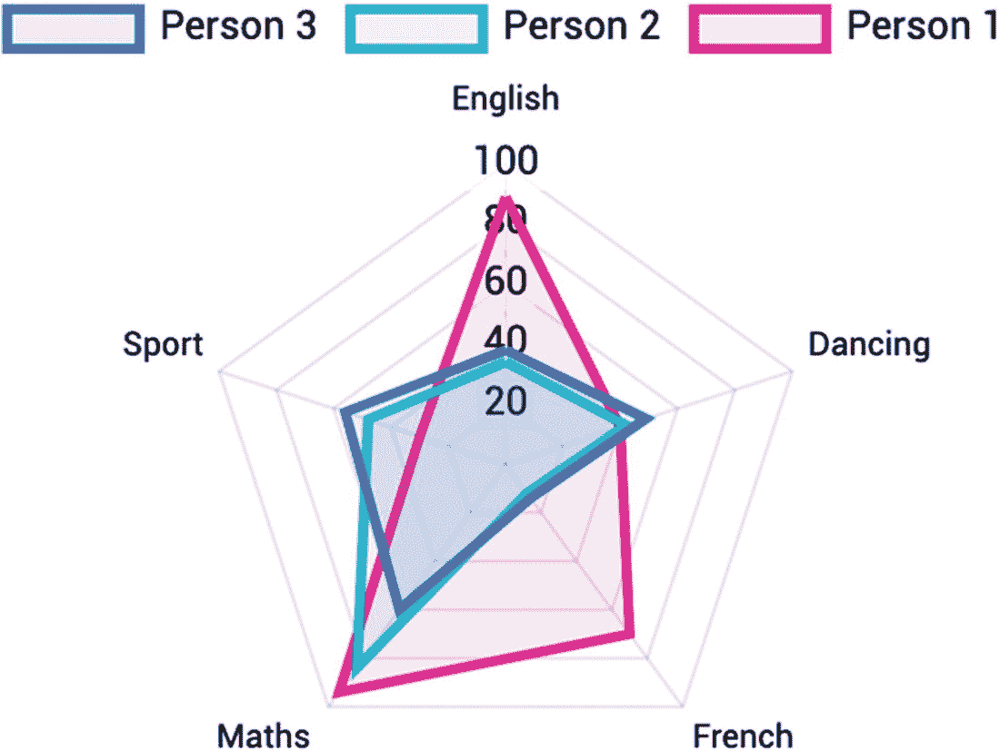

# 7. 自定义数据可视化

在前几章中，我们一直向你展示如何将业务数据连接到 `Data Studio` 并使其可操作。挑战在于，尽管 `Data Studio` 是一个极其灵活的工具，但总会有它无法解决的用例。这是因为如果 `Data Studio` 要涵盖所有内容，它就会变得臃肿且难以维护（同时还需要一支庞大的开发者团队来维持其运行）！

大多数数据产品（包括 `Data Studio`）的目标，仅仅是以简单的方式覆盖大多数用例，并创建框架，让其他人能够扩展 `Data Studio` 以满足自己的用例。

通常，这些“扩展”需要了解如何使用 `JavaScript` 的人来构建此功能。但在报表中实际使用这些扩展时，你不需要了解任何编程语言，它们的工作方式与 `Data Studio` 中的其他元素完全相同。

## Data Studio 提供哪些自定义功能？

如果你想扩展 `Data Studio`，可以利用两种类型的自定义功能：
- 自定义社区连接器
- 自定义社区可视化

## 自定义社区连接器

如果你发现所使用的平台无法连接到 `Data Studio` 或它使用的标准文件格式之一，那么你可以选择构建自己的社区连接器。如果现成的连接器不够用，自定义社区连接器是将 `Data Studio` 连接到你能想到的几乎任何数据源的标准方式。

社区连接器通常使用 `Apps Script` 构建，这是谷歌的标准脚本语言，用于为谷歌的生产力工具套件构建附加组件。如果你之前使用过 `Apps Script`，那么构建连接器的范围实际上相当简单。谷歌在其开发者网站（`https://developers.google.com/datastudio/connector`）上提供了大量有用的资源，包括一些预制的模板。

> **提示**
>
> 如果你有兴趣了解更多关于 `Apps Script` 的信息，并想看看还能用它构建什么，那么你可以在 `https://developers.google.com/apps-script` 找到更多信息。

一旦创建了 `Data Studio` 连接器，就可以通过将其发布到 `Data Studio` 连接器库或共享链接的方式与他人分享。连接器库需要谷歌人员先进行审核和预先批准，然后才能发布。

## 自定义社区可视化

自定义社区可视化是比自定义连接器更新的功能，它能让你制作出美观且定制的报表。当你对所有现有的、能够充分展示你想展示的数据的方式都不满意时，可以添加自定义可视化。

例如，如果我受雇于一家剧院公司，想要展示评论家的评分和评论，我会想在报表中找到一种方法将数据处理成最终的星级评分可视化效果。我可能会考虑使用“记分卡”或“条形图”控件之类的东西，但与用户看到评论旁边的几颗星相比，它不会给我那种瞬间的理解。如果你查看 `图 7-1`，可以看到由 Baguette Engineering 开发的“客户评论”可视化示例，它显示了：

`图 7-1` 由 Baguette Engineering 开发的“客户评论”可视化

- 被评论项目的名称（此处为电影名称）
- 满分五星的星级评分
- 评论发布的日期
- 评论中的引述或评论

## 如何在报表中添加自定义可视化

要制作 `图 7-1` 中的审阅可视化图表，我们只需执行以下操作：

`图 7-2` “管理已添加的数据源”界面

`表 7-1` “客户评论”表的数据

| 评论 ID | 名称 | 评论日期 | 评论内容 | 评分 0–5 |
| --- | --- | --- | --- | --- |
| 1 | 电影名称 | 20190512 | 这是一次胜利 | 5 |
| 2 | 动作电影 | 20190515 | 很糟糕 | 2 |
| 3 | 科幻电影 | 20190516 | 非常棒 | 4 |

1.  创建一个与 `表 7-1` 样式一致的 `Google Sheets` 文件。
2.  打开您正在处理的数据分析报告的数据洞察报告。
3.  进入 `资源` 菜单 ➤ `管理已添加的数据源`，并点击左下角的 `添加数据源`（`图 7-2`），从而连接您的“客户评论”`Google Sheets` 数据源。

`图 7-3` 添加自定义评论按钮

1.  选择 `Google Sheets 连接器`，然后选择您的“客户评论”文件。
2.  点击 `添加` 按钮以启动数据传输，然后点击 `添加到报告` 按钮。
3.  点击工具栏中的 `添加自定义可视化` 按钮。该按钮看起来像是一系列图形后跟一个加号（`图 7-3`）。

`图 7-4` 社区可视化界面

1.  社区可视化面板将打开（如 `图 7-4` 所示），然后选择 `探索更多` 以查看当前社区可视化图表的完整列表。

`图 7-5` 当您未允许在数据源中使用社区可视化时，会显示“社区可视化已禁用”错误消息

1.  选择“客户评论”，然后点击并拖拽到您希望其在报告中显示的位置。
2.  您应该会看到一个显示“社区可视化已禁用”的错误界面（如 `图 7-5` 所示）。不要惊慌，这是预期情况。

### 隐私与“社区可视化已禁用”错误

`社区可视化已禁用` 错误是数据洞察用户经常遇到的非常普遍的错误。出现此问题的原因在于，默认情况下，我们在数据源设置过程中并未授权使用社区可视化。尽管这个术语听起来有些吓人，但此错误的出现反映了数据洞察中一项保护性的默认设置。由于社区可视化可能包含第三方代码，因此在启用之前，需要考虑潜在风险。

主要考虑因素在于评估数据面临的风险程度。您需要依赖该社区可视化的开发者能够值得信赖地处理您的数据，并且其可视化图表在呈现数据时不会产生任何错误。因此，谷歌为您的数据源添加了这项额外的保护措施，要求您必须`选择启用`才能允许使用社区可视化。每当我选择启用时，我通常会：
*   对可视化图表的结果进行更多检查，以防万一出现错误。
*   更多地考虑数据的风险程度。由于涉及第三方代码，您还应该考虑最坏的情况，即代码可能停止工作或可能被新版本破坏。

每当您创建新的数据可视化源时，都应该考虑是否希望社区可视化访问这些数据。例如，电影评论数据就是低风险的数据源，通过社区可视化处理是完全可以的。

完成风险评估后，我们可以按照接下来的几个步骤消除错误并激活数据源以供社区可视化使用：

`图 7-6` 启用社区可视化访问权限

1.  首先选择 `资源` ➤ `管理已添加的数据源` 按钮。
2.  点击要修改的数据源旁边的 `编辑` 按钮。在顶部行中，您会看到有一个 `社区可视化访问` 标签页。
3.  一旦您选择了 `社区可视化访问` 标签页，您只需将其切换到 `开启` 状态并点击 `保存`（如 `图 7-6` 所示），然后点击 `完成` 按钮。

`图 7-7` 为了使社区可视化正常工作，您需要确保将正确的字段拖拽到同名的数据字段中

1.  您现在很可能会看到您的自定义可视化已出现。但离庆祝还有点远，因为还有更多工作要做。如果您点击自定义可视化，您会注意到维度和指标可能没有映射到正确的字段。
2.  为了使社区可视化正常工作，您需要确保将正确的字段拖拽到同名的数据字段中（如 `图 7-7` 所示）。
3.  请务必查看数据洞察右侧窗格中的 `样式` 标签页，您还会发现可以选择将哪一行作为审阅可视化的基础。

至此，您的报告中就拥有了一个可正常工作的社区可视化。既然您已经看到添加起来如此简单，那么让我们探索一下自定义数据可视化的其他一些选项。

## 社区可视化示例

既然我们已经学会了使用社区可视化，让我们再看几个例子。在探索可以使用的社区可视化时，我通常会遵循相同的思考过程：
1.  我的数据是什么样的？
2.  我希望数据报告产生什么影响？
3.  如何让我的报告在视觉上更具吸引力？
4.  我能否找到一个能替我完成部分艰巨工作的社区可视化？

# 社区可视化图表深入探索

第 4 步总是让我深入到每个社区可视化图表的 `3 个点` 菜单，特别是 `了解更多` 选项（如图 7-8 所示）。

*图 7-8 自定义可视化的“三点菜单”*

每个社区可视化都附带一个 `演示报告`，让人们可以看到可视化图表应有的样子，并检查是否有任何错误。让我们更深入地了解另一个名为 `雷达图` 的社区可视化图表，或者大多数人在分析中称之为……蜘蛛网图。

## 哎呀，蜘蛛图表！

雷达图，或称“蜘蛛图”，在一般商业咨询和战略分析中是一种非常有用的数据可视化工具。它以简洁优雅的方式回答了这样一个问题：“我们应该把重点放在哪里？”

蜘蛛图由多条等角线组成，每条线代表不同的度量指标。在图 7-9 的蜘蛛图中，我们绘制了三名学生的得分情况。

*图 7-9 “蜘蛛图”*

在这个蜘蛛图中，我们可以这样解读：学生 1 在英语、数学和法语等科目上表现确实不错，但在舞蹈和体育等身体活动方面却是全班最差的。因此，老师可以通过鼓励该学生多参加体育活动，或者尝试找到他们喜欢并能得到锻炼的事情来帮助他们。在所有老师中，数学老师似乎让所有学生都持续获得了更好的成绩，因此应该对其工作予以表扬。简单而强大。

> **提示**：筛选功能同样适用于社区可视化图表。因此，如果你想将一组学生单独提取到他们自己的图表中，只需复制图表并添加一个筛选器即可。

这款蜘蛛图社区可视化图表是使用一个名为“Chart.js”的免费开源图表库创建的，该库功能强大且制作精良。此外，它还具有对任何人开放使用或共享的价值。

## 回顾

在本章中，我们深入探讨了如何让你的 Data Studio 报表看起来更具定制化，以及如何整合其他数据源。最后，我们回顾了几款流行的 Data Studio 社区可视化图表。