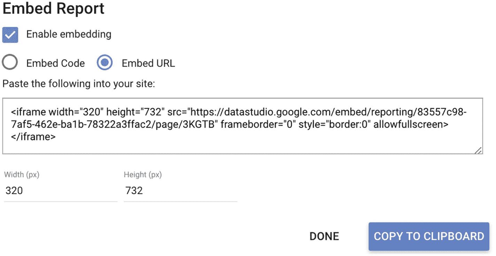
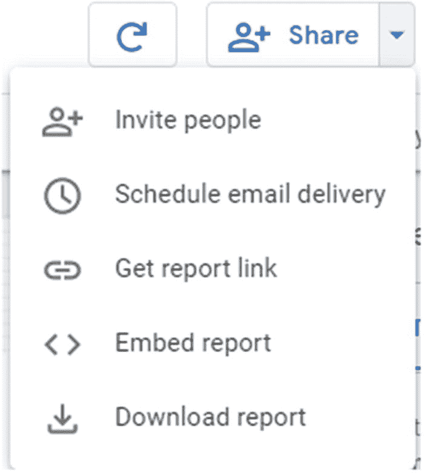
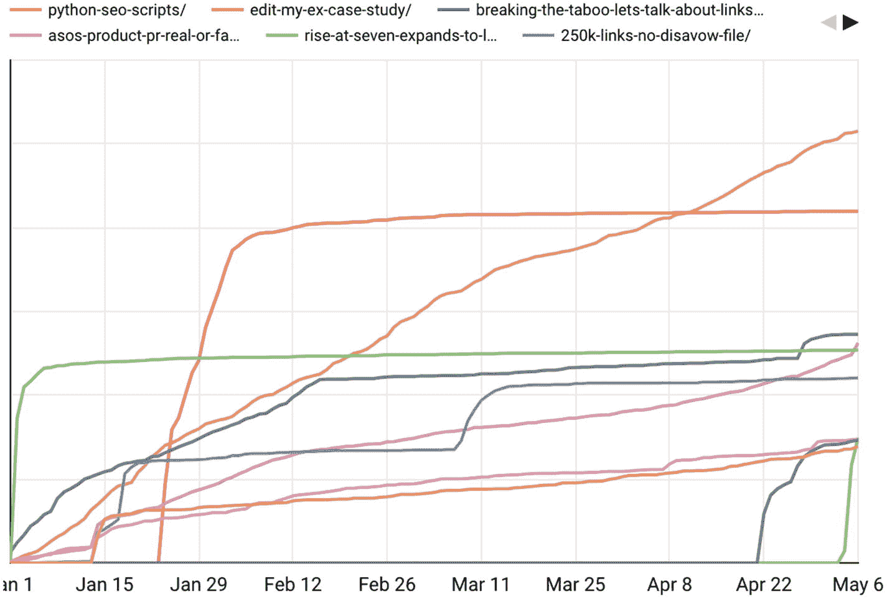
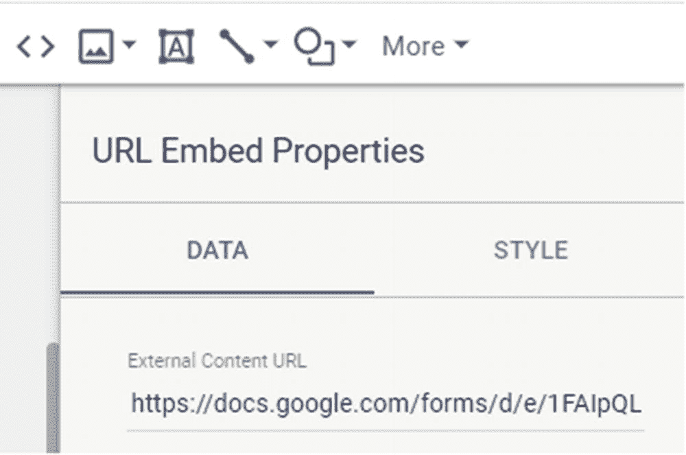
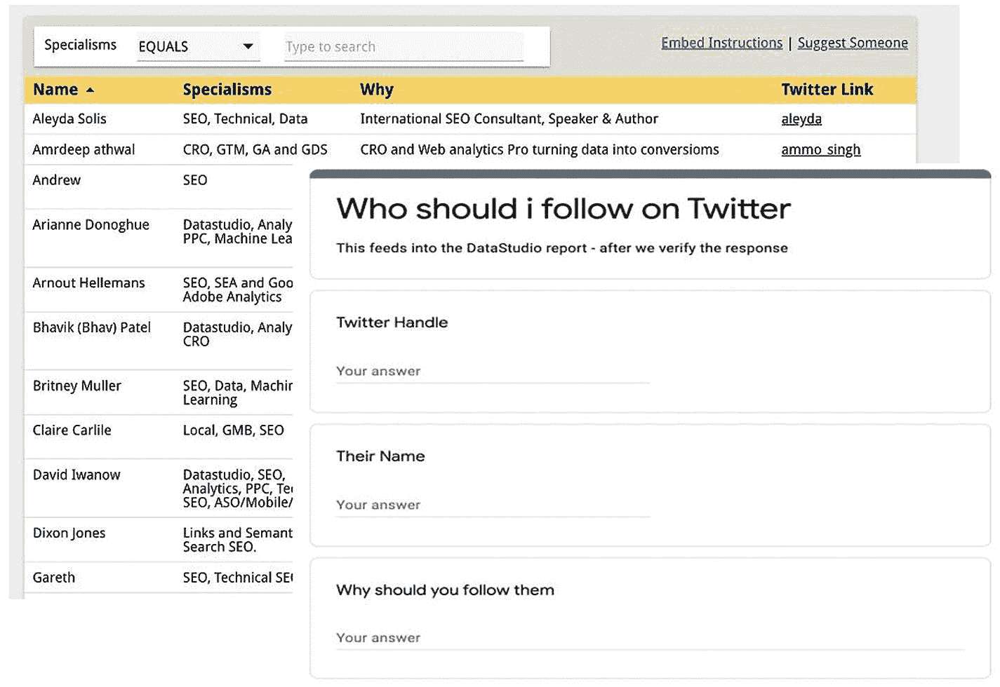
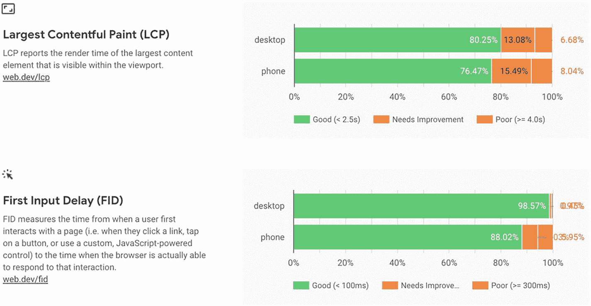

# 8. 何必止步于此？

Data Studio 的唯一限制是你的想象力

> *路？我们要去的地方，不需要路。*
>
> ——埃米特·布朗博士，《回到未来》（1985 年）

我（格里）几乎可以称得上过度使用 Data Studio 了。当我想要可视化或分析某些东西时，令人惊讶的是，在审计客户的分析数据时，我经常求助于 Google Data Studio。我会创建尽可能长的页面，并连用多个表格来展示问题，周围配上一些文字说明。利用自定义格式，我可以突出关键问题，然后从那里开始监控它们是否已被解决。我会为每个广告活动创建可视化图表，并用它来展示我希望客户查看、交互但不能编辑的数据表格。

数据通常很有趣，常常很美观，有时甚至令人着迷。关键在于解读。如果你还没有机会阅读史蒂芬·都伯纳和史蒂芬·列维特合著的《魔鬼经济学》（2005 年），书中解释了为什么相关性不等于因果性，这绝对是关于如何解读数据的一本推荐读物。

想想数学家亚伯拉罕·沃尔德在考虑如何最大限度地减少轰炸机被敌方炮火击落时，将幸存者偏差纳入计算中的那个不可思议的故事。他提出，不要在弹孔多的地方增加装甲，而应该在弹孔少的地方增加装甲。理由是，在这些区域被击中的飞机很可能没能返航，因此无法被计数。为了本书的目的，这个故事和其中的数学原理被过度简化了，但你明白了其中的道理。关键是，没有全局图景，数据常常毫无意义。相关性并不总是等于因果性。有时它只是随机的，有时则出于其他原因。

令人惊讶的是，有多少数字营销人员是“渠道中心论者”。他们只关注自己渠道的表现，在观察表现下降或上升时，不考虑来自其他渠道的蚕食效应。Google Data Studio (GDS) 使我们能够共享来自整个业务部门的数据子集，从而让我们拥有更广阔的视野。我们能够有效地开始看到缺失的部分，然后我们就真正知道该在哪里加固飞机或改善业务了。

如果有效使用，Google Data Studio 能帮助我们接触到更完整的图景。这是一个工具，它能将通常难以整合的、来自多个数据源的数据汇集到一个地方，并且如果配置正确，它还能为我们提供准确的图景。

到现在为止，我们希望你已经看到了 GDS 如何让你追溯性地清理数据，如何让你对数据进行细分和共享，如何为更多人提供更完整的图景，并且如何构成一个出色的演示层。

在本章中，我们将讨论一些使用 Google Data Studio 的有趣方式。

## 博客效果

我（格里）所在的公司通过游戏化的方式激励员工撰写更多博客文章：谁的博客文章在年底前获得最多浏览量，谁就获胜。我没花多少时间就使用 Data Studio 为这个激励活动创建了一个可视化图表。

考虑到目标受众（我的队友）的需求和习惯，我点击 **“共享”** 下拉按钮，选择 **“嵌入报表”**（图 8-1）来嵌入报表。然后我将报表的尺寸设置为手机屏幕大小，启用了嵌入功能，并分享了“嵌入”网址（图 8-2）。这意味着团队可以在手机上查看它，而无需使用工作电脑。



图 8-2
报表的嵌入选项，附有适合在手机上查看的推荐尺寸



图 8-1
嵌入报表选项

在我报表的一张图表中，如图 8-3 所示，我们可以清楚地看到，目前领先的是那篇关于 Python 脚本、增长最稳定的文章。与作者分享内容数据，会促使他们创作更多、质量更高的内容。一个内容仪表盘可以展示所选文章的排名关键词，或者该页面的参与度。我还创建了额外的标签页来追踪数据的其他视图，部分原因是为了确保所有参与度指标设置正确，并且我们还把作者作为一个自定义维度追踪到分析系统中。



图 8-3
某代理商网站上博客文章的累计页面浏览量

在 Data Studio 中创建这个小组件，促使更多同事开始制作报表，并关注交付质量。记住，如果你尝试这个，你可以按照自己的喜好设计报表样式，并将其嵌入到随时间变化的网页中。

## 广告活动效果迷你报告

对于我们做的每一个代理商广告活动，我们都会快速创建一个广告活动效果报告，通常基于 Google Analytics 数据，但经常定制以提取诸如视频分享（包括 YouTube 数据）之类的互动行为。当公关团队记录媒体报道时，这些数据会进入一个 `BigQuery` 表（甚至存储截图），然后可以被接入，瞬间变成一个可以轻松与客户共享并提供内部进度报告的报表。

将来自多个数据源的数据在报表中合并、混合，并且可以轻松快速地与客户共享，这在几年前我们还只能梦想。


## 后台数据的前端展示

数据工作室的另一个妙用在于，如果我们能将数据拉取到 Google 表格或数据库中，它就可以成为后台数据的出色前端界面。例如，我曾需要创建一个可视化报告，展示我们团队已预订、计划预订和已休完的假期天数。这些数据已经是电子表格格式，因此很容易导入数据工作室。我需要做的一件事是创建一个新的工作表来清理数据。我确保各列正确对齐，以便我们能够快速按团队，然后按个人查看剩余、已休和已预订的天数。一旦我将数据输入数据工作室，我们就神奇地获得了一份会自动更新的报告。

数据工作室是一个多功能的数据可视化工具。它不仅适用于营销数据。我经常发现，从事其他角色或行业的朋友，当你能够获取他们的数据并在数据工作室中进行可视化时，他们会感到惊喜。

## 嵌入表单

你还可以在数据工作室报告中嵌入一个表单。例如，我想在一个报告中嵌入一个表单，让人们推荐我应该在 Twitter 上关注谁（图 8-4）。这是一份只需几分钟就能完成的快速报告。我创建了一个 Google 表单，用于收集 Twitter 账号、用户姓名以及关注理由。我获取了 Google 表单的 URL，进入我的 Google 数据工作室报告，点击工具栏上的“嵌入 URL”按钮，将表单放置在页面上，并在“外部内容 URL”字段中粘贴了该 URL（图 8-5）。



图 8-5：嵌入表单的 URL



图 8-4：在 Google 数据工作室报告中嵌入表单，允许您添加更多数据

这仅需几分钟就能搭建完成，但如果我用其他方式开发，可能需要一两天才能完成。它易于共享，其他人也可以将其嵌入到他们自己的网站中。

尽管在这个例子中，我展示了如何使用表单在报告中显示数据，但您也可以使用表单来获取关于报告本身的反馈。正如我们在本书前面提到的，一个很好的做法是放置一个包含您联系方式的页脚栏，以备有人提出问题或更正。您可以通过在报告的最后一页嵌入一个表单来实现这一点，用于收集对报告的反馈或修改请求。这是一种让用户提交更改并进行跟踪的巧妙方法，可以快速见效。

## 技巧与窍门

数据工作室拥有许多能加速工作的技巧和隐藏方法，并且每隔几周的数据工作室更新都会带来更多功能。以下是我发现的一些最佳技巧：

- **不要重复造轮子** – 您可以从现有的模板和示例中获得大量灵感。如果您手头有好的示例，就无需每次都从头开始。模板可以在 `datastudio.google.com/gallery` 找到。那里有一些非常棒的模板，可以激发您的灵感或成为您的起点。

- **查看您的报告是否被使用** – 您可以在报告模板中添加分析代码段，以检查使用情况以及用户是否在与之互动。令人惊讶的是，有多少报告被创建出来却无人问津。了解哪些报告被使用或哪些被日常使用也很有趣。分析代码段可以向您显示哪些报告需要清理、合并或删除。

- **图表样式可以复制** – 您可以将一个图表的样式复制并粘贴（选择性粘贴 ➤ 仅粘贴样式）到另一个图表，以确保报告中样式的一致性，包括圆角、线条粗细和颜色。当我发现这个功能时，我简直不敢相信它过去能为我节省多少时间！

- **将交互过滤器应用于几乎所有内容** – 几乎所有内容都可以过滤其他所有内容，这赋予了它强大的能力，让您可以深入探究您想要的数据。如果您希望此操作仅应用于某个子集，可以将它们分组，包括日期过滤器。

- **高级日期** – 一些客户可能需要查看逐年的性能对比，但需要的是逐日级别而非逐日对比。这在业务遵循高度趋势驱动的日历时通常是这种情况。由于这不是内置选项，我们需要采用一些技术手段来实现。在您的比较日期范围选择器下，从列表选项中选择“高级”。完成此操作后，您需要选择一个固定的开始日期。为此，请返回到上一个日历年度，并选择与当前年度第一天对应的日期。完成此操作后，就该设置结束日期了。为此，只需选择“今天”、“减去”，然后输入 365 作为天数即可。

- **追溯清理着陆页中的参数** – 尽管我们力求输入最干净的数据，但如果您使用 Google Analytics（分析），过滤器可以帮助您清理一些奇怪的问题，但您无法像在数据工作室中那样进行追溯清理。这时就可以使用自定义字段了。在您的数据中创建一个如下所示的新字段：

```
REGEXP_REPLACE(着陆页, '\\?.+', "")
```

可以去除诸如 Facebook 和 Twitter 等社交网络可能附加的任何奇怪参数。我们发现，将此项应用于一个报告后，一些社交分享帖子的访问量翻了一番。您还可以去除并合并尾部斜杠 `REGEXP_REPLACE(页面,"./","")`。

- **清晰标识报告指标** – 提供指南，不仅要说明指标是什么，还要说明其含义。您可能需要在报告末尾添加一个术语表，用以解释一些业务指标或简单的分析定义，例如什么是会话或跳出率是什么意思。顺便提一下，始终在图表中包含 Y 轴标签，因为没有它，在 Google 数据工作室中解读指标会非常令人沮丧。

- **使用色板创建颜色样式表** – 如果您想快速为图表和素材资源设置样式，您不能使用 CSS，但可以导入一个您可以在 PowerPoint 或其他快速图形编辑器中创建的图形块。从客户的网站或徽标中选取几种颜色，以确保在整个报告中都使用他们自己的品牌标识。

非常感谢 Al Wightman、Omi Sido、Jill Quick 和 Nick Wilsdon 的贡献。

还有很多其他的技巧，以及更多尚未被发现。

## 网页指标

Google 本身现在也将数据工作室用作某些数据源的前端界面。这方面的一个例子是 Web Vitals 项目（`https://web.dev/vitals/`），它是一组数据点，展示了 Google 对您网站的看法。您可以从他们公开的 Google BigQuery 表中获取真实用户的经验数据，并且他们通过一个数据工作室报告使其可访问，该报告可以轻松配置为聚焦于您的网站（或竞争对手的网站）。请参见图 8-6。



图 8-6：用于 Web Vitals 的 Google 数据工作室模板

随着越来越多的工具、服务和公共数据集在数据工作室中提供对其数据的访问，很明显它不会在短期内消失。

数据源和可视化的结合意味着，只需简单的可视化，就可以实现前所未有的追踪可能性。


### 通过 Google Sheets 巧妙获取数据

如今可用的数据连接器越来越多。尽管如此，在营销领域，总有一些数据源不容易获取。因此，你可以通过连接 `Google Sheets`，来接入像 `IFTTT`（If This Then That）这样的数据源（图 8-7）。


图 8-7

*可用于将数据拉取到 Sheets 中的 IFTTT 示例*

你可以直接将关于会议（如果它们有话题标签或通用名称）的推文追踪到 `Google Sheet` 中，然后通过一份近乎实时的 `Data Studio` 报告，我们就能看到推文的类型、频率以及谁在发推最多。

我们还可以通过 `Asana` 将项目管理工具连接到 `Google Sheets`，从而追踪人们在 `Data Studio` 中完成任务的频率——全面了解企业的运营状况，有助于领导层做出明智决策，从而取得更优成果。

任何公司中一项常见的任务是查看团队分配情况：为某个客户投入了多少时间，客户支付了多少费用，谁工作过量，谁未被充分利用。虽然在电子表格中也能完成大部分这类工作，但通过使用 `Data Studio` 中的 API，你能获得一个实时仪表板，从而快速高效地查看状态。如果你能在工作进展中实时查看这个仪表板，就能有效地安排新项目、响应客户请求，或对表现不佳的团队成员进行补偿。

## 总结

归根结底，`Google Data Studio` 让那些常常被锁定在孤岛中的数据变得更加易于访问。无论数据是曾隐藏在电子表格中，还是无法从数据存储中获取，如今在整个企业内，甚至有时在公开网络上，都可以访问这些数据。

当然，如果你读完了本书，并构建出了某种富有灵感或趣味性的东西，欢迎在 Twitter 上与我们分享！

`索引`

`A`, `B` 后台数据 数据混合 添加更多数据/改变混合方法 计算指标 创建混合 `GSC` 博客表现 `C` 广告系列效果报告 自定义数据可视化 添加报告 Baguette 工程社区连接器 “社区可视化已禁用” 错误 定义 示例 `D` Data Studio 业务态度 数据开发者 数据旅程 演示数据 你好世界 创建空白报告 创建数据连接 开始设置，Google 账户 显示数据，CSV 打开数据 Data Studio 模板 维度 `E`, `F` 嵌入式表单 `G` Google Analytics (GA) 访问营销数据 Google Data Studio (GDS) Google Search Console (GSC) Google Sheets `H`, `I`, `J`, `K`, `L` 技巧与隐藏方法 `M`, `N` 指标 聚合 定义 示例 `O`, `P`, `Q` 在线调查 设计报告 颜色主题 页脚栏 粒度 头部栏 最终结果 自由文本分析 收集数据 在页面获取数据 准备数据 网站分析 `R`, `S`, `T`, `U`, `V` 雷达图或“蜘蛛图” 报告 构建 Hermann 的蛋糕/咖啡店 添加日期比较 清理数据 创建数据连接 创建原始表格视图 复制饼图/更改产品类型 Google 电子表格销售数据 Data Studio 帮助 Herman 的蛋糕/咖啡店 Hermann 的需求，查找信息 `W`, `X`, `Y`, `Z` 网站分析 定义 Google Analytics 可视化 大小、受众 网店 网页核心指标
