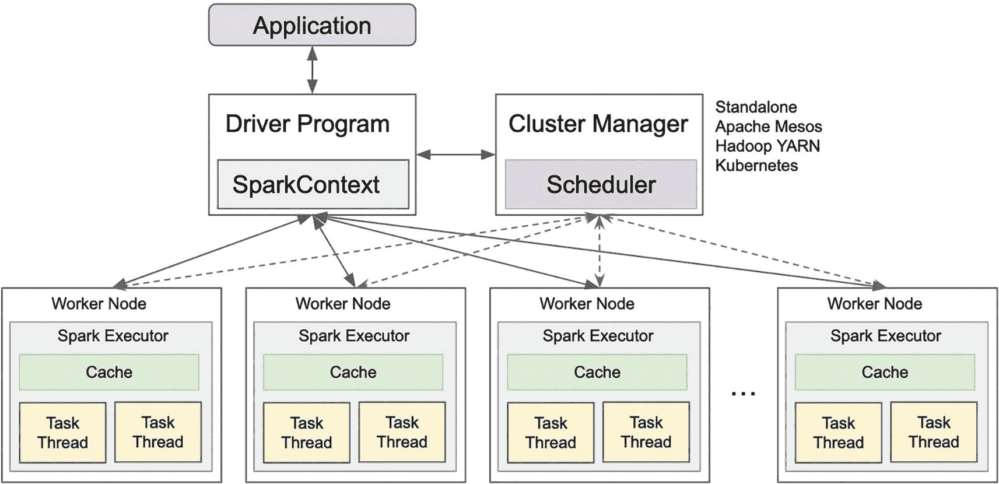
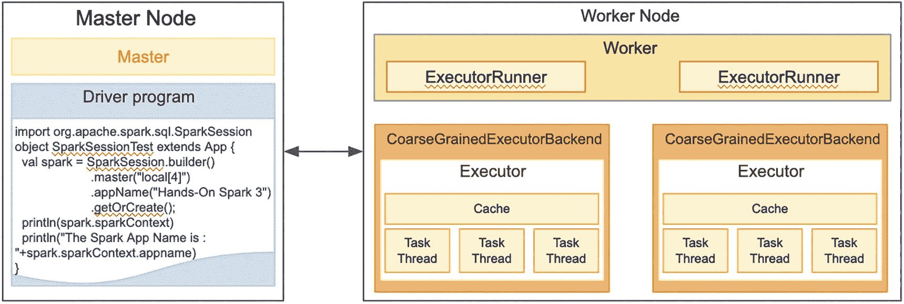
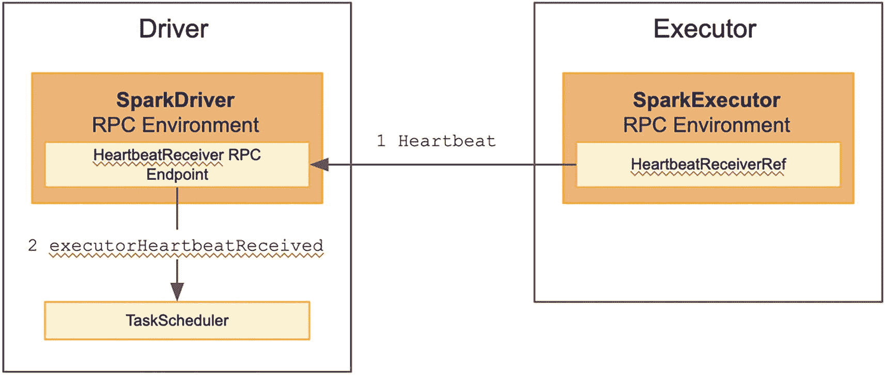
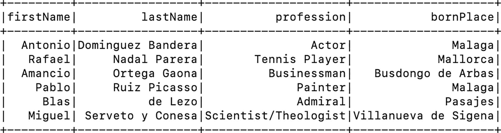
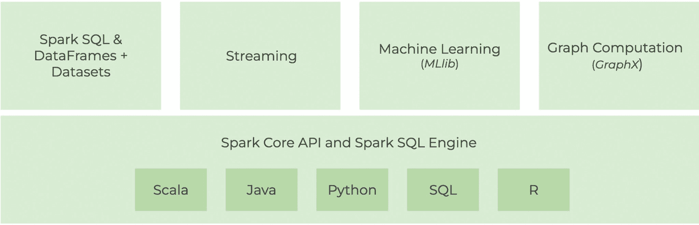
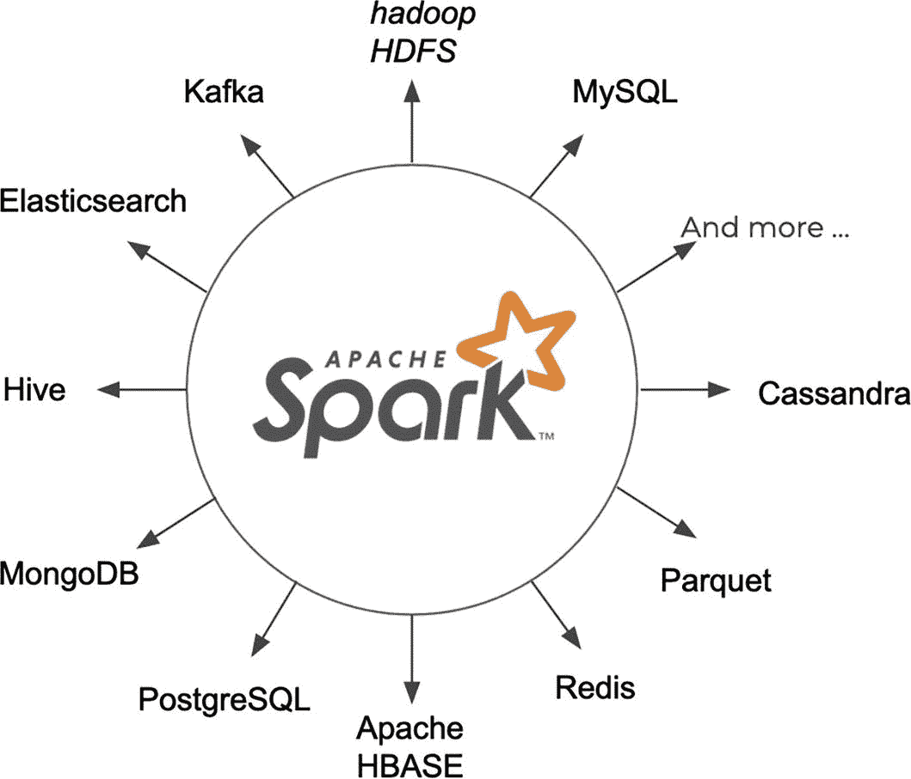
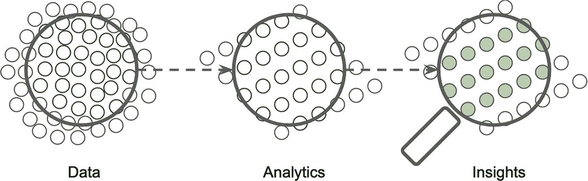
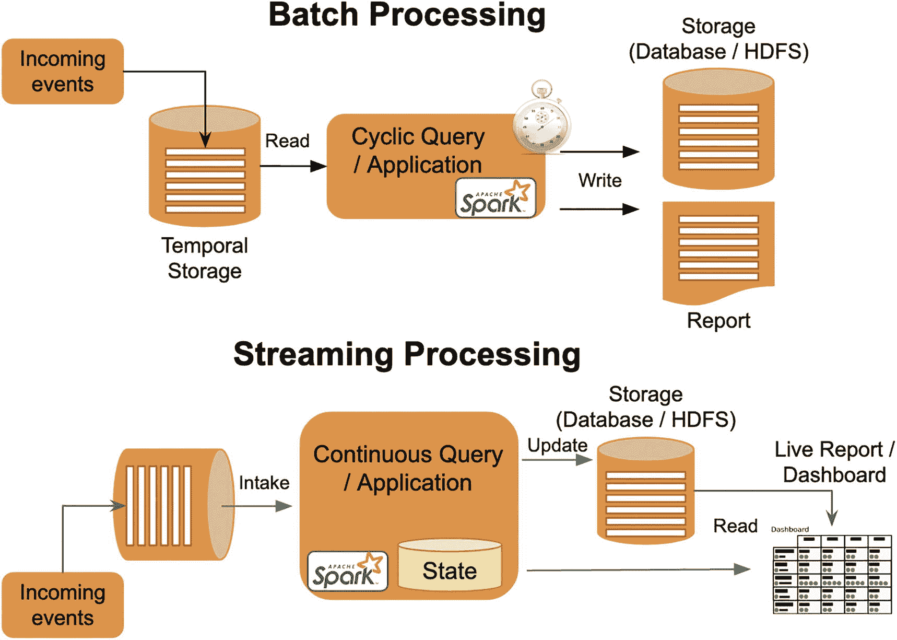

# 第 1 章 Apache Spark 大规模数据分析简介

Apache Spark 最初是 2009 年加州大学伯克利分校 AMPLab 的一个研究项目。它于 2010 年开源，并于 2013 年移交至 Apache 软件基金会，拥有最大的开源大数据社区。

从诞生之初，Spark 的设计就考虑了一个重大变革：将中间数据计算结果存储在随机存取存储器（RAM）中，利用 2010 年代 RAM 价格下降的趋势，这与将信息存储在较慢磁盘上的 `Hadoop` 形成对比。

在本章中，我将介绍 Spark，解释其工作原理、Spark 统一分析引擎以及 Apache Spark 生态系统。最后，我将描述批处理数据和流式数据之间的区别。

## 1.1 什么是 Apache Spark？

Apache Spark 是一个用于大规模数据分析的统一引擎。它为 Java、Scala、Python 和 R 编程语言提供了高级应用程序编程接口（API），并支持 SQL、流式数据、机器学习（ML）和图处理。Spark 是一个多语言引擎，用于在单节点机器或计算机集群（无论是在本地部署还是在云端）上执行数据工程、数据科学和机器学习。

Spark 为中间计算提供内存计算，这意味着数据保存在内存中，而不是写入慢速磁盘，从而使其比 `Hadoop MapReduce` 等更快。它包含一组高级工具和模块，例如：`Spark SQL` 用于结构化数据处理和访问外部数据源（如 Hive）；`MLlib` 是机器学习库；`GraphX` 是用于图和图并行计算的 Spark 组件；`Structured Streaming` 是 Spark SQL 流处理引擎；`Pandas API on Spark` 使 Pandas 用户能够通过利用 Spark 处理大型数据集；`SparkR` 提供了一个轻量级接口，用于从 R 语言使用 Apache Spark；最后，`PySpark` 提供了一个类似的前端，用于在 Spark 上运行 Python 程序。

有五个关键优势使 Apache Spark 独一无二并脱颖而出：

- 更易于使用和操作

- 快速

- 可扩展

- 易用性

- 大规模容错

让我们逐一了解。

### 更易于使用和操作

Spark 的功能通过一个通用且丰富的 API 访问，这使得可以通过不同的编程语言与统一的通用分布式数据处理引擎进行交互，并处理大规模数据。此外，广泛的文档使得 Spark 应用程序的开发变得简单直接。

`Hadoop MapReduce` 处理技术和分布式计算模型启发了 Apache Spark 的创建。这个模型概念上很简单：将一个大问题分解成更小的子问题，将问题的每个部分分发给尽可能多的独立求解器，收集各个子问题的解决方案，并将它们组合成最终结果。

### 快速

2014 年 11 月 5 日，Databricks 正式宣布赢得了 Daytona GraySort 竞赛。^(¹) 在这场比赛中，Databricks 团队使用了一个由 206 个 `EC2` 节点组成的 Spark 集群，在 23 分钟内对 100 TB 的数据（1 万亿条记录）进行了排序。此前，Yahoo 使用一个由 2100 个节点组成的 `Hadoop MapReduce` 集群创下了 72 分钟的世界纪录。总结来说，Spark 用十分之一的机器数量，以快三倍的速度完成了相同数据的排序。令人印象深刻，对吧？

但稍等一下。同一篇文章还提到：“*所有排序都在磁盘（`HDFS`）上进行，没有使用 Spark 的内存缓存。*”那么，这难道不全是关于 Spark 的内存能力吗？Apache Spark 因其内存性能而闻名。然而，认为 Spark 的卓越成果完全归功于这一特性，是人们对 Spark 设计最常见的误解之一。从诞生之初，Spark 就被设计为在内存和磁盘上都能实现卓越性能。因此，当数据无法完全放入内存时，Spark 操作员会在磁盘上执行常规操作。

### 可扩展

Apache Spark 是一个开源框架，旨在提供大规模并行化数据处理。同时，Spark 的高级函数可用于对不同大小和模式的数据集执行不同的数据处理任务。这是通过将工作负载从几台服务器分发到数千台机器上来实现的，这些机器在计算机集群上运行，并由集群管理器（如 `Mesos` 或 `Hadoop YARN`）进行编排。因此，硬件资源可以随着每台新增计算机而线性增长。值得澄清的是，向集群添加硬件并不一定代表计算性能的线性提升，从而处理时间的线性减少，因为内部集群管理、数据传输、网络流量等也会消耗资源，从而削弱 Spark 的有效计算能力。尽管在集群模式下运行可以充分利用 Spark 的分布式能力，但它也可以在单台计算机上本地运行，这称为本地模式。

如果你之前搜索过关于 Spark 的信息，你可能读到过类似“Spark 运行在商用硬件上”的内容。理解“商用硬件”这个术语很重要。在大数据的背景下，商用硬件并不意味着低质量，而是指基于市场标准的设备，这些设备是通用的、广泛可用的，因此价格合理，与专用计算机相反。

### 易用性

Spark 让处理大型数据集的数据工程师和数据科学家的生活更轻松。Spark 为流式、批处理或交互式数据处理等不同用例提供了单一的统一引擎和 API。这些工具使其能够轻松应对各种场景，如 ETL 流程、机器学习或图与图并行计算。Spark 还提供了大约一百个用于数据转换的操作符，以及用于操作半结构化数据的数据帧概念。

### 大规模容错

在大规模系统中，许多环节都可能出错。在大数据语境下，故障即指失败，也就是说，Apache Spark 的容错性体现了其在故障发生后继续运行并恢复的能力。在大型集群环境中，任何类型的故障都随时可能发生；因此，Spark 在设计时就假设故障迟早会出现。

Spark 是一个内置容错机制的分布式计算框架，它利用一种名为 `RDD`（弹性分布式数据集）的简单数据抽象，向用户隐藏了数据分区和分布式计算的细节。`RDD` 是不可变的对象集合，是 Apache Spark 数据结构的构建基石。它们在逻辑上被划分为多个部分，因此可以在集群的多个节点上并行处理。

缩写 `RDD` 体现了这些对象的本质：

- **弹性（容错）**：`RDD` 的血统或**有向无环图**（`DAG`）允许重新计算因节点故障而丢失的分区，从而能够自动恢复。

- **分布式**：`RDD` 在多个节点上并行处理。

- **数据集**：即待处理的数据集合。数据集可以是并行化现有数据集合的结果；从外部源（如数据库、Hive 表、CSV、文本或 JSON 文件）加载数据的结果；或者从另一个 `RDD` 创建 `RDD` 的结果。

利用这一简单概念，Spark 能够处理以前需要独立工具才能完成的多种数据处理工作负载。

Spark 提供两种类型的容错机制：`RDD` 容错和流式预写日志。Spark 利用其 `RDD` 抽象来处理集群中工作节点的故障；然而，为了控制驱动程序进程中的故障，Spark 1.2 引入了预写日志，将接收到的数据保存到容错存储中，例如 `HDFS`、`S3` 或类似的保护工具。

容错性还得益于引入了所谓的 `DAG`（有向无环图）概念。从形式上讲，`DAG` 被定义为一组顶点和边。在 Spark 中，`DAG` 用于直观地表示 `RDD` 以及在其上执行的操作。`RDD` 由顶点表示，而操作由边表示。每条边都从较早的状态指向较晚的状态。这种任务追踪有助于实现容错。它还用于调度任务以及协调集群工作节点。

## Spark 统一分析引擎

平台集成的概念在软件领域并不新鲜。例如，考虑客户关系管理（CRM）或企业资源规划（ERP）的概念。统一的思想从 Spark 设计之初就根植其中。2016 年 10 月 28 日，美国计算机协会（ACM）发表了题为《Apache Spark：用于大数据处理的统一引擎》的[文章](https://dl.acm.org/doi/pdf/10.1145/2934664)。在这篇文章中，作者断言，由于大数据数据集的性质，标准的数据处理管道必须结合 MapReduce、类 SQL 查询和迭代机器学习能力。同一份文档指出，Apache Spark 结合了批处理能力、图分析和数据流处理，集成了一个以前分散在 `Apache Impala`、`Drill`、`Storm`、`Dremel`、`Giraph` 等不同专用系统中的单一 SQL 查询引擎。

Spark 的简洁性在于其统一的 API，这使得应用程序开发更加容易。与之前需要将中间数据保存到永久存储以便稍后传输到其他引擎的系统相比，Spark 在同一个引擎中集成了许多功能，并且可以对相同的数据（通常是在内存中）执行不同的模块。最后，Spark 促进了新应用程序的开发，例如扩展迭代算法、在 Spark Graph 组件中集成图查询和算法。

将多种功能集成到一个系统中的附加价值，例如，可以从现代智能手机中看到。例如，如今出租车司机已经用一部智能手机取代了多种设备（GPS 导航仪、收音机、音乐磁带等）。通过统一这些设备的功能，智能手机最终实现了任何单一设备独立运行时都无法实现的新功能和服务模式。

## Apache Spark 工作原理

我们已经提到，Spark 通过将计算工作负载分布到大型计算机集群中来扩展规模，并集成了容错和并行计算。我们还指出，它使用统一的引擎和 API 来管理工作负载，并与用不同编程语言编写的应用程序进行交互。

在本节中，我们将解释 Apache Spark 在底层执行大数据分析所使用的基本原理。我们将引导您了解 Spark 应用程序模型、Spark 执行模型和 Spark 集群模型。

## Spark 应用程序模型

在 MapReduce 中，最高级别的计算单元是作业；在 Spark 中，最高级别的计算单元是应用程序。在一个作业中，我们可以加载数据、对其应用 `map` 函数、进行 shuffle、应用 `reduce` 函数，最后将信息保存到容错存储设备中。在 Spark 中，应用程序是自包含的实体，它执行用户代码并返回计算结果。如前所述，Spark 可以使用多台计算机的协调资源来运行应用程序。Spark 应用程序可以执行单个批处理作业，执行由多个作业组成的迭代会话，或者充当处理无界数据流的长期运行的流式服务器。在 Spark 中，每当应用程序调用一个动作时，就会启动一个作业。

与其他技术（如 MapReduce，它为每个任务启动一个新进程）不同，Spark 应用程序作为独立进程运行，由在驱动程序程序中运行的 `SparkSession` 对象协调。使用迭代算法的 Spark 应用程序受益于数据集缓存能力以及其他操作。这是可行的，因为这些算法对数据执行重复操作。最后，Spark 应用程序可以在集群节点上代表它们保持稳定运行的进程，即使没有作业正在执行，并且多个应用程序可以在同一个执行器上运行。前两个特性相结合，利用了 Spark 的快速启动时间和内存计算能力。

## Spark 执行模型

Spark 执行模型包含一些关键概念，如驱动程序程序、执行器、作业、任务和阶段。理解这些概念对于快速高效地开发 Spark 应用程序至关重要。在 Spark 内部，任务是最小的执行单元，并在执行器内部执行。一个任务执行有限数量的指令。例如，加载文件、过滤数据或对数据应用 `map()` 函数都可以被视为一个任务。阶段是运行相同代码的任务集合，每个任务处理数据集的不同部分。例如，使用 `reduceByKey()`、`Join()` 等需要 shuffle 或读取数据集的函数，将触发 Spark 创建一个阶段。另一方面，作业包含多个阶段。

接下来，由于它们的重要性，我们将研究驱动程序程序和执行器的概念，以及 Spark 集群模型。

## Spark 集群模型

在集群模式下运行的 Apache Spark 采用主/从层级架构，如图 1-1 所示，其中驱动程序扮演主节点的角色。Spark 驱动程序是工作节点（从节点）的中央协调器，负责将结果返回给客户端。工作节点是运行执行器的机器节点。它们可以托管一个或多个工作节点，每个工作节点只能执行一个 JVM（Java 虚拟机），并且每个工作节点可以生成一个或多个执行器，如图 1-2 所示。

Spark 驱动程序生成 `SparkContext`，并与 Spark 执行环境以及为应用程序提供资源的集群管理器建立通信。Spark 框架可以采用多种集群管理器：Spark 的独立集群管理器、Apache Mesos、Hadoop YARN 或 Kubernetes。驱动程序连接到集群的不同节点，并启动称为执行器的进程，这些进程为 RDD 提供计算资源和内存存储。资源可用后，它会将应用程序代码（JAR 或 Python 文件）发送给已获取的执行器。最后，`SparkContext` 将任务发送给执行器，以运行已放置在工作节点中的代码，这些任务在独立的处理器线程中启动，每个工作节点核心对应一个线程。`SparkContext` 也用于创建 RDD。

Apache Spark 集群模式的框图。从应用程序数据开始，依次进入驱动程序、集群管理器和四个工作节点块。

图 1-1

Apache Spark 集群模式概览

为了在集群两侧为应用程序提供逻辑容错能力，每个驱动程序调度自己的任务，每个任务（在每个执行器中运行）执行自己的 JVM（Java 虚拟机）进程，也称为执行器进程。默认情况下，执行器以静态分配方式运行，这意味着它们会在 Spark 应用程序的整个生命周期内持续执行，除非启用了动态分配。驱动程序为了跟踪执行器的健康状态和状态，会定期接收心跳信号以及正在运行任务的部分执行指标（图 1-3）。心跳信号是从执行器发送给驱动程序的周期性消息（默认每 10 秒一次）。

Spark 通信架构。主节点在左侧，工作节点在右侧。驱动程序位于主节点中，而执行器运行器位于工作节点中。

图 1-2

包含工作节点和执行器的 Spark 通信架构

这种执行模型也有一些缺点。Spark 应用程序（`SparkContext` 的实例）之间无法通过内存计算模型交换数据，除非先将数据保存到外部存储设备。

如前所述，Spark 可以与多种集群管理器一起运行。之所以可能，是因为 Spark 是一个与集群无关的平台。这意味着，只要集群管理器能够获取执行器进程并提供架构组件之间的通信，它就适合用于执行 Spark。这就是为什么驱动程序和工作节点之间的通信必须始终保持可用，因为只要应用程序在执行器上运行，驱动程序就必须接收来自执行器的传入连接。

该架构展示了执行器与驱动程序之间的通信。

图 1-3

Spark 在执行器与驱动程序之间的心跳通信

## 1.4 Apache Spark 生态系统

Apache Spark 生态系统由一个统一且容错的核心引擎组成，其之上是四个高级库，分别支持 SQL 查询、数据流处理、机器学习和图处理。这些独立的库可以组合成复杂的工作流，从而简化应用程序开发并提高生产力。

### Spark Core

Spark Core 是内存计算、容错和并行计算的基础。Core 还通过 RDD 提供数据抽象，并与集群管理器一起在集群的不同节点上进行数据编排。高级库（Spark SQL、Streaming、用于机器学习的 MLlib 和用于图数据处理的 GraphX）也运行在 Core 之上。

### Spark API

Spark 包含一系列针对不同编程语言（SQL、Scala、Java、Python 和 R）的应用程序编程接口（API），为具有不同开发、数据科学和数据工程背景的各类专业人士采用 Spark 铺平了道路。例如，Spark SQL 允许我们像向传统关系数据库提交 SQL 查询一样与 RDD 进行交互。这一特性促使许多事务性数据库管理员和开发者接受 Apache Spark。

现在让我们详细回顾这四个库中的每一个。

### Spark SQL 与 DataFrame 及 Dataset

Apache Spark 在 `Spark SQL` 模块中提供了一种名为 `DataFrames` 的数据编程抽象。如果你有使用 Python 和/或 R 语言数据框的经验，那么 Spark 的 `DataFrames` 对你来说可能并不陌生；然而，后者可以分布在多个集群工作节点上，因此不受单台计算机容量的限制。Spark 旨在以最高效的方式处理超大规模数据集。

一个 `DataFrame` 看起来就像关系型数据库表或 Excel 电子表格，包含不同数据类型的列、包含列名的表头，以及以行形式存储的数据，如表 1-1 所示。

**表 1-1**

将 `DataFrame` 表示为关系型表或 Excel 电子表格

| firstName | lastName | profession | birthPlace |
| --- | --- | --- | --- |
| Antonio | Dominguez Bandera | Actor | Málaga |
| Rafael | Nadal Parera | Tennis Player | Mallorca |
| Amancio | Ortega Gaona | Businessman | Busdongo de Arbas |
| Pablo | Ruiz Picasso | Painter | Málaga |
| Blas | de Lezo | Admiral | Pasajes |
| Miguel | Serveto y Conesa | Scientist/Theologist | Villanueva de Sigena |

另一方面，图 1-4 展示了一个 `DataFrame` 的示例。

一个包含四列的表展示了数据框。它包含了名字、姓氏、职业和出生地的数据。

**图 1-4**

`DataFrame` 示例

# Spark 核心概念

`DataFrame` 也可以被定义为一种为分布式大数据处理而优化的集成数据结构。`DataFrame` 也是 `RDD` 的扩展，具有易于使用的 API，可简化代码编写。为了进行分布式数据处理，`DataFrame` 内部的信息是围绕模式（schemas）组织的。Spark 模式包含列名、列的数据类型及其可空属性。当可空属性设置为 `true` 时，该列接受空值。

传统上，SQL 是许多业务分析师、数据科学家和高级用户利用数据的首选语言。`Spark SQL` 允许这些用户像在传统数据源前一样查询结构化数据集，从而促进了采用。

另一方面，在 Spark 中，数据集（dataset）是一种不可变且强类型的数据结构。数据集与 `DataFrame` 一样，映射到数据模式，并包含类型安全和面向对象的接口。`Dataset` API 利用编码器（encoder）概念在 JVM 对象和表格数据表示之间进行转换。这种表格表示在内部以名为 `Spark Tungsten` 的二进制格式存储，该格式改进了序列化数据的操作，并提升了内存性能。

数据集引入了编译时安全性，允许用户开发的代码在应用程序执行之前进行错误测试。数据集和数据框之间存在若干差异。其中最重要的可能是数据集仅适用于 Java 和 Scala API。Python 或 R 应用程序无法使用数据集。

## Spark Streaming

`Spark Structured Streaming` 是构建在核心 `Spark SQL` 引擎之上的高级库。`Structured Streaming` 使 Spark 能够对无界数据流进行容错和实时处理，而无需用户考虑流式处理是如何进行的。`Spark Structured Streaming` 提供容错、快速、端到端、恰好一次、大规模流处理能力。`Spark Streaming` 允许以与通过批处理计算静态数据相同的方式来表达流式计算。这是通过增量且连续地执行流处理过程，并在接收传入数据时更新输出来实现的。

从 Spark 2.3 开始，引入了一种名为连续处理（continuous processing）的新型低延迟处理模式，实现了低至 1 毫秒的端到端延迟，并确保至少一次^(²)消息投递。至少一次的概念如图 `1-5` 所示。默认情况下，`Structured Streaming` 在内部以微批次（micro-batches）方式处理信息，这意味着数据被作为一系列微小的批处理作业来处理。

一个关于生产者和消费者之间“至少一次”概念的过程图。从生产者数据开始，经过消息队列，最终到达消费者。

`图 1-5` “至少一次”消息投递语义的图示

`Spark Structured Streaming` 还使用相同的数据集和 `DataFrame` 概念，通过不同的编程语言 API（Scala、Java、Python 和 R）来表示流聚合、事件时间窗口、流到批连接等。这意味着无需更改数据集/`DataFrame` 操作即可使用相同的查询，从而可以选择最适合我们应用需求的操作模式，而无需修改代码。

## Spark MLlib

Spark 的机器学习（ML）库通常被称为 `MLlib`，尽管这不是它的官方名称。`MLlib` 的目标是提供开箱即用、易于使用的大数据机器学习能力。从高层次来看，它提供如下能力：

*   机器学习算法，如分类、聚类、回归、协同过滤、决策树、随机森林和梯度提升树等。
*   特征化：
    *   词频-逆文档频率（TF-IDF）统计和特征向量化方法，用于自然语言处理和信息检索。
    *   `Word2vec`：它以文本语料库作为输入，并生成词向量作为输出。
    *   `StandardScaler`：它是预处理步骤和特征标准化中非常常用的工具。
    *   主成分分析，这是一种将可能相关的变量进行正交变换的方法。
    *   等等。
*   ML 管道，用于创建和调优机器学习管道。
*   预测模型标记语言（PMML），用于将模型导出为 PMML。
*   基本统计，包括汇总统计、序列间相关性、分层抽样等。

从 Spark 2.0 开始，主要的 Spark 机器学习 API 是 `spark.ml` 包中基于 `DataFrame` 的 API，取代了 `spark.mllib` 包中传统的基于 `RDD` 的 API。

## Spark GraphX

`GraphX` 是一个用于图和图并行计算的新型高级 Spark 库，旨在解决图问题。`GraphX` 通过引入这种新的图抽象来支持图计算，扩展了 Spark `RDD` 的能力，并包含一系列图算法和构建器，以优化图分析。

本节描述的 Apache Spark 生态系统如图 `1-6` 所示。

Apache Spark 生态系统的示意图。顶部的四个方块依次为：Spark SQL 与数据框 + 数据集、流处理、机器学习和图计算。底部的矩形方块包括 Spark 核心 API 和 Spark SQL 引擎。

`图 1-6` Apache Spark 生态系统

在图 `1-7` 中，我们可以看到 Apache Spark 的连接器生态系统。

一个圆形图展示了 Apache Spark 的连接器生态系统。按顺时针方向，数据源依次为：Hadoop HDFS、MySQL、Cassandra、Parquet、Redis、Apache HBase、PostgreSQL、MongoDB、Hive、Elasticsearch 和 Kafka。

`图 1-7` Apache Spark 连接器生态系统

## 批处理与流式数据

当今世界产生的数据量无穷无尽，并且正以惊人的速度持续增长。预计从 2010 年到 2025 年，全球创建、捕获、复制和消费的信息量将超过 180 ZB。^(³) 如果这个数字对你来说不够直观，不妨想象一下你的个人电脑或笔记本电脑配备了一块 1 TB 的硬盘（这在现代可视为标准配置）。那么，你需要约 163,709,046,319.13 块这样的硬盘才能存储如此庞大的数据量。^(⁴)

如今，数据很少是静态的。请记住大数据的三个著名 V 特性：

*   **海量性（Volume）**
    *   数据生产的空前爆发意味着存储不再是真正的挑战，真正的挑战在于从庞大的数据集中生成可操作的洞察。
*   **高速性（Velocity）**
    *   数据生成的速度不断加快，这给数据科学家带来了挑战，他们需要找到技术来收集、处理并利用实时涌入的信息。
*   **多样性（Variety）**
    *   大数据是杂乱无章的，信息来源异构，数据格式多样。结构化数据整齐地排列在表格中，而非结构化数据则以多种形式存在，不遵循预定义的数据模型，因此难以存储在传统数据库中。当今生成的新数据绝大多数是非结构化的，它们可以由人类或机器生成。非结构化数据更难以处理并从中提取价值。非结构化数据的例子包括医学图像、视频、音频文件、传感器数据、社交媒体帖子等。

对企业而言，数据处理对于加速获取数据洞察至关重要，即通过分析信息来深入理解特定问题。这种深入理解有助于组织培养商业敏锐度，并将信息转化为可操作的洞察。因此，它足以触发行动，帮助我们提高运营效率、获得竞争优势、提升收入并增加利润。因此，面对当今和未来的商业挑战，分析数据对于发现可操作的洞察、保持生存和盈利至关重要。

值得一提的是，数据洞察、数据分析与数据本身之间存在显著差异，尽管它们经常被互换使用。数据可以定义为事实的集合，而数据分析是关于整理和审视数据。数据洞察则是关于发现数据中的模式。这三个概念之间也存在层级关系。首先，必须收集和组织信息，之后才能进行分析，最后才能提取数据洞察。这种层级关系可以直观地参见图 `1-8`。

三幅插图展示了这种层级关系。代表数据、分析和洞察的大圆内部包含一组较小的圆。在洞察部分，圆簇被着色。

`图 1-8` 数据、数据分析与数据洞察提取之间的层级关系

在数据处理方面，有许多不同的方法论，但流处理和批处理是最常见的两种。在本节中，我们将解释这两种数据处理技术之间的区别。因此，在深入细节之前，我们先定义批处理和流处理。

### 什么是批数据处理？

批数据处理可以定义为一种计算方法，它以重复的批次执行高容量数据事务，其中数据收集与处理是分离的。通常，一旦批处理作业启动，就不需要用户交互。批处理特别适用于信息周期末的处理，例如仓库库存的日终更新、银行对账或月度工资计算等。

批处理已成为企业后台流程的常见组成部分，因为它提供了许多优势，例如由于无需人工干预而带来的效率和数据质量。另一方面，批处理作业也有一些缺点。最明显的一点可能是它们复杂且关键，因为它们是组织核心支柱的一部分。因此，开发复杂的批处理作业在前期可能在时间和资源上成本高昂，但从长远来看，它们会收回投资。

批数据处理的另一个缺点是，由于其规模大且关键性强，一旦发生故障，很可能会导致重大的生产中断。批处理本质上是整体式的；因此，当数据量激增或需求达到峰值时，它们难以轻松适应。

### 什么是流数据处理？
流数据处理可以描述为收集、处理、分析并提供最新信息，以及在数据流动过程中保持其状态更新的过程。它也可以定义为一种在信息传输过程中进行收集和处理的低延迟方式。通过流处理，数据是实时处理的；因此，数据收集与处理之间没有延迟，并能提供即时响应。

当数据以连续流的形式产生，随时间变化，具有高速度，并且需要实时分析或必须在事件发生时立即做出响应时，流处理尤其适用。流数据处理利用主动智能，即时感知重要的业务事件，并能够触发即时行动。分析在数据上瞬间完成，或在几分之一秒内完成；因此，用户会感知到实时更新。流数据处理是最佳选择的一些例子包括信用卡欺诈检测、实时系统安全监控，或使用物联网（IoT）传感器。物联网设备可以监控机械异常，并在检测到异常或离群值^(⁵)时立即发出预警。社交媒体和客户情绪分析是流数据处理应用的另一个热门领域。

流数据处理的主要缺点之一是其大规模实施。在现实生活中，数据流远非完美，数据通常不会规律或平稳地流动。想象一种情况，数据流中断，部分数据丢失或损坏。然后，在恢复正常服务后，那些丢失或损坏的信息突然涌入平台，使处理系统不堪重负。为了能够应对此类情况，流式架构需要具备计算、通信和存储方面的备用容量。

### 流处理与批处理的区别
总结来说，流处理涉及对实时或近乎实时运动数据的处理和分析，而批处理则是在时间间隔内处理和分析静态信息。

在批处理作业中，你操作的是过去产生并已固化在永久存储设备中的信息。这也通常被称为静态数据。

相比之下，流处理是一种低延迟解决方案，要求在信息流仍在运动时对其进行分析。传入的数据需要在飞行中、实时或近乎实时地处理，而不是保存到永久存储中。由于数据在生成时即被消费，它提供了信息的最新快照，从而能够对事件做出主动响应。批处理与流处理的另一个区别在于，流处理从一开始就只存储被认为与分析过程相关的信息。另一方面，那些被认为没有即时价值的数据可以存储在低成本设备中，供后续使用数据挖掘算法、机器学习模型等进行分析。

批处理与流数据处理的图形化表示如图 1-9 所示。

两个流程图。从传入事件开始，顶部的批处理流程依次进入临时存储、循环查询或应用程序，最后生成报告并存储。底部的流处理流程从传入事件开始，最终生成实时报告或仪表板。

图 1-9
批处理与流处理表示

## 1.6 本章小结
在本章中，我们简要了解了 Apache Spark 的架构、实现和应用程序生态系统。我们还介绍了 Spark 可以处理的两种不同类型的数据处理方式：批处理和流处理，以及它们之间的主要区别。在下一章中，我们将介绍 Spark 的安装设置过程、Spark 应用程序概念，以及 Apache Spark RDD 的两种不同类型操作：转换和动作。

脚注 1 2 3 4 5