# 2. Apache Spark 入门

既然你已经了解了 Spark 是什么以及它是如何工作的，我们可以开始设置并开始使用它了。在本章中，我将提供下载和安装说明，并详细介绍 Spark 命令行工具。我还将回顾 Spark 应用程序概念，以及转换、动作、不可变性和惰性求值。

## 2.1 下载并安装 Apache Spark

要让你的 Spark 安装启动并运行，第一步是访问 [Spark 下载页面](https://spark.apache.org/downloads.html)，选择 Spark 版本 3.3.0。然后，从步骤 2 的下拉菜单中选择包类型“Pre-built for Apache Hadoop 3.3 and later”，并点击步骤 3 中的“Download Spark”链接（图 2-1）。

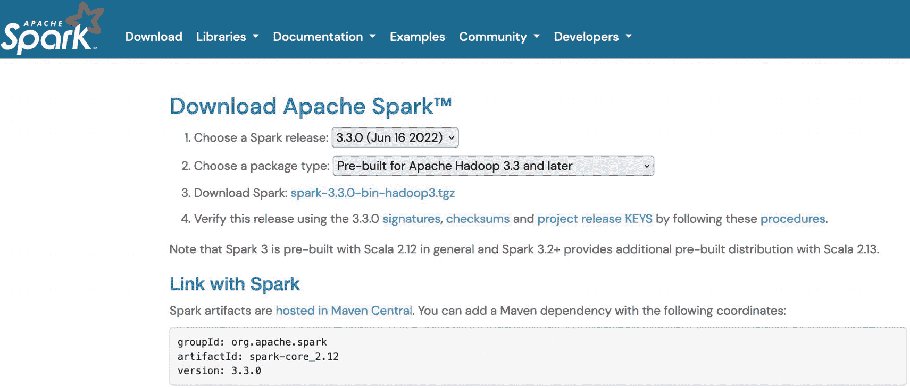

Apache Spark 下载页面的截图。Apache Spark 的下载说明包括 4 个步骤。Spark 链接包含 group id、artifact id 和版本 3.3.0。

图 2-1 Apache Spark 下载页面

这将下载文件 `spark-3.3.0-bin-hadoop3.tgz`（在你的情况下可能是其他类似名称），这是一个压缩文件，包含在本地计算机或笔记本电脑上以本地模式运行 Spark 所需的所有二进制文件。

在本地模式下设置 Apache Spark 的好处在于，你不需要做太多工作。我们基本上只需要安装 Java 并设置一些环境变量。让我们看看如何在几种环境中进行操作。

### 在 Linux 上安装 Apache Spark

以下步骤将在 Linux 系统上安装 Apache Spark。可以是 Fedora、Ubuntu 或其他发行版。

#### 步骤 1：验证 Java 安装

安装 Spark 必须安装 Java。在终端窗口中输入以下命令以验证 Java 是否可用及其版本：

```
$ java -version
```

如果 Java 已安装在你的系统上，你会看到类似以下的消息：

```
$ java -version
java version "18.0.2" 2022-07-19
Java(TM) SE Runtime Environment (build 18.0.2+9-61)
Java HotSpot(TM) 64-Bit Server VM (build 18.0.2+9-61, mixed mode, sharing)
```

你的 Java 版本可能不同。本例中 Java 18 是所使用的 Java 版本。

如果你没有安装 Java

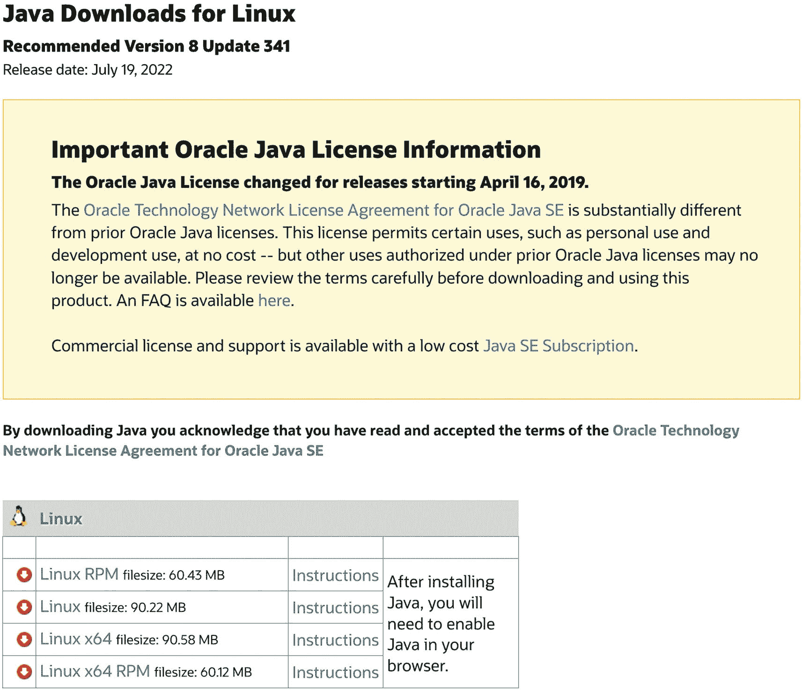

Java 下载页面的截图。顶部 8 行文字展示了 Oracle Java 许可信息。底部的表格列出了 Linux 模型、文件大小和说明。

图 2-2 Java 下载页面

1.  打开浏览器窗口，导航到 [Java 下载页面](https://www.java.com/en/download/linux_manual.jsp)，如图 2-2 所示。

2.  点击你选择的 Java 文件，并将其保存到某个位置（例如 `/home/<user>/Downloads`）。

#### 步骤 2：安装 Spark

解压之前下载的 Spark `.tgz` 文件。要在 Linux 中解压 `spark-3.3.0-bin-hadoop3.tgz` 文件，请打开终端窗口，移动到文件下载的位置

```
$ cd PATH/TO/spark-3.3.0-bin-hadoop3.tgz_location
```

并执行

```
$ tar -xzvf ./spark-3.3.0-bin-hadoop3.tgz
```

#### 步骤 3：移动 Spark 软件文件

你可以将 Spark 文件移动到一个安装目录，例如 `/usr/local/spark`：

```
$ su -
Password:
$ cd /home//Downloads/
$ mv spark-3.3.0-bin-hadoop3 /usr/local/spark
$ exit
```

#### 步骤 4：设置 Spark 环境

将以下行添加到 `~/.bashrc` 文件中。这会将 Spark 软件文件的位置和二进制文件的位置添加到 `PATH` 变量中：

```
export SPARK_HOME=/usr/local/spark
export PATH=$PATH:$SPARK_HOME/bin
```

使用以下命令来 source `~/.bashrc` 文件，更新环境变量：

```
$ source ~/.bashrc
```

#### 步骤 5：验证 Spark 安装

输入以下命令打开 Spark shell：

```
$ $SPARK_HOME/bin/spark-shell
```

如果 Spark 安装成功，您将看到以下输出：

```
Setting default log level to "WARN".
To adjust logging level use sc.setLogLevel(newLevel). For SparkR, use setLogLevel(newLevel).
22/08/29 22:16:45 WARN NativeCodeLoader: Unable to load native-hadoop library for your platform... using builtin-java classes where applicable
22/08/29 22:16:46 WARN Utils: Service 'SparkUI' could not bind on port 4040\. Attempting port 4041.
Spark context Web UI available at http://192.168.0.16:4041
Spark context available as 'sc' (master = local[*], app id = local-1661804206245).
Spark session available as 'spark'.
Welcome to
____               __
/ __/__  ___ _____/ /__
_\ \/ _ \/ _ `/ __/  '_/
/___/ .__/\_,_/_/ /_/\_\   version 3.3.0
/_/
Using Scala version 2.12.15 (Java HotSpot(TM) 64-Bit Server VM, Java 18.0.2)
Type in expressions to have them evaluated.
Type :help for more information.
scala>
```

您可以利用 `$SPARK_HOME` 目录下的 `README.md` 文件进一步测试安装：

```
scala> val readme_file = sc.textFile("/usr/local/spark/README.md")
readme_file: org.apache.spark.rdd.RDD[String] = /usr/local/spark/README.md MapPartitionsRDD[1] at textFile at :23
```

Spark 上下文 Web UI 可通过在浏览器中输入以下 URL 访问：

```
http://localhost:4040
```

在该界面中，您可以查看用于小型应用程序的作业、阶段、存储空间和执行器。结果如图 2-3 所示。

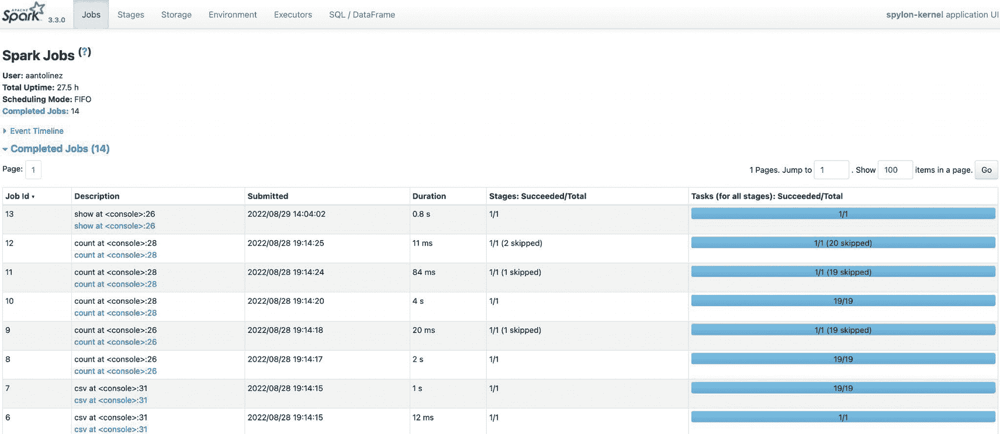

Apache Spark Web 用户界面截图。作业选项卡包含一个表格，列出了作业 ID、描述、提交时间、持续时间、阶段成功总数和任务数。

图 2-3 Apache Spark Web UI 显示在 Spark shell 上运行的应用程序所使用的作业、阶段、存储、环境及执行器

### 在 Windows 上安装 Apache Spark

在本节中，我将向您展示如何在 Windows 10 上安装 Apache Spark 并测试安装。需要注意的是，执行此安装时，您必须拥有具有管理员权限的用户账户。这是安装软件和修改系统 `PATH` 所必需的。

#### 步骤 1：安装 Java

与上一节相同，您首先需要确保已安装 Java 并且 Apache Spark 可以访问它。您可以通过点击“开始”，输入 `cmd`，然后点击“命令提示符”，在命令行中验证 Java 是否已安装。接着，在命令行中输入以下命令：

```
java -version
```

如果 Java 已安装，您将看到类似以下的输出：

# 步骤 1：安装 Java

```
openjdk version "18.0.2.1" 2022-08-18
OpenJDK Runtime Environment (build 18.0.2.1+1-1)
OpenJDK 64-Bit Server VM (build 18.0.2.1+1-1, mixed mode, sharing)
```

如果系统提示命令未知，则表示 Java 未安装或不可用。此时您需要按照以下步骤操作。

安装 Java。本例中我们将使用 [OpenJDK](https://openjdk.org/install/) 作为 Java 虚拟机。您需要下载与您的操作系统版本和硬件相匹配的二进制文件。在本教程中，我们将使用 OpenJDK JDK 18.0.2.1，因此我下载了 `openjdk-18.0.2.1_windows-x64_bin.zip` 文件。您也可以使用其他 [Java 发行版](https://www.java.com/en/download/)。

下载文件，保存，并将其解压到您选择的目录中。您可以使用任何解压工具来完成此操作。

# 步骤 2：下载 Apache Spark

打开网页浏览器，导航至 [Spark 下载页面](https://spark.apache.org/downloads.html)，并按照图 2-1 中给出的相同说明操作。

要解压 `spark-3.3.0-bin-hadoop3.tgz` 文件，您需要一个能够提取 `.tgz` 文件的工具。例如，您可以使用 [7-Zip](https://www.7-zip.org/) 等免费工具。

验证文件完整性。确认下载文件的校验和始终是一个好习惯，以确保您使用的是未经修改、未损坏的软件。在 Spark 下载页面，打开 [校验和链接](https://downloads.apache.org/spark/spark-3.3.0/spark-3.3.0-bin-hadoop3.tgz.sha512)，并复制或记住（如果您能记住）文件的签名。它应该类似于以下内容（字符串不完整）：

```
1e8234d0c1d2ab4462 ... a2575c29c    spark-3.3.0-bin-hadoop3.tgz
```

接下来，打开命令行并输入以下命令：

```
certutil -hashfile PATH\TO\spark-3.3.0-bin-hadoop3.tgz SHA512
```

您必须看到之前复制的相同签名；如果没有，则说明有问题。请尝试重新下载文件来解决。

# 步骤 3：安装 Apache Spark

安装 Apache Spark 只需将下载的文件解压到您选择的位置，例如 `C:\spark` 或其他任何位置。

# 步骤 4：下载 Hadoop 的 winutils 文件

创建一个名为 `Hadoop` 的文件夹和一个 `bin` 子文件夹，例如 `C:\hadoop\bin`，然后将与您之前下载的 Hadoop 3 版本对应的 `winutils.exe` 文件下载到该目录中。

# 步骤 5：配置系统与环境变量

在 Windows 中配置环境变量，意味着要将 Spark 和 Hadoop 的位置添加到系统环境及 `PATH` 中，从而使任何应用程序都能访问它们。

你需要进入控制面板 ➤ 系统和安全 ➤ 系统。然后点击“高级系统设置”，如图 2-4 所示。

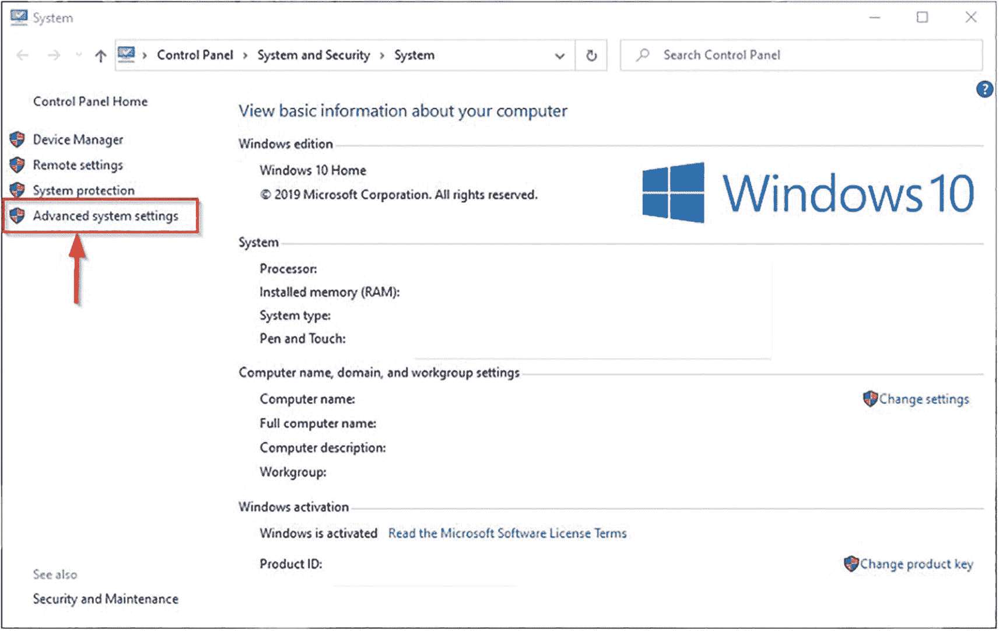

图 2-4 Windows 高级系统设置

系统会弹出“系统属性”对话框，如图 2-5 左侧所示：

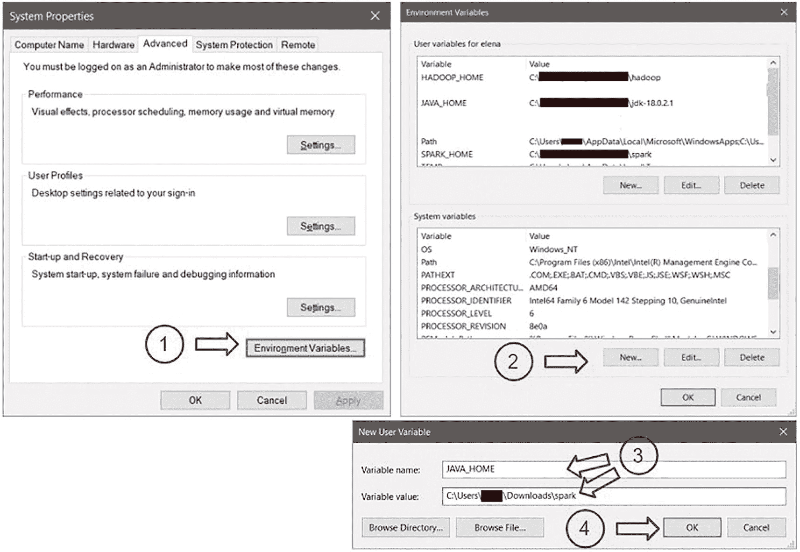

图 2-5 环境变量

1. 点击“环境变量”按钮。
2. 出现“环境变量”窗口，如图 2-5 右上角所示：
    1. 点击“新建”按钮。
3. 插入以下变量：
    1. `JAVA_HOME`：`\PATH\TO\YOUR\JAVA-DIRECTORY`
    2. `SPARK_HOME`：`\PATH\TO\YOUR\SPARK-DIRECTORY`
    3. `HADOOP_HOME`：`\PATH\TO\YOUR\HADOOP-DIRECTORY`

你需要重复上一步两次，以引入这三个变量。

4. 点击“确定”按钮保存更改。
5. 然后，点击你的“编辑”按钮，如图 2-6 左侧所示，来编辑你的 `PATH`。
6. 之后，点击“新建”按钮，如图 2-6 右侧所示，并将这些新变量添加到 `PATH` 中：
    1. `%JAVA_HOME%\bin`
    2. `%SPARK_HOME%\bin`
    3. `%HADOOP_HOME%\bin`

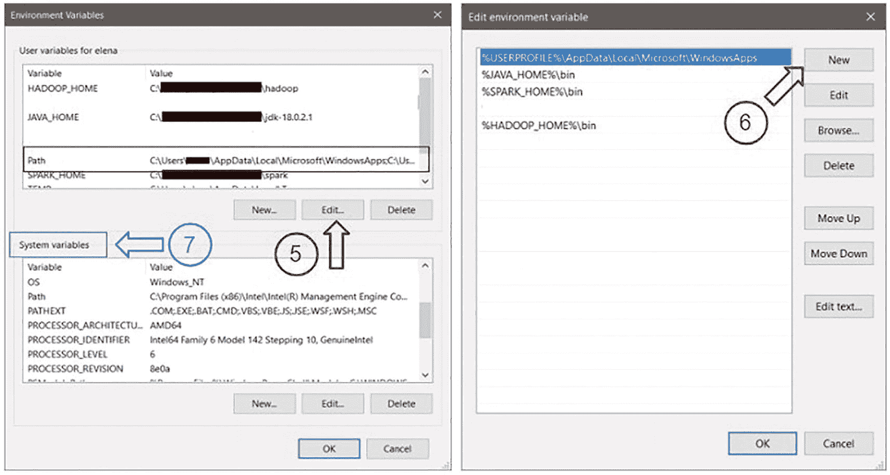

图 2-6 将变量添加到 `PATH`

**为计算机的所有用户配置系统与环境变量。**

7. 如果你想为计算机的所有用户（而非仅执行此安装的用户）添加这些变量，你应该对系统变量重复上述所有步骤，如图 2-6 左下角所示，点击“新建”按钮添加环境变量，然后点击“编辑”按钮将它们添加到系统 `PATH` 中，就像你之前做的那样。

**验证 Spark 安装。**

如果你第一次执行 `spark-shell`，你会看到大量信息性消息。这可能会分散你的注意力，让你担心出了什么问题。为了避免这些消息并只关注可能的错误消息，你需要配置 Spark 的日志记录参数。

进入你的 `%SPARK_HOME%\conf` 目录，找到一个名为 `log4j2.properties.template` 的文件，并将其重命名为 `log4j2.properties`。用记事本或其他编辑器打开该文件。

找到这一行

```
rootLogger.level = info
```

并将其修改如下：

```
rootLogger.level = ERROR
```

之后，保存并关闭文件。

打开一个 `cmd` 终端窗口，输入 `spark-shell`。如果安装顺利，你会看到类似图 2-7 的内容。

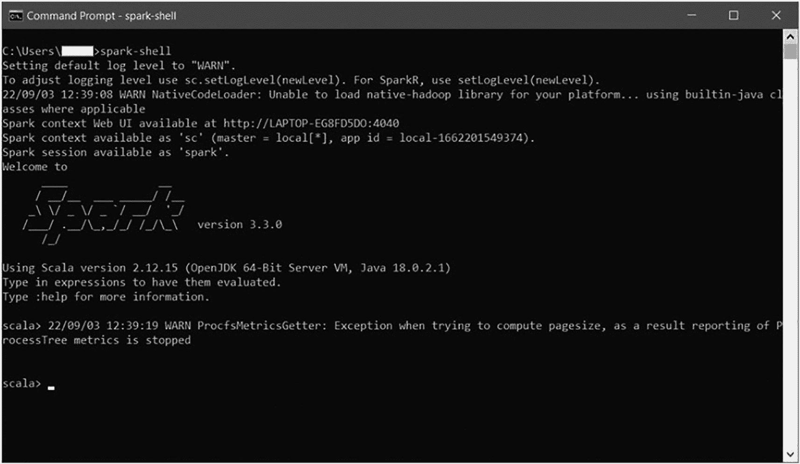

图 2-7 `spark-shell` 窗口

为了对安装进行更完整的测试，让我们尝试以下代码：

```
val file =sc.textFile("C:\\PATH\\TO\\YOUR\\spark\\README.md")
```

这将创建一个 RDD。你可以使用下一条指令查看文件内容：

```
file.take(10).foreach(println)
```

你可以在图 2-8 中看到结果。

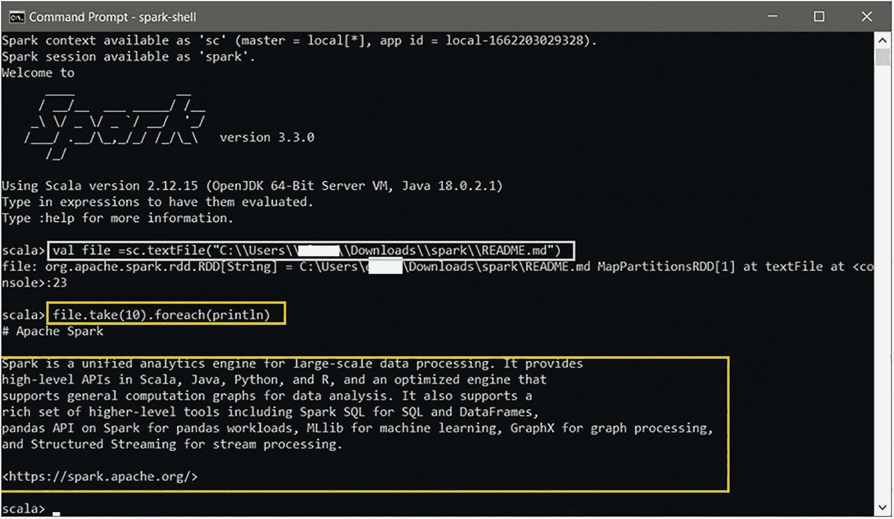

图 2-8 `spark-shell` 测试代码

要退出 `spark-shell`，你可以在命令提示符窗口中按 Ctrl-D，或者输入 `:q`。

打开一个网页浏览器，输入 URL `http://localhost:4040/`。你也可以使用你的计算机名来代替 `localhost`。你应该会看到一个 Apache Spark Web UI，类似于图 2-9 所示。下面的示例显示的是执行器页面。

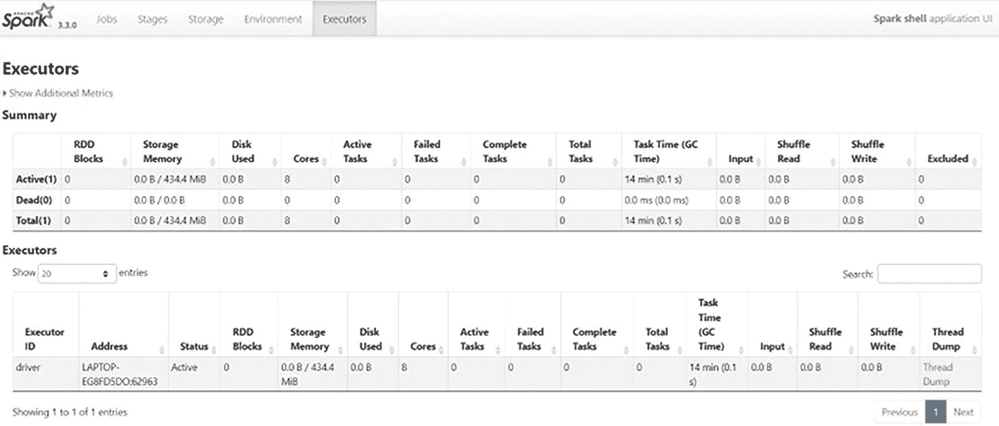

图 2-9 Apache Spark Web UI

如果你已安装 Python，可以使用以下命令运行 PySpark：

```
pyspark
```

PySpark 命令提示符窗口可以使用 `quit()` 关闭。

## 2.2 动手实践 Spark Shell

Apache Spark 附带了一系列命令行工具，你可以通过这些工具与 Spark 的 API 进行交互。Spark 为多种编程语言提供了 shell 工具，例如用于 Scala 的 `spark-shell`、用于 Python 的 `pyspark`、用于 SQL 的 `spark-sql` 以及用于 R 语言的 `sparkR`。

# Spark 命令行工具

Spark 还提供了其他专门的命令行工具，如 `spark-submit`、`run-example` 和 `spark-class`。你可以使用 `spark-submit` 来执行使用 Spark API 编写的 Java、Scala、Python 或 R 语言的独立应用程序，并将其提交到不同的 Spark 集群管理器（YARN、Kubernetes、Mesos 和 Standalone），同时提供运行时选项和配置。Apache Spark 附带了多个用 Scala、Java、Python 和 R 编写的示例，这些示例位于 `examples` 目录中。`spark-example` shell 可用于运行用 Scala 和 Java 编写的示例：

```
#对于 Scala 和 Java 示例：
$ $SPARK_HOME/bin/run-example SparkPi
```

对于用 Python 或 R 编写的示例，你可以直接使用 `spark-submit`：

```
#对于 Python 示例：
$ $SPARK_HOME/bin/spark-submit examples/src/main/python/pi.py
#对于 R 示例：
$ $SPARK_HOME/bin/spark-submit examples/src/main/r/dataframe.R
```

## 使用 Spark Shell 命令

Spark shell 是一个交互式命令行环境，用于从命令行与 Spark 进行交互。Spark shell 被称为 REPL（读取-求值-打印-循环）shell 接口。REPL 接口读取每一行输入，对其进行求值，并返回结果。它主要用于针对 Spark 集群运行临时查询。Spark shell 是一个非常方便的工具，可用于调试软件和探索新功能，同时获得即时反馈。针对不同语言有特定的 shell 脚本，例如用于启动 Spark Scala shell 的 `spark-shell`；用于 Spark with Python（也称为 PySpark）的 `pyspark`；以及用于向 Spark 提交 R 语言程序的 `sparkr`。

## Scala Shell 命令行

Spark Shell 的主要特性之一是它会自动为你创建 `SparkSession` 和 `SparkContext`。你可以通过它们的对象来访问 `SparkSession` 和 `SparkContext`，前者对应 `spark`，后者对应 `sc`。

请记住，你可以通过执行以下命令来启动 `spark-shell` 脚本：

```
$SPARK_HOME/bin/spark-shell
~ % spark-shell
Setting default log level to "WARN".
To adjust logging level use sc.setLogLevel(newLevel). For SparkR, use setLogLevel(newLevel).
Spark context Web UI available at http://192.168.0.16:4040
Spark context available as 'sc' (master = local[*], app id = local-1662487353802).
Spark session available as 'spark'.
Welcome to
____              __
/ __/__  ___ _____/ /__
_\ \/ _ \/ _ `/ __/  '_/
/___/ .__/\_,_/_/ /_/\_\   version 3.3.0
/_/
Using Scala version 2.12.15 (Java HotSpot(TM) 64-Bit Server VM, Java 18.0.2)
Type in expressions to have them evaluated.
Type :help for more information.
scala>
```

这会自动将 `SparkSession` 实例化为 `spark`，将 `SparkContext` 实例化为 `sc`：

```
scala> :type spark
org.apache.spark.sql.SparkSession
scala> :type sc
org.apache.spark.SparkContext
```

你可以使用 `getenv` 方法（即 `System.getenv('ENV_NAME')`）从 shell 中访问环境变量，例如：

```
scala> System.getenv("PWD")
res12: String = /Users/aantolinez
```

`spark-shell` 还通过输入以下命令提供在线帮助：

```
scala> :help
All commands can be abbreviated, e.g., :he instead of :help.
:completions  output completions for the given string
:edit |     edit history
:help [command]       print this summary or command-specific help
:history [num]        show the history (optional num is commands to show)
:h?           search the history
...
...
:save           save replayable session to a file
:settings    update compiler options, if possible; see reset
:silent               disable/enable automatic printing of results
:warnings             show the suppressed warnings from the most recent line which had any
scala>
```

请注意，不要将 `:help` 提供的内联帮助与 `spark-shell -h` 选项显示的 `spark-shell` 运行时选项混淆。

`-h` 选项允许向 shell 传递运行时环境选项，从而可以根据集群配置灵活地执行应用程序。让我们看一些示例，这些示例中我们运行 Apache Spark 与 Apache Hudi；设置集群管理器（YARN）、部署模式以及每个执行器的核心数；并为驱动器和执行器分配可用内存：

```
$SPARK_HOME/bin/spark-shell \
--master yarn \
--deploy-mode cluster \
--driver-memory 16g \
--executor-memory 32g \
--executor-cores 4  \
--conf "spark.sql.shuffle.partitions=1000" \
--conf "spark.executor.memoryOverhead=4024" \
--conf "spark.memory.fraction=0.7" \
--conf "spark.memory.storageFraction=0.3" \
--packages org.apache.hudi:hudi-spark3.3-bundle_2.12:0.12.0 \
--conf "spark.serializer=org.apache.spark.serializer.KryoSerializer" \
--conf "spark.sql.catalog.spark_catalog=org.apache.spark.sql.hudi.catalog.HoodieCatalog" \
--conf "spark.sql.extensions=org.apache.spark.sql.hudi.HoodieSparkSessionExtension"
```

在下一个示例中，我们在运行时定义要使用的数据库驱动程序和版本：

```
$SPARK_HOME/bin/spark-shell \
--master yarn \
--deploy-mode cluster \
--driver-memory 16g \
--executor-memory 32g \
--executor-cores 4  \
--driver-class-path /path/to/postgresql-42.5.0.jar \
--conf "spark.sql.shuffle.partitions=1000" \
--conf "spark.executor.memoryOverhead=4024" \
--conf "spark.memory.fraction=0.7" \
--conf "spark.memory.storageFraction=0.3" \
```

# Spark Shell

`spark-shell` 的另一个重要特性是，默认情况下，它使用 `local[*]` 作为 master 启动，并分配一个带有 `local-xxx` 模式的 `spark.app.id` 和 `spark.app.name="Spark shell"`。可以通过查看 `spark-shell` 启动的 Web UI（可通过 URL `http://localhost:4040/environment/` 访问）来检查所有默认设置的属性和运行环境中使用的环境变量，如图 2-10 所示。

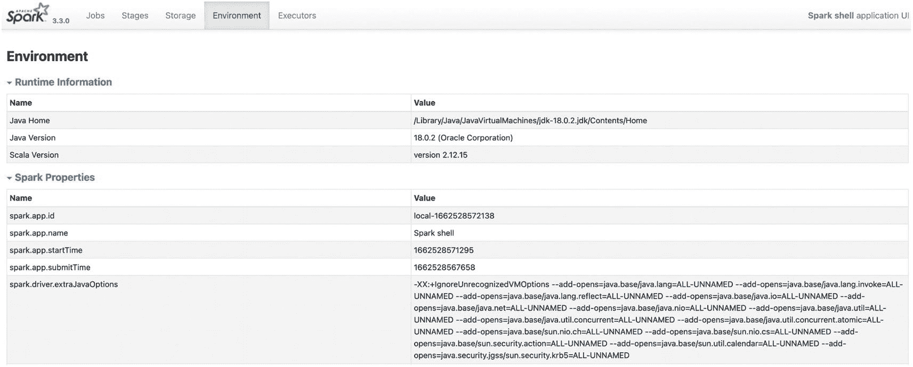

Apache Web 用户界面的屏幕截图。“环境”选项卡列出了运行时信息和 Spark 属性。运行时信息包括 Java 主目录、Java 和 Scala 版本的名称和值。Spark 属性包括名称和值。

**图 2-10** 端口 4040 上的 Apache Spark Web UI

如前所述，你可以通过在命令行中输入代码来运行交互式应用程序。例如，让我们从数据序列创建一个数据帧：

```
scala> import spark.implicits._
import spark.implicits._
scala> val cars=Seq(("USA","Chrysler","Dodge","Jeep"),("Germany","BMW","VW","Mercedes"),("Spain", "GTA Spano","SEAT","Hispano Suiza"))
cars: Seq[(String, String, String, String)] = List((USA,Chrysler,Dodge,Jeep), (Germany,BMW,VW,Mercedes), (Spain,GTA Spano,SEAT,Hispano Suiza))
scala> val cars_df = cars.toDF()
cars_df: org.apache.spark.sql.DataFrame = [_1: string, _2: string ... 2 more fields]
scala> cars_df.show()
+-------+---------+-----+-------------+
|     _1|       _2|   _3|           _4|
+-------+---------+-----+-------------+
|    USA| Chrysler|Dodge|         Jeep|
|Germany|      BMW|   VW|     Mercedes|
|  Spain|GTA Spano| SEAT|Hispano Suiza|
+-------+---------+-----+-------------+
```

以下是一个实际示例，展示了如何使用 `spark-shell` 从生产数据库中检索信息：

```
scala> val df_postgresql = spark.read.format("jdbc").option("url", "jdbc:postgresql://ec2-52-77-8-54.us-west-1.compute.amazonaws.com:5432/db").option("driver", "org.postgresql.Driver").option("dbtable","schema.table").option("user","user_password").option("password", "your_db_password_here").load()
df_postgresql: org.apache.spark.sql.DataFrame = [category_id: smallint, category_name: string ... 2 more fields]
scala> df_postgresql.show()
+-----------+--------------+--------------------+-------+
|category_id| category_name|         description|picture|
+-----------+--------------+--------------------+-------+
|          1|     Beverages|Soft drinks, coff...|     []|
|          2|    Condiments|Sweet and savory ...|     []|
|          3|   Confections|Desserts, candies...|     []|
|          4|Dairy Products|             Cheeses|     []|
|          5|Grains/Cereals|Breads, crackers,...|     []|
|          6|  Meat/Poultry|      Prepared meats|     []|
|          7|       Produce|Dried fruit and b...|     []|
|          8|       Seafood|    Seaweed and fish|     []|
+-----------+--------------+--------------------+-------+
```

最后，要退出 `spark-shell`，你只需输入 `:q`。

### PySpark Shell 命令行

如果你更喜欢使用 Python 进行编程，可以调用 `pyspark` shell。与 `spark-shell` 类似，你可以在终端中输入以下命令来运行它：

```
$SPARK_HOME/bin/pyspark
~ % pyspark
Python 3.6.12 (default, May 18 2021, 22:47:55)
[GCC 4.8.5 20150623 (Red Hat 4.8.5-28)] on linux
Type "help", "copyright", "credits" or "license" for more information.
SLF4J: Class path contains multiple SLF4J bindings.
SLF4J: Found binding in [jar:file:/usr/share/aws/glue/etl/jars/glue-assembly.jar!/org/slf4j/impl/StaticLoggerBinder.class]
...
...
22/09/07 16:30:26 WARN Client: Same path resource file:///usr/share/aws/glue/libs/pyspark.zip added multiple times to distributed cache.
Welcome to
____               __
/ __/__  ___ _____/ /__
_\ \/ _ \/ _ `/ __/  '_/
/__ / .__/\_,_/_/ /_/\_\   version 3.3.0
/_/
Using Python version 3.6.12 (default, May 18 2021 22:47:55)
SparkSession available as 'spark'.
>>>
```

与 `spark-shell` 一样，`pyspark` shell 会自动创建一个可通过 `spark` 访问的 `SparkSession`，以及一个可通过变量 `sc` 访问的 `SparkContext`。它还会设置一个 shell Web UI 服务器，其 URL 为 `http://localhost:4040/`。默认情况下，它使用端口 4040；但是，如果此端口无法绑定，则会依次尝试端口 4041、4042 等，直到找到可以绑定的端口为止。

如前所述，你可以通过在命令行中输入代码，在 `spark` 中运行交互式应用程序。在下面的示例中，我们从一个元组列表创建一个 DataFrame：

# Spark 命令行工具使用指南

`pyspark` shell 也支持运行时配置参数。以下是一个使用配置选项执行 `pyspark` 的示例：

```
$SPARK_HOME/bin/pyspark \
--master yarn \
--deploy-mode client \
--executor-memory 16G \
--executor-cores 8 \
--conf spark.sql.parquet.mergeSchema=true \
--conf spark.sql.parquet.filterPushdown=true \
--conf spark.sql.parquet.writeLegacyFormat=false Hands_On_Spark3_Script.py > ./Hands_On_Spark3_Script.log 2>&1 &
```

与 `spark-shell` 不同，要退出 `pyspark`，你可以在终端中输入 `quit()` 或 `exit()` 命令，或者按 `Ctrl-D`。

## 使用 `spark-submit` 命令运行自包含应用程序

如果你查看 `$SPARK_HOME/bin` 目录，会发现几个 `spark-submit` 脚本。Spark 为不同的操作系统和用途提供了不同的脚本。因此，对于 Linux 和 Mac，你需要使用 `spark-submit.sh` 脚本文件，而对于 Windows，你必须使用 `spark-submit.cmd` 命令文件。

`spark-submit` 命令的用法如下：

```
~ % $SPARK_HOME/bin/spark-submit --help
Usage: spark-submit [options]  [app arguments]
Usage: spark-submit --kill [submission ID] --master [spark://...]
Usage: spark-submit --status [submission ID] --master [spark://...]
Usage: spark-submit run-example [options] example-class [example args]
```

一些最常见的 `spark-submit` 选项如下：

```
$ $SPARK_HOME/bin/spark-submit \
--master  \
--deploy-mode  \
--class  \
--conf = \
--driver-memory g \
--executor-memory g \
--executor-cores   \
--jars  
... # other options
 \
[application-arguments]
```

现在，我们将通过一个实际示例来说明 `spark-submit` 的工作原理：

```
$ $SPARK_HOME/bin/spark-submit \
--deploy-mode client \
--master local \
--class org.apache.spark.examples.SparkPi \
/$SPARK_HOME/examples/jars/spark-examples_2.12-3.3.0.jar 80
```

如果你按原样运行了这段代码，你肯定会在控制台中看到类似这样的输出：

```
22/08/30 22:04:30 WARN Utils: Your hostname, MacBook-Pro.local resolves to a loopback address: 127.0.0.1; using 192.168.0.16 instead (on interface en0)
22/08/30 22:04:30 WARN Utils: Set SPARK_LOCAL_IP if you need to bind to another address
22/08/30 22:05:00 INFO SparkContext: Running Spark version 3.3.0
. . .
. . .
22/08/30 22:05:03 INFO DAGScheduler: Job 0 finished: reduce at SparkPi.scala:38, took 1.174952 s
Pi is roughly 3.142520392815049
22/08/30 22:05:03 INFO SparkUI: Stopped Spark web UI at http://192.168.0.16:4043
22/08/30 22:05:03 INFO MapOutputTrackerMasterEndpoint: MapOutputTrackerMasterEndpoint stopped!
22/08/30 22:05:03 INFO MemoryStore: MemoryStore cleared
22/08/30 22:05:03 INFO BlockManager: BlockManager stopped
22/08/30 22:05:03 INFO BlockManagerMaster: BlockManagerMaster stopped
22/08/30 22:05:03 INFO OutputCommitCoordinator$OutputCommitCoordinatorEndpoint: OutputCommitCoordinator stopped!
22/08/30 22:05:03 INFO SparkContext: Successfully stopped SparkContext
22/08/30 22:05:03 INFO ShutdownHookManager: Shutdown hook called
22/08/30 22:05:03 INFO ShutdownHookManager: Deleting directory /private/var/folders/qd/6ly2_9_54tq434fctwmmsc3m0000gp/T/spark-30934777-e061-403c-821d-0bbaa2e62745
22/08/30 22:05:03 INFO ShutdownHookManager: Deleting directory /private/var/folders/qd/6ly2_9_54tq434fctwmmsc3m0000gp/T/spark-3e2e234c-7615-4a9c-b34f-878d149517e2
```

“`Pi is roughly 3.142520392815049`” 是你真正感兴趣的信息。

正如我们在“步骤 5：配置系统和环境变量”中提到的，为了避免大量信息导致难以找到应用程序的最终结果，你可以稍微调整 Spark 配置，使其仅显示 ERROR 消息，从而移除 INFO 行。

假设你使用的是 Apache Spark 3.3.0，在终端窗口中执行以下操作：

```
$ ls $SPARK_HOME/conf
fairscheduler.xml.template    spark-defaults.conf.template
log4j2.properties.template    spark-env.sh.template
metrics.properties.template    workers.template
```

将 `log4j2.properties.template` 文件重命名为 `log4j2.properties`：

```
$ mv $SPARK_HOME/conf/log4j2.properties.template $SPARK_HOME/conf/log4j2.properties
```

编辑 `log4j2.properties` 文件：

```
$ vi $SPARK_HOME/conf/log4j2.properties
```

找到以下行：

# Set everything to be logged to the console

`rootLogger.level = INFO`

并将其更改为：

`rootLogger.level = ERROR`

保存文件，然后再次运行 Spark 示例应用程序：

```
$ $SPARK_HOME/bin/spark-submit \
--name "Hands-On Spark 3" \
--master local\[4] \
--deploy-mode client \
--conf spark.eventLog.enabled=false \
--conf "spark.executor.extraJavaOptions=-XX:+PrintGCDetails -XX:+PrintGCTimeStamps" \
--class org.apache.spark.examples.SparkPi \
/$SPARK_HOME/examples/jars/spark-examples_2.12-3.3.0.jar 80
Pi is roughly 3.1410188926273617
$
```

这次你将看到干净的退出信息。

现在让我们回顾一下最常见选项的含义。

## Spark Submit 选项

你可以通过运行以下命令获取所有可用的 `spark-submit` 选项：

```
$ $SPARK_HOME/bin/spark-submit --help
```

让我们解释一下与 Scala 和 Python（PySpark）一起使用的最相关的 `spark-submit` 选项和配置。

### 部署模式选项

`--deploy-mode` 选项指定驱动程序是在本地启动（“client”）还是在集群中运行（“cluster”）。表 2-1 描述了每个选项的含义。

**表 2-1** Apache Spark 部署模式

| 选项 | 描述 |
| --- | --- |
| `cluster` | 在集群模式下，驱动程序将在集群内的某个工作节点上运行。集群模式用于运行生产作业。 |
| `client`（默认选项） | 在客户端模式下，驱动程序在提交应用程序的本地运行，而执行器在不同的节点上运行。 |

### 集群管理器选项

`--master` 选项指定要使用的集群管理器以及运行应用程序的集群主节点 URL。您可以在表 2-2 中查看可用的不同集群管理器及其使用方法。

**表 2-2 Apache Spark 集群管理器**

| 选项 | 模板 | 描述 |
| --- | --- | --- |
| Standalone | `spark://IP:PORT` | 主节点的 URL、IP 地址和端口，默认端口为 7077。 |
| Mesos | `mesos://host:port` | Mesos 的主节点 URL。 |
| YARN | `--master yarn` | 由 Hadoop YARN 管理的集群资源。 |
| Kubernetes | `k8s://https://host:port` | Kubernetes 主机和端口：`k8s://https://<k8s-apiserver-host>:<k8s-apiserver-port>` |
| Local | `local` | 在本地运行 Spark，无并行度，仅一个工作线程。 |
| | `local[K]` | 在本地运行 Spark，使用 `K` 个核心或工作线程。 |
| | `local[K,F]` | 在本地运行 Spark，使用 `K` 个工作线程和 `F` 个 `maxFailures`（失败时的重试次数）。 |
| | `local[*]`（默认：`local[*]`） | 在本地运行 Spark，使用与逻辑核心数量相同的工作线程。 |

以下是这些常见选项的一些示例：

```
# 在 4 个核心上本地运行应用程序
(base) aantolinez@MacBook-Pro ~ % $SPARK_HOME/bin/spark-submit \
--class org.apache.spark.examples.SparkPi \
--master local[4] \
/$SPARK_HOME/examples/jars/spark-examples_2.12-3.3.0.jar 80
zsh: no matches found: local[4]
```

**注意**

如果您使用的是 zsh（Z shell），则必须对 `--master local[4] \` 中的 `[4]` 进行转义，使用 `\[`，例如 `--master local\[4] \`；否则，您将收到以下错误消息：

`zsh: no matches found: local[4]`

```
(base) aantolinez@MacBook-Pro ~ % $SPARK_HOME/bin/spark-submit \
--class org.apache.spark.examples.SparkPi \
--master local\[4] \
/$SPARK_HOME/examples/jars/spark-examples_2.12-3.3.0.jar 80
```

```
# Spark 独立集群和 Python 应用程序
$SPARK_HOME/bin/spark-submit \
--master spark://192.168.1.3:7077 \
/$SPARK_HOME/examples/src/main/python/pi.py
```

```
# 客户端部署模式下的 Spark 独立集群，使用 100 个核心
$SPARK_HOME/bin/spark-submit \
--class org.apache.spark.examples.SparkPi \
--master spark://192.168.1.3:7077 \
--executor-memory 20G \
--total-executor-cores 100 \
/$SPARK_HOME/examples/jars/spark-examples_2.12-3.3.0.jar 80
```

```
# 集群部署模式下带监督选项的 Spark 独立集群。
# --supervise 在驱动程序以非零退出码失败时自动重启驱动程序。
$SPARK_HOME/bin/spark-submit \
--class org.apache.spark.examples.SparkPi \
--master spark://192.168.1.3:7077 \
--deploy-mode cluster \
--supervise \
--executor-memory 20G \
--total-executor-cores 100 \
/$SPARK_HOME/examples/jars/spark-examples_2.12-3.3.0.jar 80
```

```
# 集群部署模式下在 YARN 集群上运行 Spark
export HADOOP_CONF_DIR=PATH_TO_HADOOP_CONF_DIR
$SPARK_HOME/bin/spark-submit \
--master yarn \
--deploy-mode cluster \
--class org.apache.spark.examples.SparkPi \
--executor-memory 10G \
--num-executors 20 \
/$SPARK_HOME/examples/jars/spark-examples_2.12-3.3.0.jar 80
```

```
# 集群部署模式下在 Mesos 集群上运行
$SPARK_HOME/bin/spark-submit \
--class org.apache.spark.examples.SparkPi \
--master mesos://207.184.161.138:7077 \
--deploy-mode cluster \
--executor-memory 16G \
--total-executor-cores 64 \
/$SPARK_HOME/examples/jars/spark-examples_2.12-3.3.0.jar 80
```

```
# 集群部署模式下在 Kubernetes 集群上运行 Spark
$SPARK_HOME/bin/spark-submit \
--class org.apache.spark.examples.SparkPi \
--master k8s://xx.yy.zz.ww:443 \
--deploy-mode cluster \
--executor-memory 20G \
--num-executors 50 \
/$SPARK_HOME/examples/jars/spark-examples_2.12-3.3.0.jar 80
```

#### 调整资源分配

向集群提交应用程序时，您可以关注其执行性能，从而使 Spark 程序运行得更快。Apache Spark 关心的两个主要资源是 CPU 和 RAM。为了充分利用 Spark 集群的能力，您可以控制驱动程序和执行器可以使用的内存和核心数量。本节列举的选项不仅影响 Spark 性能，还会影响其运行的集群。例如，它们会影响 Spark 请求的资源如何与集群管理器可用的资源相匹配。在表 2-3 中，您可以查看需要调整的参数及其技术描述。

**表 2-3 Apache Spark 驱动程序和执行器资源管理选项**

| 选项 | 描述 |
| --- | --- |
| `--executor-cores` | • Spark 驱动程序用于执行器进程的 CPU 核心数量。<br>• `cores`属性控制一个执行器可以运行的并发任务数。<br>• `--executor-cores 5`表示每个执行器最多可以同时运行五个任务。 |
| `--executor-memory` | • 执行器进程使用的 RAM 量。<br>• 此选项影响 Spark 可以缓存和分配给 shuffle 数据结构的最大数据大小。<br>• 此属性影响聚合、分组和连接等操作的性能。 |
| `--num-executors` (*) | 控制请求的执行器数量。 |
| `--driver-memory` | Spark 驱动程序使用的内存。 |
| `--driver-cores` | 分配给 Spark 驱动程序的 CPU 核心数量。 |
| `--total-executor-cores` | 授予执行器的核心总数。 |

(*) **注意** 从 CDH 5.4/Spark 1.3 开始，您可以通过`spark.dynamicAllocation.enabled`属性绕过此参数的设置，启用动态分配。动态分配允许您的应用程序在有待处理任务时请求可用的执行器，并在未使用时释放它们。

### 动态加载 Spark Submit 配置

通常，如果你的应用程序可能在不同的集群配置下运行（例如不同的集群管理器、不同的可用内存量等），建议避免在应用程序中使用 `SparkConf` 硬编码配置，因为一旦 `SparkConf` 对象被传递给 Apache Spark，用户就无法再修改它。因此，与其像下面代码片段中那样在源代码中建立 `SparkContext` 配置，不如让该配置在程序被调用时准备好接收动态参数：

```
// 在 Scala 中硬编码集群配置参数
// 创建 Spark 配置
val conf = new SparkConf()
.setMaster("local[4]")
.setAppName("Hands-On Spark 3")
.set("spark.executor.memory", "32g")
.set("spark.driver.memory", "16g")
// 创建 Spark 上下文
val sc = new SparkContext(conf)
```

```
# 在 PySpark 中硬编码集群配置参数
conf = SparkConf()
conf.setMaster("spark://localhost:7077")
conf.setAppName("Hands-On Spark 3")
conf.set("spark.executor.memory", "32g")
conf.set("spark.driver.memory", "16g")
sc = SparkContext(conf=conf)
```

`SparkContext` 对于一个应用程序只创建一次；因此，另一种更灵活的解决方案是使用空配置来构建它：

```
// 在 Scala 中使用空配置创建 SparkContext
val sc = new SparkContext(new SparkConf())
```

```
# 在 PySpark 中使用空配置创建 SparkContext
conf = SparkConf()
sc = SparkContext(conf=conf)
```

然后，你可以在运行时动态地向集群传递配置参数：

```
$SPARK_HOME/bin/spark-submit \
--name "Hands-On Spark 3" \
--master local[4] \
--deploy-mode client \
--conf spark.eventLog.enabled=false \
--conf "spark.executor.extraJavaOptions=-XX:+PrintGCDetails -XX:+PrintGCTimeStamps" \
--class org.apache.spark.examples.SparkPi \
/$SPARK_HOME/examples/jars/spark-examples_2.12-3.3.0.jar 80
```

Spark submit 允许你使用数十个参数微调集群配置，这些参数可以通过 `--config`/`-c` 选项发送给 `SparkContext`，或者通过设置 `SparkConf` 来创建 `SparkSession`。这些选项控制应用程序属性（表 2-4）、运行时环境（表 2-5）、shuffle 行为、Spark UI、压缩和序列化、内存管理、执行行为、执行器指标、网络、调度、屏障执行模式、动态分配（表 2-6）、线程配置、安全性以及运行时 SQL 配置等（表 2-7）。接下来，我们将探讨一些最常见的配置。

#### 应用程序属性

**表 2-4** Spark 应用程序属性

| 属性 | 描述 |
| --- | --- |
| `spark.app.name`（默认值，无） | 你的应用程序的名称。 |
| `spark.driver.cores`（默认值，1） | 在集群模式下，仅用于驱动程序进程的内核数。 |
| `spark.driver.memory`（默认值，1g） | 用于驱动程序进程的内存量。在客户端模式下，应通过 `--driver-memory` 命令行选项或属性文件进行设置。 |

#### 运行时环境

**表 2-5** Spark 运行时环境

| 属性 | 描述 |
| --- | --- |
| `spark.driver.extraClassPath`（默认值，无） | 要预置到驱动程序类路径的额外类路径条目。在客户端模式下，应通过 `--driver-class-path` 命令行选项或默认属性文件进行设置。该选项允许你加载特定的 JAR 文件，例如数据库连接器等。 |

#### 动态分配

**表 2-6** Spark 分配资源

| 属性 | 描述 |
| --- | --- |
| `spark.dynamicAllocation.enabled`（默认值，false） | 是否使用动态资源分配，根据现有工作负载调整处理应用程序的执行器数量。 |
| `spark.dynamicAllocation.executorIdleTimeout`（默认值，60 秒） | 如果启用了动态分配，执行器进程在空闲时间过长时将被终止。 |
| `spark.dynamicAllocation.cachedExecutorIdleTimeout`（默认值，无限） | 如果启用了动态分配，执行器进程在缓存了数据且空闲时间过长时将被终止。 |

#### 其他配置

**表 2-7** 控制应用程序属性的其他 Spark 选项

| 属性 | 描述 |
| --- | --- |
| `spark.sql.shuffle.partitions`（默认值，200） | 在连接或聚合操作中 shuffle 数据时使用的分区数。 |
| `spark.rdd.compress`（默认值，false） | 是否压缩序列化的 RDD 分区，以节省大量空间为代价，增加额外的 CPU 处理时间。 |
| `spark.executor.pyspark.memory`（默认值，未设置） | 如果设置，则为每个执行器中分配给 PySpark 的内存量。此选项的行为因操作系统而异。 |
| `spark.executor.memoryOverhead`（`executorMemory` * `spark.executor.memoryOverheadFactor`），最小值为 384 | 每个执行器进程分配的额外内存量。每个执行器运行的最大内存由 `spark.executor.memoryOverhead`、`spark.executor.memory`、`spark.memory.offHeap.size` 和 `spark.executor.pyspark.memory` 的总和决定。 |

以下是在命令行中使用其中一些选项的示例：

```
# Spark 应用程序提交与概念

## 提交 Spark 应用程序

以下是一个使用 `spark-submit` 脚本提交应用程序的示例命令，其中包含了一系列配置参数。

```bash
$SPARK_HOME/bin/spark-submit \
--master yarn \
--deploy-mode cluster \
--conf "spark.sql.shuffle.partitions=10000" \
--conf "spark.executor.memoryOverhead=8192" \
--conf "spark.memory.fraction=0.7" \
--conf "spark.memory.storageFraction=0.3" \
--conf "spark.dynamicAllocation.minExecutors=10" \
--conf "spark.dynamicAllocation.maxExecutors=2000" \
--conf "spark.dynamicAllocation.enabled=true" \
--conf "spark.executor.extraJavaOptions=-XX:+PrintGCDetails -XX:+PrintGCTimeStamps" \
--files /path/of/config.conf, /path/to/mypropeties.json \
--class org.apache.spark.examples.SparkPi \
/$SPARK_HOME/examples/jars/spark-examples_2.12-3.3.0.jar 80
```

## 配置优先级

配置可以通过三种不同的方式传递给 `Spark`。硬编码方式，利用 `SparkConf` 属性，会覆盖其他方式，并遵循第一优先级顺序：

```scala
val config = new SparkConf()
config.set("spark.sql.shuffle.partitions","500")
val spark=SparkSession.builder().appName("Hands-On Spark 3").config(config)
```

第二优先级是通过 `spark-submit` 的 `--config` 属性传递。最后，第三优先级是通过 `$SPARK_HOME/conf/spark-defaults.conf` 文件。最后一种方式的优势在于，在此文件中建立的配置是全局生效的，即适用于集群中运行的所有 `Spark` 应用程序。

## 开发与提交示例

接下来，我们将展示一个用户开发的应用程序示例，以及如何将其提交给 `Apache Spark`。

让我们开发一个名为 `Functions` 的小程序，它执行一个简单的操作：两个数相加：

```scala
object Functions {
def main(args: Array[String]) = {
agregar(1,2)
}
val agregar = (x: Int, y: Int) => println(x+y)
}
```

将文件保存为 `Functions.scala`，并按如下方式编译。我们假设你的计算机上已安装 `Scala`：

```bash
~ % scalac ./Functions.scala -d Functions.jar
```

然后，将 `JAR` 文件提交到你的 `Spark` 安装目录：

```bash
~ % spark-submit --class Functions ./Functions.jar
```

你可以在程序输出中看到数字 `3`。

## Spark 应用程序概念

到目前为止，您已经下载并配置了 `Apache Spark`，熟悉了 `Spark shell`，并执行了一些小示例。现在，让我们回顾一些 `Spark` 应用程序的重要术语，这些术语对于理解代码执行时发生的情况至关重要：

- **Spark 应用程序** 是用户在 `Spark` 之上开发的程序，它使用 `Spark` 的 `API`，并由在集群上运行的执行器和一个驱动程序组成。
- **SparkSession** 是与 `Spark` 通信的入口点，允许用户通过 `Spark API` 与底层功能进行交互。
- **任务** 是最小的执行单元，在执行器内部执行。
- **阶段** 是运行相同代码的任务集合，每个任务处理数据集的不同部分。使用需要 `shuffle` 或读取数据集的函数（例如 `reduceByKey()`、`Join()` 等）会触发 `Spark` 创建一个阶段。
- **作业** 包含多个阶段，可以定义为允许在 `Spark` 集群中执行和监督应用程序的实体。

### Spark 应用程序与 SparkSession

正如我们之前提到的，`SparkSession` 是与 `Spark` 通信的入口点，并通过 `Spark Dataset` 和 `DataFrame API` 访问其功能。`SparkSession` 使用 `SparkSession.builder()` 构造函数创建，创建 `SparkSession` 是应用程序中的第一条语句。

`SparkSession` 是在 `Spark 2.0` 中引入的，提供了新的类 `org.apache.spark.sql.SparkSession` 来替代 2.0 版本之前存在的 `SparkContext`、`SQLContext`、`StreamingContext` 和 `HiveContext` 等上下文。

`SparkSession` 的数量几乎是无限的；这意味着您可以根据需要创建任意多个 `SparkSession`。当多个程序员同时在同一个集群上工作，或者您想逻辑上隔离 `Spark` 关系实体时，这尤其有用。但是，在单个 `JVM` 上只能有一个 `SparkContext`。可以使用 `SparkSession.builder()` 或 `SparkSession.newSession()` 创建新的 `SparkSession`。

### 访问现有的 SparkSession

在预先创建好的环境中，如有必要，您可以使用 `SparkSession.Builder` 类的 `getOrCreate()` 方法从应用程序中访问现有的 `SparkSession` 以检索现有会话。以下是 `Scala` 和 `PySpark` 中的两个代码片段，向您展示如何操作：

```scala
// 了解 Scala 中现有的 SparkSession
import org.apache.spark.sql.SparkSession
val currentSparkSession = SparkSession.builder().getOrCreate()
print(currentSparkSession)
// SparkSession 输出
org.apache.spark.sql.SparkSession@7dabc2f9
```

```python
# 了解 PySpark 中现有的 SparkSession
currentSparkSession = SparkSession.builder.getOrCreate
print(currentSparkSession)
// SparkSession 输出
pyspark.sql.session.SparkSession object at 0x7fea951495e0
```

您可以使用 `getActiveSession()` 方法获取构建器返回的当前线程的活动 `SparkSession`：

```python
# 当前线程的活动 SparkSession
s = SparkSession.getActiveSession()
print(s)
```

您还可以使用 `newSession()` 方法创建一个新的/另一个 `SparkSession`。此方法将创建一个具有与活动会话相同应用名称、主节点模式和 `SparkContext` 的新会话。请记住，每个 `Spark` 应用程序只能有一个上下文：

```scala
// 创建一个新的 SparkSession
val aNewSession = spark.newSession()
print(aNewSession)
org.apache.spark.sql.SparkSession@2dc9b758
Out[6]: aNewSession: org.apache.spark.sql.SparkSession = org.apache.spark.sql.SparkSession@2dc9b758
```

### 获取当前 Spark 上下文设置/配置

`Spark` 有许多您可能希望指定的设置和配置，包括应用程序属性和运行时参数。您可以使用以下 `Scala` 或 `PySpark` 代码收集所有当前配置：

```scala
// 获取所有 Spark 配置
val configMap:Map[String, String] = spark.conf.getAll
```

您将收到的输出可能类似于：
```

```
configMap: Map[String,String] = Map(spark.sql.warehouse.dir -> file:/Users/.../spark-warehouse, spark.executor.extraJavaOptions -> -XX:+IgnoreUnrecognizedVMOptions --add-opens=java.base/java.lang=ALL-UNNAMED --add-opens=java.base/java.lang.invoke=ALL-UNNAMED --add-opens=java.base/java.lang.reflect=ALL-UNNAMED --add-opens=java.base/java.io=ALL-UNNAMED --add-opens=java.base/java.net=ALL-UNNAMED --add-opens=java.base/java.nio=ALL-UNNAMED --add-opens=java.base/java.util=ALL-UNNAMED --add-opens=java.base/java.util.concurrent=ALL-UNNAMED --add-opens=java.base/java.util.concurrent.atomic=ALL-UNNAMED --add-opens=java.base/sun.nio.ch=ALL-UNNAMED --add-opens=java.base/sun.nio.cs=ALL-UNNAMED --add-opens=java.base/sun.security.action=ALL-UNNAMED --add-opens=java.ba...
```

通过 PySpark 获取当前配置：

```python
configurations = spark.sparkContext.getConf().getAll()
for conf in configurations:
    print(conf)
```

您将收到的输出可能类似于：

```python
('spark.driver.extraJavaOptions', '-XX:+IgnoreUnrecognizedVMOptions --add-opens=java.base/java.lang=ALL-UNNAMED --add-opens=java.base/java.lang.invoke=ALL-UNNAMED --add-opens=java.base/java.lang.reflect=ALL-UNNAMED --add-opens=java.base/java.io=ALL-UNNAMED --add-opens=java.base/java.net=ALL-UNNAMED --add-opens=java.base/java.nio=ALL-UNNAMED --add-opens=java.base/java.util=ALL-UNNAMED --add-opens=java.base/java.util.concurrent=ALL-UNNAMED --add-opens=java.base/java.util.concurrent.atomic=ALL-UNNAMED --add-opens=java.base/sun.nio.ch=ALL-UNNAMED --add-opens=java.base/sun.nio.cs=ALL-UNNAMED --add-opens=java.base/sun.security.action=ALL-UNNAMED --add-opens=java.base/sun.util.calendar=ALL-UNNAMED --add-opens=java.security.jgss/sun.security.krb5=ALL-UNNAMED')
('spark.app.submitTime', '1662916389744')
('spark.sql.warehouse.dir', 'file:/Users/.../spark-warehouse')
('spark.app.id', 'local-1662916391188')
('spark.executor.id', 'driver')
('spark.app.startTime', '1662916390211')
('spark.app.name', 'PySparkShell')
('spark.driver.port', '54543')
('spark.sql.catalogImplementation', 'hive')
('spark.rdd.compress', 'True')
('spark.executor.extraJavaOptions', '-XX:+IgnoreUnrecognizedVMOptions --add-opens=java.base/java.lang=ALL-UNNAMED --add-opens=java.base/java.lang.invoke=ALL-UNNAMED --add-opens=java.base/java.lang.reflect=ALL-UNNAMED --add-opens=java.base/java.io=ALL-UNNAMED --add-opens=java.base/java.net=ALL-UNNAMED --add-opens=java.base/java.nio=ALL-UNNAMED --add-opens=java.base/java.util=ALL-UNNAMED --add-opens=java.base/java.util.concurrent=ALL-UNNAMED --add-opens=java.base/java.util.concurrent.atomic=ALL-UNNAMED --add-opens=java.base/sun.nio.ch=ALL-UNNAMED --add-opens=java.base/sun.nio.cs=ALL-UNNAMED --add-opens=java.base/sun.security.action=ALL-UNNAMED --add-opens=java.base/sun.util.calendar=ALL-UNNAMED --add-opens=java.security.jgss/sun.security.krb5=ALL-UNNAMED')
('spark.serializer.objectStreamReset', '100')
('spark.driver.host', '192.168.0.16')
('spark.master', 'local[*]')
('spark.submit.pyFiles', '')
('spark.submit.deployMode', 'client')
('spark.ui.showConsoleProgress', 'true')
```

类似地，你可以在运行时设置 Spark 配置参数：

```scala
// 在 Scala 中运行时设置 Spark 配置参数
spark.conf.set("spark.sql.shuffle.partitions", "30")
```

```python
# 在 PySpark 中运行时设置 Spark 配置参数
spark.conf.set("spark.app.name", "Hands-On Spark 3")
spark.conf.get("spark.app.name")
Output: 'Hands-On Spark 3'
```

你还可以通过 `catalog` 变量以及 `spark.catalog.listDatabases` 和 `spark.catalog.listTables` 方法，使用 `SparkSession` 来处理目录元数据：

```scala
// 列出 Spark 目录数据库
val ds = spark.catalog.listDatabases
ds.show(false)
+-------+----------------+----------------------------------------+
|name   |description     |locationUri                             |
+-------+----------------+----------------------------------------+
|default|default database|file:/Users/.../spark-warehouse         |
+-------+----------------+----------------------------------------+
```

```
// 列出 Spark 目录表
val ds = spark.catalog.listTables
ds.show(false)
+------------+--------+-----------+---------+-----------+
|name        |database|description|tableType|isTemporary|
+------------+--------+-----------+---------+-----------+
|hive_table  |default |null       |MANAGED  |false      |
|sample_table|null    |null       |TEMPORARY|true       |
|table_1     |null    |null       |TEMPORARY|true       |
+------------+--------+-----------+---------+-----------+
```

### Spark-shell 中的 SparkSession

SparkSession 对象由 Spark 驱动程序创建。请记住，我们在上一节中提到，当你使用 Spark shell 时，SparkSession 对象会自动为你创建，并且可以通过 `spark` 变量使用。你可以像这样在 Spark shell 命令行中使用 `spark` 变量：

```
scala> spark.version
Spark Version : 3.3.0
```

### 以编程方式创建 SparkSession

在 Scala 或 PySpark 中创建新 SparkSession 的更安全方法是使用 `org.apache.spark.sql.SparkSession.Builder` 对象及其构造器 `builder()`，同时调用 `getOrCreate()` 方法。这样操作可以确保：如果 SparkSession 已存在，则使用现有实例；否则，创建一个新的：

```
// 创建 SparkSession 对象的 Scala 代码
import org.apache.spark.sql.SparkSession
object NewSparkSession extends App {
val spark = SparkSession.builder()
.master("local[4]")
.appName("Hands-On Spark 3")
.getOrCreate();
println(spark)
println("The Spark Version is : "+spark.version)
}
org.apache.spark.sql.SparkSession@ddfc241
The Spark Version is : 3.3.0
```

```
# 创建 SparkSession 对象的 PySpark 代码
import pyspark
from pyspark.sql import SparkSession
spark = SparkSession.builder.master("local[4]") \
.appName("Hands-On Spark 3") \
.getOrCreate()
print(spark)
print("Spark Version : "+spark.version)
Spark Version : 3.3.0
```

## 转换、动作、不可变性与惰性求值

Spark 的核心数据结构——RDD（弹性分布式数据集）和数据帧——本质上是 `不可变` 的；这意味着一旦创建，它们就无法被修改。在此上下文中，`不可变` 是 `不可更改` 的同义词。Spark 对分布式数据集的操作分为转换和动作两类。

### 转换

转换是指以 RDD 或数据帧作为输入，并返回一个新的 RDD 或数据帧作为输出的操作。因此，转换保留了数据的原始副本，这就是为什么 Spark 数据结构被认为是不可变的。转换的另一个重要特性是，它们不会在定义后立即执行；相反，它们会被记录下来，形成一个如图 2-11 所示的转换谱系。例如，像 `map()`、`filter()` 等操作，只有在定义了动作之后才会生效。

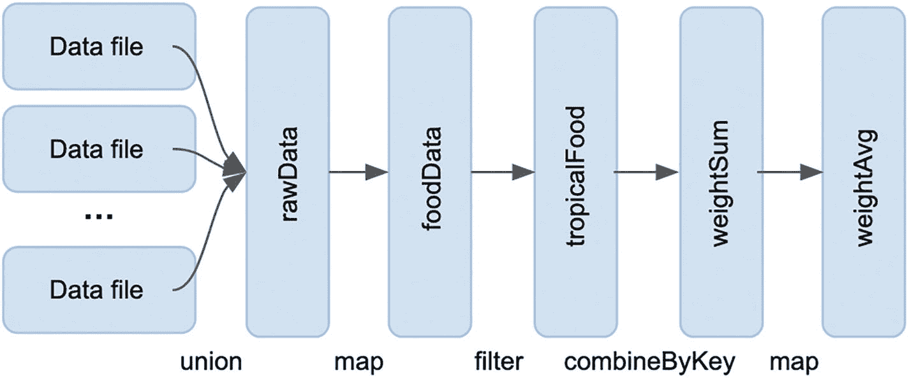

一个框图，从数据文件的输入开始，连接到原始数据、食物数据、热带食物和重量总和，最后以重量平均值结束。

图 2-11 转换谱系示例

转换谱系意味着所应用的操作序列会被记录在一个称为 DAG（有向无环图）（图 2-12）的图中，并且仅在触发动作时才会执行。这种将转换推迟到动作发生时再执行的思想，就是所谓的转换的 `惰性求值`。简单来说，当你定义上述操作时，在指示 Spark 如何处理数据之前，什么都不会发生。惰性求值是 Spark 优化操作的方式，因为它允许 Spark 在定义完整工作流后选择最佳的执行方式。

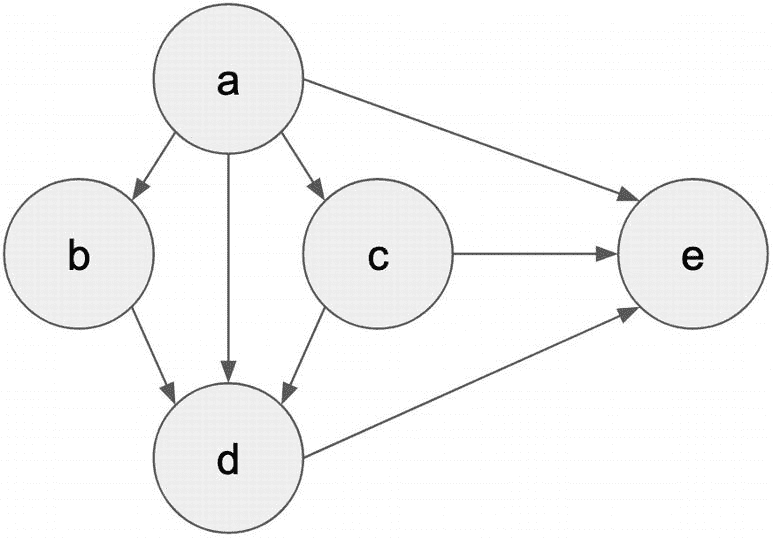

一个有向无环图，包含五个相互连接的节点。节点 b、c、d 和 e 连接到节点 a。节点 b 和 c 连接到 d。节点 a、c 和 d 连接到 e。

图 2-12 有向无环图示例

以下是 Spark 中的一些基本转换：

* `map()`
* `flatMap()`
* `filter()`
* `groupByKey()`
* `reduceByKey()`
* `sample()`
* `union()`
* `distinct()`

转换可以定义窄依赖或宽依赖；因此，Spark 实现了两种类型的转换：窄转换和宽转换。

### 窄依赖转换

窄依赖转换是不涉及数据混洗的操作，也就是说，分区之间没有数据移动。因此，窄依赖转换作用于同一分区内的数据，如图 2-13 所示。

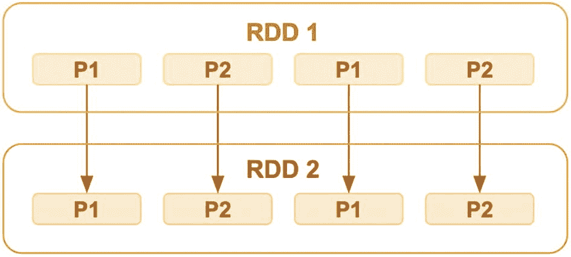

一张框图展示了窄依赖转换。`RDD1` 连接了 `RDD2` 的每个子块。`RDD1` 和 `RDD2` 分别包含 `P1`、`P2` 以及 `P1`、`P2`。

**图 2-13** 窄依赖转换示例

窄依赖转换是诸如 `map()`、`mapPartition()`、`flatMap()`、`filter()` 或 `union()` 等函数执行的结果。

### 宽依赖转换

宽依赖转换是涉及数据混洗的操作，这意味着分区之间存在数据移动，如图 2-14 所示。

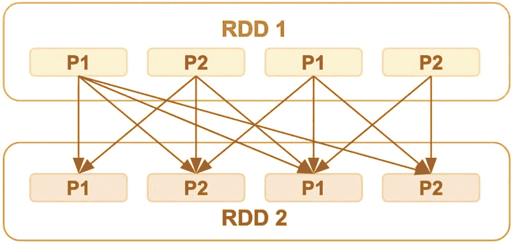

一张示意图展示了宽依赖转换。包含 `P1`、`P2`、`P3`、`P4` 等块的 `RDD1` 连接了 `RDD2` 的每个子块。每个子块都指向 `RDD2` 的所有子块。

**图 2-14** 宽依赖转换示例

宽依赖转换在计算和网络资源方面成本更高，因为它们涉及混洗操作，这意味着数据必须通过网络传输，或至少在分区之间移动。

宽操作是诸如 `groupByKey()`、`join()`、`distinct()`、`aggregateByKey()`、`aggregate()`、`repartition()` 或 `intersect()` 等函数执行的结果。

### 行动操作

另一方面，行动操作是返回单个值的 Spark 操作——换句话说，是不返回另一个数据结构、`RDD` 或 DataFrame 的操作。当在 Spark 中调用行动操作时，它会触发 DAG 中位于其之前的转换操作。

触发行动操作的函数示例包括 `aggregate()`、`collect()`、`count()`、`fold()`、`first()`、`min()`、`max()`、`top()` 等。

## 2.5 本章小结

在本章中，我们介绍了启动和运行 Spark 所需的最基本步骤：下载必要的软件和进行配置。我们还学习了如何使用 Spark shell 界面，以及如何通过 Spark shell 界面执行独立的应用程序和示例。最后，我们探讨了 Spark 的不可变性、惰性求值、转换操作和行动操作等概念。在下一章中，我们将解释 Spark 底层 API 以及弹性分布式数据集（RDD）的概念。
```