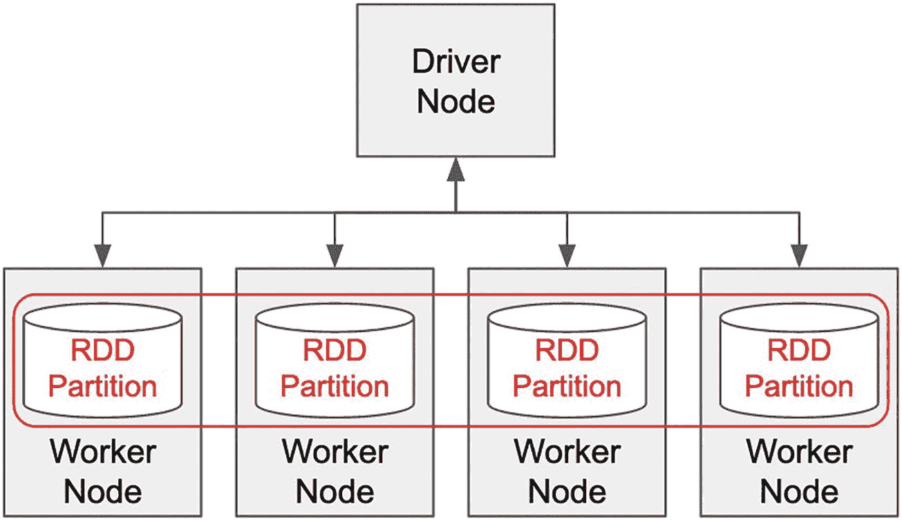
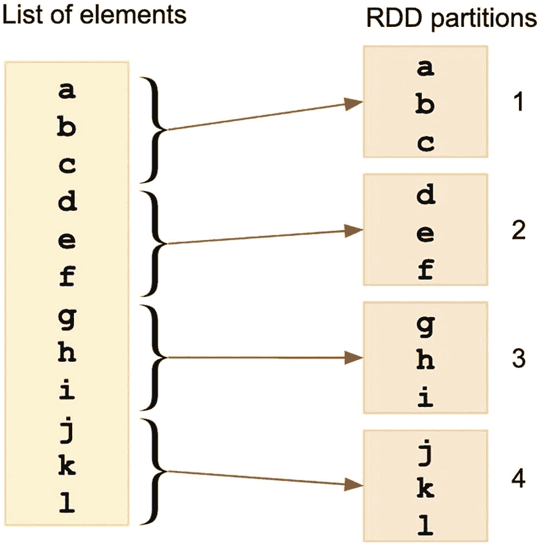
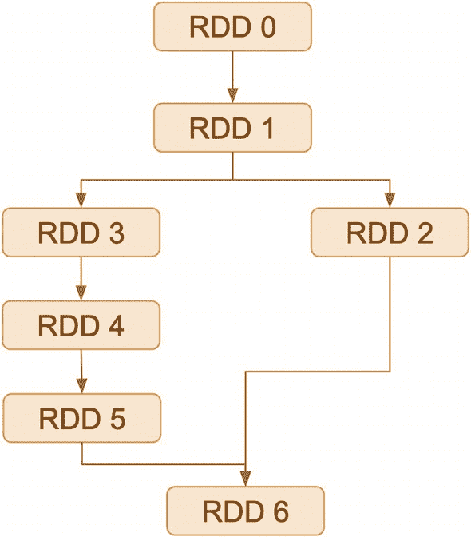
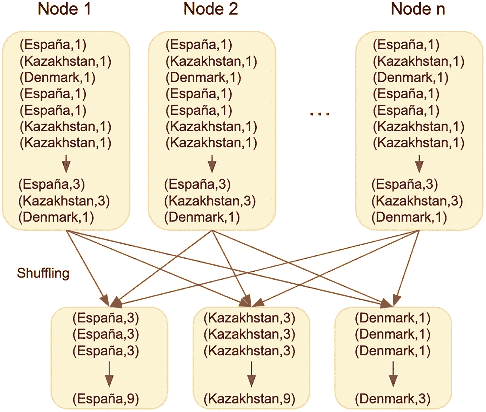
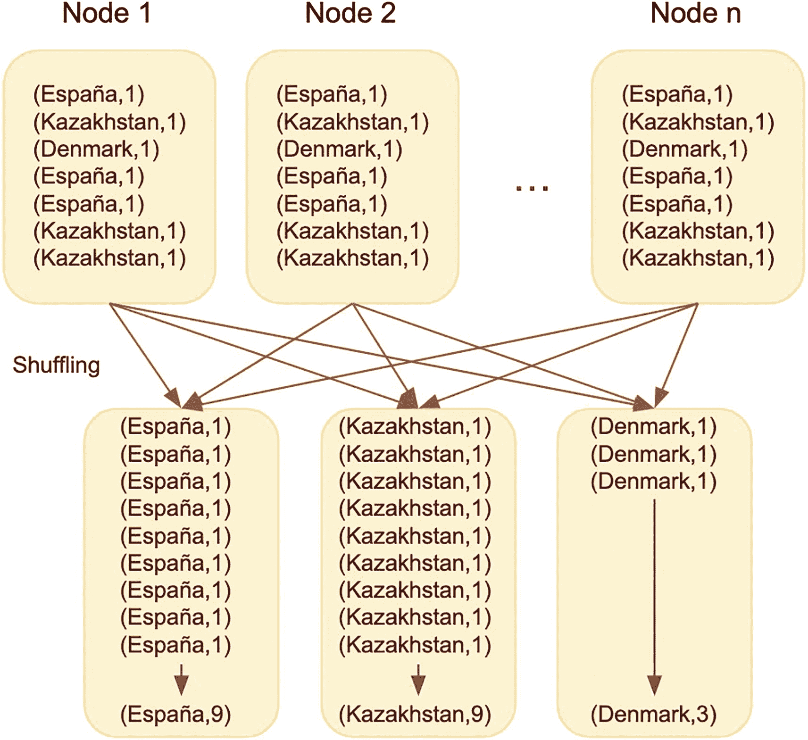
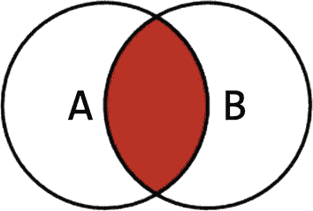
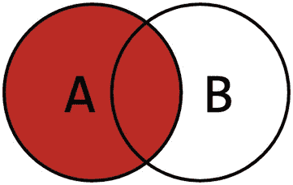
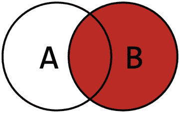
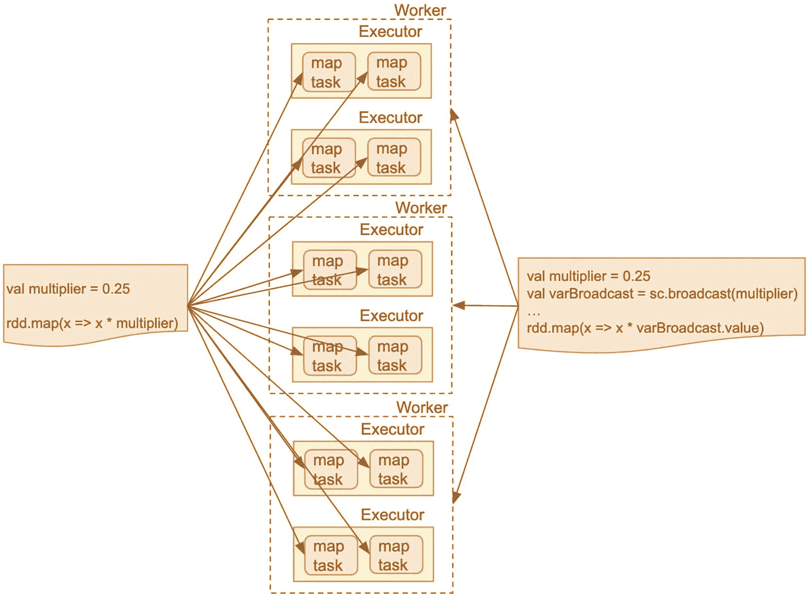
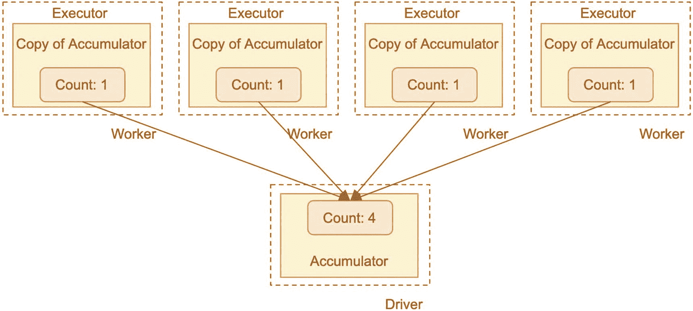

# 3. Spark 底层 API

虽然“应用程序编程接口（API）”这个术语主要用于指代通过网络共享的 Web 服务或资源，但在 Apache Spark 中，它还有另一层含义，指的是用户与框架交互的方式。

Spark 为不同目的提供了多个 API。在本章中，我们将学习所谓的底层 API 或 Spark Core API，它使用户能够直接操作 Spark 弹性分布式数据集（RDD），而 RDD 是 Spark 其他更高级数据结构（如 DataFrame 和 Dataset）的构建基础。

## 3.1 弹性分布式数据集（RDD）

弹性分布式数据集（RDD）、Dataset、DataFrame 和 SQL 表是 Spark 可用的核心抽象；然而，RDD 是 Spark 最主要的核心抽象。RDD 是不可变的对象集合，这意味着一旦创建，它们就无法被更改。*不可变*也意味着对现有 RDD 的任何操作都会返回一个新的 RDD，同时保留原始 RDD。

作为 RDD 处理的数据集被划分为逻辑分区（如图 3-1 所示），这些分区可以使用底层 API 在集群的不同节点上并行处理。为了管理并行处理和逻辑分区，RDD 提供了抽象的概念；因此，您无需担心如何处理它们。其他 Spark 数据实体（如 DataFrame 和 Dataset）都是构建在 RDD 之上的。Spark RDD 支持的操作包括转换操作和行动操作。

此外，RDD 是容错实体，这意味着它们在发生故障时具有自我恢复能力。RDD 运行在容错文件系统上，如 GFS、HDFS、AWS S3 等。如果某个 RDD 分区损坏，操作可以继续，从另一个分区恢复数据。除此之外，当 Spark 在像 YARN 这样的集群中运行时，它还提供了额外的故障保护，因为 Spark 可以从灾难中恢复。

RDD 可以通过并行化现有集合来创建，也可以从外部数据集（如本地文件系统、HDFS、AWS S3、HBase、Cassandra 或任何其他 Hadoop 兼容的输入数据源中的文本文件、序列文件、CSV 文件和 JSON 文件）来创建。



RDD 逻辑分区框图。驱动程序节点被划分为四个工作节点，每个节点都有自己的 RDD 分区。

**图 3-1** RDD 逻辑分区

我们将探讨创建 Spark RDD 的三种方法。

### 从并行化集合创建 RDD

可以通过在驱动程序程序的现有集合上调用 `SparkContext` 的 `parallelize` 方法来创建并行化集合。这样做时，元素集合会被转换为分布式数据集，并且可以并行处理。您可以使用 `sparkContext.parallelize()` 函数从元素集合创建 RDD。

图 3-2 以图形方式展示了 `sparkContext.parallelize()` 函数在将元素列表转换为 RDD 时的工作原理。



一张分为两部分的示意图。左侧是一个从 a 到 l 的元素列表。它们被分成四个相等的部分，每个部分都连接到右侧的 RDD 分区。这些分区被标记为 1、2、3 和 4。

**图 3-2** 使用 `sparkContext.parallelize()` 创建 RDD

接下来，您可以看到如何使用 PySpark 实现图 3-2 中描绘的 RDD：

```
alphabetList = ['a','b','c','d','e','f','g','h','i','j','k','l']
rdd = spark.sparkContext.parallelize(dataList, 4)
print("Number of partitions: "+str(rdd.getNumPartitions()))
Number of partitions: 4
```

以下是另一个示例，这次使用 Scala，演示如何通过并行化数字集合来创建 RDD：

```
// 从并行化集合创建 RDD 的 Scala 示例
val myCollection = Array(1, 2, 3, 4, 5, 6, 7, 8, 9, 10)
val rdd = spark.sparkContext.parallelize(myCollection)
```

请记住上一章的内容，PySpark shell 会自动提供 `SparkContext` 变量“sc”；因此，我们可以使用 `sc.parallelize()` 来创建 RDD：

```
# 从列表集合创建 PySpark RDD
rdd = sc.parallelize([1,2,3,4,5,6,7,8,9,10])
```

现在 `rdd` 是一个可以并行操作的分布式数据集。因此，您可以使用 RDD 函数来操作元素数组：

```
scala> rdd.reduce(_ + _)
res7: Int = 55
scala> rdd.reduce(_ min _)
res8: Int = 1
scala> rdd.reduce(_ max _)
res9: Int = 10
```

并行化集合时的一个重要参数是将数据集切分成的分区数量。Spark 会根据集群的可用资源自动设置此参数；不过，您始终可以指定自己的分区数量，只需将数量作为第二个参数传递给 `sc.parallelize()`（例如，`sc.parallelize(myCollection, 4)`）。


### 从外部数据集创建 RDD

Spark 可以从任何兼容 Hadoop 的数据源创建 RDD，例如：

- 本地文件系统
- HDFS
- Cassandra
- HBase
- AWS S3
- 等等

Spark 支持多种文件格式，例如：

- 文本文件
- Sequence 文件
- CSV 文件
- JSON 文件
- 以及任何 Hadoop 输入格式

可以使用`SparkContext`的`textFile`方法从文本文件创建 RDD。该方法以文件的 URL 作为参数，如果使用本地文件系统，则传入文件路径；如果从分布式文件系统访问，则传入`gs://`、`hdfs://`、`s3://`等 URI。例如，以下代码用于读取本地文件系统中的文件：

```
scala> val readmeFile =
sc.textFile("/YOUR/SPARK/HOME/README.md")
readmeFile: org.apache.spark.rdd.RDD[String] =
/YOUR/SPARK/HOME/README.md MapPartitionsRDD[7] at textFile at :26
```

如果你使用的是本地文件系统中的文件，则该文件必须在所有节点上具有相同的路径。因此，你有两种选择：要么将其复制到每个工作节点，要么使用网络共享文件系统（如 HDFS）。以下是如何加载分布式文件系统中文件的示例：

```
scala> val myFile = sc.textFile("gs://${BUCKET_NAME}/FILE.txt")
```

在处理文件时，通常会将信息分布到多个文件中，因为将所有信息追加到单个文件中可能导致文件大小难以管理，或者你可能希望将信息拆分到不同文件中（例如每个文件都有有意义的名称）。这通常会导致文件夹中包含多个需要共同操作才能获得有意义信息的文件。为简化此操作，Spark 所有基于文件的输入方法都支持文件夹、压缩文件和通配符。例如，前面展示的`textFile()`方法可以这样使用：`textFile("/path/")`、`textFile("/path/*.csv")`、`textFile("/path/*.gz")`等。当使用多个文件作为输入时，Spark 创建的分区顺序取决于文件从文件系统上传的顺序。

你还可以控制读取文件被划分成的分区数量。例如，`textFile()`方法接受第二个参数来指定分区数，如下例所示：

```
scala> val myFile = sc.textFile("/YOUR/SPARK/HOME/README.md", 10)
```

默认情况下，Spark 会将文件数据分割成与文件块数量相同的块，但正如你刚才所见，你可以请求 Spark 将文件划分为更多分区。然而，你不能请求 Spark 创建比文件块数量更少的分区。

除了`textFile()`方法，Spark Scala API 还支持其他输入数据格式。例如，`wholeTextFiles()`方法可用于从 HDFS、本地文件系统或任何其他兼容 Hadoop 的 URI 读取多个小型 UTF-8 编码文本文件。`textFile()`读取一个或多个文件，并返回每个处理文件中每行一条记录，而`wholeTextFiles()`方法读取文件后将其作为键值对（`文件路径`，`文件内容`）返回，从而保留了内容与源文件之间的关联。当`textFile()`同时处理多个文件时，可能不会保留这种关联，因为数据会被打乱并拆分到多个分区中。由于顺序处理文件的过程取决于文件系统返回文件的顺序，因此文件内行的分布不会被保留。

由于每个文件都会加载到内存中，`wholeTextFiles()`更适合处理小文件。此外，`wholeTextFiles()`提供了第二个参数来设置最小分区数。

Apache Spark API 还提供了处理 Hadoop sequence 文件的方法。这种 Hadoop 文件格式旨在存储序列化的键值对。Sequence 文件广泛用作 MapReduce 处理任务的输入和输出格式。Sequence 文件格式提供了多种优势，例如记录级和块级压缩。它们可用于封装大量小文件，从而解决某些文件系统在处理大量小文件时的缺陷。

Apache Spark 还提供了一种将 RDD 保存为序列化 Java 对象的方法，这种格式类似于前面提到的 Hadoop sequence 文件。`RDD.saveAsObjectFile`和`SparkContext.objectFile`方法可用于保存和加载 RDD。`saveAsObjectFile()`使用 Java 序列化将信息存储到文件系统中，并允许在写入文件时保存关于数据类型的元数据信息。以下示例展示了如何使用`saveAsObjectFile()`和`SparkContext.objectFile()`来保存和恢复 RDD 对象：

```
scala> val list = sc.parallelize(List("España","México","Colombia","Perú","Ecuador"))
list: org.apache.spark.rdd.RDD[String] = ParallelCollectionRDD[20] at parallelize at :23
scala> list.saveAsObjectFile("/tmp/SpanishCountries")
scala> val newlist = sc.objectFileString
newlist: org.apache.spark.rdd.RDD[String] = MapPartitionsRDD[24] at objectFile at :23
scala> newlist.collect
res9: Array[String] = Array(Ecuador, España, México, Colombia, Perú)
```

### 从现有 RDD 创建 RDD

请记住，RDD 是不可变的，因此它们无法被更改。但同样请记住，我们可以通过对原始 RDD 应用转换来生成新的 RDD。可以利用转换从另一个 RDD 创建 RDD，例如：`map()`、`filter()`、`count()`、`distinct()`、`flatMap()`等。

以下是如何从现有 RDD 创建新 RDD 的示例。第一步，我们创建一个季节序列。第二步，我们使用`parallelize()`从前面的序列创建一个 RDD，并将其划分为四个分区。第三步，我们从`seasonsParallel` RDD 生成`findSeasons` RDD，方法是提取前一个元素的第一个字母。最后，我们展示`findSeasons` RDD 的内容，并检查`findSeasons`被划分成的分区数量。我们使用`collect()`方法先将 RDD 元素带到驱动节点：

```
scala> val seasonsCollection = Seq("Summer", "Autumn", "Spring", "Winter")
seasonsCollection: Seq[String] = List(Summer, Autumn, Spring, Winter)
scala> val seasonsParallel =spark.sparkContext.parallelize(seasonsCollection,4)
seasonsParallel: org.apache.spark.rdd.RDD[String] = ParallelCollectionRDD[4] at parallelize at :23
scala> val findSeasons= seasonsParallel.map(s => (s.charAt(0), s))
findSeasons: org.apache.spark.rdd.RDD[(Char, String)] = MapPartitionsRDD[5] at map at :23
scala> findSeasons.collect().foreach(c => println(c))
(S,Spring)
(W,Winter)
(S,Summer)
(A,Autumn)
scala> println("Partitions: " + findSeasons.getNumPartitions)
Partitions: 4
```

使用`collect()`是危险的，因为它会从所有工作节点收集所有 RDD 数据到驱动节点；因此，如果整个数据集的大小超出驱动节点内存，你可能会耗尽内存。它也非常低效，因为集群中的所有数据都必须通过网络传输，这比写入磁盘慢得多，并且比内存计算低效得多。如果你只想查看 RDD 的一些样本，使用`take()`方法更安全：

```
scala> findSeasons.take(2).foreach(c => println(c))
(S,Summer)
(A,Autumn)
```


## 3.2 使用键值对

某些 Spark RDD 操作仅适用于键值对数据格式。这些操作被称为 Pair RDD 操作，为此，Spark 提供了多种 Pair RDD 函数，这些函数是 `PairRDDFunctions` 类的成员，用于处理 RDD 键值对。典型的 Pair RDD 意味着对数据进行分布式重组，包括与按键分组或聚合元素相关的 Pair RDD 转换函数。

另一方面，键值对是一种由两个连接的数据元素（键和值）集合表示的数据类型。键是数据对象的唯一标识符。值是属于数据集的变量。键值对的一个例子是电话簿，其中个人或企业的名称是键，电话号码是值。另一个例子是汽车目录，其中汽车可以是键，其属性（型号、颜色等）可以是值。键值对通常用于日志和配置文件。

### 创建 Pair RDD

可以使用返回键值对的 `map()` 函数来创建 Pair RDD。然而，具体过程可能因语言而异。例如，在 Scala 中，要利用 Pair RDD 函数，需要将数据组织成元组形式。下面是一个 Scala 示例，展示如何实现：

```
val spark = SparkSession.builder()
.appName("Hands-On Spark 3")
.master("local[2]")
.getOrCreate()
val currencyListRdd = spark.sparkContext.parallelize(List("USD;Euro;GBP;CHF","CHF;JPY;CNY;KRW","CNY;KRW;Euro;USD","CAD;NZD;SEK;MXN"))
val currenciesRdd = currencyListRdd.flatMap(_.split(";"))
val pairRDD = currenciesRdd.map(c=>(c,1))
pairRDD.foreach(println)
(USD,1)
(Euro,1)
(GBP,1)
(CHF,1)
(CHF,1)
(JPY,1)
(CNY,1)
(KRW,1)
(CNY,1)
(KRW,1)
(Euro,1)
(USD,1)
(CAD,1)
(NZD,1)
(SEK,1)
(MXN,1)
```

上述代码首先使用 `.appName()` 方法创建了一个名为“Hands-On Spark 3”的会话，并通过参数 `local[*n*]` 指定了一个本地集群，其中 *n* 必须大于 0，表示要分配的核心数，即 RDD 默认被分割成的分区数。如果 `SparkSession` 已存在，则 `getOrCreate()` 会返回它；否则，会为我们的程序创建一个新的会话。

接下来，使用 PySpark 重现了相同的示例：

```
currencyList = ["USD;Euro;GBP;CHF","CHF;JPY;CNY;KRW","CNY;KRW;Euro;USD","CAD;NZD;SEK;MXN"]
currencyListRdd = spark.sparkContext.parallelize(currencyList, 4)
currenciesRdd = currencyListRdd.flatMap(lambda x: x.split(";"))
pairRDD = currenciesRdd.map(lambda x: (x,1))
sampleData = pairRDD.take(5)
for f in sampleData:
print(str("("+f[0]) +","+str(f[1])+")")
(USD,1)
(Euro,1)
(GBP,1)
(CHF,1)
(CHF,1)
```

如果你想显示完整列表，可以使用 `collect()` 方法代替 `take()`，如下所示：

```
sampleData = pairRDD.collect()
```

但要小心。在大型数据集中，这可能会导致驱动程序节点出现溢出问题。

### 显示 Pair RDD 的不同键

你可以使用 `distinct()` 来查看 Pair RDD 中的所有不同键。首先，我们展示一个 Scala 代码片段，揭示货币列表中的不同键：

```
pairRDD.distinct().foreach(println)
(MXN,1)
(GBP,1)
(CHF,1)
(CNY,1)
(KRW,1)
(SEK,1)
(USD,1)
(JPY,1)
(Euro,1)
(NZD,1)
(CAD,1)
```

现在，这是另一个使用 PySpark 获得相同结果的代码片段：

```
# 返回不同的键。
sampleData = pairRDD.distinct().collect()
for f in sampleData:
print(str("("+f[0]) +","+str(f[1])+")")
(GBP,1)
(MXN,1)
(CNY,1)
(KRW,1)
(USD,1)
(Euro,1)
(CHF,1)
(JPY,1)
(CAD,1)
(NZD,1)
(SEK,1)
```

如前面的示例所示，返回的键不一定是有序的。如果你希望返回的数据按键排序，可以使用 `sorted()` 方法。以下是一个示例，展示如何实现：

```
sampleData = sorted(pairRDD.distinct().collect())
for f in sampleData:
print(str("("+f[0]) +","+str(f[1])+")")
(CAD,1)
(CHF,1)
(CNY,1)
(Euro,1)
(GBP,1)
(JPY,1)
(KRW,1)
(MXN,1)
(NZD,1)
(SEK,1)
(USD,1)
```

### Pair RDD 上的转换

在本节中，我们将回顾一些可以在 Pair RDD 上执行的重要转换。

我们已经提到 RDD 本质上是不可变的；因此，在 RDD 上执行的转换操作会返回一个或多个新的 RDD，而不会修改原始 RDD，从而创建 RDD 血统，Spark 利用它来优化代码执行并从故障中恢复。Apache Spark 利用 RDD 血统来重建丢失的 RDD 分区。RDD 血统或 RDD 依赖关系图的图形表示如图 3-3 所示。



一个数据结构从 R D D 0 开始，然后进入 R D D 1，R D D 1 进一步分为 R D D 3 和 R D D 2。R D D 3 被分解为 R D D 4 和 R D D 5。然后 R D D 5 和 R D D 2 连接到 R D D 6。

图 3-3

Apache Spark RDD 血统示例

#### 按键对 Pair RDD 排序

`sortByKey()` 方法对 Pair RDD 进行排序。在 Scala 中，可以这样编写：

```
pairRDD.sortByKey().foreach(println)
(KRW,1)
(KRW,1)
(CNY,1)
(CNY,1)
(GBP,1)
(NZD,1)
(JPY,1)
(MXN,1)
(Euro,1)
(Euro,1)
(SEK,1)
(USD,1)
(USD,1)
(CAD,1)
(CHF,1)
(CHF,1)
```

`sortByKey()` 接受两个参数：升序（`true`/`false`）排序和 `numPartitions`，用于设置 `sortByKey()` 返回的结果应创建的分区数：

```
pairRDD.sortByKey(true).foreach(println)
```

在 PySpark 中，我们可以使用以下代码片段来获得相同的结果：

```
sampleData = pairRDD.sortByKey().collect()
for f in sampleData:
print(str("("+f[0]) +","+str(f[1])+")")
(CAD,1)
(CHF,1)
(CHF,1)
(CNY,1)
(CNY,1)
(Euro,1)
(Euro,1)
(GBP,1)
(JPY,1)
(KRW,1)
(KRW,1)
(MXN,1)
(NZD,1)
(SEK,1)
(USD,1)
(USD,1)
```


#### 在 RDD 中按键添加值

Spark 的 `PairRDDFunction` 中的 `reduceByKey()` 是一种宽转换，它会混洗所有 RDD 分区的数据。它使用关联的归约函数合并 RDD 中每个键的值。`reduceByKey()` 针对大型数据集进行了优化，因为 Spark 可以在混洗信息之前按键合并输出。

`reduceByKey()` 的语法如下：

```
sparkContext.textFile("hdfs://")
.flatMap(line => line.split("ELEMENT_SEPARATOR"))
.map(element => (element,1))
.reduceByKey((a,b)=> (a+b))
```

为了说明此函数的功能，我们将使用[《拉曼查的堂吉诃德》](https://www.gutenberg.org/cache/epub/996/pg996.txt)的一部分来获得一个更大的数据集。你已经了解了如何加载文件并将其转换为 RDD。那么，让我们从一个 Scala 示例开始：

```
val DonQuixoteRdd = spark.sparkContext.textFile("DonQuixote.txt")
DonQuixoteRdd.foreach(println)
// 你会看到类似这样的输出
saddle the hack as well as handle the bill-hook. The age of this
In a village of La Mancha, the name of which I have no desire to call
gentleman of ours was bordering on fifty; he was of a hardy habit,
spare, gaunt-featured, a very early riser and a great sportsman. They
to mind, there lived not long since one of those gentlemen that keep a
will have it his surname was Quixada or Quesada (for here there is some
lance in the lance-rack, an old buckler, a lean hack, and a greyhound
difference of opinion among the authors who write on the subject),
for coursing. An olla of rather more beef than mutton, a salad on most
although from reasonable conjectures it seems plain that he was called
nights, scraps on Saturdays, lentils on Fridays, and a pigeon or so
Quexana. This, however, is of but little importance to our tale; it
extra on Sundays, made away with three-quarters of his income. The rest
of it went in a doublet of fine cloth and velvet breeches and shoes to
will be enough not to stray a hair's breadth from the truth in the
telling of it.
match for holidays, while on week-days he made a brave figure in his
best homespun. He had in his house a housekeeper past forty, a niece
under twenty, and a lad for the field and market-place, who used to
val wordsDonQuixoteRdd = DonQuixoteRdd.flatMap(_.split(" "))
val tupleDonQuixoteRdd = wordsDonQuixoteRdd.map(w => (w,1))
val reduceByKeyDonQuixoteRdd = tupleDonQuixoteRdd.reduceByKey((a,b)=>a+b)
// 最后，你可以看到按键合并并相加后的值。
// 输出已被截断。
reduceByKeyDonQuixoteRdd.foreach(println)
(Quesada,1)
(went,1)
(under,1)
(call,1)
(this,1)
...
(made,2)
(it,4)
(on,7)
(he,3)
(in,5)
(for,3)
(the,9)
(a,15)
(or,2)
(was,4)
(to,6)
(breeches,1)
(more,1)
(of,13)
println("Count : "+reduceByKeyDonQuixoteRdd.count())
Count : 157
```

和往常一样，你可以使用 PySpark 代码实现相同的结果。让我用一个示例向你展示。在这种情况下，大部分输出已被抑制，但请相信我，最终结果是相同的：

```
DonQuixoteRdd = spark.sparkContext.textFile("DonQuixote.txt")
DonQuixoteRdd2 = DonQuixoteRdd.flatMap(lambda x: x.split(" "))
DonQuixoteRdd3 = DonQuixoteRdd2.map(lambda x: (x,1))
DonQuixoteRddReduceByKey = DonQuixoteRdd3.reduceByKey(lambda x,y: x+y)
print("Count : "+str(DonQuixoteRddReduceByKey.count()))
Count : 157
```

#### 将 RDD 保存为文本文件

虽然将现有 RDD 保存到文件是一种行动而非转换，但我们在此介绍它，是为了利用 DonQuixote RDD 向你展示如何将内存中的数据保存到容错设备中。

你可以使用 `saveAsTextFile()` 方法将 RDD 保存为元素的字符串表示形式。`saveAsTextFile()` 会将 RDD 存储为文本文件。

`saveAsTextFile(path: str, compressionCodecClass: Optional)` 可以接受两个参数。其中一个是必填的，即 *path*，根据官方文档，它代表“*文本文件的路径*”；但实际上，它是一个文件夹。Spark 将 RDD 分割成不同的文件写入，并附带一个成功文件（`_success`）。这些文件被命名为 `part-00000`、`part-00001`，依此类推。

`compressionCodecClass` 允许指定一个压缩编解码器来压缩存储你的数据。

继续我们的 DonQuixote 示例，让我们将 RDD 写入一个文件：

```
reduceByKeyDonQuixoteRdd.saveAsTextFile("RDDDonQuixote")
```

你也可以创建一个临时目录来存储文件，并且不让操作系统决定该目录的位置，而是由你控制这些参数。以下是一个 PySpark 示例：

```
import tempfile
from tempfile import NamedTemporaryFile
tempfile.tempdir = "./"
RDDDonQuixote = NamedTemporaryFile(delete=True)
RDDDonQuixote.close()
DonQuixoteRdd3.saveAsTextFile(RDDDonQuixote.name)
print(RDDDonQuixote)
print(RDDDonQuixote.name)
# 输出

/Users/aantolinez/tmp906w7eoy
from fileinput import input
from glob import glob
''.join(sorted(input(glob(RDDDonQuixote.name + "/part-0000*"))))
# 输出
"('(for', 1)\n('An', 1)\n('Fridays,', 1)\n('He', 1)\n('I', 1)\n('In', 1)\n('La', 1)\n('Mancha,', 1)\n('Quesada', 1)\n('Quexana.', 1)\n('Quixada', 1)\n('Saturdays,', 1)\n('Sundays,', 1)\n('The', 1)\n('The', 1)\n('They', 1)\n('This,', 1)\n('a', 1)\n('a', 1)\n('a', 1)\n('a', 1)\n('a', 1)\n('a', 1)\n('a', 1)\n..."
```

在前面的示例中，我们使用了 `NamedTemporaryFile()` 函数在文件系统中创建一个具有可见名称的文件。`delete` 参数可以接受 `True/False` 值。将其设置为 `False`，我们可以在不销毁文件的情况下关闭它，从而允许我们稍后重新打开它。


#### 在每个分区内合并数据

处理键值对时最常见的问题之一就是根据标准键对值进行分组和聚合。在本节中，我们将使用 `aggregateByKey()` 函数在每个分区内聚合数据。

与 `reduceByKey()` 类似，`aggregateByKey()` 会在数据被混洗之前，在每个分区内根据公共键合并数据；然而，`reduceByKey()` 在某种意义上可以看作是 `aggregateByKey()` 的一个特例，因为它在单个分区内合并的结果与所合并的值类型相同。在合并这些单个分区的输出后，最终结果的类型也与单个分区的值的类型相同。

`aggregateByKey()` 根据键合并数据集的值，并且此合并的输出可以是任何用户定义的对象。使用 `aggregateByKey()`，您可以指定如何在分区级别（在每个工作节点内部）合并值，然后，如何将这些分区的各个输出在集群的节点之间组合起来，以提供最终结果。

我们将通过一个示例来解释这个概念以及 `reduceByKey()` 和 `aggregateByKey()` 之间的区别。

假设您有以下数据集：`(("a", 1), ("a", 3), ("b", 2), ("a", 5), ("b", 4), ("a", 7), ("b", 6))`。

首先，我们将根据上述数据创建一个 RDD：

```
val pairs = sc.parallelize(Array(("a", 1), ("a", 3), ("b", 2), ("a", 5), ("b", 4), ("a", 7), ("b", 6)))
pairs: org.apache.spark.rdd.RDD[(String, Int)] = ParallelCollectionRDD[82] at parallelize at :25
```

如果您只想通过求和来按键添加值，那么 `reduceByKey` 和 `aggregateByKey` 都会产生相同的结果。您可以在下面看到一个示例：

```
val outputReduceByKey = pairs.reduceByKey(_ + _)
outputReduceByKey.collect
outputReduceByKey: org.apache.spark.rdd.RDD[(String, Int)] = ShuffledRDD[87] at reduceByKey at :28
res49: Array[(String, Int)] = Array((a,16), (b,12))
val outputAggregateByKey = pairs.aggregateByKey(0)(_+_,_+_)
//_+_ 操作在分区内执行，_+_ 操作在分区之间执行
outputAggregateByKey.collect
outputAggregateByKey: org.apache.spark.rdd.RDD[(String, Int)] = ShuffledRDD[88] at aggregateByKey at :27
res50: Array[(String, Int)] = Array((a,16), (b,12))
```

现在假设您对另一种类型的操作感兴趣，这种操作返回的值与原始值的类型不同。例如，假设您期望的输出是一组值，其数据类型与值本身（整数）不同，并且分区内的操作（整数求和返回另一个整数）也不同。

接下来，我们通过一个示例来解释这个想法：

```
val outcomeSets = pairs.aggregateByKey(new HashSet[Int])(_+_, _++_)
// _+_ 将一个值添加到一个集合中
// _++_ 合并两个集合
outcomeSets.collect
res52: Array[(String, scala.collection.mutable.HashSet[Int])] = Array((a,Set(1, 5, 3, 7)), (b,Set(2, 6, 4)))
```

#### 使用中性零值合并值

`foldByKey()` 聚合是一种 `reduceByKey()`，它带有一个不应影响最终结果的初始化零值。与 `reduceByKey()` 一样，它使用一个关联函数来合并每个 RDD 键的值，但此外，它还允许为每个分区提供一个中性的初始化值，例如加法用 0，乘法用 1，或者列表拼接时用空列表，这个值可以任意次数地添加到最终结果中，而不会影响最终结果。零值在每个分区中为每个键初始化一次。

下面您可以看到一些 `foldByKey()` 的使用示例：

```
val pairs = sc.parallelize(Array(("a", 1), ("a", 3), ("b", 2), ("a", 5), ("b", 4), ("a", 7), ("b", 6)))
pairs: org.apache.spark.rdd.RDD[(String, Int)] = ParallelCollectionRDD[82] at parallelize at :25
pairs.foldByKey(0)(_+_).collect // 使用初始值 0
res66: Array[(String, Int)] = Array((a,24), (b,18))
pairs.foldByKey(1)(_+_).collect // 使用初始值 1
res68: Array[(String, Int)] = Array((a,20), (b,15))
pairs.foldByKey(2)(_+_).collect // 使用初始值 2
res66: Array[(String, Int)] = Array((a,24), (b,18))
```

#### 使用自定义聚合函数按键合并元素

在本节中，我们将解释 Spark 的 `combineByKey()` 通用函数，该函数使用自定义聚合函数按每个键合并配对 RDD 的元素。`combineByKey()` 是一个宽转换，因为它在最后阶段需要一次混洗。此函数将 `RDD[(K, V)]` 转换为类型为 `RDD[(K, C)]` 的结果，其中 C 是“合并类型”，C 是对键 K 的所有值进行任何聚合的结果。

下面您可以看到一个如何使用 `combineByKey()` 的 PySpark 示例：

```
pairs = sc.parallelize([("a", 1), ("a", 3), ("b", 2), ("a", 5), ("b", 4), ("a", 7), ("b", 6)])
def to_list(x):
return [x]
def append(x, y):
x.append(y) # append() 方法将 y 元素添加到 x 列表。
return x
def extend(x, y):
x.extend(y) # extend() 方法将列表 y 的元素添加到 x 列表的末尾。
return x
sorted(pairs.combineByKey(to_list, append, extend).collect())
[('a', [1, 3, 5, 7]), ('b', [2, 4, 6])]
```

#### 在配对 RDD 上对数据进行分组

处理键值对数据集时，一个常见的用例是将所有对应相同键的值分组。`groupByKey()` 方法通过按每个键对值进行分组，返回一个分组的 RDD。`groupByKey()` 需要一个函数，该函数将应用于 RDD 的每个值。

在下面的示例中，我们将一个 Scala 集合类型转换为 Spark RDD：

```
// 包含元组键值对的 Scala 集合
val countriesTuples = Seq(("España",1),("Kazakhstan",1), ("Denmark", 1),("España",1),("España",1),("Kazakhstan",1),("Kazakhstan",1))
// 将集合转换为 RDD。
val countriesDs = spark.sparkContext.parallelize(countriesTuples)
// 输出
countriesTuples: Seq[(String, Int)] = List((España,1), (Kazakhstan,1), (Denmark,1), (España,1), (España,1), (Kazakhstan,1), (Kazakhstan,1))
countriesDs: org.apache.spark.rdd.RDD[(String, Int)] = ParallelCollectionRDD[32] at parallelize at :29
countriesDs.collect.foreach(println)
// 输出
(España,1)
(Kazakhstan,1)
(Denmark,1)
(España,1)
(España,1)
(Kazakhstan,1)
(Kazakhstan,1)
```

现在，我们将使用 `groupByKey()` 方法按键对值进行分组：

```
// 在配对 RDD 上应用转换。
val groupRDDByKey = countriesDs.groupByKey()
// 输出
groupRDDByKey: org.apache.spark.rdd.RDD[(String, Iterable[Int])] = ShuffledRDD[34] at groupByKey at :26
groupRDDByKey.collect.foreach(println)
// 输出
(España,CompactBuffer(1, 1, 1))
(Kazakhstan,CompactBuffer(1, 1, 1))
(Danish,CompactBuffer(1))
```

正如您在前面的代码中看到的，`groupByKey()` 根据每个键对数据进行分组，并返回一个迭代器。请注意，与 `reduceByKey()` 不同，`groupByKey()` 函数不对最终输出执行任何操作；它只对数据进行分组，并以迭代器的形式返回。这个迭代器可用于将键值 RDD 转换为任何类型的集合，例如 List 或 Set。

现在想象一下，您想知道每个国家出现的次数，然后您想将之前的 `CompactBuffer` 格式转换为 List：

```
// 每个国家出现的次数，并将 CompactBuffer 转换为 List。
val countryCountRDD = groupRDDByKey.map(tuple => (tuple._1, tuple._2.toList.sum))
countryCountRDD.collect.foreach(println)
// 输出
(España,3)
(Kazakhstan,3)
(Danish,1)
```


#### `groupByKey` 的性能考量

在某些情况下，`groupByKey()` 并非解决特定问题的最佳选择。例如，在处理非常大的数据集时，`reduceByKey()` 的性能优于 `groupByKey()`。虽然这两个函数都能给出相同的结果，但对于大型数据集，`reduceByKey()` 是更优的选择，因为后者在 Spark 于每个分区按键合并值之前，会执行一次常规的 shuffle 操作（如你所知，这涉及数据在网络中的移动），因此在性能方面代价高昂。

让我们通过一个典型的单词计数示例，更详细地了解这些性能问题。该示例首先在分布式数据集上使用 `reduceByKey()`，然后使用 `groupByKey()`：

```
val countriesList = List("España","Kazakhstan", "Denmark","España","España","Kazakhstan","Kazakhstan")
val countriesDs = spark.sparkContext.parallelize(countriesList)
// 输出
countriesList: List[String] = List(España, Kazakhstan, Denmark, España, España, Kazakhstan, Kazakhstan)
countriesDs: org.apache.spark.rdd.RDD[String] = ParallelCollectionRDD[39] at parallelize at :28
val countryPairsRDD = sc.parallelize(countriesList).map(country => (country, 1))
val countryCountsWithReduce = countryPairsRDD
.reduceByKey(_ + _) // reduceByKey()
.collect()
val countryCountsWithGroup = countryPairsRDD
.groupByKey() // groupByKey()
.map(t => (t._1, t._2.sum))
.collect()
// 输出
countryPairsRDD: org.apache.spark.rdd.RDD[(String, Int)] = MapPartitionsRDD[51] at map at :27
countryCountsWithReduce: Array[(String, Int)] = Array((España,3), (Kazakhstan,3), (Denmark,1))
countryCountsWithGroup: Array[(String, Int)] = Array((España,3), (Kazakhstan,3), (Denmark,1))
```

这两个函数都会产生相同的结果；然而，`reduceByKey()` 在大型数据集上表现更好，因为 Spark 可以在数据跨集群节点进行 shuffle 之前，在每个分区上合并具有相同键的输出。`reduceByKey()` 使用一个 lambda 函数，在数据被 shuffle 之前，在每个节点上按每个键合并值；之后，它在分区级别合并数据。该 lambda 函数再次被用于归约每个分区返回的值，以获得最终结果。这种行为如图 3-4 所示。



一个图表包含三个块，分别标记为节点 1、2 和 n，其中包含诸如 España、Denmark 和 Kazakhstan 等值。底部的三个块表示 shuffle 后每个块中的每个值。

**图 3-4** — `reduceByKey` 内部操作

另一方面，当你使用 `groupByKey()` 时，每个分区上的键值对会在集群的节点之间进行 shuffle。当处理大型数据集时，这种行为会导致大量数据在网络中不必要的移动，从而造成显著的处理开销。

在大型数据集中避免使用 `groupByKey()` 的另一个原因是，驱动节点可能出现内存不足（`OutOfMemoryError`）的情况。请记住，当数据量无法容纳在内存中时，Spark 必须将数据写入磁盘。当单个执行器机器接收的数据量超过其内存容量时，就会发生内存不足的情况，导致内存溢出。Spark 一次将一个键的数据保存到磁盘；因此，将数据刷出到永久存储设备的过程会严重干扰 Spark 的操作。

因此，数据集越大，出现内存不足问题的可能性就越大。因此，对于大型数据集，通常 `reduceByKey()`、`combineByKey()`、`foldByKey()` 或其他函数比 `groupByKey()` 更可取。

`groupByKey()` 的内部操作模式如图 3-5 所示。



一个图表包含三个块，分别标记为节点 1、2 和 n，每个块中包含诸如 España、Denmark 和 Kazakhstan 等值。底部的三个块表示 shuffle 后每个块中的每个值。

**图 3-5** — `groupByKey` 内部操作

#### 键值对 RDD 上的连接操作

当你将键值对 RDD 与其他键值对 RDD 组合时，可以充分利用它们的优势。组合不同的数据集可以释放 Apache Spark 真正的分析能力，并让你发现数据中的洞察。连接 RDD 可能是你在键值对 RDD 上必须执行的最典型操作之一。

##### 返回两个 RDD 中都存在的键

`join()` 在对两个 RDD 应用连接转换后返回一个 RDD。返回的 RDD 仅包含两个键值对 RDD 中都存在的键。`join()` 返回的 RDD 如图 3-6 所示。



一个包含集合 A 和 B 的维恩图。中心部分被阴影覆盖。

**图 3-6** — `join()` 转换的结果集

```
val rdd1 = sc.parallelize(Array(("PySpark",10),("Scala",15),("R",100)))
val rdd2 = sc.parallelize(Array(("Scala",11),("Scala",20),("PySpark",75), ("PySpark",35)))
val joinedRDD = rdd1.join(rdd2)
joinedRDD.foreach(println)
// 输出
(Scala,(15,11))
(Scala,(15,20))
(PySpark,(10,75))
(PySpark,(10,35))
```

使用 PySpark 代码也可以获得相同的结果，如下所示：

```
rdd1 = spark.sparkContext.parallelize([("PySpark",10),("Scala",15),("R",100)])
rdd2 = spark.sparkContext.parallelize([("Scala",11),("Scala",20),("PySpark",75), ("PySpark",35)])
joinedRDD = rdd1.join(rdd2)
print(joinedRDD.collect())
# 输出
[('Scala', (15, 11)), ('Scala', (15, 20)), ('PySpark', (10, 75)), ('PySpark', (10, 35))]
```

##### 返回源 RDD 中存在的键

`leftOuterJoin()` 返回一个键值对 RDD，其中包含源（左）RDD 中每个键的条目。返回的 RDD 包含源（左）RDD 中找到的键，以及一个元组，该元组是源 RDD 中的值与另一个键值对 RDD（右）中该键的某个值的组合。换句话说，`leftOuterJoin()` 返回左（A）RDD 中的所有记录以及右（B）RDD 中匹配的记录。

`leftOuterJoin()` 返回的 RDD 如图 3-7 所示。



一个包含集合 A 和 B 的维恩图。集合 A 被阴影覆盖。它表示左外连接。

**图 3-7** — `leftOuterJoin()` 转换的结果集

下面，你可以看到如何在 Scala 中应用 `leftOuterJoin()`：

```
val leftJoinedRDD = rdd1.leftOuterJoin(rdd2)
leftJoinedRDD.foreach(println)
// 输出
(R,(100,None))
(Scala,(15,Some(11)))
(Scala,(15,Some(20)))
(PySpark,(10,Some(75)))
(PySpark,(10,Some(35)))
```

使用 PySpark 代码将获得相同的结果，如下所示：

```
rdd1 = spark.sparkContext.parallelize([("PySpark",10),("Scala",15),("R",100)])
rdd2 = spark.sparkContext.parallelize([("Scala",11),("Scala",20),("PySpark",75), ("PySpark",35)])
joinedRDD = rdd1.leftOuterJoin(rdd2)
print(joinedRDD.collect())
# 输出
[('R', (100, None)), ('Scala', (15, 11)), ('Scala', (15, 20)), ('PySpark', (10, 75)), ('PySpark', (10, 35))]
```


##### 返回参数 RDD 中存在的键

`rightOuterJoin()` 与 `leftOuterJoin()` 相同，区别在于它返回一个包含另一个（右侧）RDD 中每个键的条目的键值对 RDD。返回的 RDD 包含在另一个（右侧）RDD 中找到的键，以及一个元组，该元组是另一个（右侧）RDD 中的值与源（左侧）键值对 RDD 中该键的某个值的组合。换句话说，`rightOuterJoin()` 返回右侧 RDD (B) 中的所有记录以及左侧 RDD (A) 中匹配的记录。

`rightOuterJoin()` 返回的 RDD 如图 3-8 所示。



一个包含集合 A 和 B 的维恩图。集合 B 被着色。它表示右外连接。

**图 3-8** `rightOuterJoin()` 转换的结果集

让我们看看如何在 Scala 代码片段中应用 `rightOuterJoin()`：

```
rdd1 = spark.sparkContext.parallelize([("PySpark",10),("Scala",15),("R",100)])
rdd2 = spark.sparkContext.parallelize([("Scala",11),("Scala",20),("PySpark",75), ("PySpark",35)])
joinedRDD = rdd1.rightOuterJoin(rdd2)
print(joinedRDD.collect())
# 输出
[('Scala', (15, 11)), ('Scala', (15, 20)), ('PySpark', (10, 75)), ('PySpark', (10, 35))]
```

同样，你可以使用 PySpark 代码获得相同的结果，如下所示：

```
rdd1 = spark.sparkContext.parallelize([("PySpark",10),("Scala",15),("R",100)])
rdd2 = spark.sparkContext.parallelize([("Scala",11),("Scala",20),("PySpark",75), ("PySpark",35)])
joinedRDD = rdd1.leftOuterJoin(rdd2)
print(joinedRDD.collect())
# 输出
[('R', (100, None)), ('Scala', (15, 11)), ('Scala', (15, 20)), ('PySpark', (10, 75)), ('PySpark', (10, 35))]
```

#### 对键值对 RDD 进行排序

要按升序或降序对 RDD 的值按键排序，可以使用 Apache Spark 的 `sortByKey()` 转换。

Spark RDD `sortByKey()` 转换的语法如下：

`RDD.sortByKey(*ascending*: Optional[bool] = True, *numPartitions*: Optional[int] = None, keyfunc: Callable[[Any], Any] = <function RDD.<lambda>>) → *pyspark.rdd.RDD[Tuple[K, V]]*`

Spark RDD `sortByKey()` 转换的 *ascending* 选项指定排序顺序（默认为升序，或设置为 *true* 时）；对于降序，只需将其设置为 *false*。*numPartitions* 选项指定结果应分成的分区数。`sortByKey()` 转换返回一个数据元组。

现在，让我们通过一个实际示例来看看 `sortByKey()` 的实际应用：

```
val rdd2 = sc.parallelize(Array(("Scala",11),("Scala",20),("PySpark",75), ("PySpark",35)))
rdd1.sortByKey(true).foreach(println) // 升序 (true)
// 输出
(R,100)
(PySpark,10)
(Scala,15)
rdd1.sortByKey(false).foreach(println) // 降序 (false)
// 输出
(PySpark,10)
(R,100)
(Scala,15)
```

#### 按给定键函数对 RDD 进行排序

另一个非常重要的 Apache Spark 转换是 `sortBy()`：

```
RDD.sortBy(keyfunc: Callable[[T], S], ascending: bool = True, numPartitions: Optional[int] = None) → RDD[T]
```

`sortBy()` 函数接受三个参数。第一个是提供的键函数 (*keyfunc*)，它根据指定的键对 RDD 进行排序并返回另一个 RDD。

第二个是一个标志，指定结果应以升序还是降序返回。默认是升序 (true)。

第三个参数 (*numPartitions*) 指定结果将被划分成的总分区数。*numPartitions* 是一个重要的优化参数，因为 `sortBy()` 涉及 RDD 元素的混洗，我们已经知道这可能导致不必要的数据移动。

现在，让我们通过一个示例来看看 `sortBy()` 是如何工作的，该示例利用了之前示例中创建的 RDD1：

```
val rdd1 = sc.parallelize(Array(("PySpark",10),("Scala",15),("R",100)))
rdd1.sortBy(x => x._1).collect().foreach(println)
(PySpark,10)
(R,100)
(Scala,15)
// 输出
(PySpark,10)
(R,100)
(Scala,15)
// 现在使用元组的值对数据进行排序
rdd1.sortBy(x => x._2).collect().foreach(println)
// 输出
(PySpark,10)
(Scala,15)
(R,100)
```

### 对键值对 RDD 的操作

正如我们在本书前面所解释的，Spark 操作是返回原始值的 RDD 操作。而 RDD 上的转换返回一个新的 RDD 并保留原始 RDD，操作则返回一个值。因此，在 RDD 上执行的任何返回非新 RDD 的操作都是操作。

然后，你还必须记住，RDD 操作能够触发在 DAG（有向无环图）中定义的代码片段的有效执行。因此，虽然 Spark 转换被认为是惰性的，意味着它们在定义后不会立即执行，但操作不是。

让我们看看一些最重要的 Spark 操作。

#### 按键统计 RDD 实例

`countByKey()` 统计 RDD 中每个键的元素数量，并返回一个 `DefaultDict[key,int]`。

`DefaultDict` 是一个类似字典的对象，尝试访问字典中不存在的值将返回 0，而不是抛出错误。

让我们通过一个 Scala 示例来看看它是如何工作的。考虑之前示例中使用的以下键值对 RDD：

```
val rdd2 = sc.parallelize(Array(("Scala",11),("Scala",20),("PySpark",75), ("PySpark",35)))
rdd2.countByKey()
// 输出
res48: scala.collection.Map[String,Long] = Map(PySpark -> 2, Scala -> 2)
rdd2.countByKey().foreach(println)
// 输出
(PySpark,2)
(Scala,2)
```

你可以像访问普通字典一样访问 `elementsCount` 字典的元素：

```
val elementsCount = rdd2.countByKey()
println(elementsCount("Scala"))
// 输出

```

现在你将看到相同的示例，但这次使用的是 PySpark：

```
rdd2 = spark.sparkContext.parallelize([("Scala",11),("Scala",20),("PySpark",75), ("PySpark",35)])
rdd2.collect()
# 输出
[('Scala', 11), ('Scala', 20), ('PySpark', 75), ('PySpark', 35)]
# 按键分组，并获取每个组的计数
rdd2.countByKey()
# 输出
defaultdict(int, {'Scala': 2, 'PySpark': 2})
elementsCount = rdd2.countByKey()
print(elementsCount)
#输出
defaultdict(, {'Scala': 2, 'PySpark': 2})
```

现在你可以像访问普通字典一样访问 `elementsCount` 字典的元素：

```
elementsCount['Scala']
# 输出

```

尝试访问 `elementsCount` 中不存在的值将返回 0：

```
elementsCount['SQL']
# 输出

```

#### 按值统计 RDD 实例

Spark 的 `countByValue()` 方法统计 RDD 中每个唯一值，返回一个值-计数对的字典。

下面，你可以看到 `countByValue()` 如何与 Scala 示例一起工作：

```
println(rdd2.countByValue())
//输出:
Map((PySpark,35) -> 1, (Scala,11) -> 1, (Scala,20) -> 1, (PySpark,75) -> 1)
```

继续我们之前的 RDD 示例，现在我们将看到如何使用 PySpark 的 `countByValue()`：

```
rdd2 = spark.sparkContext.parallelize([("Scala",11),("Scala",20),("PySpark",75), ("PySpark",35)])
sorted(rdd2.countByValue().items())
# 输出
[(('PySpark', 35), 1),
(('PySpark', 75), 1),
(('Scala', 11), 1),
(('Scala', 20), 1)]
```


#### 将键值对作为字典返回

RDD 的 `collectAsMap()` 方法会收集驱动节点上配对 RDD 的所有元素，并将 RDD 中的键值对以字典形式返回。

我们将在以下 Scala 代码片段中看到此方法的用法：

```
val rdd1 = sc.parallelize(Array(("PySpark",10),("Scala",15),("R",100)))
val rdd1 = sc.parallelize(Array(("PySpark",10),("Scala",15),("R",100)))
rdd1.collectAsMap()
// 输出
res62: scala.collection.Map[String,Int] = Map(R -> 100, Scala -> 15, PySpark -> 10)
```

但是，如果存在重复的键，则最后一个键值对将覆盖之前的键值对。在下面的示例中，元组 `("Scala",11)` 已被 `("Scala",20)` 覆盖：

```
rdd2.collectAsMap()
// 输出
res63: scala.collection.Map[String,Int] = Map(Scala -> 20, PySpark -> 35)
```

以下是相同的示例，但这次使用的是 PySpark：

```
rdd1 = spark.sparkContext.parallelize([("PySpark",10),("Scala",15),("R",100)])
rdd2 = spark.sparkContext.parallelize([("Scala",11),("Scala",20),("PySpark",75), ("PySpark",35)])
rdd1.collectAsMap()
# 输出
{'PySpark': 10, 'Scala': 15, 'R': 100}
```

请记住，如果存在重复的键，则最后一个键值对将覆盖之前的键值对。在下面的示例中，元组 `("Scala",11)` 已被 `("Scala",20)` 覆盖：

```
rdd2.collectAsMap()
# 输出
{'Scala': 20, 'PySpark': 35}
```

#### 收集与某个键关联的所有值

Apache Spark 的 `lookup(key)` 方法是一个动作，它会返回与给定键关联的所有值，并以列表形式呈现。该方法接受一个键名作为参数：

```
val rdd2 = sc.parallelize(Array(("Scala",11),("Scala",20),("PySpark",75), ("PySpark",35)))
rdd2.lookup("PySpark")
// 输出
res66: Seq[Int] = WrappedArray(75, 35)
```

另一个 PySpark 代码片段展示了相同的结果：

```
rdd2 = spark.sparkContext.parallelize([("Scala",11),("Scala",20),("PySpark",75), ("PySpark",35)])
rdd2.lookup("PySpark")
# 输出
[75, 35]
```

## 3.3 Spark 共享变量：广播变量与累加器

所谓的共享变量是重要的 Spark 抽象概念。简单来说，共享变量是一种变量，你可以用它来在集群的工作节点之间，或者在驱动节点与工作节点之间交换信息。换句话说，这些变量旨在在整个集群中共享信息。

大数据问题需要使用分布式系统。Apache Spark 集群就是这种分布式基础设施的一个例子，在该集群中，驱动节点和执行节点通常运行在独立且有时是远程的计算机上。

在分布式计算中，你经常会面临在集群节点之间共享和同步信息的问题。例如，当你对数据集应用一个函数时，该函数及其变量会被复制到每个执行器。由于执行器中的计算是独立运行的，驱动节点无法获知这些变量中包含的数据的更新情况；因此，驱动节点无法追踪复制到远程节点的变量的变化。

为了解决这个问题，Spark 提供了广播变量和累加器变量，作为在执行器之间以及执行器与驱动节点之间分发信息的一种方式，从而使驱动节点能够与某些关键变量中包含的值的变化保持同步。累加器用于写入数据，而广播变量用于读取数据。

### 广播变量

广播变量是只读变量，它允许在每个集群节点中维护一个缓存的变量，而不是在每次将任务发送到执行器时都随任务一起传输该变量。因此，每个执行器都会保留广播变量的一个本地副本；这样一来，就不需要网络 I/O 了。

广播变量从驱动节点传输到执行器一次，然后由运行在这些执行器上的任务根据需要多次使用，从而最大限度地减少通过网络的数据移动，因为每次向执行器交付新任务时，该信息都不会再传输到执行器。

在图 3-9 中，我们以图形方式说明了使用广播变量和普通变量与工作节点共享信息的区别。



该图表区分了广播变量和普通变量。左侧的数据链接到执行器的每个块，而右侧的数据则传输到执行器，然后映射任务。

**图 3-9** 广播变量与普通变量的区别

如果你查看图 3-9 的左侧，我们使用一个 map 操作将每个 RDD 元素乘以外部乘数变量。以这种方式操作时，乘数变量的一个副本将随每个任务一起分发到集群的每个执行器。

另一方面，如果你查看图 3-9 的右侧，广播变量的单个副本会被传输到每个节点，并在其上运行的所有任务之间共享，因此有可能节省大量内存并减少网络流量。

广播变量具有 `value()` 方法，用于存储数据并访问广播的信息。

#### 何时使用广播变量

在前面的章节中，我们使用了一个包含整数值变量的简单示例。但是，想象一个场景，其中外部变量包含数百万个元素。再想象一下，在同一执行器上运行的多个任务将使用同一个变量。这种情况意味着需要将变量数据连同要执行的任务一起复制到每个执行器。此操作将消耗相当一部分可用内存，并产生显著的额外网络流量。

现在，让我们想象一个类似于“在 RDD 中按键添加值”一节中处理 DonQuixote 文本 RDD 的场景。设想一个更夸张的用例，其中我们的 map 函数在每个执行器中启动多个任务，并且所有这些任务都使用外部变量。在这种情况下，同一个变量的多个副本将被发送到每个执行器。

在这些情况下，DonQuixoteRdd 文本文件必须与关联的任务一起复制到所有集群节点。在该节展示的代码片段中，我们将整个 DonQuixoteRdd 文本文件作为值传递给我们的函数。因此，在 Spark 集群执行模式下工作时，将整个文本作为参数传递会带来严重的网络过载，因为它必须被复制到每个执行器节点。使用广播变量的优点之一是，Spark 广播的数据会以序列化形式缓存，并在每个执行器中运行任务之前进行反序列化。

然而，只有当分布在集群节点上的任务需要相同的数据集，或者需要以反序列化格式缓存数据时，使用广播变量才有意义。在如前所述的情况下，广播变量将减少序列化任务的数量以及在集群中运行作业所需的网络流量开销。

广播变量的一个限制是，当数据被广播到集群节点时，如果我们希望确保每个执行器都拥有完全相同的数据副本，则不应修改该数据。

#### 如何创建广播变量

可以使用 `SparkContext` 的 `broadcast` 方法来创建广播变量。让我们通过一个示例来看一下：

```
// 用于广播变量的 Scala 代码
val bVariable = sc.broadcast(Array(1, 2, 3, 4, 5, 6, 7, 8, 9))
bVariable: org.apache.spark.broadcast.Broadcast[Array[Int]] = Broadcast(137)
bVariable.value
res70: Array[Int] = Array(1, 2, 3, 4, 5, 6, 7, 8, 9)
```

```
# 用于广播变量的 Python 代码
bVariable =  spark.sparkContext.broadcast([1, 2, 3, 4, 5, 6, 7, 8, 9])
bVariable.value
# 输出
[1, 2, 3, 4, 5, 6, 7, 8, 9]
```


### 累加器

累加器是用于在集群的执行器之间跟踪和更新信息的变量。累加器可用于实现计数器和求和，并且只能通过**结合律**和**交换律**操作进行“累加”。

你可以在图 3-10 中看到累加器在执行器层面收集数据并将其传送到驱动节点的过程示意图。



一张包含四个代表执行器的方块的示意图，这些方块与驱动方块相连。驱动方块包含计数 4，而执行器方块包含累加器的一个副本和计数 1。

图 3-10

累加器操作

累加器的一个重要特性是：执行器无法读取累加器的值，只能对其进行更新。累加器的值只能在驱动进程中读取。

以下是使用 Scala 编写的代码片段：

```
// Accumulator pyspark code snipped
val rdd = spark.sparkContext.parallelize(Array(1, 2, 3, 4, 5))
val acc = spark.sparkContext.longAccumulator("AddAccumulator")
rdd.foreach(x => acc.add(x))
print("Acc value: ", acc.value) //Value collected at the driver
// Output
(Acc value: ,15)
```

以下是相同的代码片段，但这次是用 PySpark 编写的：

```
# Accumulator pyspark code snipped
acc = spark.sparkContext.accumulator(0)
rdd = spark.sparkContext.parallelize([1,2,3,4,5])
rdd.foreach(lambda x:acc.add(x))
print("Acc value: ", acc.value) # Value collected at the driver
# Output
Acc value:  15
```

总结一下，我们可以说，通过累加器变量，Apache Spark 提供了一种在执行器之间协调信息的方法；而通过广播变量，它提供了一种无需数据混洗即可在集群节点间优化共享相同信息的方法。

## 3.4 何时使用 RDD

尽管通常认为，像数据帧（DataFrame）和数据集（Dataset）这样的高级 API 数据结构能让你更高效、更快速地工作，但在某些情况下你仍然需要使用 RDD。此外，正如我们之前所说，高级结构实际上正是构建在这些基础原语之上的。因此，理解它们的工作原理非常重要，因为当你使用数据帧或数据集时，Spark 会在底层将它们转换为 RDD。因此，随着你的代码变得越来越复杂，了解 Spark RDD 编程的细微差别对于充分发挥其潜力至关重要。

此外，还有一些场景会用到 RDD：

*   当你需要对数据分区在集群中的物理分布进行底层控制时
*   当你需要底层转换和操作时
*   当你需要进行高级 API 中不可用的自定义操作时
*   当不再需要通过名称或列来访问数据属性，因此不必严格为数据施加模式时
*   当你需要维护使用 RDD 编写的遗留代码时

总而言之，我们可以说 RDD 让你对代码拥有更精细的控制。

## 3.5 本章小结

在本章中，我们简要探讨了 Spark 底层 API 的概念，以及 Spark 弹性分布式数据集（RDD）作为 Spark 构建块的概念，这些构建块用于构建其他具有更高技术隔离级别的 Spark 数据结构，如 DataFrame 和 Dataset。我们还介绍了使用 RDD 可以执行的最基本操作，最后解释了所谓的 Spark 共享变量：广播变量和累加器。在下一章中，我们将重点介绍 Spark 高级 API 以及如何在大数据世界中应用它。

