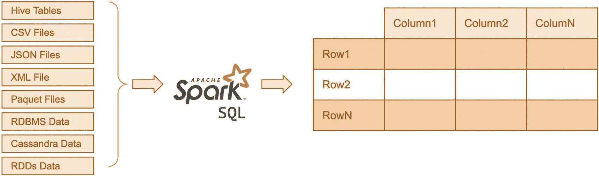
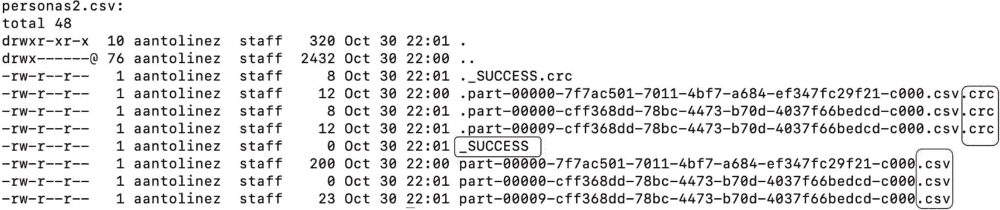
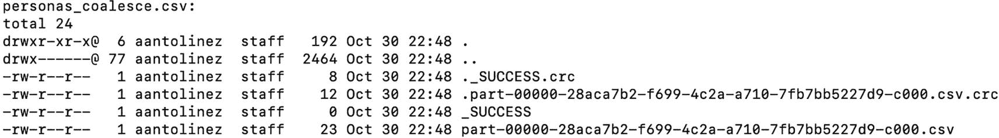
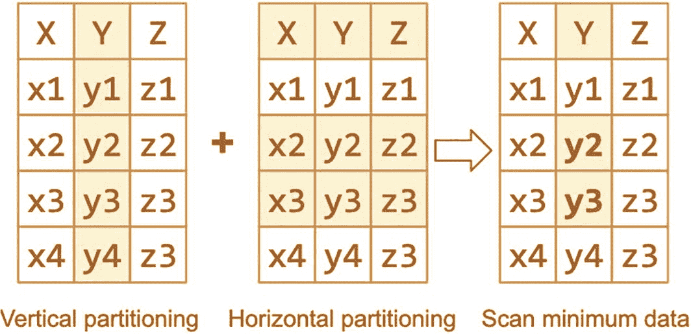
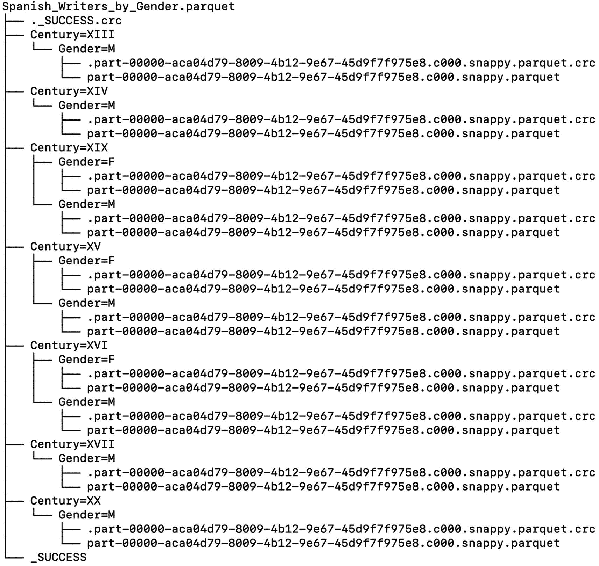
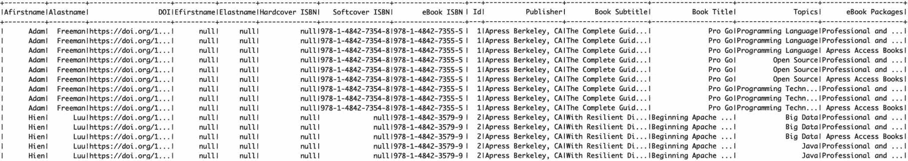

# 4. Spark 高级 API

`Spark SQL`、数据帧和数据集是 `Spark` 高级 API 的组成部分，旨在处理结构化数据，使 `Spark` 能够自动提升存储和计算性能。结构化数据是组织成标准化模式结构的信息，这使得它无需进一步处理即可访问和分析。结构化数据的示例包括数据库表、`Excel` 表格、关系型数据库管理系统（`RDBMS`）表、`Parquet` 文件等。

`Spark` 的高级 API 允许优化处理特定类型数据（例如二进制格式文件）的应用程序，其优化程度超出了 `Spark RDD` 所允许的限制。例如，数据帧和数据集利用 `Spark SQL` 的 `Catalyst` 优化器和 `Spark Project Tungsten`（本章后面会介绍）来优化其性能。

数据集 API 与数据帧 API 之间最重要的区别可能在于：数据集在编译时实现了类型安全。数据集在编译时强制执行类型安全，而数据帧则不会。`Spark` 在运行时验证数据帧的数据类型是否符合其模式中定义的类型，而数据集的数据类型则在编译时进行验证。我们将在本章后面详细讨论编译时类型安全的概念。

## 4.1 Spark 数据框

`DataFrame` 于 `Spark 1.3` 中引入，旨在提升 `Spark` 的性能和可扩展性。`DataFrame API` 引入了模式（`schema`）的概念来描述数据结构，使得 `Spark` 能够以更高效的方式在节点间移动数据，从而优化洗牌（`shuffle`）操作。从视觉上看，数据框类似于关系型数据库表或电子表格，如下例所示：

```
+--------+-----------------+-------------------+----+----+
|  Nombre|  Primer_Apellido|   Segundo_Apellido|Edad|Sexo|
+--------+-----------------+-------------------+----+----+
|  Miguel|     de Cervantes|           Saavedra|  50|   M|
|Fancisco|          Quevedo|Santibáñez Villegas|  55|   M|
|    Luis|       de Góngora|           y Argote|  65|   M|
|  Teresa|Sánchez de Cepeda|          y Ahumada|  70|   F|
+--------+-----------------+-------------------+----+----+
```

然而，从技术角度来看，`DataFrame` 是一种无类型数据集的视图。换句话说，`DataFrame` 是一个按列组织并带有列名的数据集。在 `Scala` 和 `Java` 中，`DataFrame` 可以被视为类型为 `Row`（`Dataset[Row]`）的无类型数据集，其中 `Row` 代表一个无类型的 `JVM` 对象。它们是按不同数据类型的命名列组织的数据行集合，并形成一个模式，如下所示：

```
root
|-- Nombre: string (nullable = true)
|-- Primer_Apellido: string (nullable = true)
|-- Segundo_Apellido: string (nullable = true)
|-- Edad: integer (nullable = true)
|-- Sexo: string (nullable = true)
```

如上述模式所示，每个数据框列都包含一组属性，例如名称、数据类型和一个可为空标志，该标志表示该列是否接受空值。

`DataFrame API` 是 `Spark SQL` 模块的一个组件，可用于所有编程语言，如 `Java`、`Python`、`SparkR` 和 `Scala`。与 `RDD` 不同，数据框提供自动优化，但与前者不同，它们不提供编译时类型安全。这意味着，虽然使用 `RDD` 和数据集时编译器知道列的数据类型（字符串、整数、`StructType` 等），但当您使用数据框时，操作返回的值是未定义数据类型的行数组。例如，您可以使用 `Scala` 的 `asInstanceOf()` 或 `PySpark` 的 `cast()` 方法将返回的值转换为特定类型。

让我们通过三个实际示例来分析类型安全的实现如何影响 `Spark` 应用程序的行为。

为此，我们将使用一个包含三位有史以来最杰出的西班牙作家的小型数据集。首先，我们将展示类型安全如何影响在过滤或映射函数中使用 lambda 表达式。以下是代码片段。

首先，我们创建一个样例类 `SpanishWritersDataFrame APISpanishWriters`，包含四个个人作家属性：

```
//spark.sparkContext.implicits._ 授予对 toDF() 方法的访问权限
import spark.sqlContext.implicits._
case class SpanishWriters(Nombre: String, Apellido: String, Edad: Int, Sexo:String)
```

对于此示例，我们创建一个西班牙作家的小型数据集：

```
val SpanishWritersData = Seq(SpanishWriters("Miguel", "Cervantes", 50, "M"), SpanishWriters("Fancisco", "Quevedo", 55, "M"), SpanishWriters("Luis", "Góngora", 65, "M"))
```

下一步，我们从上述数据集创建一个 `RDD`：

```
val SpanishWritersRDD = spark.sparkContext.parallelize(SpanishWritersData)
```

现在，我们分别使用 `toDF()` 和 `toDS()` 创建一个数据框和一个数据集：

```
val writersDF = SpanishWritersRDD.toDF()
val writersDS = SpanishWritersRDD.toDS()
```

现在，我们将看到在使用 lambda 函数过滤数据时，这些数据实体之间的差异：

```
// 数据框
val writersDFResult = writersDF.filter(writer => writer.Edad > 53)
// 输出
error: value Edad is not a member of org.apache.spark.sql.Row val writersDFResult = writersDF.filter(writer => writer.Edad > 53)
^
//数据集
val writersDSResult = writersDS.filter(writer => writer.Edad > 53)
// 输出
writersDSResult: org.apache.spark.sql.Dataset[SpanishWriters] = [Nombre: string, Apellido: string ... 2 more fields]
```

请注意，在两种数据结构中过滤信息时得到的不同输出。当我们对数据框应用过滤时，实现的 `lambda` 函数返回的是一个 `Row` 类型的对象，而不是您可能期望的整数值，因此它不能用于与整数（本例中为 53）进行比较。因此，仅使用列名，我们无法检索编码为 `Row` 对象的值。要获取 `Row` 对象的值，您必须将返回的值类型转换为整数。因此，我们需要将代码修改如下：

```
val writersDFResult = writersDF2.filter(writer => writer.getAsInt > 53)
writersDFResult.show()
// 输出
+--------+--------+----+----+
|  Nombre|Apellido|Edad|Sexo|
+--------+--------+----+----+
|Fancisco| Quevedo|  55|   M|
|    Luis| Góngora|  65|   M|
+--------+--------+----+----+
```

前面的示例展示了引入数据集的原因之一。开发人员无需事先知道返回的数据类型。

编译时类型安全的另一个示例出现在我们查询一个不存在的列时：

```
// 数据框
val writersDFBirthday = writersDF.select("Birthday")
// 输出
rg.apache.spark.sql.AnalysisException: Column 'Birthday' does not exist. Did you mean one of the following? [Edad, Apellido, Nombre, Sexo];
// 数据集
val writersDSBirthday = writersDS.map(writer => writer.Birthday)
// 输出
error: value Birthday is not a member of SpanishWriters
val writersDSBirthday = writersDS.map(writer => writer.Birthday)
^
```

在前面的示例中，您可以看到执行时（数据框）和编译时（数据集）之间的区别。前者仅在运行时抛出错误，而后者会在编译时给您一个错误消息。

另一个我们会发现 `DataFrames` 和数据集行为不同的情况是当我们想将它们恢复为原始的 RDD 时。在这种情况下，数据框恢复到 RDD 不会保留数据模式，而数据集恢复则会。让我们再次通过一个示例来看一下：

```
// 数据框恢复到 RDD
val rddFromDF = writersDF.rdd
// 输出
rddFromDF: org.apache.spark.rdd.RDD[org.apache.spark.sql.Row] = MapPartitionsRDD[249] at rdd at :75
```

然而，我们将无法正常使用这个恢复后的 RDD，因为实际上恢复返回的是一个 `Row` 类型的 RDD。让我们使用一个简单的操作来看看结果：

```
rddFromDF.map(writer => writer.Nombre).foreach(println)
// 输出
error: value Nombre is not a member of org.apache.spark.sql.Row
```

现在，我们将执行相同的操作，但这次使用我们的数据集：

```
// 数据集恢复到 RDD
val rddFromDS = writersDS.rdd
// 输出
rddFromDS: org.apache.spark.rdd.RDD[SpanishWriters] = MapPartitionsRDD[252] at rdd at
```

恢复返回的是一个真正的 RDD，因此我们可以正常使用它：

```
rddFromDS.map(writer => writer.Nombre).foreach(println)
// 输出
Luis
Fancisco
Miguel
```

这证明了数据集在恢复到 RDD 时会保留数据模式。

### Spark DataFrame 的属性

与其他 Apache Spark 模块一样，`DataFrames` 从诞生之初就是为了尽可能高效地处理大数据项目而创建的。因此，Spark `DataFrames` 支持分布在集群的各个节点上，充分利用 Spark 的分布式计算架构。发送给 `DataFrames` 的用户 SQL 查询和命令由 `Catalyst Optimizer` 管理，它负责查找并构建能够更高效地实现请求结果的查询执行计划。

Spark `DataFrames` 包含许多重要特性。其中之一是能够从外部源创建数据框——这在现实生活中非常有用，因为大多数时候数据会以文件、数据库等形式提供。图 4-1 展示了 Spark 原生支持加载到 `DataFrames` 中的外部文件格式示例。



一些 Spark 原生支持的用于将数据加载到 `DataFrames` 中的格式

`DataFrames` 的另一个重要特性是它们能够处理海量数据，从兆字节到拍字节不等。因此，Spark `DataFrames` 允许进行大规模数据管理。

### 创建 Spark DataFrame 的方法

`DataFrames` 可以通过多种不同的方式构建，例如手动创建、从外部关系数据库（MySQL、PostgreSQL、Oracle 等）或结构化数据文件（CSV、Excel 电子表格、Parquet、JSON 等）创建、从 NoSQL 数据库（Hive 表、Cassandra、HBase 或 MongoDB）创建，或者从已有的 RDDs 和二进制文件创建。

Spark 提供了两种手动构建 `DataFrames` 的方法：`toDF()` 和 `createDataFrame()`。利用这些方法，你可以从其他已有的 `DataFrames`、RDDs、数据集、列表和序列中创建新的 `DataFrames`。

尽管这两种方法非常相似，但它们之间有一些重要的区别。

#### 使用 `toDF()` 手动创建 Spark DataFrame

要使用 `toDF()`，我们首先需要导入 Spark 的 `sqlContext.implicits._` 库，以获得一个隐式方法将 RDD 转换为 DataFrame。让我们看看如何使用 `toDF()` 将 RDD 转换为 DataFrame：

```
val carsData=Seq(("USA","Chrysler","Chrysler 300",292),("Germany","BMW","BMW 8 Series",617),("Spain", "Spania GTA", "GTA Spano",925))
val carsRdd = spark.sparkContext.parallelize(carsData) // Seq 转 RDD
val dfCars = carsRdd.toDF() // RDD 转 DF
dfCars.show()
// 输出
+-------+----------+------------+---+
|     _1|        _2|          _3| _4|
+-------+----------+------------+---+
|    USA|  Chrysler|Chrysler 300|292|
|Germany|       BMW|BMW 8 Series|617|
|  Spain|Spania GTA|   GTA Spano|925|
+-------+----------+------------+---+
```

默认情况下，`toDF()` 会将序列 “_1”、“_2”、“_3”、“_4” 等分配为列名，并尝试推断数据类型（字符串和整数），并将除数字列外的所有列标记为可为空。你可以通过打印 `dfCars` 数据框的模式来看到这种行为：

```
dfCars.printSchema()
// 输出
root
|-- _1: string (nullable = true)
|-- _2: string (nullable = true)
|-- _3: string (nullable = true)
|-- _4: integer (nullable = false)
```

`toDF()` 方法接受不定数量的参数作为列名：`df.toDF('col1', 'col2', ..., 'colN')`，如下所示：

```
val dfBrandedCars = carsRdd.toDF("Country","Manufacturer","Model","Power" )
dfBrandedCars.show()
// 输出
+-------+------------+------------+-----+
|Country|Manufacturer|       Model|Power|
+-------+------------+------------+-----+
|    USA|    Chrysler|Chrysler 300|  292|
|Germany|         BMW|BMW 8 Series|  617|
|  Spain|  Spania GTA|   GTA Spano|  925|
+-------+------------+------------+-----+
```

从前面的例子中我们得出的结论是，使用 `toDF()` 我们无法控制数据框的模式。这意味着我们无法控制列类型和可为空标志。

#### 使用 `createDataFrame()` 手动创建 Spark DataFrame

我们可以利用 `createDataFrame()` 方法以两种形式构建 `DataFrames`。第一种是将其与 `toDF()` 结合使用，同时将 RDD 作为参数。让我们通过一个例子来展示它是如何工作的：
```

# Spark中创建DataFrame的两种方式

## 使用 `toDF()` 方法

```
var df2 = spark.createDataFrame(carsData) \
.toDF("Country","Manufacturer","Model","Power")
df2.show()
// 输出
+-------+------------+------------+-----+
|Country|Manufacturer|       Model|Power|
+-------+------------+------------+-----+
|    USA|    Chrysler|Chrysler 300|  292|
|Germany|         BMW|BMW 8 Series|  617|
|  Spain|  Spania GTA|   GTA Spano|  925|
+-------+------------+------------+-----+
```

## 使用 `createDataFrame()` 方法

第二种方式是我们可以使用 `createDataFrame()` 来创建一个数据框并释放其真正的威力，允许我们完全自定义自己的`DataFrame`模式。通过以下示例中引入模式定义，你可以很好地理解 `createDataFrame()` 的工作原理：

```
import org.apache.spark.sql.Row
import org.apache.spark.sql.types.{IntegerType,StringType, StructField, StructType}
// 首先，我们为 carsData 数据集创建一个模式。
val carSchema = StructType( Array(
StructField("Country", StringType,true),
StructField("Manufacturer", StringType,true),
StructField("Model", StringType,true),
StructField("Power", IntegerType,true)
))
// 注意，这里我们使用的是前面示例中展示的 carsRdd RDD
val carsRowRdd = carsRdd.map(carSpecs => Row(carSpecs._1, carSpecs._2, carSpecs._3, carSpecs._4))
val dfCarsFromRDD = spark.createDataFrame(carsRowRdd,carSchema)
dfCarsFromRDD.show()
// 输出
+-------+------------+------------+-----+
|Country|Manufacturer|       Model|Power|
+-------+------------+------------+-----+
|    USA|    Chrysler|Chrysler 300|  292|
|Germany|         BMW|BMW 8 Series|  617|
|  Spain|  Spania GTA|   GTA Spano|  925|
+-------+------------+------------+-----+
```

总而言之，我们可以说，虽然 `toDF()` 和 `createDataFrame()` 方法都可以用来创建`DataFrames`，但前者会推断数据模式，而后者则让你能够完全自定义控制`DataFrame`的模式。

# 创建 Spark DataFrame 的数据源

Spark SQL 通过 DataFrame 接口支持多种数据源。DataFrame 可以通过两种不同的方式操作。第一种是直接使用我们在前几章已经见过的关系型转换。第二种是通过从 DataFrame 创建临时视图。第二种方法允许你对数据运行 SQL 查询，就像查询传统的关系型数据库管理系统一样。

`Parquet` 是 Spark 在输入/输出操作中期望使用的默认数据源。这个默认格式可以通过 `spark.sql.sources.default` 属性名称进行设置。

让我们通过一个例子来看一下。尝试使用 `load()` 方法加载一个 CSV 文件：

```
val personasDF = spark.read.load("/Users/aantolinez/Downloads/personas.csv")
```

你会收到以下错误信息：

```
Caused by: java.lang.RuntimeException: file:/Users/aantolinez/Downloads/personas.csv is not a Parquet file. Expected magic number at tail, but found [48, 44, 70, 10]
```

然而，如果你加载一个 Parquet 文件：

```
val personasDF = spark.read.load("/Users/aantolinez/Downloads/personas.parquet")
```

一切顺利：

```
personasDF: org.apache.spark.sql.DataFrame = [Nombre: string, Primer_Apellido: string ... 3 more fields]
```

如果你使用 PySpark 代码，情况完全相同：

```
personasDF = spark.read.load("/Users/aantolinez/Downloads/personas.csv")
// 输出
Caused by: java.lang.RuntimeException: file:/Users/aantolinez/Downloads/personas.csv is not a Parquet file. Expected magic number at tail, but found [48, 44, 70, 10]
```

而使用 Parquet 格式文件时，一切正常：

```
personasDF = spark.read.load("/Users/aantolinez/Downloads/personas.parquet")
personasDF.show(1)
# 输出
+------+---------------+----------------+----+----+
|Nombre|Primer_Apellido|Segundo_Apellido|Edad|Sexo|
+------+---------------+----------------+----+----+
|Miguel|   de Cervantes|        Saavedra|  50|   M|
+------+---------------+----------------+----+----+
```

### 使用 SQL 查询文件

有时直接查询数据文件而不是先将其加载到 DataFrame 中可能会很有用。Spark 允许你通过以下方式实现，在 Scala 和 PySpark 中使用相同的代码并获得相同的结果：

```
spark.sql("SELECT * FROM parquet.`/Users/aantolinez/Downloads/personas.parquet`").show()
// Scala 和 PySpark 输出
+--------+-----------------+-------------------+----+----+
|  Nombre|  Primer_Apellido|   Segundo_Apellido|Edad|Sexo|
+--------+-----------------+-------------------+----+----+
|  Miguel|     de Cervantes|           Saavedra|  50|   M|
|Fancisco|          Quevedo|Santibáñez Villegas|  55|   M|
|    Luis|       de Góngora|           y Argote|  65|   M|
|  Teresa|Sánchez de Cepeda|          y Ahumada|  70|   F|
+--------+-----------------+-------------------+----+----+
```

### 忽略损坏和缺失的文件

Spark 提供了 `spark.sql.files.ignoreCorruptFiles` 方法来忽略损坏的文件，以及 `spark.sql.files.ignoreMissingFiles` 方法来忽略从文件系统读取文件时缺失的文件。对于前者，当设置为 `true` 时，Spark 作业在发现损坏文件时不会崩溃，并且仍会返回已读取的内容。后者意味着当文件缺失时，Spark 作业不会失败，并且与前面的方法一样，仍会返回已读取的数据。在此上下文中，缺失文件是指在应用 DataFrame 转换后被删除的文件。

我们将通过一个例子来了解这个 Spark 特性：

```
// 启用忽略损坏文件
spark.sql("set spark.sql.files.ignoreCorruptFiles=true")
// personas_corrupt.parquet 不是真正的 parquet 文件
val corruptFiles = spark.read.parquet(
"/Users/aantolinez/Downloads/personas.parquet",
"/Users/aantolinez/Downloads/personas_corrupt.parquet")
corruptFiles.show()
```

### 基于时间的路径

Spark 提供了 `modifiedBefore` 和 `modifiedAfter` 选项，用于在查询时对应加载的文件进行时间控制。

`modifiedBefore` 接受一个时间戳作为参数，指示 Spark 仅读取修改时间早于给定时间的文件。类似地，`modifiedAfter` 也接受一个时间戳作为参数，但这次是命令 Spark 仅加载修改时间晚于给定时间的文件。在这两种情况下，时间戳必须采用以下格式：`YYYY-MM-DDTHH:mm:ss`（例如 `2022-10-29T20:30:50`）。

让我们通过一个 Scala 示例，然后是 PySpark 示例，来看看这个 Spark 行为：

```
val modifiedAfterDF = spark.read.format("csv")
.option("header", "true")
.option("modifiedAfter", "2022-10-30T05:30:00")
.load("/Users/aantolinez/Downloads/Hands-On-Spark3");
modifiedAfterDF.show();
```

我们可以使用 PySpark 代码获得相同的结果，如下所示：

```
modifiedAfterDF = spark.read.format("csv") \
.option("header", "true") \
.option("modifiedAfter", "2022-10-30T05:30:00") \
.load("/Users/aantolinez/Downloads/Hands-On-Spark3");
modifiedAfterDF.show();
```

两种情况的输出将相同：

## 指定保存选项

我们之前提到过，Spark 的默认数据源是 Parquet 格式；然而，Spark 也允许与许多其他数据源进行交互，例如 JSON、ORC、CSV 和文本文件，以及 Hive 表、Cassandra 等，还有 JDBC 数据源。

这个庞大的数据源生态系统以及 Spark 在不同格式之间转换数据的能力，使得 Spark 能够被用作一个高效的 ETL^(⁶) 工具。Spark 可以从上述数据源加载数据，进行转换，然后以指定的格式和存储库进行保存。有四种保存模式，如表 4-1 所示。

**表 4-1** 保存模式

| 在 Scala 和 Java 中 | 在任何语言中 | 含义 |
| --- | --- | --- |
| `SaveMode.ErrorIfExists`（默认） | `"error"` 或 `"errorifexists"`（默认） | 如果保存 DataFrame 时目标位置已存在数据，则抛出异常。 |
| `SaveMode.Append` | `"append"` | 数据被追加到目标数据/表中。 |
| `SaveMode.Overwrite` | `"overwrite"` | 如果目标位置已存在数据/表，则覆盖它。 |
| `SaveMode.Ignore` | `"ignore"` | 其工作方式类似于 SQL 的 `CREATE TABLE IF NOT EXISTS`。如果目标位置已存在数据，则忽略该操作。 |

让我们通过一个示例来看看 Spark 的保存模式是如何工作的：

```scala
val SpanishDf = spark.read.option("header", "true")
.option("inferSchema", "true")
.csv("/Users/aantolinez/Downloads/personas.csv")
// 写入第一个 DataFrame
SpanishDf.write.format("csv").mode("overwrite")
.option("header", true)
.save("/Users/aantolinez/Downloads/personas2.csv")
// 添加一些数据以追加到之前保存的 DataFrame
val SpanishWritersData2 = Seq(("Miguel", "de Unamuno", 70, "M"))
val SpanishWritersRdd = spark.sparkContext.parallelize(SpanishWritersData2)
val SpanishWritersAppendDF = SpanishWritersRdd.toDF()
// 将新数据追加到之前保存的数据中
SpanishWritersAppendDF.write.format("csv").mode("append").save("/Users/aantolinez/Downloads/personas2.csv")
```

现在，如果你查看图 4-2 中保存的数据，你会看到一些令人惊讶的东西。



一段代码片段显示了关于文件 `personas2.csv` 的信息。它显示了文件的大小、权限、修改日期，以及同一目录下的其他相关文件及其属性。它突出显示了 `_SUCCESS` 以及文件名 `.crc` 和 `.csv`。

原因如下。默认情况下，Spark 会将 DataFrame、数据集或 RDD 保存到一个以指定名称命名的文件夹中，并将内容写入该文件夹内的多个 part 文件（每个分区一个 part 文件），这些文件具有指定的格式扩展名。正如你在前面的输出中所看到的，Spark 还会为每个分区写入一个 `_SUCCESS` 文件和一个 `.crc` 文件。

如果出于某种原因，你需要将数据合并到一个文件中，并去掉文件夹和附带文件，你只能轻松实现你的第一个愿望。

如前所述，Spark 会为每个分区创建一个文件。因此，获取单个文件的一种方法是使用 `coalesce()` 和/或 `repartition()` 方法将所有经过 shuffle 的数据合并到一个分区中。

### 注意

在处理大量数据时，请谨慎使用 `coalesce()` 和/或 `repartition()` 方法，因为这可能会使驱动程序内存过载，并导致 OutOfMemory 问题。

让我们通过一个适用于 Scala 和 PySpark 的简单示例来看看如何获取单个文件：

```scala
SpanishWritersAppendDF.coalesce(1)
.write.csv("/Users/aantolinez/Downloads/personas_coalesce.csv")
```

现在，当你查看上述代码的输出（图 4-3）时，你可以看到一个单一的 CSV 文件；然而，文件夹、`_SUCCESS` 文件和 `.crc` 隐藏文件仍然存在。



一段代码片段显示了关于文件 `personas_coalesce.csv` 的信息。它显示了文件的大小、权限、修改日期，以及同一目录下的其他相关文件及其属性。

要进行进一步优化，例如移除文件夹以及 `_SUCCESS` 和 `.crc` 隐藏文件，你将需要使用 Hadoop 文件系统库来操作最终的输出。

## 读取和写入 Apache Parquet 文件

Apache Parquet 是一种免费、开源、列式且自描述的**文件格式**，专为快速分析查询而设计。Apache Parquet 在现代数据湖中扮演着重要角色，因为它能够跳过不相关的数据，从而实现对大型数据集的高效查询。

Parquet 列式存储的一些优势如下：



三个表格展示了垂直分区 y, y1, y2, y3, y4，加上水平分区 x, y, z, x2, y2, z2, x3, y3, z3 的数据，相当于扫描 x, y 和 z 的最小数据量。Y, y2 和 y3 被着色。

*   **列式存储**：Parquet 是一种面向列的格式。在 Parquet 文件中，数据按列存储，这意味着每列的值彼此相邻存储，便于访问，从而提升查询性能。
*   **自描述**：Parquet 文件将数据本身与数据模式和结构结合在一起。这种结合简化了用于读取、存储和写入 Parquet 文件的工具的开发。
*   **压缩**：在 Parquet 文件中，数据压缩是逐列进行的，并且包含灵活的压缩选项，例如每种数据类型可扩展的编码模式。这意味着我们可以根据数据类型（`long`、`string`、`date` 等）使用不同的压缩编码，从而优化压缩效果。
*   **性能**：Parquet 格式专为查询性能而设计。Parquet 的内部格式结构（这超出了本书的范围）由行组、头部和尾部组成，它最大限度地减少了读取的数据量，从而减少了磁盘 I/O。将 Parquet 与 CSV 文件进行比较，后者必须完整读取并加载到内存中，而前者只允许读取回答我们问题所需的相关列。Parquet 格式允许检索最少的数据，实现了行组和列块（column chunks）的垂直和水平分区，如图 4-4 所示。列块也被组织成包含元数据信息的数据页。

## 将 DataFrame 保存并压缩为 Parquet 文件格式

`parquet()` 方法允许将 Spark DataFrame 保存为 Parquet 文件格式。默认情况下，此方法使用 `snappy` 压缩编解码器：

## Spark 操作 Parquet 文件

```scala
import org.apache.spark.sql.types.{StringType, StructType, IntegerType}
val schemaWriters = new StructType()
.add("Name",StringType,true)
.add("Surname",StringType,true)
.add("Century",StringType,true)
.add("YearOfBirth",IntegerType,true)
val SpanishWritersDf = spark.read.option("header", "true")
.schema(schemaWriters)
.csv("/Users/aantolinez/Downloads/Spanish_Writers_by_Century.csv")
// 使用默认压缩编解码器保存数据：snappy
SpanishWritersDf.write.parquet("/Users/aantolinez/Downloads/Spanish_Writers_by_Century.parquet")
Spanish_Writers_by_Century.parquet:
_SUCCESS    part-00000-e4385fd4-fcc0-4a5c-8632-d0080438fa82-c000.gz.parquet
```

压缩编解码器可以设置为 `none`、`uncompressed`、`snappy`、`gzip`、`lzo`、`brotli`、`lz4` 和 `zstd`，这会覆盖 `spark.sql.parquet.compression.codec` 配置。可以使用 `append` 选项将数据追加到 Parquet 文件中：

```scala
// 使用 gzip 压缩编解码器选项保存数据
SpanishWritersDf.write.mode("append").option("compression", "gzip").parquet("/Users/aantolinez/Downloads/Spanish_Writers_by_Century.parquet")
```

如下所示，可以组合使用多种压缩编解码器：

```text
Spanish_Writers_by_Century.parquet:
_SUCCESS    part-00000-e4385fd4-fcc0-4a5c-8632-d0080438fa82-c000.gz.parquet
part-00000-d070dd4d-86ca-476f-8e67-060365db7ca7-c000.snappy.parquet
```

使用 PySpark 代码也可以获得相同的结果：

```python
from pyspark.sql.types import StructField, StringType, StructType, IntegerType
schemaWriters = StructType([
StructField("Name",StringType(),True),
StructField("Surname",StringType(),True),
StructField("Century",StringType(),True),
StructField("YearOfBirth", IntegerType(), True)
])
SpanishWritersDf = spark.read.option("header", "true") \
.schema(schemaWriters) \
.csv("/Users/aantolinez/Downloads/Spanish_Writers_by_Century.csv")
```

### 对 Parquet 文件执行直接查询

Spark 可以通过临时视图直接在 Parquet 文件上运行 SQL 语句：

```scala
val parquetDF = spark.read.parquet("/Users/aantolinez/Downloads/Spanish_Writers_by_Century.parquet")
parquetDF.createOrReplaceTempView("TempTable")
val sqlDf = spark.sql("select * from TempTable where YearOfBirth = 1600")
sqlDf.show()
// 输出
+--------+-----------+-------+-----------+
|    Name|    Surname|Century|YearOfBirth|
+--------+-----------+-------+-----------+
|Calderón|de la Barca|   XVII|       1600|
+--------+-----------+-------+-----------+
```

使用 PySpark 代码也可以获得相同的结果，如下面的代码片段所示：

```python
parquetDF = spark.read.parquet("/Users/aantolinez/Downloads/Spanish_Writers_by_Century.parquet")
parquetDF.createOrReplaceTempView("TempTable")
sqlDf = spark.sql("select * from TempTable where YearOfBirth = 1600")
sqlDf.show()
# 输出
+--------+-----------+-------+-----------+
|    Name|    Surname|Century|YearOfBirth|
+--------+-----------+-------+-----------+
|Calderón|de la Barca|   XVII|       1600|
+--------+-----------+-------+-----------+
```

### Parquet 文件分区

Spark 允许使用 `partitionBy()` 方法对 Parquet 文件进行分区。文件分区是 Spark 提升数据分析性能和可扩展性的关键特性之一。文件分区是加快读取速度的关键特性；它允许快速访问数据、加载更小的数据集以及并行处理数据。让我们通过一个小例子来看看它是如何工作的：

```scala
import org.apache.spark.sql.types.{StringType, StructType, IntegerType}
val schemaWriters = new StructType()
.add("Name",StringType,true)
.add("Surname",StringType,true)
.add("Century",StringType,true)
.add("YearOfBirth",IntegerType,true)
.add("Gender",StringType,true)
val SpanishWritersDf = spark.read.option("header", "true")
.schema(schemaWriters)
.csv("/Users/aantolinez/Downloads/Spanish_Writers_by_Gender.csv")
SpanishWritersDf.write.partitionBy("Century","Gender")
.parquet("/Users/aantolinez/Downloads/Spanish_Writers_by_Gender.parquet")
```

Spark 会基于 `Century`（第一个分区键）创建一个文件夹层级，并递归地为 `Gender`（第二个分区键）创建一组子文件夹。您可以在图 4-5 中看到上述层级结构。



一个片段显示了与 Spanish Writers by Gender dot parquet 数据集相关的文件，这些文件按世纪和性别类别组织，其中 `.crc` 文件表示校验和。`_SUCCESS` 文件的存在表示相关过程已成功完成。

**图 4-5** Spark 按键对 Parquet 文件进行分区

以下 PySpark 代码片段将返回相同的输出：

## 写入 Parquet 文件

```
from pyspark.sql.types import StructField, StringType, StructType, IntegerType
schemaWriters = StructType([
StructField("Name",StringType(),True),
StructField("Surname",StringType(),True),
StructField("Century",StringType(),True),
StructField("YearOfBirth", IntegerType(),True),
StructField("Gender",StringType(),True),
])
SpanishWritersDf = spark.read.option("header", "true") \
.schema(schemaWriters) \
.csv("/Users/aantolinez/Downloads/Spanish_Writers_by_Gender.csv")
SpanishWritersDf.write.partitionBy("Century","Gender") \
.parquet("/Users/aantolinez/Downloads/Spanish_Writers_by_Gender.parquet")
```

### 读取 Parquet 文件分区

Spark 提供加速数据处理的方法之一，是允许只读取所需的数据部分。在下面的 Scala 代码片段中，您可以看到如何仅从 Parquet 文件中选择所需的数据：

```
val partitionDF = spark.read.parquet("/Users/aantolinez/Downloads/Spanish_Writers_by_Gender.parquet/Century=XX")
partitionDF.show()
+----+---------------+-----------+------+
|Name|        Surname|YearOfBirth|Gender|
+----+---------------+-----------+------+
|José|Ortega y Gasset|       1883|     M|
+----+---------------+-----------+------+
```

使用 PySpark 代码也能获得相同的结果：

```
partitionDF = spark.read.parquet("/Users/aantolinez/Downloads/Spanish_Writers_by_Gender.parquet/Century=XX")
partitionDF.show()
```

## 使用 Spark 读写 JSON 文件

Spark 提供了两种读取 JSON 文件的方法：将 JSON 文件加载为 `Dataset[Row]`，以及以 JSON 格式将数据写入磁盘。Spark 原生支持 JSON 文件的模式推断，但 JSON 文件必须包含独立的、以换行符分隔的有效 JSON 对象。你可以使用 `spark.read.json("path/to/file.json")` 加载单行或多行 JSON 文件，或将 `Dataset[String]` 加载到 Spark DataFrame 中；使用 `dataframe.write.json("path/to/file.json")` 将 Spark DataFrame 保存为 JSON 文件。让我们看看如何将 JSON 文件加载到 Spark DataFrame 中。

在第一个示例中，我们将加载一个由换行符分隔的 JSON 字符串组成的文件，如下所示：

```
{"id":1,"first_name":"Luis","last_name":"Ortiz","email":"luis.ortiz@mapy.cz","country":"Spain","updated":"2015-05-16","registered":false},
{"id":2,"first_name":"Alfonso","last_name":"Antolinez","email":"aantolinez@optc.es","country":"Spain","updated":"2015-03-11","registered":true},
{"id":3,"first_name":"Juan","last_name":"Dominguez","email":"jdomin@xyz.org","country":"Spain","updated":"2015-02-15","registered":true},
{"id":4,"first_name":"Santiago","last_name":"Sanchez","email":"ssanchez@google.com","country":"Spain","updated":"2014-10-31","registered":false}
```

要加载一个简单的单文件 JSON，你可以使用 `read.json()`，如下例所示：

```
val df = spark.read.json("/Users/aantolinez/Downloads/Spaniards.json")
```

与其他数据源格式不同，Spark 在读取 JSON 文件时能够推断数据模式：

```
df.printSchema()
// 输出
root
|-- country: string (nullable = true)
|-- email: string (nullable = true)
|-- first_name: string (nullable = true)
|-- id: long (nullable = true)
|-- last_name: string (nullable = true)
|-- registered: boolean (nullable = true)
|-- updated: string (nullable = true)
```

使用 PySpark 代码也能获得相同的结果，如下所示：

```
jsonDf = spark.read.json("/Users/aantolinez/Downloads/Spaniards.json")
jsonDf.printSchema()
# 输出
root
|-- country: string (nullable = true)
|-- email: string (nullable = true)
|-- first_name: string (nullable = true)
|-- id: long (nullable = true)
|-- last_name: string (nullable = true)
|-- registered: boolean (nullable = true)
|-- updated: string (nullable = true)
```

然而，在许多实际场景中，你会遇到格式为 JSON 字符串数组的文件。这种文件格式的一个示例如下：

```
[{"id":1,"first_name":"Luis","last_name":"Ortiz","email":"luis.ortiz@mapy.cz","country":"Spain","updated":"2015-05-16","registered":false},
{"id":2,"first_name":"Alfonso","last_name":"Antolinez","email":"aantolinez@optc.es","country":"Spain","updated":"2015-03-11","registered":true},
{"id":3,"first_name":"Juan","last_name":"Dominguez","email":"jdomin@xyz.org","country":"Spain","updated":"2015-02-15","registered":true},
{"id":4,"first_name":"Santiago","last_name":"Sanchez","email":"ssanchez@google.com","country":"Spain","updated":"2014-10-31","registered":false}]
```

这类文件被称为多行 JSON 字符串。对于多行 JSON 文件，你必须在读取数据时使用 `.option("multiline","true")`。让我们通过 Scala 和 PySpark 的示例来看看它是如何工作的：

# Spark 读取 JSON 文件示例

将多行 JSON 字符串文件加载到 DataFrame 中（Scala 示例）：

```scala
// 将多行 JSON 字符串文件加载到 DataFrame 中。Scala
val multilineJsonDf = spark.read.option("multiline","true")
.json("/Users/aantolinez/Downloads/Spaniards_array.json")
multilineJsonDf.show(4, false)
// 输出
+-------+-------------------+----------+---+---------+----------+----------+
|country|email              |first_name|id |last_name|registered|updated   |
+-------+-------------------+----------+---+---------+----------+----------+
|Spain  |luis.ortiz@mapy.cz |Luis      |1  |Ortiz    |false     |2015-05-16|
|Spain  |aantolinez@optc.es |Alfonso   |2  |Antolinez|true      |2015-03-11|
|Spain  |jdomin@xyz.org     |Juan      |3  |Dominguez|true      |2015-02-15|
|Spain  |ssanchez@google.com|Santiago  |4  |Sanchez  |false     |2014-10-31|
+-------+-------------------+----------+---+---------+----------+----------+
```

### 一次性读取多个 JSON 文件

`read.json()` 方法也可以用于从不同路径读取多个文件。要一次性加载多个文件，你只需将它们的路径作为列表元素传入。看看如何在 Scala 代码片段中实现：

```scala
// 一次性将多行 JSON 字符串文件加载到 DataFrame 中
val multipleJsonsDf = spark.read.option("multiline","true").json(
"/Users/aantolinez/Downloads/Spaniards_array.json",
"/Users/aantolinez/Downloads/Spaniards_array2.json")
// 输出
+-------+-------------------+----------+---+---------+----------+----------+
|country|email              |first_name|id |last_name|registered|updated   |
+-------+-------------------+----------+---+---------+----------+----------+
|Spain  |luis.ortiz@mapy.cz |Luis      |1  |Ortiz    |false     |2015-05-16|
|Spain  |aantolinez@optc.es |Alfonso   |2  |Antolinez|true      |2015-03-11|
|Spain  |jdomin@xyz.org     |Juan      |3  |Dominguez|true      |2015-02-15|
|Spain  |ssanchez@google.com|Santiago  |4  |Sanchez  |false     |2014-10-31|
|Spain  |luis.herrera@xyz.es|Luis      |1  |Herrera  |false     |2015-05-15|
|Spain  |mabad@opti.es      |Marcos    |2  |Abad     |true      |2015-03-21|
|Spain  |jabalos@redis.org  |Juan      |3  |Abalos   |true      |2015-02-14|
|Spain  |samo@terra.es      |Santiago  |4  |Amo      |false     |2014-10-21|
+-------+-------------------+----------+---+---------+----------+----------+
```

使用 `PySpark` 代码也能达到同样的效果：

```python
multipleJsonsDf = spark.read.option("multiline","true") \
.json(["/Users/aantolinez/Downloads/Spaniards_array.json", \
"/Users/aantolinez/Downloads/Spaniards_array2.json"])
multipleJsonsDf.show(10,False)
# 输出
+-------+-------------------+----------+---+---------+----------+----------+
|country|email              |first_name|id |last_name|registered|updated   |
+-------+-------------------+----------+---+---------+----------+----------+
|Spain  |luis.ortiz@mapy.cz |Luis      |1  |Ortiz    |false     |2015-05-16|
|Spain  |aantolinez@optc.es |Alfonso   |2  |Antolinez|true      |2015-03-11|
|Spain  |jdomin@xyz.org     |Juan      |3  |Dominguez|true      |2015-02-15|
|Spain  |ssanchez@google.com|Santiago  |4  |Sanchez  |false     |2014-10-31|
|Spain  |luis.herrera@xyz.es|Luis      |1  |Herrera  |false     |2015-05-15|
|Spain  |mabad@opti.es      |Marcos    |2  |Abad     |true      |2015-03-21|
|Spain  |jabalos@redis.org  |Juan      |3  |Abalos   |true      |2015-02-14|
|Spain  |samo@terra.es      |Santiago  |4  |Amo      |false     |2014-10-21|
+-------+-------------------+----------+---+---------+----------+----------+
```

### 一次性根据模式读取 JSON 文件

在实际工作中，你可能会遇到需要根据文件名模式读取文件，或者读取文件夹中所有文件的情况。Spark 允许使用我们之前示例中见过的同一个 `read.json()` 方法，根据文件名模式或读取目录中的全部文件来加载数据。让我们通过另一个示例来看看它是如何工作的：

val `patternJsonsDf` = spark.read.option("multiline","true").json(
`"/Users/aantolinez/Downloads/Spaniards_array*.json"`)
`patternJsonsDf`.show(20, false)
// 输出
+-------+-------------------------+----------+---+---------+----------+----------+
|country|email                    |first_name|id |last_name|registered|updated   |
+-------+-------------------------+----------+---+---------+----------+----------+
|Spain  |luis.garcia@xyz.es       |Lucia     |9  |Garcia   |true      |2015-05-15|
|Spain  |maria.rodriguez@opti.es  |Maria     |10 |Rodriguez|true      |2015-03-21|
|Spain  |carmen.gonzalez@redis.org|Carmen    |11 |Gonzalez |true      |2015-02-14|
|Spain  |sara.fernandez@terra.es  |Sara      |12 |Fernandez|true      |2014-10-21|
|Spain  |luis.ortiz@mapy.cz       |Luis      |1  |Ortiz    |false     |2015-05-16|
|Spain  |aantolinez@optc.es       |Alfonso   |2  |Antolinez|true      |2015-03-11|
|Spain  |jdomin@xyz.org           |Juan      |3  |Dominguez|true      |2015-02-15|
|Spain  |ssanchez@google.com      |Santiago  |4  |Sanchez  |false     |2014-10-31|
|Spain  |luis.herrera@xyz.es      |Luis      |1  |Herrera  |false     |2015-05-15|
|Spain  |mabad@opti.es            |Marcos    |2  |Abad     |true      |2015-03-21|
|Spain  |jabalos@redis.org        |Juan      |3  |Abalos   |true      |2015-02-14|
|Spain  |samo@terra.es            |Santiago  |4  |Amo      |false     |2014-10-21|
+-------+-------------------------+----------+---+---------+----------+----------+

## 使用 PySpark 代码得到相同结果

使用 `PySpark` 代码可以得到完全相同的结果，如下所示：

```python
patternJsonsDf = spark.read.option("multiline","true").json(
"/Users/aantolinez/Downloads/Spaniards_array*.json")
patternJsonsDf.show(20, False)
```

## 读取文件夹中的所有 JSON 文件

类似地，你可以使用模式来加载文件夹中的所有 JSON 文件。例如，以下代码片段将允许你读取一个目录中的所有 JSON 文件（且仅限 JSON 文件）：

```
// 在 `Scala` 中读取目录中的所有 JSON 文件（且仅限 JSON 文件）。
val patternJsonsDf = spark.read.option("multiline","true").json(
"/Users/aantolinez/Downloads/*.json")
# 在 `PySpark` 中读取目录中的所有 JSON 文件（且仅限 JSON 文件）。
patternJsonsDf = spark.read.option("multiline","true").json(
"/Users/aantolinez/Downloads/*.json")
```

同样，如果你想读取一个目录中的所有文件，可以使用以下代码：

```
// 在 `Scala` 中读取目录中的 ALL 文件。
val patternJsonsDf = spark.read.option("multiline","true").json(
"/Users/aantolinez/Downloads/")
# 在 `PySpark` 中读取目录中的 ALL 文件。
patternJsonsDf = spark.read.option("multiline","true").json(
"/Users/aantolinez/Downloads/")
```

### 对 JSON 文件进行直接查询

与其他文件格式（如 `Parquet`）一样，`Spark` 也允许我们直接查询 JSON 文件。因此，可以创建一个 SQL 查询字符串并将其传递给 Spark，就像你对关系型数据库管理系统（`RDBMS`）所做的那样。

假设你想直接查询前面示例中展示的 `Spaniards.json` 文件。一种方法是将以下查询发送给 Spark：

```
CREATE TEMPORARY VIEW Spaniards
USING org.apache.spark.sql.json
OPTIONS (path '/Users/aantolinez/Downloads/Spaniards.json')
```

像往常一样，现在我们来看看如何使用 `Scala` 和 `PySpark` 代码来实现它：

```
// 使用 `Scala` 代码
val sqlContext = new org.apache.spark.sql.SQLContext(sc)
val Spaniards = sqlContext.jsonFile("/Users/aantolinez/Downloads/Spaniards.json")
Spaniards.registerTempTable("Spaniards")
sqlContext.sql("select * from Spaniards").show(false)
// 输出
+-------+-------------------+----------+---+---------+----------+----------+
|country|email              |first_name|id |last_name|registered|updated   |
+-------+-------------------+----------+---+---------+----------+----------+
|Spain  |luis.ortiz@mapy.cz |Luis      |1  |Ortiz    |false     |2015-05-16|
|Spain  |aantolinez@optc.es |Alfonso   |2  |Antolinez|true      |2015-03-11|
|Spain  |jdomin@xyz.org     |Juan      |3  |Dominguez|true      |2015-02-15|
|Spain  |ssanchez@google.com|Santiago  |4  |Sanchez  |false     |2014-10-31|
+-------+-------------------+----------+---+---------+----------+----------+
```

使用更简洁的代码也可以获得完全相同的结果：

# Spark JSON 数据处理

## 使用 Spark SQL 读取 JSON

```
spark.sqlContext.sql("CREATE TEMPORARY VIEW Spaniards USING json OPTIONS" + " (path '/Users/aantolinez/Downloads/Spaniards.json')")
spark.sqlContext.sql("select * from Spaniards").show(false)
// 输出
+-------+-------------------+----------+---+---------+----------+----------+
|country|email              |first_name|id |last_name|registered|updated   |
+-------+-------------------+----------+---+---------+----------+----------+
|Spain  |luis.ortiz@mapy.cz |Luis      |1  |Ortiz    |false     |2015-05-16|
|Spain  |aantolinez@optc.es |Alfonso   |2  |Antolinez|true      |2015-03-11|
|Spain  |jdomin@xyz.org     |Juan      |3  |Dominguez|true      |2015-02-15|
|Spain  |ssanchez@google.com|Santiago  |4  |Sanchez  |false     |2014-10-31|
+-------+-------------------+----------+---+---------+----------+----------+
```

现在我们将展示如何使用 PySpark 代码获得相同的结果：

```
# 使用 PySpark 代码
spark.sql("CREATE TEMPORARY VIEW Spaniards USING json OPTIONS" + " (path '/Users/aantolinez/Downloads/Spaniards.json')")
spark.sql("select * from Spaniards").show(10, False)
# 输出
+-------+-------------------+----------+---+---------+----------+----------+
|country|email              |first_name|id |last_name|registered|updated   |
+-------+-------------------+----------+---+---------+----------+----------+
|Spain  |luis.ortiz@mapy.cz |Luis      |1  |Ortiz    |false     |2015-05-16|
|Spain  |aantolinez@optc.es |Alfonso   |2  |Antolinez|true      |2015-03-11|
|Spain  |jdomin@xyz.org     |Juan      |3  |Dominguez|true      |2015-02-15|
|Spain  |ssanchez@google.com|Santiago  |4  |Sanchez  |false     |2014-10-31|
+-------+-------------------+----------+---+---------+----------+----------+
```

## 将 DataFrame 保存为 JSON 文件

Apache Spark 提供了一个类似的方法 `write().json()`，可以轻松地将 `DataFrame` 保存为 JSON 文件。下一个代码片段展示了如何将 `multipleJsonsDf` 数据帧保存为 JSON 文件到持久化存储中：

```
multipleJsonsDf.write
.json("/Users/aantolinez/Downloads/Merged_Spaniards_array.json")
```

现在，我们检查一下 `Merged_Spaniards_array.json` 是否已创建，并如预期那样被分割成多个分区：

```
ls Downloads/Merged_Spaniards_array.json
_SUCCESS
part-00000-69975a01-3566-4d2d-898d-cf9e543d81c3-c000.json
part-00001-69975a01-3566-4d2d-898d-cf9e543d81c3-c000.json
```

## 保存模式

与其他文件格式一样，适用于 JSON 文件的保存模式与之前表 4-1 中展示的相同。在下一个代码片段中，你可以看到如何将数据追加到一个已存在的 JSON 文件中：

```
multipleJsonsDf.write.mode("append").json("/Users/aantolinez/Downloads/Merged_Spaniards_array.json")
ls Downloads/Merged_Spaniards_array.json
_SUCCESS
part-00000-188063e9-e5f6-4308-b6e1-7965eaa46c80-c000.json
part-00000-7453b1ad-f3b6-4e68-80eb-254fb539c04d-c000.json
part-00001-188063e9-e5f6-4308-b6e1-7965eaa46c80-c000.json
part-00001-7453b1ad-f3b6-4e68-80eb-254fb539c04d-c000.json
```

同样的代码可用于 PySpark。

在早期的 Spark 版本中，保存模式被标识为 `SaveMode.ErrorIfExists`、`SaveMode.Overwrite`、`SaveMode.Append` 和 `SaveMode.Ignore`。然而，在最新的 Spark 版本中，`mode("errorifexists")`、`mode("append")` 等格式似乎是主流方式。

# 基于自定义模式加载 JSON 文件

当我们开始使用 JSON 文件时，我们提到 Spark 能够在读取 JSON 文件时自动为我们推断数据模式。然而，有时你可能希望利用 Spark SQL 的 `StructType` 和 `StructField` 类来定义自己的文件模式。当数据模式过于复杂，Spark 无法自主推断时，就可能出现这种情况：

```
import org.apache.spark.sql.types.{StructType,StructField, StringType,IntegerType,BooleanType,DateType}
val schemaSpaniards = StructType(Array(
StructField("id",StringType,nullable=true),
StructField("first_name",StringType,nullable=true),
StructField("last_name",StringType,nullable=true),
StructField("email", StringType,nullable=true),
StructField("country", StringType,nullable=true),
StructField("updated", DateType,nullable=true),
StructField("registered", BooleanType,nullable=true)
))
val schemaSpaniardsDf = spark.read.schema(schemaSpaniards).json("/Users/aantolinez/Downloads/Spaniards.json")
```

我们可以看到新的 DataFrame 与之前定义的数据模式相匹配：

```
schemaSpaniardsDf.printSchema()
// 输出
root
|-- id: string (nullable = true)
|-- first_name: string (nullable = true)
|-- last_name: string (nullable = true)
|-- email: string (nullable = true)
|-- country: string (nullable = true)
|-- updated: date (nullable = true)
|-- registered: boolean (nullable = true)
```

现在，我们可以看到根据自定义模式加载 JSON 文件后的最终结果：

```
schemaSpaniardsDf.show(false)
// 输出
+---+----------+---------+-------------------+-------+----------+----------+
|id |first_name|last_name|email              |country|updated   |registered|
+---+----------+---------+-------------------+-------+----------+----------+
|1  |Luis      |Ortiz    |luis.ortiz@mapy.cz |Spain  |2015-05-16|false     |
|2  |Alfonso   |Antolinez|aantolinez@optc.es |Spain  |2015-03-11|true      |
|3  |Juan      |Dominguez|jdomin@xyz.org     |Spain  |2015-02-15|true      |
|4  |Santiago  |Sanchez  |ssanchez@google.com|Spain  |2014-10-31|false     |
+---+----------+---------+-------------------+-------+----------+----------+
```

和往常一样，使用 PySpark 代码也能得到相同的结果。让我们重复之前的步骤，但这次用 PySpark 编写：

```
from pyspark.sql.types import StructType,StructField,StringType,IntegerType,BooleanType,DateType
schemaSpaniards = StructType([ \
StructField("id",IntegerType(),nullable=True), \
StructField("first_name",StringType(),nullable=True), \
StructField("last_name",StringType(),nullable=True), \
StructField("email",StringType(),nullable=True), \
StructField("country",StringType(),nullable=True), \
StructField("updated",DateType(),nullable=True), \
StructField("registered",BooleanType(),nullable=True)])
```

```
schemaSpaniardsDf.printSchema()
# 输出
root
|-- id: integer (nullable = true)
|-- first_name: string (nullable = true)
|-- last_name: string (nullable = true)
|-- email: string (nullable = true)
|-- country: string (nullable = true)
|-- updated: date (nullable = true)
|-- registered: boolean (nullable = true)
```

最后，你还可以看到与 Scala 脚本相同的结果：

```
schemaSpaniardsDf.show(4, False)
# 输出
+---+----------+---------+-------------------+-------+----------+----------+
|id |first_name|last_name|email              |country|updated   |registered|
+---+----------+---------+-------------------+-------+----------+----------+
|1  |Luis      |Ortiz    |luis.ortiz@mapy.cz |Spain  |2015-05-16|false     |
|2  |Alfonso   |Antolinez|aantolinez@optc.es |Spain  |2015-03-11|true      |
|3  |Juan      |Dominguez|jdomin@xyz.org     |Spain  |2015-02-15|true      |
|4  |Santiago  |Sanchez  |ssanchez@google.com|Spain  |2014-10-31|false     |
+---+----------+---------+-------------------+-------+----------+----------+
```

### 使用 Spark 处理复杂的嵌套 JSON 结构

在现实生活中，你几乎不会遇到像前面示例中那样简单的 JSON 文件。特别是，如果你必须使用像 Apache Cassandra、MongoDB 等 NoSQL 数据库，经常会遇到一个问题：需要将嵌套且复杂的 JSON 结构展平，以便作为 ETL^(⁷) 过程的一部分与 RDBMS 数据库交换数据，使其更易于人类阅读或便于数据分析。假设你有一个数据源，其模式如下所示：

# 使用Spark展平嵌套JSON数据

## 原始模式
```
root
|-- Book: struct (nullable = true)
|    |-- Authors: array (nullable = true)
|    |      |-- element: struct (containsNull = true)
|    |      |     |-- firstname: string (nullable = true)
|    |      |     |-- lastname: string (nullable = true)
|    |-- DOI: string (nullable = true)
|    |-- Editors: array (nullable = true)
|    |      |-- element: struct (containsNull = true)
|    |      |     |-- firstname: string (nullable = true)
|    |      |     |-- lastname: string (nullable = true)
|    |-- ISBN: array (nullable = true)
|    |      |-- element: struct (containsNull = true)
|    |      |     |-- Hardcover ISBN: string (nullable = true)
|    |      |     |-- Softcover ISBN: string (nullable = true)
|    |      |     |-- eBook ISBN: string (nullable = true)
|    |-- Id: long (nullable = true)
|    |-- Publisher: string (nullable = true)
|    |-- Title: struct (nullable = true)
|    |      |-- Book Subtitle: string (nullable = true)
|    |      |-- Book Title: string (nullable = true)
|    |-- Topics: array (nullable = true)
|    |      |-- element: string (containsNull = true)
|    |-- eBook Packages: array (nullable = true)
|    |      |-- element: string (containsNull = true)
```

## 目标模式
```
root
|-- Afirstname: string (nullable = true)
|-- Alastname: string (nullable = true)
|-- DOI: string (nullable = true)
|-- Efirstname: string (nullable = true)
|-- Elastname: string (nullable = true)
|-- Hardcover ISBN: string (nullable = true)
|-- Softcover ISBN: string (nullable = true)
|-- eBook ISBN: string (nullable = true)
|-- Id: long (nullable = true)
|-- Publisher: string (nullable = true)
|-- Book Subtitle: string (nullable = true)
|-- Book Title: string (nullable = true)
|-- Topics: string (nullable = true)
|-- eBook Packages: string (nullable = true)
```

## 转换结果
因此，展平数据并得到一个最终的 Spark DataFrame，如图 4-6 所示。



一张表格显示了书籍信息，包括作者、ISBN、格式（精装、平装、电子书）、出版商、副标题、标题、主题和电子书包。

图 4-6 展平的嵌套 JSON 文件

## 实现方法
为此，Spark 提供了一些特定的函数，例如`explode()`，用于为给定数组或映射中的每个元素返回一个新行。该函数接受一个包含数组或值映射的列名作为参数。当传入数组时，它会创建一个默认名为"`col`"的新列，包含数组中的每个元素。当此函数接收映射时，它会创建两个默认名为"`key`"和"`value`"的新列，并为每个键和值创建一个新行。然而，`explode()`会忽略 null 或空值；因此，如果你也对这些值感兴趣，应该使用`explode_outer()`，它在传入的数组或映射为 null 或空时返回 null。

还有其他你可能感兴趣的补充函数，例如`posexplode()`和`posexplode_outer()`。前者除了为数组或映射的元素创建列之外，还会创建一个名为"`pos`"的额外列，用于保存数组和映射元素的位置。

让我们通过图 4-6 中的示例来解释其中一些函数的工作原理。你可以随意取消下面代码片段中代码行的注释，并逐行运行代码，以观察模式结构和数据的演变过程：

```markdown
val dfMlBooks = spark.read.option("multiline", "true").json("file:///Users/aantolinez/Books_array.json")
// dfMlBooks.show(false)
val df2 =dfMlBooks.select("Book.*")
// df2.printSchema()
val df3=df2.select(explode_outer($"Authors"), col("DOI"), $"Editors", $"ISBN", col("Id"), col("Publisher"), $"Title", col("Topics"), $"eBook Packages")
// df3.show(false)
// df3.printSchema()
val df4=df3.select(col("col.*"),  col("DOI"), explode_outer($"Editors"), $"ISBN", col("Id"), col("Publisher"), $"Title", col("Topics"), $"eBook Packages")
// df4.show(false)
// df4.printSchema()
val df5=df4.select(col("firstname").alias("Afirstname"),col("lastname").alias("Alastname"),col("DOI"), col("col.*"),explode_outer($"ISBN"), col("Id"), col("Publisher"), $"Title", col("Topics"), $"eBook Packages")
// df5.show(false)
// df5.printSchema()
val df6=df5.select(col("Afirstname"),col("Alastname"),col("DOI"),col("firstname").alias("Efirstname"),col("lastname").alias("Elastname"),col("col.Hardcover ISBN").alias("Hardcover ISBN"),col("col.Softcover ISBN").alias("Softcover ISBN"),col("col.eBook ISBN").alias("eBook ISBN"), col("Id"), col("Publisher"),col("Title.Book Subtitle").alias("Book Subtitle"),col("Title.Book Title").alias("Book Title") ,explode_outer($"Topics").alias("Topics"), $"eBook Packages")
// df6.show(false)
// df6.printSchema()
val df7=df6.select(col("Afirstname"),col("Alastname"),col("DOI"),col("Efirstname"), col("Elastname"),col("Hardcover ISBN"),col("Softcover ISBN"),col("eBook ISBN"),col("Id"),col("Publisher"),col("Book Subtitle"),col("Book Title"),col("Topics"),explode_outer( $"eBook Packages").alias("eBook Packages"))
// df7.show(false)
// df7.printSchema()
val df8=df7.select("*")
df8.show(false)
```

使用类似的 PySpark 代码也可以实现相同的结果。

### 使用 Spark 读写 CSV 文件

Apache Spark SQL 提供了两个特定的函数来读写 CSV 文件。`spark.read().csv()` 方法将单个 CSV 文件或 CSV 文件目录读入 DataFrame。此外，`dataframe.write().csv()` 方法将 Spark DataFrame 写入 CSV 文件。

Spark 提供了 `option()` 和 `options()` 函数来自定义 `read()` 和 `write()` 的行为。后者允许一次性指定多个选项。

我们将在下面的示例中了解如何使用上述这四个函数来加载和写入 CSV 文件。

`read()` 函数的通用用法如下所示：

```
val PATH ="Downloads/Spanish_Writers_by_Century_II.csv"
val df0 = spark.read.csv(PATH)
df0.show(5)
// 输出
+--------------------+
|                 _c0|
+--------------------+
|Name;Surname;Cent...|
|Gonzalo;de Berceo...|
| Juan ;Ruiz;XIV;1283|
|Fernando;de Rojas...|
|Garcilaso;de la V...|
+--------------------+
```

如果使用 PySpark 代码，将得到完全相同的输出，如下所示：

```
# 用于上传 Spanish_Writers_by_Century_II.csv 的 PySpark 版本
PATH ="Downloads/Spanish_Writers_by_Century_II.csv"
df0 = spark.read.csv(PATH)
df0.show(5)
```

我们可以利用 `option()` 函数来指定字段分隔符。默认的分隔符是“,”：

```
val df1 = spark.read.option("delimiter", ";").csv(PATH)
df1.show(5)
// 输出
+---------+----------+-------+-----------+
|      _c0|       _c1|    _c2|        _c3|
+---------+----------+-------+-----------+
|     Name|   Surname|Century|YearOfBirth|
|  Gonzalo| de Berceo|   XIII|       1196|
|    Juan |      Ruiz|    XIV|       1283|
| Fernando|  de Rojas|     XV|       1465|
|Garcilaso|de la Vega|    XVI|       1539|
+---------+----------+-------+-----------+
```

要跳过第一行并将其用作列名，我们可以使用 `.option("header", "true")`：

```
val df2 = spark.read.option("delimiter", ";").option("header", "true").csv(path)
df2.show(5)
// 输出
+---------+------------+-------+-----------+
|     Name|     Surname|Century|YearOfBirth|
+---------+------------+-------+-----------+
|  Gonzalo|   de Berceo|   XIII|       1196|
|    Juan |        Ruiz|    XIV|       1283|
| Fernando|    de Rojas|     XV|       1465|
|Garcilaso|  de la Vega|    XVI|       1539|
|   Miguel|de Cervantes|    XVI|       1547|
+---------+------------+-------+-----------+
```

可以使用 `options()` 函数一次性指定多个 CSV 操作选项：
```

## 读取和写入 Hive 表

Apache Spark SQL 还提供了读取和写入存储在 Apache Hive 表中数据的能力。在本节中，我们将展示一个典型的 Spark 工作流程：从外部源（CSV 文件）读取数据到 Spark DataFrame，然后将其保存到 Hive 表中。

如果你还没有 Hive 数据库和表，第一步和第二步应该是创建它们：

```sql
-- 创建我们将要使用的 Hive 数据库
CREATE DATABASE IF NOT EXISTS spaniards;
-- 创建我们将要使用的 Hive 表
CREATE TABLE IF NOT EXISTS spaniards.writersByCentury (
Name string,
Surname string,
Century string,
YearOfBirth int )
COMMENT '按世纪划分的西班牙作家'
ROW FORMAT DELIMITED
FIELDS TERMINATED BY ',';
```

创建好基本的 Hive 资源后，我们可以编写代码，从文件加载数据并将其保存到 Hive 表中：

```scala
import java.io.File
import org.apache.spark.sql.{Row, SaveMode, SparkSession}
val warehouseLocation = "hdfs://localhost:9745/user/hive/warehouse"
val spark = SparkSession
.builder()
.appName("Hands-On Spark 3")
.config("spark.sql.warehouse.dir", warehouseLocation)
.enableHiveSupport()
.getOrCreate()
import spark.implicits._
import spark.sql
val path = "file:///tmp/Spanish_Writers_by_Century.csv"
val df = spark.read.option("header", "true").csv(path)
df.show(5,false)
```

输出：

```
+---------+------------+-------+-----------+
|Name     |Surname     |Century|YearOfBirth|
+---------+------------+-------+-----------+
|Gonzalo  |de Berceo   |XIII   |1196       |
|Juan     |Ruiz        |XIV    |1283       |
|Fernando |de Rojas    |XV     |1465       |
|Garcilaso|de la Vega  |XVI    |1539       |
|Miguel   |de Cervantes|XVI    |1547       |
+---------+------------+-------+-----------+
```

```scala
// 现在将 DataFrame 保存到 Hive 表
df.write.mode("overwrite").saveAsTable("spaniards.writersByCentury")
```

保存数据后，我们可以前往 Hive 服务器检查数据是否已存在。

```markdown
```
hive> select * from spaniards.writersByCentury;
OK
SLF4J: Failed to load class "org.slf4j.impl.StaticLoggerBinder".
SLF4J: Defaulting to no-operation (NOP) logger implementation
SLF4J: See http://www.slf4j.org/codes.html#StaticLoggerBinder for further details.
Gonzalo    de Berceo        XIII   1196
Juan       Ruiz             XIV    1283
Fernando   de Rojas         XV     1465
Garcilaso  de la Vega       XVI    1539
Miguel     de Cervantes     XVI    1547
Francisco  de Quevedo       XVI    1580
Luis       de Góngora       XVI    1561
Lope       de Vega          XVI    1562
Tirso      de Molina        XVI    1583
Calderón   de la Barca      XVII   1600
Adolfo     Bécquer          XIX    1836
Benito     Pérez Galdós     XIX    1843
Emilia     Pardo Bazán      XIX    1851
José       Ortega y Gasset  XX     1883
Time taken: 9.226 seconds, Fetched: 14 row(s)
hive>
```

#### 通过 JDBC 从数据库读取和写入数据

Apache Spark 还可以使用 `JDBC` 连接器从多种数据源读取和写入数据。在使用 `JDBC` 连接访问数据时，需要注意的一点是，从数据源返回的信息会被格式化为 `Spark DataFrame`，这非常方便。

如果你计划使用 `JDBC` 连接访问远程数据源，首先需要一个与你的数据源兼容的 `JDBC` 驱动程序。在以下示例中，我们将引导你实现与两个最流行的关系型数据库管理系统（`RDBMS`）——`MySQL` 和 `PostgreSQL` 的 `JDBC` 连接：

```scala
val spark = SparkSession.builder
.appName("Hands-On Guide to Apache Spark 3")
.master("local[*]")
.config("spark.driver.memory", "1g")
.config("spark.sql.ansi.enabled ",true)
.config("spark.jars", "./postgresql-42.5.0.jar, ./mysql-connector-java-8.0.30.jar")
.getOrCreate()
// 连接到 PostgreSQL 远程服务器
val dfPostgresql = spark.read
.format("jdbc")
.option("url", "jdbc:postgresql://dbserver_url:5432/northwind")
.option("driver", "org.postgresql.Driver")
.option("dbtable","public.categories")
.option("user","YOUR_USER_HERE")
.option("password", "YOUR_PASSWORD_HERE")
.load()
dfPostgresql.show()
// 输出
+-----------+--------------+--------------------+-------+
|category_id| category_name|         description|picture|
+-----------+--------------+--------------------+-------+
|          1|     Beverages|Soft drinks, coff...|     []|
|          2|    Condiments|Sweet and savory ...|     []|
|          3|   Confections|Desserts, candies...|     []|
|          4|Dairy Products|             Cheeses|     []|
|          5|Grains/Cereals|Breads, crackers,...|     []|
|          6|  Meat/Poultry|      Prepared meats|     []|
|          7|       Produce|Dried fruit and b...|     []|
|          8|       Seafood|    Seaweed and fish|     []|
+-----------+--------------+--------------------+-------+
```

现在我们将展示如何连接到 `MySQL` 数据库：

```scala
val jdbcMySQL = spark.read
.format("jdbc")
.option("url", "jdbc:mysql://dbserver_url:3306/northwind")
.option("driver", "com.mysql.jdbc.Driver")
.option("dbtable", "customers")
.option("user", "YOUR_USER_HERE")
.option("password", "YOUR_PASSWORD_HERE")
.load()
jdbcAwsMySQL.select("id","company","last_name","first_name","job_title")show(8)
// 输出
+---+---------+----------------+----------+--------------------+
| id|  company|       last_name|first_name|           job_title|
+---+---------+----------------+----------+--------------------+
|  1|Company A|          Bedecs|      Anna|               Owner|
|  2|Company B|Gratacos Solsona|   Antonio|               Owner|
|  3|Company C|            Axen|    Thomas|Purchasing Repres...|
|  4|Company D|             Lee| Christina|  Purchasing Manager|
|  5|Company E|       O’Donnell|    Martin|               Owner|
|  6|Company F|    Pérez-Olaeta| Francisco|  Purchasing Manager|
|  7|Company G|             Xie| Ming-Yang|               Owner|
|  8|Company H|        Andersen| Elizabeth|Purchasing Repres...|
+---+---------+----------------+----------+--------------------+
```

你可以使用嵌入式 `SQL` 查询来获得相同的结果，而不是检索整个表。
```

# 4.2 Spark DataFrame 的使用

Spark DataFrame 的主要用途是执行查询。在本节中，我们将探讨一些通过使用 Spark DataFrame 可以执行的最常见操作，例如选择、过滤、聚合和数据分组。

在本节中，我们将利用 WorldCup^(⁸) 数据集来引导你使用 Spark DataFrame 查询数据。

## 选择 DataFrame 列

你在 Spark 中使用的最重要的转换函数可能是 `select()`。这个 Spark 函数返回一个新的 Spark DataFrame，该 DataFrame 由一组选定的列组成。返回的列可以使用 `alias()` 函数重命名，以消除歧义和/或提高人类可读性。

`select()` 函数接受一个或多个 DataFrame 列的名称，并返回一个仅包含所选列的新 Spark DataFrame。默认情况下，Spark 不会显示新 DataFrame 的内容。正如你在本书中所见，我们可以使用 `show()` 函数来指示 Spark 显示返回的值。

以下代码片段说明了如何使用 `show()` 来显示从 `select()` 语句中检索到的数据：

```scala
val jdbcMySQL = spark.read
.format("jdbc")
.option("url", "jdbc:mysql://dbserver_url:3306/northwind")
.option("driver", "com.mysql.jdbc.Driver")
.option("query", "select id,company,last_name,first_name,job_title from customers")
.option("user", "YOUR_USER_HERE")
.option("password", "YOUR_PASSWORD_HERE")
.load()
jdbcAwsMySQL.show(8)
// Output
+---+---------+----------------+----------+--------------------+
| id|  company|       last_name|first_name|           job_title|
+---+---------+----------------+----------+--------------------+
|  1|Company A|          Bedecs|      Anna|               Owner|
|  2|Company B|Gratacos Solsona|   Antonio|               Owner|
|  3|Company C|            Axen|    Thomas|Purchasing Repres...|
|  4|Company D|             Lee| Christina|  Purchasing Manager|
|  5|Company E|       O’Donnell|    Martin|               Owner|
|  6|Company F|    Pérez-Olaeta| Francisco|  Purchasing Manager|
|  7|Company G|             Xie| Ming-Yang|               Owner|
|  8|Company H|        Andersen| Elizabeth|Purchasing Repres...|
+---+---------+----------------+----------+--------------------+
```

类似地，你可以使用 JDBC 连接将 Spark DataFrame 保存到数据库。让我们通过一个示例来看看如何向 MySQL 数据库表添加数据：

```scala
import spark.implicits._
val data = Seq((6, "Alfonso"))
val dataRdd = spark.sparkContext.parallelize(data)
val dfFromRDD = dataRdd.toDF("id","name")
```

```scala
dfFromRDD.write
.mode("append")
.format("jdbc")
.option("url", "jdbc:mysql://dbserver_url:3306/northwind")
.option("driver", "com.mysql.jdbc.Driver")
.option("dbtable", "customers")
.option("user", "YOUR_USER_HERE")
.option("password", "YOUR_PASSWORD_HERE")
.save()
```

使用 JDBC 连接时，还有许多其他选项可供使用。我们接下来展示的选项，可能是你在优化与数据源通信时最相关的几个：

```scala
val jdbcMySQL = spark.read
.format("jdbc")
.option("url", "jdbc:mysql://dbserver_url:3306/northwind")
.option("driver", "com.mysql.jdbc.Driver")
.option("dbtable", "customers")
.option("numpartitions", numpartitions)
.option("lowerbound", min)
.option("upperbound", max)
.option("partitioncolumn", primarykey)
.option("fetchsize", 0)
.option("batchsize", 1000)
.option("user", "YOUR_USER_HERE")
.option("password", "YOUR_PASSWORD_HERE")
.load()
```

新增的选项提供了以下功能：

*   `numPartitions`：此选项用于读取和写入操作，表示用于并行处理的最大分区数，同时也是 JDBC 连接的最大数量。
*   `partitionColumn`：表示用于分区的表列。它必须是数值、日期或时间戳格式。
*   `lowerBound` 和 `upperBound`：这些选项用于读取操作，它们设定了分区的步长。
*   `fetchsize`：此选项旨在提升 JDBC 连接性能：它设定了每次往返获取的行数。默认值为 0。
*   `batchsize`：此选项仅适用于写入操作，其目标是提高写入性能。它设定了每次往返插入的行数。

# 数据选择

```scala
val dfWC = spark.read.option("header", "true").csv("file:///Users/aantolinez/Downloads/WorldCups.csv")
dfWC.show(5, false)
// Output showing only the first 5 rows
+----+-----------+----------+--------------+-------+----------+-----------+--------------+-------------+----------+
|Year|Country    |Winner    |Runners-Up    |Third  |Fourth    |GoalsScored|QualifiedTeams|MatchesPlayed|Attendance|
+----+-----------+----------+--------------+-------+----------+-----------+--------------+-------------+----------+
|1930|Uruguay    |Uruguay   |Argentina     |USA    |Yugoslavia|70         |13            |18           |590.549   |
|1934|Italy      |Italy     |Czechoslovakia|Germany|Austria   |70         |16            |17           |363.000   |
|1938|France     |Italy     |Hungary       |Brazil |Sweden    |84         |15            |18           |375.700   |
|1950|Brazil     |Uruguay   |Brazil        |Sweden |Spain     |88         |13            |22           |1.045.246 |
|1954|Switzerland|Germany FR|Hungary       |Austria|Uruguay   |140        |16            |26           |768.607   |
+----+-----------+----------+--------------+-------+----------+-----------+--------------+-------------+----------+
only showing top 5 rows
```

不带参数的 `show()` 函数默认显示 20 行，并将文本长度截断为 20 个字符。然而，`show()` 最多可以接受三个参数：第一个参数是一个整数，对应要显示的行数。第二个参数可以是一个布尔值，指示是否应截断文本字符串，或者是一个整数，表示要显示的字符数。第三个参数是一个布尔类型的值，指定是否应垂直显示值。

以下输出显示了前一个示例的结果，但使用了 `dfWC.show(5, 8)` 选项，仅显示前五行且每行仅显示八个字符：

```
+----+--------+--------+----------+-------+--------+-----------+--------------+-------------+----------+
|Year| Country|  Winner|Runners-Up|  Third|  Fourth|GoalsScored|QualifiedTeams|MatchesPlayed|Attendance|
+----+--------+--------+----------+-------+--------+-----------+--------------+-------------+----------+
|1930| Uruguay| Uruguay|  Argen...|    USA|Yugos...|         70|            13|           18|   590.549|
|1934|   Italy|   Italy|  Czech...|Germany| Austria|         70|            16|           17|   363.000|
|1938|  France|   Italy|   Hungary| Brazil|  Sweden|         84|            15|           18|   375.700|
|1950|  Brazil| Uruguay|    Brazil| Sweden|   Spain|         88|            13|           22|  1.045...|
|1954|Switz...|Germa...|   Hungary|Austria| Uruguay|        140|            16|           26|   768.607|
+----+--------+--------+----------+-------+--------+-----------+--------------+-------------+----------+
only showing top 5 rows
```

你可以使用 `select()` 来筛选你想要查询的列。要检索 `DataFrame` 中的所有列，你可以像之前的示例那样使用 `show()`，或者使用通配符 `"*"`，如下所示：

```scala
dfWC.select("*").show()
```

另一方面，你可以使用列名通过以下查询方式之一从 `DataFrame` 中获取特定列：

```scala
// 使用列名从 DataFrame 中获取特定列
dfWC.select("Year", "Country", "Winner", "Runners-Up", "Third", "Fourth").show(5, false)
// 输出
+----+-----------+----------+--------------+-------+----------+
|Year|Country    |Winner    |Runners-Up    |Third  |Fourth    |
+----+-----------+----------+--------------+-------+----------+
|1930|Uruguay    |Uruguay   |Argentina     |USA    |Yugoslavia|
|1934|Italy      |Italy     |Czechoslovakia|Germany|Austria   |
|1938|France     |Italy     |Hungary       |Brazil |Sweden    |
|1950|Brazil     |Uruguay   |Brazil        |Sweden |Spain     |
|1954|Switzerland|Germany FR|Hungary       |Austria|Uruguay   |
+----+-----------+----------+--------------+-------+----------+
// 使用 DataFrame 对象名称从 DataFrame 中获取单个列
dfWC.select(dfWC("Year"), dfWC("Country"), dfWC("Winner"), dfWC("Runners-Up"), dfWC("Third"), dfWC("Fourth")).show(5, false)
// 使用 col 函数从 DataFrame 中获取单个列
import org.apache.spark.sql.functions.col
dfWC.select(col("Year"), col("Country"), col("Winner"), col("Runners-Up"), col("Third"), col("Fourth")).show(5, false)
```

你也可以基于列索引从 `DataFrame` 中选择列。以下是一些示例：

### 使用列索引选择列

以下代码选择`dfWC`数据框的前四列并显示：

```
dfWC.select(dfWC.columns(0),dfWC.columns(1),dfWC.columns(2),dfWC.columns(3)).show(5, false)
// 输出
+----+-----------+----------+--------------+
|Year|Country    |Winner    |Runners-Up    |
+----+-----------+----------+--------------+
|1930|Uruguay    |Uruguay   |Argentina     |
|1934|Italy      |Italy     |Czechoslovakia|
|1938|France     |Italy     |Hungary       |
|1950|Brazil     |Uruguay   |Brazil        |
|1954|Switzerland|Germany FR|Hungary       |
+----+-----------+----------+--------------+
```

### 使用索引序列选择列

你可以使用索引序列获取一组列：

```
val colIndex = Seq(0, 1, 2, 3, 4, 5)
dfWC.select(colIndex map dfWC.columns map col: _*).show(5, false)
// 输出
+----+-----------+----------+--------------+-------+----------+
|Year|Country    |Winner    |Runners-Up    |Third  |Fourth    |
+----+-----------+----------+--------------+-------+----------+
|1930|Uruguay    |Uruguay   |Argentina     |USA    |Yugoslavia|
|1934|Italy      |Italy     |Czechoslovakia|Germany|Austria   |
|1938|France     |Italy     |Hungary       |Brazil |Sweden    |
|1950|Brazil     |Uruguay   |Brazil        |Sweden |Spain     |
|1954|Switzerland|Germany FR|Hungary       |Austria|Uruguay   |
+----+-----------+----------+--------------+-------+----------+
```

### 使用列名序列选择列

序列还可以通过其他几种方式使用，例如，使用序列加上字符串列名，如下所示：

```
val seqColumnas = Seq("Year","Country","Winner","Runners-Up","Third","Fourth")
val result = dfWC.select(seqColumnas.head, seqColumnas.tail: _*).show(5, false)
```

另一种方式是使用序列加上`map`函数和一组列名：

```
dfWC.select(seqColumnas.map(i => col(i)): _*).show(5,false)
```

在这两个示例中，你得到的结果与之前的代码片段完全相同。

### 使用列列表选择列

你也可以使用列列表来检索所需数据。请看下一个示例：

```
import org.apache.spark.sql.Column
val miColumnas: List[Column] = List(new Column("Year"), new Column("Country"), new Column("Winner"))
dfWC.select(miColumnas: _*).show(5,false)
// 输出
+----+-----------+----------+
|Year|Country    |Winner    |
+----+-----------+----------+
|1930|Uruguay    |Uruguay   |
|1934|Italy      |Italy     |
|1938|France     |Italy     |
|1950|Brazil     |Uruguay   |
|1954|Switzerland|Germany FR|
+----+-----------+----------+
```

### 基于名称模式选择列

`startsWith(String prefix)` 和 `endsWith(String suffix)` 列函数用于确认字符串是否以指定的前缀或子字符串开头（第一种情况），或者同一字符串是否以指定的后缀结尾。另一个有趣的列函数是 `contains(Other)`，它返回一个布尔值，指示某个模式是否出现在列中。这三个函数可以与 `like()` 函数互补使用，以达到相同的结果。让我们看看如何使用它们通过名称模式选择所需的列：

```
dfWC.select(dfWC.columns.filter(s=>s.startsWith("Y")).map(c=>col(c)):_*).show(5,false)
// 输出
+----+
|Year|
+----+
|1930|
|1934|
|1938|
|1950|
|1954|
+----+
dfWC.select(dfWC.columns.filter(s=>s.endsWith("ner")).map(c=>col(c)):_*).show(5,false)
// 输出
+----------+
|Winner    |
+----------+
|Uruguay   |
|Italy     |
|Italy     |
|Uruguay   |
|Germany FR|
+----------+
```

另一方面，函数 `contains()` 可用于按包含特定模式的列来过滤行。以下是一个示例，我们过滤数据集中 `Winner` 列包含字母 `"y"` 的行：

```
import org.apache.spark.sql.functions.col
dfWC.select("Year","Country","Winner","Runners-Up","Third","Fourth").filter(col("Winner").contains("S")).show()
// 输出
+----+------------+------+-----------+-------+-------+
|Year|     Country|Winner| Runners-Up|  Third| Fourth|
+----+------------+------+-----------+-------+-------+
|2010|South Africa| Spain|Netherlands|Germany|Uruguay|
+----+------------+------+-----------+-------+-------+
```

`filter` 可以与函数 `like()` 互补使用，以达到相同的结果：

```
dfWC.select("Year","Country","Winner","Runners-Up","Third","Fourth").filter(col("Winner").like("%S%")).show()
// 结果
+----+------------+------+-----------+-------+-------+
|Year|     Country|Winner| Runners-Up|  Third| Fourth|
+----+------------+------+-----------+-------+-------+
|2010|South Africa| Spain|Netherlands|Germany|Uruguay|
+----+------------+------+-----------+-------+-------+
```

我们还可以使用 `SQL ANSI` 语言作为补充来过滤数据集行。

### 基于一个或多个条件筛选查询结果

到目前为止，我们一直在列级别应用选择条件。现在，我们将了解如何在行级别细化收集到的数据。Spark 的 `filter()` 和 `where()` 函数用于基于一个或或多个条件在行级别过滤数据。这两个函数返回相同的结果；因此，`where()` 函数是为了兼容 SQL 背景而引入的。

这两个过滤函数可以单独使用，也可以与其他函数结合使用来细化结果。在下面的代码片段中，我们单独使用了 `filter()`；因此，我们得到了完整的列集。在第二个代码片段中，我们将其与 `select` 结合使用，以将检索到的列数限制为我们感兴趣的列：

```python
dfWC.createOrReplaceTempView("WorldCups")
spark.sql("select Year,Country,Winner,`Runners-Up`,Third,Fourth from WorldCups where Winner like '%S%'").show()
# 输出
+----+------------+------+-----------+-------+-------+
|Year|     Country|Winner| Runners-Up|  Third| Fourth|
+----+------------+------+-----------+-------+-------+
|2010|South Africa| Spain|Netherlands|Germany|Uruguay|
+----+------------+------+-----------+-------+-------+

dfWC.filter("Year < 1938").show(5,false)
# 输出
+----+-------+-------+--------------+-------+----------+-----------+--------------+-------------+----------+
|Year|Country|Winner |Runners-Up    |Third  |Fourth    |GoalsScored|QualifiedTeams|MatchesPlayed|Attendance|
+----+-------+-------+--------------+-------+----------+-----------+--------------+-------------+----------+
|1930|Uruguay|Uruguay|Argentina     |USA    |Yugoslavia|70         |13            |18           |590.549   |
|1934|Italy  |Italy  |Czechoslovakia|Germany|Austria   |70         |16            |17           |363.000   |
+----+-------+-------+--------------+-------+----------+-----------+--------------+-------------+----------+

dfWC.select(col("Year"),col("Country"),col("Winner"),col("Runners-Up"),col("Third"),col("Fourth")).filter("Year < 1938").show(5,false)
# 输出
+----+-------+-------+--------------+-------+----------+
|Year|Country|Winner |Runners-Up    |Third  |Fourth    |
+----+-------+-------+--------------+-------+----------+
|1930|Uruguay|Uruguay|Argentina     |USA    |Yugoslavia|
|1934|Italy  |Italy  |Czechoslovakia|Germany|Austria   |
+----+-------+-------+--------------+-------+----------+
```

在最后一段代码中，您可以体会到 Spark 如何执行查询操作。首先，Spark 执行 `select()` 转换，然后将过滤条件应用于所选数据。最后，它对结果应用 `show()` 动作。

可以级联多个 `filter()` 函数以提供额外的数据细化：

```python
dfWC.select(col("Year"),col("Country"),col("Winner"),col("Runners-Up")).filter("Year < 1938").filter("Country = 'Italy'").show(5,false)
# 输出
+----+-------+------+--------------+
|Year|Country|Winner|Runners-Up    |
+----+-------+------+--------------+
|1934|Italy  |Italy |Czechoslovakia|
+----+-------+------+--------------+
```

### 使用不同的列表示法

`filter()` 函数中的列名也可以使用 `'columnName`、`col(columnName)`、`$"columnName"`、`Dataframe("columnName")` 表示法来指定。让我们通过一个示例来看看它是如何工作的：

```python
// 使用 'columnName 表示法
dfWC.select("Year","Country","Winner","Runners-Up","Third","Fourth","GoalsScored").filter('Winner === "Spain").show(false)
// 使用 $"columnName" 表示法
dfWC.select("Year","Country","Winner","Runners-Up","Third","Fourth","GoalsScored").filter($"Winner" === "Spain").show(false)
// 使用 col(columnName) 表示法
dfWC.select("Year","Country","Winner","Runners-Up","Third","Fourth","GoalsScored").filter(col("Winner") === "Winner").show(false)
// 使用 Dataframe("columnName") 表示法
dfWC.select("Year","Country","Winner","Runners-Up","Third","Fourth","GoalsScored").filter(dfWC("Winner") === "Spain").show(false)
// 所有代码片段的输出
+----+------------+------+-----------+-------+-------+-----------+
|Year|Country     |Winner|Runners-Up |Third  |Fourth |GoalsScored|
+----+------------+------+-----------+-------+-------+-----------+
|2010|South Africa|Spain |Netherlands|Germany|Uruguay|145        |
+----+------------+------+-----------+-------+-------+-----------+
```

或者，您可以使用 `where()` 函数获得相同的结果，如下例所示：

```
### 使用不同的表示法进行筛选

```
// 使用 'columnName 表示法
dfWC.select("Year","Country","Winner","Runners-Up","Third","Fourth","GoalsScored").where('Winner === "Spain").show(false)
// 使用 $"columnName" 表示法
dfWC.select("Year","Country","Winner","Runners-Up","Third","Fourth","GoalsScored").where($"Winner" === "Spain").show(false)
// 使用 col(columnName) 表示法
dfWC.select("Year","Country","Winner","Runners-Up","Third","Fourth","GoalsScored").where(col("Winner") === "Spain").show(false)
// 使用 Dataframe("columnName") 表示法
dfWC.select("Year","Country","Winner","Runners-Up","Third","Fourth","GoalsScored").where(dfWC("Winner") === "Spain").show(false)
// 所有代码片段的输出
+----+------------+------+-----------+-------+-------+-----------+
|Year|Country     |Winner|Runners-Up |Third  |Fourth |GoalsScored|
+----+------------+------+-----------+-------+-------+-----------+
|2010|South Africa|Spain |Netherlands|Germany|Uruguay|145        |
+----+------------+------+-----------+-------+-------+-----------+
```

## 使用逻辑运算符进行多条件筛选

到目前为止，我们展示了如何应用单个条件来筛选数据集的行。然而，在实际应用中，我们常常需要更复杂的选择标准。通过应用 `AND`、`OR` 和 `NOT` 等逻辑运算符，可以增强 `filter()` 函数的功能，这些运算符允许你连接多个条件。这些逻辑运算符也可以表示为 `&&`、`||` 和 `!`。接下来，我们将通过几个示例向你展示如何使用它们：

```
// 使用 AND 逻辑运算符 "&&"
dfWC.select("Year","Country","Winner","Runners-Up","Third","Fourth","GoalsScored").filter(dfWC("Winner") === "Spain" and dfWC("Runners-Up") === "Netherlands").show(false)
// 输出
+----+------------+------+-----------+-------+-------+-----------+
|Year|Country     |Winner|Runners-Up |Third  |Fourth |GoalsScored|
+----+------------+------+-----------+-------+-------+-----------+
|2010|South Africa|Spain |Netherlands|Germany|Uruguay|145        |
+----+------------+------+-----------+-------+-------+-----------+
// 使用 OR 逻辑运算符 "||"
dfWC.select("Year","Country","Winner","Runners-Up","Third","Fourth","GoalsScored").filter(dfWC("Winner") === "Spain" or dfWC("Runners-Up") === "Netherlands").show(false)
// 输出
+----+------------+----------+-----------+-------+-------+-----------+
|Year|Country     |Winner    |Runners-Up |Third  |Fourth |GoalsScored|
+----+------------+----------+-----------+-------+-------+-----------+
|1974|Germany     |Germany FR|Netherlands|Poland |Brazil |97         |
|1978|Argentina   |Argentina |Netherlands|Brazil |Italy  |102        |
|2010|South Africa|Spain     |Netherlands|Germany|Uruguay|145        |
+----+------------+----------+-----------+-------+-------+-----------+
```

看来荷兰队确实是当亚军的专家！

`NOT` 或 `!` 的一个可能用法如下所示：

```
// 使用 NOT 逻辑运算符 "!"
dfWC.select("Year","Country","Winner","Runners-Up","Third","Fourth").filter(not (dfWC("Winner") === "Italy" or dfWC("Runners-Up") === "Netherlands")).show(false)
// 输出
+----+-----------+----------+--------------+-----------+--------------+
|Year|Country    |Winner    |Runners-Up    |Third      |Fourth        |
+----+-----------+----------+--------------+-----------+--------------+
|1930|Uruguay    |Uruguay   |Argentina     |USA        |Yugoslavia    |
|1950|Brazil     |Uruguay   |Brazil        |Sweden     |Spain         |
|1954|Switzerland|Germany FR|Hungary       |Austria    |Uruguay       |
|1958|Sweden     |Brazil    |Sweden        |France     |Germany FR    |
|1962|Chile      |Brazil    |Czechoslovakia|Chile      |Yugoslavia    |
|1966|England    |England   |Germany FR    |Portugal   |Soviet Union  |
|1970|Mexico     |Brazil    |Italy         |Germany FR |Uruguay       |
|1986|Mexico     |Argentina |Germany FR    |France     |Belgium       |
|1990|Italy      |Germany FR|Argentina     |Italy      |England       |
|1994|USA        |Brazil    |Italy         |Sweden     |Bulgaria      |
|1998|France     |France    |Brazil        |Croatia    |Netherlands   |
|2002|Korea/Japan|Brazil    |Germany       |Turkey     |Korea Republic|
|2014|Brazil     |Germany   |Argentina     |Netherlands|Brazil        |
+----+-----------+----------+--------------+-----------+--------------+
```

### 操作 Spark DataFrame 列
```

在实际环境中工作时，你很可能会操作原始`DataFrame`，例如添加列、删除列等。Apache Spark 提供了 `withColumn()` 转换函数来操作 Spark `DataFrame` 列，例如添加新列、更新列的值、更改列的数据类型、从现有列创建派生列等。

使用 `withColumn()` 函数执行的转换可以应用于所有 `DataFrame` 行或其中的一部分。正如我们刚才提到的，`withColumn()` 是一个转换函数，并且如前所述，`DataFrame` 转换会返回新的 `DataFrame`，并且是惰性求值的。

像往常一样，让我们通过一些示例来看看如何利用 `withColumn()`。在第一个示例中，我们将使用之前的 FIFA 世界杯数据集，添加一个新的计算列，以反映一个缺失的重要指标——每场比赛的球迷上座率。

如果你尝试立即应用 `withColumn()` 来添加一个新的计算列，你会遇到麻烦。为什么？看看你得到的数据模式：

```
dfWC.printSchema()
// 输出
root
|-- Year: string (nullable = true)
|-- Country: string (nullable = true)
|-- Winner: string (nullable = true)
|-- Runners-Up: string (nullable = true)
|-- Third: string (nullable = true)
|-- Fourth: string (nullable = true)
|-- GoalsScored: string (nullable = true)
|-- QualifiedTeams: string (nullable = true)
|-- MatchesPlayed: string (nullable = true)
|-- Attendance: string (nullable = true)
```

你发现问题了吗？是的，Spark 将所有列都识别为字符串类型。因此，如果你在此阶段尝试执行操作，将会得到以下错误：

```
// 向 DataFrame 添加新列：每场比赛的球迷上座率
import org.apache.spark.sql.functions.col
val dfWCExt=dfWC.withColumn("AttendancePerMatch", round(col("Attendance")/col("MatchesPlayed"), 3))
dfWCExt.select("Attendance","MatchesPlayed","AttendancePerMatch").show(5)
// 输出
+----------+-------------+------------------+
|Attendance|MatchesPlayed|AttendancePerMatch|
+----------+-------------+------------------+
|   590.549|           18|            32.808|
|   363.000|           17|            21.353|
|   375.700|           18|            20.872|
| 1.045.246|           22|              null|
|   768.607|           26|            29.562|
+----------+-------------+------------------+
```

因此，第一步应该是将感兴趣的列转换为数值数据类型。然而，如果你尝试直接转换某些数字（例如 `1.045.246`）为数值类型，也会遇到问题，因为它们是以公制格式存储的。因此，最好先移除 `.` 以避免问题：

```
import org.apache.spark.sql.functions.regexp_replace
import org.apache.spark.sql.functions.col
import org.apache.spark.sql.types.IntegerType
val dfWC2=dfWC.withColumn("Attendance", regexp_replace($"Attendance", "\\.", ""))
val dfWC3=dfWC2.withColumn("GoalsScored", col("GoalsScored").cast(IntegerType))
.withColumn("QualifiedTeams", col("QualifiedTeams").cast(IntegerType))
.withColumn("MatchesPlayed", col("MatchesPlayed").cast(IntegerType))
.withColumn("Attendance", col("Attendance").cast(IntegerType))
dfWC3.printSchema()
// 输出
root
|-- Year: string (nullable = true)
|-- Country: string (nullable = true)
|-- Winner: string (nullable = true)
|-- Runners-Up: string (nullable = true)
|-- Third: string (nullable = true)
|-- Fourth: string (nullable = true)
|-- GoalsScored: integer (nullable = true)
|-- QualifiedTeams: integer (nullable = true)
|-- MatchesPlayed: integer (nullable = true)
|-- Attendance: integer (nullable = true)
```

现在，我们可以实现添加新计算列的目标了：

```
val dfWCExt=dfWC3.withColumn("AttendancePerMatch", round(col("Attendance").cast(IntegerType)/col("MatchesPlayed").cast(IntegerType), 3))
dfWCExt.select("Attendance","MatchesPlayed","AttendancePerMatch").show(5)
// 输出
+----------+-------------+------------------+
|Attendance|MatchesPlayed|AttendancePerMatch|
+----------+-------------+------------------+
|    590549|           18|         32808.278|
|    363000|           17|         21352.941|
|    375700|           18|         20872.222|
|   1045246|           22|         47511.182|
|    768607|           26|         29561.808|
+----------+-------------+------------------+
```

在前面的示例中，你已经使用了不少 `withColumn()` 的用例。

### 重命名 `DataFrame` 列

Apache Spark 提供了 `withColumnRenamed()` 转换函数来更改 `DataFrame` 的列名；它可以用于同时重命名单个列或多个列。此函数也可用于重命名嵌套的 `StructType` 模式。`withColumnRenamed()` 函数接受两个参数：我们想要更改的 `DataFrame` 列的当前名称，以及我们想要赋予该列的新名称。由于 `withColumnRenamed()` 是一种转换，它会返回一个 `DataFrame`。

让我们通过一个实际示例来看看它是如何工作的。下面的代码片段将 `dfWCExt` 的一个列从 `AttendancePerMatch` 重命名为 `AxMatch`：

# 重命名 DataFrame 列

```scala
val dfRenamed = dfWCExt.withColumnRenamed("AttendancePerMatch","AxMatch")
dfRenamed.select("Attendance", "MatchesPlayed","AxMatch").show(5)
// 输出
+----------+-------------+---------+
|Attendance|MatchesPlayed|  AxMatch|
+----------+-------------+---------+
|    590549|           18|32808.278|
|    363000|           17|21352.941|
|    375700|           18|20872.222|
|   1045246|           22|47511.182|
|    768607|           26|29561.808|
+----------+-------------+---------+
```

可以通过连接多次调用 `withColumnRenamed()` 来一次重命名多个列，如下所示：

```scala
val dfRenamed2 = dfRenamed
.withColumnRenamed("Attendance","Att")
.withColumnRenamed("AxMatch","AttendancexMatch")
dfRenamed2.select("Att", "MatchesPlayed","AttendancexMatch").show(5)
// 输出
+-------+-------------+----------------+
|    Att|MatchesPlayed|AttendancexMatch|
+-------+-------------+----------------+
| 590549|           18|       32808.278|
| 363000|           17|       21352.941|
| 375700|           18|       20872.222|
|1045246|           22|       47511.182|
| 768607|           26|       29561.808|
+-------+-------------+----------------+
```

### 删除 DataFrame 列

Apache Spark 提供了 `drop()` 函数来删除 DataFrame 列。`drop()` 函数可用于删除单个列或多个列。

Spark 的 `drop()` 可以通过使用三种不同的语法来使用：

- **删除单个列**：`dataframe.drop('column name')`

- **删除多个列**：`dataframe.drop(*('column 1', 'column 2', 'column n'))`

- **删除 DataFrame 的所有列**：`dataframe.drop(*list_of_column names)`

现在，我们将继续使用前面章节中创建的 DataFrame，通过几个示例来看看如何使用它们。

让我们从删除之前添加的一个列（`AttendancexMatch`）开始：

```scala
val dfFropOne = dfRenamed2.drop("AttendancexMatch")
dfFropOne.show(5)
// 输出
+----+-----------+----------+--------------+-------+----------+-----------+--------------+-------------+-------+
|Year|    Country|    Winner|    Runners-Up|  Third|    Fourth|GoalsScored|QualifiedTeams|MatchesPlayed|    Att|
+----+-----------+----------+--------------+-------+----------+-----------+--------------+-------------+-------+
|1930|    Uruguay|   Uruguay|     Argentina|    USA|Yugoslavia|         70|            13|           18| 590549|
|1934|      Italy|     Italy|Czechoslovakia|Germany|   Austria|         70|            16|           17| 363000|
|1938|     France|     Italy|       Hungary| Brazil|    Sweden|         84|            15|           18| 375700|
|1950|     Brazil|   Uruguay|        Brazil| Sweden|     Spain|         88|            13|           22|1045246|
|1954|Switzerland|Germany FR|       Hungary|Austria|   Uruguay|        140|            16|           26| 768607|
+----+-----------+----------+--------------+-------+----------+-----------+--------------+-------------+-------+
```

之后，我们将删除 `MatchesPlayed` 和 `AttendancexMatch` 列：

```scala
val dfFropTwo = dfRenamed2.drop("MatchesPlayed","AttendancexMatch")
dfFropTwo.show(5)
// 输出
+----+-----------+----------+--------------+-------+----------+-----------+--------------+-------+
|Year|    Country|    Winner|    Runners-Up|  Third|    Fourth|GoalsScored|QualifiedTeams|    Att|
+----+-----------+----------+--------------+-------+----------+-----------+--------------+-------+
|1930|    Uruguay|   Uruguay|     Argentina|    USA|Yugoslavia|         70|            13| 590549|
|1934|      Italy|     Italy|Czechoslovakia|Germany|   Austria|         70|            16| 363000|
|1938|     France|     Italy|       Hungary| Brazil|    Sweden|         84|            15| 375700|
|1950|     Brazil|   Uruguay|        Brazil| Sweden|     Spain|         88|            13|1045246|
|1954|Switzerland|Germany FR|       Hungary|Austria|   Uruguay|        140|            16| 768607|
+----+-----------+----------+--------------+-------+----------+-----------+--------------+-------+
```

使用 PySpark 代码可以获得相同的结果：

# Spark DataFrame 操作：删除列与创建新列

## 删除 DataFrame 的列

```
dfFropTwo = dfRenamed2.drop(*("MatchesPlayed","AttendancexMatch"))
dfFropTwo.show(5)
# 输出
+----+-----------+----------+--------------+-------+----------+-----------+--------------+-------+
|Year|    Country|    Winner|    Runners-Up|  Third|    Fourth|GoalsScored|QualifiedTeams|    Att|
+----+-----------+----------+--------------+-------+----------+-----------+--------------+-------+
|1930|    Uruguay|   Uruguay|     Argentina|    USA|Yugoslavia|         70|            13| 590549|
|1934|      Italy|     Italy|Czechoslovakia|Germany|   Austria|         70|            16| 363000|
|1938|     France|     Italy|       Hungary| Brazil|    Sweden|         84|            15| 375700|
|1950|     Brazil|   Uruguay|        Brazil| Sweden|     Spain|         88|            13|1045246|
|1954|Switzerland|Germany FR|       Hungary|Austria|   Uruguay|        140|            16| 768607|
+----+-----------+----------+--------------+-------+----------+-----------+--------------+-------+
```

你可以使用以下 Scala 代码片段一次性删除 DataFrame 的所有列：

```scala
val allColumnsList = dfRenamed2.columns
val dfFropAll = dfRenamed2.drop(allColumnsList:_*)
dfFropAll.show(5)
// 输出
++
||
++
||
++
```

使用 PySpark 可以获得相同的结果：

```python
allColumnsList = dfRenamed2.columns
dfFropAll = dfRenamed2.drop(*allColumnsList)
dfFropAll.show(2)
# 输出
++
||
++
||
||
++
```

## 创建依赖另一列的新数据框列

Spark SQL 的 `case when` 和 `when otherwise` 允许在 Spark 中复制 SQL 的 `CASE` 语句。

考虑以下数据集：

```scala
import org.apache.spark.sql.functions.{when, _}
import spark.sqlContext.implicits._
val p = List(("Juan ","Bravo",67,"M",65000),
("Miguel ","Rosales",40,"M",87000),
("Roberto ","Morales",7,"M",0),
("Maria ","Gomez",12,"F",0),
("Vanesa","Lopez",25,"F",72000))
val c = Seq("name","surname","age","gender","salary")
val df = spark.createDataFrame(p).toDF(c:_*)
df.show(5)
// 输出
+--------+-------+---+------+------+
|    name|surname|age|gender|salary|
+--------+-------+---+------+------+
|   Juan |  Bravo| 67|     M| 65000|
| Miguel |Rosales| 40|     M| 87000|
|Roberto |Morales|  7|     M|     0|
|  Maria |  Gomez| 12|     F|     0|
|  Vanesa|  Lopez| 25|     F| 72000|
+--------+-------+---+------+------+
```

现在我们将了解如何在 Scala 中实现 `when()` 和 `otherwise()`：

```scala
val df2 = df
.withColumn("stage", when(col("age") = 10 && col("age") < 18,"Teenager")
.otherwise("Adult"))
df2.show(5)
// 输出
+--------+-------+---+------+------+--------+
|    name|surname|age|gender|salary|   stage|
+--------+-------+---+------+------+--------+
|   Juan |  Bravo| 67|     M| 65000|   Adult|
| Miguel |Rosales| 40|     M| 87000|   Adult|
|Roberto |Morales|  7|     M|     0|   Child|
|  Maria |  Gomez| 12|     F|     0|Teenager|
|  Vanesa|  Lopez| 25|     F| 72000|   Adult|
+--------+-------+---+------+------+--------+
```

`when()` 子句也可以作为 SQL select 语句的一部分使用：

```scala
val df3 = df.select(col("*"),
expr("case when age = '10' and age <= '18' then 'Teenager' "
+ "else 'Adult' end").alias("stage"))
df3.show()
// 输出
+--------+-------+---+------+------+--------+
|    name|surname|age|gender|salary|   stage|
+--------+-------+---+------+------+--------+
|   Juan |  Bravo| 67|     M| 65000|   Adult|
| Miguel |Rosales| 40|     M| 87000|   Adult|
|Roberto |Morales|  7|     M|     0|   Child|
|  Maria |  Gomez| 12|     F|     0|Teenager|
|  Vanesa|  Lopez| 25|     F| 72000|   Adult|
+--------+-------+---+------+------+--------+
```

以下是使用 `when()` 子句处理 `null` 值的示例：


```
val personas = sc.parallelize(Seq(
("Juan ","Bravo",67,"M",new Integer(65000) ),
("Miguel ","Rosales",40,"M",new Integer(87000) ),
("Roberto ","Morales",7,"M",null.asInstanceOf[Integer] ),
("Maria ","Gomez",12,"F",null.asInstanceOf[Integer] ),
("Vanesa","Lopez",25,"F",new Integer(32000) ))
)
val dfp = personas.toDF("name","surname","age","gender","salary")
// ppower --> 购买力
dfp.withColumn("ppower", when(col("salary") = 40000 && col("Salary") < 70000,"Medium")
.when(col("salary").isNull ,"")
.otherwise("High")).show()
// 输出
+--------+-------+---+------+------+------+
|    name|surname|age|gender|salary|ppower|
+--------+-------+---+------+------+------+
|   Juan |  Bravo| 67|     M| 65000|Medium|
| Miguel |Rosales| 40|     M| 87000|  High|
|Roberto |Morales|  7|     M|  null|      |
|  Maria |  Gomez| 12|     F|  null|      |
|  Vanesa|  Lopez| 25|     F| 32000|   Low|
+--------+-------+---+------+------+------+
```

### 用户自定义函数（UDF）

用户自定义函数是 Spark 的一项功能，旨在帮助用户通过编写自定义函数来扩展系统的内置功能。

在本节中，我们将使用一个 `UDF` 来将之前的 `personas` 数据框分类为成年人和非成年人。要创建一个 `UDF`，第一步是编写一个函数。在 Scala 中，这类函数不包含 `return` 语句，可以接收多个参数，并且不接受 `null` 值。让我们编写一个简单的函数，它接收一个整数值并返回一个字符串，根据年龄将数据集中的每个个体分类为 `Adult` 或 `No adult`：

```
def  isAdult= (age: Integer) => {
if(age >= 18){
"Adult"
}
else{
"No adult"
}
}
```

`isAdult()` 函数已准备好使用；然而，在调用它之前需要先注册。在驱动节点上注册 `UDF` 后，Spark 会将其传输到所有执行器进程，使其对所有工作节点可用。下面我们继续注册 `isAdult()` 函数：

```
val isAdultUDF = udf(isAdult)
```

现在我们的 `UDF` 已注册，我们可以像使用普通 SQL 函数一样，将其用于我们的 `personas` 数据框：

```
val finalDF=df.withColumn("is_adult",isAdultUDF(col("age")))
finalDF.show()
// 输出
+--------+-------+---+------+------+--------+
|    name|surname|age|gender|salary|is_adult|
+--------+-------+---+------+------+--------+
|   Juan |  Bravo| 67|     M| 65000|   Adult|
| Miguel |Rosales| 40|     M| 87000|   Adult|
|Roberto |Morales|  7|     M|     0|No adult|
|  Maria |  Gomez| 12|     F|     0|No adult|
|  Vanesa|  Lopez| 25|     F| 72000|   Adult|
+--------+-------+---+------+------+--------+
```

### 使用 Union 和 UnionByName 合并数据框

在实际工作中，你经常会遇到需要将一组数据文件合并到单个 DataFrame 中的情况。一个典型的例子是当你收到多个包含时间序列数据的文件时。在这种情况下，你收到的所有文件都具有相同的数据结构。在这种场景下，可以使用 Spark 的 `union()` 方法来合并多个具有相同模式的数据框。`union()` 方法有一个重要的限制：它通过按位置合并数据框来工作。这意味着两个数据框的列必须按相同顺序排列；如果顺序不同，生成的数据框将不正确。如果你的数据框结构不同，`union()` 会返回错误。

让我们通过一个实际示例来了解如何使用 `union()` 函数，该示例将使用两个包含原油产量（单位：千桶）的文件：


# 合并包含重复值的 DataFrame

```scala
val dfCOP3=spark.read.option("header", "true").csv("file:///Users/aantolinez/Downloads/Crude_Oil_Production_3.csv")
dfCOP3.show(5)
// 输出
+----+------+------+------+------+------+------+------+------+------+------+------+------+
|Year|   Jan|   Feb|   Mar|   Apr|   May|   Jun|   Jul|   Aug|   Sep|   Oct|   Nov|   Dec|
+----+------+------+------+------+------+------+------+------+------+------+------+------+
|2010|167529|155496|170976|161769|167427|161385|164234|168867|168473|174547|167272|173831|
|2011|170393|151354|174158|166858|174363|167673|168635|175618|168411|182977|181157|189487|
|2012|191472|181783|196138|189601|197456|188262|199368|196867|197942|216057|212472|220282|
|2013|219601|200383|223683|221242|227139|218355|233210|233599|235177|240600|237597|245937|
|2014|250430|228396|257225|255822|268025|262291|274273|276909|272623|287256|279821|296518|
+----+------+------+------+------+------+------+------+------+------+------+------+------+
```

```scala
val dfCOP4=spark.read.option("header", "true").csv("file:///Users/aantolinez/Downloads/Crude_Oil_Production_4.csv")
dfCOP4.show(5)
// 输出
+----+------+------+------+------+------+------+------+------+------+------+------+------+
|Year|   Jan|   Feb|   Mar|   Apr|   May|   Jun|   Jul|   Aug|   Sep|   Oct|   Nov|   Dec|
+----+------+------+------+------+------+------+------+------+------+------+------+------+
|2015|290891|266154|297091|289755|293711|280734|292807|291702|284406|291419|279982|287533|
|2016|285262|262902|282132|266219|273875|260284|268526|269386|256317|272918|267097|273288|
|2017|275117|255081|284146|273041|284727|273321|286657|286759|285499|299726|302564|309486|
|2018|310032|287870|324467|314996|323491|319216|337814|353154|343298|356767|356583|370284|
|2019|367924|326845|369292|364458|376763|366546|368965|387073|377710|397094|390010|402314|
+----+------+------+------+------+------+------+------+------+------+------+------+------+
```

与其他 SQL 函数不同，Spark 的 `union()` 在合并 DataFrame 后不会去除重复值。如果你不希望最终 DataFrame 中包含重复值，可以在合并后使用 `distinct()` 函数将其移除。`distinct()` 函数用于过滤重复值。接下来是一个如何移除重复记录的示例。

在此示例中，我们希望合并 `dfCOP5` 和 `dfCOP4` 这两个 DataFrame。如下所示，`dfCOP5` 和 `dfCOP4` 都包含了 2015 年的记录，因此合并后的 DataFrame 中会出现重复的 2015 年行：

```scala
// 包含 2015 年记录的 dfCOP5 DataFrame
val dfCOP5=spark.read.option("header", "true").csv("file:///Users/aantolinez/Downloads/Crude_Oil_Production_5.csv")
dfCOP5.show(10)
// 输出
+----+------+------+------+------+------+------+------+------+------+------+------+------+
|Year|   Jan|   Feb|   Mar|   Apr|   May|   Jun|   Jul|   Aug|   Sep|   Oct|   Nov|   Dec|
+----+------+------+------+------+------+------+------+------+------+------+------+------+
|2010|167529|155496|170976|161769|167427|161385|164234|168867|168473|174547|167272|173831|
|2011|170393|151354|174158|166858|174363|167673|168635|175618|168411|182977|181157|189487|
|2012|191472|181783|196138|189601|197456|188262|199368|196867|197942|216057|212472|220282|
|2013|219601|200383|223683|221242|227139|218355|233210|233599|235177|240600|237597|245937|
|2014|250430|228396|257225|255822|268025|262291|274273|276909|272623|287256|279821|296518|
|2015|290891|266154|297091|289755|293711|280734|292807|291702|284406|291419|279982|287533|
+----+------+------+------+------+------+------+------+------+------+------+------+------+
```

为了得到一个清晰的 DataFrame，我们可以使用以下代码片段。如下所示，最终只保留了一行 2015 年的数据：

## 使用 `union()` 方法

```scala
val cleanDf = dfCOP4.union(dfCOP5).distinct()
cleanDf.show(false)
// 输出
+----+------+------+------+------+------+------+------+------+------+------+------+------+
|Year|Jan   |Feb   |Mar   |Apr   |May   |Jun   |Jul   |Aug   |Sep   |Oct   |Nov   |Dec   |
+----+------+------+------+------+------+------+------+------+------+------+------+------+
|2019|367924|326845|369292|364458|376763|366546|368965|387073|377710|397094|390010|402314|
|2016|285262|262902|282132|266219|273875|260284|268526|269386|256317|272918|267097|273288|
|2015|290891|266154|297091|289755|293711|280734|292807|291702|284406|291419|279982|287533|
|2018|310032|287870|324467|314996|323491|319216|337814|353154|343298|356767|356583|370284|
|2017|275117|255081|284146|273041|284727|273321|286657|286759|285499|299726|302564|309486|
|2012|191472|181783|196138|189601|197456|188262|199368|196867|197942|216057|212472|220282|
|2011|170393|151354|174158|166858|174363|167673|168635|175618|168411|182977|181157|189487|
|2014|250430|228396|257225|255822|268025|262291|274273|276909|272623|287256|279821|296518|
|2010|167529|155496|170976|161769|167427|161385|164234|168867|168473|174547|167272|173831|
|2013|219601|200383|223683|221242|227139|218355|233210|233599|235177|240600|237597|245937|
+----+------+------+------+------+------+------+------+------+------+------+------+------+
```

当我们想要合并 `DataFrame` 时，另一个非常有用的 Spark 方法是 `unionByName()`。`unionByName()` 允许按列名而非列位置来合并多个 `DataFrame`；因此，当 `DataFrame` 具有相同的列名但位置不同时，它非常适用。

## 使用 `unionByName()` 方法

自 Spark 3 版本起，`unionByName()` 函数引入了 `allowMissingColumns` 参数。当 `allowMissingColumns` 设置为 `true` 时，它允许在某个 `DataFrame` 缺少某些列的情况下进行合并。

在下面的示例中，我们合并了 `DataFrame` `dfCOP1`：

```scala
val dfCOP1=spark.read.option("header", "true").csv("file:///Users/aantolinez/Downloads/Crude_Oil_Production_1.csv")
dfCOP1.show(5)
// 输出
+----+------+------+------+------+------+------+
|Year|   Jan|   Feb|   Mar|   Apr|   May|   Jun|
+----+------+------+------+------+------+------+
|2015|290891|266154|297091|289755|293711|280734|
|2016|285262|262902|282132|266219|273875|260284|
|2017|275117|255081|284146|273041|284727|273321|
|2018|310032|287870|324467|314996|323491|319216|
|2019|367924|326845|369292|364458|376763|366546|
+----+------+------+------+------+------+------+
```

与 `DataFrame` `dfCOP2` 合并：

```scala
val dfCOP2=spark.read.option("header", "true").csv("file:///Users/aantolinez/Downloads/Crude_Oil_Production_2.csv")
dfCOP2.show(5)
// 输出
+----+------+------+------+------+------+------+
|Year|   Jan|   Feb|   Mar|   Apr|   May|   Jun|
+----+------+------+------+------+------+------+
|2015|290891|266154|297091|289755|293711|280734|
|2016|285262|262902|282132|266219|273875|260284|
|2017|275117|255081|284146|273041|284727|273321|
|2018|310032|287870|324467|314996|323491|319216|
|2019|367924|326845|369292|364458|376763|366546|
+----+------+------+------+------+------+------+
```

`dfCOP1` 和 `dfCOP2` 这两个 `DataFrame` 只有 `Year` 列是相同的。

```markdown
```
// 使用 allowMissingColumns=true
val missingColumnsDf=dfCOP1.unionByName(dfCOP2, allowMissingColumns=true)
missingColumnsDf.show()
// 输出
+----+------+------+------+------+------+------+------+------+------+------+------+------+
|Year|   Jan|   Feb|   Mar|   Apr|   May|   Jun|   Jul|   Aug|   Sep|   Oct|   Nov|   Dec|
+----+------+------+------+------+------+------+------+------+------+------+------+------+
|2015|290891|266154|297091|289755|293711|280734|  null|  null|  null|  null|  null|  null|
|2016|285262|262902|282132|266219|273875|260284|  null|  null|  null|  null|  null|  null|
|2017|275117|255081|284146|273041|284727|273321|  null|  null|  null|  null|  null|  null|
|2018|310032|287870|324467|314996|323491|319216|  null|  null|  null|  null|  null|  null|
|2019|367924|326845|369292|364458|376763|366546|  null|  null|  null|  null|  null|  null|
|2020|398420|372419|396693|357412|301105|313275|  null|  null|  null|  null|  null|  null|
|2015|  null|  null|  null|  null|  null|  null|292807|291702|284406|291419|279982|287533|
|2016|  null|  null|  null|  null|  null|  null|268526|269386|256317|272918|267097|273288|
|2017|  null|  null|  null|  null|  null|  null|286657|286759|285499|299726|302564|309486|
|2018|  null|  null|  null|  null|  null|  null|337814|353154|343298|356767|356583|370284|
|2019|  null|  null|  null|  null|  null|  null|368965|387073|377710|397094|390010|402314|
|2020|  null|  null|  null|  null|  null|  null|341184|327875|327623|324180|335867|346223|
+----+------+------+------+------+------+------+------+------+------+------+------+------+
```
Spark 还提供了另一种合并 DataFrame 的方法，名为`unionAll()`；然而，自 Spark 2 起，该方法已被弃用，推荐使用`union()`。

总而言之，需要强调的是，`union()`和`unionByName()`是纵向（垂直方向）合并 DataFrame 的。

在下一节中，我们将介绍另一种连接 DataFrame 的方法。

### 使用 Join 连接 DataFrame

在上一节中，你了解了如何垂直拼接 DataFrame，即一个叠放在另一个之上。本节你将看到另一种组合 DataFrame 的方式，但这次是水平拼接，即一个挨着另一个。

Apache Spark 提供了`join()`方法来连接 DataFrame。尽管 Spark DataFrame 的连接操作足以写成一整本书，但我们将范围限定在五种最常用的连接类型：`inner`（内连接）、`outer`（外连接）、`left`（左连接）、`right`（右连接）和`anti`（反连接）。

Spark DataFrame 的 INNER 连接是最常用的。INNER 连接会合并 DataFrame，仅包含所有参与连接的 DataFrame 中共同的元素。

像往常一样，让我们通过一个实际示例来看看 INNER 连接是如何工作的。为此，第一步是创建几个用于操作的 DataFrame。第一个 DataFrame 包含来自不同国籍用户的属性，其中包含一个标识其国家 ISO 3166 国家代码的字段：
```
```
val dfUByL=spark.read.option("header", "true").csv("file:///Users/aantolinez/Downloads/User_by_language.csv")
// 输出
+---------+--------+------+--------+-----------+------+
|firstName|lastName|gender|language|ISO3166Code|salary|
+---------+--------+------+--------+-----------+------+
|  Liselda|   Rojas|Female| Spanish|        484| 62000|
| Leopoldo|   Galán|  Male| Spanish|        604| 47000|
|  William|   Adams|  Male| English|        826| 99000|
|    James|   Allen|  Male| English|        124| 55000|
|   Andrea|   López|Female| Spanish|        724| 95000|
+---------+--------+------+--------+-----------+------+
```
第二个 DataFrame 包含不同国家的名称及其 ISO 3166 国家代码：
```
```
val dfCCodes=spark.read.option("header", "true").csv("file:///Users/aantolinez/Downloads/ISO_3166_country_codes.csv")
// 输出
+------------+--------------+
| ISO3166Code|   CountryName|
+------------+--------------+
|         484|        Mexico|
|         826|United Kingdom|
|         250|        France|
|         124|        Canada|
|         724|         Spain|
+------------+--------------+
```
现在，我们使用 INNER 连接，根据`ISO3166Code`列将上述两个 DataFrame 连接起来：
```


```
dfUByL.join(dfCCodes, dfUByL("ISO3166Code") === dfCCodes("ISO3166Code"), "inner").show()
// 输出
+---------+---------+------+--------+-----------+------+-----------+--------------+
|firstName| lastName|gender|language|ISO3166Code|salary|ISO3166Code|   CountryName|
+---------+---------+------+--------+-----------+------+-----------+--------------+
|  Liselda|    Rojas|Female| Spanish|        484| 62000|        484|        Mexico|
| Leopoldo|    Galán|  Male| Spanish|        604| 47000|        604|          Peru|
|  William|    Adams|  Male| English|        826| 99000|        826|United Kingdom|
|    James|    Allen|  Male| English|        124| 55000|        124|        Canada|
|   Andrea|    López|Female| Spanish|        724| 95000|        724|         Spain|
|   Sophia|Rochefort|Female|  French|        250| 49000|        250|        France|
|      Ben|   Müller|Female|  German|        276| 47000|        276|       Germany|
+---------+---------+------+--------+-----------+------+-----------+--------------+
```

你在上面的输出中看到了什么？是的，连接列重复了。如果你尝试使用最终的 `DataFrame`，这种情况会给你带来麻烦，因为重复的列会造成歧义。因此，你很可能会收到类似这样的消息：“`org.apache.spark.sql.AnalysisException: Reference 'ISO3166Code' is ambiguous, could be: ISO3166Code, ISO3166Code`。”

避免此类问题的一种方法是使用临时视图，并只选择你想要的字段。让我们重复前面的示例，但这次使用 Spark 函数 `createOrReplaceTempView()` 来创建一个临时视图：

```
// 创建一个临时视图
dfUByL.createOrReplaceTempView("UByL")
dfCCodes.createOrReplaceTempView("CCodes")
// 现在你可以像在关系型数据库中一样运行 SQL 查询
val cleanDf=spark.sql("SELECT u.*, c.CountryName FROM UByL u INNER JOIN CCodes c ON u.ISO3166Code == c.ISO3166Code")
cleanDf.show(5)
// 输出
+---------+--------+------+--------+-----------+------+--------------+
|firstName|lastName|gender|language|ISO3166Code|salary|   CountryName|
+---------+--------+------+--------+-----------+------+--------------+
|  Liselda|   Rojas|Female| Spanish|        484| 62000|        Mexico|
| Leopoldo|   Galán|  Male| Spanish|        604| 47000|          Peru|
|  William|   Adams|  Male| English|        826| 99000|United Kingdom|
|    James|   Allen|  Male| English|        124| 55000|        Canada|
|   Andrea|   López|Female| Spanish|        724| 95000|         Spain|
+---------+--------+------+--------+-----------+------+--------------+
```

另一方面，`fullouter`、`outer` 或 `full` 连接会收集两个 `DataFrame` 中的所有行，并为那些在两个 `DataFrame` 中没有匹配的记录添加空值。我们再次通过一个使用前面 `DataFrame` 的实际示例来展示如何使用这种连接。请注意，接下来的三个代码片段返回的结果完全相同：

```
// Fullouter、Full 和 Outer 连接
dfUByL.join(dfCCodes, dfUByL("ISO3166Code") === dfCCodes("ISO3166Code"), "fullouter").show()
dfUByL.join(dfCCodes, dfUByL("ISO3166Code") === dfCCodes("ISO3166Code"), "full").show()
dfUByL.join(dfCCodes, dfUByL("ISO3166Code") === dfCCodes("ISO3166Code"), "outer").show()
// 输出
+---------+---------+------+--------+-----------+------+-----------+--------------+
|firstName| lastName|gender|language|ISO3166Code|salary|ISO3166Code|   CountryName|
+---------+---------+------+--------+-----------+------+-----------+--------------+
|    James|    Allen|  Male| English|        124| 55000|        124|        Canada|
|   Agnete|   Jensen|Female|  Danish|        208| 80000|       null|          null|
|   Sophia|Rochefort|Female|  French|        250| 49000|        250|        France|
|      Ben|   Müller|Female|  German|        276| 47000|        276|       Germany|
|   Amelie| Hoffmann|Female|  German|         40| 45000|       null|          null|
|  Liselda|    Rojas|Female| Spanish|        484| 62000|        484|        Mexico|
| Leopoldo|    Galán|  Male| Spanish|        604| 47000|        604|          Peru|
|   Andrea|    López|Female| Spanish|        724| 95000|        724|         Spain|
|  William|    Adams|  Male| English|        826| 99000|        826|United Kingdom|
+---------+---------+------+--------+-----------+------+-----------+--------------+
```

Spark 的左外连接会收集左侧 `DataFrame` 中的所有元素，以及右侧 `DataFrame` 中与左侧 `DataFrame` 匹配的元素。如果左侧 `DataFrame` 中没有匹配的元素，则不会发生连接。

同样，接下来的代码片段会给你相同的结果：


```scala
dfUByL.join(dfCCodes, dfUByL("ISO3166Code") === dfCCodes("ISO3166Code"), "left").show()
dfUByL.join(dfCCodes, dfUByL("ISO3166Code") === dfCCodes("ISO3166Code"), "leftouter").show()
// 输出
+---------+---------+------+--------+-----------+------+-----------+--------------+
|firstName| lastName|gender|language|ISO3166Code|salary|ISO3166Code|   CountryName|
+---------+---------+------+--------+-----------+------+-----------+--------------+
|  Liselda|    Rojas|Female| Spanish|        484| 62000|        484|        Mexico|
| Leopoldo|    Galán|  Male| Spanish|        604| 47000|        604|          Peru|
|  William|    Adams|  Male| English|        826| 99000|        826|United Kingdom|
|    James|    Allen|  Male| English|        124| 55000|        124|        Canada|
|   Andrea|    López|Female| Spanish|        724| 95000|        724|         Spain|
|   Sophia|Rochefort|Female|  French|        250| 49000|        250|        France|
|      Ben|   Müller|Female|  German|        276| 47000|        276|       Germany|
|   Agnete|   Jensen|Female|  Danish|        208| 80000|       null|          null|
|   Amelie| Hoffmann|Female|  German|         40| 45000|       null|          null|
+---------+---------+------+--------+-----------+------+-----------+--------------+
```

Spark 右外连接或右连接执行的是左连接的对等操作。在这种情况下，会收集右侧 `DataFrame` 中的所有元素，并在左侧未找到匹配项的位置添加空值。下面是一个示例，同样，两行代码会产生相同的结果：

```scala
dfUByL.join(dfCCodes, dfUByL("ISO3166Code") === dfCCodes("ISO3166Code"), "right").show()
dfUByL.join(dfCCodes, dfUByL("ISO3166Code") === dfCCodes("ISO3166Code"), "rightouter").show()
// 输出
+---------+---------+------+--------+-----------+------+-----------+--------------+
|firstName| lastName|gender|language|ISO3166Code|salary|ISO3166Code|   CountryName|
+---------+---------+------+--------+-----------+------+-----------+--------------+
|  Liselda|    Rojas|Female| Spanish|        484| 62000|        484|        Mexico|
|  William|    Adams|  Male| English|        826| 99000|        826|United Kingdom|
|   Sophia|Rochefort|Female|  French|        250| 49000|        250|        France|
|    James|    Allen|  Male| English|        124| 55000|        124|        Canada|
|   Andrea|    López|Female| Spanish|        724| 95000|        724|         Spain|
| Leopoldo|    Galán|  Male| Spanish|        604| 47000|        604|          Peru|
|      Ben|   Müller|Female|  German|        276| 47000|        276|       Germany|
+---------+---------+------+--------+-----------+------+-----------+--------------+
```

最后，Spark 反连接返回第一个 `DataFrame` 中在第二个 `DataFrame` 中没有匹配项的行。这里再举一个例子：

```scala
dfUByL.join(dfCCodes, dfUByL("ISO3166Code") === dfCCodes("ISO3166Code"), "anti").show()
// 输出
+---------+--------+------+--------+-----------+------+
|firstName|lastName|gender|language|ISO3166Code|salary|
+---------+--------+------+--------+-----------+------+
|   Agnete|  Jensen|Female|  Danish|        208| 80000|
|   Amelie|Hoffmann|Female|  German|         40| 45000|
+---------+--------+------+--------+-----------+------+
```

总结一下，在本节中，你已经了解了如何使用最典型的 Spark 连接操作。但是，你必须牢记一件重要的事情。连接是宽转换操作；因此，它们意味着数据在节点之间进行混洗。因此，如果不谨慎使用，性能可能会受到严重影响。

## 4.3 Spark 数据缓存与持久化

我们在本书中已经提到，Spark 的竞争优势之一是其跨多个执行器的数据分区能力。在网络中拆分大量信息会带来重要挑战，例如带宽饱和与网络延迟。

在使用 Spark 时，你可能需要在某段时间内多次使用同一个数据集；因此，反复将同一数据集提取到执行器可能效率低下。为了克服这一障碍，Spark 提供了两个 API 调用，名为 `cache()` 和 `persist()`，用于在内存允许的情况下，将尽可能多的分区本地存储在执行器中。因此，`cache()` 和 `persist()` 是 Spark 为提升迭代式和交互式应用程序性能而设计的方法。

Spark 的 `cache()` 和 `persist()` 是等价的。实际上，当不带参数调用 `persist()` 时，它内部会调用 `cache()`。然而，带有 `StorageLevel` 参数的 `persist()` 提供了额外的存储优化能力，例如数据应存储在内存中还是磁盘上，以及是否以序列化或非序列化方式存储。

现在，我们将通过一个实际示例来了解使用 `cache()` 对 Spark 操作性能的影响：

```scala
// 我们创建一个 10⁹ 的 DataFrame
val dfcache = spark.range(1, 1000000000).toDF("base").withColumn("square", $"base" * $"base")
dfcache.cache() // 调用 Cache 以在内存中创建数据副本
spark.time(dfcache.count()) // 仅在首次执行操作时才会物化缓存
Time taken: 57407 ms
Out[96]: res81: Long = 1000000000
spark.time(dfcache.count())  // 这次 count() 利用了缓存数据
Time taken: 2358 ms
Out[98]: res83: Long = 1000000000
```

如果你仔细观察上面的示例，你会发现 `cache()` 是惰性求值的；这意味着它不是在调用时被物化，而是在首次被调用时物化。因此，第一次调用 `dfcache.count()` 并没有利用缓存数据；只有第二次调用才能从中受益。如你所见，第二次 `dfcache.count()` 的执行速度快了 24.34 倍。

值得注意的是，`cache()` 以非序列化格式将分区数据持久化在内存中。缓存数据位于处理相应分区的节点内存中；因此，如果该节点在下次调用该信息时丢失，则必须从源端恢复数据。由于数据不会被序列化，这将花费更长时间，并可能导致网络瓶颈。

为了克服 `cache()` 的限制，引入了 `DataFrame.persist()` 方法，它通过 `'storageLevel' [ = ] value` 键值对接受多种类型的存储级别。

`storageLevel` 最典型的有效选项包括：

*   `NONE`：无选项时，`persist()` 在底层调用 `cache()`。
*   `DISK_ONLY`：数据存储在磁盘上而非 RAM 中。由于持久化在磁盘上，数据本质上是序列化的。
*   `MEMORY_ONLY`：将数据作为反序列化的 Java 对象存储在 RAM 中。由于无法完全容纳于内存且没有副本，因此不保证完整的数据缓存。
*   `MEMORY_ONLY_SER`：将数据作为序列化的 Java 对象存储。通常比反序列化对象更节省空间，但读取时 CPU 开销更大。
*   `MEMORY_AND_DISK`：将数据作为反序列化的 Java 对象存储。如果整个数据无法放入内存，则将无法容纳于 RAM 的分区存储到磁盘。
*   `OFF_HEAP`：这是一个实验性的存储级别，类似于 `MEMORY_ONLY_SER`，但如果启用了堆外内存，则将数据存储在堆外内存中。
*   `MEMORY_AND_DISK_SER`：选项类似于 `MEMORY_ONLY_SER`；然而，无法容纳于内存的分区会被流式传输到磁盘。
*   `DISK_ONLY_2`、`DISK_ONLY_3`、`MEMORY_ONLY_2`、`MEMORY_AND_DISK_2`、`MEMORY_AND_DISK_SER_2`、`MEMORY_ONLY_SER_2`：与父级别相同，但增加了将分区复制到两个集群节点的功能。

接下来，我们将通过一个实际示例向你展示如何使用 `persist()`：

```scala
import org.apache.spark.storage.StorageLevel
val dfpersist = spark.range(1, 1000000000).toDF("base").withColumn("square", $"base" * $"base")
dfpersist.persist(StorageLevel.DISK_ONLY) // 序列化并将数据缓存到磁盘
spark.time(dfpersist.count()) // 物化缓存
Time taken: 54762 ms
Out[107]: res90: Long = 999999999
spark.time(dfpersist.count()) // 利用缓存数据
Time taken: 2045 ms
Out[108]: res91: Long = 999999999
```

再次强调，在上述示例中，对持久化数据执行的操作速度提升了 26.8 倍。

此外，从 DataFrame 派生的表和视图也可以被缓存。让我们通过一个实际示例再次了解其用法：

```scala
val dfWithQuery = spark.range(1, 1000000000).toDF("base").withColumn("square", $"base" * $"base")
dfQuery.createOrReplaceTempView("TableWithQuery")
spark.sql("CACHE TABLE TableWithQuery")
spark.time(spark.sql("SELECT count(*) FROM TableWithQuery")).show()
Time taken: 2 ms
+---------+
| count(1)|
+---------+
|999999999|
+---------+
// 使用已缓存的数据
spark.time(spark.sql("SELECT count(*) FROM TableWithQuery")).show()
Time taken: 1 ms
+---------+
| count(1)|
+---------+
|999999999|
+---------+
```

### 取消持久化缓存数据

类似地，可以使用 `unpersist()` 取消持久化不再使用的数据以释放空间，不过 Spark 会监控应用程序对 `cache()` 和 `persist()` 的使用情况，并在数据不再使用时自动释放持久化数据。Spark 还采用了最近最少使用（LRU）页面置换算法。每当需要访问一个新数据块且该块不在内存中时，Spark 会用新创建的数据块替换其中一个现有数据块。

让我们利用前面的示例来看看如何使用 `unpersist()`：

```scala
val dfUnpersist = dfWithQuery.unpersist()
Out[5]: dfUnpersist: dfWithQuery.type = [base: bigint, square: bigint]
spark.time(dfUnpersist.count())
Time taken: 99 ms
Out[6]:   res2: Long = 9999999
```

总结一下，在本节中，你了解了使用 Spark 缓存技术可以获得的显著性能提升。通常，当你预计在作业中会多次使用某数据时，就应该缓存它；而使用的存储级别则取决于具体的用例。`MEMORY_ONLY` 具有 CPU 高效性和性能优化特性。`MEMORY_ONLY_SER` 与 Kyro 等序列化框架结合使用时，具有存储优化特性，特别适用于包含大量元素的 DataFrame。涉及复制的存储类型，如 `MEMORY_ONLY_2`、`MEMORY_ONLY_2` 等，则适用于需要完全快速恢复的场景。

## 4.4 本章小结

在本章中，我们介绍了所谓的 Apache Spark 高级 API。我们回顾了 DataFrame 的概念及其属性，讨论了创建 Spark DataFrame 的不同方法。接着，我们解释了如何利用 DataFrame 来操作和分析信息。最后，我们探讨了通过将数据缓存到内存来加速数据处理的各种选项。在下一章中，我们将学习另一种名为数据集（Dataset）的 Spark 高级数据结构。

脚注 1   2   3

