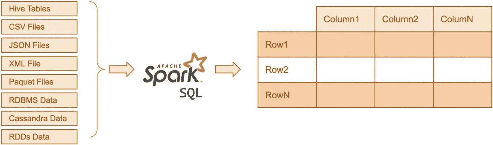

# 4. Spark 高级 API

`Spark SQL`、数据帧和数据集是 `Spark` 高级 API 的组成部分，旨在处理结构化数据，使 `Spark` 能够自动提升存储和计算性能。结构化数据是组织成标准化模式结构的信息，这使得它无需进一步处理即可访问和分析。结构化数据的示例包括数据库表、`Excel` 表格、关系型数据库管理系统（`RDBMS`）表、`Parquet` 文件等。

`Spark` 的高级 API 允许优化处理特定类型数据（例如二进制格式文件）的应用程序，其优化程度超出了 `Spark RDD` 所允许的限制。例如，数据帧和数据集利用 `Spark SQL` 的 `Catalyst` 优化器和 `Spark Project Tungsten`（本章后面会介绍）来优化其性能。

数据集 API 与数据帧 API 之间最重要的区别可能在于：数据集在编译时实现了类型安全。数据集在编译时强制执行类型安全，而数据帧则不会。`Spark` 在运行时验证数据帧的数据类型是否符合其模式中定义的类型，而数据集的数据类型则在编译时进行验证。我们将在本章后面详细讨论编译时类型安全的概念。

## 4.1 Spark 数据框

`DataFrame` 于 `Spark 1.3` 中引入，旨在提升 `Spark` 的性能和可扩展性。`DataFrame API` 引入了模式（`schema`）的概念来描述数据结构，使得 `Spark` 能够以更高效的方式在节点间移动数据，从而优化洗牌（`shuffle`）操作。从视觉上看，数据框类似于关系型数据库表或电子表格，如下例所示：

```
+--------+-----------------+-------------------+----+----+
|  Nombre|  Primer_Apellido|   Segundo_Apellido|Edad|Sexo|
+--------+-----------------+-------------------+----+----+
|  Miguel|     de Cervantes|           Saavedra|  50|   M|
|Fancisco|          Quevedo|Santibáñez Villegas|  55|   M|
|    Luis|       de Góngora|           y Argote|  65|   M|
|  Teresa|Sánchez de Cepeda|          y Ahumada|  70|   F|
+--------+-----------------+-------------------+----+----+
```

然而，从技术角度来看，`DataFrame` 是一种无类型数据集的视图。换句话说，`DataFrame` 是一个按列组织并带有列名的数据集。在 `Scala` 和 `Java` 中，`DataFrame` 可以被视为类型为 `Row`（`Dataset[Row]`）的无类型数据集，其中 `Row` 代表一个无类型的 `JVM` 对象。它们是按不同数据类型的命名列组织的数据行集合，并形成一个模式，如下所示：

```
root
|-- Nombre: string (nullable = true)
|-- Primer_Apellido: string (nullable = true)
|-- Segundo_Apellido: string (nullable = true)
|-- Edad: integer (nullable = true)
|-- Sexo: string (nullable = true)
```

如上述模式所示，每个数据框列都包含一组属性，例如名称、数据类型和一个可为空标志，该标志表示该列是否接受空值。

`DataFrame API` 是 `Spark SQL` 模块的一个组件，可用于所有编程语言，如 `Java`、`Python`、`SparkR` 和 `Scala`。与 `RDD` 不同，数据框提供自动优化，但与前者不同，它们不提供编译时类型安全。这意味着，虽然使用 `RDD` 和数据集时编译器知道列的数据类型（字符串、整数、`StructType` 等），但当您使用数据框时，操作返回的值是未定义数据类型的行数组。例如，您可以使用 `Scala` 的 `asInstanceOf()` 或 `PySpark` 的 `cast()` 方法将返回的值转换为特定类型。

让我们通过三个实际示例来分析类型安全的实现如何影响 `Spark` 应用程序的行为。

为此，我们将使用一个包含三位有史以来最杰出的西班牙作家的小型数据集。首先，我们将展示类型安全如何影响在过滤或映射函数中使用 lambda 表达式。以下是代码片段。

首先，我们创建一个样例类 `SpanishWritersDataFrame APISpanishWriters`，包含四个个人作家属性：

```
//spark.sparkContext.implicits._ 授予对 toDF() 方法的访问权限
import spark.sqlContext.implicits._
case class SpanishWriters(Nombre: String, Apellido: String, Edad: Int, Sexo:String)
```

对于此示例，我们创建一个西班牙作家的小型数据集：

```
val SpanishWritersData = Seq(SpanishWriters("Miguel", "Cervantes", 50, "M"), SpanishWriters("Fancisco", "Quevedo", 55, "M"), SpanishWriters("Luis", "Góngora", 65, "M"))
```

下一步，我们从上述数据集创建一个 `RDD`：

```
val SpanishWritersRDD = spark.sparkContext.parallelize(SpanishWritersData)
```

现在，我们分别使用 `toDF()` 和 `toDS()` 创建一个数据框和一个数据集：

```
val writersDF = SpanishWritersRDD.toDF()
val writersDS = SpanishWritersRDD.toDS()
```

现在，我们将看到在使用 lambda 函数过滤数据时，这些数据实体之间的差异：

```
// 数据框
val writersDFResult = writersDF.filter(writer => writer.Edad > 53)
// 输出
error: value Edad is not a member of org.apache.spark.sql.Row val writersDFResult = writersDF.filter(writer => writer.Edad > 53)
^
//数据集
val writersDSResult = writersDS.filter(writer => writer.Edad > 53)
// 输出
writersDSResult: org.apache.spark.sql.Dataset[SpanishWriters] = [Nombre: string, Apellido: string ... 2 more fields]
```

请注意，在两种数据结构中过滤信息时得到的不同输出。当我们对数据框应用过滤时，实现的 `lambda` 函数返回的是一个 `Row` 类型的对象，而不是您可能期望的整数值，因此它不能用于与整数（本例中为 53）进行比较。因此，仅使用列名，我们无法检索编码为 `Row` 对象的值。要获取 `Row` 对象的值，您必须将返回的值类型转换为整数。因此，我们需要将代码修改如下：

```
val writersDFResult = writersDF2.filter(writer => writer.getAsInt > 53)
writersDFResult.show()
// 输出
+--------+--------+----+----+
|  Nombre|Apellido|Edad|Sexo|
+--------+--------+----+----+
|Fancisco| Quevedo|  55|   M|
|    Luis| Góngora|  65|   M|
+--------+--------+----+----+
```

前面的示例展示了引入数据集的原因之一。开发人员无需事先知道返回的数据类型。

编译时类型安全的另一个示例出现在我们查询一个不存在的列时：

```
// 数据框
val writersDFBirthday = writersDF.select("Birthday")
// 输出
rg.apache.spark.sql.AnalysisException: Column 'Birthday' does not exist. Did you mean one of the following? [Edad, Apellido, Nombre, Sexo];
// 数据集
val writersDSBirthday = writersDS.map(writer => writer.Birthday)
// 输出
error: value Birthday is not a member of SpanishWriters
val writersDSBirthday = writersDS.map(writer => writer.Birthday)
^
```

在前面的示例中，您可以看到执行时（数据框）和编译时（数据集）之间的区别。前者仅在运行时抛出错误，而后者会在编译时给您一个错误消息。

另一个我们会发现 `DataFrames` 和数据集行为不同的情况是当我们想将它们恢复为原始的 RDD 时。在这种情况下，数据框恢复到 RDD 不会保留数据模式，而数据集恢复则会。让我们再次通过一个示例来看一下：

```
// 数据框恢复到 RDD
val rddFromDF = writersDF.rdd
// 输出
rddFromDF: org.apache.spark.rdd.RDD[org.apache.spark.sql.Row] = MapPartitionsRDD[249] at rdd at :75
```

然而，我们将无法正常使用这个恢复后的 RDD，因为实际上恢复返回的是一个 `Row` 类型的 RDD。让我们使用一个简单的操作来看看结果：

```
rddFromDF.map(writer => writer.Nombre).foreach(println)
// 输出
error: value Nombre is not a member of org.apache.spark.sql.Row
```

现在，我们将执行相同的操作，但这次使用我们的数据集：

```
// 数据集恢复到 RDD
val rddFromDS = writersDS.rdd
// 输出
rddFromDS: org.apache.spark.rdd.RDD[SpanishWriters] = MapPartitionsRDD[252] at rdd at
```

恢复返回的是一个真正的 RDD，因此我们可以正常使用它：

```
rddFromDS.map(writer => writer.Nombre).foreach(println)
// 输出
Luis
Fancisco
Miguel
```

这证明了数据集在恢复到 RDD 时会保留数据模式。

### Spark DataFrame 的属性

与其他 Apache Spark 模块一样，`DataFrames` 从诞生之初就是为了尽可能高效地处理大数据项目而创建的。因此，Spark `DataFrames` 支持分布在集群的各个节点上，充分利用 Spark 的分布式计算架构。发送给 `DataFrames` 的用户 SQL 查询和命令由 `Catalyst Optimizer` 管理，它负责查找并构建能够更高效地实现请求结果的查询执行计划。

Spark `DataFrames` 包含许多重要特性。其中之一是能够从外部源创建数据框——这在现实生活中非常有用，因为大多数时候数据会以文件、数据库等形式提供。图 4-1 展示了 Spark 原生支持加载到 `DataFrames` 中的外部文件格式示例。



一些 Spark 原生支持的用于将数据加载到 `DataFrames` 中的格式

`DataFrames` 的另一个重要特性是它们能够处理海量数据，从兆字节到拍字节不等。因此，Spark `DataFrames` 允许进行大规模数据管理。

### 创建 Spark DataFrame 的方法

`DataFrames` 可以通过多种不同的方式构建，例如手动创建、从外部关系数据库（MySQL、PostgreSQL、Oracle 等）或结构化数据文件（CSV、Excel 电子表格、Parquet、JSON 等）创建、从 NoSQL 数据库（Hive 表、Cassandra、HBase 或 MongoDB）创建，或者从已有的 RDDs 和二进制文件创建。

Spark 提供了两种手动构建 `DataFrames` 的方法：`toDF()` 和 `createDataFrame()`。利用这些方法，你可以从其他已有的 `DataFrames`、RDDs、数据集、列表和序列中创建新的 `DataFrames`。

尽管这两种方法非常相似，但它们之间有一些重要的区别。

#### 使用 `toDF()` 手动创建 Spark DataFrame

要使用 `toDF()`，我们首先需要导入 Spark 的 `sqlContext.implicits._` 库，以获得一个隐式方法将 RDD 转换为 DataFrame。让我们看看如何使用 `toDF()` 将 RDD 转换为 DataFrame：

```
val carsData=Seq(("USA","Chrysler","Chrysler 300",292),("Germany","BMW","BMW 8 Series",617),("Spain", "Spania GTA", "GTA Spano",925))
val carsRdd = spark.sparkContext.parallelize(carsData) // Seq 转 RDD
val dfCars = carsRdd.toDF() // RDD 转 DF
dfCars.show()
// 输出
+-------+----------+------------+---+
|     _1|        _2|          _3| _4|
+-------+----------+------------+---+
|    USA|  Chrysler|Chrysler 300|292|
|Germany|       BMW|BMW 8 Series|617|
|  Spain|Spania GTA|   GTA Spano|925|
+-------+----------+------------+---+
```

默认情况下，`toDF()` 会将序列 “_1”、“_2”、“_3”、“_4” 等分配为列名，并尝试推断数据类型（字符串和整数），并将除数字列外的所有列标记为可为空。你可以通过打印 `dfCars` 数据框的模式来看到这种行为：

```
dfCars.printSchema()
// 输出
root
|-- _1: string (nullable = true)
|-- _2: string (nullable = true)
|-- _3: string (nullable = true)
|-- _4: integer (nullable = false)
```

`toDF()` 方法接受不定数量的参数作为列名：`df.toDF('col1', 'col2', ..., 'colN')`，如下所示：

```
val dfBrandedCars = carsRdd.toDF("Country","Manufacturer","Model","Power" )
dfBrandedCars.show()
// 输出
+-------+------------+------------+-----+
|Country|Manufacturer|       Model|Power|
+-------+------------+------------+-----+
|    USA|    Chrysler|Chrysler 300|  292|
|Germany|         BMW|BMW 8 Series|  617|
|  Spain|  Spania GTA|   GTA Spano|  925|
+-------+------------+------------+-----+
```

从前面的例子中我们得出的结论是，使用 `toDF()` 我们无法控制数据框的模式。这意味着我们无法控制列类型和可为空标志。

#### 使用 `createDataFrame()` 手动创建 Spark DataFrame

我们可以利用 `createDataFrame()` 方法以两种形式构建 `DataFrames`。第一种是将其与 `toDF()` 结合使用，同时将 RDD 作为参数。让我们通过一个例子来展示它是如何工作的：
```

# Spark中创建DataFrame的两种方式

## 使用 `toDF()` 方法

```
var df2 = spark.createDataFrame(carsData) \
.toDF("Country","Manufacturer","Model","Power")
df2.show()
// 输出
+-------+------------+------------+-----+
|Country|Manufacturer|       Model|Power|
+-------+------------+------------+-----+
|    USA|    Chrysler|Chrysler 300|  292|
|Germany|         BMW|BMW 8 Series|  617|
|  Spain|  Spania GTA|   GTA Spano|  925|
+-------+------------+------------+-----+
```

## 使用 `createDataFrame()` 方法

第二种方式是我们可以使用 `createDataFrame()` 来创建一个数据框并释放其真正的威力，允许我们完全自定义自己的`DataFrame`模式。通过以下示例中引入模式定义，你可以很好地理解 `createDataFrame()` 的工作原理：

```
import org.apache.spark.sql.Row
import org.apache.spark.sql.types.{IntegerType,StringType, StructField, StructType}
// 首先，我们为 carsData 数据集创建一个模式。
val carSchema = StructType( Array(
StructField("Country", StringType,true),
StructField("Manufacturer", StringType,true),
StructField("Model", StringType,true),
StructField("Power", IntegerType,true)
))
// 注意，这里我们使用的是前面示例中展示的 carsRdd RDD
val carsRowRdd = carsRdd.map(carSpecs => Row(carSpecs._1, carSpecs._2, carSpecs._3, carSpecs._4))
val dfCarsFromRDD = spark.createDataFrame(carsRowRdd,carSchema)
dfCarsFromRDD.show()
// 输出
+-------+------------+------------+-----+
|Country|Manufacturer|       Model|Power|
+-------+------------+------------+-----+
|    USA|    Chrysler|Chrysler 300|  292|
|Germany|         BMW|BMW 8 Series|  617|
|  Spain|  Spania GTA|   GTA Spano|  925|
+-------+------------+------------+-----+
```

总而言之，我们可以说，虽然 `toDF()` 和 `createDataFrame()` 方法都可以用来创建`DataFrames`，但前者会推断数据模式，而后者则让你能够完全自定义控制`DataFrame`的模式。