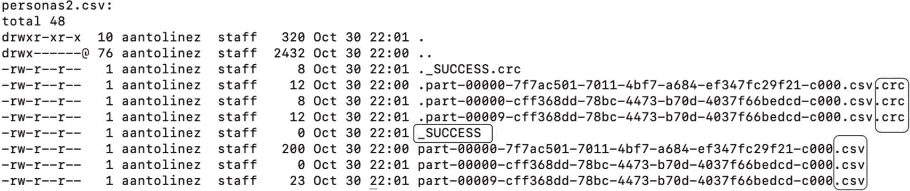
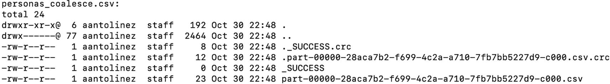
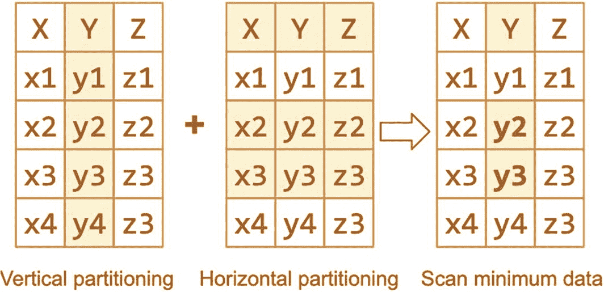
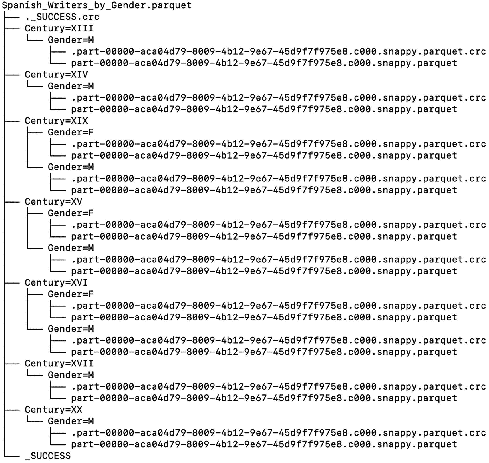

# 创建 Spark DataFrame 的数据源

Spark SQL 通过 DataFrame 接口支持多种数据源。DataFrame 可以通过两种不同的方式操作。第一种是直接使用我们在前几章已经见过的关系型转换。第二种是通过从 DataFrame 创建临时视图。第二种方法允许你对数据运行 SQL 查询，就像查询传统的关系型数据库管理系统一样。

`Parquet` 是 Spark 在输入/输出操作中期望使用的默认数据源。这个默认格式可以通过 `spark.sql.sources.default` 属性名称进行设置。

让我们通过一个例子来看一下。尝试使用 `load()` 方法加载一个 CSV 文件：

```
val personasDF = spark.read.load("/Users/aantolinez/Downloads/personas.csv")
```

你会收到以下错误信息：

```
Caused by: java.lang.RuntimeException: file:/Users/aantolinez/Downloads/personas.csv is not a Parquet file. Expected magic number at tail, but found [48, 44, 70, 10]
```

然而，如果你加载一个 Parquet 文件：

```
val personasDF = spark.read.load("/Users/aantolinez/Downloads/personas.parquet")
```

一切顺利：

```
personasDF: org.apache.spark.sql.DataFrame = [Nombre: string, Primer_Apellido: string ... 3 more fields]
```

如果你使用 PySpark 代码，情况完全相同：

```
personasDF = spark.read.load("/Users/aantolinez/Downloads/personas.csv")
// 输出
Caused by: java.lang.RuntimeException: file:/Users/aantolinez/Downloads/personas.csv is not a Parquet file. Expected magic number at tail, but found [48, 44, 70, 10]
```

而使用 Parquet 格式文件时，一切正常：

```
personasDF = spark.read.load("/Users/aantolinez/Downloads/personas.parquet")
personasDF.show(1)
# 输出
+------+---------------+----------------+----+----+
|Nombre|Primer_Apellido|Segundo_Apellido|Edad|Sexo|
+------+---------------+----------------+----+----+
|Miguel|   de Cervantes|        Saavedra|  50|   M|
+------+---------------+----------------+----+----+
```

### 使用 SQL 查询文件

有时直接查询数据文件而不是先将其加载到 DataFrame 中可能会很有用。Spark 允许你通过以下方式实现，在 Scala 和 PySpark 中使用相同的代码并获得相同的结果：

```
spark.sql("SELECT * FROM parquet.`/Users/aantolinez/Downloads/personas.parquet`").show()
// Scala 和 PySpark 输出
+--------+-----------------+-------------------+----+----+
|  Nombre|  Primer_Apellido|   Segundo_Apellido|Edad|Sexo|
+--------+-----------------+-------------------+----+----+
|  Miguel|     de Cervantes|           Saavedra|  50|   M|
|Fancisco|          Quevedo|Santibáñez Villegas|  55|   M|
|    Luis|       de Góngora|           y Argote|  65|   M|
|  Teresa|Sánchez de Cepeda|          y Ahumada|  70|   F|
+--------+-----------------+-------------------+----+----+
```

### 忽略损坏和缺失的文件

Spark 提供了 `spark.sql.files.ignoreCorruptFiles` 方法来忽略损坏的文件，以及 `spark.sql.files.ignoreMissingFiles` 方法来忽略从文件系统读取文件时缺失的文件。对于前者，当设置为 `true` 时，Spark 作业在发现损坏文件时不会崩溃，并且仍会返回已读取的内容。后者意味着当文件缺失时，Spark 作业不会失败，并且与前面的方法一样，仍会返回已读取的数据。在此上下文中，缺失文件是指在应用 DataFrame 转换后被删除的文件。

我们将通过一个例子来了解这个 Spark 特性：

```
// 启用忽略损坏文件
spark.sql("set spark.sql.files.ignoreCorruptFiles=true")
// personas_corrupt.parquet 不是真正的 parquet 文件
val corruptFiles = spark.read.parquet(
"/Users/aantolinez/Downloads/personas.parquet",
"/Users/aantolinez/Downloads/personas_corrupt.parquet")
corruptFiles.show()
```

### 基于时间的路径

Spark 提供了 `modifiedBefore` 和 `modifiedAfter` 选项，用于在查询时对应加载的文件进行时间控制。

`modifiedBefore` 接受一个时间戳作为参数，指示 Spark 仅读取修改时间早于给定时间的文件。类似地，`modifiedAfter` 也接受一个时间戳作为参数，但这次是命令 Spark 仅加载修改时间晚于给定时间的文件。在这两种情况下，时间戳必须采用以下格式：`YYYY-MM-DDTHH:mm:ss`（例如 `2022-10-29T20:30:50`）。

让我们通过一个 Scala 示例，然后是 PySpark 示例，来看看这个 Spark 行为：

```
val modifiedAfterDF = spark.read.format("csv")
.option("header", "true")
.option("modifiedAfter", "2022-10-30T05:30:00")
.load("/Users/aantolinez/Downloads/Hands-On-Spark3");
modifiedAfterDF.show();
```

我们可以使用 PySpark 代码获得相同的结果，如下所示：

```
modifiedAfterDF = spark.read.format("csv") \
.option("header", "true") \
.option("modifiedAfter", "2022-10-30T05:30:00") \
.load("/Users/aantolinez/Downloads/Hands-On-Spark3");
modifiedAfterDF.show();
```

两种情况的输出将相同：

```
+--------+-----------------+-------------------+----+----+
|  Nombre|  Primer_Apellido|   Segundo_Apellido|Edad|Sexo|
+--------+-----------------+-------------------+----+----+
|  Miguel|     de Cervantes|           Saavedra|  50|   M|
|Fancisco|          Quevedo|Santibáñez Villegas|  55|   M|
|    Luis|       de Góngora|           y Argote|  65|   M|
|  Teresa|Sánchez de Cepeda|          y Ahumada|  70|   F|
+--------+-----------------+-------------------+----+----+
```

这两个选项都支持通过 `spark.sql.session.timeZone` 指定时区；在这种情况下，时间戳将引用给定的时区。


### 指定保存选项

我们之前提到过，Spark 的默认数据源是 Parquet 格式；然而，Spark 也允许与许多其他数据源进行交互，例如 JSON、ORC、CSV 和文本文件，以及 Hive 表、Cassandra 等，还有 JDBC 数据源。

这个庞大的数据源生态系统以及 Spark 在不同格式之间转换数据的能力，使得 Spark 能够被用作一个高效的 ETL^(⁶) 工具。Spark 可以从上述数据源加载数据，进行转换，然后以指定的格式和存储库进行保存。有四种保存模式，如表 4-1 所示。

**表 4-1** 保存模式

| 在 Scala 和 Java 中 | 在任何语言中 | 含义 |
| --- | --- | --- |
| `SaveMode.ErrorIfExists`（默认） | `"error"` 或 `"errorifexists"`（默认） | 如果保存 DataFrame 时目标位置已存在数据，则抛出异常。 |
| `SaveMode.Append` | `"append"` | 数据被追加到目标数据/表中。 |
| `SaveMode.Overwrite` | `"overwrite"` | 如果目标位置已存在数据/表，则覆盖它。 |
| `SaveMode.Ignore` | `"ignore"` | 其工作方式类似于 SQL 的 `CREATE TABLE IF NOT EXISTS`。如果目标位置已存在数据，则忽略该操作。 |

让我们通过一个示例来看看 Spark 的保存模式是如何工作的：

```
val SpanishDf = spark.read.option("header", "true")
.option("inferSchema", "true")
.csv("/Users/aantolinez/Downloads/personas.csv")
// 写入第一个 DataFrame
SpanishDf.write.format("csv").mode("overwrite")
.option("header", true)
.save("/Users/aantolinez/Downloads/personas2.csv")
// 添加一些数据以追加到之前保存的 DataFrame
val SpanishWritersData2 = Seq(("Miguel", "de Unamuno", 70, "M"))
val SpanishWritersRdd = spark.sparkContext.parallelize(SpanishWritersData2)
val SpanishWritersAppendDF = SpanishWritersRdd.toDF()
// 将新数据追加到之前保存的数据中
SpanishWritersAppendDF.write.format("csv").mode("append").save("/Users/aantolinez/Downloads/personas2.csv")
```

现在，如果你查看图 4-2 中保存的数据，你会看到一些令人惊讶的东西。



一段代码片段显示了关于文件 `personas2.csv` 的信息。它显示了文件的大小、权限、修改日期，以及同一目录下的其他相关文件及其属性。它突出显示了 `_SUCCESS` 以及文件名 `.crc` 和 `.csv`。

**图 4-2** Spark 保存的数据

原因如下。默认情况下，Spark 会将 DataFrame、数据集或 RDD 保存到一个以指定名称命名的文件夹中，并将内容写入该文件夹内的多个 part 文件（每个分区一个 part 文件），这些文件具有指定的格式扩展名。正如你在前面的输出中所看到的，Spark 还会为每个分区写入一个 `_SUCCESS` 文件和一个 `.crc` 文件。

如果出于某种原因，你需要将数据合并到一个文件中，并去掉文件夹和附带文件，你只能轻松实现你的第一个愿望。

如前所述，Spark 会为每个分区创建一个文件。因此，获取单个文件的一种方法是使用 `coalesce()` 和/或 `repartition()` 方法将所有经过 shuffle 的数据合并到一个分区中。

### 注意

在处理大量数据时，请谨慎使用 `coalesce()` 和/或 `repartition()` 方法，因为这可能会使驱动程序内存过载，并导致 OutOfMemory 问题。

让我们通过一个适用于 Scala 和 PySpark 的简单示例来看看如何获取单个文件：

```
SpanishWritersAppendDF.coalesce(1)
.write.csv("/Users/aantolinez/Downloads/personas_coalesce.csv")
```

现在，当你查看上述代码的输出（图 4-3）时，你可以看到一个单一的 CSV 文件；然而，文件夹、`_SUCCESS` 文件和 `.crc` 隐藏文件仍然存在。



一段代码片段显示了关于文件 `personas_coalesce.csv` 的信息。它显示了文件的大小、权限、修改日期，以及同一目录下的其他相关文件及其属性。

**图 4-3** Spark 保存到单个文件

要进行进一步优化，例如移除文件夹以及 `_SUCCESS` 和 `.crc` 隐藏文件，你将需要使用 Hadoop 文件系统库来操作最终的输出。

### 读取和写入 Apache Parquet 文件

Apache Parquet 是一种免费、开源、列式且自描述的**文件格式**，专为快速分析查询而设计。Apache Parquet 在现代数据湖中扮演着重要角色，因为它能够跳过不相关的数据，从而实现对大型数据集的高效查询。

Parquet 列式存储的一些优势如下：



三个表格展示了垂直分区 y, y1, y2, y3, y4，加上水平分区 x, y, z, x2, y2, z2, x3, y3, z3 的数据，相当于扫描 x, y 和 z 的最小数据量。Y, y2 和 y3 被着色。

**图 4-4** Parquet 数据分区

*   **列式存储**：Parquet 是一种面向列的格式。在 Parquet 文件中，数据按列存储，这意味着每列的值彼此相邻存储，便于访问，从而提升查询性能。

*   **自描述**：Parquet 文件将数据本身与数据模式和结构结合在一起。这种结合简化了用于读取、存储和写入 Parquet 文件的工具的开发。

*   **压缩**：在 Parquet 文件中，数据压缩是逐列进行的，并且包含灵活的压缩选项，例如每种数据类型可扩展的编码模式。这意味着我们可以根据数据类型（`long`、`string`、`date` 等）使用不同的压缩编码，从而优化压缩效果。

*   **性能**：Parquet 格式专为查询性能而设计。Parquet 的内部格式结构（这超出了本书的范围）由行组、头部和尾部组成，它最大限度地减少了读取的数据量，从而减少了磁盘 I/O。将 Parquet 与 CSV 文件进行比较，后者必须完整读取并加载到内存中，而前者只允许读取回答我们问题所需的相关列。Parquet 格式允许检索最少的数据，实现了行组和列块（column chunks）的垂直和水平分区，如图 4-4 所示。列块也被组织成包含元数据信息的数据页。


### 将 DataFrame 保存并压缩为 Parquet 文件格式

`parquet()` 方法允许将 Spark DataFrame 保存为 Parquet 文件格式。默认情况下，此方法使用 `snappy` 压缩编解码器：

```
import org.apache.spark.sql.types.{StringType, StructType, IntegerType}
val schemaWriters = new StructType()
.add("Name",StringType,true)
.add("Surname",StringType,true)
.add("Century",StringType,true)
.add("YearOfBirth",IntegerType,true)
val SpanishWritersDf = spark.read.option("header", "true")
.schema(schemaWriters)
.csv("/Users/aantolinez/Downloads/Spanish_Writers_by_Century.csv")
// 使用默认压缩编解码器保存数据：snappy
SpanishWritersDf.write.parquet("/Users/aantolinez/Downloads/Spanish_Writers_by_Century.parquet")
Spanish_Writers_by_Century.parquet:
_SUCCESS    part-00000-e4385fd4-fcc0-4a5c-8632-d0080438fa82-c000.gz.parquet
```

压缩编解码器可以设置为 `none`、`uncompressed`、`snappy`、`gzip`、`lzo`、`brotli`、`lz4` 和 `zstd`，这会覆盖 `spark.sql.parquet.compression.codec` 配置。可以使用 `append` 选项将数据追加到 Parquet 文件中：

```
// 使用 gzip 压缩编解码器选项保存数据
SpanishWritersDf.write.mode("append").option("compression", "gzip").parquet("/Users/aantolinez/Downloads/Spanish_Writers_by_Century.parquet")
```

如下所示，可以组合使用多种压缩编解码器：

```
Spanish_Writers_by_Century.parquet:
_SUCCESS    part-00000-e4385fd4-fcc0-4a5c-8632-d0080438fa82-c000.gz.parquet
part-00000-d070dd4d-86ca-476f-8e67-060365db7ca7-c000.snappy.parquet
```

使用 PySpark 代码也可以获得相同的结果：

```
from pyspark.sql.types import StructField, StringType, StructType, IntegerType
schemaWriters = StructType([
StructField("Name",StringType(),True),
StructField("Surname",StringType(),True),
StructField("Century",StringType(),True),
StructField("YearOfBirth", IntegerType(), True)
])
SpanishWritersDf = spark.read.option("header", "true") \
.schema(schemaWriters) \
.csv("/Users/aantolinez/Downloads/Spanish_Writers_by_Century.csv")
```

### 对 Parquet 文件执行直接查询

Spark 可以通过临时视图直接在 Parquet 文件上运行 SQL 语句：

```
val parquetDF = spark.read.parquet("/Users/aantolinez/Downloads/Spanish_Writers_by_Century.parquet")
parquetDF.createOrReplaceTempView("TempTable")
val sqlDf = spark.sql("select * from TempTable where YearOfBirth = 1600")
sqlDf.show()
// 输出
+--------+-----------+-------+-----------+
|    Name|    Surname|Century|YearOfBirth|
+--------+-----------+-------+-----------+
|Calderón|de la Barca|   XVII|       1600|
+--------+-----------+-------+-----------+
```

使用 PySpark 代码也可以获得相同的结果，如下面的代码片段所示：

```
parquetDF = spark.read.parquet("/Users/aantolinez/Downloads/Spanish_Writers_by_Century.parquet")
parquetDF.createOrReplaceTempView("TempTable")
sqlDf = spark.sql("select * from TempTable where YearOfBirth = 1600")
sqlDf.show()
# 输出
+--------+-----------+-------+-----------+
|    Name|    Surname|Century|YearOfBirth|
+--------+-----------+-------+-----------+
|Calderón|de la Barca|   XVII|       1600|
+--------+-----------+-------+-----------+
```

### Parquet 文件分区

Spark 允许使用 `partitionBy()` 方法对 Parquet 文件进行分区。文件分区是 Spark 提升数据分析性能和可扩展性的关键特性之一。文件分区是加快读取速度的关键特性；它允许快速访问数据、加载更小的数据集以及并行处理数据。让我们通过一个小例子来看看它是如何工作的：

```
import org.apache.spark.sql.types.{StringType, StructType, IntegerType}
val schemaWriters = new StructType()
.add("Name",StringType,true)
.add("Surname",StringType,true)
.add("Century",StringType,true)
.add("YearOfBirth",IntegerType,true)
.add("Gender",StringType,true)
val SpanishWritersDf = spark.read.option("header", "true")
.schema(schemaWriters)
.csv("/Users/aantolinez/Downloads/Spanish_Writers_by_Gender.csv")
SpanishWritersDf.write.partitionBy("Century","Gender")
.parquet("/Users/aantolinez/Downloads/Spanish_Writers_by_Gender.parquet")
```

Spark 会基于 `Century`（第一个分区键）创建一个文件夹层级，并递归地为 `Gender`（第二个分区键）创建一组子文件夹。您可以在图 4-5 中看到上述层级结构。



一个片段显示了与 Spanish Writers by Gender dot parquet 数据集相关的文件，这些文件按世纪和性别类别组织，其中 `.crc` 文件表示校验和。`_SUCCESS` 文件的存在表示相关过程已成功完成。

**图 4-5** Spark 按键对 Parquet 文件进行分区

以下 PySpark 代码片段将返回相同的输出：

```
from pyspark.sql.types import StructField, StringType, StructType, IntegerType
schemaWriters = StructType([
StructField("Name",StringType(),True),
StructField("Surname",StringType(),True),
StructField("Century",StringType(),True),
StructField("YearOfBirth", IntegerType(),True),
StructField("Gender",StringType(),True),
])
SpanishWritersDf = spark.read.option("header", "true") \
.schema(schemaWriters) \
.csv("/Users/aantolinez/Downloads/Spanish_Writers_by_Gender.csv")
SpanishWritersDf.write.partitionBy("Century","Gender") \
.parquet("/Users/aantolinez/Downloads/Spanish_Writers_by_Gender.parquet")
```

### 读取 Parquet 文件分区

Spark 提供加速数据处理的方法之一，是允许只读取所需的数据部分。

在下面的 Scala 代码片段中，您可以看到如何仅从 Parquet 文件中选择所需的数据：

```
val partitionDF = spark.read.parquet("/Users/aantolinez/Downloads/Spanish_Writers_by_Gender.parquet/Century=XX")
partitionDF.show()
+----+---------------+-----------+------+
|Name|        Surname|YearOfBirth|Gender|
+----+---------------+-----------+------+
|José|Ortega y Gasset|       1883|     M|
+----+---------------+-----------+------+
```

使用 PySpark 代码也能获得相同的结果：

```
partitionDF = spark.read.parquet("/Users/aantolinez/Downloads/Spanish_Writers_by_Gender.parquet/Century=XX")
partitionDF.show()
```


### 使用 Spark 读写 JSON 文件

Spark 提供了两种读取 JSON 文件的方法：将 JSON 文件加载为 `Dataset[Row]`，以及以 JSON 格式将数据写入磁盘。Spark 原生支持 JSON 文件的模式推断，但 JSON 文件必须包含独立的、以换行符分隔的有效 JSON 对象。

你可以使用 `spark.read.json("path/to/file.json")` 加载单行或多行 JSON 文件，或将 `Dataset[String]` 加载到 Spark DataFrame 中；使用 `dataframe.write.json("path/to/file.json")` 将 Spark DataFrame 保存为 JSON 文件。

让我们看看如何将 JSON 文件加载到 Spark DataFrame 中。在第一个示例中，我们将加载一个由换行符分隔的 JSON 字符串组成的文件，如下所示：

```
{"id":1,"first_name":"Luis","last_name":"Ortiz","email":"luis.ortiz@mapy.cz","country":"Spain","updated":"2015-05-16","registered":false},
{"id":2,"first_name":"Alfonso","last_name":"Antolinez","email":"aantolinez@optc.es","country":"Spain","updated":"2015-03-11","registered":true},
{"id":3,"first_name":"Juan","last_name":"Dominguez","email":"jdomin@xyz.org","country":"Spain","updated":"2015-02-15","registered":true},
{"id":4,"first_name":"Santiago","last_name":"Sanchez","email":"ssanchez@google.com","country":"Spain","updated":"2014-10-31","registered":false}
```

要加载一个简单的单文件 JSON，你可以使用 `read.json()`，如下例所示：

```
val df = spark.read.json("/Users/aantolinez/Downloads/Spaniards.json")
```

与其他数据源格式不同，Spark 在读取 JSON 文件时能够推断数据模式：

```
df.printSchema()
// 输出
root
|-- country: string (nullable = true)
|-- email: string (nullable = true)
|-- first_name: string (nullable = true)
|-- id: long (nullable = true)
|-- last_name: string (nullable = true)
|-- registered: boolean (nullable = true)
|-- updated: string (nullable = true)
```

使用 PySpark 代码也能获得相同的结果，如下所示：

```
jsonDf = spark.read.json("/Users/aantolinez/Downloads/Spaniards.json")
jsonDf.printSchema()
# 输出
root
|-- country: string (nullable = true)
|-- email: string (nullable = true)
|-- first_name: string (nullable = true)
|-- id: long (nullable = true)
|-- last_name: string (nullable = true)
|-- registered: boolean (nullable = true)
|-- updated: string (nullable = true)
```

然而，在许多实际场景中，你会遇到格式为 JSON 字符串数组的文件。这种文件格式的一个示例如下：

```
[{"id":1,"first_name":"Luis","last_name":"Ortiz","email":"luis.ortiz@mapy.cz","country":"Spain","updated":"2015-05-16","registered":false},
{"id":2,"first_name":"Alfonso","last_name":"Antolinez","email":"aantolinez@optc.es","country":"Spain","updated":"2015-03-11","registered":true},
{"id":3,"first_name":"Juan","last_name":"Dominguez","email":"jdomin@xyz.org","country":"Spain","updated":"2015-02-15","registered":true},
{"id":4,"first_name":"Santiago","last_name":"Sanchez","email":"ssanchez@google.com","country":"Spain","updated":"2014-10-31","registered":false}]
```

这类文件被称为多行 JSON 字符串。对于多行 JSON 文件，你必须在读取数据时使用 `.option("multiline","true")`。让我们通过 Scala 和 PySpark 的示例来看看它是如何工作的：

```
// 将多行 JSON 字符串文件加载到 DataFrame 中。Scala
val multilineJsonDf = spark.read.option("multiline","true")
.json("/Users/aantolinez/Downloads/Spaniards_array.json")
multilineJsonDf.show(4, false)
// 输出
+-------+-------------------+----------+---+---------+----------+----------+
|country|email              |first_name|id |last_name|registered|updated   |
+-------+-------------------+----------+---+---------+----------+----------+
|Spain  |luis.ortiz@mapy.cz |Luis      |1  |Ortiz    |false     |2015-05-16|
|Spain  |aantolinez@optc.es |Alfonso   |2  |Antolinez|true      |2015-03-11|
|Spain  |jdomin@xyz.org     |Juan      |3  |Dominguez|true      |2015-02-15|
|Spain  |ssanchez@google.com|Santiago  |4  |Sanchez  |false     |2014-10-31|
+-------+-------------------+----------+---+---------+----------+----------+
```

### 一次性读取多个 JSON 文件

`read.json()` 方法也可以用于从不同路径读取多个文件。要一次性加载多个文件，你只需将它们的路径作为列表元素传入。看看如何在 Scala 代码片段中实现：

```
// 一次性将多行 JSON 字符串文件加载到 DataFrame 中
val multipleJsonsDf = spark.read.option("multiline","true").json(
"/Users/aantolinez/Downloads/Spaniards_array.json",
"/Users/aantolinez/Downloads/Spaniards_array2.json")
// 输出
+-------+-------------------+----------+---+---------+----------+----------+
|country|email              |first_name|id |last_name|registered|updated   |
+-------+-------------------+----------+---+---------+----------+----------+
|Spain  |luis.ortiz@mapy.cz |Luis      |1  |Ortiz    |false     |2015-05-16|
|Spain  |aantolinez@optc.es |Alfonso   |2  |Antolinez|true      |2015-03-11|
|Spain  |jdomin@xyz.org     |Juan      |3  |Dominguez|true      |2015-02-15|
|Spain  |ssanchez@google.com|Santiago  |4  |Sanchez  |false     |2014-10-31|
|Spain  |luis.herrera@xyz.es|Luis      |1  |Herrera  |false     |2015-05-15|
|Spain  |mabad@opti.es      |Marcos    |2  |Abad     |true      |2015-03-21|
|Spain  |jabalos@redis.org  |Juan      |3  |Abalos   |true      |2015-02-14|
|Spain  |samo@terra.es      |Santiago  |4  |Amo      |false     |2014-10-21|
+-------+-------------------+----------+---+---------+----------+----------+
```

使用 PySpark 代码也能达到同样的效果：

```
multipleJsonsDf = spark.read.option("multiline","true") \
.json(["/Users/aantolinez/Downloads/Spaniards_array.json", \
"/Users/aantolinez/Downloads/Spaniards_array2.json"])
multipleJsonsDf.show(10,False)
# 输出
+-------+-------------------+----------+---+---------+----------+----------+
|country|email              |first_name|id |last_name|registered|updated   |
+-------+-------------------+----------+---+---------+----------+----------+
|Spain  |luis.ortiz@mapy.cz |Luis      |1  |Ortiz    |false     |2015-05-16|
|Spain  |aantolinez@optc.es |Alfonso   |2  |Antolinez|true      |2015-03-11|
|Spain  |jdomin@xyz.org     |Juan      |3  |Dominguez|true      |2015-02-15|
|Spain  |ssanchez@google.com|Santiago  |4  |Sanchez  |false     |2014-10-31|
|Spain  |luis.herrera@xyz.es|Luis      |1  |Herrera  |false     |2015-05-15|
|Spain  |mabad@opti.es      |Marcos    |2  |Abad     |true      |2015-03-21|
|Spain  |jabalos@redis.org  |Juan      |3  |Abalos   |true      |2015-02-14|
|Spain  |samo@terra.es      |Santiago  |4  |Amo      |false     |2014-10-21|
+-------+-------------------+----------+---+---------+----------+----------+
```


### 一次性根据模式读取 JSON 文件

在实际工作中，你可能会遇到需要根据文件名模式读取文件，或者读取文件夹中所有文件的情况。Spark 允许使用我们之前示例中见过的同一个 `read.json()` 方法，根据文件名模式或读取目录中的全部文件来加载数据。让我们通过另一个示例来看看它是如何工作的：

```
val patternJsonsDf = spark.read.option("multiline","true").json(
"/Users/aantolinez/Downloads/Spaniards_array*.json")
patternJsonsDf.show(20, false)
// 输出
+-------+-------------------------+----------+---+---------+----------+----------+
|country|email                    |first_name|id |last_name|registered|updated   |
+-------+-------------------------+----------+---+---------+----------+----------+
|Spain  |luis.garcia@xyz.es       |Lucia     |9  |Garcia   |true      |2015-05-15|
|Spain  |maria.rodriguez@opti.es  |Maria     |10 |Rodriguez|true      |2015-03-21|
|Spain  |carmen.gonzalez@redis.org|Carmen    |11 |Gonzalez |true      |2015-02-14|
|Spain  |sara.fernandez@terra.es  |Sara      |12 |Fernandez|true      |2014-10-21|
|Spain  |luis.ortiz@mapy.cz       |Luis      |1  |Ortiz    |false     |2015-05-16|
|Spain  |aantolinez@optc.es       |Alfonso   |2  |Antolinez|true      |2015-03-11|
|Spain  |jdomin@xyz.org           |Juan      |3  |Dominguez|true      |2015-02-15|
|Spain  |ssanchez@google.com      |Santiago  |4  |Sanchez  |false     |2014-10-31|
|Spain  |luis.herrera@xyz.es      |Luis      |1  |Herrera  |false     |2015-05-15|
|Spain  |mabad@opti.es            |Marcos    |2  |Abad     |true      |2015-03-21|
|Spain  |jabalos@redis.org        |Juan      |3  |Abalos   |true      |2015-02-14|
|Spain  |samo@terra.es            |Santiago  |4  |Amo      |false     |2014-10-21|
+-------+-------------------------+----------+---+---------+----------+----------+
```

使用 PySpark 代码可以得到完全相同的结果，如下所示：

```
patternJsonsDf = spark.read.option("multiline","true").json(
"/Users/aantolinez/Downloads/Spaniards_array*.json")
patternJsonsDf.show(20, False)
```

类似地，你可以使用模式来加载文件夹中的所有 JSON 文件。例如，以下代码片段将允许你读取一个目录中的所有 JSON 文件（且仅限 JSON 文件）：

```
// 在 Scala 中读取目录中的所有 JSON 文件（且仅限 JSON 文件）。
val patternJsonsDf = spark.read.option("multiline","true").json(
"/Users/aantolinez/Downloads/*.json")
# 在 PySpark 中读取目录中的所有 JSON 文件（且仅限 JSON 文件）。
patternJsonsDf = spark.read.option("multiline","true").json(
"/Users/aantolinez/Downloads/*.json")
```

同样，如果你想读取一个目录中的所有文件，可以使用以下代码：

```
// 在 Scala 中读取目录中的 ALL 文件。
val patternJsonsDf = spark.read.option("multiline","true").json(
"/Users/aantolinez/Downloads/")
# 在 PySpark 中读取目录中的 ALL 文件。
patternJsonsDf = spark.read.option("multiline","true").json(
"/Users/aantolinez/Downloads/")
```

### 对 JSON 文件进行直接查询

与其他文件格式（如 Parquet）一样，Spark 也允许我们直接查询 JSON 文件。因此，可以创建一个 SQL 查询字符串并将其传递给 Spark，就像你对关系型数据库管理系统（RDBMS）所做的那样。

假设你想直接查询前面示例中展示的 `Spaniards.json` 文件。一种方法是将以下查询发送给 Spark：

```
CREATE TEMPORARY VIEW Spaniards
USING org.apache.spark.sql.json
OPTIONS (path '/Users/aantolinez/Downloads/Spaniards.json')
```

像往常一样，现在我们来看看如何使用 Scala 和 PySpark 代码来实现它：

```
// 使用 Scala 代码
val sqlContext = new org.apache.spark.sql.SQLContext(sc)
val Spaniards = sqlContext.jsonFile("/Users/aantolinez/Downloads/Spaniards.json")
Spaniards.registerTempTable("Spaniards")
sqlContext.sql("select * from Spaniards").show(false)
// 输出
+-------+-------------------+----------+---+---------+----------+----------+
|country|email              |first_name|id |last_name|registered|updated   |
+-------+-------------------+----------+---+---------+----------+----------+
|Spain  |luis.ortiz@mapy.cz |Luis      |1  |Ortiz    |false     |2015-05-16|
|Spain  |aantolinez@optc.es |Alfonso   |2  |Antolinez|true      |2015-03-11|
|Spain  |jdomin@xyz.org     |Juan      |3  |Dominguez|true      |2015-02-15|
|Spain  |ssanchez@google.com|Santiago  |4  |Sanchez  |false     |2014-10-31|
+-------+-------------------+----------+---+---------+----------+----------+
```

使用更简洁的代码也可以获得完全相同的结果：

```
spark.sqlContext.sql("CREATE TEMPORARY VIEW Spaniards USING json OPTIONS" + " (path '/Users/aantolinez/Downloads/Spaniards.json')")
spark.sqlContext.sql("select * from Spaniards").show(false)
// 输出
+-------+-------------------+----------+---+---------+----------+----------+
|country|email              |first_name|id |last_name|registered|updated   |
+-------+-------------------+----------+---+---------+----------+----------+
|Spain  |luis.ortiz@mapy.cz |Luis      |1  |Ortiz    |false     |2015-05-16|
|Spain  |aantolinez@optc.es |Alfonso   |2  |Antolinez|true      |2015-03-11|
|Spain  |jdomin@xyz.org     |Juan      |3  |Dominguez|true      |2015-02-15|
|Spain  |ssanchez@google.com|Santiago  |4  |Sanchez  |false     |2014-10-31|
+-------+-------------------+----------+---+---------+----------+----------+
```

现在我们将展示如何使用 PySpark 代码获得相同的结果：

```
# 使用 PySpark 代码
spark.sql("CREATE TEMPORARY VIEW Spaniards USING json OPTIONS" + " (path '/Users/aantolinez/Downloads/Spaniards.json')")
spark.sql("select * from Spaniards").show(10, False)
# 输出
+-------+-------------------+----------+---+---------+----------+----------+
|country|email              |first_name|id |last_name|registered|updated   |
+-------+-------------------+----------+---+---------+----------+----------+
|Spain  |luis.ortiz@mapy.cz |Luis      |1  |Ortiz    |false     |2015-05-16|
|Spain  |aantolinez@optc.es |Alfonso   |2  |Antolinez|true      |2015-03-11|
|Spain  |jdomin@xyz.org     |Juan      |3  |Dominguez|true      |2015-02-15|
|Spain  |ssanchez@google.com|Santiago  |4  |Sanchez  |false     |2014-10-31|
+-------+-------------------+----------+---+---------+----------+----------+
```

### 将 DataFrame 保存为 JSON 文件

Apache Spark 提供了一个类似的方法 `write().json()`，可以轻松地将 DataFrame 保存为 JSON 文件。下一个代码片段展示了如何将 `multipleJsonsDf` 数据帧保存为 JSON 文件到持久化存储中：

```
multipleJsonsDf.write
.json("/Users/aantolinez/Downloads/Merged_Spaniards_array.json")
```

现在，我们检查一下 `Merged_Spaniards_array.json` 是否已创建，并如预期那样被分割成多个分区：

```
ls Downloads/Merged_Spaniards_array.json
_SUCCESS
part-00000-69975a01-3566-4d2d-898d-cf9e543d81c3-c000.json
part-00001-69975a01-3566-4d2d-898d-cf9e543d81c3-c000.json
```

### 保存模式

与其他文件格式一样，适用于 JSON 文件的保存模式与之前表 4-1 中展示的相同。在下一个代码片段中，你可以看到如何将数据追加到一个已存在的 JSON 文件中：

```
multipleJsonsDf.write.mode("append").json("/Users/aantolinez/Downloads/Merged_Spaniards_array.json")
ls Downloads/Merged_Spaniards_array.json
_SUCCESS
part-00000-188063e9-e5f6-4308-b6e1-7965eaa46c80-c000.json
part-00000-7453b1ad-f3b6-4e68-80eb-254fb539c04d-c000.json
part-00001-188063e9-e5f6-4308-b6e1-7965eaa46c80-c000.json
part-00001-7453b1ad-f3b6-4e68-80eb-254fb539c04d-c000.json
```

同样的代码可用于 PySpark。

在早期的 Spark 版本中，保存模式被标识为 `SaveMode.ErrorIfExists`、`SaveMode.Overwrite`、`SaveMode.Append` 和 `SaveMode.Ignore`。然而，在最新的 Spark 版本中，`mode("errorifexists")`、`mode("append")` 等格式似乎是主流方式。


