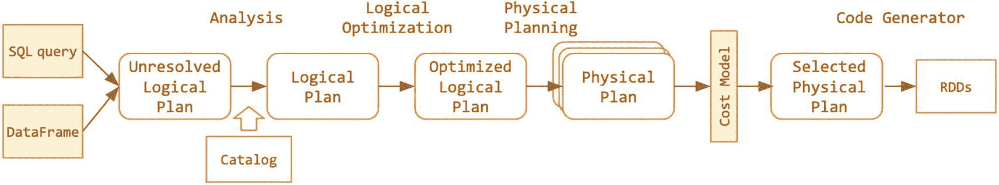
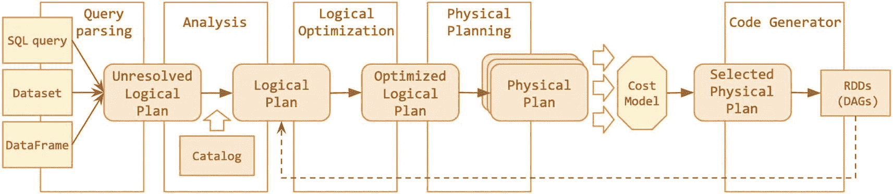
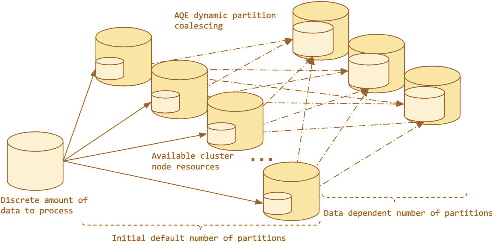
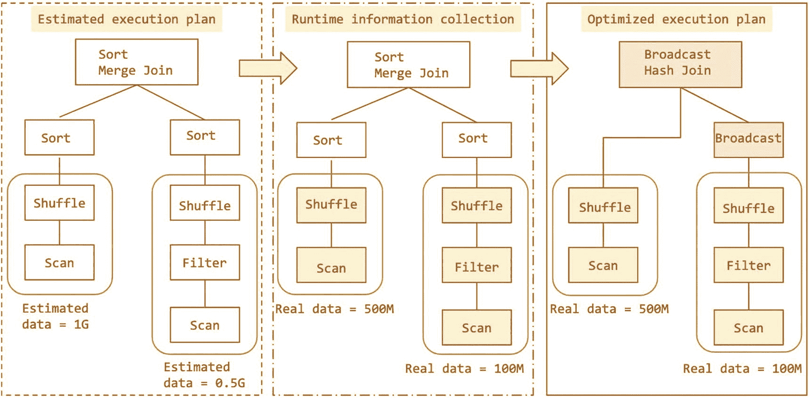
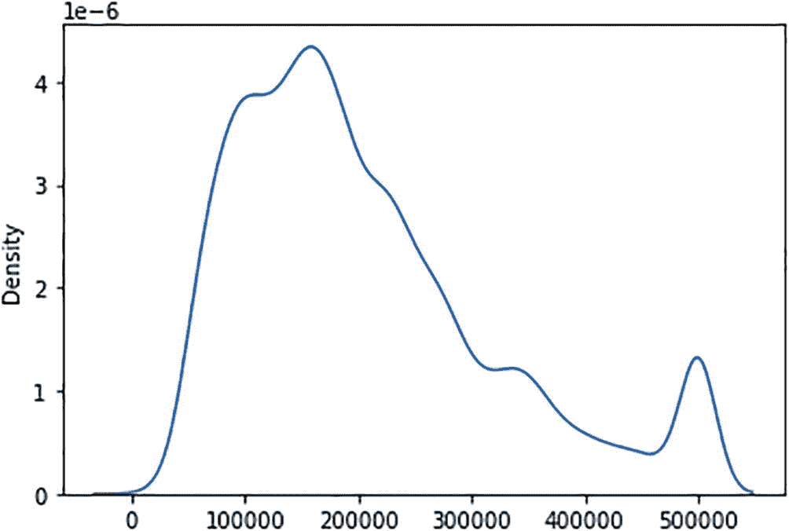

# 5. Spark Dataset API 与自适应查询执行

在 Spark 生态系统中，DataFrame 和数据集是底层使用 Spark RDD 的高级 API。Spark 开发者主要使用 DataFrame 和数据集，因为这些数据结构能更高效地利用 Spark 的存储和查询优化器，从而实现最佳的数据处理性能。因此，DataFrame 和数据集是处理结构化数据时获得最佳性能的 Spark 工具。Spark DataFrame 和数据集还允许具有 RDBMS 和 SQL 背景的技术人员更快地利用 Spark 的功能。

## 5.1 什么是 Spark 数据集？

根据官方 [Spark 数据集文档](https://spark.apache.org/docs/latest/api/scala/org/apache/spark/sql/Dataset.html)，数据集是“*一种强类型的领域特定对象集合，可以通过函数式或关系型操作进行并行化处理*”。数据集是在 Spark 1.6 中引入的，旨在克服 DataFrame 的某些局限性；而在 Spark 2.0 中，这两个高级 API（DataFrame 和 Dataset）被合并为一个统一的 Dataset API。因此，DataFrame 可以被视为行类型的数据集，即 `Dataset[Row]`。

数据集结合了 RDD 的特性（如编译时类型安全和使用 lambda 函数的能力）与 DataFrame 的特性（包括 SQL 自动优化）。数据集还引入了编译时安全性，这一特性仅在 Java 或 Scala 等编译型语言中实现，而在 PySpark 或 SparkR 等解释型语言中不可用。这就是数据集仅适用于 Java 和 Scala 的原因。

## 5.2 创建 Spark 数据集的方法

数据集可以通过以下四种不同的方式创建：

- 可以从元素序列创建
- 可以从样例类序列创建
- 可以从 RDD 创建
- 可以从 DataFrame 创建

可以使用 `toDS()` 方法从元素序列创建数据集，如下例所示：

```
val sequencia = Seq(0, 1, 2, 3, 4)
val sequenciaToDS = sequencia.toDS()
sequenciaToDS.show()
// 输出
+-----+
|value|
+-----+
|    0|
|    1|
|    2|
|    3|
|    4|
+-----+
```

要再次使用 `toDS()` 方法从样例类序列创建数据集，我们首先需要一个样例类。让我们通过一个实际示例来看看它是如何工作的。首先，我们创建一个名为 `Personas` 的 Scala `case class`：

```
case class Personas(Nombre: String, Primer_Apellido: String, Segundo_Apellido: String, Edad: Int, Sexo:String)
```

然后，我们可以创建一个与 `Personas` 样例类模式匹配的数据序列。在这个例子中，我们将使用一些有史以来最著名的西班牙作家的数据：

```
val personasSeq = Seq(
Personas("Miguel","de Cervantes","Saavedra",50,"M"),
Personas("Fancisco","Quevedo","Santibáñez Villegas",55,"M"),
Personas("Luis","de Góngora","y Argote",65,"M"))
```

之后，我们可以通过对 `personasSeq` 序列应用 `toDS()` 方法来获得一个数据集：

```
val personasDs = personasSeq.toDS()
personasDs.show()
// 输出
+--------+---------------+-------------------+----+----+
|  Nombre|Primer_Apellido|   Segundo_Apellido|Edad|Sexo|
+--------+---------------+-------------------+----+----+
|  Miguel|   de Cervantes|           Saavedra|  50|   M|
|Fancisco|        Quevedo|Santibáñez Villegas|  55|   M|
|    Luis|     de Góngora|           y Argote|  65|   M|
+--------+---------------+-------------------+----+----+
```

创建数据集的另一种方式是从 RDD 创建。我们再次通过一个示例来展示它是如何工作的：

```
val myRdd = spark.sparkContext.parallelize(Seq(("Miguel de Cervantes", 1547),("Lope de Vega", 1562),("Fernando de Rojas",1470)))
val rddToDs = myRdd.toDS
.withColumnRenamed("_1","Nombre")
.withColumnRenamed("_2","Nacimiento")
rddToDs.show()
// 输出
+-------------------+----------+
|             Nombre|Nacimiento|
+-------------------+----------+
|Miguel de Cervantes|      1547|
|       Lope de Vega|      1562|
|  Fernando de Rojas|      1470|
+-------------------+----------+
```

创建数据集的第四种方式是从 DataFrame 创建。在这种情况下，我们将使用一个外部文件来创建 DataFrame，然后将其转换为数据集，如下面的代码片段所示：

```
case class Personas(Nombre: String, Primer_Apellido: String, Segundo_Apellido: String, Edad: Int, Sexo:String)
val personas = spark.read.format("csv")
.option("header", "true")
.option("inferSchema", "true")
.load("personas.csv")
.as[Personas]
personas.show()
// 输出
+--------+-----------------+-------------------+----+----+
|  Nombre|  Primer_Apellido|   Segundo_Apellido|Edad|Sexo|
+--------+-----------------+-------------------+----+----+
|  Miguel|     de Cervantes|           Saavedra|  50|   M|
|Fancisco|          Quevedo|Santibáñez Villegas|  55|   M|
|    Luis|       de Góngora|           y Argote|  65|   M|
|  Teresa|Sánchez de Cepeda|          y Ahumada|  70|   F|
+--------+-----------------+-------------------+----+----+
```

## 5.3 自适应查询执行

随着每个版本的发布，Apache Spark 都引入了新的方法来提高数据查询的性能。因此，在 Spark 1.x 中，引入了 Catalyst 优化器和 Tungsten 执行引擎；Spark 2.x 引入了基于成本的优化器；最后，在 Spark 3.0 中，新增了自适应查询执行（AQE）。

自适应查询执行（AQE）无疑是 Apache Spark 3.0 引入的最重要的特性之一。在 Spark 3.0 之前，查询执行计划是单一的；这意味着在执行查询之前，Spark 会建立一个执行计划，一旦作业执行开始，该计划就会被严格遵守，而不管在每个作业阶段收集的统计数据和指标如何。图 5-1 描述了 Spark 2.x 使用基于成本的优化框架创建和执行查询的过程。



**图 5-1** Spark 2.x 基于成本的优化器（来源：Databricks）

# Spark 3 自适应查询执行（AQE）框架

基于成本的优化试图通过使用执行规则生成多个执行计划，同时计算每个查询的计算成本，来提高执行 SQL 语句的质量。基于成本的优化技术可以改进决策，例如选择最高效的连接类型，在哈希连接中选择正确的构建侧等。

自适应查询执行的引入允许 `Spark SQL` 引擎在运行时根据收集的统计信息持续更新执行计划。`AQE` 框架包括以下三个主要特性：

- 根据数据自适应确定 shuffle 分区数

- 根据最准确的连接关系大小在运行时重新规划连接策略

- 在执行时优化分布不均的数据连接

`Spark 3` 自适应查询执行（`AQE`）框架引入了`物化点`和`查询阶段`的概念。`AQE` 的工作方式简要如下：通常，`Spark` 进程以流水线方式并行运行；然而，触发 shuffle 和广播操作的操作会中断该流水线，因为每个查询阶段必须物化其中间结果，并且所有正在运行的并行进程必须在工作流继续之前物化它们的中间阶段。这些临时中断为查询计划的重新优化提供了机会。

当查询被释放时，自适应查询执行框架会启动所有所谓的叶阶段或不依赖于任何其他阶段的阶段。一旦这些阶段完成各自的物化，`AQE` 会在物理查询计划中将它们标记为已完成，随后使用从已完成的阶段在运行时收集的新鲜统计信息更新逻辑查询计划指标。基于更新后的信息，`AQE` 会重新运行优化器和物理规划器。

凭借现在经过改进且希望是更优的执行计划，`AQE` 框架会运行那些已物化阶段下的查询阶段，重复这个运行-重新评估-执行循环，直到整个查询执行完毕。

使用新的自适应查询执行框架，`SQL` 计划工作流如图 5-2 所示。



一个流程图概述了处理数据集所涉及的步骤，从 `SQL` 查询开始，包括分析、逻辑和物理规划、成本估算以及代码生成。它包含了诸如目录、`RDD`、`DAG` 和数据帧等组件，以实现高效的数据处理。

**图 5-2** `Spark 3` 自适应查询执行框架 `SQL` 计划

## 5.4 基于数据动态确定 Shuffle 分区数

根据[自适应查询执行](https://spark.apache.org/docs/latest/sql-performance-tuning.html)官方文档，`Apache Spark` 默认将连接和聚合操作中数据 `Shuffle` 的分区数设置为 200。这个基础参数并非在任何时候都是最佳选择，因为当我们处理非常大的数据集时，`Shuffle` 操作需要在集群节点间重新排列信息并通过网络移动数据，这对 `Spark` 性能有着非常重要的影响。

为了最小化数据传输的影响，分配正确的分区数至关重要。另一方面，分区数在很大程度上取决于数据量，而数据量又会因阶段和操作的不同而变化。

- 如果分配的分区数少于所需数量，每个分区的信息大小可能过大而无法放入内存。因此，可能需要将其写入磁盘，从而影响性能。

- 如果分区数多于所需数量，则可能引入额外的瓶颈：
    - 首先，每个分区的大小可能非常小，需要大量的 I/O 操作来获取 `Shuffle` 操作所涉及的数据块。
    - 其次，过多的操作会增加 `Spark` 需要处理的作业数量，从而产生额外的开销。

为了解决这些问题，你可以设置对分区数的最佳估计，然后让 `Spark` 根据阶段之间收集的统计信息动态调整此数量。选择最佳 `numPartitions` 的可能策略包括：

- 基于可用的计算机容量

- 基于待处理的数据量

图 5-3 展示了自适应查询执行如何工作的图形示例。



一个结构图描述了 `AQE` 中涉及动态分区合并的各元素之间的关系。它包括可用的集群节点资源、待处理的离散数据量、初始默认分区数以及基于数据的分区数。

**图 5-3** 自适应查询执行 (`AQE`)

## 5.5 连接策略的运行时重新规划

启用 `AQE` 后，当我们想要对表执行连接操作时，`Spark` 可以在运行时确定要使用的最佳连接算法。`Spark` 支持多种连接策略。其中，当连接的一方可以放入内存且小于广播阈值时，广播哈希连接通常是性能最高的。

启用新的 `AQE` 后，`Spark` 可以根据收集到的信息在运行时重新规划连接策略。如图 5-4 所示，`Spark` 基于最初可用的信息制定初始连接策略。在首次计算之后，基于数据量和分布，`Spark` 能够将连接策略从初始的排序合并连接调整为更适合当前情况的广播哈希连接。



一个流程图描述了涉及连接、排序、`Shuffle` 和过滤操作的查询执行计划。收集运行时信息，然后优化执行计划，最终得到一个广播哈希连接、两次排序和多次 `Shuffle`。

**图 5-4** 动态连接策略调整

## 5.6 数据分布不均连接的优化

倾斜数据集的特征是其频率分布图并非完全对称，而是向左或向右倾斜。换句话说，数据倾斜与集群中不同分区之间数据分布不均匀或不一致有关。在图 5-5 中，你可以看到一个真实的正偏态数据集的图形表示。



一个折线图绘制了密度与从 0 到 500000 的数值的关系。它在 (4, 200000) 处有一个峰值，然后下降，在 (1, 500000) 处有一个小峰值，然后再次下降。所有值均为估计值。

**图 5-5** 正偏态

在现实场景中，你经常需要处理非理想数据分布的问题。严重的数据倾斜会严重影响 `Spark` 的连接性能，因为对于连接操作，`Spark` 必须将每个键的记录放置在其特定的分区中。因此，如果你想通过特定的键或列连接两个 `DataFrame`，并且其中一个键的记录数远多于其他键，那么其对应的分区将变得比其他分区大得多（或倾斜）；因此，处理该分区所需的时间将比其他分区更长，从而导致作业瓶颈、`CPU` 利用率低下和/或内存不足问题。

`AQE` 会自动从 `Shuffle` 统计信息中检测数据倾斜，并将较大的分区拆分为较小的分区，这些分区将在本地与对应的分区进行连接。

要使 `Spark` 利用倾斜连接优化，必须将 `spark.sql.adaptive.enabled` 和 `spark.sql.adaptive.skewJoin.enabled` 这两个选项都设置为 `true`。

## 5.7 启用自适应查询执行 (`AQE`)

自适应查询执行在 `Spark 3.0` 中默认是禁用的。要启用它，必须将 `spark.sql.adaptive.enabled` 配置属性设置为 `true`。然而，`AQE` 的优势只能应用于非流式查询，或者包含数据交换操作（如连接、聚合或窗口算子）的查询。

## 5.8 总结

数据集与 `DataFrame` 一起属于所谓的 `Spark` 高级 `API`。然而，与后者不同，它们仅适用于编译型编程语言，例如 `Java` 和 `Scala`。这个属性既是优点也是缺点，因为这些编程语言的学习曲线比 `Python` 等语言更陡峭；因此，它们的使用不那么普遍。数据集还提供了安全性改进，因为它们是强类型的数据结构。在介绍了数据集的概念之后，我们重点介绍了 `Spark` 自适应查询执行 (`AQE`)，因为它是 `Spark 3.0` 中引入的最新且最有趣的功能之一。`AQE` 能够根据运行时收集的统计数据自动调整查询计划，从而提升 `Spark` 查询性能。在接下来的章节中，我们将转向另一个重要的 `Spark` 功能，即数据流处理。

