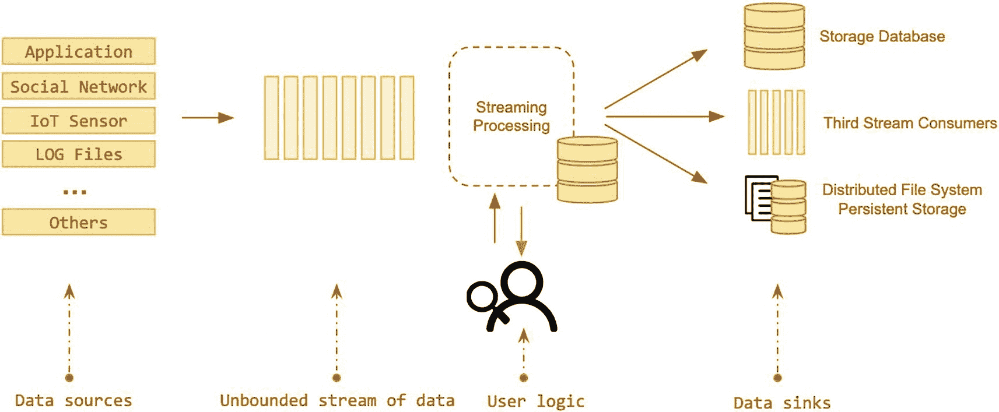
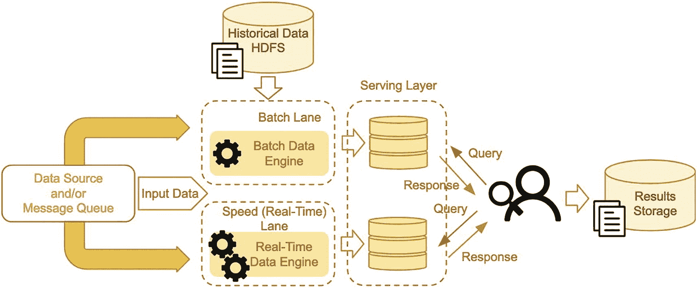
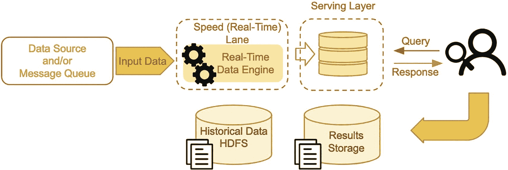
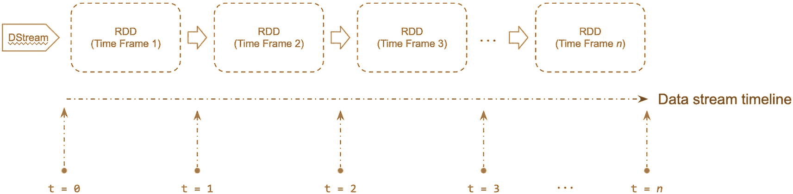
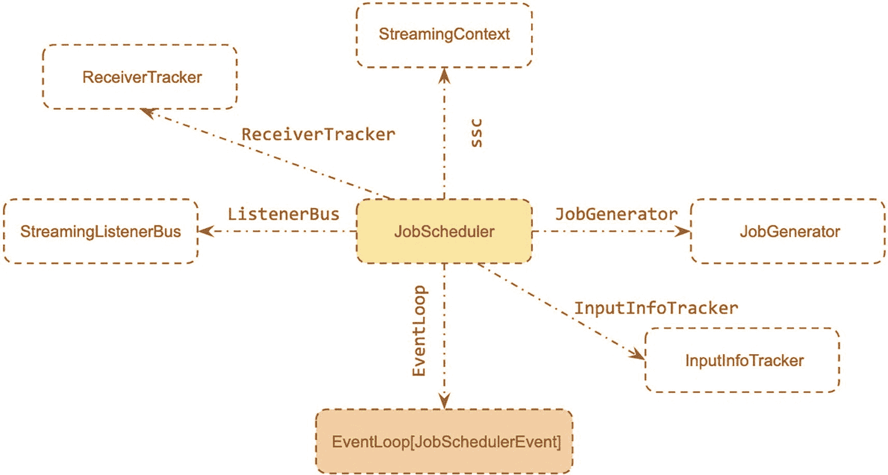

## 6. Apache Spark Streaming 简介

Spark Streaming 于 2013 年添加到 Apache Spark 中，作为核心 Spark API 的一个可扩展、容错、实时的流处理扩展。Spark Streaming 原生支持批处理和流处理工作负载，并使用微批处理来摄取和处理数据流，将结果传递到永久存储或仪表板以进行在线数据分析。

Spark Streaming 集成了庞大的数据源和数据接收器生态系统。前者包括 Apache Kafka、Apache Flume、Amazon Kinesis 和 TCP 套接字作为数据流源，后者包括大多数 RDBMS 和 NoSQL 数据库，例如 MemSQL、PostgreSQL 和 MySQL，当然也包括 Parquet 或 CSV 等文件存储格式。

### 6.1 有界数据与无界数据的实时分析

持续流式传输和实时分析正在改变当今我们消费信息的方式。事实上，在现实世界中，我们产生和消费的大部分信息都基于无界或无限制的数据。例如，我们的大脑在信息于非常明确的时间窗口内传入时，会处理数据并做出决策。

在数学中，无界意味着一个函数不受限制或没有边界。因此，无界集合是一个没有有限上界或下界的集合。无界集合的例子包括 `(−∞,+∞)`、`(5,+∞)` 等。另一方面，一个具有有限上界和下界值的集合被称为有界集合。这就是为什么你可能会听到无界数据（理论上）是无限的。

数据分析分为批处理和流处理。传统上，批处理数据与通常所说的有界数据相关联。

有界数据是稳定的、不变的、大小已知且处于定义时间范围内的。这种受限数据的例子包括去年或上个季度的销售数据分析、历史股票市场交易等。另一方面，无界或无限制数据是动态的（尚未结束），并且通常不处于完美或预期的序列中。

Spark Streaming 的工作方式如下：通过接收连续的数据流，并将其划分为称为离散化流或 `DStreams` 的微批次，这些微批次被传递给生成结果批次的 Spark 引擎。

图 6-1 展示了对数据批次流进行连续流处理以提供实时数据分析的图形化描述。



一个过程图描绘了一个数据处理管道，该管道涉及多种数据源，最终形成一个无界的数据流。数据在进行流处理和逻辑处理之后，被存储在存储数据库和分布式文件系统中，并最终发送到数据接收端。

图 6-1 实现实时分析的连续流处理

### 6.2 流处理的挑战

当我们使用有限资源（有限数量的 CPU、RAM、存储硬件等）分析数据时，我们不能期望能够将其容纳在有限资源中。相反，我们必须将其视为在一段时间内使用有限计算资源接收的一系列事件来处理。

在处理数据流时，时间引入了重要的挑战，因为信息产生的时刻与信息被处理和分析的时刻之间存在时间差。

在处理流式数据时，有三个重要的概念：

- **事件时间**：指事件在其产生设备上被创建的时刻。这个时间参考可以由事件发送者（通常）或事件接收者建立；无论哪种方式，你都必须理解例如在不同时区操作所带来的额外复杂性。

- **摄入时间**：指事件流入流处理过程的时间。

- **数据处理时间**：在这种情况下，参考框架是处理数据的计算机。

### 6.3 数据流的不确定性因素

处理数据流时需要考虑的另一个重要方面是数据吞吐量的不确定性。通常，无法对到达系统的数据节奏做出任何假设；因此，无法精确预知未来所需的硬件资源或事件序列的顺序。

来自传感器、社交网络等流源的信息可能会因多种情况而遭受延迟和中断。在这些特定情况下，可能会发生以下情况之一：信息堆积起来，一旦连接恢复，就会像数据雪崩一样释放出来；或者数据丢失，因此事件序列中会出现一些缺口。当类似上述场景发生时，系统可能会因数据供应过剩而暂时饱和，导致处理延迟或失败。

### 6.4 Apache Spark Streaming 的执行模型

从一开始，Apache Spark 就被设想为一个用于批处理和流数据处理的统一引擎，旨在提供一些主要特性，例如：

- 从故障中快速恢复服务

- 主动识别运行缓慢的任务（即掉队者），并主动处理它们

- 改进负载均衡和计算资源利用率

- 能够从静态数据集和交互式 SQL 查询中消费数据流

- 与其他 Spark 模块（如 SQL、MLlib 等）的内置集成

在上述特性中，Spark 处理运行缓慢任务或掉队者的能力值得一提。掉队者指的是某个阶段中执行时间异常长于同一阶段其他任务的任务。就性能而言，关注掉队者总是一个好习惯，因为它们可能频繁出现在一个阶段中，或分散在多个阶段中。

即使只有一个阶段出现运行缓慢的任务，也可能显著延迟 Spark 作业，并产生级联效应，损害应用程序的整体性能。

### 6.5 流处理架构

在本节中，我们将介绍两种最典型的实时数据处理技术方法，即所谓的 Lambda 和 Kappa 架构。建立一个适合我们业务需求且经济上可持续的实时处理架构并非易事。

实时数据处理架构是旨在高效管理完整实时数据生命周期（数据摄入、数据处理以及最终的海量数据存储）的技术系统。它们在使现代企业能够从可用信息中获取宝贵见解方面发挥着关键作用。这些架构与数据分析技术一起，构成了现代数据驱动型组织的基础，这些组织利用数据分析来改进决策、获得竞争优势和运营效率，并最终推动增长。

Lambda 和 Kappa 架构旨在同时处理批处理和实时数据处理。

#### Lambda 架构

Lambda 架构由 Apache Storm 的创建者 Nathan Marz 于 2011 年提出，旨在为海量实时数据处理提供一种可扩展、容错且灵活的架构。

Lambda 架构的主要特点是它包含两条独立的数据处理通道来处理不同类型的工作负载，如图 6-2 所示。批处理通道旨在处理大量数据，并将结果存储在集中式仓库或分布式文件系统（如 Hadoop）中。



一个流程图描绘了数据处理管道，包括数据源、消息队列以及来自 HDFS 的历史数据。它涉及用于查询的实时和批处理数据引擎、速度实时层、带有响应和查询的服务层，并将结果存储在结果存储中。

图 6-2

用于实时流和批处理数据处理的 Lambda 架构

实时通道负责处理到达系统的数据，与批处理通道一样，它将结果存储在分布式数据仓库系统中。

Lambda 架构已被证明能够满足许多业务用例，目前正被雅虎和 Netflix 等重要公司所采用。

Lambda 架构由三个主要层或通道组成：

- 批处理层

- 实时层或速度层

- 服务层

除了这三个主要的数据处理通道外，一些作者还会增加一个用于数据摄入的前置层：

- 数据摄入层

让我们简要地回顾一下所有这些层。

##### 数据摄入层

该通道负责即时整合来自多个数据源的原始数据。这些信息会同时提供给批处理通道和速度通道。

##### 批处理层

该通道旨在高效处理大量信息，并提供数据的全局视图。批处理层负责 (a) 将历史整合数据纳入分析过程，以及 (b) 重新处理先前的结果，例如重新训练机器学习模型。该层负责处理整个数据集，因此能产生更精确的结果；然而，由于计算时间较长，结果是离线交付的。

##### 实时层或速度层

该层旨在为海量数据流提供低延迟且近乎实时的视图，通过增量结果来补充批处理层。得益于这些增量结果，计算时间得以缩短。该层负责实时数据处理，并将获得的结果存储在分布式存储（NoSQL 数据库或文件系统）中。

##### 服务层

该层合并来自批处理层和实时层的结果，并构成用户交互式提交查询和在线接收结果的方式。该层允许用户无缝地与正在处理的全部数据进行交互，无论这些数据是在批处理通道还是流处理通道上处理。该层还向可视化层提供最新的信息。

##### Lambda 架构的优缺点

Lambda 架构满足了许多大数据用例的需求，但代价是冗余和复杂性较高。因此，它既有优点也有缺点。

优点：

- 可扩展性：Lambda 架构适用于满足大数据需求的水平扩展。

- 对硬件故障的容错能力。

- 灵活处理批处理和流处理工作负载。

缺点：

- 复杂性：由于其分布式特性以及涉及多种不同技术，该架构复杂且冗余，可能难以调优和维护。

- 可能的数据不一致：由于数据通过并行通道处理，处理故障可能导致批处理通道和流处理通道产生不一致的结果。

#### Kappa 架构

图 6-3 所示的 Kappa 架构由 Jay Kreps 于 2014 年设计，旨在解决 Lambda 架构中发现的某些问题，并避免维护两套独立的开发。

Kappa 架构使用单条通道，包含两层：流处理层和服务层，用于处理批处理和流处理工作负载，因此将所有数据流入视为数据流。该架构比 Lambda 架构更简单，因为实时数据流的摄入、处理和存储都由流处理层执行，同时仍能保持快速高效的查询能力。



一个数据处理管道的流程图，涉及作为输入的数据源。数据在实时数据引擎中进行处理，历史数据存储在`HDFS`中，然后通过服务层提供服务。执行查询，生成响应并存储在结果存储中。

图 6-3

用于实时流数据处理的 Kappa 架构

Kappa 架构的两层实现以下功能：

- 流处理：该模块负责实时数据摄入和原始数据的永久存储。

- 服务：服务层负责提供数据查询所需的工具。

### Kappa 架构的优缺点

这里介绍 Kappa 架构的一些优缺点。

优点：

- 简化了管道的设计、实现、调试和维护

- 利用单通道管道，便于管道的迁移和重组

缺点：

- 复杂性：虽然比 Lambda 架构简单，但整体基础设施仍然复杂。

- 可扩展性问题：使用单个流处理通道处理无界数据流，在处理大量已处理结果时可能会引发瓶颈。

## 6.6 Spark Streaming 架构：离散化流

Spark 用于流处理的关键抽象是所谓的 Apache Spark 离散化流，通常称为 Spark DStream。正如我们在本章开头所见，`DStream` 由数据流组成，这些数据流被划分为亚秒级的微批次。为了创建这些微批次，Spark Streaming 接收器可以并行摄取数据，并在将其释放以进行处理之前，将其存储在 Spark 工作节点的内存中。在微批次处理中，Spark 工作节点通常会等待一个定义的时间段（称为批次周期），或者等待批次大小达到上限，然后才执行批次作业。

例如，如果一个流作业配置的批次周期为 1 秒，批次大小限制为读取 128 个项目，那么即使在一秒内读取的项目数少于 128 个，该作业也会启动。另一方面，如果接收器维持高吞吐量，并且在不到 1 秒内接收到的项目数超过 128 个，那么作业将启动，而无需等待批次周期完成。

`DStream` 在内部构建于一系列无界的 Spark `RDD` 之上；因此，在 `DStream` 上执行的转换和操作实际上是 `RDD` 操作。每个 `RDD` 仅包含来自特定时间槽的数据，如图 6-4 所示。



一个过程图表示一个数据流时间线，其中包含多个对应于不同时间帧（t = 1, 2, 3, n）的弹性分布式数据集。D Stream 代表连续的数据流。

图 6-4

Spark DStream 作为微批次（RDD）的连续序列

在底层使用 `RDD` 来操作数据，有助于在批处理和流处理中使用通用的 API。同时，这种架构允许使用任何可用的第三方库来处理 Spark 数据流。

Spark 通过动态地将处理任务分配给可用的工作节点，实现了流式负载均衡和更快的故障恢复。

因此，一个离散化流（`DStream`）实际上是相同类型的 `RDD` 的连续序列，它模拟了连续的数据流，并将 `RDD` 在速度和安全性方面的所有优势带到了近实时的流数据处理中。然而，与 Apache Spark `RDD`（低级 API）相比，`DStream` API 并未提供完整的转换集。

## 6.7 Spark Streaming 数据源与接收器

在 Spark Streaming 中，输入数据流是 `DStream`，它象征着传入信息的输入点，并且是将外部数据源的数据集成进来的方式。

每个输入 `DStream`（文件流除外）都与一个 `Receiver` 对象相关联，它充当数据源和 Spark 工作节点内存之间的缓冲区，数据在处理之前会在内存中以微批次的形式堆积。

Spark 中有两种内置的流式数据源：

*   基本输入源

*   高级输入源

### 基本输入源

基本源是那些原生构建在 `StreamingContext` API 中的源，例如，TCP 套接字连接和文件系统源。当通过套接字连接实现数据流时，Spark 会监听指定的 TCP/IP 地址和端口，从通过该 TCP 套接字连接接收到的文本数据中创建输入离散化流（`DStream`）。套接字流是基于接收器的连接；因此，它们需要实现一个接收器。所以，在实现基于套接字接收器的输入 `DStream` 时，必须分配足够的资源（CPU 核心）来接收和处理数据。因此，在本地模式下运行基于接收器的流时，必须将 `"local[*]"` 或 `"local[n]"`（其中 n > 接收器数量）作为 master URL 来实现。出于同样的原因，如果在集群模式下运行基于接收器的流作业，可用的处理线程数必须大于接收器数量。

另一方面，文件流不需要执行接收器；因此，文件数据摄取不需要额外的 CPU 资源。文件源用于从系统文件夹中出现的文件中摄取数据，从而模拟数据流。支持的输入文件格式包括文本、CSV、JSON、ORC 和 Parquet。

### Socket 连接流式数据源

Socket 是 IP 地址和网络端口（`<IP>:<port>`）的组合。Socket 允许计算机通过 TCP/IP 建立连接，其中每台终端计算机都会建立一个连接 Socket。

为了演示 Spark Streaming 如何通过监听 Socket 连接来接收数据，我们将基于一个真实的数据流使用场景来举例；我们将实现一个基本的近实时流式医院排队管理系统，输入格式为 CSV，如下所示：

```
1004,Tomás,30,DEndo,01-09-2022
1005,Lorena,50,DGineco,01-09-2022
1006,Pedro,10,DCardio,01-09-2022
1007,Ester,10,DCardio,01-09-2022
1008,Marina,10,DCardio,01-09-2022
1009,Julia,20,DNeuro,01-09-2022
1010,Javier,30,DEndo,01-09-2022
1011,Laura,50,DGineco,01-09-2022
1012,Nuria,10,DCardio,01-09-2022
1013,Helena,10,DCardio,01-09-2022
1014,Nati,10,DCardio,01-09-2022
```

接下来，我们展示两种让程序运行起来的方式。第一个代码（`socketTextStream.scala`）如下所示，它是一个 Scala 变体，可以使用 `$SPARK_HOME/bin/spark-submit` 命令在 Spark 中编译和执行。讨论如何编译和链接 Scala 代码超出了本书的范围，但建议使用 `sbt` 配合 `sbt-assembly` 来创建一个包含所有必要库（即所谓的依赖项）的“胖 JAR”文件：

```scala
import org.apache.spark.sql.SparkSession
import org.apache.spark.streaming.{Seconds, StreamingContext}
import java.io.IOException

object socketTextStream {
    def main(args: Array[String]): Unit = {
        val host = "localhost"
        val port = 9999
        try {
            val spark: SparkSession = SparkSession.builder()
                .master("local[*]")
                .appName("Hand-On-Spark3_socketTextStream")
                .getOrCreate()
            spark.sparkContext.setLogLevel("ERROR")
            val sc = spark.sparkContext
            val ssc = new StreamingContext(sc, Seconds(5))
            val lines = ssc.socketTextStream(host, port)
            printf("\n Spark is listening on port 9999 and ready...\n")
            lines.print()
            ssc.start()
            ssc.awaitTermination()
        } catch {
            case e: java.net.ConnectException => println("Error establishing connection to " + host + ":" + port)
            case e: IOException => println("IOException occurred")
            case t: Throwable => println("Error receiving data", t)
        } finally {
            println("Finally block")
        }
    }
}
```

下一个代码片段是上述医院排队管理系统应用的一个版本，可以在 Spark 中使用 Jupyter、Apache Zeppelin 等笔记本应用程序执行，这对于学习目的来说可能更方便，尤其是当你不熟悉 Scala 代码编译工具时：

## 代码示例

```scala
import org.apache.spark.SparkConf
import org.apache.spark.sql.SparkSession
import org.apache.spark.streaming.{Seconds, StreamingContext}
import java.io.IOException
val host = "localhost"
val port = 9999
try{
val spark = SparkSession
.builder()
.master("local[*]")
.appName("Hands-On_Spark3_socketTextStream")
.getOrCreate()
val sc = spark.sparkContext
// Create the context with a 5 seconds batch size
val ssc = new StreamingContext(sc, Seconds(5))
val lines = ssc.socketTextStream(host, port)
printf("\n Spark is listening on port 9999 and ready...\n")
lines.print()
ssc.start()
ssc.awaitTermination()
}catch {
case e: java.net.ConnectException => println("Error establishing connection to " + host + ":" + port)
case e: IOException => println("IOException occurred")
case t: Throwable => println("Error receiving data", t)
} finally {
println("Finally block")
}
```

请注意 `local[*]` 选项。这里我们使用了 `*`；因此，程序将使用所有可用的核心。使用多个核心很重要，因为应用程序必须能够并行运行两个任务：监听 TCP Socket（`localhost:9999`），同时处理数据并在控制台上显示。

### 本地运行 Socket 流式应用

我们将使用一个名为 Netcat 的特色网络工具来建立一个简单的客户端/服务器流式连接。Netcat（根据系统不同，称为 `netcat`、`nc`、`ncat` 等）在类 Unix 操作系统中可用，它使用 TCP/IP 通过网络读写数据。在本书中，我们使用 Netcat OpenBSD 版本（`nc`）。

`nc` 命令的语法是：

```
nc [<options>] [<host>] [<port>]
```

Netcat 有几个 `[<options>]`；不过，我们只使用 `-l`，它指示 `nc` 监听 UDP 或 TCP `<port>`，以及 `-k`，它在监听模式下用于接受多个连接。当省略 `<host>` 时，`nc` 会监听绑定到给定 `<port>` 的所有 IP 地址。

为了说明程序的工作原理，我们将利用前面介绍的 `nc` 工具，在 `nc` 和我们的 Spark 应用程序之间建立一个流式客户端/服务器连接。在我们的场景中，`nc` 将充当服务器（监听 `host:port`），而我们的应用程序将充当客户端（连接到 `nc` 服务器）。

无论你是从之前的代码构建了 JAR 文件，还是使用笔记本版本，运行应用程序都包含两个步骤：

1.  在你的系统中打开一个终端，通过运行以下代码来设置客户端/服务器流式连接的服务器端：

```
nc -lk 9999
```

2.  根据你运行应用程序的方式：

    - `使用 JAR 文件`：打开第二个终端，并按如下所示执行你的应用程序：

```
$SPARK_HOME/bin/spark-submit --class org.apress.handsOnSpark3.socketTextStream --master "local[*]" /PATH/TO/socketTextStream/HandsOnSpark3-socketTextStream.jar
```

    - `使用笔记本`：只需在你的笔记本中执行代码即可。

一旦你在屏幕上看到消息 `Spark is listening on port 9999 and ready...`，你就可以回到步骤 1，输入一些作为示例提供的 CSV 字符串，例如：

```
1009,Julia,20,DNeuro,01-09-2022
1010,Javier,30,DEndo,01-09-2022
1011,Laura,50,DGineco,01-09-2022
1012,Nuria,10,DCardio,01-09-2022
1013,Helena,10,DCardio,01-09-2022
1014,Nati,10,DCardio,01-09-2022
1004,Tomás,30,DEndo,01-09-2022
1005,Lorena,50,DGineco,01-09-2022
1006,Pedro,10,DCardio,01-09-2022
1007,Ester,10,DCardio,01-09-2022
1008,Marina,10,DCardio,01-09-2022
```

每隔几秒钟，你将在终端或笔记本上看到类似如下的输出：

```
Spark is listening on port 9999 and ready...
-------------------------------------------
Time: 1675025630000 ms
-------------------------------------------
1009,Julia,20,DNeuro,01-09-2022
1010,Javier,30,DEndo,01-09-2022
1011,Laura,50,DGineco,01-09-2022
1012,Nuria,10,DCardio,01-09-2022
1013,Helena,10,DCardio,01-09-2022
1014,Nati,10,DCardio,01-09-2022
-------------------------------------------
Time: 1675025635000 ms
-------------------------------------------
1004,Tomás,30,DEndo,01-09-2022
1005,Lorena,50,DGineco,01-09-2022
1006,Pedro,10,DCardio,01-09-2022
1007,Ester,10,DCardio,01-09-2022
1008,Marina,10,DCardio,01-09-2022
...
```

3.  **应用程序终止**

`awaitTermination()` 会等待用户的终止信号。因此，回到步骤 1 中启动的终端会话，按下 `Ctrl+C` 或发送 `SIGTERM` 信号，流式上下文将被停止，你的流式应用程序也将终止。

然而，在大多数实际流式应用中，这种突然终止流处理进程的方式既不优雅也不方便。无界数据的概念意味着信息会持续不断地流入系统；因此，在绝大多数情况下，突然中断流处理进程几乎必然会导致信息丢失。为了避免数据丢失，一种做法是在 RDD 处理期间不突然终止流式应用，而是将其暂停；这被称为“优雅关闭”，我们将在后面的“Spark Streaming 优雅关闭”部分进行解释。

### 使用 Spark Streaming 转换改进数据分析

尽管可应用于 RDD DStream 的转换数量有限，但我们可以对之前的示例进行调整以改进其功能。

我们可以使用 `flatMap(function())` 函数，该函数将 `function()` 作为参数，并将其应用于每个元素，返回一个包含 0 个或多个元素的新 RDD。

因此，将之前代码片段中的代码行 `lines.print()` 替换为以下代码行：

```
lines.flatMap(_.split(",")).print()
```

我们将得到以下输出：

```
Time: 1675203480000 ms
Julia
DNeuro
01-09-2022
Javier
DEndo
01-09-2022
...
Time: 1675203485000 ms
Lorena
DGineco
01-09-2022
Pedro
DCardio
01-09-2022
...
```

我们还可以引入 `count()` 函数来统计流中的行数。因此，添加 `count()` 函数，如下行所示：

并从我们的示例中输入文本行，我们将得到类似于以下的输出：

```
Time: 1675204465000 ms

Time: 1675204470000 ms

Time: 1675204470000 ms
```

我们还可以使用 `countByValue()` 来统计数据集中每个单词出现的次数，也就是说，每个单词在流中出现的次数。

为了实现这个目标，我们只需将：

```
lines.flatMap(_.split(",")).print()
```

这行代码转换为以下代码：

```
lines.countByValue().print()
```

再次运行代码，并复制粘贴一些示例行，您将看到类似于以下的输出：

```
Spark is listening on port 9999 and ready...

Time: 1675236625000 ms

(1013,Helena,10,DCardio,01-09-2022,1)
(1007,Ester,10,DCardio,01-09-2022,4)
(1010,Javier,30,DEndo,01-09-2022,1)
(1011,Laura,50,DGineco,01-09-2022,1)
(1005,Lorena,50,DGineco,01-09-2022,3)
(1014,Nati,10,DCardio,01-09-2022,1)
(1004,Tomás,30,DEndo,01-09-2022,1)
(1008,Marina,10,DCardio,01-09-2022,4)
(1012,Nuria,10,DCardio,01-09-2022,1)
(1006,Pedro,10,DCardio,01-09-2022,4)

Time: 1675236630000 ms

(1007,Ester,10,DCardio,01-09-2022,1)
(1005,Lorena,50,DGineco,01-09-202,1)
(1005,Lorena,50,DGineco,01-09-2022,1)
(1014,Nati,10,DCardio,01-09-2022,1)
(1004,Tomás,30,DEndo,01-09-2022,1)
(1008,Marina,10,DCardio,01-09-2022,1)
(1006,Pedro,10,DCardio,01-09-2022,1)

Time: 1675236640000 ms

(1007,Ester,10,DCardio,01-09-2022,1)
(1005,Lorena,50,DGineco,01-09-2022,1)
(1008,Marina,10,DCardio,01-09-2022,1)
(1006,Pedro,10,DCardio,01-09-2022,1)
```

我们可以进一步改进示例，通过将之前的代码行与我们之前看到的 `flatMap()` 函数链接或管道连接来实现相同的结果：

```
lines.flatMap(_.split(",")).countByValue().print()
```

像之前一样，再次运行代码，在终端中复制并粘贴示例行，您将再次看到类似于以下的输出：

```
Spark is listening on port 9999 and ready...

Time: 1675236825000 ms

(01-09-202,1)
(01-09-2022,20)
(1007,5)
(1008,5)
(50,4)
(DCardio,16)
(Lorena,4)
(Tomás,1)
(Marina,5)
(Ester,5)
...

Time: 1675236830000 ms

(01-09-202,1)
(01-09-2022,13)
(1007,3)
(1008,3)
(50,3)
(DCardio,10)
(Lorena,3)
(Tomás,1)
(Marina,3)
(Ester,3)
...

Time: 1675236835000 ms

(01-09-202,1)
(01-09-2022,6)
(1007,2)
(1008,1)
(50,2)
(DCardio,5)
(Lorena,2)
(Marina,1)
(Ester,2)
(DGineco,2)
...
```

这次输出信息更丰富，您可以看到心脏病科的注册量正在累积。这些信息可用于，例如，在预约数量接近或超过最大容量阈值时触发警报。

我们也可以通过使用 `reduceByKey()` 函数获得相同的结果。此函数作用于 RDD（键/值对），用于使用提供的归约函数（在我们的示例中是 `_ + _`）合并每个键的值。

为此，只需将以下代码行：

```
lines.countByValue().print()
```

替换为下一行：

```
val words = lines.flatMap(_.split(",")).map(x => (x, 1)).reduceByKey(_+_)
words.print()
```

重复将示例行复制粘贴到终端的过程，将会产生类似如下的输出：

```
Spark is listening on port 9999 and ready...

Time: 1675241775000 ms

(01-09-202,2)
(01-09-2022,22)
(1007,6)
(1008,5)
(50,5)
(DCardio,19)
(Lorena,5)
(Marina,5)
(Ester,6)
(DGineco,5)
...

Time: 1675241780000 ms

(01-09-2022,9)
(1007,3)
(1008,2)
(50,1)
(DCardio,8)
(Lorena,1)
(Marina,2)
(Ester,3)
(DGineco,1)
(Pedro,3)
...
```

现在，我们要对程序进行一项更重要的改动。我们只想分析传入数据流中的特定字段。具体来说，我们希望近乎实时地监控按科室划分的预约数量。

请记住，我们正在处理 CSV 格式的数据，而且你可能知道，CSV 文件通常包含一个带有列名的标题行。如果我们沿用之前示例中的代码，这个标题行就会被错误地处理。因此，我们必须引入一个过滤器来筛除这一行。由于我们不知道这个标题行会在何时到达我们的流处理过程，我们必须找到一种方法来阻止它被处理。我们知道标题行是唯一以单词（字母字符串）开头，而不是以数字开头的行，因此我们可以使用正则表达式来过滤掉以单词开头的行。

以下是我们调整后的代码片段，用于过滤标题行，并仅提取和处理其中一个感兴趣的字段——科室编号（`DNom`）：

```scala
import org.apache.spark.SparkConf
import org.apache.spark.sql.SparkSession
import org.apache.spark.streaming.{Seconds, StreamingContext}
import java.io.IOException
val host = "localhost"
val port = 9999
try{
val spark = SparkSession
.builder()
.master("local[*]")
.appName("Hands-On_Spark3_socketTextStream")
.getOrCreate()
val sc = spark.sparkContext
// 创建一个批处理大小为 5 秒的上下文
val ssc = new StreamingContext(sc, Seconds(5))
val lines = ssc.socketTextStream(host, port)
printf("\n Spark is listening on port 9999 and ready...\n")
val filterHeaders = lines.filter(!_.matches("[⁰-9]+"))
val selectedRecords = filterHeaders.map{ row =>
val rowArray = row.split(",")
(rowArray(3))
}
selectedRecords.map(x => (x, 1)).reduceByKey(_+_).print()
ssc.start()
ssc.awaitTermination()
}catch {
case e: java.net.ConnectException => println("Error establishing connection to " + host + ":" + port)
case e: IOException => println("IOException occurred")
case t: Throwable => println("Error receiving data", t)
} finally {
println("Finally block")
}
```

应用这些更改后，如果你再次执行程序，并将以下行粘贴到终端：

```
NSS,Nom,DID,DNom,Fecha
1004,Tomás,30,DEndo,01-09-2022
1005,Lorena,50,DGineco,01-09-2022
1006,Pedro,10,DCardio,01-09-2022
1007,Ester,10,DCardio,01-09-2022
1008,Marina,10,DCardio,01-09-2022
NSS,Nom,DID,DNom,Fecha
1009,Julia,20,DNeuro,01-09-2022
1010,Javier,30,DEndo,01-09-2022
1011,Laura,50,DGineco,01-09-2022
1012,Nuria,10,DCardio,01-09-2022
1013,Helena,10,DCardio,01-09-2022
1014,Nati,10,DCardio,01-09-2022
```

你将看到类似如下的输出：

```
Time: 1675284925000 ms

(DCardio,3)
(DGineco,1)
(DEndo,1)

Time: 1675284930000 ms

(DCardio,3)
(DGineco,1)
(DEndo,1)
(DNeuro,1)
```

正如你所见，标题行已被移除；因此，只有我们感兴趣的行被纳入考虑。

接下来，我们将了解 Spark Streaming 核心 API 中直接可用的另一种基本数据源——与 HDFS（Hadoop 分布式文件系统）兼容的文件系统。

### 文件系统流式数据源

Spark Streaming 可以将文件系统用作输入数据源。[文件流](https://spark.apache.org/docs/latest/streaming-programming-guide.html%2523file-streams)用于从文件夹中流式读取数据。Spark 可以在任何兼容 HDFS 的文件系统上挂载文件流处理过程，例如 HDFS 本身、AWS S3、NFS 等。当设置好文件系统流后，Spark 会监控指定的路径，并处理在该路径下创建的任何文件。默认情况下，文件会根据文件修改时间戳进行处理，修改时间最早的文件优先；不过，可以使用`latestFirst`选项（默认值：false）来反转顺序，该选项指示 Spark 从最新修改的文件开始处理。Spark 默认支持不同的文件格式，例如文本、CSV、JSON、ORC 和 Parquet。

可以使用`streamingContext.fileStreamKeyClass,ValueClass,InputFormatClass`从文件创建 DStream，但对于文本文件，也可以使用`StreamingContext.textFileStream(dataDirectory)`。变量`dataDirectory`表示要监控的文件夹路径。

### Spark 如何监控文件系统

Spark 根据以下模式监控文件系统：

- 对于诸如`"hdfs://hadoop:9000/folder/"`、`"s3//..."`、`"file//..."`等路径，Spark 会在文件出现在该路径下时立即处理它们。
- 也可以使用全局模式来指定目录，例如`"hdfs://hadoop:9000/folder/textfiles/*/*"`。
- 路径下的所有文件必须采用相同的格式。
- 路径下存在的文件数量会影响 Spark 扫描该路径所需的时间，即使没有文件被更新。
- 在同一时间窗口内的文件更新将被忽略。因此，一旦文件被处理，更新它不会导致其被重新处理。
- Spark 将根据文件的修改时间（而非创建时间）来处理文件。因此，当流处理过程启动时，路径中已存在的文件将不会被处理。
- 使用[Hadoop FileSystem.setTimes()](https://hadoop.apache.org/docs/current/api/org/apache/hadoop/fs/FileSystem.html%2523setTimes-org.apache.hadoop.fs.Path-long-long-)设置文件的访问时间可能会导致文件在当前处理时间窗口之外被处理。

现在，我们将了解如何使用 Spark 持续监控文件夹并从其中流式读取文件。在此案例中，我们将继续使用基础的近实时流式医院排队管理系统，并再次对其进行微调，以便从文件系统流式读取文件。

正如我们之前在套接字数据源示例中所做的那样，这里提供了两个版本的程序。第一个版本可以使用`sbt`或其他 Scala 编译器进行编译。

第一个代码（`textFileStream.scala`）如下所示，它是 Scala 变体，可以使用`$SPARK_HOME/bin/spark-submit`命令在 Spark 中编译和执行。在这种情况下，考虑到我们将把 CSV 文件放入一个文件夹，我们应该从上一个示例的最新版本开始，在该版本中，我们过滤掉了以单词开头的行，并将它们从流处理中排除：

```scala
package org.apress.handsOnSpark3
import org.apache.spark.sql.SparkSession
import org.apache.spark.streaming.{Seconds, StreamingContext}
import java.io.IOException
object textFileStream {
def main(args: Array[String]): Unit = {
val folder="/tmp/patient_streaming"
try {
val spark: SparkSession = SparkSession.builder()
.master("local[1]")
.appName("Hand-On-Spark3_textFileStream")
.getOrCreate()
spark.sparkContext.setLogLevel("ERROR")
val sc = spark.sparkContext
val ssc = new StreamingContext(sc, Seconds(5))
val lines = ssc.textFileStream(folder)
printf(f"\n Spark is monitoring the folder $folder%s and ready... \n")
val filterHeaders = lines.filter(!_.matches("[⁰-9]+"))
val selectedRecords = filterHeaders.map { row =>
val rowArray = row.split(",")
(rowArray(3))
}
selectedRecords.map(x => (x, 1)).reduceByKey(_ + _).print()
ssc.start()
ssc.awaitTermination()
} catch {
case e: IOException => println("IOException occurred")
case t: Throwable => println("Error receiving data", t)
} finally {
println("Finally block")
}
}
}
```

请注意`local[1]`选项。在这种情况下，我们只使用了`"[1]"`，因为文件流不需要执行接收器；因此，文件摄入不需要额外的核心。

下一段代码是上述医院排队管理系统应用程序的一个版本，可以使用 Jupyter、Apache Zeppelin 等笔记本应用程序在 Spark 中执行：

```markdown
```
import org.apache.spark.SparkConf
import org.apache.spark.sql.SparkSession
import org.apache.spark.streaming.{Seconds, StreamingContext}
import java.io.IOException
val folder="/tmp/patient_streaming"
try{
val spark = SparkSession
.builder()
.master("local[1]")
.appName("Hand-On-Spark3_textFileStream")
.getOrCreate()
val sc = spark.sparkContext
// Create the context with a 5 seconds batch size
val ssc = new StreamingContext(sc, Seconds(5))
val lines = ssc.textFileStream(folder)
printf(f"\n Spark is monitoring the folder $folder%s and ready... \n")
val filterHeaders = lines.filter(!_.matches("[⁰-9]+"))
val selectedRecords = filterHeaders.map{ row =>
val rowArray = row.split(",")
(rowArray(3))
}
selectedRecords.map(x => (x, 1)).reduceByKey(_+_).print()
ssc.start()
ssc.awaitTermination()
}catch {
case e: IOException => println("IOException occurred")
case t: Throwable => println("Error receiving data", t)
} finally {
println("Finally block")
}
```

现在是时候运行这些示例并查看其结果了。

### 在本地运行文件系统流式应用程序

在本例中，我们的程序将监控选定的 `/tmp/patient_streaming` 路径，并在 Spark 发现文件后立即处理复制到该路径下的文件。

与“在本地运行套接字流式应用程序”部分一样，运行此处提供的文件系统数据源示例也取决于您选择的执行方法。在这里，您也可以选择从之前提供的代码片段构建自己的 JAR 文件，或者使用笔记本版本。无论如何，运行应用程序都包含两个步骤：

1.  根据您运行应用程序的方式

    1.  如果您使用 JAR 文件，请在计算机上打开一个终端，并按如下所示执行您的应用程序：

        ```
        $SPARK_HOME/bin/spark-submit --class org.apress.handsOnSpark3.textFileStream --master "local[1]" /PATH/TO/YOUR/HandsOnSpark3-textFileStream.jar
        ```

    2.  如果您使用笔记本，只需在笔记本中执行代码即可。

2.  在计算机上打开一个新终端，将提供的 CSV 文件复制到被监控的文件夹。

    一旦您在屏幕上看到消息 `Spark is monitoring the folder /tmp/patient_streaming and ready...`，您就可以返回步骤 2，并开始将 CSV 文件复制到 `/tmp/patient_streaming` 文件夹，^(¹⁴) 例如：

    ```
    cp /PATH/TO/patient1.csv /tmp/patient_streaming
    cp /PATH/TO/patient2.csv /tmp/patient_streaming
    cp /PATH/TO/patient3.csv /tmp/patient_streaming
    cp /PATH/TO/patient4.csv /tmp/patient_streaming
    cp /PATH/TO/patient5.csv /tmp/patient_streaming
    ```

    每隔几秒钟，您就会开始在终端会话或笔记本上看到类似于下面的输出：

    ```
    Spark is monitoring the folder /tmp/patient_streaming and ready...
    -------------------------------------------
    Time: 1675447065000 ms
    -------------------------------------------
    (DCardio,1)
    -------------------------------------------
    Time: 1675447070000 ms
    -------------------------------------------
    (DEndo,1)
    (DNeuro,1)
    -------------------------------------------
    Time: 1675447075000 ms
    -------------------------------------------
    (DGastro,1)
    (DCardio,3)
    (DGineco,1)
    (DNeuro,2)
    ```

3.  应用程序终止

    再次说明，`awaitTermination()` 会等待用户的终止信号。因此，转到步骤 2 中启动的终端会话，按 Ctrl+C 或发送 SIGTERM 信号，流式上下文将被停止。如果应用程序在笔记本中运行，您可以通过停止或重启 Spark 内核来停止应用程序的执行。

### 处理对象存储数据源时的已知问题

诸如 Hadoop 分布式文件系统（HDFS）之类的文件系统，可以在创建文件的输出流开始时设置文件的修改时间。也就是说，修改时间可以在创建文件的写入过程完成之前设置。因此，这种行为可能导致 Spark DStream 将那些未完成的文件包含在当前处理窗口中，并随后忽略后续的数据聚合或文件更新；因此，部分数据可能会因被排除在窗口流之外而丢失。

根据所采用的文件系统技术，可以使用多种技术来解决这个潜在问题。在某些情况下，直接将数据写入 Spark 监控的路径是可行的；在另一些情况下，文件可以先创建在不同于最终目标位置的文件夹中，待文件完成后，再将其复制或重命名到监控路径。不过，在这种情况下，文件复制或重命名操作也需要时间，并且文件元数据也可能被更改，例如，原始文件的创建时间或修改时间可能会被重命名或复制的时间覆盖。无论如何，在使用 Spark Streaming 时，都应关注这些细节。

### 高级输入源

高级输入源并非 `StreamingContext` API 的一部分，只能通过第三方额外类（类似于操作系统中外设的驱动程序）来使用。这些高级输入源的示例包括 Kafka 和 Kinesis。

在本书撰写时，Spark Streaming 3.3.1 兼容 Kafka broker 0.10 及更高版本，以及 Kinesis Client Library 1.2.1。

### Spark Streaming 优雅关闭

在我们之前的流处理示例中，我们通过按下 `Ctrl+C` 或发送 `SIGTERM` 信号来中断流处理进程的执行，从而在进程仍在监听套接字端口或监控文件系统目录时将其终止。在实际生产环境中，Spark 流式应用不能突然中断，因为数据很可能会丢失。想象一下，当你运行我们之前的示例时，在你中断作业的那一刻，可能正有数据流被接收，或者有文件正从磁盘被读取。考虑到每次数据摄取和处理之间存在时间间隔，如果你在这两者之间中断应用，那么这些信息将会丢失。

在生产环境中，情况则完全不同。理想情况下，Spark 流式应用必须 7x24 小时不间断运行。因此，生产作业绝不应停止；它应该持续从数据源读取事件/文件，进行处理，并将输出写入到数据管道中的接收器或其他组件。

然而，在现实生活中，事情远非完美。有时我们需要出于多种原因停止流式作业；其中一个原因可能是我们的 Spark 应用新版本需要部署到生产环境。在这些情况下，当我们的目标是平滑地停止 Spark 流式作业时，我们必须找到一种方法来实现它而不丢失数据。事实证明，有一种称为“优雅关闭”的程序，可以保证在处理中的 RDD 被处理完成之前，不会强制停止任何作业。本章的这一部分将重点介绍如何优雅地停止处理。
```

# 优雅关闭

优雅关闭是 Spark Streaming 提供的一项功能，旨在便于在特定条件下“安全地”停止流式作业而不丢失数据，我们将在下文解释这些条件。优雅关闭允许完成已经在进行中的作业以及在关闭流监听/读取进程之前堆积起来的作业，只有在此之后，流式作业才会被停止；因此，在我们将要解释的某些条件下，不会发生数据丢失。

要理解 Spark Streaming 的优雅关闭功能，有必要先了解 Spark Streaming 作业是如何被停止的。

## 停止流式作业的逻辑

Spark 启动和停止流式作业背后的逻辑由 `JobScheduler` 处理，如图 6-5 所示。



一个流程图展示了流式应用中的组件及其交互。它包括接收器追踪器、流式上下文、作业调度器、事件循环、作业生成器和输入信息追踪器，所有这些组件协同工作，以有效处理和管理流式数据。

**图 6-5** — `JobScheduler` 及其依赖服务

流式调度器或 `JobScheduler` 是在创建 `StreamingContext` 的过程中被创建并启动的。`JobScheduler` 的角色是追踪提交到内部 `jobSets` 映射（一个流式作业的集合）中等待执行的作业。

## 优雅关闭的启用与行为

启用优雅关闭需要创建一个 Spark 上下文，并将参数 `spark.streaming.stopGracefullyOnShutdown` 设置为 `true`。

### 非优雅关闭的行为

当优雅关闭未启用时，`JobScheduler` 会按如下方式强制停止流式作业：

- 阻止新的数据摄入。
- 当动态分配激活时，停止执行器分配器。
- 中断新作业的生成。
- 停止当前正在执行的作业。
- 最后，停止作业事件监听器。

可以看到，终止流处理进程的过程相当“暴力”，这意味着传输中的数据会丢失。

### 优雅关闭的行为

然而，当优雅关闭启用时，Spark `JobScheduler` 的行为会温和一些：

- 阻止新的数据摄入。优雅关闭会等待，直到接收器接收到所有正在传输中的数据。
- 停止执行器分配器。此关闭步骤未改变。
- 新任务的生成被中断。允许生成新任务，但仅限于当前正在进行的时间间隔内。
- 当前正在执行的任务被停止。优雅关闭会将输入参数 `processAllReceivedData` 设置为 `true`。此操作会在终止前为 `jobExecutor` 线程池额外授予 1 小时的时间。此参数不可配置，并假定这段时间足以完成正在进行的任务。否则，`jobExecutor` 线程池将在 2 秒内被终止。
- 任务事件监听器被暂停。停止过程的此步骤也未改变。

## 代码示例与演示

现在是时候调整我们之前的示例，以展示如何实现优雅关闭：

```scala
import org.apache.spark.SparkConf
import org.apache.spark.storage.StorageLevel
import org.apache.spark.streaming.{Seconds, StreamingContext}
import org.apache.spark.sql.SparkSession
import org.apache.hadoop.conf.Configuration
import org.apache.hadoop.fs.{FileSystem, Path}

val spark = SparkSession
  .builder()
  .master("local[3]")
  .appName("streamingGracefulShutdown")
  .config("spark.streaming.stopGracefullyOnShutdown", true)
  .getOrCreate()

import spark.implicits._
val sc = spark.sparkContext
val ssc = new StreamingContext(sc, Seconds(5))
val host = "localhost"
val port = 9999
val altFolder = "/tmp/alt_folder"
var stopFlag:Boolean = false

val groupedRecords =lines.map(record =>{
  val arrayRecords=record.split(",")
  (arrayRecords(3))
})
groupedRecords.countByValue().print()

val words = lines.flatMap(_.split(","))
val wordCounts = words.map(x => (x, 1)).reduceByKey(_+_)
wordCounts.print()

ssc.start()
val timeout = 10000
var wasStopped = false
while (! wasStopped) {
  printf("\n Listening and ready... \n")
  wasStopped = ssc.awaitTerminationOrTimeout(timeout)
  if (wasStopped)
    println("Streaming process is no longer active...")
  else
    println("Streaming is in progress...")
  // Check the existence of altFolder, /tmp/alt_folder
  if (!stopFlag) {
    val fs = FileSystem.get(new Configuration())
    stopFlag = fs.exists(new Path(altFolder))
  }
  if (!wasStopped && stopFlag) {
    println("Stopping ssc context...")
    ssc.stop(stopSparkContext = true, stopGracefully = true)
    println("ssc context has been stopped!")
  }
}
```

现在，在执行上述代码示例之前，请在一个终端中通过输入以下命令来设置套接字服务器：

```bash
nc -lk 9999
```

之后，您可以执行上述代码片段，一旦您在屏幕上看到消息 `Listening and ready...`，就可以开始复制并粘贴所提供的 CSV 示例行，例如：

```csv
1004,Tomás,30,DEndo,01-09-2022
1005,Lorena,50,DGineco,01-09-2022
1006,Pedro,10,DCardio,01-09-2022
1007,Ester,10,DCardio,01-09-2022
...
1010,Javier,30,DEndo,01-09-2022
1011,Laura,50,DGineco,01-09-2022
1012,Nuria,10,DCardio,01-09-2022
1013,Helena,10,DCardio,01-09-2022
1014,Nati,10,DCardio,01-09-2022
1009,Julia,20,DNeuro,01-09-2022
1010,Javier,30,DEndo,01-09-2022
```

几秒钟后，您会看到程序输出类似如下的结果：

```
Listening and ready...

Time: 1675631795000 ms

(DCardio,12)
(DGineco,4)
(DEndo,4)
(DNeuro,2)

Time: 1675631795000 ms

(01-09-2022,22)
(1007,2)
(1008,2)
(Laura,2)
(Julia,2)
(50,4)
(Nuria,2)
(1009,2)
(DCardio,12)
(Javier,2)
...

Time: 1675631800000 ms

Time: 1675631800000 ms

Streaming in progress. Timeout...
Listening and ready...

Time: 1675631805000 ms

```

接下来，在一个新的终端中输入以下命令行：

```bash
mkdir /tmp/alt_folder
```

以创建 `/tmp/alt_folder` 文件夹。

同样，几秒钟后，在定义的超时期限过后，您应该会看到以下行：

```
Stopping ssc context...
WARN ReceiverSupervisorImpl: Receiver has been stopped

Time: 1675631815000 ms

Time: 1675631820000 ms

ssc context has been stopped!
Listening and ready...
Streaming process is no longer active...
```

优雅关闭完成了队列中的任务，并妥善地停止了您的流处理过程，没有丢失任何数据。

如果您仔细查看上述代码片段，您会发现当标志 `stopFlag` 为 `false` 时，Spark 会不间断地监听网络套接字 `localhost:9999` (`host:port`)。因此，我们需要找到一种方法向 Spark 发送停止流处理的信号。我们通过在定义的文件系统路径 `/tmp/alt_folder` 中创建一个新文件夹来实现这一点。

接下来的两行代码：
```scala
val fs = FileSystem.get(new Configuration())
stopFlag = fs.exists(new Path(altFolder))
```
用于检查由 `altFolder` 变量定义的路径是否存在。如果存在，布尔变量 `stopFlag` 将被设置为 `true`，从而触发优雅关闭过程。

### DStreams 上的转换

与 `RDD` 上的转换类似，DStreams 上的转换允许根据我们的需求对输入 DStream 中的数据进行转换。

除了之前示例中已经看到的 DStreams 转换之外，DStreams 还支持普通 Spark `RDD` 上可用的其他几种转换。表 6-1 列出并简要解释了 DStreams 上的一些常见转换。

#### 表 6-1 DStreams 上的转换

| 转换 | 描述 |
| --- | --- |
| `map(func)` | 将函数 `func` 应用于所有 DStream 元素后返回一个新的 DStream。 |
| `flatMap(func)` | 类似于 `map`，它接受一个函数作为参数并将其应用于每个元素，返回一个包含 0 个或多个元素的新 RDD。 |
| `filter(func)` | 返回一个新的 DStream，筛选出函数 `func` 返回 `false` 的传入 DStream 记录。 |
| `repartition(numPartitions)` | 更改 DStream 的并行度，增加或减少分区数量。 |
| `union(otherStream)` | 返回源 DStream 和 `otherDStream` 元素并集的 DStream。 |
| `count()` | 返回一个新的 DStream，用于计算 DStream 的元素数量。 |
| `reduce(func)` | 通过使用函数 `func` 聚合 DStream 中每个 RDD 的元素，返回一个新的 DStream。该函数应支持并行计算。 |
| `countByValue()` | 返回一个新的 `(K, Long)` 对 DStream，其中包含 DStream 的 RDD 中每个键的频率。 |
| `reduceByKey(func, [numTasks])` | 返回一个 `(Key, Value)` 对的 DStream，使用 `reduce` 函数聚合每个键的值。 |
| `join(otherStream, [numTasks])` | 通过对两个 `(K, V)` 和 `(K, W)` 键值对 DStream 执行连接操作，返回一个新的 `(K, (V, W))` 对 DStream。 |
| `cogroup(otherStream, [numTasks])` | 从 `(K, V)` 和 `(K, W)` 对的 DStream 返回一个 `(K, Seq[V], Seq[W])` 元组的 DStream。 |
| `transform(func)` | 在将任意的 `RDD` 到 `RDD` 函数应用于 DStream 后返回一个 DStream。 |
| `updateStateByKey(func)` | 返回一个“状态”DStream，并使用来自先前 DStream 的新信息保持其更新。 |

### 6.10 本章小结

在本章中，我们解释了什么是 Apache Spark Streaming，以及作为 Spark Streaming 概念背后基本抽象的 Spark `DStream`（离散化流）。我们提到 `DStream` 是 Spark Streaming 的高级抽象，就像 `RDD` 一样。我们还探讨了有界数据与无界数据的实时分析之间的差异，并提及了流处理带来的挑战和不确定性。接着，我们讨论了 Spark Streaming 执行模型和流处理架构。在这一点上，我们解释了 Lambda 和 Kappa 架构作为当前可用的主要流处理架构。之后，我们介绍了离散化流以及流数据源和接收器的概念。最后一点内容相当丰富，解释并举例说明了基本和高级数据源。我们还描述了优雅关闭这一高级主题，并给出了一个实际示例，最后提供了 `DStreams` 上最常用转换操作的列表。

脚注 1 2 3 4 5 6


# 第二部分 Apache Spark Streaming


