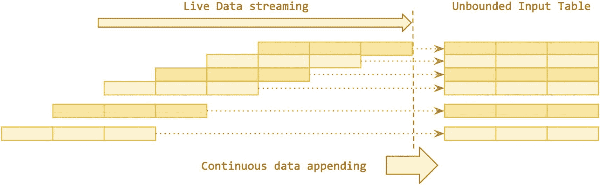
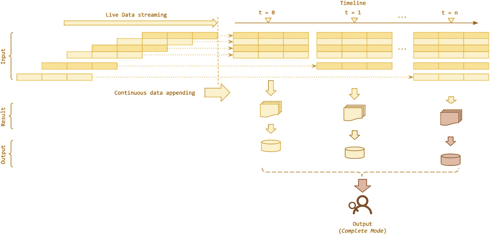
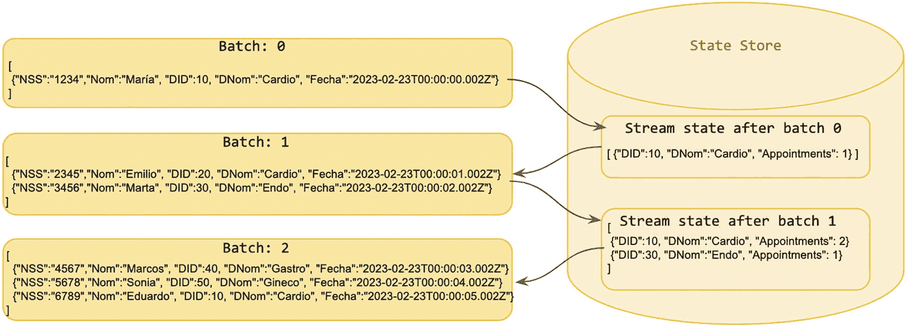

# 7. Spark Structured Streaming

如今，在大数据领域，越来越多的业务流程和日常应用需要大规模地分析实时或近实时信息。实时数据分析通常与需要快速、无延迟做出决策的流程相关联。因此，能够提供即时分析、管理持续流动的数据、具备容错能力并处理掉队者或慢速组件的基础设施是必不可少的。

考虑到定义数据流的主要特征，其中：

- 信息是连续的
- 信息是无界的
- 数据产生具有高容量和高速度
- 信息对时间敏感
- 数据源具有异构性

我们可以推断，在这种环境中，数据故障和掉队者^(¹⁵) 是必然会发生的情况。

数据故障和掉队者对流数据处理构成了严峻挑战。例如，如果我们不知道事件发生的顺序，又如何能从到达流处理系统的一系列事件中获取洞察呢？

流处理使用时间戳^(¹⁶) 来对事件进行排序，并包含了关于流事件处理的不同时间概念：

- `事件时间`：对应于设备生成事件的时间点。
- `摄入时间`：事件到达流处理架构的时间。
- `处理时间`：指计算机开始处理事件的时间。

在第 6 章中，我们看到 Spark 为了跟上信息流的动态特性并应对前述挑战，首次尝试引入了 Apache Spark Streaming（`DStream` API）。我们还研究了 `DStreams` 或离散化流是在 Spark 的弹性分布式数据集（`RDD`）数据结构之上实现的。`DStream` 通过将连续流动的数据分割成小块，然后作为微批次进行处理，从而处理连续数据流。

使用低级的 `RDD` API 既有优点也有缺点。第一个缺点是，顾名思义，它是一个低级框架；因此，需要更高的技术技能才能充分利用它，并且由于数据序列化和内存管理，会带来性能问题。序列化对于分布式系统性能至关重要，可以最大限度地减少网络间的数据混洗；因此，如果管理不当，可能会导致内存过度使用和网络瓶颈等诸多问题。

## 7.1 消息传递可靠性的通用规则

在此，我们介绍在后续章节中将会遇到的通用消息传递语义，以及每种语义在流数据处理基础设施中的重要性。

执行复杂的实时流分析并非易事。为了说明消息传递可靠性在实时流分析中的重要性，考虑一个流式应用程序，它从分布在多个位置的远程主机或传感器（通常可称为参与者）收集实时事件。同时考虑这些参与者将连接到不同的网络拓扑和不同质量的硬件，这些硬件在消息延迟（消息在网络中从一个点传输到另一个点所需的时间）、带宽（电子通信系统的数据传输能力）和可靠性方面存在明显差异。因此，事件传输涉及的步骤越多，消息序列出现故障的可能性就越大。

当考虑到所有这些因素时，我们得出结论：对于实时数据流处理，我们只能依赖那些始终得到保证的属性，以实现完全的参与者位置透明性和严格的消息传递保证。

关于消息传递可靠性机制的语义，有以下三个基本类别：

- `至多一次（at-most-once delivery）`：此语义意味着消息被传递一次或根本不传递（以即发即忘的方式）。这意味着消息可能会丢失。就最高传递性能和最少实现开销而言，它是最经济的，因为在发送过程或传输过程中都不保留任何状态。由于它消除了等待消息代理确认的开销，因此适用于那些实现高吞吐量至关重要，并且丢失一些消息不会显著影响最终结果的用例，例如，通过监听社交网络上的帖子来分析客户情绪。在数百万条帖子中，丢失几条可能不会对最终结论产生重大影响。
- `至少一次（at-least-once delivery）`：在此语义下，可能会进行多次尝试，以确保至少有一条消息到达目的地。它适用于那些不太关心数据重复，但确保不丢失任何消息至关重要的用例，例如，监控关键组件或人体生命体征（体温、脉搏率、呼吸率、血压等）的传感器。
- `恰好一次（exactly-once delivery）`：此语义意味着消息既不会丢失也不会重复。消息被传递并读取一次。因此，向目的地进行恰好一次的传递。

尽管有大量文献认为实现恰好一次传递是不可能的，因为它意味着保证消息被传递给接收者一次且仅一次，但从理论角度来看，它是存在的，并且我们在本书中会考虑这一点。

## 7.2 结构化流 vs. Spark Streaming

仅考虑 Spark 的统一版本和模块，`Spark Streaming` 和 `Spark Structured Streaming` 都使用默认的微批处理模型；然而，`Spark Streaming` 采用 `DStreams`，而 `Spark Structured Streaming` 则使用数据集/DataFrame。`DStream` 由一系列永久的 `RDDs` 表示，`RDDs` 是 Spark 中驻留在内存中的不可变、分布式数据集的概念。`DStream` 依赖 `RDDs` 提供底层转换和处理。另一方面，`Structured Streaming` 利用 `DataFrame` 和 `Dataset` API，提供了更高层次的抽象，并允许使用类似 SQL 的操作函数。由于 `RDDs` 属于底层 API，它们只能处理事件摄入时间（也称为处理时间或事件进入引擎的时间），因此无法高效处理乱序事件。相反，`Structured Streaming` 可以基于事件时间（事件生成的时间）处理数据，从而提供了一种处理延迟到达和乱序事件的解决方案。Spark `RDDs` 无法优化，因此更容易产生低效的数据转换，优化需要程序员额外的工作。

此外，使用 `DStream` 构建支持精确一次交付策略的流内处理管道并不直接。虽然可以实现，但需要编程变通方法。相比之下，`Structured Streaming` 为流内处理引入了新的有价值概念：

*   精确一次保证的消息传递规则默认实现；因此，理论上数据只被处理一次，重复数据会从结果中移除。
*   基于事件时间的流内处理带来了前述优势。

使用 `DStreams` 和 `Structured Streaming` 的另一个重要区别在于是否需要流式接收器。`DStream` 的流式输出是 `RDDs`，可以进行操作，因此不需要流式接收器作为最终输出；而 Spark `Structured Streaming` 则需要一个流式接收器。

另一个区别在于对实时流式处理的处理方式。`DStream` 通过将数据堆积成微批次来模拟实时处理，而 Spark `Structured Streaming` 使用无界表的概念（我们将在本章后面详细解释），以持续将实时事件添加到流中。

Spark `DStreams` 和 Spark `Structured Streaming` 之间的另一个显著区别在于端到端流式处理过程的执行方式。一方面，Spark `Structured Streaming` 有一个专用线程来检查是否有新数据到达流中，并且当且仅当有新信息需要处理时，才会执行流查询。另一方面，当 Spark Streaming 程序运行时，`DStream` 的微批次会根据 `StreamingContext()` 方法的 `batchDuration` 时间间隔参数执行，无论是否有实时信息，`DStream` 都会生成一个 `RDD`。

## 7.3 什么是 Apache Spark Structured Streaming？

Apache Spark Structured Streaming 是在 Spark 2.0 中引入的。Spark Structured Streaming 是一个可扩展的近实时流处理引擎，提供端到端的容错能力，并保证精确一次处理。Spark Structured Streaming 构建在 Spark SQL 库之上，因此原生集成了 Spark SQL 的代码和内存优化，并便于使用 SQL。Structured Streaming 基于 `Dataframe` 和 `Dataset` API。

Spark Structured Streaming 融合了多个新颖的概念，其中最重要的包括：

*   输入表
*   结果表
*   输出模式
*   数据集和 DataFrame 流式 API
*   事件时间窗口操作
*   水印
*   流式数据去重
*   状态存储（一个版本化的键值存储）
*   输出接收器

接下来，我们将解释其中一些概念背后的原理。其他概念将在后续章节中解释。

### Spark Structured Streaming 输入表

Spark Structured Streaming 使用“输入表”的概念来处理每个输入数据，该概念可以类比为图 7-1 中描述的“无界输入表”抽象。无界表的概念意味着到达系统的每一条新数据都会作为新行追加到表中。



示意图展示了实时数据流通过持续追加数据流入无界输入表。

图 7-1 Spark Structured Streaming 无界输入表流程图

因此，使用 Structured Streaming，计算是增量执行的，随着数据的到来持续更新结果，这使得流式数据处理能够以与批处理静态数据相同的方式表示。

### Spark Structured Streaming 结果表

# Spark Structured Streaming

Spark Structured Streaming 中的“结果表”也可以类比为一种无界输出表。结果表最终是对输入数据执行每次查询的结果。每当有新信息添加到无界输入表时，都会触发无界输出表的更新，从而根据设定的输出模式将结果写入指定的输出或数据接收器。无界输出表的概念及其如何集成到流式工作流中，如图 7-2 所示。



流程图展示了实时数据流通过持续追加数据输入到时间线，以完整模式呈现结果和输出。

图 7-2 Spark Structured Streaming 无界输出表流程图

接下来，我们将解释 Spark Structured Streaming 中可用的三种不同输出模式。

## Spark Structured Streaming 输出模式

输出模式（别名：`OutputMode`）是 Structured Streaming 引入的一个新概念，正如我们之前提到的，Spark Structured Streaming 需要一个流式接收器。

对于 Spark Structured Streaming 而言，输出模式指定了哪些数据被写入流式接收器以及写入这些数据的方式。

Spark Structured Streaming 支持三种输出模式：

- **追加模式**（别名：`append`）。这是默认行为，只有到达结果表的*新行*会被写入输出接收器。对于流式聚合而言，*新行*是指其中间状态变为最终状态的那些行。此模式保证每一行只会输出一次；当我们只对分析新数据感兴趣时，会使用此模式。追加模式仅适用于那些追加到结果表的行不会被修改的查询，例如，仅使用 `select`、`where`、`map`、`flatMap`、`filter`、`join` 等操作的查询。

- **完整模式**（别名：`complete`）。此模式仅支持流式聚合，其工作原理是每次处理信息时都写入结果表的所有行。当我们想要执行数据聚合，然后在每次更新后将完整的结果表转储到数据接收器时，会使用此模式。此模式不处理完整表数据的写入方式；因此，管理信息的责任在于所使用的连接器。

- **更新模式**（别名：`update`）。此输出模式是在 Spark 2.1.1 中引入的，它只会将自上次触发以来更新过的行写入接收器。当查询不包含聚合时，它等同于追加模式。

然而，没有一种输出模式适用于所有可能的流式查询。表 7-1 展示了输出模式与流式查询的兼容性矩阵。

**表 7-1** 输出模式与流式查询兼容性矩阵

| 流式查询类型 | 支持的输出模式 |
| --- | --- |
| 带聚合的查询 | 基于事件时间且带水印的聚合：Append、Update、Complete |
| | 其他聚合：Complete、Update |
| 包含 `mapGroupsWithState` 的查询 | Update |
| 包含 `flatMapGroupsWithState` 的查询 | Append 操作模式：Append |
| | Update 操作模式：Update |
| 包含 `joins` 的查询 | Append |
| 其他查询 | Append、Update |

输出模式是在流式查询的写入端，通过 `streaming.DataStreamWriter.outputMode` 方法指定的，该方法可以使用别名或 `org.apache.spark.sql.streaming.OutputMode` 对象的值：

```scala
import org.apache.spark.sql.SparkSession
import org.apache.spark.sql.streaming.OutputMode.Update

val spark: SparkSession = SparkSession.builder()
  .master("local[*]")
  .appName("Hands-On-Spark3_Structured_Streaming")
  .getOrCreate()

val inputStream = spark
  .readStream
  .format("socket")
  .option("host","localhost")
  .option("port","9999")
  .load()

inputStream
  .select(explode(split(df("value")," ")).alias("palabra"))
  .groupBy("word")
  .count()
  .writeStream
  .format("console")
  .outputMode("complete") // 选择了完整输出模式
  .start()
  .awaitTermination()

// 另一种指定方式
val inputStream = spark
  .readStream
  .format("socket")
  .load()
// .... 你的代码写在这里
  .writeStream
  .format("console")
  .outputMode(Update) // 选择了更新输出模式
  .start()
  .awaitTermination()
```

请记住，使用 Structured Streaming 时，你始终需要指定一个流式接收器和输出模式。

总之，考虑到前面列举的 Spark Structured Streaming 特性，我们可以说 Structured Streaming 提供了结果的一致性，因为它保证结果始终等同于具有相同输入数据的等效批处理所返回的结果。然而，这些模式中的每一种都仅适用于特定类型的查询。

## 数据集和 DataFrame 流式 API

自 Spark 2.0 起，DataFrame 和数据集可用于处理静态数据（有界数据）和流式数据（无界数据）。最新的 Spark 版本可以使用 DataFrame/数据集，通过通用的 `SparkSession` 入口点处理来自流式数据源的数据，并对它们应用与批处理中完全相同的转换和操作。

流式 DataFrame 可以通过 `DataStreamReader` 接口创建，该接口由 `SparkSession.readStream()` 返回（如果你使用 Scala、Java 或 Python），或者通过 `read.stream()` 方法返回（如果你使用 R）。与 Spark SQL 的 `read()` 方法类似，可以指定源数据格式（CSV、JSON 等）、模式等详细信息，以将不同格式的文件读入 Spark DataFrame。

与 Spark Streaming（DStream）一样，Structured Streaming 也内置了一些用于数据摄取的数据源。这些数据源包括：

- **文件源**：使用 `DataStreamReader` 方法，从目录中不同格式的文件（如文本、CSV、JSON、Parquet 等）上传流式数据。

- **Kafka 源**：从 Apache Kafka 主题读取流式数据。在本书编写时，仅支持 Kafka 代理版本 0.10.0 或更高版本。

- **套接字源**：从套接字连接读取 UTF-8 编码的文本。它不被视为容错的流式数据源，因为它不支持在发生故障后使用检查点偏移量重新提交数据。

- **速率源**：此流式数据源仅用于测试和基准测试。它用于以指定的每秒行数（速率）生成包含两列（"timestamp" 和 "value"）的随机数据。"timestamp" 列包含消息发送的时间，格式为 Timestamp 类型，而 "value" 列分配一个 Long 类型的数字，用于计数从 0 开始发送的消息。

- **每微批次速率源**：此流式数据源也仅用于测试和基准测试。与速率源一样，每个输出行包含两列："timestamp" 和 "value"。它具有与速率源相同的特性，但与后者不同，前者旨在为每个微批次提供一致数量的行（时间戳和值），也就是说，如果批次 0 产生数字 0 到 999 及其关联的时间戳，那么批次 1 将产生 1000 到 1999 及其后续的时间戳，依此类推。

接下来，在表 7-2 中，你可以看到上述数据源及其主要选项的总结。此表同样基于 Apache Spark 官方文档中关于流式 DataFrame 和数据集输入源的内容。

**表 7-2** Spark Structured Streaming 数据源选项

| 数据源 | 选项 | 容错 |
| --- | --- | --- |

| 文件数据源 | - `path`: 输入文件目录的路径。<br>- `maxFilesPerTrigger`: 每次触发时考虑的新文件最大数量（默认：无上限）。<br>- `latestFirst`: 是否优先处理最新文件。<br>- `fileNameOnly`: 是否仅基于文件名（而非完整路径）检查新文件：<br>  - 默认值：false。<br>  - 将 `fileNameOnly` 设为 `true` 后，以下文件 `hdfs://<host>:<port>/file.txt`、`file:///file.txt`、`s3://x/file.txt` 等将被视为同一文件，因为它们的文件名都是 `file.txt`。<br>- `maxFileAge`: 目录中文件被忽略前的最大存在时间：<br>  - 对于第一批次，所有文件均视为有效。<br>  - 最大存在时间基于最新文件的时间戳而非当前系统时间戳计算（默认：1 周）。<br>  - 若 `latestFirst` 设为 `true` 且设置了 `maxFilesPerTrigger`，则此参数将被忽略，因为有效且应被处理的旧文件可能被忽略。<br>- `cleanSource`: 处理完成后清理已完成文件。可选值为 `archive`、`delete` 和 `off`（默认：`off`）：<br>  - 选择 `archive` 时，必须同时提供 `sourceArchiveDir` 选项。<br>  - 归档（移动文件）和删除已完成文件都会在每个微批次中引入开销（降低处理速度）。<br>更多详情请参阅输入数据源手册。 | 是 |
| Socket 数据源 | 连接的主机和端口（`<host>`:`<port>`）。 | 否 |
| Rate 数据源 | - `rowsPerSecond`: 每秒应生成的行数，例如 100（默认：1）。<br>- `rampUpTime`: 生成速度达到 `rowsPerSecond` 前的加速时间。最大粒度为秒，例如 5 秒（默认：0 秒）。<br>- `numPartitions`: 生成行的分区数，例如 10（默认：Spark 的默认并行度）。<br>`rowsPerSecond` 的数量无法保证，因为查询可能受资源限制；此时可调整 `numPartitions` 以帮助达到期望速率。 | 是 |
| 每微批次 Rate 数据源 | - `rowsPerBatch`: 每个微批次应生成的行数，例如 100<br>- `numPartitions`: 生成行的分区数，例如 10（默认：Spark 的默认并行度）<br>- `startTimestamp`: 生成时间的起始值，例如 1000（默认：0）<br>- `advanceMillisPerBatch`: 每个微批次生成时间推进的毫秒数，例如 1000（默认：1000） | 是 |
| Kafka 数据源 | 更多详情请查阅 [`Kafka 集成指南`](https://spark.apache.org/docs/latest/structured-streaming-kafka-integration.html) 文档。 | 是 |

现在我们已经学习了 Spark Structured Streaming 的基础知识和主要数据源，接下来通过一些示例了解流式 DataFrame 的工作原理。

### Socket Structured Streaming 数据源

为了展示如何通过监听 Socket 连接使用 Spark Structured Streaming 摄取数据，我们将继续使用上一章中基本的近实时流式医院排队管理系统，并稍作调整，通过实现 JSON 输入格式使其更贴近实际场景。

我们提供两种运行程序的方式。第一个代码（`readStreamSocket.scala`）如下所示，这是一个 Scala 变体，可使用 `$SPARK_HOME/bin/spark-submit` 命令在 Spark 中编译和执行。讨论如何编译和链接 Scala 代码超出了本书范围，但建议使用 `sbt` 配合 `sbt-assembly` 创建包含所有必要库（即依赖项）的所谓 "fat JAR" 文件：

```scala
package org.apress.handsOnSpark3
import org.apache.spark.sql.SparkSession
import org.apache.spark.sql.functions._
import org.apache.spark.sql.types.{IntegerType, StringType, StructField, StructType}
import java.io.IOException
case class Patient(
NSS: String,
Nom: String,
DID: Option[Long],
DNom: String,
Date: String
)
object readStreamSocket {
def main(args: Array[String]): Unit = {
val PatientsSchema = StructType(Array(
StructField("NSS", StringType),
StructField("Nom", StringType),
StructField("DID", IntegerType),
StructField("DNom", StringType),
StructField("Date", StringType))
)
val host = "localhost"
val port = 9999
try {
val spark: SparkSession = SparkSession.builder()
.master("local[*]")
.appName("Hand-On-Spark3_Socket_Data_Source")
.getOrCreate()
spark.sparkContext.setLogLevel("ERROR")
// 设置 spark.readStream …
import spark.implicits._
val PatientDS = spark.readStream
.format("socket")
.option("host", host)
.option("port", port)
.load()
.select(from_json(col("value"),PatientsSchema).as("patient"))
.selectExpr("patient.*")
.as[Patient]
printf("\n 正在监听，准备就绪... \n")
val selectDF = PatientDS.select("*")
selectDF.writeStream
.format("console")
.outputMode("append")
.option("truncate", false)
.option("newRows", 30)
.start()
.awaitTermination()
} catch {
case e: java.net.ConnectException => println("建立连接到 " + host + ":" + port + " 时出错")
case e: IOException => println("发生 IOException")
case t: Throwable => println("接收数据时出错", t)
} finally {
println("Finally 块")
}
}
}
```

下一段代码是上述医院排队管理系统应用程序的另一个版本，可使用 Jupyter、Apache Zeppelin 等笔记本应用程序在 Spark 中执行，这对于学习目的更为方便，尤其当您不熟悉 Scala 代码编译工具时：

### 本地运行 Socket 结构化流应用程序

以下是用于从 Socket 读取流数据的 Spark 应用程序的完整代码：

```
import org.apache.spark.sql.SparkSession
import org.apache.spark.sql.functions._
import org.apache.spark.sql.types.{IntegerType, StringType, StructField, StructType,DoubleType,LongType}
import org.apache.spark.sql.{DataFrame, Dataset, Encoders, SparkSession}
import java.io.IOException

val PatientsSchema = StructType(Array(
StructField("NSS", StringType),
StructField("Nom", StringType),
StructField("DID", IntegerType),
StructField("DNom", StringType),
StructField("Fecha", StringType))
)

case class Patient(
NSS: String,
Nom: String,
DID: Option[Long],
DNom: String,
Fecha: String
)

val spark:SparkSession = SparkSession.builder()
.master("local[*]")
.appName("Hand-On-Spark3_Socket_Data_Source")
.getOrCreate()

spark.sparkContext.setLogLevel("ERROR")

val host = "localhost"
val port = 9999

try {
val PatientDS = spark.readStream
.format("socket")
.option("host",host)
.option("port",port)
.load()
.select(from_json(col("value"), PatientsSchema).as("patient"))
.selectExpr("Patient.*")
.as[Patient]

printf("\n 正在监听，准备就绪... \n")

val selectDF = PatientDS.select("*")

selectDF.writeStream
.format("console")
.outputMode("append")
.option("truncate",false)
.option("newRows",30)
.start()
.awaitTermination()
} catch {
case e: java.net.ConnectException => println("建立连接到 " + host + ":" + port + " 时出错")
case e: IOException => println("发生 IOException")
case t: Throwable => println("接收数据时出错", t)
}finally {
println("在 Finally 块中")
}
```

请注意我们在摄取数据之前是如何定义 `PatientsSchema` 模式的：

```
val PatientsSchema = StructType(Array(
StructField("NSS", StringType),
StructField("Nom", StringType),
StructField("DID", IntegerType),
StructField("DNom", StringType),
StructField("Fecha", StringType))
)
```

使用 Spark Structured Streaming 时，必须在使用信息之前定义其模式。

同时请注意 `local[*]` 选项。这里我们使用了 `*`，因此程序将使用所有可用的核心。使用多个核心很重要，因为应用程序必须能够并行运行两个任务：监听 TCP Socket（`localhost:9999`），同时处理数据并在控制台显示。

我们将使用一个名为 `Netcat` 的特色网络工具来建立一个简单的客户端/服务器流式连接。`Netcat`（根据系统不同，可能叫 `netcat`、`nc`、`ncat` 等）在类 Unix 操作系统中可用，它使用 TCP/IP 协议通过网络读写数据。在本书中，我们使用 Netcat OpenBSD 版本（`nc`）。

`nc` 命令的语法是：

```
nc [<options>] [<host>] [<port>]
```

`Netcat` 有几个 `[<options>]`；然而，我们只使用 `-l`，它指示 `nc` 监听一个 UDP 或 TCP `<port>`，以及 `-k`，它在监听模式下用于接受多个连接。当省略 `<host>` 时，`nc` 会监听绑定到给定 `<port>` 的所有 IP 地址。

为了说明程序如何工作，我们将利用前面介绍的 `nc` 工具，在 `nc` 和我们的 Spark 应用程序之间建立一个流式客户端/服务器连接。在我们的场景中，`nc` 将充当服务器（监听一个 `host:port`），而我们的应用程序将充当客户端（连接到 `nc` 服务器）。

无论你是从之前的代码构建了 JAR 文件，还是使用笔记本版本，运行应用程序都包含两个步骤：

1.  在你的系统中打开一个终端，并通过运行以下代码来设置客户端/服务器流式连接的服务器端：

```
nc -lk 9999
```

2.  根据你运行应用程序的方式：

    - **使用 JAR 文件**：打开第二个终端并按如下所示执行你的应用程序：

    ```
    $SPARK_HOME/bin/spark-submit --class org.apress.handsOnSpark3.readStreamSocket --master "local[*]" PATH/TO/YOUR/HandsOnSpark3-readStreamSocket.jar
    ```

    - **使用笔记本**：只需在你的笔记本中执行代码。

一旦你在屏幕上看到消息 `Listening and ready…`，你就可以回到步骤 1 并输入一些提供的 JSON 字符串，例如：

```
{"NSS":"1234","Nom":"María", "DID":10, "DNom":"Cardio", "Fecha":"01-09-2022"}
{"NSS":"2345","Nom":"Emilio", "DID":20, "DNom":"Neuro", "Fecha":"01-09-2022"}
{"NSS":"3456","Nom":"Marta", "DID":30, "DNom":"Endo", "Fecha":"01-09-2022"}
…
{"NSS":"4567","Nom":"Marcos", "DID":40, "DNom":"Gastro", "Fecha":"01-09-2022"}
{"NSS":"5678","Nom":"Sonia", "DID":50, "DNom":"Gineco", "Fecha":"01-09-2022"}
{"NSS":"6789","Nom":"Eduardo", "DID":10, "DNom":"Cardio", "Fecha":"01-09-2022"}
```

每隔几秒钟，你将在终端上看到类似如下的输出：

# 3. 应用程序终止

`awaitTermination()` 等待用户的终止信号。因此，转到步骤 1 中启动的终端会话，按下 `Ctrl+C` 或发送 `SIGTERM` 信号，流式上下文将被停止。

这种终止流式应用程序的方式既不优雅也不正确，因为当我们终止它时，正在进行的操作将会丢失。一种更优雅且正确的方法是使用我们在前一章中看到的 Spark Structured Streaming 优雅关闭。因此，我们鼓励你修改之前的代码，为其添加优雅关闭功能。

### 文件系统结构化流数据源

Spark Streaming 可以使用文件系统作为输入数据库。Spark 可以在任何兼容 HDFS 的文件系统（如 HDFS 本身、AWS S3、NFS 等）上挂载文件流处理过程。当设置文件系统流时，Spark 会监控指定的路径，并处理在其中创建的任何文件。

Spark 根据以下模式监控文件系统：

- 对于像 `"hdfs://hadoop:9000/folder/"`、`"s3//…"`、`"file//…"` 等路径，Spark 会在文件出现在路径下时立即处理它们。
- 也可以使用全局模式来指定目录，例如 `"hdfs://<hadoop-host>:<hadoop-port>/folder/textfiles/*/*"`。
- 路径内的所有文件必须具有相同的格式。
- 路径下存在的文件数量会影响 Spark 扫描该路径所需的时间，即使没有文件被更新。
- 同一时间窗口内的文件更新将被忽略。因此，一旦文件被处理，更新它不会导致其被重新处理。
- Spark 将根据文件的修改时间（而非创建时间）来处理文件。因此，当流处理过程启动时，路径中已存在的文件将不会被处理。
- 使用 `Hadoop FileSystem.setTimes()` 设置文件的访问时间可能会导致文件在当前处理时间窗口之外被处理。

现在我们将看到如何使用 Spark 持续监控文件夹并从文件夹中流式读取文件。在本例中，我们将继续使用基本的近实时流式医院排队管理系统，再次对其进行一些调整，以使其能够从文件系统流式读取文件。

正如我们之前对 Socket 数据源示例所做的那样，这里提供了两个版本的程序。第一个版本可以使用 `sbt` 或其他 Scala 编译器编译：

```scala
package org.apress.handsOnSpark3
import org.apache.spark.sql.SparkSession
import org.apache.spark.sql.functions._
import org.apache.spark.sql.types.{IntegerType, StringType, StructField, StructType}
import java.io.IOException
object dStreamsFiles {
def main(args: Array[String]): Unit = {
val PatientsSchema = StructType(Array(
StructField("NSS", StringType),
StructField("Nom", StringType),
StructField("DID", IntegerType),
StructField("DNom", StringType),
StructField("Date", StringType)
)
)
try {
val spark: SparkSession = SparkSession
.builder()
.master("local[3]")
.appName("Hand-On-Spark3_File_Data_Source")
.getOrCreate()
spark.sparkContext.setLogLevel("ERROR")
val df = spark.readStream
.schema(PatientsSchema).json("/tmp/patient_streaming")
val groupDF = df.select("DID")
.groupBy("DID").agg(count("DID").as("Accumulated"))
.sort(desc("Accumulated"))
printf("\n Listening and ready... \n")
groupDF.writeStream
.format("console")
.outputMode("complete")
.option("truncate", false)
.option("newRows", 30)
.start()
.awaitTermination()
} catch {
case e: IOException => println("IOException occurred")
case t: Throwable => println("Error receiving data", t)
} finally {
println("Finally block")
}
}
}
```

接下来是第二个版本，旨在 Apache Zeppelin、Jupyter Notebook 等笔记本中执行。

```markdown
```scala
import org.apache.spark.sql.SparkSession
import org.apache.spark.sql.types.{IntegerType, StringType, StructField, StructType}
import org.apache.spark.sql.functions.desc
import java.io.IOException

val spark:SparkSession = SparkSession
  .builder()
  .master("local[3]")
  .appName("Hand-On-Spark3_File_Data_Source")
  .getOrCreate()

spark.sparkContext.setLogLevel("ERROR")

val PatientsSchema = StructType(Array(
  StructField("NSS", StringType),
  StructField("Nom", StringType),
  StructField("DID", IntegerType),
  StructField("DNom", StringType),
  StructField("Fecha", StringType)
))

try {
  val df = spark.readStream.schema(PatientsSchema)
    .json("/tmp/patient_streaming")

  val groupDF = df.select("DID")
    .groupBy("DID").agg(count("DID").as("Accumulated"))
    .sort(desc("Accumulated"))

  groupDF.writeStream
    .format("console")
    .outputMode("complete")
    .option("truncate", false)
    .option("newRows", 30)
    .start()
    .awaitTermination()
} catch {
  case e: IOException => println("IOException occurred")
  case t: Throwable => println("Error receiving data", t)
}
```

### 在本地运行文件系统流式应用

在本例中，我们的程序将监控选定的 `/tmp/patient_streaming` 路径，并在 Spark 发现文件后立即处理复制到该路径的文件。

与“在本地运行 Socket 结构化流式应用”部分类似，运行此处提供的文件系统数据源示例也取决于您选择的执行方式。您同样可以选择从之前提供的代码片段构建自己的 JAR 文件，或使用笔记本版本。无论哪种方式，运行该应用都包含两个步骤：

1.  根据您运行应用的方式

    1.  如果您使用 JAR 文件，请在计算机上打开一个终端，并按如下所示执行您的应用：

        ```
        $SPARK_HOME/bin/spark-submit --class org.apress.handsOnSpark3.dStreamsFiles --master "local[*]" target/scala-2.12/HandsOnSpark3-dStreamsFiles-assembly-fatjar-1.0.jar
        ```

    2.  如果您使用笔记本，只需在笔记本中执行代码即可。

2.  在计算机上打开一个新终端，将提供的 JSON 文件复制到被监控的文件夹。

    当您在屏幕上看到消息 `Listening and ready...` 后，可以返回步骤 2，开始将 JSON 文件复制到 `/tmp/patient_streaming` 文件夹，例如：

    ```
    cp /PATH/TO/patient1.json /tmp/patient_streaming
    cp /PATH/TO/patient2.json /tmp/patient_streaming
    cp /PATH/TO/patient3.json /tmp/patient_streaming
    cp /PATH/TO/patient4.json /tmp/patient_streaming
    cp /PATH/TO/patient5.json /tmp/patient_streaming
    ```

每隔几秒，您就会在终端会话或笔记本中看到类似如下的输出：

```
Listening and ready...

Batch: 0

+---+-----------+
|DID|Accumulated|
+---+-----------+
|10 |1          |
+---+-----------+

Batch: 1

+---+-----------+
|DID|Accumulated|
+---+-----------+
|20 |1          |
|10 |1          |
|30 |1          |
+---+-----------+

Batch: 2

+---+-----------+
|DID|Accumulated|
+---+-----------+
|10 |4          |
|20 |3          |
|40 |1          |
|50 |1          |
|30 |1          |
+---+-----------+

Batch: 3

+---+-----------+
|DID|Accumulated|
+---+-----------+
|10 |7          |
|20 |3          |
|50 |2          |
|30 |2          |
|40 |1          |
+---+-----------+
```

提供的示例生成的是无类型 DataFrame；这意味着提供的模式不会在编译时验证，仅在代码执行时的运行时验证。

到目前为止，我们仅对到达流处理过程的数据应用了转换。例如，在我们上一个程序中，“Accumulated”列累加了输入的“DID”字段。这就是所谓的无状态流处理。现在假设一个场景，您想要找出流式应用接收到的每个值的总出现次数，并更新先前处理信息的状态。这就是我们接下来要讨论的流状态和有状态流处理概念发挥作用的地方。

## 7.5 Spark 结构化流转换

在本节中，我们将向您介绍 Spark 结构化流支持的转换操作。这些数据转换分为`无状态`和`有状态`操作。Spark 结构化流仅支持能够增量更新 DataFrame 聚合的操作。有状态操作需要在流处理过程中或在我们定义的时间范围内维护事件状态。

接下来，我们将解释之前提到的结构化流概念：流状态、无状态操作和有状态操作。

### Spark 结构化流中的流状态

状态是任何流式数据管道中最重要的组件之一。根据具体的用例，可能需要在流式应用运行期间维护不同变量（如计数器）的状态。

在处理流式数据的过程中，每个应用都必须使用无状态或有状态的数据管理方法。无状态操作与有状态操作的主要区别在于，执行增量聚合/操作时是否需要跟踪持续的事件状态。

总结来说，在此上下文中，“状态”基本上指的是需要在特定时间段内保留的“临时信息”，以便在后续流处理过程中使用。

### Spark 无状态流处理

无状态意味着处理当前微批次中的数据时，不考虑过去或未来的信息。这种无状态数据处理的一个例子是收集和保存网络事件（点击、页面访问等）。

无状态操作是指可以独立于先前处理的信息来处理当前信息的操作。这些操作的例子包括 `select()`、`explode()`、`map()`、`flatMap()`、`filter()` 和 `where()` 等。无状态操作仅支持 `append` 和 `update` 输出模式，因为这些操作处理的信息无法在下游更新。另一方面，它们不支持 `complete` 输出模式，因为要累积完整的流信息实际上是不可能的。

在下一节中，我们将探讨如何执行有状态操作，以及如何相应地更新流配置和资源。

### Spark 有状态流处理

有状态流处理是一种维护事件状态的流处理方式。这意味着事件状态会在流处理过程中被维护并在事件之间共享；因此，事件条件可以随时间被维护和/或更新。有状态流用于在流式聚合中持久化实时聚合结果。

在涉及有状态操作时，`Spark Structured Streaming` 提供了一套简洁的 API 来维护不同批次之间的状态。

当我们需要在流处理过程中持续更新中间状态（正在处理的信息）时，有状态处理是必要的。例如，当我们需要按键或事件时间进行数据聚合时，且无法保证事件按序到达。如图 7-3 所示，你可以看到 Spark 如何利用 `StateStore`/`state store` 的概念来维护和共享不同批次之间的事件状态信息。
```



示意图左侧从上到下依次展示了三个水平方块，分别标记为批次 0 到 2。右侧是一个圆柱体形状，标记为状态存储，从上到下分别显示批次 0 和批次 1 后的流状态。两侧通过箭头连接。

**图 7-3** `Spark Structured Streaming` 状态维护过程

## 有状态流处理

Apache Spark 通过将中间状态信息保存在一个名为 `StateStore` 的内存键值存储中来实现有状态操作。`StateStore` 实现了容错机制，将中间状态保存在一个称为检查点目录的文件系统目录中。

因此，通过有状态流处理，每个微批次的中间输出会被临时保存，并通过事件“状态”在执行之间共享。

有状态转换的一个例子是统计（`df.groupBy().count()`）自查询开始以来处理的事件数量。Spark 会将已统计的事件数量保存在事件状态中，并将其传递给下一个微批次，该数量会被累加到持续计数中。事件状态保存在 Spark 执行器的内存中，并保存到指定的文件系统目录以实现容错。

根据中间信息的管理和移除方式，有状态操作分为两种类型：

*   **托管有状态操作** 是自动管理过时（“旧”）状态的操作。此类操作包括：
    *   流式聚合
    *   流-流连接
    *   流式去重

    都属于此类别。

*   **非托管有状态操作**，例如：
    *   `mapGroupsWithState`
    *   `flatMapGroupsWithState`

    允许用户定义自己的有状态操作。

### 有状态流式聚合

Spark 有状态流式聚合可分为：

*   **基于时间的聚合**：每单位时间处理的事件数量
*   **非基于时间的聚合**：例如按键对事件进行分组

#### 基于时间的聚合

基于时间的聚合将在第 8 章中详细研究。因此，我们暂时搁置。

#### 非基于时间的聚合

非基于时间的聚合包括：

*   **全局聚合**
    这些是不区分键的通用聚合。在您目前看到的示例中，可以是医院登记的患者数量：

```python
# PySpark
counts = PatientDS.groupBy().count()
```

```scala
// Scala
val counts = PatientDS.groupBy().count()
```

*   **分组聚合**
    这些是按键或区分键的聚合。在上述医院排队管理系统应用示例的基础上，我们可能只关心医院中特定科室的预约数量。

    以下是我们医院排队管理系统应用示例的修改版本，其中包含了按科室 ID 和科室名称进行的有状态分组聚合：

```scala
import org.apache.spark.sql.SparkSession
import org.apache.spark.sql.functions._
import org.apache.spark.sql.types.{IntegerType, StringType, StructField, StructType,DoubleType,LongType}
import org.apache.spark.sql.{DataFrame, Dataset, Encoders, SparkSession}
import java.io.IOException

val PatientsSchema = StructType(Array(
  StructField("NSS", StringType),
  StructField("Nom", StringType),
  StructField("DID", IntegerType),
  StructField("DNom", StringType),
  StructField("Fecha", StringType))
)

case class Patient(
  NSS: String,
  Nom: String,
  DID: Option[Long],
  DNom: String,
  Fecha: String
)

val spark:SparkSession = SparkSession.builder()
  .master("local[*]")
  .appName("Hand-On-Spark3_Socket_Data_Source")
  .getOrCreate()

spark.sparkContext.setLogLevel("ERROR")

val host = "localhost"
val port = 9999

try {
  val PatientDS = spark.readStream
    .format("socket")
    .option("host",host)
    .option("port",port)
    .load()
    .select(from_json(col("value"),  PatientsSchema).as("patient"))
    .selectExpr("Patient.*")
    .as[Patient]

  printf("\n Listening and ready... \n")

  val counts = PatientDS
    .groupBy(col("DID"),col("DNom"))
    .count()

  counts.writeStream
    .format("update")
    .format("console")
    .outputMode("complete")
    .option("truncate",false)
    .option("newRows",30)
    .start()
    .awaitTermination()
} catch {
  case e: java.net.ConnectException => println("Error establishing connection to " + host + ":" + port)
  case e: IOException => println("IOException occurred")
  case t: Throwable => println("Error receiving data", t)
} finally {
  println("Finally block")
}
```

运行上述代码，您将看到类似如下的输出：

```
    Listening and ready...
    -------------------------------------------
    Batch: 1
    -------------------------------------------
    +---+------+-----+
    |DID|DNom  |count|
    +---+------+-----+
    |20 |Neuro |4    |
    |40 |Gastro|1    |
    |50 |Gineco|3    |
    |30 |Endo  |3    |
    |10 |Cardio|9    |
    +---+------+-----+
    -------------------------------------------
    Batch: 2
    -------------------------------------------
    +---+------+-----+
    |DID|DNom  |count|
    +---+------+-----+
    |20 |Neuro |11   |
    |40 |Gastro|3    |
    |50 |Gineco|9    |
    |30 |Endo  |8    |
    |10 |Cardio|26   |
    +---+------+-----+
    -------------------------------------------
    Batch: 3
    -------------------------------------------
    +---+------+-----+
    |DID|DNom  |count|
    +---+------+-----+
    |20 |Neuro |11   |
    |40 |Gastro|3    |
    |50 |Gineco|9    |
    |30 |Endo  |8    |
    |10 |Cardio|27   |
    +---+------+-----+
```

*   **多重聚合**
    `groupBy` 子句允许您指定多个聚合函数来转换列信息。因此，可以一次性执行多个聚合。例如，您可以按如下方式修改之前的代码片段。

# Spark 聚合函数示例

## 聚合代码示例

以下代码用于同时获取多个聚合结果：

```scala
val counts = PatientDS
.groupBy(col("DID"),col("DNom"))
.agg(count("*").alias("countDID"),
sum("DID").alias("sumDID"),
mean("DID").alias("meanDID"),
stddev("DID").alias("stddevDID"),
approx_count_distinct("DID").alias("distinctDID"),
collect_list("DID").alias("collect_listDID"))
```

## 运行与输出

当你在终端中运行上述代码并复制（记得先执行 `nc -lk 9999`）以下第一组 JSON 字符串时：

```json
{"NSS":"4567","Nom":"Marcos", "DID":40, "DNom":"Gastro", "Fecha":"2023-02-23T00:00:03.002Z"}
{"NSS":"5678","Nom":"Sonia", "DID":50, "DNom":"Gineco", "Fecha":"2023-02-23T00:00:04.002Z"}
{"NSS":"6789","Nom":"Eduardo", "DID":10, "DNom":"Cardio", "Fecha":"2023-02-23T00:00:05.002Z"}
{"NSS":"1001","Nom":"Lorena", "DID":10, "DNom":"Cardio", "Fecha":"2023-02-23T00:00:06.002Z"}
{"NSS":"1006","Nom":"Sara", "DID":20, "DNom":"Neuro", "Fecha":"2023-02-23T00:00:07.002Z"}
{"NSS":"1002","Nom":"Teresa", "DID":10, "DNom":"Cardio", "Fecha":"2023-02-23T00:00:08.002Z"}
{"NSS":"1003","Nom":"Luis", "DID":20, "DNom":"Neuro", "Fecha":"2023-02-23T00:00:09.002Z"}
```

紧接着再复制第二组 JSON 字符串：

```json
{"NSS":"1004","Nom":"Tomás", "DID":30, "DNom":"Endo", "Fecha":"2023-02-23T00:00:10.002Z"}
{"NSS":"1005","Nom":"Lorena", "DID":50, "DNom":"Gineco", "Fecha":"023-02-23T00:00:11.002Z"}
{"NSS":"1006","Nom":"Pedro", "DID":10, "DNom":"Cardio", "Fecha":"023-02-23T00:00:12.002Z"}
{"NSS":"1007","Nom":"Ester", "DID":10, "DNom":"Cardio", "Fecha":"023-02-23T00:00:13.002Z"}
{"NSS":"1008","Nom":"Marina", "DID":10, "DNom":"Cardio", "Fecha":"023-02-23T00:00:14.002Z"}
{"NSS":"1009","Nom":"Julia", "DID":20, "DNom":"Neuro", "Fecha":"023-02-23T00:00:15.002Z"}
{"NSS":"1010","Nom":"Javier", "DID":30, "DNom":"Endo", "Fecha":"023-02-23T00:00:16.002Z"}
{"NSS":"1011","Nom":"Laura", "DID":50, "DNom":"Gineco", "Fecha":"023-02-23T00:00:17.002Z"}
{"NSS":"1012","Nom":"Nuria", "DID":10, "DNom":"Cardio", "Fecha":"023-02-23T00:00:18.002Z"}
{"NSS":"1013","Nom":"Helena", "DID":10, "DNom":"Cardio", "Fecha":"023-02-23T00:00:19.002Z"}
```

你将看到类似如下的输出：

```
Listening and ready...
-------------------------------------------
Batch: 1
-------------------------------------------
+---+------+--------+------+-------+---------+-----------+---------------+
|DID|DNom  |countDID|sumDID|meanDID|stddevDID|distinctDID|collect_listDID|
+---+------+--------+------+-------+---------+-----------+---------------+
|20 |Neuro |2       |40    |20.0   |0.0      |1          |[20, 20]       |
|40 |Gastro|1       |40    |40.0   |null     |1          |[40]           |
|50 |Gineco|1       |50    |50.0   |null     |1          |[50]           |
|10 |Cardio|3       |30    |10.0   |0.0      |1          |[10, 10, 10]   |
+---+------+--------+------+-------+---------+-----------+---------------+
-------------------------------------------
Batch: 2
-------------------------------------------
+---+------+--------+------+-------+---------+-----------+----------------------------+
|DID|DNom  |countDID|sumDID|meanDID|stddevDID|distinctDID|collect_listDID             |
+---+------+--------+------+-------+---------+-----------+----------------------------+
|20 |Neuro |3       |60    |20.0   |0.0      |1          |[20, 20, 20]                |
|40 |Gastro|1       |40    |40.0   |null     |1          |[40]                        |
|50 |Gineco|3       |150   |50.0   |0.0      |1          |[50, 50, 50]                |
|30 |Endo  |2       |60    |30.0   |0.0      |1          |[30, 30]                    |
|10 |Cardio|7       |70    |10.0   |0.0      |1          |[10, 10, 10, 10, 10, 10, 10]|
+---+------+--------+------+-------+---------+-----------+----------------------------+
-------------------------------------------
Batch: 3
-------------------------------------------
+---+------+--------+------+-------+---------+-----------+--------------------------------+
|DID|DNom  |countDID|sumDID|meanDID|stddevDID|distinctDID|collect_listDID                 |
+---+------+--------+------+-------+---------+-----------+--------------------------------+
|20 |Neuro |3       |60    |20.0   |0.0      |1          |[20, 20, 20]                    |
|40 |Gastro|1       |40    |40.0   |null     |1          |[40]                            |
|50 |Gineco|3       |150   |50.0   |0.0      |1          |[50, 50, 50]                    |
|30 |Endo  |2       |60    |30.0   |0.0      |1          |[30, 30]                        |
|10 |Cardio|8       |80    |10.0   |0.0      |1          |[10, 10, 10, 10, 10, 10, 10, 10]|
+---+------+--------+------+-------+---------+-----------+--------------------------------+
```

上述代码片段中展示的聚合函数仅用于说明目的。显然，将 `sum()`、`mean()`、`stddev()`、`approx_count_distinct()` 和 `collect_list()` 等函数应用于科室编号 `"DID"` 并不具备任何业务意义。

**表 7-3** Spark Structured Streaming 数据框聚合函数列表

| 聚合函数 | 描述 |
| --- | --- |
| `approx_count_distinct()` | 返回一个新列，用于近似计算某列的去重数量。 |
| `avg()` | 返回组内值的平均值。 |
| `collect_list()` | 返回一个包含输入列所有值（含重复项）的列表。 |
| `collect_set()` | 返回一个包含输入列值（不含重复项）的集合。 |
| `countDistinct()` | 返回一个新列，用于计算某列中的去重元素。 |
| `count()` | 返回某列中的元素数量。 |
| `first()` | 返回某列中的第一个非空元素。 |
| `last()` | 返回最后一个非空元素。 |
| `kurtosis()` | 返回某列值的峰度。可用于尝试识别数据中的异常值。 |
| `max()/min()` | 分别返回某列的最大值或最小值。 |
| `mean()` | `avg()` 的别名，返回某列元素的平均值。 |
| `skewness()` | 返回某列值的偏度。表示偏离正态分布的程度。 |
| `stddev()` | `stddev_samp()` 的别名，返回组内表达式的无偏样本标准差。 |
| `stddev_pop()` | 返回某列表达式的总体标准差。 |
| `sum()` | 返回某列值的总和。 |
| `sumDistinct()` | 返回某列中去重值的总和。 |
| `variance()` | `var_samp()` 的别名，返回某列值的无偏样本方差。 |
| `var_pop()` | 返回某列值的总体方差。 |

(*) 尽管现有文献中 `countDistinct()` 被视为结构化流式处理的有效聚合函数，但在本书编写时，当我们尝试将其用作上一节所述的多个聚合函数之一时，Spark 输出了以下消息：`"Distinct aggregations are not supported on streaming DataFrames/Datasets. Consider using approx_count_distinct() instead."`

### 内置聚合函数

Spark Streaming 的内置聚合函数简化了数据汇总过程，这是数据分析的重要组成部分。要使用它们，您需要指定一个用于分组的聚合键，以及定义如何在 DataFrame 列上执行转换的聚合函数。

表 7-3 列出了 DataFrame 最常用的聚合函数。有关列操作的完整聚合函数列表，请参阅官方文档。^(²⁰)

### 用户自定义聚合

最后，Spark Structured Streaming 支持用户自定义聚合函数。请查阅 Spark SQL 指南以获取更多和更新的详细信息。

## 7.6 Spark 检查点流式处理

为了提供容错能力，Spark 使用检查点来确保能从故障中恢复。检查点用于将中间信息状态持久化到文件系统存储中，Spark 在发生故障时可以从中读取。在有状态流式处理中，必须应用检查点，以便在发生故障时能够恢复过渡状态。

在“Spark 有状态流式处理”一节中研究并在图 7-3 中描绘的 `StateStore` 支持增量检查点，这意味着只保存更新的键值对，而不会修改流式处理过程中存在的其他键值对。

为了在我们的流式医院排队管理系统应用示例中加入检查点支持，我们将按如下方式更新之前的代码片段：

```scala
import org.apache.spark.sql.streaming._
// ...
val checkpointDir = "/tmp/streaming_checkpoint"
// ...
counts.writeStream
// ...
.trigger(Trigger.ProcessingTime("5 seconds"))
.option("checkpointLocation", checkpointDir)
// ...
.start()
.awaitTermination()
```

如您所见，我们引入了几个新特性，下面将逐一解释：

### Trigger（触发器）

定义流式查询必须多久被触发（运行）一次，以处理新可用的流式数据——换句话说，就是我们的应用程序需要以多高的频率检查数据源以寻找新信息，并可能发出新数据。`Trigger` 被引入 Spark 用于设置流批处理周期。

`ProcessingTime` 是一种触发器，它以毫秒为最小时间单位。`ProcessingTime(interval: String)` 接受带或不带间隔字符串的 `CalendarInterval` 实例，例如：

- **带间隔字符串**：`ProcessingTime("interval 10 seconds")`

- **不带间隔字符串**：`ProcessingTime("10 seconds")`

有四种工厂方法（选项）：

- **默认**：如果未设置触发器，流式查询会在前一个微批次完成后立即一个接一个地运行微批次。

- `OneTimeTrigger`：设置此触发器模式后，它执行一次触发器然后停止。流式查询将仅在一个微批次中执行可用的数据。此触发器模式的一个用例是将其用作一种每日批处理，以节省计算资源和资金。示例：`.trigger(Trigger.Once)`。

- `ProcessingTime`：用户可以定义 `ProcessingTime` 参数，流式查询将按设定的间隔被触发，执行新的微批次并可能发出新数据。

- `ContinuousTrigger`：在本书编写时，连续处理是 Spark 2.3 中引入的一种实验性流式执行模式。^(²¹) 它旨在实现低延迟（约 1 毫秒），并提供至少一次保证。为了提供容错能力，必须提供一个检查点间隔作为参数。示例：`.trigger(Trigger.Continuous("1 second"))`。1 秒的检查点间隔意味着流引擎将每秒记录查询的中间结果。每个检查点都以与微批次引擎兼容的结构写入；因此，在发生故障后，正在进行的（受支持的）查询可以通过任何其他类型的触发器重新启动。例如，使用微批次模式启动的受支持查询可以在连续模式下重新启动，反之亦然。连续处理模式仅支持无状态查询，例如 `select`、`map`、`flatMap`、`mapPartitions` 等，以及 `where`、`filter` 等选择操作。连续模式支持所有 SQL 函数，但聚合函数 `current_timestamp()` 和 `current_date()` 除外。

### checkpointLocation（检查点位置）

此参数指向为状态存储持久化而创建的文件系统目录。为了使存储具有容错能力，必须将选项 `checkpointLocation` 设置为 `writeStream` 输出配置的一部分。

状态存储使用检查点文件夹主要存储：

- 数据检查点
- 元数据检查点

如果我们使用有状态操作，Spark Streaming 检查点文件夹和状态数据表示文件夹的结构将如表 7-4 所示。

**表 7-4** Spark Streaming 检查点与状态数据表示结构

| `checkpointLocation` 文件夹结构 | 状态数据表示 |
| --- | --- |
| `/tmp/streaming_checkpoint`<br>├── `commits`<br>│   ├── `0`<br>│   ├── `1`<br>│   ├── `2`<br>│   └── `3`<br>├── `metadata`<br>├── `offsets`<br>│   ├── `0`<br>│   ├── `1`<br>│   ├── `2`<br>│   └── `3`<br>└── `state`<br>      └── `0` | └── `state`<br>    └── `0`<br>        ├── `0`<br>        │   ├── `1.delta`<br>        │   ├── `2.delta`<br>        │   ├── `3.delta`<br>        │   ├── `4.delta`<br>        │   └── `_metadata`<br>        │   └── `schema`<br>        ├── `1`<br>        │   ├── `1.delta`<br>        │   ├── `2.delta`<br>        │   ├── `3.delta`<br>        │   └── `4.delta`<br>        ├── `10`<br>        │   ├── `1.delta`<br>        │   ├── `2.delta`<br>        │   ├── `3.delta`<br>        │   └── `4.delta` |

### 通过检查点从故障中恢复

在发生故障或计划内关闭时，可以借助持久化在检查点目录中的中间信息，将查询精确恢复到其停止的位置。此外，恢复后，流式查询中允许进行某些更改，而其他更改则不允许。例如，您可以将查询的接收端从文件改为 Kafka，但不能反过来。您可以查阅 Structured Streaming 编程指南文档，了解从同一检查点位置重启流式查询时，允许和不允许更改的最新列表。^((22))

## 7.7 总结

在本章中，我们介绍了 Spark Structured Streaming 模块。首先，我们研究了消息传递可靠性机制的一般语义。其次，我们将 Structured Streaming 与基于 DStream 的 Spark Streaming 进行了比较。之后，我们解释了 Spark Structured Streaming 架构背后的技术细节，例如输入表和结果表以及支持的不同输出模式。此外，我们还介绍了用于 DataFrame 和 Dataset 的流式 API，以及 Structured Streaming 的无状态和有状态转换与聚合，并给出了一些有趣的示例，这些示例将帮助您学习如何实现这些功能。最后，我们研究了流式检查点和恢复的概念，并给出了一些实际示例。在下一章中，我们将继续学习流式数据源和接收端。

脚注 1 2 3 4 5 6 7 8

