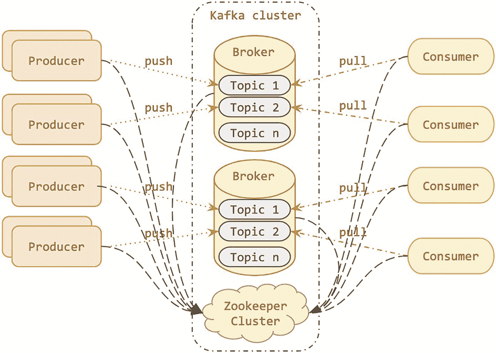
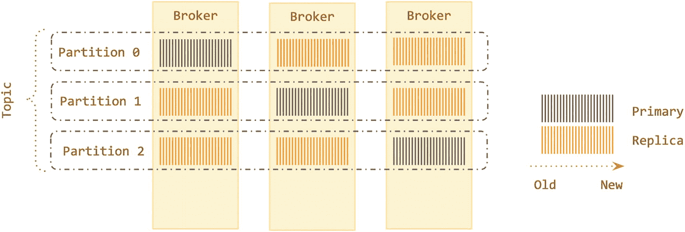
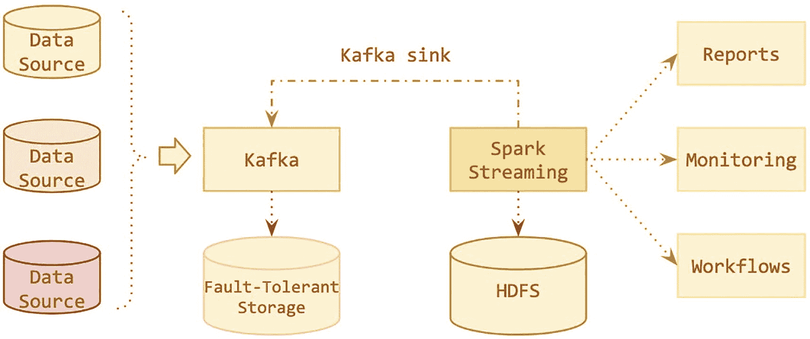
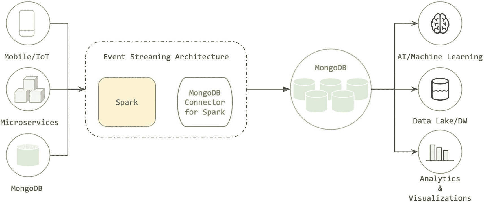
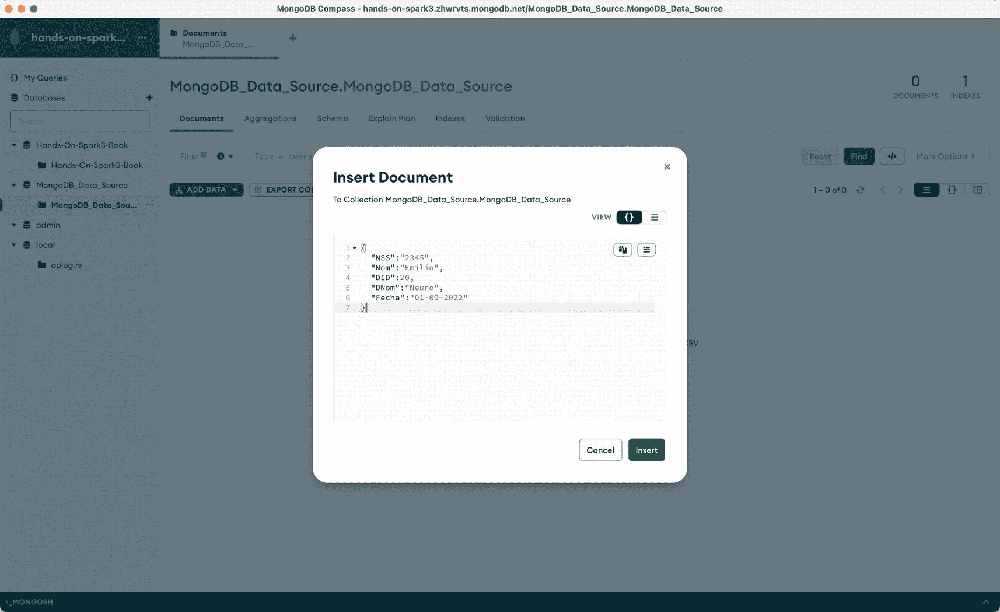
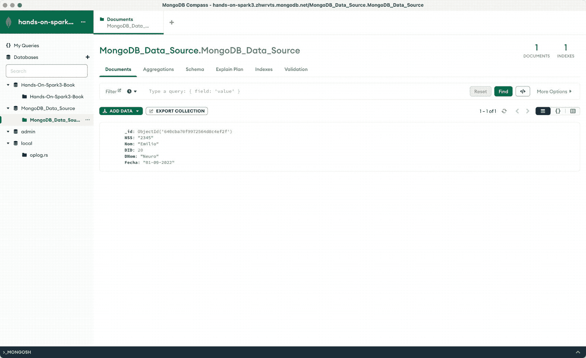
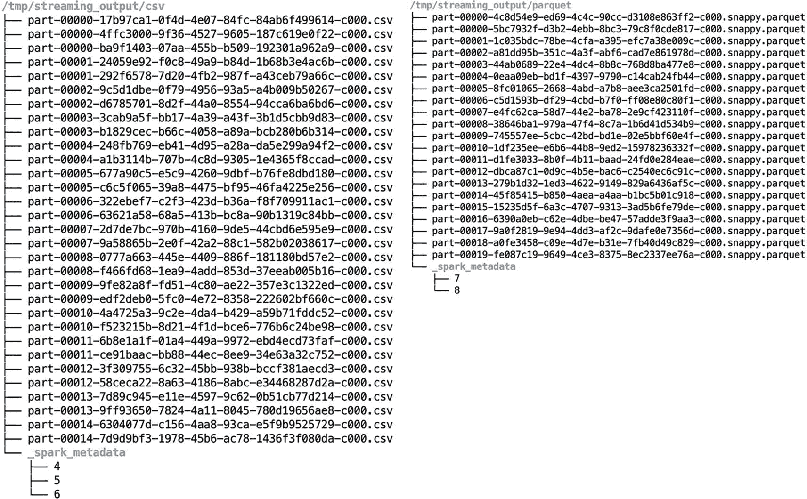
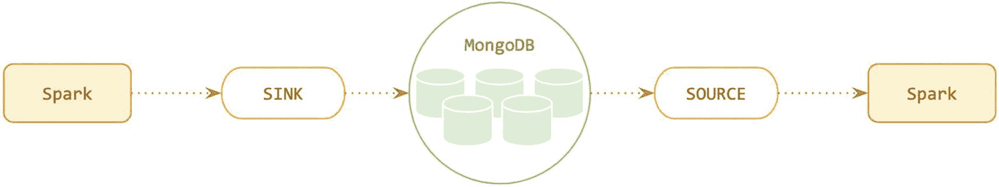
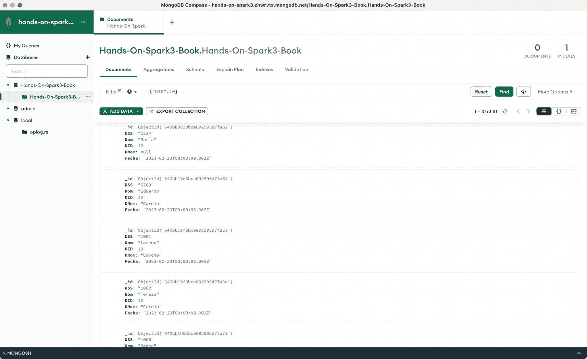
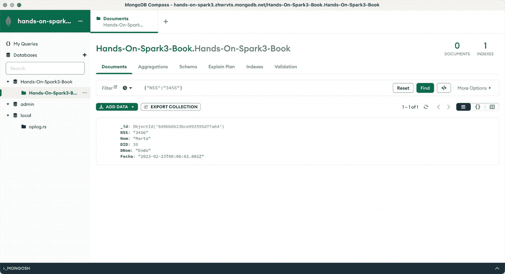

# 8. 流式数据源与接收端

在上一章中，我们介绍了端到端 Structured Streaming 流程的基础知识。请记住，Apache Spark Structured Streaming 的基础是：使用 `SparkSession.readStream()` 方法从数据源摄取数据来创建流式 DataFrame，使用处理引擎对其应用业务逻辑，然后使用 `DataFrame.writeStream()` 将结果 DataFrame 输出到数据接收端。

在本章中，我们将深入探讨内置数据源和接收端的使用，以及如何使用 `foreachBatch()` 和 `foreach()` 方法创建您自己的自定义流式数据源和接收端，以实现您自己的功能，并将数据写入 Spark Structured Streaming 原生支持之外的存储系统。

## 8.1 Spark 流式数据源

请记住，我们在上一章中看到 Spark 支持多种用于数据摄取的输入源。其中一些是所谓的内置源：

- **文件源**：用于从文件系统流式读取数据。支持的文件格式有 text、CSV、JSON 和 Parquet。
- **Kafka 源**：用于从 Kafka 主题读取数据。需要 Kafka 0.10.0 或更高版本。

此外，还有其他一些主要被视为用于测试的数据源，因为它们不具备容错性：

- **Socket 源**：从 TCP/IP socket 连接读取数据。
- **速率源**：以指定的每秒行数生成随机数据，每行数据有两列：“timestamp”和“value”。
- **每微批次速率源**：类似于“速率”源，但在此情况下，无论查询执行配置如何，它都会为每个微批次生成一组一致的输入行。例如，批次 0 将生成区间 [0, 999] 内的值，批次 1 将生成区间 [1000, 9999] 内的值，依此类推。

### 从文件数据源读取流式数据

Apache Spark Structured Streaming 原生支持从文件系统进行流式读取，使用的文件格式与批处理中支持的格式相同（text、CSV、JSON、ORC 和 Parquet）。

Spark Structured Streaming 使用 `DataStreamReader` 类从文件系统文件夹流式读取文本文件。当您将目录定义为流式源时，Spark 会将该位置出现的文件视为数据流。这意味着 `FileStreamSource` 是一种源，它会在 Spark 发现目录中的文本格式文件时读取它们。以下是如何设置基本文件源流式处理的示例：

```
val df = spark.readStream
.format("text")
.option("maxFilesPerTrigger", 1)
.load("/tmp/logs")
```

您还可以指定数据的模式，例如：

```
val PatientsSchema = StructType(Array(
StructField("NSS", StringType),
StructField("Nom", StringType),
StructField("DID", IntegerType),
StructField("DNom", StringType),
StructField("Fecha", StringType)
)
)
```

然后，您可以基于上述模式读取文件：

```
val df = spark
.readStream
.schema(PatientsSchema)
.json("/tmp/patient_streaming")
```

在我们前面的示例中，返回的 `df` 流式 DataFrame 将具有 `PatientsSchema`。当流处理启动时，`/tmp/patient_streaming` 源目录必须存在。

使用文件源时，需要记住一些要点：

`图 8-1` – 文件数据流处理模式

示意图展示了文件的排列方式。已处理的文件位于中心，被忽略的文件位于左侧，沿着流时间线排列。

- 如前所述，流处理启动时源目录必须存在。
- 流式传输到源目录的所有文件必须具有相同的格式，也就是说，它们必须都是 text、JSON、Parquet 等格式，并且如果我们希望保持数据完整性并避免错误，模式也必须相同。
- 流式作业开始时，指定文件夹中已存在的文件将被忽略。此概念如`图 8-1`所示。
- Spark 使用列出文件的系统工具来识别新文件。因此，出现在流式目录中的文件必须是完整且已关闭的，因为 Spark 一旦发现它们就会立即处理。因此，任何数据添加或文件更新都可能导致数据丢失。
- 当 Spark 处理一个文件时，它会在内部被标记为已处理。因此，即使文件被更新，也不会被再次处理。
- 如果需要处理多个文件，但 Spark 在下一个微批次中只能处理其中一部分，那么将优先处理时间戳最早的文件。

创建新的 `FileStreamSource` 实例时，有两个主要选项可用：

- **schema**：正如我们已经提到的，这是数据的模式，在实例化时指定。
- **maxFilesPerTrigger**：指定每个微批次读取的最大文件数。因此，它用于将流读取速率控制为每个触发器的最大文件数。

下面是一个代码示例，其中我们从文件源流式读取数据。此示例包括用作数据源的文件模式，从目录流式读取数据，并将转换结果输出到控制台：

```scala
package org.apress.handsOnSpark3
import org.apache.spark.sql.SparkSession
import org.apache.spark.sql.functions._
import org.apache.spark.sql.types.{IntegerType, StringType, StructField, StructType}
import java.io.IOException
object dStreamsFiles {
def main(args: Array[String]): Unit = {
val PatientsSchema = StructType(Array(
StructField("NSS", StringType),
StructField("Nom", StringType),
StructField("DID", IntegerType),
StructField("DNom", StringType),
StructField("Fecha", StringType)
)
)
try {
val spark: SparkSession = SparkSession
.builder()
.master("local[3]")
.appName("Hand-On-Spark3_File_Data_Source")
.getOrCreate()
spark.sparkContext.setLogLevel("ERROR")
val df = spark
.readStream
.schema(PatientsSchema)
.json("/tmp/patient_streaming")
val groupDF = df.select("DID")
.groupBy("DID").agg(count("DID").as("Accumulated"))
.sort(desc("Accumulated"))
printf("\n Listening and ready... \n")
groupDF.writeStream
.format("console")
.outputMode("complete")
.option("truncate", false)
.option("newRows", 30)
.start()
.awaitTermination()
} catch {
case e: IOException => println("IOException occurred")
case t: Throwable => println("Error receiving data", t)
} finally {
println("Finally block")
}
}
}
```

接下来，我们将转向另一个内置数据源，也是目前最常用的数据源之一。首先，我们将介绍 Kafka 的基础知识，然后提供一个实践示例。

### 从 Kafka 读取流式数据

Apache Kafka 是一个开源、分布式、持久化且高度可扩展的事件流平台，支持开发实时、事件驱动的应用程序等功能。Kafka 将事件组织并存储在主题（topic）中，主题是 Kafka 最基本的事件组织单元。主题是一个命名的事件日志，类似于关系数据库中的表。日志中的事件是不可变且持久的，这意味着事件一旦发生，就无法更改或删除——它们保持不变，并可以在主题中保留一段定义的时间，或者最终无限期保留。包含事件的 Kafka 日志/主题是存储在磁盘上的文件。

Kafka 组件在 Kafka 架构中如何交互的示例如`图 8-2`所示。



`图 8-2` Kafka 架构

Kafka 架构包括生产者、主题、代理、分区和消费者，用于实现可靠的数据处理和存储。

Kafka 有四个主要能力：

## Kafka 的主要能力

*   Kafka 允许应用程序发布或订阅事件流，使其能够实时响应事件。
*   Kafka 管理记录，并保持其发生的顺序。
*   Kafka 是一个容错且可扩展的系统，能够实时处理记录。
*   主题的简单语义使 Kafka 能够提供高水平的持续输入和输出吞吐量，并促进数据复制以增强容错能力。Kafka 主题被分区和复制，有助于为大量消费者维持高性能的同步事件投递服务。

在图 8-3 中，你可以看到 Kafka 概念（主题、数据分区和副本）的图形化表示。



Kafka 概念示意图包含 3 个垂直代理和 3 个水平分区（编号 0 到 2）。分区即主题。分区包含主数据和副本数据。

**图 8-3** Kafka 的主题、分区和副本概念

## Kafka 的 API

Kafka 的能力可以通过四个 API 来利用：

*   **生产者 API**：用于将事件或事件流发布到 Kafka 主题。
*   **消费者 API**：应用程序使用它来订阅一个或多个主题，消费存储在主题中的数据流。主题中的信息可以实时消费，也可以从历史记录中读取。
*   **流处理 API**：此 API 比生产者和消费者 API 更复杂，提供了构建复杂数据和事件流处理的能力。例如，它可用于设置端到端的流作业，接收信息、分析信息，并在需要时进行转换。
*   **连接器 API**：此 API 旨在开发连接器，以自动化进出 Kafka 集群的数据流。

Apache Kafka 和 Spark Streaming 经常一起使用来处理实时数据流。将 Kafka 和 Spark 结合可以构建一个可靠、高性能且可扩展的流数据处理管道，能够应对复杂的事件处理。Kafka-Spark Streaming 集成架构的示意图如图 8-4 所示。



示意图如下：数据源流向 Kafka。从 Kafka 进入容错存储。从 HDFS 通过 `Spark Streaming` 和 `Kafka Sink` 到达 Kafka。从流处理分支为报告、监控和工作流。

**图 8-4** Kafka-Spark Streaming 集成架构

使用 Kafka-Spark Streaming 实现数据处理管道包括：从 Kafka 主题摄取数据，使用 `Spark Streaming` 操作和分析数据，然后将处理后的数据存储到最终的数据接收器，或作为另一管道的一部分将其重新注入另一个 Kafka 主题。

### 代码示例

在以下代码片段中，你将看到一个示例，展示了 Apache Kafka 和 Apache Spark Structured Streaming 如何协同工作，以实现高度可扩展的实时处理架构：

```scala
package org.apress.handsOnSpark3.com
import org.apache.spark.sql.SparkSession
import org.apache.spark.sql.functions.{col, from_json}
import org.apache.spark.sql.types.{IntegerType, StringType, StructType, StructField}
object SparkKafka {
  def main(args: Array[String]): Unit = {
    val spark: SparkSession = SparkSession.builder
      .master("local[3]")
      .appName("SparkStructuredStreamingHospital")
      .getOrCreate()
    spark.sparkContext.setLogLevel("ERROR")
    import spark.implicits._
    val df = spark.readStream
      .format("kafka")
      .option("kafka.bootstrap.servers", "localhost:9092")
      .option("subscribe", "patient")
      .option("startingOffsets", "earliest")
      .load()
    df.printSchema()
    val PatientsSchema = StructType(Array(
      StructField("NSS", StringType),
      StructField("Nom", StringType),
      StructField("DID", IntegerType),
      StructField("DNom", StringType),
      StructField("Fecha", StringType))
    )
    val patient = df.selectExpr("CAST(value AS STRING)")
      .select(from_json(col("value"), PatientsSchema).as("data"))
      .select("data.*")
    patient.printSchema()
    val query = patient.writeStream
      .format("console")
      .outputMode("append")
      .start()
      .awaitTermination()
  }
}
```

代码准备就绪后，就可以开始尝试了。我们要做的第一件事是启动 Kafka 环境。

> **注意**：在本书编写时，Kafka 3.4.0 是最新版本，也是我们示例中使用的版本。要执行前面展示的代码，你的本地环境必须安装 Java 8+。

Apache Kafka 可以使用 ZooKeeper 或 KRaft 启动。在本书中，我们只使用前者。

首先，打开一个终端会话，从你的 `$KAFKA_HOME` 目录执行以下命令，以正确的顺序启动所有服务。运行以下命令，使用默认配置启动 ZooKeeper 服务：

```bash
$ bin/zookeeper-server-start.sh config/zookeeper.properties
```

其次，打开另一个终端会话，运行以下命令，同样使用默认配置启动 Kafka 代理服务：

```bash
$ bin/kafka-server-start.sh config/server.properties
```

一旦所有前面的服务成功运行，一个基本的 Kafka 环境就可以使用了。然而，在我们写入第一个事件之前，必须创建一个主题。

因此，打开另一个终端会话，运行以下代码创建一个 `patient` 主题，用于我们的医院队列管理系统数据示例：

```bash
$ bin/kafka-topics.sh --create --topic patient --bootstrap-server localhost:9092
```

不带任何参数的 `kafka-topics.sh` 命令也可以用来显示使用信息。例如，它可以用来显示新主题的详细信息，比如 `patient` 主题的分区数、副本等。你可以执行以下命令和选项来显示这些信息：

```bash
bin/kafka-topics.sh --describe --topic patient --bootstrap-server localhost:9092
```

输出结果：
```
Topic: patient    TopicId: Bhq8M7cgTVqRrV18nT7dzg    PartitionCount: 1    ReplicationFactor: 1    Configs:
Topic: patient    Partition: 0    Leader: 0    Replicas: 0    Isr: 0
```

现在是时候向刚刚创建的 `patient` 主题写入一些事件并查看结果了。为此，我们将使用位于 Kafka 目录中的 `bin/kafka-console-producer.sh` 创建一个 Kafka 生产者。

Kafka 生产者是一个客户端应用程序，它与 Kafka 代理通信，将事件写入主题。一旦收到信息，代理就会将其保存在容错存储中，只要我们需要，理论上可以永久保存。这就是我们的 Spark 应用程序能够异步消费示例主题中存储的信息的原因。

要了解其工作原理，请打开一个新的终端会话，并运行生产者控制台客户端，如下所示，向刚刚创建的 `patient` 主题写入一些事件。在此示例中，我们将使用第 6 章 JSON 文件中的数据。默认情况下，你输入的每一行都将成为写入 `patient` 主题的一个新事件：

运行Kafka生产者发送测试数据
使用`bin/kafka-console-producer.sh`命令启动生产者控制台，并向`patient`主题发送一系列JSON格式的测试数据：

```
$ bin/kafka-console-producer.sh --topic patient --bootstrap-server localhost:9092
>{"NSS":"4567","Nom":"Marcos", "DID":40, "DNom":"Gastro", "Fecha":"01-09-2022"}
>{"NSS":"5678","Nom":"Sonia", "DID":50, "DNom":"Gineco", "Fecha":"01-09-2022"}
>{"NSS":"6789","Nom":"Eduardo", "DID":10, "DNom":"Cardio", "Fecha":"01-09-2022"}
>{"NSS":"1234","Nom":"María", "DID":10, "DNom":"Cardio", "Fecha":"01-09-2022"}
>{"NSS":"4567","Nom":"Marcos", "DID":40, "DNom":"Gastro", "Fecha":"01-09-2022"}
> . . .
> . . .
> . . .
>{"NSS":"2345","Nom":"Emilio", "DID":20, "DNom":"Neuro", "Fecha":"01-09-2022"}
>{"NSS":"3456","Nom":"Marta", "DID":30, "DNom":"Endo", "Fecha":"01-09-2022"}
>{"NSS":"4567","Nom":"Marcos", "DID":40, "DNom":"Gastro", "Fecha":"01-09-2022"}
>{"NSS":"4567","Nom":"Marcos", "DID":40, "DNom":"Gastro", "Fecha":"01-09-2022"}
>{"NSS":"5678","Nom":"Sonia", "DID":50, "DNom":"Gineco", "Fecha":"01-09-2022"}
>{"NSS":"6789","Nom":"Eduardo", "DID":10, "DNom":"Cardio", "Fecha":"01-09-2022"}
>{"NSS":"1234","Nom":"María", "DID":10, "DNom":"Cardio", "Fecha":"01-09-2022"}
```

执行Spark流处理程序
将JSON文件的内容粘贴到Kafka生产者控制台后，按如下方式运行你的示例程序：

```
$SPARK_HOME/bin/spark-submit --class org.apress.handsOnSpark3.com.SparkKafka --master yarn --packages org.apache.spark:spark-sql-kafka-0-10_2.12:3.2.0 /PATH/TO/JAR/FILE/HandsOnSpark3-Structured_Streaming_Hospital-1.0.jar
```

查看Spark程序输出
程序运行后，你将看到类似如下的输出：

```
root
|-- key: binary (nullable = true)
|-- value: binary (nullable = true)
|-- topic: string (nullable = true)
|-- partition: integer (nullable = true)
|-- offset: long (nullable = true)
|-- timestamp: timestamp (nullable = true)
|-- timestampType: integer (nullable = true)
root
|-- NSS: string (nullable = true)
|-- Nom: string (nullable = true)
|-- DID: integer (nullable = true)
|-- DNom: string (nullable = true)
|-- Fecha: string (nullable = true)

Batch: 0

+----+-----+---+------+----------+
| NSS|  Nom|DID|  DNom|     Fecha|
+----+-----+---+------+----------+
|1234|María| 10|Cardio|01-09-2022|
+----+-----+---+------+----------+

Batch: 1

+----+------+---+------+----------+
| NSS|   Nom|DID|  DNom|     Fecha|
+----+------+---+------+----------+
|4567|Marcos| 40|Gastro|01-09-2022|
|5678| Sonia| 50|Gineco|01-09-2022|
+----+------+---+------+----------+

Batch: 2

+----+-------+---+------+----------+
| NSS|    Nom|DID|  DNom|     Fecha|
+----+-------+---+------+----------+
|6789|Eduardo| 10|Cardio|01-09-2022|
+----+-------+---+------+----------+

Batch: 3

+----+------+---+------+----------+
| NSS|   Nom|DID|  DNom|     Fecha|
+----+------+---+------+----------+
|1234| María| 10|Cardio|01-09-2022|
|2345|Emilio| 20| Neuro|01-09-2022|
|3456| Marta| 30|  Endo|01-09-2022|
|4567|Marcos| 40|Gastro|01-09-2022|
+----+------+---+------+----------+

Batch: 4

+----+-------+---+------+----------+
| NSS|    Nom|DID|  DNom|     Fecha|
+----+-------+---+------+----------+
|4567| Marcos| 40|Gastro|01-09-2022|
|5678|  Sonia| 50|Gineco|01-09-2022|
|6789|Eduardo| 10|Cardio|01-09-2022|
|1234|  María| 10|Cardio|01-09-2022|
|4567| Marcos| 40|Gastro|01-09-2022|
|5678|  Sonia| 50|Gineco|01-09-2022|
|6789|Eduardo| 10|Cardio|01-09-2022|
|1234|  María| 10|Cardio|01-09-2022|
|2345| Emilio| 20| Neuro|01-09-2022|
|3456|  Marta| 30|  Endo|01-09-2022|
|4567| Marcos| 40|Gastro|01-09-2022|
+----+-------+---+------+----------+
```

使用Kafka消费者进行验证
要双重验证流处理过程的结果，您还可以使用Kafka消费者从Kafka代理读取事件，该消费者是一个订阅（读取并处理）事件的客户端应用程序。

要了解其工作原理，请打开另一个终端会话，并按照如下所示运行消费者控制台客户端，以读取我们之前创建的`patient`主题：

```
$ bin/kafka-console-consumer.sh --topic patient --from-beginning --bootstrap-server localhost:9092
```

您将在屏幕上看到类似于以下的输出：


## 从 MongoDB 读取流数据

```json
{"NSS":"1234","Nom":"María", "DID":10, "DNom":"Cardio", "Fecha":"01-09-2022"}
{"NSS":"2345","Nom":"Emilio", "DID":20, "DNom":"Neuro", "Fecha":"01-09-2022"}
{"NSS":"3456","Nom":"Marta", "DID":30, "DNom":"Endo", "Fecha":"01-09-2022"}
{"NSS":"4567","Nom":"Marcos", "DID":40, "DNom":"Gastro", "Fecha":"01-09-2022"}
. . .
. . .
{"NSS":"4567","Nom":"Marcos", "DID":40, "DNom":"Gastro", "Fecha":"01-09-2022"}
{"NSS":"5678","Nom":"Sonia", "DID":50, "DNom":"Gineco", "Fecha":"01-09-2022"}
{"NSS":"6789","Nom":"Eduardo", "DID":10, "DNom":"Cardio", "Fecha":"01-09-2022"}
```

为了能够编译本节中使用的代码示例，您必须使用正确的 `Kafka` 依赖项和 `Scala` 编译器版本，这完全取决于您安装的 `Kafka`、`Spark` 和 `Scala` 版本。

到目前为止，我们已经讨论了 `Spark` 内置的流数据源，例如 `TCP/IP` 套接字、文件、`Apache Kafka` 等。其他可以与 `Apache Spark` 配对以创建流管道的先进流应用程序包括 `Kinesis`。在下一节中，我们将了解如何使用并非主要用于此目的的工具创建自定义流数据源。具体来说，我们将向您展示如何从 `NoSQL` 数据库（例如 `MongoDB`）流式传输数据。

`Spark Streaming` 支持对从 `MongoDB` 读取的数据流进行实时分析。在本节中，我们将使用 `Spark Structured Streaming` 和新的连续处理触发器在 `MongoDB` 和 `Spark` 之间传输数据。

为了完成我们的任务，我们还将使用新的 `v2 MongoDB Spark 连接器`。最新的 `10.x` 系列连接器提供了 `Spark Structured Streaming` 与 `MongoDB` 之间的原生集成，并支持新的连续触发器类型流。该连接器还利用了 `MongoDB 5.1` 及更高版本的一个特性，即“变更流游标”，来订阅数据库中的信息变更。

因此，使用此连接器，我们将从 `MongoDB` 数据库打开一个输入流连接，同时为指定的数据库和数据集合设置一个 `MongoDB` 变更流游标。当新文档被插入，或现有文档被修改或删除时，此特性会触发一个变更流事件。这些事件变更会被转发到指定的消费者，在我们的案例中就是 `Spark`。

在图 8-5 中，您可以看到一个用例示例，其中 `Spark` 和 `MongoDB` 被耦合在一起以构建事件流架构。



示意图如下。来自移动端、微服务和 `MongoDB` 的数据流入由 `Spark` 和用于 `Spark` 的 `MongoDB` 连接器组成的事件流架构。通过 `MongoDB`，数据流向 `AI`、数据湖、分析和可视化。

图 8-5 `Spark-MongoDB` 事件流架构

考虑以下示例，该示例将来自 `MongoDB Atlas` 集群的关于医疗预约的实时信息流式传输到我们在前几章中一直使用的医院排队管理系统应用程序中：

```json
{"NSS":"2345","Nom":"Emilio", "DID":20, "DNom":"Neuro", "Fecha":"01-09-2022"}
{"NSS":"3456","Nom":"Marta", "DID":30, "DNom":"Endo", "Fecha":"01-09-2022"}
```

像这样的信息在 `MongoDB` 文档中如下所示：

```json
{
"_id": {
"$oid": "640cba70f9972564d8c4ef2f"
},
"NSS": "2345",
"Nom": "Emilio",
"DID": 20,
"DNom": "Neuro",
"Fecha": "01-09-2022"
}
```

在接下来的代码片段中，我们将使用新的 `MongoDB Spark 连接器`从我们的 `MongoDB` 数据集合中读取数据：

```scala
import org.apache.spark.sql.SparkSession
import org.apache.spark.{SparkConf, SparkContext}
import org.apache.spark.sql.streaming.Trigger
val spark:SparkSession = SparkSession
.builder()
.config("spark.jars.packages", "org.mongodb.spark:mongo-spark-connector:10.1.1")
.master("local[*]")
.appName("Hand-On-Spark3_File_Data_Source_MongoDB")
.getOrCreate()
val sc = spark.sparkContext
sc.setLogLevel("ERROR")
val mongoDBURI = "mongodb+srv://:@hands-on-spark3.abcdef.mongodb.net/?retryWrites=true&w=majority"
val columsOfInterest = List("NSS","Nom","DID","DNom","Fecha","_id")
// 定义一个流查询
val df = spark.readStream
.format("mongodb")
.option("spark.mongodb.connection.uri", mongoDBURI)
.option("spark.mongodb.database", "MongoDB_Data_Source")
.option("spark.mongodb.collection", "MongoDB_Data_Source")
.option("spark.mongodb.change.stream.publish.full.document.only", "true")
.option("forceDeleteTempCheckpointLocation", "true")
//.schema(PatientsSchema)
.load()
df.printSchema()
if (df.isStreaming) printf(" ----- 流正在运行 -----! \n")
import spark.implicits._
val groupDF = df.select(columsOfInterest.map(col): _*) // 在此处您可以进行数据转换
groupDF.printSchema()
groupDF.writeStream
.outputMode("append")
.option("forceDeleteTempCheckpointLocation", "true")
.format("console")
.option("checkpointLocation", "/tmp/checkpointDir")
//.trigger(Trigger.ProcessingTime("10 seconds"))
.trigger(Trigger.Continuous("30 seconds"))
.start()
.awaitTermination()
```

浏览上述代码，你会注意到，从 `MongoDB` 数据库读取数据时，我们不一定需要定义信息模式，因为模式是从 `MongoDB` 集合中推断出来的。

无论如何，如果你更倾向于或需要定义自己的数据模式，可以按照以下方式操作，并调用流式读取过程。

首先，定义你的数据模式：

```scala
val PatientsSchema = StructType(Array(
StructField("NSS", StringType),
StructField("Nom", StringType),
StructField("DID", IntegerType),
StructField("DNom", StringType),
StructField("Fecha", StringType),
StructField("_id", StringType))
)
```

之后，像这样将其与你的 `readStream` 方法结合使用，以定义传入数据的模式：


```markdown
# 8.1 构建流式数据读取管道

```scala
val df = spark.readStream
  .format("mongodb")
  .option("spark.mongodb.connection.uri", mongoDBURI)
  .option("spark.mongodb.database", "MongoDB_Data_Source")
  .option("spark.mongodb.collection", "MongoDB_Data_Source")
  .option("spark.mongodb.change.stream.publish.full.document.only", "true")
  .option("forceDeleteTempCheckpointLocation", "true")
  .schema(PatientsSchema)
  .load()
```

另一行值得关注的代码如下：

```scala
if (df.isStreaming) printf(" ----- Streaming is running -----! \n")
```

我们使用了 `isStreaming` 属性来验证数据集是否正在流式传输。如果 `df` 数据集包含一个或多个持续发送数据的数据源，它将返回 `true`。

最后，在将流式数据写入控制台时，我们选择了连续触发器类型，因为最新的 MongoDB Spark 连接器支持该类型。在此例中，为了便于阅读，我们将触发器设置为“30 秒”，因为如果使用“1 秒”触发器，数据会持续不断地拉取到控制台，对于本书而言，收集数据会更加困难：

```scala
.trigger(Trigger.Continuous("30 seconds"))
```

不过，你也可以使用其他支持的触发器类型，例如：

*   *默认触发器*：尽可能快地运行微批次。

*   *处理时间触发器*：按指定的时间间隔触发微批次。

*   *一次性触发器*：仅执行一个微批次，处理可用信息，然后停止。

*   *可用立即触发器*：与一次性触发器类似，区别在于它旨在实现更好的查询可扩展性，尝试根据配置的源选项（例如 `maxFilesPerTrigger`）在多个微批次中处理数据。

在下一个代码示例中，我们将展示如何修改之前的程序，以使用间隔为 10 秒的 `Trigger.ProcessingTime`：

```scala
groupDF.writeStream
  .outputMode("append")
  .option("forceDeleteTempCheckpointLocation", "true")
  .format("console")
  .option("checkpointLocation", "/tmp/checkpointDir")
  .trigger(Trigger.ProcessingTime("10 seconds"))
  .start()
  .awaitTermination()
```

好了，现在是时候尝试运行这个程序了。一旦你执行程序，就在你的数据库中插入一些文档（信息）。如果你使用的是图形界面（如 MongoDB Compass），可以按照图 8-6 所示进行操作。



一张 MongoDB Compass 的截图，显示了一个用于插入文档的弹出窗口。

**图 8-6**
向 MongoDB 数据库中插入一个新文档

一旦新文档被插入到 MongoDB 数据库中，你可以看到它如图 8-7 所示显示出来。



一张 MongoDB Compass 的截图，显示了 MongoDB 数据源面板，其中选中的是文档选项卡。

**图 8-7**
一个新文档被插入到 MongoDB 数据库和集合中

你应该会看到应用程序输出类似如下的结果：

```
root
|-- _id: string (nullable = true)
|-- NSS: string (nullable = true)
|-- Nom: string (nullable = true)
|-- DID: integer (nullable = true)
|-- DNom: string (nullable = true)
|-- Fecha: string (nullable = true)
----- Streaming is running -----!
… 为简洁起见已省略 …

Batch: 1

+----+------+---+------+----------+--------------------+
| NSS|   Nom|DID|  DNom|     Fecha|                 _id|
+----+------+---+------+----------+--------------------+
|3456| Marta| 30|  Endo|01-09-2022|640cbaa7f9972564d...|
|4567|Marcos| 40|Gastro|01-09-2022|640cbab3f9972564d...|
+----+------+---+------+----------+--------------------+

Batch: 2

+----+-------+---+------+----------+--------------------+
| NSS|    Nom|DID|  DNom|     Fecha|                 _id|
+----+-------+---+------+----------+--------------------+
|4567| Marcos| 40|Gastro|01-09-2022|640cbabdf9972564d...|
|5678|  Sonia| 50|Gineco|01-09-2022|640cbac8f9972564d...|
|6789|Eduardo| 10|Cardio|01-09-2022|640cbad3f9972564d...|
+----+-------+---+------+----------+--------------------+

Batch: 3

+----+-----+---+------+----------+--------------------+
| NSS|  Nom|DID|  DNom|     Fecha|                 _id|
+----+-----+---+------+----------+--------------------+
|1234|María| 10|Cardio|01-09-2022|640cbadcf9972564d...|
+----+-----+---+------+----------+--------------------+
```

由于我们使用了间隔为 30 秒的连续触发器类型，数据并非在注册时立即流式传输，而是每 30 秒传输一次；否则，你将无法看到不同批次中的聚合数据，除非你的输入速度比服务器处理信息的速度更快。

现在，在了解了多种流式数据源之后，是时候处理数据存储了。在数据流术语中，这些存储被称为数据接收器（data sinks）。

## 8.2 Spark Streaming 数据接收器

到目前为止，我们已经看到，Apache Spark Streaming 由三个主要的逻辑组件组成：数据源（输入源）、处理引擎（业务逻辑），以及最终输出目的地（接收器），用于存放所有计算、聚合、转换等操作完成后的结果信息。

因此，在 Spark Streaming 中，输出接收器用于保存应用于外部源的业务逻辑。我们在前面的章节中已经看到，Spark Streaming 使用 `org.apache.spark.sql.streaming.DataStreamWriter` 类作为接口，通过 `writeStream` 方法将流式 DataFrame/数据集写入外部存储系统。

Spark 包含一组内置的输出接收器：

*   控制台接收器

*   文件接收器

*   Kafka 接收器

*   ForeachBatch 接收器

*   Foreach 接收器

所有这些接收器都受到 Spark Structured Streaming 的原生支持。第一个，控制台接收器，主要用于测试和调试，因为它不支持容错。前三个（控制台、文件和 Kafka 接收器）是已定义的输出格式：控制台，如 `format("console")`；文件，如 `format("csv")`（或 `"json"`、`"orc"`、`"parquet"`）；以及 `"kafka"`。但是，如何将流式输出写入任意存储系统，例如像 MongoDB 这样的 NoSQL 数据库，或者像 PostgreSQL 这样的关系型数据库呢？这时，Foreach 和 ForeachBatch 接收器就派上用场了。

接下来，我们将详细研究每一种接收器。

### 将流式数据写入控制台接收器

正如你在我们的示例中已经看到的，结果会显示在控制台上。这种数据接收器主要不用于生产系统；它更像是一个有用的开发和调试工具。
```

### 将流式数据写入文件接收器

文件接收器将输出数据存储到文件系统目录中。支持多种文件格式，例如 JSON、ORC、CSV 和 Parquet。

以下是一个示例，演示如何将流式输出保存到 CSV 文件。该代码片段是对我们流式医院排队管理系统应用程序的修改，用于将处理后的数据保存到文件系统，而不是输出到控制台：

```
PatientDF.writeStream
// 你必须修改这部分代码
.format("csv")
.option("path", "/tmp/streaming_output/csv")
// … 改为这样
.format("parquet")
.option("path", "/tmp/streaming_output/parquet")
// ...
.trigger(Trigger.ProcessingTime("5 seconds"))
.option("checkpointLocation", checkpointDir)
.outputMode("append")
.option("truncate",false)
.option("newRows",30)
.start()
.awaitTermination()
```

现在，如果你查看指定的输出目录，应该会找到类似于图 8-8 所示的输出。



左侧为 CSV 文件的流式输出列表，右侧为 Parquet 文件的流式输出列表。

**图 8-8** 以 CSV 和 Parquet 格式输出到文件接收器的流式示例

为了简洁和清晰起见，在图 8-8 中，我们将两个输出并排放置。左侧是 CSV 输出格式，右侧是 Parquet 输出格式。

### 将流式数据写入 Kafka 接收器

Kafka 接收器将输出发布到 Kafka 中的一个或多个主题。

以下是一个示例，演示如何将流式输出保存到一个或多个 Kafka 主题：

```
counts.writeStream
.format("kafka")
.option("kafka.bootstrap.servers","host1:port1,host2:port2")
// ...
.option("topic", "patient")
.option("checkpointLocation", "/tmp/kafka_checkpoint")
.start()
.awaitTermination()
```

请注意 `.option("kafka.bootstrap.servers","host1:port1,host2:port2")` 这一行。如你所见，`bootstrap.servers` 是一个逗号分隔的套接字连接列表（主机和端口对），对应于“引导”Kafka 集群中 Kafka 代理的 IP 地址。Kafka 客户端（生产者和消费者）使用它们来连接到 Kafka 集群。

到目前为止，我们使用的接收器其输出格式都是原生（内置）支持的，例如文件、Kafka 或控制台。现在，我们将学习如何在保存之前将我们自己的业务逻辑应用于每个流记录，以及如何使用 `foreachBatch` 和 `foreach` 数据接收器将信息写入我们自己定义的数据存储。

两者之间的主要区别在于，`foreachBatch` 在微批次级别执行自定义逻辑，而 `foreach` 在行级别执行该自定义逻辑。

现在让我们研究这两个接收器。

### 将流式数据写入 ForeachBatch 接收器

ForeachBatch 接收器接受一个用户定义的函数，该函数在流式查询的每个微批次的输出数据上执行，例如：

```
def saveToCSV = (df: DataFrame, timeStamp: Long) => {
df.withColumn("timeStamp", date_format(current_date(),"yyyyMMdd"))
.write.format("csv")
.option("path", "/tmp/streaming_output/foreachBatch")
.mode("append")
.save()
}
// ...
// ...
PatientDF.writeStream
.trigger(Trigger.ProcessingTime("5 seconds"))
.option("checkpointLocation", checkpointDir)
.outputMode("append")
.foreachBatch(saveToCSV)
.start()
.awaitTermination()
```

如你所见，这段代码是对我们之前示例的一个小修改。首先，我们定义了自己的写入业务逻辑，封装在 `saveToCSV()` 函数中。该函数为每个处理的微批次添加一个时间戳。

以下是代码示例：

# 文件接收器到CSV

```scala
// 文件接收器到 CSV
import org.apache.spark.sql.SparkSession
import org.apache.spark.sql.functions._
import org.apache.spark.sql.types.{IntegerType, StringType, StructField, StructType,DoubleType,LongType}
import org.apache.spark.sql.{DataFrame, Dataset, Encoders, SparkSession}
import java.io.IOException
import org.apache.spark.sql.streaming._
import org.apache.spark.sql.streaming.{GroupState,GroupStateTimeout,OutputMode}
import org.apache.spark.sql.DataFrame
val PatientsSchema = StructType(Array(
StructField("NSS", StringType),
StructField("Nom", StringType),
StructField("DID", IntegerType),
StructField("DNom", StringType),
StructField("Fecha", StringType))
)
case class Patient(
NSS: String,
Nom: String,
DID: Option[Long],
DNom: String,
Fecha: String
)
def saveToCSV = (df: DataFrame, timeStamp: Long) => {
df.withColumn("timeStamp", date_format(current_date(),"yyyyMMdd"))
.write.format("csv")
.option("path", "/tmp/streaming_output/foreachBatch")
.mode("append")
.save()
}
val spark:SparkSession = SparkSession.builder()
.master("local[*]")
.appName("Hand-On-Spark3_Socket_Data_Source")
.getOrCreate()
spark.sparkContext.setLogLevel("ERROR")
import spark.implicits._
val host = "localhost"
val port = 9999
val checkpointDir = "/tmp/streaming_checkpoint"
try {
val PatientDS = spark.readStream
.format("socket")
.option("host",host)
.option("port",port)
.load()
.select(from_json(col("value"), PatientsSchema).as("patient"))
.selectExpr("Patient.*")
.as[Patient]
printf("\n 正在监听，准备就绪... \n")
val PatientDF = PatientDS.select("*")
PatientDF.writeStream
.trigger(Trigger.ProcessingTime("5 seconds"))
.option("checkpointLocation", checkpointDir)
.outputMode("append")
.foreachBatch(saveToCSV)
.start()
.awaitTermination()
} catch {
case e: java.net.ConnectException => println("建立连接到 " + host + ":" + port + " 时出错")
case e: IOException => println("发生 IOException")
case t: Throwable => println("接收数据时出错", t)
}finally {
println("在 finally 块中")
}
```

现在，打开一个终端会话，像往常一样输入：

```bash
nc -lk 9999
```

然后，运行前面的代码示例，当你在笔记本中看到以下内容时：

```
正在监听，准备就绪...
```

回到之前的终端会话，粘贴我们在第 6 章中提供的 JSON 示例，例如：

```json
{"NSS":"1234","Nom":"María", "DID":10, "DNom":"Cardio", "Fecha":"01-09-2022"}
. . .
{"NSS":"2345","Nom":"Emilio", "DID":20, "DNom":"Neuro", "Fecha":"01-09-2022"}
{"NSS":"3456","Nom":"Marta", "DID":30, "DNom":"Endo", "Fecha":"01-09-2022"}
```

运行完前面的程序并将数据粘贴到终端控制台后，如果你查看指定的输出目录路径 `/tmp/streaming_output/foreachBatch/`，应该会找到类似于以下的一堆文件：

```
/tmp/streaming_output/foreachBatch/
├── part-00000-07c12f65-b1d6-4c7b-b50d-2d8b25d724b8-c000.csv
├── part-00000-63507ff8-a09a-4c8e-a526-28890c170d96-c000.csv
├── part-00000-9a2caabe-7d84-4799-b788-a633cfc32042-c000.csv
├── part-00000-dabb8320-0c0e-4bb5-ad19-c36a53ac8d1e-c000.csv
├── part-00000-df0c4ba0-a9f0-40ed-b773-b879488b0a85-c000.csv
├── part-00000-f924d5cc-8e4a-4d5f-91b7-965ce2ac8710-c000.csv
├── part-00000-fd07c2e4-1db1-441c-8199-a69a064efe75-c000.csv
├── part-00001-07c12f65-b1d6-4c7b-b50d-2d8b25d724b8-c000.csv
├── part-00001-63507ff8-a09a-4c8e-a526-28890c170d96-c000.csv
├── part-00001-9a2caabe-7d84-4799-b788-a633cfc32042-c000.csv
├── part-00001-df0c4ba0-a9f0-40ed-b773-b879488b0a85-c000.csv
├── part-00001-fd07c2e4-1db1-441c-8199-a69a064efe75-c000.csv
├── part-00002-07c12f65-b1d6-4c7b-b50d-2d8b25d724b8-c000.csv
├── part-00002-9a2caabe-7d84-4799-b788-a633cfc32042-c000.csv
├── part-00002-df0c4ba0-a9f0-40ed-b773-b879488b0a85-c000.csv
├── part-00002-fd07c2e4-1db1-441c-8199-a69a064efe75-c000.csv
├── part-00003-07c12f65-b1d6-4c7b-b50d-2d8b25d724b8-c000.csv
├── part-00003-df0c4ba0-a9f0-40ed-b773-b879488b0a85-c000.csv
├── part-00003-fd07c2e4-1db1-441c-8199-a69a064efe75-c000.csv
├── part-00004-07c12f65-b1d6-4c7b-b50d-2d8b25d724b8-c000.csv
├── part-00004-df0c4ba0-a9f0-40ed-b773-b879488b0a85-c000.csv
├── part-00005-07c12f65-b1d6-4c7b-b50d-2d8b25d724b8-c000.csv
├── part-00005-df0c4ba0-a9f0-40ed-b773-b879488b0a85-c000.csv
└── _SUCCESS
```

请记住，Spark 默认以分布式方式写入磁盘；因此，你会看到常规的程序输出是一系列分区的文件。

例如，我们将以下 JSON 字符串复制并粘贴到了控制台会话中。

# 示例输出与自定义写入函数

```
{"NSS":"1009","Nom":"Julia", "DID":20, "DNom":"Neuro", "Fecha":"01-09-2022"}
```

现在，如果我们打开文件 `part-00000-07c12f65-b1d6-4c7b-b50d-2d8b25d724b8-c000.csv`，例如：

```
vi part-00000-07c12f65-b1d6-4c7b-b50d-2d8b25d724b8-c000.csv
```

我们会看到以下内容，正如我们所料，记录末尾包含了时间戳：

```
1009,Julia,20,Neuro,01-09-2022,20230317
```

打开其他输出文件也能看到完全相同的情况：

```
{"NSS":"2345","Nom":"Emilio", "DID":20, "DNom":"Neuro", "Fecha":"01-09-2022"}
2345,Emilio,20,Neuro,01-09-2022,20230317
{"NSS":"4567","Nom":"Marcos", "DID":40, "DNom":"Gastro", "Fecha":"01-09-2022"}
4567,Marcos,40,Gastro,01-09-2022,20230317
```

以此类推。

类似地，你可以编写自己的函数，将 `PostgreSQL` 用作数据接收器。你的代码可能如下所示：

```scala
def savePostgreSql = (df: DataFrame, timeStamp: Long) => {
  val url = "jdbc:postgresql://:5432/database"
  df
    .withColumn("timeStamp", date_format(current_date(),"yyyyMMdd"))
    .write.format("jdbc")
    .option("driver": "org.postgresql.Driver")
    .option("url", url)
    .option("dbtable", "")
    .option("user", "")
    .option("password", )
    .mode("append")
    .save()
}
```

总而言之，`foreachBatch` 会将每个微批次写入我们指定的存储，并应用我们的自定义逻辑。

## 将流数据写入 Foreach 接收器

Foreach 接收器允许在数据写入过程中对每一行应用用户定义的业务逻辑。它可用于将流数据写入任何类型的存储。如果由于某种原因我们无法使用 `foreachBatch`（例如，不存在特定的批次数据写入器，或者你需要使用连续处理模式），那么 `foreach` 可能是一个解决方案。使用 `foreach` 时，我们必须实现三个方法（`open`、`process` 和 `close`）：

*   `open`：负责打开连接的方法
*   `process`：将数据写入指定连接的方法
*   `close`：负责关闭连接的方法

`Spark Structured Streaming` 按以下顺序实现上述方法：对于每个流式批次/周期（`epoch_id`）中的每个分区（`partition_id`），都会调用方法 `open(partitionId`, `epochId)`。

如果对于每个批次/周期中的分区内的每一行，`open(partitionId`, `epochId)` 都返回 `true`，那么就会执行方法 `process(row)`。

如果在处理数据行时出现任何错误，则会调用方法 `close(error)`。

另一方面，如果任何 `open()` 方法存在并成功返回，且在此期间没有发生系统故障，则会执行 `close()` 方法^(²³)：

```scala
counts.writeStream
  .foreach( "此处放置一些用户逻辑")
  // ...
  .start()
  .awaitTermination()
```

现在，让我们通过一个简单的示例来看看如何实现 `foreach`。出于本示例的目的，我们对之前用于 `foreachBatch` 接收器的代码片段稍作修改，以适应我们的需求。

```scala
// 使用 foreach() 的控制台接收器
import org.apache.spark.sql.{Column, Row, SparkSession}
import org.apache.spark.sql.functions._
import org.apache.spark.sql.types.{IntegerType, StringType, StructField, StructType,DoubleType,LongType}
import org.apache.spark.sql.{DataFrame, Dataset, Encoders, SparkSession}
import java.io.IOException
import org.apache.spark.sql.streaming._
import org.apache.spark.sql.streaming.{GroupState,GroupStateTimeout,OutputMode}
import org.apache.spark.sql.{DataFrame,ForeachWriter}

val PatientsSchema = StructType(Array(
  StructField("NSS", StringType),
  StructField("Nom", StringType),
  StructField("DID", IntegerType),
  StructField("DNom", StringType),
  StructField("Fecha", StringType))
)

case class Patient(
  NSS: String,
  Nom: String,
  DID: Option[Long],
  DNom: String,
  Fecha: String
)

val customWriterToConsole = new ForeachWriter[Row] {
  override def open(partitionId: Long, version: Long) = true
  override def process(record: Row) = {
    // 你可以将记录转换为序列并循环遍历
    //record.toSeq.foreach{col => println(col) }
    // ... 或者你可以逐个字段打印记录
    println("NSS: " + record.getAs("NSS")
      + " Nom: "  + record.getAs("Nom")
      + " DID: "  + record.getAs("DID")
      + " DNom: "  + record.getAs("DNom")
      + " Fecha : "  + record.getAs("Fecha"))
  }
  override def close(errorOrNull: Throwable) = {}
}

val spark:SparkSession = SparkSession.builder()
  .master("local[*]")
  .appName("Hand-On-Spark3_Socket_Data_Source")
  .getOrCreate()

spark.sparkContext.setLogLevel("ERROR")
import spark.implicits._

val host = "localhost"
val port = 9999
val checkpointDir = "/tmp/streaming_checkpoint"

try {
  val PatientDS = spark.readStream
    .format("socket")
    .option("host",host)
    .option("port",port)
    .load()
    .select(from_json(col("value"), PatientsSchema).as("patient"))
    .selectExpr("Patient.*")
    .as[Patient]

  printf("\n 正在监听，准备就绪... \n")

  val PatientDF = PatientDS.select("*")

  PatientDF.writeStream
    .trigger(Trigger.ProcessingTime("5 seconds"))
    .option("checkpointLocation", checkpointDir)
    .outputMode("append")
    .foreach(customWriterToConsole)
    .start()
    .awaitTermination()
} catch {
  case e: java.net.ConnectException => println("建立与 " + host + ":" + port + " 的连接时出错")
  case e: IOException => println("发生 IOException")
  case t: Throwable => println("接收数据时出错", t)
} finally {
  println("在 finally 块中")
}
```

在执行上述代码之前，请打开一个终端会话并按如下方式创建一个套接字会话：

```bash
$ nc -lk 9999
```

套接字会话创建完成后，就可以运行代码了。当你在屏幕上看到 `正在监听，准备就绪...` 这一行时，返回打开套接字会话的终端，并开始输入 JSON 行。你可以使用如下所示的行：

```json
{"NSS":"1234","Nom":"María", "DID":10, "DNom":"Cardio", "Fecha":"01-09-2022"}
{"NSS":"2345","Nom":"Emilio", "DID":20, "DNom":"Neuro", "Fecha":"01-09-2022"}
{"NSS":"3456","Nom":"Marta", "DID":30, "DNom":"Endo", "Fecha":"01-09-2022"}
{"NSS":"4567","Nom":"Marcos", "DID":40, "DNom":"Gastro", "Fecha":"01-09-2022"}
{"NSS":"5678","Nom":"Sonia", "DID":50, "DNom":"Gineco", "Fecha":"01-09-2022"}
{"NSS":"6789","Nom":"Eduardo", "DID":10, "DNom":"Cardio", "Fecha":"01-09-2022"}
{"NSS":"1001","Nom":"Lorena", "DID":10, "DNom":"Cardio", "Fecha":"01-09-2022"}
{"NSS":"1006","Nom":"Sara", "DID":20, "DNom":"Neuro", "Fecha":"01-09-2022"}
{"NSS":"1002","Nom":"Teresa", "DID":10, "DNom":"Cardio", "Fecha":"01-09-2022"}
{"NSS":"1003","Nom":"Luis", "DID":20, "DNom":"Neuro", "Fecha":"01-09-2022"}
```

你会看到程序输出类似如下的内容：

正在监听，准备就绪...
NSS: 1234 Nom: María DID: 10 DNom: Cardio Fecha : 01-09-2022
NSS: 2345 Nom: Emilio DID: 20 DNom: Neuro Fecha : 01-09-2022
NSS: 3456 Nom: Marta DID: 30 DNom: Endo Fecha : 01-09-2022
NSS: 4567 Nom: Marcos DID: 40 DNom: Gastro Fecha : 01-09-2022
NSS: 5678 Nom: Sonia DID: 50 DNom: Gineco Fecha : 01-09-2022
NSS: 6789 Nom: Eduardo DID: 10 DNom: Cardio Fecha : 01-09-2022
NSS: 1001 Nom: Lorena DID: 10 DNom: Cardio Fecha : 01-09-2022
NSS: 1006 Nom: Sara DID: 20 DNom: Neuro Fecha : 01-09-2022
NSS: 1002 Nom: Teresa DID: 10 DNom: Cardio Fecha : 01-09-2022
NSS: 1003 Nom: Luis DID: 20 DNom: Neuro Fecha : 01-09-2022

回到之前的代码示例，你可以看到唯一的区别在于实现了 `ForeachWriter` 的 `customWriterToConsole()` 函数，以及 `writeStream` 方法内部的 `foreach` 接收器调用本身。

请注意三个必需方法——`open`、`process` 和 `close` 的实现：

```scala
val customWriterToConsole = new ForeachWriter[Row] {
  override def open(partitionId: Long, version: Long) = true
  override def process(record: Row) = {
    // 你可以将记录转换为序列并循环遍历
    //record.toSeq.foreach{col => println(col) }
    // ... 或者你可以逐个字段打印记录
    println("NSS: " + record.getAs("NSS")
      + " Nom: "  + record.getAs("Nom")
      + " DID: "  + record.getAs("DID")
      + " DNom: "  + record.getAs("DNom")
      + " Fecha : "  + record.getAs("Fecha"))
  }
  override def close(errorOrNull: Throwable) = {}
}
```

并注意 `writeStream` 方法内部的 `foreach` 接收器调用：

```scala
PatientDF.writeStream
  .trigger(Trigger.ProcessingTime("5 seconds"))
  .option("checkpointLocation", checkpointDir)
  .outputMode("append")
  .foreach(customWriterToConsole)
  .start()
  .awaitTermination()
```

你可以修改 `customWriterToConsole` 的实现以满足你的特定需求。

### 将流式数据写入其他数据接收器

在前面的章节中，我们已经了解了如何使用 Spark Structured Streaming 内置的数据接收器。在本节中，我们将学习如何使用 MongoDB Spark 连接器将实时数据流式传输到 MongoDB。

MongoDB 以类似 JSON 的文档形式存储信息，其结构可变，提供了动态且灵活的架构。MongoDB 专为高可用性和可扩展性而设计，并原生集成了内置复制和自动分片功能。

MongoDB 接收器允许您将 Spark 中的事件写入 MongoDB 实例。该接收器连接器会将 Spark 流式事件数据转换为 MongoDB 文档，并根据您选择的保存模式配置执行 `append`（追加）或 `overwrite`（覆盖）操作。

MongoDB 接收器连接器要求输出数据库预先创建，而目标 MongoDB 集合如果不存在，则可以在运行时创建。

图 8-9 展示了用于 Spark 的 MongoDB 连接器的图形表示。



一个流程图，从左到右依次包含 Spark、Sink、MongoDB、Source 和 Spark。

**图 8-9** 用于 Spark 的 MongoDB 连接器表示

接下来，我们将看到一个实际的代码示例，展示如何将 MongoDB 用作 Spark 数据接收器。与之前的其他示例类似，程序会从目录中读取新出现的 JSON 文件，并将数据插入到 MongoDB 集合中。本示例中使用的 JSON 文件是我们在之前示例中一直使用的 *patient* 示例，这些示例首次出现在第 6 章中：

```scala
import org.apache.spark.sql.SparkSession
import org.apache.spark.{SparkConf, SparkContext}
import org.apache.spark.sql.types.{IntegerType, StringType, StructField, StructType}
val spark:SparkSession = SparkSession
.builder()
.config("spark.jars.packages", "org.mongodb.spark:mongo-spark-connector:10.1.1")
.master("local[*]")
.appName("Hand-On-Spark3_File_Data_Source_MongoDB_Sink")
.getOrCreate()
val sc = spark.sparkContext
sc.setLogLevel("ERROR")
val mongoDBURI = "mongodb+srv://:@hands-on-spark3.akxgvpe.mongodb.net/?retryWrites=true&w=majority"
val PatientsSchema = StructType(Array(
StructField("NSS", StringType),
StructField("Nom", StringType),
StructField("DID", IntegerType),
StructField("DNom", StringType),
StructField("Fecha", StringType))
)
val df = spark.readStream
.schema(PatientsSchema)
.option("checkpointLocation", "/tmp/checkpoint")
.json("/tmp/stream_mongo")
df.printSchema()
val newDF = df.select("*") // 此处可对数据进行转换
newDF.printSchema()
newDF.writeStream
.format("mongodb")
.option("checkpointLocation", "/tmp/checkpoint")
.option("forceDeleteTempCheckpointLocation", "true")
```

要查看代码运行效果，请创建一个流式目录，例如 `/tmp/stream_mongo`，用于复制您的 JSON 文件。

当您运行上述代码并看到以下输出时：

```
root
|-- NSS: string (nullable = true)
|-- Nom: string (nullable = true)
|-- DID: integer (nullable = true)
|-- DNom: string (nullable = true)
|-- Fecha: string (nullable = true)
```

您可以开始将文件复制到指定的流式目录。为了本示例的目的，我们使用第 6 章中使用的 JSON 文件。以下是操作示例：

## 文件复制

```
$ cp /tmp/json/patient1.json /tmp/stream_mongo
$ cp /tmp/json/patient2.json /tmp/stream_mongo
$ cp /tmp/json/patient3.json /tmp/stream_mongo
$ cp /tmp/json/patient4.json /tmp/stream_mongo
$ cp /tmp/json/patient5.json /tmp/stream_mongo
$ cp /tmp/json/patient6.json /tmp/stream_mongo
```

请记住，这些文件内部的信息如下所示：

```
{"NSS":"1009","Nom":"Julia", "DID":20, "DNom":"Neuro", "Fecha":"01-09-2022"}
{"NSS":"1010","Nom":"Javier", "DID":30, "DNom":"Endo", "Fecha":"01-09-2022"}
{"NSS":"1011","Nom":"Laura", "DID":50, "DNom":"Gineco", "Fecha":"01-09-2022"}
{"NSS":"1012","Nom":"Nuria", "DID":10, "DNom":"Cardio", "Fecha":"01-09-2022"}
{"NSS":"1013","Nom":"Helena", "DID":10, "DNom":"Cardio", "Fecha":"01-09-2022"}
{"NSS":"1014","Nom":"Nati", "DID":10, "DNom":"Cardio", "Fecha":"01-09-2022"}
```

## MongoDB 数据查看

现在，如果您查看您的 MongoDB 数据库（在我们的案例中，我们使用了图形界面 MongoDB Compass 进行查看），您将看到从流式处理过程中插入的数据。

图 8-10 向您展示了如何使用不同的数据键过滤已记录的数据。在此案例中，我们使用了部门 ID（`DID`）。请记住，MongoDB 以类似 JSON 的格式存储信息，而不是像传统 OLTP 数据库那样存储在表中。



MongoDB Compass 动手实践 Spark 3 书籍的截图，显示已选中文档选项卡。

**图 8-10** MongoDB Compass 按部门 ID（`DID`）过滤数据

在图 8-11 中，您可以看到一个类似的过滤查询，但在此案例中，我们按社会保险号（`SSN`）进行了过滤。



MongoDB Compass 动手实践 Spark 3 书籍的截图，显示已选中文档选项卡以添加数据和导出集合。

**图 8-11** MongoDB Compass 按社会保险号（`SSN`）过滤数据

总而言之，MongoDB 是一个著名的面向文档的非关系型数据库，旨在用于半结构化数据。它非常灵活，可以处理大量异构信息。MongoDB 和 Spark 均在免费开源许可下发布，两者共同构成了任何现代数据架构中值得考虑的坚实支柱。

## 8.3 总结

在本章中，我们介绍了 Spark Structured Streaming 模块。具体来说，我们研究了流式数据处理中最常见的数据源和数据接收器。首先，我们研究了 Spark Structured Streaming 内置的数据源，特别关注了最典型的几种：文件源、套接字源和 Kafka 源。Kafka 是当今最重要的流式框架之一；因此，我们开发了一个具体的代码示例，展示如何将其用作实时流源。其次，我们展示了如何实现自定义数据源，并实现了另一个实际示例，说明如何使用 MongoDB 实现。之后，我们继续前进，对数据接收器重复了相同的过程。首先，我们介绍了已定义的数据接收器，即控制台接收器、文件接收器和 Kafka 接收器。随后，我们研究了 `foreachBatch` 和 `foreach` 接收器，并分析了用户如何使用它们来创建自己的定制数据接收器。最后，我们还提供了一个使用 MongoDB 实现的自定义数据接收器的实际示例。在下一章中，我们将继续学习高级流式配置，介绍事件时间窗口操作和水印。

**脚注** 1

