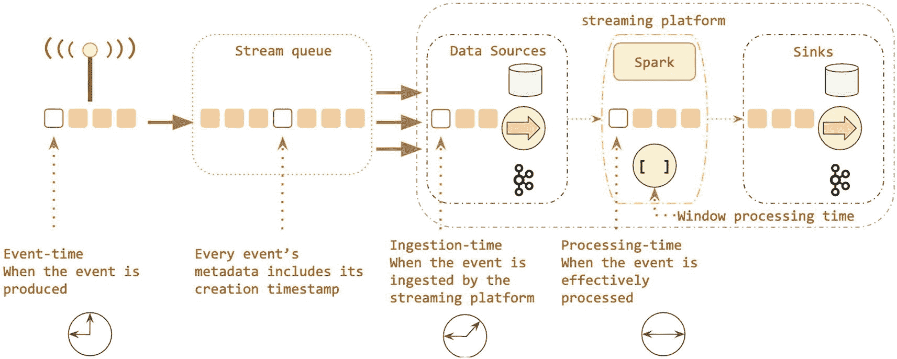
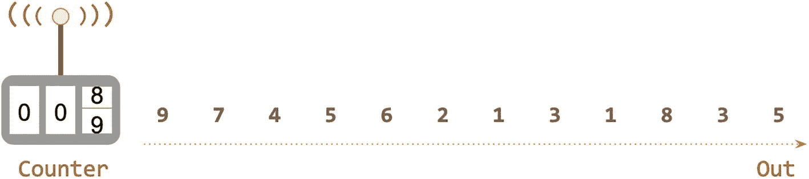
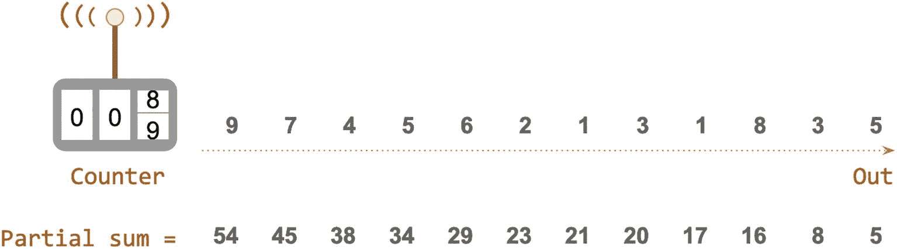
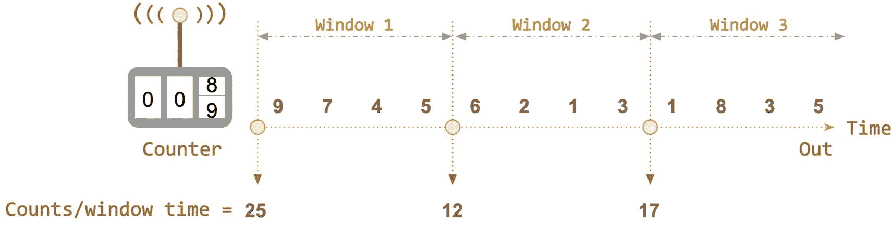
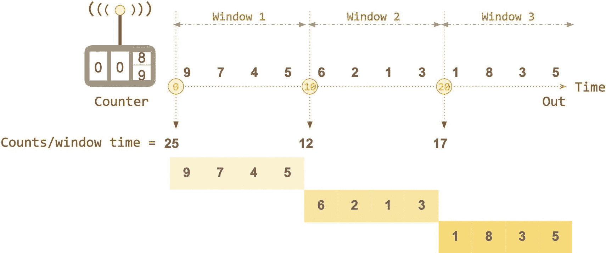
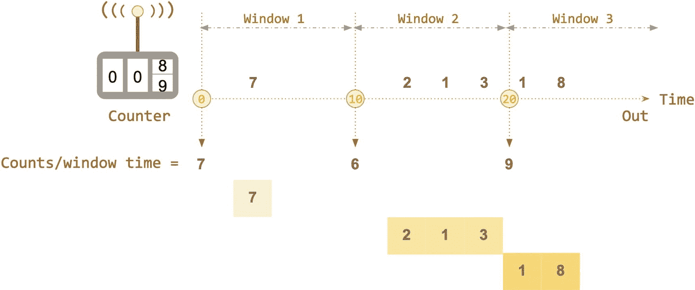
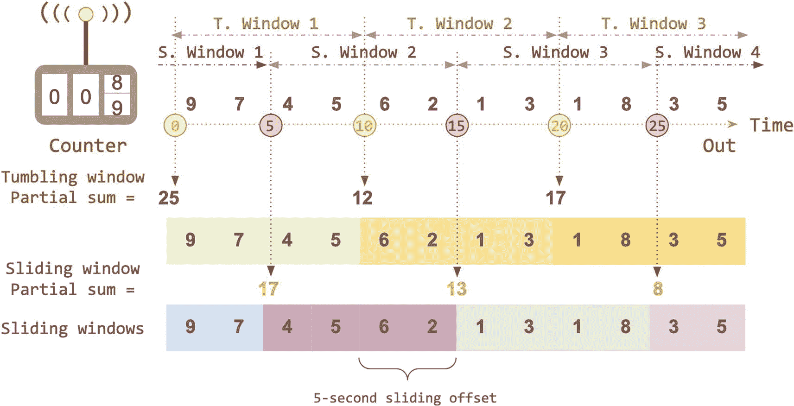
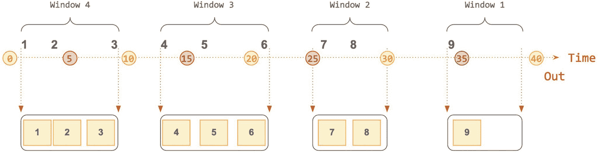

# 9. 事件时间窗口操作与水位线

在学习了 Apache Spark Streaming 和 Structured Streaming 的见解之后，本章我们将重点讨论基于时间的流处理。

在许多用例中，数据分析正从批处理向流数据处理演进。这种转变的原因之一是，人们越来越普遍地认为流数据更适合模拟我们所经历的生活。当我们思考大多数需要分析和建模的系统时，这一点尤为明显——接收和发送卫星导航坐标的自动驾驶汽车、交换信号的物联网设备、用于交通控制的道路车辆计数传感器、可穿戴设备等——它们都有一个共同点：都以连续的事件流形式及时出现。事实上，流数据源几乎无处不在。

此外，事件是某些活动的结果，在许多场景中，它们需要立即采取行动。例如，考虑欺诈或异常检测、个性化、营销和实时广告等应用，这些都是实时流处理和事件驱动应用最常见的用例。

一致的时间语义在流处理中至关重要，因为事件处理中的许多操作，如时间窗口上的聚合、连接和延迟数据管理，都依赖于时间。

在本章中，我们将探讨用于流处理的时间窗口概念（也称为时间窗口），研究 Spark 的内置窗口函数，并解释窗口语义。

## 9.1 事件时间处理

如前所述，实时事件流处理中的许多操作都依赖于时间。在处理事件和时间时，我们有几种事件时间标记选项，根据手头的用例，我们必须优先选择其中一种：

*   **事件时间**：指事件被创建的时间，例如由传感器产生的时间。
*   **摄入时间**：表示事件被事件流平台摄入的时刻。通过在事件进入流平台时为其添加时间戳来实现。
*   **处理时间**，也称为**挂钟时间**：指事件被实际处理的时刻。

接下来，图 9-1 以图形方式解释了上述事件时间处理概念。



一个流程图解释了从事件时间到流平台，再经过流队列的过程。该平台包含带有摄入时间的数据源、带有处理时间的 Spark，最后是数据接收端。

`图 9-1` 流事件时间处理模式

## 9.2 Apache Spark 中的流时间窗口

在实时流处理中，对时间窗口内的数据执行操作是最常见的操作之一。

时间窗口将流元素按时间间隔分组。Apache Spark Structured Streaming 也支持事件时间，并允许基于事件时间的窗口计算，以及对窗口函数的原生支持。在 Apache 3.2 版本之前，Spark 仅支持“滚动窗口”和“滑动窗口”，但从 Spark 3.2 开始，Spark 还包含了“会话窗口”，它同样可用于流式查询和批处理查询，使工程师能够以最少的工作量开发复杂的流处理作业。

使用 Structured Streaming，数据聚合在应用于滑动窗口时与 Spark 的分组聚合非常相似。对于分组聚合，会为分组列的每个不同元素维护聚合计算。而对于基于窗口的聚合，会为事件时间值所属的每个窗口维护聚合计算。

因此，在本书撰写时，Spark 提供了三种时间窗口可供选择：

*   滚动窗口
*   滑动窗口
*   会话窗口

上述窗口类型的共同点是，它们都应用于连续的数据流，将其分割成有限的信息集合。当我们想要执行聚合、连接和模式识别等操作时，将时间窗口或有限时间窗口应用于流数据尤其合适。接下来的章节将描述滚动窗口、滑动窗口和会话窗口类型的工作原理以及如何实际实现它们。让我们详细研究每一种。

### 什么是时间窗口，为什么它们在流处理中很重要

考虑我们一直在使用的医院排队管理系统的例子。同时假设我们有一个计数器设备，每 15 秒统计一次进入医院的患者数量。由此产生的事件流可能如图 9-2 所示。



一个示意图左侧显示了一个计数器。其上的三个窗格分别显示 0、0 和 8/9。水平方向从左到右依次输出数字 9、7、4、5、6、2、1、3、1、8、3、5。

`图 9-2` 传递事件流的计数设备示例

如果我们想知道进入医院的患者数量，我们可以将计数的患者数相加。然而，流的本质是我们面临一个无界数据的场景。也就是说，计数流是无穷无尽的，因此我们无法得出进入设施的患者总数的最终结果。一种替代方案是计算部分和，即，将接收到的计数相加，并在收集到新值时更新部分和。这样做，我们收集了一系列随着新计数更新的运行总计，如图 9-3 所示。



一个示意图左侧显示了一个计数器。其上的三个窗格分别显示 0、0 和 8/9。水平方向从左到右依次输出数字 9、7、4、5、6、2、1、3、1、8、3、5。下方的部分和依次为 54、45、38、34、29、23、21、20、17、16、8 和 5。

`图 9-3` 部分和序列

然而，部分和序列是一个实时指标，因为它会不断更新。因此，如果你想分析数据随时间的变化，例如，医院患者流量在早上还是晚上更大？或者如图 9-4 所示，每个时间单位有多少患者进入医院？滚动求和策略可能不是最佳选择。



示意图包含一个计数器和三个编号窗格。窗口 1：9、7、4、5，计数时间 25。窗口 2：6、2、1、3，计数时间 12。窗口 3：1、8、3、5，计数时间 17。

`图 9-4` 用于按窗口时间统计事件的时间窗口示例

为了回答类似上述的问题，我们有不同类型的时间窗口操作。接下来我们将研究滚动窗口操作。

## 9.3 滚动窗口

滚动窗口（或称非重叠窗口）将数据流离散化为不重叠的数据段，并对每个数据段应用函数，如图 9-5 所示。

滚动窗口的主要特征是：窗口之间互不重叠且重复出现，每个事件仅属于一个且唯一一个滚动窗口。



示意图包含一个计数器与三个编号窗格。窗口 1：9 7 4 5，计数时间 25。窗口 2：6 2 1 3，计数时间 12。窗口 3：1 8 3 5，计数时间 17。所有窗口均为 10 秒滚动窗口。

`图 9-5` 一个十秒的滚动窗口

为简化说明，前述图示中每个窗口区间内的事件数量相同；但请注意，实际情况并非总是如此，不同时间窗口内可能出现不同数量的事件，如下方图 9-6 所强调。



示意图包含一个计数器与三个编号窗格。窗口 1：7，计数时间 7。窗口 2：2 1 3，计数时间 6。窗口 3：1 8，计数时间 9。窗口 1、2、3 的滚动窗口分别为 0、10、20。

`图 9-6` 一个十秒的滚动窗口，每个窗口内事件数量不同

以下代码片段使用大小为十秒的滚动窗口，对同一窗口时间内进入医院的患者数量进行聚合计数。

要运行上述代码示例，首先需要创建必要的数据源（本例中为`/tmp/window`），以便拉取对应的 JSON 文件。

完成创建后，运行代码，当看到以下消息时：

```
Listening and ready...
```

开始将文件复制到数据源，例如：

```
$ cp json_file1.json /tmp/window
$ cp json_file2.json /tmp/window
$ cp json_file3.json /tmp/window
$ cp json_file4.json /tmp/window
$ cp json_file5.json /tmp/window
$ cp json_file6.json /tmp/window
$ cp json_file7.json /tmp/window
```

你将看到程序输出类似如下的结果：

```scala
// Tumbling windows
import org.apache.spark.sql.SparkSession
import org.apache.spark.sql.functions._
import org.apache.spark.sql.types.{IntegerType, StringType, StructField, StructType,DoubleType,LongType}
import org.apache.spark.sql.{DataFrame, Dataset, Encoders, SparkSession}
import java.io.IOException
import org.apache.spark.sql.streaming._
import org.apache.spark.sql.streaming.{GroupState,GroupStateTimeout,OutputMode}
import org.apache.spark.sql.DataFrame
val PatientsSchema = StructType(Array(
StructField("NSS", StringType),
StructField("Nom", StringType),
StructField("DID", IntegerType),
StructField("DNom", StringType),
StructField("Fecha", StringType))
)
val spark:SparkSession = SparkSession.builder()
.master("local[10]")
.appName("Hand-On-Spark3_Socket_Data_Source")
.getOrCreate()
spark.sparkContext.setLogLevel("ERROR")
import spark.implicits._
try {
val PatientDS = spark.readStream
.schema(PatientsSchema)
.json("/tmp/window")
printf("\n Listening and ready... \n")
val PatientDF = PatientDS
.groupBy(window(col("Fecha"), "10 seconds"))
.agg(count("DNom").alias("Suma_x_Dpt"))
PatientDF.writeStream
.outputMode("complete")
.format("console")
.option("truncate", false)
.start()
.awaitTermination()
} catch {
case e: IOException => println("IOException occurred")
case t: Throwable => println("Error receiving data", t)
}finally {
println("In finally block")
}
```

# Listening and ready...

## 窗口聚合示例

*   **Batch 0**
    ```
    +------------------------------------------+----------+
    |window                                    |Suma_x_Dpt|
    +------------------------------------------+----------+
    |{2023-02-23 01:00:00, 2023-02-23 01:00:10}|1         |
    +------------------------------------------+----------+
    ```
*   **Batch 1**
    ```
    +------------------------------------------+----------+
    |window                                    |Suma_x_Dpt|
    +------------------------------------------+----------+
    |{2023-02-23 01:00:00, 2023-02-23 01:00:10}|3         |
    +------------------------------------------+----------+
    ```
*   **Batch 2**
    ```
    +------------------------------------------+----------+
    |window                                    |Suma_x_Dpt|
    +------------------------------------------+----------+
    |{2023-02-23 01:00:00, 2023-02-23 01:00:10}|6         |
    +------------------------------------------+----------+
    ```
*   **Batch 3**
    ```
    +------------------------------------------+----------+
    |window                                    |Suma_x_Dpt|
    +------------------------------------------+----------+
    |{2023-02-23 01:00:00, 2023-02-23 01:00:10}|10        |
    +------------------------------------------+----------+
    ```
*   **Batch 4**
    ```
    +------------------------------------------+----------+
    |window                                    |Suma_x_Dpt|
    +------------------------------------------+----------+
    |{2023-02-23 01:00:00, 2023-02-23 01:00:10}|10        |
    |{2023-02-23 01:00:10, 2023-02-23 01:00:20}|1         |
    +------------------------------------------+----------+
    ```
*   **Batch 5**
    ```
    +------------------------------------------+----------+
    |window                                    |Suma_x_Dpt|
    +------------------------------------------+----------+
    |{2023-02-23 01:00:00, 2023-02-23 01:00:10}|10        |
    |{2023-02-23 01:00:10, 2023-02-23 01:00:20}|1         |
    +------------------------------------------+----------+
    ```
*   **Batch 6**
    ```
    +------------------------------------------+----------+
    |window                                    |Suma_x_Dpt|
    +------------------------------------------+----------+
    |{2023-02-23 01:00:00, 2023-02-23 01:00:10}|10        |
    |{2023-02-23 01:00:10, 2023-02-23 01:00:20}|1         |
    +------------------------------------------+----------+
    ```

## 代码修改

现在，如果你对上述代码做一个小改动，在以下代码部分之前添加 `PatientDF.printSchema()`，即放在：

```
PatientDF.writeStream
.outputMode("complete")
.format("console")
.option("truncate", false)
.start()
.awaitTermination()
```

之前，你将看到窗口数据框的模式（`schema`）如下所示：

```
root
|-- window: struct (nullable = true)
|    |-- start: timestamp (nullable = true)
|    |-- end: timestamp (nullable = true)
|-- Suma_x_Dpt: long (nullable = false)
```

因此，如果你希望将窗口边界显示为单独的列，可以按如下方式修改上述代码：

```
val PatientDF = PatientDS
.groupBy(window(col("Fecha"), "10 seconds"))
.agg(count("DNom").alias("Suma_x_Dpt"))
.select("window.start", "window.end", "Suma_x_Dpt")
```

你将看到窗口信息显示如下：

Listening and ready...

```
Batch: 0

+-------------------+-------------------+----------+
|start              |end                |Suma_x_Dpt|
+-------------------+-------------------+----------+
|2023-02-23 01:00:00|2023-02-23 01:00:10|1         |
+-------------------+-------------------+----------+

Batch: 1

+-------------------+-------------------+----------+
|start              |end                |Suma_x_Dpt|
+-------------------+-------------------+----------+
|2023-02-23 01:00:00|2023-02-23 01:00:10|3         |
+-------------------+-------------------+----------+

Batch: 2

+-------------------+-------------------+----------+
|start              |end                |Suma_x_Dpt|
+-------------------+-------------------+----------+
|2023-02-23 01:00:00|2023-02-23 01:00:10|6         |
+-------------------+-------------------+----------+

Batch: 3

+-------------------+-------------------+----------+
|start              |end                |Suma_x_Dpt|
+-------------------+-------------------+----------+
|2023-02-23 01:00:00|2023-02-23 01:00:10|10        |
+-------------------+-------------------+----------+

Batch: 4
```

```text
+-------------------+-------------------+----------+
|start              |end                |Suma_x_Dpt|
+-------------------+-------------------+----------+
|2023-02-23 01:00:00|2023-02-23 01:00:10|10        |
|2023-02-23 01:00:10|2023-02-23 01:00:20|1         |
+-------------------+-------------------+----------+

批次：5

+-------------------+-------------------+----------+
|start              |end                |Suma_x_Dpt|
+-------------------+-------------------+----------+
|2023-02-23 01:00:00|2023-02-23 01:00:10|10        |
|2023-02-23 01:00:10|2023-02-23 01:00:20|1         |
+-------------------+-------------------+----------+

批次：6

+-------------------+-------------------+----------+
|start              |end                |Suma_x_Dpt|
+-------------------+-------------------+----------+
|2023-02-23 01:00:00|2023-02-23 01:00:10|10        |
|2023-02-23 01:00:10|2023-02-23 01:00:20|1         |
+-------------------+-------------------+----------+
```

## 9.4 滑动窗口

在某些情况下，我们可能需要不同类型的窗口。例如，如果我们想每隔 30 分钟了解过去一分钟内有多少患者进入医院，就需要重叠窗口。要回答这类问题，我们需要滑动窗口。

滑动窗口与滚动窗口一样是“固定大小”的，但与滚动窗口不同，它们可以重叠。当窗口重叠发生时，一个事件可能属于多个窗口。当滑动的持续时间小于窗口的持续时间时，就会发生重叠。

因此，在 Spark Streaming 中，定义滑动窗口需要两个参数：窗口大小（间隔）和滑动偏移量（重叠维度）。例如，在图 9-7 中，我们创建了一个大小为 10 秒、滑动偏移量为 5 秒的滑动窗口。



示意图包含一个计数器、三个编号窗格和三个窗口。计算出的数字分别对应滚动窗口部分和、滑动窗口部分和以及滑动窗口。

**图 9-7** 滑动偏移量为 5 秒的 10 秒滑动窗口

在接下来的代码示例中，我们计算每十秒进入医院的总人数。该示例演示了如何在`Fecha`列上创建一个每十秒滑动一次、滑动偏移量为五秒的滑动窗口。

> **注意**  
>
> 请注意，为了演示用法，设定的时间间隔非常短。应用于真实医院的相同代码可能会使用更宽的时间间隔。

# 滑动窗口

与之前滚动窗口示例中的做法相同，在尝试运行上述代码示例之前，首先需要创建 JSON 文件的数据源（本例中为`/tmp/window`文件夹）。之后，就可以开始向该目录写入 JSON 文件。例如：

```bash
$ cp json_file9.json /tmp/window
$ cp json_file8.json /tmp/window
$ cp json_file7.json /tmp/window
...
$ cp json_file1.json /tmp/window
```

```scala
// 滑动窗口
import org.apache.spark.sql.SparkSession
import org.apache.spark.sql.functions._
import org.apache.spark.sql.types.{IntegerType, StringType, StructField, StructType,DoubleType,LongType}
import org.apache.spark.sql.{DataFrame, Dataset, Encoders, SparkSession}
import java.io.IOException
import org.apache.spark.sql.streaming._
import org.apache.spark.sql.streaming.{GroupState,GroupStateTimeout,OutputMode}
import org.apache.spark.sql.DataFrame

val PatientsSchema = StructType(Array(
  StructField("NSS", StringType),
  StructField("Nom", StringType),
  StructField("DID", IntegerType),
  StructField("DNom", StringType),
  StructField("Fecha", StringType))
)

val spark:SparkSession = SparkSession.builder()
  .master("local[10]")
  .appName("Hand-On-Spark3_Socket_Data_Source")
  .getOrCreate()

spark.sparkContext.setLogLevel("ERROR")
import spark.implicits._

try {
  val PatientDS = spark.readStream
    .schema(PatientsSchema)
    .json("/tmp/window")

  printf("\n 正在监听，准备就绪... \n")

  val PatientDF = PatientDS
    .groupBy(window(col("Fecha"), "10 seconds", "5 seconds"))
    .agg(count("DID").alias("Suma_x_Dpt"))

  PatientDF.writeStream
    .outputMode("complete")
    .format("console")
    .option("truncate", false)
    .start()
    .awaitTermination()
} catch {
  case e: IOException => println("发生 IOException 异常")
  case t: Throwable => println("接收数据时出错", t)
} finally {
  println("在 finally 块中")
}
```

一旦复制了上述文件，根据你应用的复制速率，程序将创建一个大小为 10 秒、滑动间隔为 5 秒的窗口。每 5 秒就会创建一个新的 10 秒窗口，且该窗口与上一个窗口的起始位置相差 5 秒，如下一个程序输出所示。

```
正在监听，准备就绪...

批次：0

+------------------------------------------+----------+
|window                                    |Suma_x_Dpt|
+------------------------------------------+----------+
|{2023-02-23 01:00:25, 2023-02-23 01:00:35}|5         |
|{2023-02-23 01:00:35, 2023-02-23 01:00:45}|4         |
|{2023-02-23 01:00:30, 2023-02-23 01:00:40}|9         |
+------------------------------------------+----------+

批次：1

+------------------------------------------+----------+
|window                                    |Suma_x_Dpt|
+------------------------------------------+----------+
|{2023-02-23 01:00:25, 2023-02-23 01:00:35}|10        |
|{2023-02-23 01:00:20, 2023-02-23 01:00:30}|8         |
|{2023-02-23 01:00:35, 2023-02-23 01:00:45}|4         |
|{2023-02-23 01:00:30, 2023-02-23 01:00:40}|9         |
|{2023-02-23 01:00:15, 2023-02-23 01:00:25}|3         |
+------------------------------------------+----------+

批次：2

+------------------------------------------+----------+
|window                                    |Suma_x_Dpt|
+------------------------------------------+----------+
|{2023-02-23 01:00:25, 2023-02-23 01:00:35}|10        |
|{2023-02-23 01:00:20, 2023-02-23 01:00:30}|10        |
|{2023-02-23 01:00:35, 2023-02-23 01:00:45}|4         |
|{2023-02-23 01:00:10, 2023-02-23 01:00:20}|5         |
|{2023-02-23 01:00:30, 2023-02-23 01:00:40}|9         |
|{2023-02-23 01:00:15, 2023-02-23 01:00:25}|10        |
+------------------------------------------+----------+

批次：3

+------------------------------------------+----------+
|window                                    |Suma_x_Dpt|
+------------------------------------------+----------+
|{2023-02-23 01:00:25, 2023-02-23 01:00:35}|10        |
|{2023-02-23 01:00:20, 2023-02-23 01:00:30}|11        |
|{2023-02-23 01:00:35, 2023-02-23 01:00:45}|4         |
|{2023-02-23 01:00:10, 2023-02-23 01:00:20}|10        |
|{2023-02-23 01:00:30, 2023-02-23 01:00:40}|9         |
|{2023-02-23 01:00:15, 2023-02-23 01:00:25}|16        |
+------------------------------------------+----------+
```

正如我们对滚动窗口所做的那样，你可以修改之前的代码片段如下：

# 滑动窗口示例与输出

## 示例代码

```scala
val PatientDF = PatientDS
.groupBy(window(col("Fecha"), "10 seconds", "5 seconds"))
.agg(count("DID").alias("Suma_x_Dpt"))
.select("window.start", "window.end", "Suma_x_Dpt")
```

将窗口时间数据分离到两个不同的列中。

## 输出结果

与滚动窗口示例类似，你将得到如下所示的输出：

```
Listening and ready...

Batch: 0

+-------------------+-------------------+----------+
|start              |end                |Suma_x_Dpt|
+-------------------+-------------------+----------+
|2023-02-23 01:00:25|2023-02-23 01:00:35|5         |
|2023-02-23 01:00:35|2023-02-23 01:00:45|4         |
|2023-02-23 01:00:30|2023-02-23 01:00:40|9         |
+-------------------+-------------------+----------+

Batch: 1

+-------------------+-------------------+----------+
|start              |end                |Suma_x_Dpt|
+-------------------+-------------------+----------+
|2023-02-23 01:00:25|2023-02-23 01:00:35|10        |
|2023-02-23 01:00:20|2023-02-23 01:00:30|8         |
|2023-02-23 01:00:35|2023-02-23 01:00:45|4         |
|2023-02-23 01:00:30|2023-02-23 01:00:40|9         |
|2023-02-23 01:00:15|2023-02-23 01:00:25|3         |
+-------------------+-------------------+----------+

Batch: 2

+-------------------+-------------------+----------+
|start              |end                |Suma_x_Dpt|
+-------------------+-------------------+----------+
|2023-02-23 01:00:25|2023-02-23 01:00:35|10        |
|2023-02-23 01:00:20|2023-02-23 01:00:30|10        |
|2023-02-23 01:00:35|2023-02-23 01:00:45|4         |
|2023-02-23 01:00:10|2023-02-23 01:00:20|5         |
|2023-02-23 01:00:30|2023-02-23 01:00:40|9         |
|2023-02-23 01:00:15|2023-02-23 01:00:25|10        |
+-------------------+-------------------+----------+

Batch: 3

+-------------------+-------------------+----------+
|start              |end                |Suma_x_Dpt|
+-------------------+-------------------+----------+
|2023-02-23 01:00:25|2023-02-23 01:00:35|10        |
|2023-02-23 01:00:20|2023-02-23 01:00:30|11        |
|2023-02-23 01:00:35|2023-02-23 01:00:45|4         |
|2023-02-23 01:00:10|2023-02-23 01:00:20|10        |
|2023-02-23 01:00:30|2023-02-23 01:00:40|9         |
|2023-02-23 01:00:15|2023-02-23 01:00:25|16        |
+-------------------+-------------------+----------+
```

## 窗口功能说明

通过`滑动窗口`，我们可以回答诸如“过去一分钟/一小时等时间内，有多少患者到访我们医院？”之类的问题，或者触发事件，例如“当同一科室的患者在过去十秒内超过五人进入医院时，触发警报”。

在下一节中，我们将学习`会话窗口`，其语义与前两种窗口类型有所不同。

# 会话窗口

与会话窗口和滑动窗口相比，会话窗口有一个重要的不同特性。会话窗口具有可变的几何形状。会话窗口的长度是动态变化的，具体取决于传入的事件。

会话窗口会收集在相似时间点到达的事件，并隔离出没有数据活动的时段。一个会话窗口从收集到第一个输入事件开始，只要我们在等于窗口长度的间隔持续时间内不断接收到数据，它就会持续存在。因此，在任何情况下，当达到最大窗口长度时，它就会自行关闭。例如，在我们之前的示例中，窗口大小为十秒，会话窗口将在接收到第一个输入后立即开始。此后，在十秒内获取的所有事件都将与该窗口关联。如果该窗口在十秒内没有收到更多输入，它就会自行关闭。图 9-8 展示了会话窗口工作方式的图形化描述。



一张示意图展示了从左到右编号为 4 到 1 的四个窗口。每个窗口中的值是根据不同会话中的不同数字计算得出的。

## 图 9-8 间隔为五秒的十秒会话窗口

当遇到诸如“哪些患者在某个时间点去了医院？”或“在特定时间段内，医院最繁忙的时刻是什么？”这类业务问题时，会话窗口是合适的工具。

像往常一样，我们提供一个使用会话窗口的实际示例。在下面的代码片段中，你可以看到如何将会话窗口描述为创建一个窗口来收集在超时时间内到达的所有后续事件。如你所见，窗口时间范围内收集的所有事件都会被添加到当前会话中。

在下一个示例中，我们实现了 `session_window()` 函数，用于在会话窗口上统计传入事件的数量，该会话窗口基于我们示例事件中 `Fecha` 列的十秒间隔。

```
// Session Window
import org.apache.spark.sql.SparkSession
import org.apache.spark.sql.functions._
import org.apache.spark.sql.types._
import org.apache.spark.sql.{DataFrame, Dataset, Encoders, SparkSession}
import java.io.IOException
import org.apache.spark.sql.streaming._
import org.apache.spark.sql.streaming.{GroupState,GroupStateTimeout,OutputMode}
import org.apache.spark.sql.DataFrame
val PatientsSchema = StructType(Array(
StructField("NSS", StringType),
StructField("Nom", StringType),
StructField("DID", IntegerType),
StructField("DNom", StringType),
StructField("Fecha", StringType))
)
val spark:SparkSession = SparkSession.builder()
.master("local[10]")
.appName("Hand-On-Spark3_Socket_Data_Source")
.getOrCreate()
spark.sparkContext.setLogLevel("ERROR")
import spark.implicits._
try {
val PatientDS = spark.readStream
.schema(PatientsSchema)
.json("/tmp/window")
PatientDS.printSchema()
printf("\n Listening and ready... \n")
val PatientDF = PatientDS
.groupBy(
session_window(col("Fecha"), "10 seconds"), col("DID")
).count()
PatientDF.printSchema()
PatientDF.writeStream
.outputMode("complete")
.format("console")
.option("truncate", false)
.start()
.awaitTermination()
} catch {
case e: IOException => println("IOException occurred")
case t: Throwable => println("Error receiving data", t)
}finally {
println("In finally block")
}
```

正如你在之前的示例中所做的那样，在运行上述代码之前，你首先需要创建数据源文件夹（在我们的示例中仍然是 `/tmp/window`）。之后，你可以将作为示例提供的 JSON 文件复制到数据源目录，例如像这样：

```
$ cp json_file11.json /tmp/window
$ cp json_file9.json /tmp/window
...
$ cp json_file7.json /tmp/window
```

## 文件复制完成后的输出

文件复制完成后，你的程序应该会输出类似以下的内容：

. . . 为简洁起见已省略 . . .
Listening and ready...

Batch: 0

+--------------------------------------------------+---+-----+
|session_window                                    |DID|count|
+--------------------------------------------------+---+-----+
|{2023-02-23 01:00:15.002, 2023-02-23 01:00:25.002}|20 |1    |
|{2023-02-23 01:00:18.002, 2023-02-23 01:00:31.002}|10 |4    |
|{2023-02-23 01:00:17.002, 2023-02-23 01:00:27.002}|50 |1    |
|{2023-02-23 01:00:16.002, 2023-02-23 01:00:26.002}|30 |1    |
+--------------------------------------------------+---+-----+

Batch: 1

+--------------------------------------------------+---+-----+
|session_window                                    |DID|count|
+--------------------------------------------------+---+-----+
|{2023-02-23 01:00:15.002, 2023-02-23 01:00:25.002}|20 |2    |
|{2023-02-23 01:00:18.002, 2023-02-23 01:00:31.002}|10 |7    |
|{2023-02-23 01:00:17.002, 2023-02-23 01:00:27.002}|50 |2    |
|{2023-02-23 01:00:16.002, 2023-02-23 01:00:26.002}|30 |2    |
+--------------------------------------------------+---+-----+

Batch: 2

+--------------------------------------------------+---+-----+
|session_window                                    |DID|count|
+--------------------------------------------------+---+-----+
|{2023-02-23 01:02:00.002, 2023-02-23 01:02:10.002}|20 |1    |
|{2023-02-23 01:00:15.002, 2023-02-23 01:00:25.002}|20 |2    |
|{2023-02-23 01:01:34.002, 2023-02-23 01:01:44.002}|20 |1    |
|{2023-02-23 01:02:05.002, 2023-02-23 01:02:15.002}|10 |1    |
|{2023-02-23 01:00:18.002, 2023-02-23 01:00:31.002}|10 |7    |
|{2023-02-23 01:00:17.002, 2023-02-23 01:00:27.002}|50 |2    |
|{2023-02-23 01:02:20.002, 2023-02-23 01:02:30.002}|50 |1    |
|{2023-02-23 01:02:38.002, 2023-02-23 01:02:48.002}|50 |1    |
|{2023-02-23 01:01:30.002, 2023-02-23 01:01:43.002}|50 |4    |
|{2023-02-23 01:02:37.002, 2023-02-23 01:02:47.002}|30 |1    |
|{2023-02-23 01:00:16.002, 2023-02-23 01:00:26.002}|30 |2    |
|{2023-02-23 01:02:10.002, 2023-02-23 01:02:20.002}|30 |1    |
+--------------------------------------------------+---+-----+

Batch: 3

+--------------------------------------------------+---+-----+
|session_window                                    |DID|count|
+--------------------------------------------------+---+-----+
|{2023-02-23 01:00:15.002, 2023-02-23 01:00:25.002}|20 |2    |
|{2023-02-23 01:01:34.002, 2023-02-23 01:01:44.002}|20 |1    |
|{2023-02-23 01:00:34.002, 2023-02-23 01:00:45.002}|20 |2    |
|{2023-02-23 01:02:00.002, 2023-02-23 01:02:10.002}|20 |1    |
|{2023-02-23 01:00:18.002, 2023-02-23 01:00:31.002}|10 |7    |
|{2023-02-23 01:02:05.002, 2023-02-23 01:02:15.002}|10 |1    |
|{2023-02-23 01:00:36.002, 2023-02-23 01:00:46.002}|10 |1    |
|{2023-02-23 01:02:20.002, 2023-02-23 01:02:30.002}|50 |1    |
|{2023-02-23 01:00:17.002, 2023-02-23 01:00:27.002}|50 |2    |
|{2023-02-23 01:00:30.002, 2023-02-23 01:00:48.002}|50 |5    |
|{2023-02-23 01:02:38.002, 2023-02-23 01:02:48.002}|50 |1    |
|{2023-02-23 01:01:30.002, 2023-02-23 01:01:43.002}|50 |4    |
|{2023-02-23 01:00:16.002, 2023-02-23 01:00:26.002}|30 |2    |
|{2023-02-23 01:02:10.002, 2023-02-23 01:02:20.002}|30 |1    |
|{2023-02-23 01:00:37.002, 2023-02-23 01:00:47.002}|30 |1    |
|{2023-02-23 01:02:37.002, 2023-02-23 01:02:47.002}|30 |1    |
+--------------------------------------------------+---+-----+

### 具有动态间隔的会话窗口

会话窗口类型的另一个有趣特性是它支持所谓的动态间隔时长^(²⁴)。我们在前一个示例中实现的会话窗口，虽然其大小会根据新事件是否到达而变化，但它有一个最大尺寸，即窗口长度。而动态间隔时长的特殊之处在于，每个会话的间隔时长可以不同。因此，我们可以使用一个表达式来动态设置窗口大小，使其适应输入数据的特征，而不是使用固定的间隔/超时值。

下面是一个实际示例，展示了如何实现具有动态间隔时长的会话窗口。

```
// Session Windows II. Session window with dynamic gap duration
import org.apache.spark.sql.SparkSession
import org.apache.spark.sql.functions._
import org.apache.spark.sql.types._
import org.apache.spark.sql.{DataFrame, Dataset, Encoders, SparkSession}
import java.io.IOException
import org.apache.spark.sql.streaming._
import org.apache.spark.sql.streaming.{GroupState,GroupStateTimeout,OutputMode}
import org.apache.spark.sql.DataFrame
val PatientsSchema = StructType(Array(
StructField("NSS", StringType),
StructField("Nom", StringType),
StructField("DID", IntegerType),
StructField("DNom", StringType),
StructField("Fecha", StringType))
)
val spark:SparkSession = SparkSession.builder()
.master("local[10]")
.appName("Hand-On-Spark3_Socket_Data_Source")
.getOrCreate()
spark.sparkContext.setLogLevel("ERROR")
import spark.implicits._
try {
val PatientDS = spark.readStream
.schema(PatientsSchema)
.json("/tmp/window")
PatientDS.printSchema()
printf("\n Listening and ready... \n")
val PatientDF = PatientDS
.groupBy(
session_window(col("Fecha"),
when(col("NSS") === "1009", "10 seconds")
.when(col("NSS") === "2001", "30 seconds")
.when(col("NSS") === "5000", "50 seconds")
.otherwise("60 seconds")),
col("DID")
).count()
PatientDF.printSchema()
PatientDF.writeStream
.outputMode("complete")
.format("console")
.option("truncate", false)
.start()
.awaitTermination()
} catch {
case e: IOException => println("IOException occurred")
case t: Throwable => println("Error receiving data", t)
}finally {
println("In finally block")
}
```

上述代码的新颖之处在于下面这段代码块，它实现了具有动态超时的会话窗口。

```
val PatientDF = PatientDS
.groupBy(
session_window(col("Fecha"),
when(col("NSS") === "1009", "10 seconds")
.when(col("NSS") === "2001", "30 seconds")
.when(col("NSS") === "5000", "50 seconds")
.otherwise("60 seconds")),
col("DID")
).count()
```

现在你可以看到，会话窗口的长度是由 `NSS` 字段的值动态确定的。

再次，在创建源数据目录（`/tmp/window`）、执行代码示例并复制提供的 JSON 文件后，程序将输出类似于下面的结果。

. . . Removed for brevity . . .
Listening and ready...

```
Batch: 0

+--------------------------------------------------+---+-----+
|session_window                                    |DID|count|
+--------------------------------------------------+---+-----+
|{2023-02-23 01:00:15.002, 2023-02-23 01:00:25.002}|20 |1    |
|{2023-02-23 01:00:18.002, 2023-02-23 01:01:20.002}|10 |3    |
|{2023-02-23 01:00:17.002, 2023-02-23 01:01:17.002}|50 |1    |
|{2023-02-23 01:00:16.002, 2023-02-23 01:01:16.002}|30 |1    |
+--------------------------------------------------+---+-----+

Batch: 1

+--------------------------------------------------+---+-----+
|session_window                                    |DID|count|
+--------------------------------------------------+---+-----+
|{2023-02-23 01:00:15.002, 2023-02-23 01:00:45.002}|20 |2    |
|{2023-02-23 01:00:18.002, 2023-02-23 01:01:21.002}|10 |7    |
|{2023-02-23 01:00:17.002, 2023-02-23 01:01:17.002}|50 |2    |
|{2023-02-23 01:00:16.002, 2023-02-23 01:01:16.002}|30 |2    |
+--------------------------------------------------+---+-----+

Batch: 2

+--------------------------------------------------+---+-----+
|session_window                                    |DID|count|
+--------------------------------------------------+---+-----+
|{2023-02-23 01:00:15.002, 2023-02-23 01:01:22.002}|20 |3    |
|{2023-02-23 01:00:18.002, 2023-02-23 01:01:28.002}|10 |11   |
|{2023-02-23 01:00:17.002, 2023-02-23 01:01:29.002}|50 |4    |
|{2023-02-23 01:00:16.002, 2023-02-23 01:01:23.002}|30 |3    |
+--------------------------------------------------+---+-----+

Batch: 3

+--------------------------------------------------+---+-----+
|session_window                                    |DID|count|
+--------------------------------------------------+---+-----+
|{2023-02-23 01:00:15.002, 2023-02-23 01:01:35.002}|20 |5    |
|{2023-02-23 01:00:18.002, 2023-02-23 01:01:36.002}|10 |12   |
|{2023-02-23 01:00:17.002, 2023-02-23 01:01:38.002}|50 |9    |
|{2023-02-23 01:00:16.002, 2023-02-23 01:01:37.002}|30 |4    |
+--------------------------------------------------+---+-----+

Batch: 4

+--------------------------------------------------+---+-----+
|session_window                                   |DID|count|
+--------------------------------------------------+---+-----+
|{2023-02-23 01:00:15.002, 2023-02-23 01:03:00.002}|20 |7    |
|{2023-02-23 01:02:05.002, 2023-02-23 01:03:05.002}|10 |1    |
|{2023-02-23 01:00:18.002, 2023-02-23 01:01:36.002}|10 |12   |
|{2023-02-23 01:00:17.002, 2023-02-23 01:03:38.002}|50 |15   |
|{2023-02-23 01:00:16.002, 2023-02-23 01:01:37.002}|30 |4    |
|{2023-02-23 01:02:10.002, 2023-02-23 01:03:37.002}|30 |2    |
+--------------------------------------------------+---+-----+

Batch: 5

+--------------------------------------------------+---+-----+
|session_window                                    |DID|count|
+--------------------------------------------------+---+-----+
|{2023-02-23 01:00:15.002, 2023-02-23 01:03:00.002}|20 |7    |
|{2023-02-23 01:00:18.002, 2023-02-23 01:01:36.002}|10 |12   |
|{2023-02-23 01:02:05.002, 2023-02-23 01:03:05.002}|10 |1    |
|{2023-02-23 01:00:17.002, 2023-02-23 01:03:38.002}|50 |15   |
|{2023-02-23 01:02:10.002, 2023-02-23 01:03:37.002}|30 |2    |
|{2023-02-23 01:00:10.002, 2023-02-23 01:01:37.002}|30 |5    |
+--------------------------------------------------+---+-----+
```

在本书撰写时，对于 Spark 3.3.2 版本，在流式查询中使用会话窗口存在一些限制：

- 不支持 `"update"` 输出模式。
- 分组子句应至少包含两列：`session_window` 和另一列。

然而，当用于批处理查询时，分组子句只能包含 `session_window` 列，如 Apache Spark 官方文档所述^(²⁵)。

## 9.6 Spark Structured Streaming 中的水印

正如我们在本书中多次提到的，流数据远非理想状态。我们已经探讨过掉队者和延迟到达事件的概念。

水印（Watermarking）是在 Apache Spark 2.1 中引入的，用于支持延迟到达的数据。例如，水印用于有状态流式操作，以避免状态中无限累积信息，这很可能会因内存饱和而导致不稳定，从而在流式操作过程中引入计算延迟。

本节将解释水印背后的基本概念，并提供一个将水印与 Spark 有状态流式操作结合使用的实际示例。

### 什么是水印？

水印可定义为延迟阈值。水印允许 Spark Structured Streaming 处理事件延迟到达的问题。在分布式架构中，为了数据完整性、准确性和容错性，管理掉队或乱序事件至关重要。处理此类复杂系统时，无法保证数据会按照其发送顺序到达流式平台。这可能是由于网络瓶颈、通信延迟等原因造成的。为了克服这些困难，必须保留聚合操作的状态。

Spark Structured Streaming 使用水印作为截止点，来控制 Spark 流处理引擎等待延迟事件的时间。

因此，当我们声明水印时，需要指定一个时间戳字段和一个水印时间限制。例如，考虑我们的会话窗口代码片段。我们可以如下所示修改它，以引入水印阈值。

```scala
val PatientDF = PatientDS
.withWatermark("Fecha", "30 seconds")
.groupBy(
session_window(col("Fecha"), "10 seconds"), col("DID")
).count()
```

在这个例子中：

- `Fecha` 列用于定义一个 30 秒的水印。
- 对于每个非重叠的十秒窗口内观察到的每个 `DID`，执行 `count` 操作。
- 每个计数的状态信息会一直保留，直到窗口结束时间比最新观察到的 `Fecha` 值早十秒以上。

包含水印后，随着新数据的到来，Spark 会跟踪指定列中的最新时间戳，并在水印阈值内处理传入的事件。

以下是包含 30 秒水印的完整代码示例。

```scala
// Watermarking in Spark Structured Streaming
import org.apache.spark.sql.SparkSession
import org.apache.spark.sql.functions._
import org.apache.spark.sql.types._ //{IntegerType, StringType, StructField, StructType,DoubleType,LongType}
import org.apache.spark.sql.{DataFrame, Dataset, Encoders, SparkSession}
import java.io.IOException
import org.apache.spark.sql.streaming._
import org.apache.spark.sql.streaming.{GroupState,GroupStateTimeout,OutputMode}
import org.apache.spark.sql.DataFrame
val PatientsSchema = StructType(Array(
StructField("NSS", StringType),
StructField("Nom", StringType),
StructField("DID", IntegerType),
StructField("DNom", StringType),
StructField("Fecha", StringType))
)
val spark:SparkSession = SparkSession.builder()
.master("local[10]")
.appName("Hand-On-Spark3_Socket_Data_Source")
.getOrCreate()
spark.sparkContext.setLogLevel("ERROR")
import spark.implicits._
try {
val PatientDS = spark.readStream
.schema(PatientsSchema)
.json("/tmp/window")
.withColumn("Fecha", to_timestamp(col("Fecha"), "yyyy-MM-dd'T'HH:mm:ss.SSSX"))
PatientDS.printSchema()
printf("\n Listening and ready... \n")
val PatientDF = PatientDS
.withWatermark("Fecha", "30 seconds")
.groupBy(
session_window(col("Fecha"), "10 seconds"), col("DID")
).count()
PatientDF.printSchema()
PatientDF.writeStream
.outputMode("complete")
.format("console")
.option("truncate", false)
.start()
.awaitTermination()
} catch {
case e: IOException => println("IOException occurred")
case t: Throwable => println("Error receiving data", t)
}finally {
println("In finally block")
}
```

上述代码片段中还有另一个需要注意的重要部分。

```scala
val PatientDS = spark.readStream
.schema(PatientsSchema)
.json("/tmp/window")
.withColumn("Fecha", to_timestamp(col("Fecha"), "yyyy-MM-dd'T'HH:mm:ss.SSSX"))
PatientDS.printSchema()
root
|-- NSS: string (nullable = true)
|-- Nom: string (nullable = true)
|-- DID: integer (nullable = true)
|-- DNom: string (nullable = true)
|-- Fecha: timestamp (nullable = true)
```

水印只能与时间戳或窗口列一起使用。因此，`Fecha` 列必须先从字符串类型转换为时间戳类型才能使用；否则，你会收到错误。

再次强调，如果你运行上述程序并将作为示例提供的 JSON 文件复制到数据源目录（`/tmp/window`），你将得到类似于以下的输出。

```
. . . Removed for brevity . . .
Listening and ready...

## `Batch`: 0

```
+--------------------------------------------------+---+-----+
|session_window                                    |DID|count|
+--------------------------------------------------+---+-----+
|{2023-02-23 01:01:34.002, 2023-02-23 01:01:44.002}|20 |1    |
|{2023-02-23 01:02:00.002, 2023-02-23 01:02:10.002}|20 |1    |
|{2023-02-23 01:02:05.002, 2023-02-23 01:02:15.002}|10 |1    |
|{2023-02-23 01:02:20.002, 2023-02-23 01:02:30.002}|50 |1    |
|{2023-02-23 01:02:38.002, 2023-02-23 01:02:48.002}|50 |1    |
|{2023-02-23 01:01:30.002, 2023-02-23 01:01:43.002}|50 |4    |
|{2023-02-23 01:02:10.002, 2023-02-23 01:02:20.002}|30 |1    |
|{2023-02-23 01:02:37.002, 2023-02-23 01:02:47.002}|30 |1    |
+--------------------------------------------------+---+-----+
```

## `Batch`: 1

```
+--------------------------------------------------+---+-----+
|session_window                                    |DID|count|
+--------------------------------------------------+---+-----+
|{2023-02-23 01:02:00.002, 2023-02-23 01:02:10.002}|20 |1    |
|{2023-02-23 01:01:34.002, 2023-02-23 01:01:44.002}|20 |1    |
|{2023-02-23 01:02:05.002, 2023-02-23 01:02:15.002}|10 |1    |
|{2023-02-23 01:02:20.002, 2023-02-23 01:02:30.002}|50 |1    |
|{2023-02-23 01:02:38.002, 2023-02-23 01:02:48.002}|50 |1    |
|{2023-02-23 01:01:30.002, 2023-02-23 01:01:43.002}|50 |4    |
|{2023-02-23 01:02:37.002, 2023-02-23 01:02:47.002}|30 |1    |
|{2023-02-23 01:02:10.002, 2023-02-23 01:02:20.002}|30 |1    |
+--------------------------------------------------+---+-----+
```

## `Batch`: 2

```
+--------------------------------------------------+---+-----+
|session_window                                    |DID|count|
+--------------------------------------------------+---+-----+
|{2023-02-23 01:02:00.002, 2023-02-23 01:02:10.002}|20 |1    |
|{2023-02-23 01:01:34.002, 2023-02-23 01:01:44.002}|20 |1    |
|{2023-02-23 01:02:05.002, 2023-02-23 01:02:15.002}|10 |1    |
|{2023-02-23 01:02:20.002, 2023-02-23 01:02:30.002}|50 |1    |
|{2023-02-23 01:02:38.002, 2023-02-23 01:02:48.002}|50 |1    |
|{2023-02-23 01:01:30.002, 2023-02-23 01:01:43.002}|50 |4    |
|{2023-02-23 01:02:37.002, 2023-02-23 01:02:47.002}|30 |1    |
|{2023-02-23 01:02:10.002, 2023-02-23 01:02:20.002}|30 |1    |
+--------------------------------------------------+---+-----+
```

## `Batch`: 3

```
+--------------------------------------------------+---+-----+
|session_window                                    |DID|count|
+--------------------------------------------------+---+-----+
|{2023-02-23 01:02:00.002, 2023-02-23 01:02:10.002}|20 |1    |
|{2023-02-23 01:01:34.002, 2023-02-23 01:01:44.002}|20 |1    |
|{2023-02-23 01:02:05.002, 2023-02-23 01:02:15.002}|10 |1    |
|{2023-02-23 01:02:20.002, 2023-02-23 01:02:30.002}|50 |1    |
|{2023-02-23 01:02:38.002, 2023-02-23 01:02:48.002}|50 |1    |
|{2023-02-23 01:01:30.002, 2023-02-23 01:01:43.002}|50 |4    |
|{2023-02-23 01:02:37.002, 2023-02-23 01:02:47.002}|30 |1    |
|{2023-02-23 01:02:10.002, 2023-02-23 01:02:20.002}|30 |1    |
+--------------------------------------------------+---+-----+
```

## `Batch`: 4
```


```text
+--------------------------------------------------+---+-----+
|session_window                                    |DID|count|
+--------------------------------------------------+---+-----+
|{2023-02-23 01:02:00.002, 2023-02-23 01:02:10.002}|20 |1    |
|{2023-02-23 01:01:34.002, 2023-02-23 01:01:44.002}|20 |1    |
|{2023-02-23 01:02:05.002, 2023-02-23 01:02:15.002}|10 |1    |
|{2023-02-23 01:02:20.002, 2023-02-23 01:02:30.002}|50 |1    |
|{2023-02-23 01:02:38.002, 2023-02-23 01:02:48.002}|50 |1    |
|{2023-02-23 01:01:30.002, 2023-02-23 01:01:43.002}|50 |4    |
|{2023-02-23 01:02:37.002, 2023-02-23 01:02:47.002}|30 |1    |
|{2023-02-23 01:02:10.002, 2023-02-23 01:02:20.002}|30 |1    |
+--------------------------------------------------+---+-----+

`Batch: 5`

+--------------------------------------------------+---+-----+
|session_window                                    |DID|count|
+--------------------------------------------------+---+-----+
|{2023-02-23 01:02:00.002, 2023-02-23 01:02:10.002}|20 |1    |
|{2023-02-23 01:01:34.002, 2023-02-23 01:01:44.002}|20 |1    |
|{2023-02-23 01:02:05.002, 2023-02-23 01:02:15.002}|10 |1    |
|{2023-02-23 01:02:20.002, 2023-02-23 01:02:30.002}|50 |1    |
|{2023-02-23 01:02:38.002, 2023-02-23 01:02:48.002}|50 |1    |
|{2023-02-23 01:01:30.002, 2023-02-23 01:01:43.002}|50 |4    |
|{2023-02-23 01:02:37.002, 2023-02-23 01:02:47.002}|30 |1    |
|{2023-02-23 01:02:10.002, 2023-02-23 01:02:20.002}|30 |1    |
+--------------------------------------------------+---+-----+
```

## 9.7 总结

在本章中，我们介绍了使用 Apache Spark 进行不同的事件时间窗口操作和水印处理。首先，我们学习了如何使用滚动窗口和滑动窗口（两种固定大小的窗口操作）执行流式聚合。之后，我们了解了如何实现会话窗口，以及如何使用 Spark 新的内置函数 `session_window` 来创建窗口列。我们特别关注了具有动态间隔持续时间的会话窗口，以根据输入数据调整窗口长度。最后，我们介绍了 Spark Structured Streaming 中的水印机制，以及如何使用它来管理延迟到达的事件。在下一章也是最后一章中，我们将探讨 Spark Streaming 的未来发展方向。

脚注 1 2

