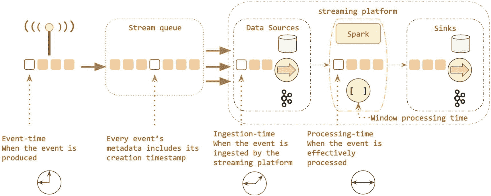
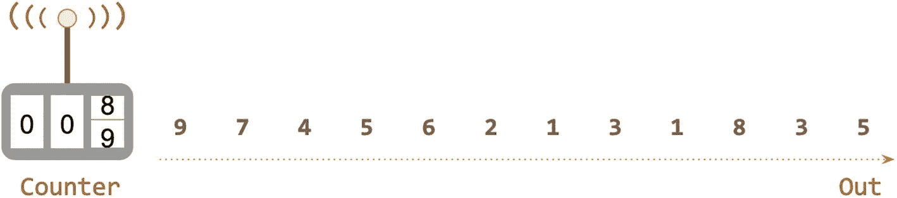
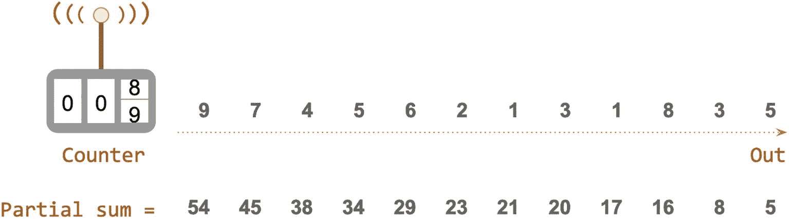
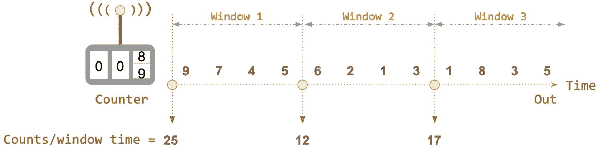
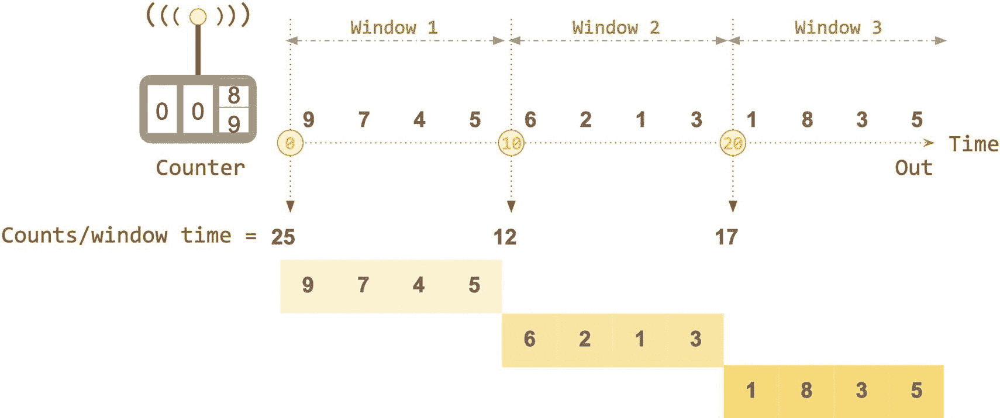
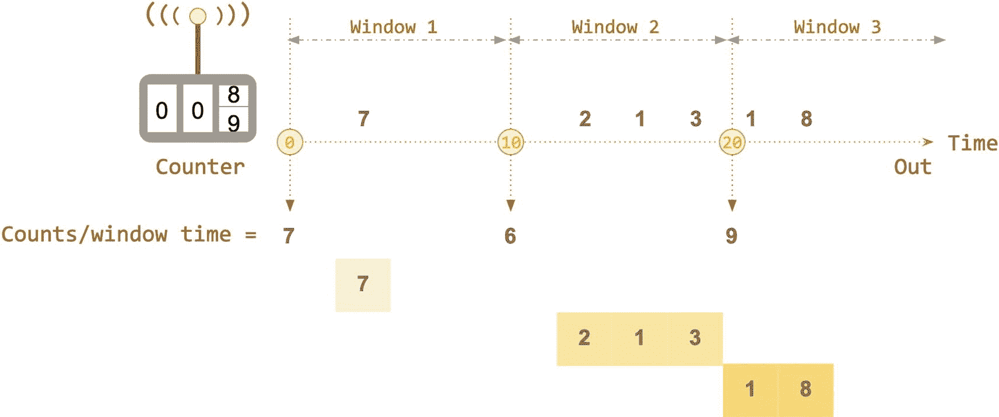
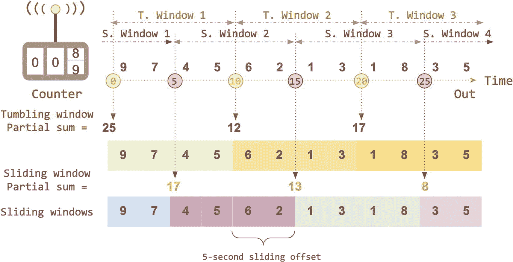

# 9. 事件时间窗口操作与水位线

在学习了 Apache Spark Streaming 和 Structured Streaming 的见解之后，本章我们将重点讨论基于时间的流处理。

在许多用例中，数据分析正从批处理向流数据处理演进。这种转变的原因之一是，人们越来越普遍地认为流数据更适合模拟我们所经历的生活。当我们思考大多数需要分析和建模的系统时，这一点尤为明显——接收和发送卫星导航坐标的自动驾驶汽车、交换信号的物联网设备、用于交通控制的道路车辆计数传感器、可穿戴设备等——它们都有一个共同点：都以连续的事件流形式及时出现。事实上，流数据源几乎无处不在。

此外，事件是某些活动的结果，在许多场景中，它们需要立即采取行动。例如，考虑欺诈或异常检测、个性化、营销和实时广告等应用，这些都是实时流处理和事件驱动应用最常见的用例。

一致的时间语义在流处理中至关重要，因为事件处理中的许多操作，如时间窗口上的聚合、连接和延迟数据管理，都依赖于时间。

在本章中，我们将探讨用于流处理的时间窗口概念（也称为时间窗口），研究 Spark 的内置窗口函数，并解释窗口语义。

## 9.1 事件时间处理

如前所述，实时事件流处理中的许多操作都依赖于时间。在处理事件和时间时，我们有几种事件时间标记选项，根据手头的用例，我们必须优先选择其中一种：

*   **事件时间**：指事件被创建的时间，例如由传感器产生的时间。
*   **摄入时间**：表示事件被事件流平台摄入的时刻。通过在事件进入流平台时为其添加时间戳来实现。
*   **处理时间**，也称为**挂钟时间**：指事件被实际处理的时刻。

接下来，图 9-1 以图形方式解释了上述事件时间处理概念。



一个流程图解释了从事件时间到流平台，再经过流队列的过程。该平台包含带有摄入时间的数据源、带有处理时间的 Spark，最后是数据接收端。

图 9-1 流事件时间处理模式

## 9.2 Apache Spark 中的流时间窗口

在实时流处理中，对时间窗口内的数据执行操作是最常见的操作之一。

时间窗口将流元素按时间间隔分组。Apache Spark Structured Streaming 也支持事件时间，并允许基于事件时间的窗口计算，以及对窗口函数的原生支持。在 Apache 3.2 版本之前，Spark 仅支持“滚动窗口”和“滑动窗口”，但从 Spark 3.2 开始，Spark 还包含了“会话窗口”，它同样可用于流式查询和批处理查询，使工程师能够以最少的工作量开发复杂的流处理作业。

使用 Structured Streaming，数据聚合在应用于滑动窗口时与 Spark 的分组聚合非常相似。对于分组聚合，会为分组列的每个不同元素维护聚合计算。而对于基于窗口的聚合，会为事件时间值所属的每个窗口维护聚合计算。

因此，在本书撰写时，Spark 提供了三种时间窗口可供选择：

*   滚动窗口
*   滑动窗口
*   会话窗口

上述窗口类型的共同点是，它们都应用于连续的数据流，将其分割成有限的信息集合。当我们想要执行聚合、连接和模式识别等操作时，将时间窗口或有限时间窗口应用于流数据尤其合适。接下来的章节将描述滚动窗口、滑动窗口和会话窗口类型的工作原理以及如何实际实现它们。让我们详细研究每一种。

### 什么是时间窗口，为什么它们在流处理中很重要

考虑我们一直在使用的医院排队管理系统的例子。同时假设我们有一个计数器设备，每 15 秒统计一次进入医院的患者数量。由此产生的事件流可能如图 9-2 所示。



一个示意图左侧显示了一个计数器。其上的三个窗格分别显示 0、0 和 8/9。水平方向从左到右依次输出数字 9、7、4、5、6、2、1、3、1、8、3、5。

图 9-2 传递事件流的计数设备示例

如果我们想知道进入医院的患者数量，我们可以将计数的患者数相加。然而，流的本质是我们面临一个无界数据的场景。也就是说，计数流是无穷无尽的，因此我们无法得出进入设施的患者总数的最终结果。一种替代方案是计算部分和，即，将接收到的计数相加，并在收集到新值时更新部分和。这样做，我们收集了一系列随着新计数更新的运行总计，如图 9-3 所示。



一个示意图左侧显示了一个计数器。其上的三个窗格分别显示 0、0 和 8/9。水平方向从左到右依次输出数字 9、7、4、5、6、2、1、3、1、8、3、5。下方的部分和依次为 54、45、38、34、29、23、21、20、17、16、8 和 5。

图 9-3 部分和序列

然而，部分和序列是一个实时指标，因为它会不断更新。因此，如果你想分析数据随时间的变化，例如，医院患者流量在早上还是晚上更大？或者如图 9-4 所示，每个时间单位有多少患者进入医院？滚动求和策略可能不是最佳选择。



示意图包含一个计数器和三个编号窗格。窗口 1：9、7、4、5，计数时间 25。窗口 2：6、2、1、3，计数时间 12。窗口 3：1、8、3、5，计数时间 17。

图 9-4 用于按窗口时间统计事件的时间窗口示例

为了回答类似上述的问题，我们有不同类型的时间窗口操作。接下来我们将研究滚动窗口操作。


## 9.3 滚动窗口

滚动窗口（或称非重叠窗口）将数据流离散化为不重叠的数据段，并对每个数据段应用函数，如图 9-5 所示。

滚动窗口的主要特征是：窗口之间互不重叠且重复出现，每个事件仅属于一个且唯一一个滚动窗口。



示意图包含一个计数器与三个编号窗格。窗口 1：9 7 4 5，计数时间 25。窗口 2：6 2 1 3，计数时间 12。窗口 3：1 8 3 5，计数时间 17。所有窗口均为 10 秒滚动窗口。

**图 9-5** 一个十秒的滚动窗口

为简化说明，前述图示中每个窗口区间内的事件数量相同；但请注意，实际情况并非总是如此，不同时间窗口内可能出现不同数量的事件，如下方图 9-6 所强调。



示意图包含一个计数器与三个编号窗格。窗口 1：7，计数时间 7。窗口 2：2 1 3，计数时间 6。窗口 3：1 8，计数时间 9。窗口 1、2、3 的滚动窗口分别为 0、10、20。

**图 9-6** 一个十秒的滚动窗口，每个窗口内事件数量不同

以下代码片段使用大小为十秒的滚动窗口，对同一窗口时间内进入医院的患者数量进行聚合计数。

```
// Tumbling windows
import org.apache.spark.sql.SparkSession
import org.apache.spark.sql.functions._
import org.apache.spark.sql.types.{IntegerType, StringType, StructField, StructType,DoubleType,LongType}
import org.apache.spark.sql.{DataFrame, Dataset, Encoders, SparkSession}
import java.io.IOException
import org.apache.spark.sql.streaming._
import org.apache.spark.sql.streaming.{GroupState,GroupStateTimeout,OutputMode}
import org.apache.spark.sql.DataFrame
val PatientsSchema = StructType(Array(
StructField("NSS", StringType),
StructField("Nom", StringType),
StructField("DID", IntegerType),
StructField("DNom", StringType),
StructField("Fecha", StringType))
)
val spark:SparkSession = SparkSession.builder()
.master("local[10]")
.appName("Hand-On-Spark3_Socket_Data_Source")
.getOrCreate()
spark.sparkContext.setLogLevel("ERROR")
import spark.implicits._
try {
val PatientDS = spark.readStream
.schema(PatientsSchema)
.json("/tmp/window")
printf("\n Listening and ready... \n")
val PatientDF = PatientDS
.groupBy(window(col("Fecha"), "10 seconds"))
.agg(count("DNom").alias("Suma_x_Dpt"))
PatientDF.writeStream
.outputMode("complete")
.format("console")
.option("truncate", false)
.start()
.awaitTermination()
} catch {
case e: IOException => println("IOException occurred")
case t: Throwable => println("Error receiving data", t)
}finally {
println("In finally block")
}
```

要运行上述代码示例，首先需要创建必要的数据源（本例中为 `/tmp/window`），以便拉取对应的 JSON 文件。

完成创建后，运行代码，当看到以下消息时：

```
Listening and ready...
```

开始将文件复制到数据源，例如：

```
$ cp json_file1.json /tmp/window
$ cp json_file2.json /tmp/window
$ cp json_file3.json /tmp/window
$ cp json_file4.json /tmp/window
$ cp json_file5.json /tmp/window
$ cp json_file6.json /tmp/window
$ cp json_file7.json /tmp/window
```

你将看到程序输出类似如下的结果：

```
Listening and ready...

Batch: 0

+------------------------------------------+----------+
|window                                    |Suma_x_Dpt|
+------------------------------------------+----------+
|{2023-02-23 01:00:00, 2023-02-23 01:00:10}|1         |
+------------------------------------------+----------+

Batch: 1

+------------------------------------------+----------+
|window                                    |Suma_x_Dpt|
+------------------------------------------+----------+
|{2023-02-23 01:00:00, 2023-02-23 01:00:10}|3         |
+------------------------------------------+----------+

Batch: 2

+------------------------------------------+----------+
|window                                    |Suma_x_Dpt|
+------------------------------------------+----------+
|{2023-02-23 01:00:00, 2023-02-23 01:00:10}|6         |
+------------------------------------------+----------+

Batch: 3

+------------------------------------------+----------+
|window                                    |Suma_x_Dpt|
+------------------------------------------+----------+
|{2023-02-23 01:00:00, 2023-02-23 01:00:10}|10        |
+------------------------------------------+----------+

Batch: 4

+------------------------------------------+----------+
|window                                    |Suma_x_Dpt|
+------------------------------------------+----------+
|{2023-02-23 01:00:00, 2023-02-23 01:00:10}|10        |
|{2023-02-23 01:00:10, 2023-02-23 01:00:20}|1         |
+------------------------------------------+----------+

Batch: 5

+------------------------------------------+----------+
|window                                    |Suma_x_Dpt|
+------------------------------------------+----------+
|{2023-02-23 01:00:00, 2023-02-23 01:00:10}|10        |
|{2023-02-23 01:00:10, 2023-02-23 01:00:20}|1         |
+------------------------------------------+----------+

Batch: 6

+------------------------------------------+----------+
|window                                    |Suma_x_Dpt|
+------------------------------------------+----------+
|{2023-02-23 01:00:00, 2023-02-23 01:00:10}|10        |
|{2023-02-23 01:00:10, 2023-02-23 01:00:20}|1         |
+------------------------------------------+----------+
```

现在，如果你对上述代码做一个小改动，在以下代码部分之前添加：

```
PatientDF.printSchema()
```

即放在：

```
PatientDF.writeStream
.outputMode("complete")
.format("console")
.option("truncate", false)
.start()
.awaitTermination()
```

之前，你将看到窗口数据框的模式（schema）如下所示：

```
root
|-- window: struct (nullable = true)
|    |-- start: timestamp (nullable = true)
|    |-- end: timestamp (nullable = true)
|-- Suma_x_Dpt: long (nullable = false)
```

因此，如果你希望将窗口边界显示为单独的列，可以按如下方式修改上述代码：

```
val PatientDF = PatientDS
.groupBy(window(col("Fecha"), "10 seconds"))
.agg(count("DNom").alias("Suma_x_Dpt"))
.select("window.start", "window.end", "Suma_x_Dpt")
```

你将看到窗口信息显示如下：

```
Listening and ready...

Batch: 0

+-------------------+-------------------+----------+
|start              |end                |Suma_x_Dpt|
+-------------------+-------------------+----------+
|2023-02-23 01:00:00|2023-02-23 01:00:10|1         |
+-------------------+-------------------+----------+

Batch: 1

+-------------------+-------------------+----------+
|start              |end                |Suma_x_Dpt|
+-------------------+-------------------+----------+
|2023-02-23 01:00:00|2023-02-23 01:00:10|3         |
+-------------------+-------------------+----------+

Batch: 2

+-------------------+-------------------+----------+
|start              |end                |Suma_x_Dpt|
+-------------------+-------------------+----------+
|2023-02-23 01:00:00|2023-02-23 01:00:10|6         |
+-------------------+-------------------+----------+

Batch: 3

+-------------------+-------------------+----------+
|start              |end                |Suma_x_Dpt|
+-------------------+-------------------+----------+
|2023-02-23 01:00:00|2023-02-23 01:00:10|10        |
+-------------------+-------------------+----------+

Batch: 4
```


```text
+-------------------+-------------------+----------+
|start              |end                |Suma_x_Dpt|
+-------------------+-------------------+----------+
|2023-02-23 01:00:00|2023-02-23 01:00:10|10        |
|2023-02-23 01:00:10|2023-02-23 01:00:20|1         |
+-------------------+-------------------+----------+

批次：5

+-------------------+-------------------+----------+
|start              |end                |Suma_x_Dpt|
+-------------------+-------------------+----------+
|2023-02-23 01:00:00|2023-02-23 01:00:10|10        |
|2023-02-23 01:00:10|2023-02-23 01:00:20|1         |
+-------------------+-------------------+----------+

批次：6

+-------------------+-------------------+----------+
|start              |end                |Suma_x_Dpt|
+-------------------+-------------------+----------+
|2023-02-23 01:00:00|2023-02-23 01:00:10|10        |
|2023-02-23 01:00:10|2023-02-23 01:00:20|1         |
+-------------------+-------------------+----------+
```

## 9.4 滑动窗口

在某些情况下，我们可能需要不同类型的窗口。例如，如果我们想每隔 30 分钟了解过去一分钟内有多少患者进入医院，就需要重叠窗口。要回答这类问题，我们需要滑动窗口。

滑动窗口与滚动窗口一样是“固定大小”的，但与滚动窗口不同，它们可以重叠。当窗口重叠发生时，一个事件可能属于多个窗口。当滑动的持续时间小于窗口的持续时间时，就会发生重叠。

因此，在 Spark Streaming 中，定义滑动窗口需要两个参数：窗口大小（间隔）和滑动偏移量（重叠维度）。例如，在图 9-7 中，我们创建了一个大小为 10 秒、滑动偏移量为 5 秒的滑动窗口。



示意图包含一个计数器、三个编号窗格和三个窗口。计算出的数字分别对应滚动窗口部分和、滑动窗口部分和以及滑动窗口。

**图 9-7** 滑动偏移量为 5 秒的 10 秒滑动窗口

在接下来的代码示例中，我们计算每十秒进入医院的总人数。该示例演示了如何在`Fecha`列上创建一个每十秒滑动一次、滑动偏移量为五秒的滑动窗口。

> **注意**  
> 请注意，为了演示用法，设定的时间间隔非常短。应用于真实医院的相同代码可能会使用更宽的时间间隔。

```scala
// 滑动窗口
import org.apache.spark.sql.SparkSession
import org.apache.spark.sql.functions._
import org.apache.spark.sql.types.{IntegerType, StringType, StructField, StructType,DoubleType,LongType}
import org.apache.spark.sql.{DataFrame, Dataset, Encoders, SparkSession}
import java.io.IOException
import org.apache.spark.sql.streaming._
import org.apache.spark.sql.streaming.{GroupState,GroupStateTimeout,OutputMode}
import org.apache.spark.sql.DataFrame

val PatientsSchema = StructType(Array(
  StructField("NSS", StringType),
  StructField("Nom", StringType),
  StructField("DID", IntegerType),
  StructField("DNom", StringType),
  StructField("Fecha", StringType))
)

val spark:SparkSession = SparkSession.builder()
  .master("local[10]")
  .appName("Hand-On-Spark3_Socket_Data_Source")
  .getOrCreate()

spark.sparkContext.setLogLevel("ERROR")
import spark.implicits._

try {
  val PatientDS = spark.readStream
    .schema(PatientsSchema)
    .json("/tmp/window")

  printf("\n 正在监听，准备就绪... \n")

  val PatientDF = PatientDS
    .groupBy(window(col("Fecha"), "10 seconds", "5 seconds"))
    .agg(count("DID").alias("Suma_x_Dpt"))

  PatientDF.writeStream
    .outputMode("complete")
    .format("console")
    .option("truncate", false)
    .start()
    .awaitTermination()
} catch {
  case e: IOException => println("发生 IOException 异常")
  case t: Throwable => println("接收数据时出错", t)
} finally {
  println("在 finally 块中")
}
```

与之前滚动窗口示例中的做法相同，在尝试运行上述代码示例之前，首先需要创建 JSON 文件的数据源（本例中为`/tmp/window`文件夹）。之后，就可以开始向该目录写入 JSON 文件。例如：

```bash
$ cp json_file9.json /tmp/window
$ cp json_file8.json /tmp/window
$ cp json_file7.json /tmp/window
...
$ cp json_file1.json /tmp/window
```

一旦复制了上述文件，根据你应用的复制速率，程序将创建一个大小为 10 秒、滑动间隔为 5 秒的窗口。每 5 秒就会创建一个新的 10 秒窗口，且该窗口与上一个窗口的起始位置相差 5 秒，如下一个程序输出所示。

```
正在监听，准备就绪...

批次：0
```


```text
+------------------------------------------+----------+
|window                                    |Suma_x_Dpt|
+------------------------------------------+----------+
|{2023-02-23 01:00:25, 2023-02-23 01:00:35}|5         |
|{2023-02-23 01:00:35, 2023-02-23 01:00:45}|4         |
|{2023-02-23 01:00:30, 2023-02-23 01:00:40}|9         |
+------------------------------------------+----------+

批次：1

+------------------------------------------+----------+
|window                                    |Suma_x_Dpt|
+------------------------------------------+----------+
|{2023-02-23 01:00:25, 2023-02-23 01:00:35}|10        |
|{2023-02-23 01:00:20, 2023-02-23 01:00:30}|8         |
|{2023-02-23 01:00:35, 2023-02-23 01:00:45}|4         |
|{2023-02-23 01:00:30, 2023-02-23 01:00:40}|9         |
|{2023-02-23 01:00:15, 2023-02-23 01:00:25}|3         |
+------------------------------------------+----------+

批次：2

+------------------------------------------+----------+
|window                                    |Suma_x_Dpt|
+------------------------------------------+----------+
|{2023-02-23 01:00:25, 2023-02-23 01:00:35}|10        |
|{2023-02-23 01:00:20, 2023-02-23 01:00:30}|10        |
|{2023-02-23 01:00:35, 2023-02-23 01:00:45}|4         |
|{2023-02-23 01:00:10, 2023-02-23 01:00:20}|5         |
|{2023-02-23 01:00:30, 2023-02-23 01:00:40}|9         |
|{2023-02-23 01:00:15, 2023-02-23 01:00:25}|10        |
+------------------------------------------+----------+

批次：3

+------------------------------------------+----------+
|window                                    |Suma_x_Dpt|
+------------------------------------------+----------+
|{2023-02-23 01:00:25, 2023-02-23 01:00:35}|10        |
|{2023-02-23 01:00:20, 2023-02-23 01:00:30}|11        |
|{2023-02-23 01:00:35, 2023-02-23 01:00:45}|4         |
|{2023-02-23 01:00:10, 2023-02-23 01:00:20}|10        |
|{2023-02-23 01:00:30, 2023-02-23 01:00:40}|9         |
|{2023-02-23 01:00:15, 2023-02-23 01:00:25}|16        |
+------------------------------------------+----------+
```

正如我们对滚动窗口所做的那样，你可以修改之前的代码片段如下：

```
val PatientDF = PatientDS
.groupBy(window(col("Fecha"), "10 seconds", "5 seconds"))
.agg(count("DID").alias("Suma_x_Dpt"))
.select("window.start", "window.end", "Suma_x_Dpt")
```

将窗口时间数据分离到两个不同的列中。

与滚动窗口示例类似，你将得到如下所示的输出：

```
Listening and ready...

Batch: 0

+-------------------+-------------------+----------+
|start              |end                |Suma_x_Dpt|
+-------------------+-------------------+----------+
|2023-02-23 01:00:25|2023-02-23 01:00:35|5         |
|2023-02-23 01:00:35|2023-02-23 01:00:45|4         |
|2023-02-23 01:00:30|2023-02-23 01:00:40|9         |
+-------------------+-------------------+----------+

Batch: 1

+-------------------+-------------------+----------+
|start              |end                |Suma_x_Dpt|
+-------------------+-------------------+----------+
|2023-02-23 01:00:25|2023-02-23 01:00:35|10        |
|2023-02-23 01:00:20|2023-02-23 01:00:30|8         |
|2023-02-23 01:00:35|2023-02-23 01:00:45|4         |
|2023-02-23 01:00:30|2023-02-23 01:00:40|9         |
|2023-02-23 01:00:15|2023-02-23 01:00:25|3         |
+-------------------+-------------------+----------+

Batch: 2

+-------------------+-------------------+----------+
|start              |end                |Suma_x_Dpt|
+-------------------+-------------------+----------+
|2023-02-23 01:00:25|2023-02-23 01:00:35|10        |
|2023-02-23 01:00:20|2023-02-23 01:00:30|10        |
|2023-02-23 01:00:35|2023-02-23 01:00:45|4         |
|2023-02-23 01:00:10|2023-02-23 01:00:20|5         |
|2023-02-23 01:00:30|2023-02-23 01:00:40|9         |
|2023-02-23 01:00:15|2023-02-23 01:00:25|10        |
+-------------------+-------------------+----------+

Batch: 3

+-------------------+-------------------+----------+
|start              |end                |Suma_x_Dpt|
+-------------------+-------------------+----------+
|2023-02-23 01:00:25|2023-02-23 01:00:35|10        |
|2023-02-23 01:00:20|2023-02-23 01:00:30|11        |
|2023-02-23 01:00:35|2023-02-23 01:00:45|4         |
|2023-02-23 01:00:10|2023-02-23 01:00:20|10        |
|2023-02-23 01:00:30|2023-02-23 01:00:40|9         |
|2023-02-23 01:00:15|2023-02-23 01:00:25|16        |
+-------------------+-------------------+----------+
```

通过滑动窗口，我们可以回答诸如“过去一分钟/一小时等时间内，有多少患者到访我们医院？”之类的问题，或者触发事件，例如“当同一科室的患者在过去十秒内超过五人进入医院时，触发警报”。

在下一节中，我们将学习会话窗口，其语义与前两种窗口类型有所不同。


