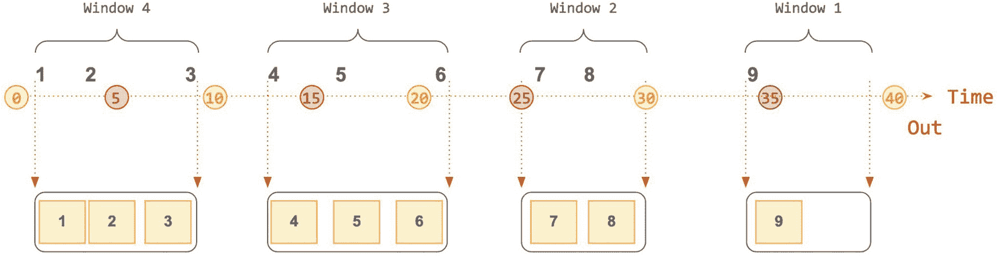

# 会话窗口

与会话窗口和滑动窗口相比，会话窗口有一个重要的不同特性。会话窗口具有可变的几何形状。会话窗口的长度是动态变化的，具体取决于传入的事件。

会话窗口会收集在相似时间点到达的事件，并隔离出没有数据活动的时段。一个会话窗口从收集到第一个输入事件开始，只要我们在等于窗口长度的间隔持续时间内不断接收到数据，它就会持续存在。因此，在任何情况下，当达到最大窗口长度时，它就会自行关闭。例如，在我们之前的示例中，窗口大小为十秒，会话窗口将在接收到第一个输入后立即开始。此后，在十秒内获取的所有事件都将与该窗口关联。如果该窗口在十秒内没有收到更多输入，它就会自行关闭。图 9-8 展示了会话窗口工作方式的图形化描述。



一张示意图展示了从左到右编号为 4 到 1 的四个窗口。每个窗口中的值是根据不同会话中的不同数字计算得出的。

**图 9-8** 间隔为五秒的十秒会话窗口

当遇到诸如“哪些患者在某个时间点去了医院？”或“在特定时间段内，医院最繁忙的时刻是什么？”这类业务问题时，会话窗口是合适的工具。

像往常一样，我们提供一个使用会话窗口的实际示例。在下面的代码片段中，你可以看到如何将会话窗口描述为创建一个窗口来收集在超时时间内到达的所有后续事件。如你所见，窗口时间范围内收集的所有事件都会被添加到当前会话中。

在下一个示例中，我们实现了 `session_window()` 函数，用于在会话窗口上统计传入事件的数量，该会话窗口基于我们示例事件中 `Fecha` 列的十秒间隔。

```
// Session Window
import org.apache.spark.sql.SparkSession
import org.apache.spark.sql.functions._
import org.apache.spark.sql.types._
import org.apache.spark.sql.{DataFrame, Dataset, Encoders, SparkSession}
import java.io.IOException
import org.apache.spark.sql.streaming._
import org.apache.spark.sql.streaming.{GroupState,GroupStateTimeout,OutputMode}
import org.apache.spark.sql.DataFrame
val PatientsSchema = StructType(Array(
StructField("NSS", StringType),
StructField("Nom", StringType),
StructField("DID", IntegerType),
StructField("DNom", StringType),
StructField("Fecha", StringType))
)
val spark:SparkSession = SparkSession.builder()
.master("local[10]")
.appName("Hand-On-Spark3_Socket_Data_Source")
.getOrCreate()
spark.sparkContext.setLogLevel("ERROR")
import spark.implicits._
try {
val PatientDS = spark.readStream
.schema(PatientsSchema)
.json("/tmp/window")
PatientDS.printSchema()
printf("\n Listening and ready... \n")
val PatientDF = PatientDS
.groupBy(
session_window(col("Fecha"), "10 seconds"), col("DID")
).count()
PatientDF.printSchema()
PatientDF.writeStream
.outputMode("complete")
.format("console")
.option("truncate", false)
.start()
.awaitTermination()
} catch {
case e: IOException => println("IOException occurred")
case t: Throwable => println("Error receiving data", t)
}finally {
println("In finally block")
}
```

正如你在之前的示例中所做的那样，在运行上述代码之前，你首先需要创建数据源文件夹（在我们的示例中仍然是 `/tmp/window`）。之后，你可以将作为示例提供的 JSON 文件复制到数据源目录，例如像这样：

```
$ cp json_file11.json /tmp/window
$ cp json_file9.json /tmp/window
...
$ cp json_file7.json /tmp/window
```

文件复制完成后，你的程序应该会输出类似以下的内容：

```
. . . 为简洁起见已省略 . . .
Listening and ready...

Batch: 0

+--------------------------------------------------+---+-----+
|session_window                                    |DID|count|
+--------------------------------------------------+---+-----+
|{2023-02-23 01:00:15.002, 2023-02-23 01:00:25.002}|20 |1    |
|{2023-02-23 01:00:18.002, 2023-02-23 01:00:31.002}|10 |4    |
|{2023-02-23 01:00:17.002, 2023-02-23 01:00:27.002}|50 |1    |
|{2023-02-23 01:00:16.002, 2023-02-23 01:00:26.002}|30 |1    |
+--------------------------------------------------+---+-----+

Batch: 1

+--------------------------------------------------+---+-----+
|session_window                                    |DID|count|
+--------------------------------------------------+---+-----+
|{2023-02-23 01:00:15.002, 2023-02-23 01:00:25.002}|20 |2    |
|{2023-02-23 01:00:18.002, 2023-02-23 01:00:31.002}|10 |7    |
|{2023-02-23 01:00:17.002, 2023-02-23 01:00:27.002}|50 |2    |
|{2023-02-23 01:00:16.002, 2023-02-23 01:00:26.002}|30 |2    |
+--------------------------------------------------+---+-----+

Batch: 2

+--------------------------------------------------+---+-----+
|session_window                                    |DID|count|
+--------------------------------------------------+---+-----+
|{2023-02-23 01:02:00.002, 2023-02-23 01:02:10.002}|20 |1    |
|{2023-02-23 01:00:15.002, 2023-02-23 01:00:25.002}|20 |2    |
|{2023-02-23 01:01:34.002, 2023-02-23 01:01:44.002}|20 |1    |
|{2023-02-23 01:02:05.002, 2023-02-23 01:02:15.002}|10 |1    |
|{2023-02-23 01:00:18.002, 2023-02-23 01:00:31.002}|10 |7    |
|{2023-02-23 01:00:17.002, 2023-02-23 01:00:27.002}|50 |2    |
|{2023-02-23 01:02:20.002, 2023-02-23 01:02:30.002}|50 |1    |
|{2023-02-23 01:02:38.002, 2023-02-23 01:02:48.002}|50 |1    |
|{2023-02-23 01:01:30.002, 2023-02-23 01:01:43.002}|50 |4    |
|{2023-02-23 01:02:37.002, 2023-02-23 01:02:47.002}|30 |1    |
|{2023-02-23 01:00:16.002, 2023-02-23 01:00:26.002}|30 |2    |
|{2023-02-23 01:02:10.002, 2023-02-23 01:02:20.002}|30 |1    |
+--------------------------------------------------+---+-----+

Batch: 3

+--------------------------------------------------+---+-----+
|session_window                                    |DID|count|
+--------------------------------------------------+---+-----+
|{2023-02-23 01:00:15.002, 2023-02-23 01:00:25.002}|20 |2    |
|{2023-02-23 01:01:34.002, 2023-02-23 01:01:44.002}|20 |1    |
|{2023-02-23 01:00:34.002, 2023-02-23 01:00:45.002}|20 |2    |
|{2023-02-23 01:02:00.002, 2023-02-23 01:02:10.002}|20 |1    |
|{2023-02-23 01:00:18.002, 2023-02-23 01:00:31.002}|10 |7    |
|{2023-02-23 01:02:05.002, 2023-02-23 01:02:15.002}|10 |1    |
|{2023-02-23 01:00:36.002, 2023-02-23 01:00:46.002}|10 |1    |
|{2023-02-23 01:02:20.002, 2023-02-23 01:02:30.002}|50 |1    |
|{2023-02-23 01:00:17.002, 2023-02-23 01:00:27.002}|50 |2    |
|{2023-02-23 01:00:30.002, 2023-02-23 01:00:48.002}|50 |5    |
|{2023-02-23 01:02:38.002, 2023-02-23 01:02:48.002}|50 |1    |
|{2023-02-23 01:01:30.002, 2023-02-23 01:01:43.002}|50 |4    |
|{2023-02-23 01:00:16.002, 2023-02-23 01:00:26.002}|30 |2    |
|{2023-02-23 01:02:10.002, 2023-02-23 01:02:20.002}|30 |1    |
|{2023-02-23 01:00:37.002, 2023-02-23 01:00:47.002}|30 |1    |
|{2023-02-23 01:02:37.002, 2023-02-23 01:02:47.002}|30 |1    |
+--------------------------------------------------+---+-----+
```


### 具有动态间隔的会话窗口

会话窗口类型的另一个有趣特性是它支持所谓的*动态间隔时长*^(²⁴)。我们在前一个示例中实现的会话窗口，虽然其大小会根据新事件是否到达而变化，但它有一个最大尺寸，即窗口长度。而动态间隔时长的特殊之处在于，每个会话的间隔时长可以不同。因此，我们可以使用一个表达式来动态设置窗口大小，使其适应输入数据的特征，而不是使用固定的间隔/超时值。

下面是一个实际示例，展示了如何实现具有动态间隔时长的会话窗口。

```
// Session Windows II. Session window with dynamic gap duration
import org.apache.spark.sql.SparkSession
import org.apache.spark.sql.functions._
import org.apache.spark.sql.types._
import org.apache.spark.sql.{DataFrame, Dataset, Encoders, SparkSession}
import java.io.IOException
import org.apache.spark.sql.streaming._
import org.apache.spark.sql.streaming.{GroupState,GroupStateTimeout,OutputMode}
import org.apache.spark.sql.DataFrame
val PatientsSchema = StructType(Array(
StructField("NSS", StringType),
StructField("Nom", StringType),
StructField("DID", IntegerType),
StructField("DNom", StringType),
StructField("Fecha", StringType))
)
val spark:SparkSession = SparkSession.builder()
.master("local[10]")
.appName("Hand-On-Spark3_Socket_Data_Source")
.getOrCreate()
spark.sparkContext.setLogLevel("ERROR")
import spark.implicits._
try {
val PatientDS = spark.readStream
.schema(PatientsSchema)
.json("/tmp/window")
PatientDS.printSchema()
printf("\n Listening and ready... \n")
val PatientDF = PatientDS
.groupBy(
session_window(col("Fecha"),
when(col("NSS") === "1009", "10 seconds")
.when(col("NSS") === "2001", "30 seconds")
.when(col("NSS") === "5000", "50 seconds")
.otherwise("60 seconds")),
col("DID")
).count()
PatientDF.printSchema()
PatientDF.writeStream
.outputMode("complete")
.format("console")
.option("truncate", false)
.start()
.awaitTermination()
} catch {
case e: IOException => println("IOException occurred")
case t: Throwable => println("Error receiving data", t)
}finally {
println("In finally block")
}
```

上述代码的新颖之处在于下面这段代码块，它实现了具有动态超时的会话窗口。

```
val PatientDF = PatientDS
.groupBy(
session_window(col("Fecha"),
when(col("NSS") === "1009", "10 seconds")
.when(col("NSS") === "2001", "30 seconds")
.when(col("NSS") === "5000", "50 seconds")
.otherwise("60 seconds")),
col("DID")
).count()
```

现在你可以看到，会话窗口的长度是由 `NSS` 字段的值动态确定的。

再次，在创建源数据目录（`/tmp/window`）、执行代码示例并复制提供的 JSON 文件后，程序将输出类似于下面的结果。

```
. . . Removed for brevity . . .
Listening and ready...

Batch: 0

+--------------------------------------------------+---+-----+
|session_window                                    |DID|count|
+--------------------------------------------------+---+-----+
|{2023-02-23 01:00:15.002, 2023-02-23 01:00:25.002}|20 |1    |
|{2023-02-23 01:00:18.002, 2023-02-23 01:01:20.002}|10 |3    |
|{2023-02-23 01:00:17.002, 2023-02-23 01:01:17.002}|50 |1    |
|{2023-02-23 01:00:16.002, 2023-02-23 01:01:16.002}|30 |1    |
+--------------------------------------------------+---+-----+

Batch: 1

+--------------------------------------------------+---+-----+
|session_window                                    |DID|count|
+--------------------------------------------------+---+-----+
|{2023-02-23 01:00:15.002, 2023-02-23 01:00:45.002}|20 |2    |
|{2023-02-23 01:00:18.002, 2023-02-23 01:01:21.002}|10 |7    |
|{2023-02-23 01:00:17.002, 2023-02-23 01:01:17.002}|50 |2    |
|{2023-02-23 01:00:16.002, 2023-02-23 01:01:16.002}|30 |2    |
+--------------------------------------------------+---+-----+

Batch: 2

+--------------------------------------------------+---+-----+
|session_window                                    |DID|count|
+--------------------------------------------------+---+-----+
|{2023-02-23 01:00:15.002, 2023-02-23 01:01:22.002}|20 |3    |
|{2023-02-23 01:00:18.002, 2023-02-23 01:01:28.002}|10 |11   |
|{2023-02-23 01:00:17.002, 2023-02-23 01:01:29.002}|50 |4    |
|{2023-02-23 01:00:16.002, 2023-02-23 01:01:23.002}|30 |3    |
+--------------------------------------------------+---+-----+

Batch: 3

+--------------------------------------------------+---+-----+
|session_window                                    |DID|count|
+--------------------------------------------------+---+-----+
|{2023-02-23 01:00:15.002, 2023-02-23 01:01:35.002}|20 |5    |
|{2023-02-23 01:00:18.002, 2023-02-23 01:01:36.002}|10 |12   |
|{2023-02-23 01:00:17.002, 2023-02-23 01:01:38.002}|50 |9    |
|{2023-02-23 01:00:16.002, 2023-02-23 01:01:37.002}|30 |4    |
+--------------------------------------------------+---+-----+

Batch: 4

+--------------------------------------------------+---+-----+
|session_window                                   |DID|count|
+--------------------------------------------------+---+-----+
|{2023-02-23 01:00:15.002, 2023-02-23 01:03:00.002}|20 |7    |
|{2023-02-23 01:02:05.002, 2023-02-23 01:03:05.002}|10 |1    |
|{2023-02-23 01:00:18.002, 2023-02-23 01:01:36.002}|10 |12   |
|{2023-02-23 01:00:17.002, 2023-02-23 01:03:38.002}|50 |15   |
|{2023-02-23 01:00:16.002, 2023-02-23 01:01:37.002}|30 |4    |
|{2023-02-23 01:02:10.002, 2023-02-23 01:03:37.002}|30 |2    |
+--------------------------------------------------+---+-----+

Batch: 5

+--------------------------------------------------+---+-----+
|session_window                                    |DID|count|
+--------------------------------------------------+---+-----+
|{2023-02-23 01:00:15.002, 2023-02-23 01:03:00.002}|20 |7    |
|{2023-02-23 01:00:18.002, 2023-02-23 01:01:36.002}|10 |12   |
|{2023-02-23 01:02:05.002, 2023-02-23 01:03:05.002}|10 |1    |
|{2023-02-23 01:00:17.002, 2023-02-23 01:03:38.002}|50 |15   |
|{2023-02-23 01:02:10.002, 2023-02-23 01:03:37.002}|30 |2    |
|{2023-02-23 01:00:10.002, 2023-02-23 01:01:37.002}|30 |5    |
+--------------------------------------------------+---+-----+
```

在本书撰写时，对于 Spark 3.3.2 版本，在流式查询中使用会话窗口存在一些限制：

*   不支持 `"update"` 输出模式。
*   分组子句应至少包含两列：`session_window` 和另一列。

然而，当用于批处理查询时，分组子句只能包含 `session_window` 列，如 Apache Spark 官方文档所述^(²⁵)。

## 9.6 Spark Structured Streaming 中的水印

正如我们在本书中多次提到的，流数据远非理想状态。我们已经探讨过掉队者和延迟到达事件的概念。

水印（Watermarking）是在 Apache Spark 2.1 中引入的，用于支持延迟到达的数据。例如，水印用于有状态流式操作，以避免状态中无限累积信息，这很可能会因内存饱和而导致不稳定，从而在流式操作过程中引入计算延迟。

本节将解释水印背后的基本概念，并提供一个将水印与 Spark 有状态流式操作结合使用的实际示例。


### 什么是水印？

水印可定义为延迟阈值。水印允许 Spark Structured Streaming 处理事件延迟到达的问题。在分布式架构中，为了数据完整性、准确性和容错性，管理掉队或乱序事件至关重要。处理此类复杂系统时，无法保证数据会按照其发送顺序到达流式平台。这可能是由于网络瓶颈、通信延迟等原因造成的。为了克服这些困难，必须保留聚合操作的状态。

Spark Structured Streaming 使用水印作为截止点，来控制 Spark 流处理引擎等待延迟事件的时间。

因此，当我们声明水印时，需要指定一个时间戳字段和一个水印时间限制。例如，考虑我们的会话窗口代码片段。我们可以如下所示修改它，以引入水印阈值。

```
val PatientDF = PatientDS
.withWatermark("Fecha", "30 seconds")
.groupBy(
session_window(col("Fecha"), "10 seconds"), col("DID")
).count()
```

在这个例子中：

- `Fecha` 列用于定义一个 30 秒的水印。
- 对于每个非重叠的十秒窗口内观察到的每个 `DID`，执行 `count` 操作。
- 每个计数的状态信息会一直保留，直到窗口结束时间比最新观察到的 `Fecha` 值早十秒以上。

包含水印后，随着新数据的到来，Spark 会跟踪指定列中的最新时间戳，并在水印阈值内处理传入的事件。

以下是包含 30 秒水印的完整代码示例。

```
// Watermarking in Spark Structured Streaming
import org.apache.spark.sql.SparkSession
import org.apache.spark.sql.functions._
import org.apache.spark.sql.types._ //{IntegerType, StringType, StructField, StructType,DoubleType,LongType}
import org.apache.spark.sql.{DataFrame, Dataset, Encoders, SparkSession}
import java.io.IOException
import org.apache.spark.sql.streaming._
import org.apache.spark.sql.streaming.{GroupState,GroupStateTimeout,OutputMode}
import org.apache.spark.sql.DataFrame
val PatientsSchema = StructType(Array(
StructField("NSS", StringType),
StructField("Nom", StringType),
StructField("DID", IntegerType),
StructField("DNom", StringType),
StructField("Fecha", StringType))
)
val spark:SparkSession = SparkSession.builder()
.master("local[10]")
.appName("Hand-On-Spark3_Socket_Data_Source")
.getOrCreate()
spark.sparkContext.setLogLevel("ERROR")
import spark.implicits._
try {
val PatientDS = spark.readStream
.schema(PatientsSchema)
.json("/tmp/window")
.withColumn("Fecha", to_timestamp(col("Fecha"), "yyyy-MM-dd'T'HH:mm:ss.SSSX"))
PatientDS.printSchema()
printf("\n Listening and ready... \n")
val PatientDF = PatientDS
.withWatermark("Fecha", "30 seconds")
.groupBy(
session_window(col("Fecha"), "10 seconds"), col("DID")
).count()
PatientDF.printSchema()
PatientDF.writeStream
.outputMode("complete")
.format("console")
.option("truncate", false)
.start()
.awaitTermination()
} catch {
case e: IOException => println("IOException occurred")
case t: Throwable => println("Error receiving data", t)
}finally {
println("In finally block")
}
```

上述代码片段中还有另一个需要注意的重要部分。

```
val PatientDS = spark.readStream
.schema(PatientsSchema)
.json("/tmp/window")
.withColumn("Fecha", to_timestamp(col("Fecha"), "yyyy-MM-dd'T'HH:mm:ss.SSSX"))
PatientDS.printSchema()
root
|-- NSS: string (nullable = true)
|-- Nom: string (nullable = true)
|-- DID: integer (nullable = true)
|-- DNom: string (nullable = true)
|-- Fecha: timestamp (nullable = true)
```

水印只能与时间戳或窗口列一起使用。因此，`Fecha` 列必须先从字符串类型转换为时间戳类型才能使用；否则，你会收到错误。

再次强调，如果你运行上述程序并将作为示例提供的 JSON 文件复制到数据源目录（`/tmp/window`），你将得到类似于以下的输出。

```
. . . Removed for brevity . . .
Listening and ready...

Batch: 0

+--------------------------------------------------+---+-----+
|session_window                                    |DID|count|
+--------------------------------------------------+---+-----+
|{2023-02-23 01:01:34.002, 2023-02-23 01:01:44.002}|20 |1    |
|{2023-02-23 01:02:00.002, 2023-02-23 01:02:10.002}|20 |1    |
|{2023-02-23 01:02:05.002, 2023-02-23 01:02:15.002}|10 |1    |
|{2023-02-23 01:02:20.002, 2023-02-23 01:02:30.002}|50 |1    |
|{2023-02-23 01:02:38.002, 2023-02-23 01:02:48.002}|50 |1    |
|{2023-02-23 01:01:30.002, 2023-02-23 01:01:43.002}|50 |4    |
|{2023-02-23 01:02:10.002, 2023-02-23 01:02:20.002}|30 |1    |
|{2023-02-23 01:02:37.002, 2023-02-23 01:02:47.002}|30 |1    |
+--------------------------------------------------+---+-----+

Batch: 1

+--------------------------------------------------+---+-----+
|session_window                                    |DID|count|
+--------------------------------------------------+---+-----+
|{2023-02-23 01:02:00.002, 2023-02-23 01:02:10.002}|20 |1    |
|{2023-02-23 01:01:34.002, 2023-02-23 01:01:44.002}|20 |1    |
|{2023-02-23 01:02:05.002, 2023-02-23 01:02:15.002}|10 |1    |
|{2023-02-23 01:02:20.002, 2023-02-23 01:02:30.002}|50 |1    |
|{2023-02-23 01:02:38.002, 2023-02-23 01:02:48.002}|50 |1    |
|{2023-02-23 01:01:30.002, 2023-02-23 01:01:43.002}|50 |4    |
|{2023-02-23 01:02:37.002, 2023-02-23 01:02:47.002}|30 |1    |
|{2023-02-23 01:02:10.002, 2023-02-23 01:02:20.002}|30 |1    |
+--------------------------------------------------+---+-----+

Batch: 2

+--------------------------------------------------+---+-----+
|session_window                                    |DID|count|
+--------------------------------------------------+---+-----+
|{2023-02-23 01:02:00.002, 2023-02-23 01:02:10.002}|20 |1    |
|{2023-02-23 01:01:34.002, 2023-02-23 01:01:44.002}|20 |1    |
|{2023-02-23 01:02:05.002, 2023-02-23 01:02:15.002}|10 |1    |
|{2023-02-23 01:02:20.002, 2023-02-23 01:02:30.002}|50 |1    |
|{2023-02-23 01:02:38.002, 2023-02-23 01:02:48.002}|50 |1    |
|{2023-02-23 01:01:30.002, 2023-02-23 01:01:43.002}|50 |4    |
|{2023-02-23 01:02:37.002, 2023-02-23 01:02:47.002}|30 |1    |
|{2023-02-23 01:02:10.002, 2023-02-23 01:02:20.002}|30 |1    |
+--------------------------------------------------+---+-----+

Batch: 3

+--------------------------------------------------+---+-----+
|session_window                                    |DID|count|
+--------------------------------------------------+---+-----+
|{2023-02-23 01:02:00.002, 2023-02-23 01:02:10.002}|20 |1    |
|{2023-02-23 01:01:34.002, 2023-02-23 01:01:44.002}|20 |1    |
|{2023-02-23 01:02:05.002, 2023-02-23 01:02:15.002}|10 |1    |
|{2023-02-23 01:02:20.002, 2023-02-23 01:02:30.002}|50 |1    |
|{2023-02-23 01:02:38.002, 2023-02-23 01:02:48.002}|50 |1    |
|{2023-02-23 01:01:30.002, 2023-02-23 01:01:43.002}|50 |4    |
|{2023-02-23 01:02:37.002, 2023-02-23 01:02:47.002}|30 |1    |
|{2023-02-23 01:02:10.002, 2023-02-23 01:02:20.002}|30 |1    |
+--------------------------------------------------+---+-----+

Batch: 4
```


```text
+--------------------------------------------------+---+-----+
|session_window                                    |DID|count|
+--------------------------------------------------+---+-----+
|{2023-02-23 01:02:00.002, 2023-02-23 01:02:10.002}|20 |1    |
|{2023-02-23 01:01:34.002, 2023-02-23 01:01:44.002}|20 |1    |
|{2023-02-23 01:02:05.002, 2023-02-23 01:02:15.002}|10 |1    |
|{2023-02-23 01:02:20.002, 2023-02-23 01:02:30.002}|50 |1    |
|{2023-02-23 01:02:38.002, 2023-02-23 01:02:48.002}|50 |1    |
|{2023-02-23 01:01:30.002, 2023-02-23 01:01:43.002}|50 |4    |
|{2023-02-23 01:02:37.002, 2023-02-23 01:02:47.002}|30 |1    |
|{2023-02-23 01:02:10.002, 2023-02-23 01:02:20.002}|30 |1    |
+--------------------------------------------------+---+-----+

`Batch: 5`

+--------------------------------------------------+---+-----+
|session_window                                    |DID|count|
+--------------------------------------------------+---+-----+
|{2023-02-23 01:02:00.002, 2023-02-23 01:02:10.002}|20 |1    |
|{2023-02-23 01:01:34.002, 2023-02-23 01:01:44.002}|20 |1    |
|{2023-02-23 01:02:05.002, 2023-02-23 01:02:15.002}|10 |1    |
|{2023-02-23 01:02:20.002, 2023-02-23 01:02:30.002}|50 |1    |
|{2023-02-23 01:02:38.002, 2023-02-23 01:02:48.002}|50 |1    |
|{2023-02-23 01:01:30.002, 2023-02-23 01:01:43.002}|50 |4    |
|{2023-02-23 01:02:37.002, 2023-02-23 01:02:47.002}|30 |1    |
|{2023-02-23 01:02:10.002, 2023-02-23 01:02:20.002}|30 |1    |
+--------------------------------------------------+---+-----+

## 9.7 总结

在本章中，我们介绍了使用 Apache Spark 进行不同的事件时间窗口操作和水印处理。首先，我们学习了如何使用滚动窗口和滑动窗口（两种固定大小的窗口操作）执行流式聚合。之后，我们了解了如何实现会话窗口，以及如何使用 Spark 新的内置函数 `session_window` 来创建窗口列。我们特别关注了具有动态间隔持续时间的会话窗口，以根据输入数据调整窗口长度。最后，我们介绍了 Spark Structured Streaming 中的水印机制，以及如何使用它来管理延迟到达的事件。在下一章也是最后一章中，我们将探讨 Spark Streaming 的未来发展方向。

脚注 1 2

# 10. Spark Streaming 的未来发展方向

如今，数据驱动着全球众多公司的决策过程。信息帮助他们了解客户并吸引新客户。信息也被用于简化业务流程，实现竞争优势和运营效率。正因如此，许多公司都认识到数据对于做出更好决策、改善客户关系以及启动战略举措的重要性。因此，为了充分利用信息，公司必须知道如何提取其价值。

与此同时，随着世界数字化进程的推进，数据越来越被视为一种贬值的资产，因为组织需要近乎实时地从海量信息中获取洞察。这正是流处理发挥作用的地方。

在前面的章节中，我们已经看到流处理允许处理和分析实时信息。我们还看到，实时信息处理可用于即时响应事件，并触发主动或被动操作。因此，流分析使企业和组织能够立即对机遇和威胁采取行动。

流处理在事件驱动架构和微服务流程编排中的应用日益增多。如今，流处理的另一个流行用途是将实时数据处理与人工智能（AI）和机器学习（ML）算法相结合，以进行即时预测。

在下一节中，我们将向您展示一个实际示例，说明如何使用 Spark Structured Streaming 与 Spark ML 将 ML 算法应用于数据流、提取模式、获取实时信息洞察并触发决策。
```


## 10.1 使用 Spark 进行流式机器学习

正如本章所述，许多数据源会以无界的方式产生数据，例如网络日志、物联网设备、金融服务交易等。这些连续的数据流传统上会被存储并转换为有界数据集，以供后续的批处理。因此，数据收集、处理以及为决策做准备，都是完全异步的过程，发生在不同的时间点。

在我们这个时代，由于数据的时间价值，许多组织根本无法承受数据采集与决策之间的这种时间延迟。如今，许多场景需要利用实时数据，在信息可用时尽可能主动地对事件做出响应。例如，考虑自动驾驶、无人驾驶车辆等用例。

在这种情况下，流式分析无需等待数据走完整个流程，就能近乎实时地检测数据中的模式，并由此触发相应操作。对动态数据进行分析的另一个重要优势在于，随着信息属性及其模式随时间变化，流式算法能够适应这些变化。

本节将介绍如何将 Spark 机器学习与 Spark Streaming 结合起来，对流式数据进行预测。

接下来的代码示例展示了如何使用 Spark ML 训练一个机器学习模型，以生成一个 `PipelineModel`，用于对流式工作流进行预测。本书不涉及教你如何使用 Spark 实现机器学习，因此，我们假定读者已具备机器学习的基础知识，并了解如何使用 Apache Spark ML 实现它。

为了本示例的目的，我们将使用一个包含 303 行和 14 列的小型心脏病分类数据集，该数据集属于公共领域，可在[心脏病分析与预测数据集](https://www.kaggle.com/datasets/rashikrahmanpritom/heart-attack-analysis-prediction-dataset)中找到。在此数据集上训练我们的机器学习模型后，我们将能够根据年龄、性别和生命体征等 13 个自变量来预测一个人是否可能患心脏病。

表 10-1 描述了数据集的每一列。

**表 10-1** 心脏病分析与预测数据集列描述

| 列名 | 描述与可能取值 |
| --- | --- |
| `age` | 患者年龄 |
| `sex` | 患者性别 |
| `exang` | 运动诱发的心绞痛 |
| | 取值 |
| | 1 | 是 |
| | 0 | 否 |
| `ca` | 主要血管数量（0–3） |
| `cp` | 胸痛类型 |
| | 取值 |
| | 1 | 典型心绞痛 |
| | 2 | 非典型心绞痛 |
| | 3 | 非心绞痛性疼痛 |
| | 4 | 无症状 |
| `trtbps` | 静息血压（单位：mm Hg） |
| `chol` | 通过 BMI 传感器获取的胆固醇（单位：mg/dl） |
| `fbs` | （空腹血糖 > 120 mg/dl）（1 = 真；0 = 假） |
| `rest_ecg` | 静息心电图结果 |
| | 取值 |
| | 0 | 正常 |
| | 1 | 存在 ST-T 波异常（T 波倒置和/或 ST 段抬高或压低 > 0.05 mV） |
| | 2 | 根据 Estes 标准显示可能或明确的左心室肥厚 |
| `thalach` | 达到的最大心率 |
| `output` | |
| | 取值 |
| | 0 | 心脏病发作几率较低 |
| | 1 | 心脏病发作几率较高 |

列 `output` 代表因变量，如你所见，它只能取两个可能的值：0 和 1。因此，我们需要处理一个二分类问题。基于此，我们可以实现一个逻辑回归模型，因为它适用于概率预测。

### 什么是逻辑回归？

回归模型（也称为 logit 模型）通常用于分类和预测分析。逻辑回归根据给定的自变量（也称为预测变量）数据库，估计事件发生的概率，例如是否发生心脏病。

逻辑回归用于估计一个因变量（连续变量）与一个或多个独立分类变量之间的关系。分类变量只能取有限数量的值，例如真或假、是或否、1 或 0 等。

在机器学习的背景下，逻辑回归属于监督式机器学习模型家族。监督式机器学习模型需要一个带标签的数据集来训练模型。

### 逻辑回归的类型

根据其分类输出的不同，逻辑回归模型有三种类型。

*   二元逻辑回归：因变量只有两种可能的结果（例如，0 或 1）。
*   多项逻辑回归：因变量有三种或更多可能的结果，且这些值没有特定的顺序。
*   有序逻辑回归：因变量有三种或更多可能的结果，且这些值有特定的顺序。


### 逻辑回归的应用场景

逻辑回归可用于回归（预测）和分类问题。以下是一些应用场景：

- 欺诈检测：识别可预测欺诈行为的异常情况
- 疾病预测：在医学领域，预测特定人群患某种疾病的可能性

因此，逻辑回归有助于进行预测并增强决策能力。有关逻辑回归的更多信息，请点击[此处](https://www.ibm.com/topics/logistic-regression)查看。

在简要介绍逻辑回归背后的概念之后，现在让我们聚焦于代码示例。

首先，我们将在加载数据时为数据帧创建一个模式，以枚举各列及其数据类型。

代码如下。

```
import org.apache.spark.sql.types.{StructType,LongType}
import org.apache.spark.ml.feature.{OneHotEncoder, VectorAssembler, MinMaxScaler, StringIndexer}
import org.apache.spark.ml.{Pipeline, PipelineModel}
import org.apache.spark.ml.classification.LogisticRegression
val schema = new StructType()
.add("age",LongType,true)
.add("sex",LongType,true)
.add("cp",LongType,true)
.add("trtbps",LongType,true)
.add("chol",LongType,true)
.add("fbs",LongType,true)
.add("restecg",LongType,true)
.add("thalachh",LongType,true)
.add("exng",LongType,true)
.add("oldpeak",LongType,true)
.add("slp",LongType,true)
.add("caa",LongType,true)
.add("thall",LongType,true)
.add("output",LongType,true)
val spark:SparkSession = SparkSession.builder()
.master("local[*]")
.appName("Hand-On-Spark3_Spark_ML_and_Streaming")
.getOrCreate()
spark.sparkContext.setLogLevel("ERROR")
val heartdF = spark.read.format("csv")
.option("header", "true")
.schema(schema)
.load("file:///tmp/spark_ml")
.withColumnRenamed("output","label")
println(heartdF.count)
heartdF.printSchema()
```

当你在笔记本等环境中运行此代码时，将看到以下输出。

```
root
|-- age: long (nullable = true)
|-- sex: long (nullable = true)
|-- cp: long (nullable = true)
|-- trtbps: long (nullable = true)
|-- chol: long (nullable = true)
|-- fbs: long (nullable = true)
|-- restecg: long (nullable = true)
|-- thalachh: long (nullable = true)
|-- exng: long (nullable = true)
|-- oldpeak: long (nullable = true)
|-- slp: long (nullable = true)
|-- caa: long (nullable = true)
|-- thall: long (nullable = true)
|-- label: long (nullable = true)
```

在上述代码中，你可以看到数据帧的模式以及各列的数据类型。

处理数据时一个非常重要的步骤是数据工程和特征工程。作为数据工程过程的一部分，始终建议检查数据集中是否存在 NULL 值。

如果不小心处理了包含 NULL 值的数据集，最好的情况是会收到错误提示，让你明白数据有问题；最坏的情况则是得到不准确的结果。

在我们的数据集中，如果你检查 `oldpeak` 列，运行以下代码行，会发现有 173 个 NULL 值。

```
heartdF.filter("oldpeak is null").count
res2: Long = 173
```

因此，在构建机器学习模型时，我们必须考虑到这一点。

下一步可能是将数据集拆分为训练子数据集（`trainDF`）和测试子数据集（`testDF`）。

```
val Array(trainDF, testDF) = heartdF.randomSplit(weights=Array(.8, .2))
```

上一行代码将按 80%–20% 的比例随机拆分数据。80% 的数据将用于训练我们的 `PipelineModel`，另外 20%（未见过的数据）用于测试。

```
val lr = new LogisticRegression()
.setMaxIter(10)
.setRegParam(0.01)
val oneHotEnc = new OneHotEncoder()
.setInputCols(Array("sex", "cp", "fbs", "restecg", "exng", "slp", "caa","thall"))
.setOutputCols(Array("SexOHE", "cpOHE", "fbsOHE", "restecgOHE", "exngOHE", "slpOHE", "caaOHE","thallOHE"))
val assemblerA = new VectorAssembler()
.setInputCols(Array("age", "trtbps", "chol", "thalachh", "oldpeak"))
.setOutputCol("features_scaled1")
.setHandleInvalid("skip")
val scaler = new MinMaxScaler()
.setInputCol("features_scaled1")
.setOutputCol("features_scaled")
val assemblerB = new VectorAssembler()
.setInputCols(Array("SexOHE", "cpOHE", "fbsOHE", "restecgOHE", "exngOHE", "slpOHE", "caaOHE","thallOHE", "features_scaled"))
.setOutputCol("features")
.setHandleInvalid("skip")
val modelStages = Array(assemblerA, scaler, oneHotEnc, assemblerB, lr)
val pipeline = new Pipeline()
.setStages(modelStages)
val PipelineModel = pipeline.fit(trainDF)
val trainingPred = PipelineModel.transform(trainDF)
trainingPred.select("label","probability","prediction").show(truncate=false)
```

如果你在笔记本中执行上述代码，将得到与下面类似的输出。

```
+-----+------------------------------------------+----------+
|label|probability                               |prediction|
+-----+------------------------------------------+----------+
|1    |[0.03400091691592197,0.965999083084078]   |1.0       |
|1    |[0.05511659822191829,0.9448834017780817]  |1.0       |
|0    |[0.5605994301074364,0.4394005698925636]   |0.0       |
|1    |[0.03115074381750154,0.9688492561824985]  |1.0       |
|1    |[0.004384634167846924,0.995615365832153]  |1.0       |
|1    |[0.08773404036960819,0.9122659596303918]  |1.0       |
|1    |[0.08773404036960819,0.9122659596303918]  |1.0       |
|1    |[0.06985863429068614,0.9301413657093138]  |1.0       |
|0    |[0.7286457381073151,0.27135426189268486]  |0.0       |
|1    |[0.02996587703476992,0.9700341229652301]  |1.0       |
|1    |[0.0016700146317826447,0.9983299853682174]|1.0       |
|0    |[0.36683434534535186,0.6331656546546481]  |1.0       |
|1    |[0.04507024193962369,0.9549297580603763]  |1.0       |
|1    |[0.013996165515300337,0.9860038344846996] |1.0       |
|1    |[0.016828318827434772,0.9831716811725653] |1.0       |
|1    |[0.2671331307894787,0.7328668692105214]   |1.0       |
|1    |[0.32331781956753536,0.6766821804324646]  |1.0       |
|1    |[0.09759145569985764,0.9024085443001424]  |1.0       |
|1    |[0.032829375720753985,0.967170624279246]  |1.0       |
|0    |[0.8584162531850159,0.1415837468149841]   |0.0       |
+-----+------------------------------------------+----------+
only showing top 20 rows
```

如果你仔细观察上述结果，会发现概率越低，预测结果越倾向于 1；反之，概率越高，预测结果越倾向于 0。

上述代码中有一行需要特别注意：

```
.setHandleInvalid("skip")
```

如果你还记得，我们的数据集中有些列包含 NULL 值。如果不处理这些值，就会收到错误提示。上面这行代码的作用就是跳过 NULL 值。

模型训练完成后，我们将把测试数据集（`testDF`）分成多个文件，以模拟流式数据流。然后，我们将设置一个文件数据源，并将每个单独的文件复制到源文件夹中，就像我们在前几章中模拟信息流时所做的那样。

以下是将 `testDF` 分成十个分区（单个文件）并将其写入 `/tmp/spark_ml_streaming/` 目录的代码。

```
testDF.repartition(10)
.write.format("csv")
.option("header", true)
.mode("overwrite")
.save("file:///tmp/spark_ml_streaming/")
```

执行完上述代码片段后，如果你查看指定的源目录，会发现类似这样的内容：


```bash
$ tree /tmp/spark_ml_streaming/
/tmp/spark_ml_streaming/
├── part-00000-2c24d64a-2ecd-4674-a394-44aa5e17f131-c000.csv
├── part-00001-2c24d64a-2ecd-4674-a394-44aa5e17f131-c000.csv
├── part-00002-2c24d64a-2ecd-4674-a394-44aa5e17f131-c000.csv
├── part-00003-2c24d64a-2ecd-4674-a394-44aa5e17f131-c000.csv
├── part-00004-2c24d64a-2ecd-4674-a394-44aa5e17f131-c000.csv
├── part-00005-2c24d64a-2ecd-4674-a394-44aa5e17f131-c000.csv
├── part-00006-2c24d64a-2ecd-4674-a394-44aa5e17f131-c000.csv
├── part-00007-2c24d64a-2ecd-4674-a394-44aa5e17f131-c000.csv
├── part-00008-2c24d64a-2ecd-4674-a394-44aa5e17f131-c000.csv
├── part-00009-2c24d64a-2ecd-4674-a394-44aa5e17f131-c000.csv
└── _SUCCESS
```

接下来，我们必须创建流式数据源，以便在文件出现在目录中时立即从数据源加载它们。

```scala
val streamingSource=spark
.readStream
.format("csv")
.option("header",true)
.schema(schema)
.option("ignoreLeadingWhiteSpace",true)
.option("mode","dropMalformed")
.option("maxFilesPerTrigger",1)
.load("file:///tmp/HeartTest/")
.withColumnRenamed("output","label")
```

我们必须控制注入模型的数据质量；这就是我们加入以下代码行的原因：

```scala
.option("ignoreLeadingWhiteSpace",true)
.option("mode","dropMalformed")
```

以确保不必要的空格和格式错误的行不会进入模型。

我们还添加了以下代码行：

```scala
.option("maxFilesPerTrigger",1)
```

以确保一次只处理一个文件。

现在是时候编写我们的 `PipelineModel`，将输入流传递给它，并构建流写入器以将输出写入接收器。

```scala
val streamingHeart = PipelineModel.transform(streamingSource).select("label","probability","prediction")
streamingHeart.writeStream
.outputMode("append")
.option("truncate", false)
.format("console")
.start()
.awaitTermination()
```

现在，执行前面的代码片段，并将分区文件复制到数据源。例如：

```bash
$ cp part-00000-2c24d64a-2ecd-4674-a394-44aa5e17f131-c000.csv /tmp/HeartTest/
$ cp part-00001-2c24d64a-2ecd-4674-a394-44aa5e17f131-c000.csv /tmp/HeartTest/
...
$ cp part-00009-2c24d64a-2ecd-4674-a394-44aa5e17f131-c000.csv /tmp/HeartTest/
```

您将看到程序输出类似如下的结果。

```
Batch: 0

+-----+----------------------------------------+----------+
|label|probability                             |prediction|
+-----+----------------------------------------+----------+
|0    |[0.7464870545074516,0.25351294549254844]|0.0       |
|1    |[0.1632367041842738,0.8367632958157262] |1.0       |
+-----+----------------------------------------+----------+

Batch: 1

+-----+-----------------------------------------+----------+
|label|probability                              |prediction|
+-----+-----------------------------------------+----------+
|0    |[0.9951659487928823,0.004834051207117662]|0.0       |
|0    |[0.9929886660069713,0.007011333993028668]|0.0       |
+-----+-----------------------------------------+----------+

Batch: 2

+-----+-----------------------------------------+----------+
|label|probability                              |prediction|
+-----+-----------------------------------------+----------+
|0    |[0.6601488743972465,0.33985112560275355] |0.0       |
|0    |[0.9885105583774811,0.011489441622518859]|0.0       |
|1    |[0.004729033461790646,0.9952709665382093]|1.0       |
|1    |[0.002543643876197849,0.9974563561238021]|1.0       |
+-----+-----------------------------------------+----------+

Batch: 3

+-----+----------------------------------------+----------+
|label|probability                             |prediction|
+-----+----------------------------------------+----------+
|1    |[0.23870496408150266,0.7612950359184973]|1.0       |
|0    |[0.8285765606366566,0.17142343936334337]|0.0       |
|1    |[0.1123278992547269,0.8876721007452731] |1.0       |
+-----+----------------------------------------+----------+

Batch: 4

+-----+-----------------------------------------+----------+
|label|probability                              |prediction|
+-----+-----------------------------------------+----------+
|1    |[0.3811392681451562,0.6188607318548438]  |1.0       |
|1    |[0.016044469761318698,0.9839555302386813]|1.0       |
|1    |[0.011124987326959632,0.9888750126730403]|1.0       |
|0    |[0.009425069592366693,0.9905749304076333]|1.0       |
+-----+-----------------------------------------+----------+

Batch: 5

+-----+-----------------------------------------+----------+
|label|probability                              |prediction|
+-----+-----------------------------------------+----------+
|1    |[0.030581176663381764,0.9694188233366182]|1.0       |
|1    |[0.028952221072329157,0.9710477789276708]|1.0       |
|0    |[0.7251959061823547,0.27480409381764526] |0.0       |
+-----+-----------------------------------------+----------+

Batch: 6

+-----+----------------------------------------+----------+
|label|probability                             |prediction|
+-----+----------------------------------------+----------+
|1    |[0.3242653848343221,0.6757346151656779] |1.0       |
|0    |[0.9101196538221397,0.08988034617786034]|0.0       |
|1    |[0.08227291309126751,0.9177270869087325]|1.0       |
+-----+----------------------------------------+----------+

Batch: 7

+-----+----------------------------------------+----------+
|label|probability                             |prediction|
+-----+----------------------------------------+----------+
|1    |[0.09475287521715883,0.9052471247828412]|1.0       |
+-----+----------------------------------------+----------+

Batch: 8

+-----+----------------------------------------+----------+
|label|probability                             |prediction|
+-----+----------------------------------------+----------+
|1    |[0.8256079035149502,0.17439209648504983]|0.0       |
|0    |[0.31539711793989017,0.6846028820601098]|1.0       |
|0    |[0.9889473486170233,0.01105265138297673]|0.0       |
|1    |[0.12416982209602322,0.8758301779039768]|1.0       |
+-----+----------------------------------------+----------+
```

在开发机器学习（ML）模型时，始终需要确定它是否准确地衡量了其旨在衡量的内容。

在下一节中，我们将对示例代码进行一个小改动，向您展示如何通过衡量模型的灵敏度和特异度来评估管道模型的准确性。


### 评估流式机器学习模型的敏感性与特异性

正如前文所述，机器学习模型仅能做出预测是不够的；这些预测必须准确。

`敏感性`和`特异性`是衡量测试或测量准确性的指标，有助于判断预测的有效性。每当我们创建机器学习模型时（例如本例中用于筛查某人患心脏病的可能性，或检测异常情况），都必须确定该模型的有效性。在这个心脏病分析与预测示例中，我们的筛查模型用于判断哪些患者更可能患有某种疾病（心脏病）。

接下来，我们将展示如何调整之前代码的以下部分：

```
val streamingHeart = PipelineModel.transform(streamingSource).select("label","probability","prediction")
streamingHeart.writeStream
.outputMode("append")
.option("truncate", false)
.format("console")
.start()
.awaitTermination()
```

将其修改为：

```
import org.apache.spark.sql.functions.{count, sum, when}
val streamingRates = PipelineModel.transform(streamingSource)
.groupBy('label)
.agg(
(sum(when('prediction === 'label, 1)) / count('label)).alias("true prediction rate"),
count('label).alias("count")
)
streamingRates.writeStream
.outputMode("complete")
.option("truncate", false)
.format("console")
.start()
.awaitTermination()
```

以便分别计算测试数据集上模型预测的持续`敏感性`和`特异性`。

由于我们将`PipelineModel`应用于数据流，上述指标（`敏感性`和`特异性`）将作为真阳性率和真阴性率进行计算，并随着传入数据的处理而不断更新。

调整代码并重复流式模拟过程后，你的代码将显示类似如下的输出。

```

Batch: 0

+-----+--------------------+-----+
|label|true prediction rate|count|
+-----+--------------------+-----+
|0    |0.5                 |2    |
|1    |0.5                 |2    |
+-----+--------------------+-----+

Batch: 1

+-----+--------------------+-----+
|label|true prediction rate|count|
+-----+--------------------+-----+
|0    |0.6666666666666666  |3    |
|1    |0.6666666666666666  |3    |
+-----+--------------------+-----+

Batch: 2

+-----+--------------------+-----+
|label|true prediction rate|count|
+-----+--------------------+-----+
|0    |0.6666666666666666  |3    |
|1    |0.7142857142857143  |7    |
+-----+--------------------+-----+

Batch: 3

+-----+--------------------+-----+
|label|true prediction rate|count|
+-----+--------------------+-----+
|0    |0.75                |4    |
|1    |0.75                |8    |
+-----+--------------------+-----+

Batch: 4

+-----+--------------------+-----+
|label|true prediction rate|count|
+-----+--------------------+-----+
|0    |0.8                 |5    |
|1    |0.7777777777777778  |9    |
+-----+--------------------+-----+

Batch: 5

+-----+--------------------+-----+
|label|true prediction rate|count|
+-----+--------------------+-----+
|0    |0.8                 |5    |
|1    |0.6363636363636364  |11   |
+-----+--------------------+-----+

Batch: 6

+-----+--------------------+-----+
|label|true prediction rate|count|
+-----+--------------------+-----+
|0    |0.8                 |5    |
|1    |0.7333333333333333  |15   |
+-----+--------------------+-----+

Batch: 7

+-----+--------------------+-----+
|label|true prediction rate|count|
+-----+--------------------+-----+
|0    |0.7142857142857143  |7    |
|1    |0.75                |16   |
+-----+--------------------+-----+

Batch: 8

+-----+--------------------+-----+
|label|true prediction rate|count|
+-----+--------------------+-----+
|0    |0.7777777777777778  |9    |
|1    |0.7647058823529411  |17   |
+-----+--------------------+-----+
```

如你所见，真阳性率和真阴性率会随着数据的输入而持续更新。`true prediction rate`（真实预测率）并不算特别出色，因为我们使用的数据集非常小，更糟糕的是，其中还包含已被丢弃的 NULL 值。

逻辑回归的主要缺点之一是它需要大型数据集才能真正洞察数据。

如果你想更深入地了解如何将 Spark ML 与 Spark Structured Streaming 结合使用，可以[点击此链接](https://docs.databricks.com/_extras/notebooks/source/using-mllib-with-structured-streaming.html)找到一个完整的流式管道示例。

在下一节中，我们将分析一些已经实现的、预期的未来 Spark Streaming 特性。

## 10.2 Spark 3.3.x

新的 Spark 3.3.2 版本于 2023 年 2 月 17 日发布（本书撰写之时）；因此，一些预期的 Spark 未来改进已经实现^(²⁶)。

例如，最近与 Spark Streaming 相关的改进之一就是增加了 [RocksDB](https://rocksdb.org/) 状态存储提供程序，作为基于 HDFS 后端状态存储提供程序的默认实现的补充。

虽然 RocksDB 作为状态存储提供程序的引入并不新鲜（它是在 Spark 3.2 中引入的），但 RocksDB 状态存储的 `WriteBatch` 在清理本地内存方面的问题最近才得到解决。

在 Spark 3.2 之前，唯一可用的内置流式状态存储实现是 HDFS 后端状态存储提供程序（`HDFSBackedStateStore`）。HDFS 状态存储实现分为两个不同阶段。在第一阶段，状态数据存储在内存映射中。第二阶段包括将该信息保存到具有容错能力的 HDFS 兼容文件系统中。

回顾前几章，流处理应用程序通常是有状态的，它们会保留先前事件的信息，用于更新其他未来事件的状态。

当我们执行有状态操作（例如流式聚合、流式 `dropDuplicates`、`流-流连接`、`mapGroupsWithState` 或 `flatMapGroupsWithState`）时，同时希望维护大量键的状态，这可能会因 Java 虚拟机（JVM）垃圾回收问题而导致处理延迟，从而在微批次处理时间中产生重要延迟。

要理解导致上述状态存储问题的原因，我们必须知道 `HDFSBackedStateStore` 的实现会导致状态信息存储在 Spark 执行器的 JVM 内存中。因此，大量状态对象的累积会耗尽内存，引发垃圾回收性能问题。

针对此类情况，Spark 最近引入了 RocksDB 作为另一种状态存储提供程序，允许将状态信息存储在 RocksDB 数据库中。

### Spark RocksDB 状态存储数据库

让我们探讨一下 RocksDB 带来的一些新特性，以及如何使用它们来提升 Spark Streaming 的性能。


#### 什么是 RocksDB？

RocksDB 是一个可嵌入的持久化键值存储引擎，专为快速存储设计，基于三种基本结构：`memtable`、`sstfile` 和 `logfile`。

RocksDB 包含以下主要特性：

- 采用日志结构数据库引擎。
- 针对存储中小型键值对进行了优化，尽管键和值是任意大小的字节流。
- 针对快速、低延迟存储（如闪存盘和高速磁盘驱动器）进行了优化，以实现高读写速率性能。
- 适用于多核处理器。

除了 Spark Streaming，RocksDB 还被其他先进的流处理框架（如 Apache Flink 或 Kafka Streams）用作状态后端，这些框架使用 RocksDB 在计算节点上维护本地状态。

如果你想将 RocksDB 集成到你的 Spark 集群中，设置

```
spark.conf.set(
"spark.sql.streaming.stateStore.providerClass",
"org.apache.spark.sql.execution.streaming.state.RocksDBStateStoreProvider")
```

可以将 `RocksDBStateStoreProvider` 启用为默认的 Spark `StateStoreProvider`。

除了上述基本配置外，Spark 还提供了多个选项，可用于调整你的 RocksDB 安装。

表 10-2 总结了用于优化 RocksDB 的最常见 `RocksDBConf` 配置选项。

**表 10-2** RocksDB 状态存储参数

| 配置名称 | 描述 | 默认值 |
| --- | --- | --- |
| `spark.sql.streaming.stateStore.rocksdb.compactOnCommit` | 激活后，RocksDB 状态变更将在提交过程中进行压缩 | False |
| `spark.sql.streaming.stateStore.rocksdb.blockSizeKB` | RocksDB 在 `BlockBasedTableConfig` 上设置的块大小（以 kB 为单位） | 4 |
| `spark.sql.streaming.stateStore.rocksdb.blockCacheSizeMB` | 块缓存的大小（以 MB 为单位） | 8 |
| `spark.sql.streaming.stateStore.rocksdb.lockAcquireTimeoutMs` | 在 RocksDB 实例的加载操作中等待获取锁的毫秒数 | 60000 |
| `spark.sql.streaming.stateStore.rocksdb.resetStatsOnLoad` | 加载时是否重置 RocksDB 的所有计数器和直方图统计信息 | True |
| `spark.sql.streaming.stateStore.rocksdb.trackTotalNumberOfRows` | 是否跟踪总行数。这会在写操作时增加额外的查找，但启用它可能导致 RocksDB 性能下降 | True |

#### BlockBasedTableConfig

`BlockBasedTable` 是 RocksDB 默认的 SST 文件格式。它包含了 `sst` 格式的普通表配置。RocksDB 在创建时会生成一个 `BlockBasedTableConfig`。

#### RocksDB 可能的性能下降

启用此选项后，会在写操作时增加额外的数据检索尝试，以跟踪总行数的变化，从而在大量写入工作负载下带来开销。当我们希望 RocksDB 上传一个键值对的版本、更新值、然后删除该键时，会使用此选项。因此，请注意，开启此选项可能会影响系统性能。

总而言之，RocksDB 能够实现非常高的性能。RocksDB 包含一个灵活且可调优的架构，具有许多设置，可以根据不同的生产环境和可用硬件进行调整，包括内存存储、闪存、普通硬盘、HDFS 文件系统等。

RocksDB 支持高级数据库操作，如合并、压缩过滤器和 SNAPSHOT 隔离级别。另一方面，RocksDB 不支持某些数据库功能，如连接、查询编译或存储过程。

## 10.3 光速项目

2022 年 6 月 28 日，Databricks 宣布了光速项目。光速项目是下一代 Spark Streaming 引擎。

Spark Structured Streaming 已被业界和社区广泛采用，随着越来越多的现代应用程序需要处理流式数据，对流处理引擎的要求也发生了变化。

光速项目将专注于提供更高的吞吐量和更低的延迟，并降低数据处理成本。光速项目还将支持扩展连接器生态系统，增强新的流处理功能，并简化应用程序的部署、监控和故障排除。

光速项目将逐步推出，支持以下 Spark Structured Streaming 领域的改进：

### 可预测的低延迟

在这一领域，新的 Apache Spark Structured Streaming 承诺与当前能力相比，将工作负载性能提升多达两倍。目前在该领域正在进行的一些支持实现此目标的举措如下：

- **偏移量管理**：实践经验表明，偏移量管理操作消耗了总管道处理时间的 30% 到 50%。通过使这些操作异步化并具有可配置的节奏，预计将减少处理延迟。
- **异步检查点**：通过将两个相邻记录组的执行与检查点写入重叠，预计在此领域可实现高达 25% 的效率提升。目前，检查点仅在处理每组记录后写入。
- **状态检查点频率**：新的 Spark Structured Streaming 引擎预计将引入检查点数量的参数化，即仅在处理一定数量的记录组后才写入检查点，以减少延迟。

### 增强的数据/事件处理功能

光速项目将在以下领域扩展 Spark Structured Streaming 的功能：

- **多状态运算符**：新的 Spark Structured Streaming 预计将支持多个状态运算符，以满足多种用例，例如：
  - 链式时间窗口聚合（例如，不同类型窗口聚合的链）
  - 链式流-流外等值连接
  - 流-流时间间隔连接加上时间窗口聚合
- **高级窗口**：新的 Spark Structured Streaming 引擎预计将提供直观的 API 以支持以下功能：
  - 任意窗口元素组
  - 定义何时执行处理逻辑的能力
  - 在处理逻辑触发之前或之后移除窗口元素的能力
- **状态管理**：光速项目将引入一个动态状态模式，以适应处理逻辑的变化，并具备外部查询中间信息（“状态”）的能力。
- **异步 I/O**：光速项目预计还将引入一个新的 API，用于异步管理到外部数据源或系统的连接。这个新功能对于从异构源收集实时数据和/或写入多个接收器的流式 ETL 作业非常有用。
- **Python API 对等性**：光速项目将提供一个新的 Python API，包含有状态处理能力，并与流行的 Python 包（如 Pandas）内置集成，以方便 Python 开发人员使用。

### 新的连接器生态系统

连接器无疑让 Spark 用户的生活更轻松。在这一领域，光速项目预计还将提供以下内容：

- **新连接器**：新的原生连接器将被添加到 Spark Structured Streaming 中。例如：
  - Google Pub/Sub，一种异步且可扩展的消息传递服务，充当生成消息的服务和处理这些消息的服务之间的接口
  - Amazon DynamoDB，一种 NoSQL 数据库服务
- **连接器增强**：预计此领域还将增加新功能，例如在 Apache Kafka 连接器中包含 AWS IAM 身份验证支持，或增强 Amazon Kinesis 连接器。


### 改进运维与故障排查

处理未绑定数据要求系统能够全天候不间断运行。因此，在控制运营成本的同时，持续监控和管理这类系统对业务至关重要。作为 Project Lightspeed 的一部分，Spark 预计将引入两组新特性：

- **可观测性**：结构化流处理管道将包含：
  - 用于排查流处理性能问题的额外指标。
  - 统一的指标收集机制。
  - 增强向不同系统和格式导出指标数据的能力。
  - 改进的可视化工具。
- **可调试性**：与上一点类似，结构化流处理管道还将集成以下可视化能力：
  - 管道算子如何分组并映射到任务。
  - 在 Executor 上运行的任务。
  - Executor 日志与指标的深入分析能力。

## 10.4 总结

在本章中，我们讨论了 Spark Structured Streaming 与 Spark ML 结合以执行实时预测的能力。这是 Apache Spark 社区预计将改进的最重要特性之一，因为越来越多的业务应用需要利用动态数据分析来触发快速响应。随后，我们讨论了新的 RocksDB 状态存储的优势，并以最受期待的 Spark Streaming 转折点之一——Project Lightspeed 作为结尾，该项目将推动 Spark Structured Streaming 进入实时时代。


