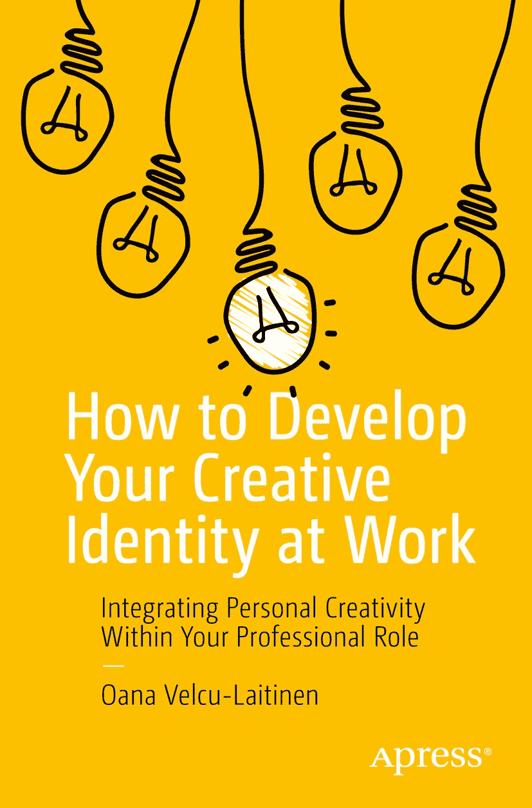
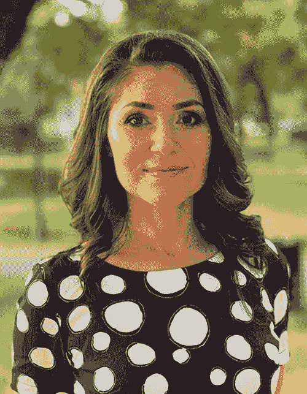
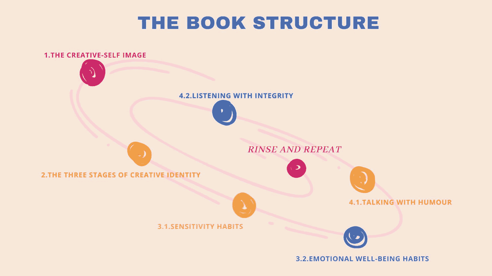

ISBN 978-1-4842-8679-1

电子版 ISBN 978-1-4842-8680-7

<`https://doi.org/10.1007/978-1-4842-8680-7`>

© Oana Velcu-Laitinen 2022

本作品受版权保护。所有权利均由出版商独家授权，无论涉及材料的全部或部分，具体包括翻译、转载、插图重用、朗诵、广播、以缩微胶卷或其他任何物理方式复制、传输或信息存储与检索、电子改编、计算机软件，或目前已知或未来开发的其他类似或不同方法。

在本出版物中使用通用的描述性名称、注册商标名称、商标、服务标志等，即使未作明确声明，也不意味着这些名称可免于相关保护法律和法规的约束，因此可自由使用。

出版商、作者和编辑均假定本书在出版之日所提供的信息和建议是真实且准确的。出版商、作者或编辑均不对文中材料可能存在的错误或遗漏承担任何明示或暗示的担保责任。出版商对已出版地图中的管辖权主张及机构隶属关系保持中立。

本 Apress 印张由注册公司 APress Media, LLC（Springer Nature 旗下）出版。

注册公司地址：1 New York Plaza, New York, NY 10004, U.S.A.

*谨以此书纪念我的祖父母玛丽亚和科林，他们是我生命中最初的创意人格。*

*献给所有将在此书中找到指引的创意人格。愿你们塑造世界、改善他人生活，如同我的祖父母点亮我的童年一般。*


# 引言

## 重新审视你对工作角色的承诺

> *时间宝贵。我们必须选择如何度过一生。*
> ——亚历克斯，8 岁

迄今为止，你在人生中做过的最关键的选择是什么？

小时候，你身边的一些成年人一定问过：“你长大后想做什么？”后来，在青少年时期，你必然通过寻找“我是谁？”、“我一生应该做什么？”、“我想成为什么样的人？”等问题的答案，进一步探索了这个问题。

现在你已三十多岁，拥有一个身份角色，却总觉得缺少了什么。这不再是关于声望或个人财富。你对这些都已满足。你所缺失的是将全部能量投入到工作中。你常常思考：“我本可以做出其他什么教育选择？”发生了什么？年轻时的自己选择了一条高等教育路径，却对那个选择缺乏强烈的情感依恋。

心理学家埃里克·埃里克森——因其关于整个生命周期中身份发展的研究而闻名——认为健康的个体会经历八种心理社会危机，这些危机是个人成长的阶梯。^(¹) 在青春期，我们经历了第四阶段的心理社会危机，在此期间，我们尝试不同的信仰、社会角色和对未来的设想。当我们发展出个人身份感时，问题就解决了。然而，在 20 多岁时，职业身份的确定并非总能达成。

允许自己探索你是谁，并致力于你能成为谁，可能会产生四种身份状态形式，其中两种是本书感兴趣的内容——**身份达成**和**身份早闭**。^(²)

你是否遇到过那些觉得自己是合适的人在合适位置的职场人士？这类人享受着身份达成的心理状态。它源于早期对某种特殊兴趣的认同，例如作为学生时对手工艺术的热爱，或对文学技能、数学、科学的喜爱。对他们而言，决定在大学发展哪些技能和知识更为容易。从此，职业身份也随之塑造。^(³)

但并非所有青少年都有机会围绕自己的创造潜力——即导致原创作品产生的认知能力、人格特质和对知识领域亲和力的组合——来探索和发展自我意识。心理学家将这种情况称为身份早闭，这可能是你多年来所维持的身份状态。^(⁴)

你选择专注于某个特定领域的动机是什么？是因为这个职业在社会上重要且受人尊敬？是因为它能确保经济稳定？是因为你迷恋未来自己在那个角色中的想象？还是因为你根本不知道自己在做什么？

即使对于我们中最独立的人而言，我们年轻时的教育偏好也受到某位家庭成员、老师或朋友的影响，你们之间基于情感联系和钦佩有着特殊关系。结果，你过早地确定了一项专业能力，这反映了你对那个你高度敬仰之人价值观的忠诚。你继续致力于某一行业，同时不断向自己合理化当初的选择，例如“回头太晚了，我必须继续走下去”。然而，你的潜意识对于你可能成为什么样的人仍感不安。

你长大后想做什么？本书邀请你考虑定制自己的职业角色。你的核心竞争力可能在于科学、工程、技术咨询或其他不被视为顶级创意领域的行业。但如果童年时你对阅读、绘画、唱歌、历史等曾有过中断的兴趣，那么作为一个成年人，你可以做出的一个重要选择就是**以专家的身份重新找回你的创造力。**

这并不意味着你应该立刻辞职去为新专业腾出空间。相反，你可以首先将更多创意兴趣带入任务执行中，例如，在工作中使用你的表演技巧进行演示。当你根据当前生活状况探索创造潜力时，你会找到令人惊讶的个人能量来源。再次强调，这关乎积极重塑你的工作环境，以便缩小你作为创意人的自我感知与对你所做工作的情感依恋之间的差距。同样，你也可能对某种颠覆性兴趣产生喜好，比如在 TED 演讲中就某个无法与当前工作任务融合的兴趣主题发表讲话。在这种情况下，你将准备进行职业转型。

## 重新审视你对自己创造力的重视程度

允许自己吸纳所爱或所敬之人的思想，这是人之常情。亲近之人潜移默化地塑造了你的职业选择，这也是人性使然。尽管这些人真诚且心怀善意，但他们可能在无意识中引导你走向他们的价值观，而远离了你自身的创造潜能。

如果“创造力”这个词让你既感到兴奋又自觉不配，这便是一个信号：你或许会受益于迈出第一步，以创造性个体的身份踏上自我实验的旅程。

你的创造力远非过往经历让你相信的那样狭隘。从 1 分（*完全不同意*）到 5 分（*完全同意*）^(⁵)，你在多大程度上认同以下三种说法？

- “我的创造力是我自身的重要组成部分。”
- “我愿意经常处理那些需要创造性思维的问题。”
- “我愿意从事那些能让我感到内在驱动力的项目。”

如果你的平均得分在三分或以上，那么你已经准备好去探索如何展现你潜在的创造力了。

你可以带着同情与感激回望过去。并对未来充满好奇。你那被封闭的自我定位并非一成不变。借助更深刻的经验与事实认知，以及更新后的人生境遇，你能够忠于自己，并从此刻开始探索你被忽视的创造性侧面。

我们身处 2020 年代，创造力与原创性和主动性一起，被视为就业市场上最顶尖的未来技能之一。^(⁶) 具备创造力似乎是解决问题与创新、保持情感健康以及在成年生活中获得全面成功的关键能力。

从整体上看，我们似乎都认同向创造力敞开怀抱的益处。然而，魔鬼往往隐藏在那些隐晦的想法和感受细节之中。在个体层面上，我们对自身与个人创造力之间关系的理解，远没有我们以为的那么深刻，部分原因在于那些在各种教育和组织文化中根深蒂固的刻板印象与偏见。

特别是，内隐的创造力偏见会驱使我们做出自我伤害的行为，而我们却意识不到它们正在限制我们的职业选择。结果，我们剥夺了自己在所选工作中优先发挥创造潜能的可能性。当个人创造力被误解时，创造的动力就会被阻塞。

一种疏离感和无望感可能是创造力未得到充分发挥的症状。你多年从事某种工作，在理智层面理解其价值，但在情感层面却感到这是一种妥协。你可能在想，“我想为世界带来一点改善。但我就是不知道该从何处着手。”

你想接受一项创新挑战，让你觉得自己正在帮助世界发展。自己创业？担任领导职务？在创新领域扮演核心角色？开辟一条创意职业的新专业？

那会是什么呢？哪一步能让你踏入那些创造性守护生命的洪流之中？

在每个富有创造力的人心中，都存在着一个“存在者”和一个“行动者”。存在者扎根于生命能量之中，带来创造力、智慧与直觉。行动者则负责处理实际事务，比如设定目标、制定计划和采取行动。

当存在者与行动者和谐一致时，生活感觉良好。你感到自在舒适，并拥有深刻的成就感。反之，当行动者不顾存在者而自行其是时，不满、疲惫和无望就会成为日常的情绪菜单。

你或许能胜任当前角色相关的任务。然而，完成这些任务让你感到毫无灵感。探索你与自身创造力的关系，能够为你下一个项目提供可操作的洞见。诀窍在于辨别那些新的活动，在这些活动中，你所运用的技能与你内在的创造性存在是协调一致的。

我们被告知，富有创造力的人往往愿意在冒着显得不那么能干的风险下，去测试新想法。^(⁷) 富有创造力的人有勇气经历反复试错，直到找到能承载其创造力的环境。富有创造力的人的主要动力来自于在尝试有意义想法时感受到的“活力感”。领导力沟通专家约翰·贝茨的创业历程便是一个例证。

```
“从我成年后的整个人生起，基本上从 1994 年开始，我就背负着大约一万五千美元的债务。还有价值数百万美元永远无法变现的无用股票。我是所有这些不同公司的布道者，周游世界。非常有趣、很酷，但我总是负债累累。然后这一切都枯竭了。我创办了这个公司，当时我承认自己可能赚不到什么钱，这可能不是个好主意，因为还有其他各种意见。但我知道我在提供价值，因为我曾免费做 TEDx 活动时看到了我所提供的价值。我当时想，‘我知道我能在这方面有所作为。我知道我能提供价值，所以我无论如何都要去做。’头一年半，我的债务进一步增加。到了第二年，情况开始看起来或许还过得去。第三年，我赚的钱比我此生任何时候都多。第四年，我翻了一番。第五年，我翻了三番。我们现在已经是第七年了。是的，赚钱很棒，不必为钱发愁。这对我来说已经是很久远的事了。我为此挣扎了那么久，它却让我无法专注在我能带来的改变上。

但对我来说，真正重要的是这个。我意识到，当我作为创业者只专注于赚钱，想着‘哦，这个能赚钱’时，我负债累累。当我将焦点稍微转向‘我如何能提供最大的价值？’时，虽然并非一蹴而就，但我确实开始赚钱了。

所以，对我来说，人生中最快乐的事情之一就是，我从未感觉到自己能向他人提供如此有价值的东西。你知道，这真是巨大的满足感？而金钱只是记分牌。真正的比赛是在赛场上，在于产生实实在在的影响。如果我做到了这一点，分数自然会以金钱的形式显现出来。但这并不是目的。这才是目的，就在这赛场之上。这说得通吗？”
```

尽管活力与成就感的前景听起来很诱人，但你或许仍然认为自己并非冒险家。当你看到自己能为自己做些什么时，你对自己发展出能产生影响力的想法的信心便会建立起来。本书旨在帮助你理解并相信你作为创造者所拥有的选项。每一次选择都会增强你的创造性胜任感。

## 为何本书能为你带来启发？

若以 1 分（*从未想过*）到 5 分（*满怀期待*）来衡量，你有多大意愿优先花时间理解自身创造力的微妙特质？

通常，探讨创造力的书籍会围绕“如何在工作中更具创造力？”这一问题展开。这与我设计的创造力课程遵循的思路如出一辙——核心在于培养助力长期创造力的思维技能：想象力、灵感和直觉。

而本书则深究以下问题：“为何我们拥有创造潜能却未能付诸实践？”以及“我们该如何打破自我设限，认清自己所能创造的价值？”下面是一位课程参与者（一位专攻复杂疾病遗传学的医学研究者兼医生）的反馈：

“我从课程中获得的关键启示之一，便是认识到培养提升创造力的习惯至关重要。此前我从未想到习惯在创造力领域中扮演如此重要的角色。此外，我还进一步理解了趋近动机与回避动机的影响、游戏在科学中的裨益，以及与他人分享想法的优势。”

的确，有利的环境对于培养知识工作者的创造型身份至关重要。对于部分高精尖人才而言，挑战在于他们可能感觉工作环境“迫使”他们采取抑制个人创造力的行为方式。另一些人则可能认为，心怀恐惧才是最佳表现之道。因此，个人信念决定了我们在多大程度上能于环境中发现施展个人创造力的契机。

信念塑造习惯。思维习惯——比如出于好奇而投入任务，还是因恐惧失去工作或晋升而参与活动——决定了我们将成为怎样的人。我们对自己的认知影响着习惯，而习惯又反作用于信念。由此，信念与工作身份之间形成了由环境中介的螺旋效应。

写作此书的愿望，在五年创造力培训课程的引导中逐渐成形并不断强化。我注意到某些认知偏见阻碍了我们在工作中养成融入个人创造力的习惯。我不禁思考：若每个人都能更准确地理解个人创造力的多元特质，将会带来多大的裨益。

我观察到一种大多数人都有的倾向——固着于固有的思维模式与信念。创造性意味着愿意重新审视这些模式中的某些部分。然而，对大多数人而言，放弃一个核心观点——即便只是几分钟的思维练习——也可能如同在跨越深渊时松开绳索。

诚然，在每个专业领域，都有构成现有知识基础的基本假设。同样，在每个社交网络中，基本规则都需要被尊重。但是，如果我们无法在替代情景练习的短时间内灵活地搁置坚定持有的信念，那么我们便对创造力关上了大门，创造新知识的空间也就所剩无几。更不用说，我们剥夺了自己体验创造力的机会——那种自我发现与知识发现的喜悦。

我课程中的一位参与者曾告诉我：“如果我做这个练习（假设性思维情景），我会开始质疑我所知道的一切。”另一位参与者则好奇正念冥想是否值得花时间。我很高兴他们对我建议的创造性思维练习表达了迟疑。批判性思维是我们所能拥有的最佳能力之一。但批评背后隐藏着什么？是测试想法的好奇心，还是捍卫特定信念、安于现状的欲望？

因此，我接受了挑战，回顾了关于我们的信念、思维模式与身份如何影响创造动机与成果的研究。^(⁸) 此外，我还采访了来自不同领域的专业创作者，了解他们如何看待自身的个人创造力。

要让自己感觉是一个在合适岗位上工作的创造性人士，你需要做出哪些不同的改变？为了从封闭的身份走向实现的自我身份，你或许希望探索如何有意识地在环境中展现你的创造力。

在埃里克森的理论中，“实现的自我身份”意味着在青春期探索过不同兴趣，并在成年早期专注于其中一种的状态。此处，“实现的自我身份”特指意识到自己是一个创造性的人，并有意识地选择在专业水平上测试自己的创造潜能。三个问题将伴随你的转变：“什么是可能参与、什么是不可能参与的？”“来自哪些领域的什么想法能激发我的灵感？”“我在工作角色中采取了哪些创造性行为？”

这些正是本书探讨的问题。你的创造性实践越多样化，就越有可能理解个人创造力千变万化的本质，并体验到你内在的创造主体与行动者之间的共生关系。

总而言之，本书为你提供了一次内在反思的契机，助你认清自己是何种类型的创造者、身处创作者旅程的哪个阶段，以及可以开始做出哪些不同的改变来实现成长。

## 创造力与创造性自我偏见

生而为人，活在地球上，就是在不断积累刻板印象和偏见，这些因素会将我们的注意力引向特定信息，并据此做出决策。刻板印象是一个群体成员对另一个群体（如职业、种族、性别等）成员普遍持有的共同信念。偏见则是个人的信念，它由刻板印象滋养，要么夸大，要么贬低了关于某个人或某个情境的真相。

“我喜欢这个解决方案。”

“我不喜欢这个解决方案。”

“这个问题很有用。”

“这个问题没什么用。”

同样地，我们对创造力的意义和价值也抱有偏见。挑战在于要意识到那些让我们固守于特定方式看待世界和自身的偏见。各种各样的误解，比如认为创造力是稀有的天赋^(⁹)，会让我们对以下问题感到困惑：

-   谁是有创造力的人？

-   什么时候需要创造力？

-   哪些重要问题值得去研究？

在看着儿子们成长的过程中，我注意到他们会自发地展现出创造性思维和行为，比如把皮塔饼吃成战斗号角、小船、大拇指等各种形状。我很好奇他们对自己创造力的认知程度，于是第一次与我当时 8 岁的大儿子进行了一场关于创造力的对话。

“谁是有创造力的人？” 我问道。

“爱因斯坦，” 他毫不犹豫地回答，“他创造了物理学，他是物理学领域最棒的。”

他为什么会认为一个有创造力的人就是天才？而且不是那种被淹没在第二名阴影里的天才，而是人尽皆知的天才。确实，谁没听说过爱因斯坦和他的相对论呢？如今，我们生活在一个被他的理论所塑造的世界里，这些理论催生了光电电池、激光、核能、光纤和太空旅行。^(¹⁰)

因此，我们通常根据一个人原创性的成就来识别其创造性。而开创性的成就必然需要超凡的智慧。那么，一个智力中等的人也能有创造力吗？研究表明，在智商达到 120 左右之后，对于产生更多创造性想法而言，像动力和智慧这样的人格因素比智力本身更重要。^(¹¹) ^, ^(¹²)

“培养个性很重要，” 爱因斯坦说过，“因为只有个体才能产生新思想。” ^(¹³) 确实，个体创造力被视为 “一切创新的种子”。^(¹⁴) 所以，不必为自己不是房间里最聪明的那个人而烦恼。相反，应该专注于寻找你的创造性动力。

不妨多问问自己，“什么能让我体验到惊奇？” 在爱因斯坦革命性思想的背后，是对宇宙法则的迷恋，以及他相信科学家的使命是发现自然界根本和谐的信念。

一个有创造力的人会带着神秘和敬畏感看待现实的方方面面。然后，他们决定对此做些什么。在成为科学家之前，爱因斯坦是瑞士的一名专利局职员。从他与朋友康拉德·哈比希特的通信可以看出，1905 年 5 月至 6 月期间，爱因斯坦决心在业余时间撰写四篇学术论文。^(¹⁵)

有创造力的人不仅更善于识别值得关注的问题，他们还会腾出时间去寻找答案。例如，爱因斯坦在 1905 年计划写的第一篇论文是关于光的能量特性。第二篇论文是关于确定原子的实际大小。第三篇论文是关于液体中微观粒子的不规则运动。第四个想法则促成了一篇关于运动物体电动力学的草稿。

爱因斯坦在写信给朋友谈及这四篇论文的计划时并不知道，同年他还会写出第五篇论文。这是对第四篇论文的补充。它讨论了能量与质量的关系，从而导出了物理学中著名的方程：`E=mc2`（物体的能量等于其质量乘以光速的平方）。在这个狭义相对论公式出现之前，质量和能量被认为是截然不同的实体。有创造力的人将“如果……会怎样”的问题转化为具体的实验项目，这为他们打开了创造性成就的新可能性之门。

爱因斯坦是如何运用他的创造力的呢？他头发蓬乱，眼中充满人性，是一个极富想象力的人。他主要通过思想实验，而非实验室里的归纳法，来发现其理论背后的原理。早在 16 岁时，他就想象过自己骑在一束光旁边会是什么样子。

往好了说，创造力偏见可以激励我们。但是，如果富有创造力的人能积极地改变世界，难道你不想成为为他人进步铺平道路的人之一吗？

继续与儿子的对话，我问道：“你个人认识的最有创造力的人是谁？”

沉默。

“你的老师怎么样？” 我提示他。

沉默。

“或者某个朋友？你自己呢？”

我儿子沉默得像条鱼一样。

往坏了说，那些关于成为有创造力的人需要什么条件的先入为主观念，会阻碍我们认识到自己的创造潜力。如果创造力强的人都是聪明、自律且富有想象力的，那么谁敢这么看待自己呢？除了对与我们直接互动的有创造力的视而不见之外，我们还可能对自己的原创想法能力抱有偏见，而且是消极的偏见，比如 “我不够有才华，无法……”

关于你的创造能力，了解什么可能是有意义的呢？考虑到当我问起我儿子认识哪些有创造力的人时他一脸茫然的样子，我一定是触及了他内心对创造力的隐含信念。^(¹⁶) 有没有可能，是某些任务或人让我们感到有创造力，但我们还没有机会去接触这些任务或人？

问题不在于你是否是一个有创造力的人。问题在于，是哪些自我偏见阻止你表达自己的创造力？例如，“我不够有才华，没法就这个话题写博客……”，或者 “我不够有天赋，学不会编程……”，或者 “我不够幽默，讲不了笑话……”，等等。如果你反其道而行之，不去遵循消极的创造性自我偏见的指引，你会去从事哪些活动呢？

在各自领域里做到最棒，这应该是你最不必担心的事情。相反，你的关注点应该放在成为一个被某种创造性活动深深吸引的人。

### 创作者被新奇事物所吸引

> *我不明白人们为何害怕新想法。我害怕的是旧想法。*
>
> ——作曲家约翰·凯奇

也许你不会提出能与相对论相提并论的理论。但话说回来，在尝试之前，你永远不知道自己能创造出什么。正如上面引文所言，你可以从主动创造一些小规模的事物开始，比如一个小工具、一本书、一次演讲、一门课程，或一场建设性的对话，为某个情境带来新意。新意意味着对先前已达成共识的事物引入视角上的改变。然而，人类大脑对确定性有强烈需求。作为一个创作者，你是在挑战他人对“什么是可能且适当”的既有信念。是什么驱使着我们中一些人让自己置身于打破他人熟悉感的境地呢？

事实上，人类似乎是通过神经系统的发展而进化的，当我们创造事物时——哪怕是画画、讲故事或烹饪这样的小事——这个系统会激活大脑中的愉悦中枢。^((17)) 这就是创作者的亲身经验。

让我们来做下面这个练习，好吗？请花一分钟时间完成下方的画作。让你的想象力自由驰骋。

```
[画作描述/示意图区域]
```



奥娜·韦尔库·莱蒂宁的照片。

感觉如何？这幅画是我在主持培训时最喜欢的暖场练习之一。我最享受的是看到参与者展示他们完成的图像时的那份喜悦。我们都能在发现新的创造方式时感受到喜悦。但我们可能并未意识到创造的乐趣，要么是因为我们还没有机会找到合适的环境，要么是因为我们更倾向于从众。^((18))

心理学家米哈里·契克森米哈赖假设，我们是那些欣赏好奇孩童并保护他们，使其能长大成人并繁衍后代的原始部落的后裔。^((19)) 例如，假设你喜欢不按食谱做菜，或者愿意尝一种新的冰淇淋口味（尽管有点怀疑），或者在没有谷歌地图导航的情况下漫步于一座新城市，那么你很可能拥有史前时期的`“我能看到参与新体验之美”基因`，这凸显了你内在的创作者倾向。本书将帮助你意识到习惯和个人特质的改变，这些改变有助于你发现新的兴趣和滋养性的环境。

到目前为止，我们讨论了作为内部障碍的内隐偏见，它们会让你困惑于自己能开启何种形式的创作。那么，哪些品质能使你胜任专家创作者这一新角色呢？

### 探索你的创造潜能需要行动的责任感与学习的谦逊

如果以 1 分（`像个破洞的硬币一样无望`）到 5 分（`像云层中透出的阳光一样充满希望`）来衡量，你认为自己在感兴趣的领域参与并创造，其可控程度有多少？

如果你的分数很低，不必惊慌。通常情况下，对自己创造能力缺乏信心，可能会 override 参与创造活动的决定。

人本主义心理学家亚伯拉罕·马斯洛在其笔记中提到了`“对自己伟大的恐惧”`或`“逃避自身最佳天赋”`。^((20)) 这指的是人们普遍恐惧去充分发展我们在最完美时刻所瞥见的潜能。

当阳光照到你街道的那一天，第一个让你的工作与你创造潜能对齐的机会就触手可及。想象一下，有人给你一个临时领导项目、参与初创项目或内容创作任务的机会。你内心却在颤抖，对现有的任务感到舒适。对工作生活的不满感觉起来竟然有点“甜蜜”。马斯洛称这种逃避成长的倾向为`约拿情结`。

约拿是谁？《旧约》讲述了上帝选派约拿去向尼尼微城居民传道的故事。^((21)) 但约拿觉得自己无法胜任告诉尼尼微人——上帝认为他们的邪恶已太过分，悔改会有好处——这项任务。那他做了什么？约拿登上一艘船，朝着与尼尼微相反的方向航行，企图逃离上帝。航行途中，一场风暴爆发。约拿被抛下船，被一条“大鱼”吞入腹中。

正如约拿逃避自己的命运一样，我们也逃避自然或机遇所赋予的责任。如果我们故意回避，不敢成为本可以成为的样子，通过设定较低的抱负，我们就是在向停滞不前的状态投降。

至于约拿，他最终确实实现了自己的潜能。在大鱼腹中待了三日三夜并祈求解救后，约拿被吐到干地上，从此他致力于找到前往尼尼微的路。

对于我们其余关心在世界上改进或创新的人来说，我们的命运可能与约拿相似。我们需要长期与自己进行诚实的对话，直到识别出一种好奇心——艺术的、智识的、创业的、科学的等等——获得在相应领域表现的信心，并致力于`释放作为创作者的最大潜能`。^((22)) 这需要愿意与自己合作并与世界协商。这是为履行创作者的召唤而承担的责任。在此过程中，我们将学会`何时该谦逊，何时该固执`地对待我们选择参与的创意项目。学会`何时积极投身创作，何时保持耐心，为下一次行动做好准备`。

例如，我儿子让我经历了一次谦逊的考验。有一天，我正在写这本书的新段落，隔壁房间传来砰砰声。我过去看发生了什么事。他正在沙发上跳上跳下，玩室内跑酷。在我对写作不满的背景下，我以一种自以为高人一等的家长权威训斥他：“请你安静点好吗？我正在写书。”

他反驳道：“如果你不写你的书，会发生什么？”

“别人会写，” 我咕哝着，被这个问题吓了一跳。

我回到写作室，思考自己为何如此不遗余力地专注于写作。如果别人也能做，那我是不是应该靠边站？

# 关于创作的思考

我想这也是其他创作者的共同体验。我们都会经历谦逊的时刻，对某些人而言，这反而促使我们固执地选择继续创作，而不是投身其他职业领域，无休止地重复过去做过的事。随着创作决心不断更新，大大小小的障碍便会显现，既有内在的壁垒，也有外在的阻挠。尽管如此，坚持创作的决心仍是一种美德。

*“人微不足道，作品才是全部”*——小说家古斯塔夫·福楼拜在 1875 年 12 月与乔治·桑的书信中写道^(²³)。*“个体无足轻重，艺术作品才是一切。”*当一件新产品——无论是书籍、歌曲还是发明——完成时，它便向所有有兴趣与之互动的人敞开怀抱。创作行为就此终结，而消费产品之人的创造性投入就此开始。

让我们以书为例。从读者的角度来看，是谁写了一本让他们欣赏、并为他们开启全新情感与认知的书，这并不重要。然而，从作者的角度来看，写作是一个自我蜕变和与所产生思想亲密接触的过程。

无论你怀有怎样的创作抱负，当创作型人格与正在从事的工作之间形成一致时，便会出现一个自我发现与成长的过程，推动你不断逼近个人技能与自我认知的上限。

最后，投身成为一名创作者本身就是一种塑造品格的经历。成功与被拒都是不可避免却又宝贵的经历。你或许想学会如何不为赞美所陶醉，同时也要学会如何保护自己免受严苛批评的伤害。你可能永远无法完全掌握这种谦逊的技能，但将其作为一个成长理想是值得的。

## 约拿的故事与使命

从某种意义上说，约拿接受赋予他的使命的过程更为顺畅。他能听到上帝之声，清楚上帝为他选定的角色，也知道他应当服务的群体。约拿的挑战在于建立对使命的信任。

我们应将上帝的信息理解为一个隐喻，它代表着有抱负的创作者领悟到自身使命就是创造的那一刻。在巨鱼腹中度过的时光，是协商与接纳的过程。而被吐到旱地上，则是你相信自身使命、相信自己有能力尽力完成任务的第一缕征兆。

在现实生活中，建立对创作之选的信任要艰难得多。起初，挑战在于你学会相信自己的冲动和直觉，即使没有客观证据表明你的创作行为是最明智的选择。

随着经验积累，你锤炼出敏锐的嗅觉，去找到适合你创作行为的媒介以及将从中受益的人。在约拿的故事中，目的地至关重要，尽管它并非核心。你知道你的尼尼微在哪里吗？

你的尼尼微，是你的创作兴趣与某个工作场所或社群特定需求相交汇的地方。它并非一个物理地点，而是一个心理空间——在这个空间里，你身体的每一个细胞都确信，你的使命是为某个兴趣领域带来新意。

建立属于你自己的空间去尝试可能的创作，这本身就是一个创造过程。在这个过程中，觉醒的创作者超越当前的自我，去拥抱创造力的全部潜能。

这个世界幸运地拥有艺术家、活动家、企业家、哲学家、科学家以及各类细分领域的专家，以满足社会、经济和文化发展的多样化需求。如果你能自由选择成为这些创作者中的哪一位，那会怎样？你更愿意成为谁？

如果你被邀请登上 TED 的舞台，谈论你希望改善现实的某个方面，那会怎样？你能在毫无准备的情况下讲上 15 分钟的主题会是什么？

你有两个选择：在一个你需要从头开始学习新技能、并作为创意专业人士获得认可的全新领域起步；或者，在一个你已经具备良好能力水平、且在特定角色中获得认可的领域，发起一项创造性倡议。


## 个人创造力发展的三个基本假设

我和大儿子开启的关于创造力的对话显示，对他来说，一个富有创造力的人就是天才。然而，他并不认为身边其他任何人具有创造力，于是我问他：“当你想到自己的创造力时，你会想到什么？”

他回答说：“创造力就是我在《几何冲刺》^(²⁴)里创造我的世界，而且我变得很擅长。”

接着，我转向当时六岁的小儿子，问了同样的问题。

他脱口而出：“我的创造力就是画画，就像我在托儿所里做的那样。”

在这些简洁的表述中，我们已能注意到三个重要的信念，它们决定了一个人对个人创造力的自我认知水平。有一项活动、一种感觉和一个物理场所，让我们认为自己是有创造力的：^(²⁵)

*   有一项活动让孩子们感到有创造力，并乐此不疲地参与其中——画画或玩平台游戏的创造性活动。

*   他们认为自己有能力完成所需的任务——我的大儿子认为自己擅长以独特的方式组合《几何冲刺》中的元素，并能在这个快速变化的游戏中自发应对障碍。

*   对环境的认知——无论是托儿所还是家中——在那里他们感到安全，可以获取可用资源并运用创造力。

如果你像我儿子一样，那么当你把大部分闲暇时间花在某种创造性爱好上时，你会感到愉悦，例如表演艺术、手工艺、视觉艺术、创意烹饪、文学、音乐、室内/园林设计以及科学/技术^(²⁶)。创造力研究文献中的一致发现表明，人们出于明确的个人原因（如享受乐趣、振奋精神、获得能力感或感到被认可）而热衷于从事特定的创造性活动。

此外，在职业角色中发展你的创造潜能，意味着有意识地选择在工作环境中实践特定的创造性活动。在这种情况下，你的动力可能会因一种隐含的假设而受到抑制：要么你认为没有哪个创造性活动能让你达到专业水准并脱颖而出，要么你找不到任何能支持你——无论是情感上、经济上还是资源上——去创作的环境。那么，什么能帮助你认识到自己在工作中参与创造性项目的动力基础呢？

# 本书结构

本书将深入探讨创作者的**心理发展历程**。为此，我们将阐明哪些习惯有助于引导你专注于新的个人创举。本书将围绕以下四个主题展开：

1. 创造力与你的活动之间的契合度。
2. 学习像创作者一样生活。
3. 为创造性洞察力做好思维准备。
4. 培养创造性的沟通风格。

一个健康的个体，是一位走在创造性自我探索正确道路上的*真正*创作者。本书所描述的旅程如图 1 所示。



下图展示了本书的结构：创造性自我形象、创造性身份的*三个*阶段、敏感性习惯、情绪健康习惯、幽默地交谈、真诚地倾听，以及循环往复。

**图 1** 本书结构

对创造力最普遍的定义是，做出不寻常联系的能力，从而产生新颖、出人意料且有价值的产品。在本书中，创造力被定义为：在能够唤醒你意义感的某个知识或经验领域中探索兴趣的灵活性，以及保持专注并创造新事物的韧性。

在第一部分中，我们将探讨你如何看待自己的创造力为何重要。^(²⁷) 你理解自身创造力的方式，定义了你所过的生活。

当创造力被理解为一种行为方式时，审视你对自己好奇心、冒险精神以及能够激发最佳创造力的环境所持有的理所当然的看法，可能会有所帮助。

如果你在当前的角色中展现出更多的想象力和好奇心会怎样？那又会是什么样呢？

我们将讨论关于恰当工作行为的新信念如何能够激发新的行动，从而重拾你的创造力、精力和热情。

在本书的第二部分，我们将描绘作为专业创作者在发展历程中需要经历的三个心理里程碑。

创造力研究者们似乎达成了一个共识：在科学和艺术领域，任何重大的创造性工作都需要在特定知识领域发展专长长达十年之久。^(²⁸)

最受赞誉的创造性行为发生在创造性自我发展的第三阶段，即“`立业期`”。在此之前，不断发展的创造性自我会经历学习、收集印象以及利用颠覆性思维的过程。有两个尝试时刻值得一提。

第一个时刻是邂逅那个激起你好奇心想法或对象的瞬间：“哦，这是个迷人的话题！我想了解更多。”

第二个时刻是*令人崩溃的*自我怀疑声音变得响亮的时候：“我*为什么*想创造？”

要达到第三个发展阶段，与那些使你在创造行为中站稳脚跟的心理需求建立联系至关重要。

思考创造力的另一个视角是将其视为“看见的能力”以及“对所看见之物采取行动的*欲望*”。本书的第三部分是关于以不同的眼光看待环境。它是围绕你的创造性敏感性形成新的思维习惯，这将引导你的注意力转向创造的机会。

同时，情绪健康是看见你前所未见之物的关键促进因素。因此，我们将讨论如何管理向新的创造过程敞开时所带来的脆弱感。

成为一名创作者，既关乎个人层面的颠覆，也关乎与合适之人的社会互动。令人信服地描述你的原创想法，是对你萌芽中创造性身份的考验。本书的第四部分是关于让你的创造个性在你沟通想法的*方式*中闪耀光芒。

直接沟通由倾听和表达组成。我们将讨论一种特定的倾听方式——为获得灵感和想象力的倾听。此外，我们还将详细阐述哪种*幽默*能够增强他人对你正在进行的工作提供良好见解的动机。

本书提供了一个向内反思的机会，让你思考：你是哪种类型的创作者？你在创作者的旅程中身处何处？你可以开始做出哪些不同的改变来促进自身成长？

让我们从三个关于你创造潜能发展历程的热身问题开始：

1. 在你最近接触过的所有专业人士中，你最敬佩的是哪些人？
2. 他们身上的什么东西给你留下了印记？
3. 你经历过哪些职业转变（如果有的话）？


## 致谢

作家生活在一个能够促进他们坐下来写作的社群中。随着我写作的进展，我的社群也壮大了。公允地说，我将按照时间顺序表达我的感谢，因为不同的社群成员对我*开始*并*完成*本书的承诺做出了各自的贡献。

一切始于 2017 年，当时一位刚出版处女作的朋友对我说：“**现在轮到你了**。” 我想：“我？一边抚养两个学龄前孩子，一边发展独立咨询业务的同时写书？”

然而，这句“现在轮到你了”的话还是时常在我脑海中回响。尤其是在我主持培训，注意到聪明人如何误解他们自己的创造力时；以及，当我阅读一些关于创造力的研究论文，感觉想为这个话题增添自己的视角时。于是我想：“*为什么不呢*？” 我为什么不能写一本关于创造力心理学的书呢？因此，我要感谢 **奥斯卡·桑托拉利亚** 激励我书写这个我热爱的话题。

2019 年，我开始动笔写作，并前所未有地体验到了同一天内的*高峰*与*低谷*！衷心感谢我的丈夫 **特罗**，他无数次中断自己的工作来充当我的禅宗导师。我也感激我的儿子们，**克里斯蒂安** 和 **亚历克斯**，他们坚定地跟进我的进展：“妈妈，你今天过得怎么样？” 他们知道我曾花时间处理他们之间的冲突。最后，我感谢我的三位好友，**劳拉·阿兰兹-阿佩尔特**、**索拉娜·纳吉** 和 **乔安娜·林登-蒙特斯**，感谢她们在最初的写作阶段为我加油鼓劲。

不进行自己的研究，你是无法写出一本书的。因此，我感谢那些同意抽出宝贵时间接受我关于其与创造力关系采访的魅力专业人士：**马蒂亚斯·库皮埃宁**、**达莎·皮尔斯**、**文森佐·塞鲁洛**、**赫尔德·桑托斯**、**约翰·贝茨**、**哈里特·法格霍尔姆**、**奥斯卡·桑托利亚拉**、**帕梅拉·汤普森**、**彼得·伊万诺夫** 和 **图利亚·洛佩斯**。他们的工作并不轻松，但他们优雅地应对着。

2020 年，我完成了手稿的初稿。我感谢 **萨拉·库塞拉** 担任我的试读读者，而当时她正一边抚养三个孩子，一边完成她的生物医学博士学位论文。此外，我要向 **尼古拉斯·巴尔卡扎尔** 表达感谢，他耐心地校对了具有学术风格的第二个版本。

我感谢我的妹妹 **路易莎**，她自始至终给予我热情的支持，特别是帮助我下定决心寻找出版商而非自行出版。其次，我感谢我的母亲 **索菲亚**，她提出批评意见，促使我从读者的角度思考。最后，我感谢我的阿姨 **西尔维娅** 倾听我的最新进展，并保留她的评判。但我*感觉*她至少有一个想法——“在她*能*做的所有事情中，为什么偏要写书？”

当我开始向出版商推荐本书时，一个转折点是 **保罗·罗伯茨** 审阅了我的图书提案包。保罗是 Fifthday 的董事，也是 Jericho Writers 社区的编辑成员。不久之后，我开始与我的出版团队合作：**希瓦·拉马钱德兰**、**杰西卡·瓦基利** 和 **吉姆·马克姆**。是你们给了我能量，让我能够调整状态，以所需的创造力完成最后一英里——本书的最终修订。

**弗拉德·格拉韦阿努**，都柏林城市大学心理学正教授，于 2022 年 4 月以技术审阅者的身份加入团队。与他的对话为我的写作经历画上了圆满的句号，使我能够微调书中的章节，并开启了我对未来研究主题的视野。我感激弗拉德，他在自身职业和家庭生活发生变化的时刻，仍愿意承接这个项目。

最后但同样重要的是，我深深感谢那些其研究工作在本书中被引用的创造力研究者们。他们的研究震撼了我的世界！

如今，当我回首往事时，我意识到书中最好的部分都源于我从这些杰出人士*每一位*身上获得的启发。


## 关于作者


## 关于技术审阅者

## 脚注

1 2 3 4 5 6 7 8 9 10 11 12 13 14 15 16 17 18 19 20 21 22 23 24 25 26 27 28


