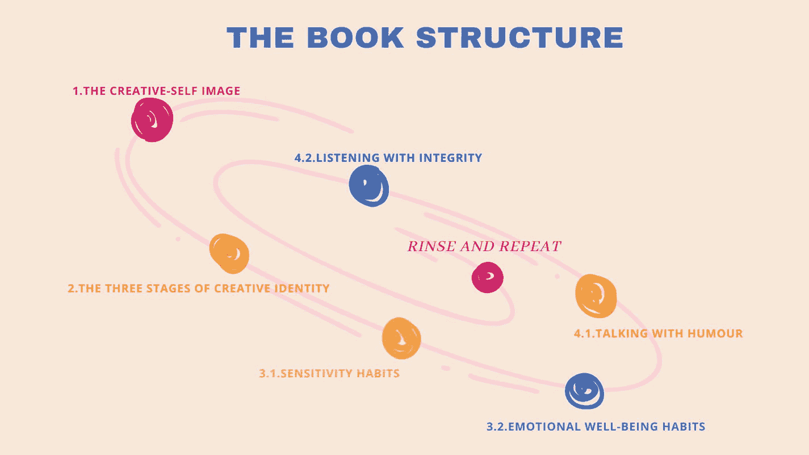

# 本书结构

本书将深入探讨创作者的**心理发展历程**。为此，我们将阐明哪些习惯有助于引导你专注于新的个人创举。本书将围绕以下四个主题展开：

1.  创造力与你的活动之间的契合度。
2.  学习像创作者一样生活。
3.  为创造性洞察力做好思维准备。
4.  培养创造性的沟通风格。

一个健康的个体，是一位走在创造性自我探索正确道路上的*真正*创作者。本书所描述的旅程如图 1 所示。

下图展示了本书的结构：创造性自我形象、创造性身份的*三个*阶段、敏感性习惯、情绪健康习惯、幽默地交谈、真诚地倾听，以及循环往复。

**图 1** 本书结构

对创造力最普遍的定义是，做出不寻常联系的能力，从而产生新颖、出人意料且有价值的产品。在本书中，创造力被定义为：在能够唤醒你意义感的某个知识或经验领域中探索兴趣的灵活性，以及保持专注并创造新事物的韧性。

在第一部分中，我们将探讨你如何看待自己的创造力为何重要。^(²⁷) 你理解自身创造力的方式，定义了你所过的生活。

当创造力被理解为一种行为方式时，审视你对自己好奇心、冒险精神以及能够激发最佳创造力的环境所持有的理所当然的看法，可能会有所帮助。

如果你在当前的角色中展现出更多的想象力和好奇心会怎样？那又会是什么样呢？

我们将讨论关于恰当工作行为的新信念如何能够激发新的行动，从而重拾你的创造力、精力和热情。

在本书的第二部分，我们将描绘作为专业创作者在发展历程中需要经历的三个心理里程碑。

创造力研究者们似乎达成了一个共识：在科学和艺术领域，任何重大的创造性工作都需要在特定知识领域发展专长长达十年之久。^(²⁸)

最受赞誉的创造性行为发生在创造性自我发展的第三阶段，即“`立业期`”。在此之前，不断发展的创造性自我会经历学习、收集印象以及利用颠覆性思维的过程。有两个尝试时刻值得一提。

第一个时刻是邂逅那个激起你好奇心想法或对象的瞬间：“哦，这是个迷人的话题！我想了解更多。”

第二个时刻是*令人崩溃的*自我怀疑声音变得响亮的时候：“我*为什么*想创造？”

要达到第三个发展阶段，与那些使你在创造行为中站稳脚跟的心理需求建立联系至关重要。

思考创造力的另一个视角是将其视为“看见的能力”以及“对所看见之物采取行动的*欲望*”。本书的第三部分是关于以不同的眼光看待环境。它是围绕你的创造性敏感性形成新的思维习惯，这将引导你的注意力转向创造的机会。

同时，情绪健康是看见你前所未见之物的关键促进因素。因此，我们将讨论如何管理向新的创造过程敞开时所带来的脆弱感。

成为一名创作者，既关乎个人层面的颠覆，也关乎与合适之人的社会互动。令人信服地描述你的原创想法，是对你萌芽中创造性身份的考验。本书的第四部分是关于让你的创造个性在你沟通想法的*方式*中闪耀光芒。

直接沟通由倾听和表达组成。我们将讨论一种特定的倾听方式——为获得灵感和想象力的倾听。此外，我们还将详细阐述哪种*幽默*能够增强他人对你正在进行的工作提供良好见解的动机。

本书提供了一个向内反思的机会，让你思考：你是哪种类型的创作者？你在创作者的旅程中身处何处？你可以开始做出哪些不同的改变来促进自身成长？

让我们从三个关于你创造潜能发展历程的热身问题开始：

1.  在你最近接触过的所有专业人士中，你最敬佩的是哪些人？
2.  他们身上的什么东西给你留下了印记？
3.  你经历过哪些职业转变（如果有的话）？

## 致谢

作家生活在一个能够促进他们坐下来写作的社群中。随着我写作的进展，我的社群也壮大了。公允地说，我将按照时间顺序表达我的感谢，因为不同的社群成员对我*开始*并*完成*本书的承诺做出了各自的贡献。

一切始于 2017 年，当时一位刚出版处女作的朋友对我说：“**现在轮到你了**。” 我想：“我？一边抚养两个学龄前孩子，一边发展独立咨询业务的同时写书？”

然而，这句“现在轮到你了”的话还是时常在我脑海中回响。尤其是在我主持培训，注意到聪明人如何误解他们自己的创造力时；以及，当我阅读一些关于创造力的研究论文，感觉想为这个话题增添自己的视角时。于是我想：“*为什么不呢*？” 我为什么不能写一本关于创造力心理学的书呢？因此，我要感谢 **奥斯卡·桑托拉利亚** 激励我书写这个我热爱的话题。

2019 年，我开始动笔写作，并前所未有地体验到了同一天内的*高峰*与*低谷*！衷心感谢我的丈夫 **特罗**，他无数次中断自己的工作来充当我的禅宗导师。我也感激我的儿子们，**克里斯蒂安** 和 **亚历克斯**，他们坚定地跟进我的进展：“妈妈，你今天过得怎么样？” 他们知道我曾花时间处理他们之间的冲突。最后，我感谢我的三位好友，**劳拉·阿兰兹-阿佩尔特**、**索拉娜·纳吉** 和 **乔安娜·林登-蒙特斯**，感谢她们在最初的写作阶段为我加油鼓劲。

不进行自己的研究，你是无法写出一本书的。因此，我感谢那些同意抽出宝贵时间接受我关于其与创造力关系采访的魅力专业人士：**马蒂亚斯·库皮埃宁**、**达莎·皮尔斯**、**文森佐·塞鲁洛**、**赫尔德·桑托斯**、**约翰·贝茨**、**哈里特·法格霍尔姆**、**奥斯卡·桑托利亚拉**、**帕梅拉·汤普森**、**彼得·伊万诺夫** 和 **图利亚·洛佩斯**。他们的工作并不轻松，但他们优雅地应对着。

2020 年，我完成了手稿的初稿。我感谢 **萨拉·库塞拉** 担任我的试读读者，而当时她正一边抚养三个孩子，一边完成她的生物医学博士学位论文。此外，我要向 **尼古拉斯·巴尔卡扎尔** 表达感谢，他耐心地校对了具有学术风格的第二个版本。

我感谢我的妹妹 **路易莎**，她自始至终给予我热情的支持，特别是帮助我下定决心寻找出版商而非自行出版。其次，我感谢我的母亲 **索菲亚**，她提出批评意见，促使我从读者的角度思考。最后，我感谢我的阿姨 **西尔维娅** 倾听我的最新进展，并保留她的评判。但我*感觉*她至少有一个想法——“在她*能*做的所有事情中，为什么偏要写书？”

当我开始向出版商推荐本书时，一个转折点是 **保罗·罗伯茨** 审阅了我的图书提案包。保罗是 Fifthday 的董事，也是 Jericho Writers 社区的编辑成员。不久之后，我开始与我的出版团队合作：**希瓦·拉马钱德兰**、**杰西卡·瓦基利** 和 **吉姆·马克姆**。是你们给了我能量，让我能够调整状态，以所需的创造力完成最后一英里——本书的最终修订。

**弗拉德·格拉韦阿努**，都柏林城市大学心理学正教授，于 2022 年 4 月以技术审阅者的身份加入团队。与他的对话为我的写作经历画上了圆满的句号，使我能够微调书中的章节，并开启了我对未来研究主题的视野。我感激弗拉德，他在自身职业和家庭生活发生变化的时刻，仍愿意承接这个项目。

最后但同样重要的是，我深深感谢那些其研究工作在本书中被引用的创造力研究者们。他们的研究震撼了我的世界！

如今，当我回首往事时，我意识到书中最好的部分都源于我从这些杰出人士*每一位*身上获得的启发。

## 关于作者

## 关于技术审阅者

## 脚注

1 2 3 4 5 6 7 8 9 10 11 12 13 14 15 16 17 18 19 20 21 22 23 24 25 26 27 28

