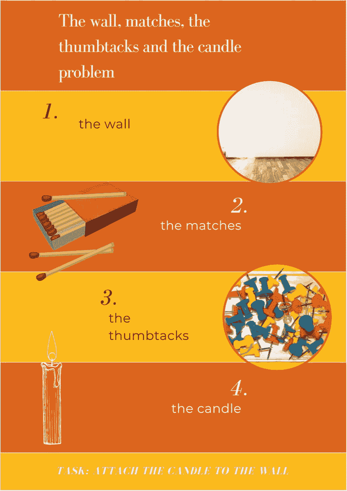

# 16. 用幽默来交谈

## 什么是幽默？

“你认为哪些特质帮助你取得了如今的成就？”我曾这样问过本书采访的创作者们。

`坚持`、相信自我和`创造力`是被提及最多的特质。其他被个别提及的技能包括：拥抱变化、持续学习、好奇心、共情力、勤奋、兴趣、动力、耐心、目标导向和自我反思。但没有人提到幽默。

当赫尔辛基的一群学龄前儿童被鼓励思考自己的优势时，13 个孩子中有 7 个表示幽默感是他们最突出的特质之一。你呢？你的幽默感是低于平均水平还是高于平均水平？

研究者将幽默定义为“一种智力游戏的形式；即与想法玩耍”^(186)。幽默是一种连接两个或更多人——制造幽默的人和接收幽默的人——的社交活动。制造幽默在于注意到你觉得有趣的事物，并渴望与他人分享。理解幽默则是听到或看到某些东西后不由自主地发笑。回应幽默比创造幽默更容易。你是在工作或家庭中讲笑话的那个人吗？还是你更愿意被有幽默感的人包围？

从 1 分（“从未想过”）到 5 分（“我活着就是为了让别人笑”），在一天中，能说出让别人发笑的话语对你来说有多重要？在对话中增添更多幽默的起点，是愿意去发现缓和气氛的机会。幽默感在生命早期（大约两岁左右）就开始形成，这对儿童社交和认知能力的发展至关重要^(187)。如果有机会，你可以问问父母你小时候是个什么样的孩子：是笑得肆无忌惮的那种吗？还是那种让大人们开怀大笑的小丑？

幽默是一种包含两种思维能力（洞察力和发散思维）的创造力形式^(188)。首先，幽默需要洞察力——即通过情境细节快速看出解决方案（也就是有趣之处）的能力。洞察发生在当你对某个问题所掌握的信息进行心理重构，从而突然理解解决方案时。

让我们以邓克（1945 年）的蜡烛问题为例来展示幽默场景。心理学家卡尔·邓克邀请参与者进行一项实验：将一支蜡烛固定在墙上。实验对象拿到一盒火柴、一盒图钉和一支蜡烛（见图 16-1）。

图片展示了一面墙壁和供实验者使用的三种材料（邓克的蜡烛问题）。材料包括一盒火柴、图钉和一支蜡烛。任务目标是将蜡烛固定在墙上。

`图 16-1 邓克的问题`

现在请花几秒钟思考如何解决这个问题。准备好了吗？

解决方案是：清空图钉盒，将其固定在墙上，作为蜡烛的支撑物。那么，如果你在解谜时想让别人发笑呢？你可能会尝试直接用图钉把蜡烛钉在墙上，或者融化蜡烛将其粘在墙上。

产生幽默的洞察力是什么？那些看着你实施这些“另类方案”的人可能会觉得好笑——前提是他们已经看出了正确答案。

其次，幽默需要发散思维，以及在新情境中发现新功能的能力——比如将空图钉盒用作蜡烛底座。学龄前儿童最擅长发现物体的多种用途^(189)。这些小人类热衷于将手中的物体想象成其他东西，并投入特定的游戏。对他们来说，一根棍子可以是剑；或者骑着一根杆子就是在骑马。

伯根和鲁斯塔（2018）认为，创造幽默的能力是伴随着玩耍和创造性行为的发展而演化的，因为它有助于在应对日常问题和危机时提供新视角^(190)。尽管幽默的表达和欣赏方式因个体所处的环境而异，但幽默的存在似乎是一种重要且普遍的人类体验。

## 幽默从何而来？

当儿童开始了解他们的物理和社会环境时，他们会在看到与自己现有知识不符的刺激情境下发笑，以此展示自己的理解。在认知发展的每个阶段，幽默都伴随着我们对所见所闻视角转变的洞察。“我看到了 X。我预期 Y。然而，我看到了 Z 发生。Z 与 Y 相反。我笑了。”Y 与 Z 之间的这种不匹配被称为“失谐”。

一个四岁孩子骑着棍子玩耍是健康的嬉戏行为。一个成年人骑着棍子，那八成是母亲在逗孩子玩，或者，是一个巨蟒剧团的喜剧演员^(191)。因此，失谐就是我们预期看到的与实际看到的之间的差异。意识到这种失谐——理解那个与最初假设相矛盾的笑点——是引发笑声的关键。^(192)

儿童不断发展的发散思维能力使他们不仅能创造出物体使用上的新失谐，还能在身体动作、语言和声音的运用上创造出新的失谐。例如，把一根香蕉放在嘴前假装它是一个大大的微笑，这既能让他们自己开心，也能逗乐别人。^(193)

尽管幽默起源于肢体游戏，但随着儿童自我意识的增强并开始观察他人的行为，幽默的运用变得更加多样化，并与其他形式的游戏——物理游戏、语言游戏、想象游戏、社会戏剧游戏等——同步发展。^(194) 根据麦吉的说法，失谐发展的第四阶段也是最后阶段，被称为文字游戏或“多重含义”阶段，大约在孩子 7 岁时形成，此时他们获得了更高的认知复杂度，比如玩弄想法和比喻性语言的能力，以及注意到因果关系的能力。^(195)

一个十岁的孩子可以通过在棍子末端系上一些草来进行假装游戏。这根装饰过的棍子可以扮演老师的角色，孩子可以向它倾诉所有他们不敢当面直言的事情。孩子可能会独自玩耍，从不向任何人透露他们想象中的对话，也可能与朋友分享这个游戏。

笑话之后通常是笑声，但并非总是如此。与此同时，孩子们开始内化他人不同的视角。那个十岁的孩子知道他的朋友可能会觉得有趣，但老师不会。老师如果发现自己被比作一根棍子，可能会觉得好笑，也可能不会，尽管这个幽默确实揭示了课堂中心理安全感的缺失。

“我正在读一本关于反重力的书。我根本放不下它。”^(196) “多重含义”阶段贯穿整个青春期。我们带着已经形成的幽默风格步入成年，这风格源于两个方面。首先，源于你自身以及他人对身体动作、语言、声音和心理状态之间感知到的失谐的个人倾向。

其次，取决于照料者和更广泛的文化背景，到了青春期，我们会吸纳两种主要幽默类型的组合。一些青少年可能每天都会使用幽默，有时是积极的，有时则带有攻击性。^(197)

“让我们把工作放在一个高不可及的基座上吧。”“努力工作让你保持健康，但懒惰也不会要你的命。”这些都是伴随我成长的讽刺幽默的例子。无论我们是在何种幽默形式中成长起来的——肢体幽默、双关、反讽、讽刺、观察式幽默等等——幽默感会通过我们一生中那些有影响力的社交互动而持续发展。^(198)

总结一下，幽默源于在两个不协调的物体、想法或词语含义之间建立非显而易见的联系。在语言幽默中，最初的信息设定了语境，激活了听者对接下来内容的认知和预期。意识到初始预期与笑点中提供的最新信息之间的失谐，会带来惊讶和笑声。

“我和一个 45 度角吵了一架。它是个锐角。”^(199)

***可选练习 1：*** *步骤 1 – 你最喜欢通过哪些来源消费幽默？*

*   *单口喜剧节目*
*   *幽默网站*
*   *漫画*
*   *喜剧电影*
*   *其他 _____*

*连续五天，确保每天至少听到/读到一个笑话。*

*步骤 2 – 每天改编一个笑话。*

*对于你喜欢的每个笑话，你能如何改编它以符合你日常生活中的某次经历？*

*步骤 3 – 笑话创作日记 – 创作你自己的笑话。*

*在连续五天模仿你喜欢的笑话之后，选择一周时间，记录下每天工作中遇到的概念或物体。例如，45 度角可能是一个程序员生活中的日常需求。针对每个概念/物体，尽可能多地写下它的特性。同时，记下你应用该概念/物件的目标是什么。*

*在达成目标的过程中可能遇到哪些挑战？针对每个挑战，尝试想出一个隐喻。这将成为你笑话的语境。在上述双关语中，隐喻是“吵架”。接下来，思考当天概念或物件的哪些特性符合这个隐喻的含义？*

*“我和一个 145 度角吵了一架。它是个钝角；我很快就赢了。”*

*不必担心是否能制造出哄堂大笑的效果。只要你能够习惯识别出一个书呆子式笑话所需的基本要素，那就足够了。*

## 人们何时笑得最畅快？

你今天至少笑过一次吗？你什么时候更想开怀大笑？是在黎明破晓时，还是在夜幕降临时？1999 年一项针对 30 名男性和 50 名女性（年龄在 17 至 79 岁之间）的研究表明，人们对幽默的兴致会随着时间推移而增加，尤其在傍晚时分。^(200) 特别是，年轻参与者报告在一天结束时笑的次数是年长参与者的两倍多。

在考察幽默的不同来源（即兴反应、媒体、复述笑话以及回忆过往趣事）时，大约 88%的笑声发生在与他人共处时，而非独处时（12%）。与研究中男性相比，女性在与他人相处时表现出更高频率的即兴笑声。

在考察笑声的发起者时，大约 64%的笑声是对他人幽默的回应。参与者本人仅发起了 36%的幽默时刻。

一个有趣的发现是：衰老似乎对笑的倾向有负面影响，但这仅体现在研究中的女性身上。24 岁以下的女性平均每天笑 22.7 次，而 60 岁以上的女性平均每天仅笑 11.7 次，恰好是前者的一半。

这可能意味着，年纪越大，你发现值得笑的事情就越少。对年长女性笑声频率显著下降的另一种解释是：退休后与人社交的机会减少，听到或使用幽默的场合也相应变少。平均而言，女性比她们的丈夫活得更久——尽管该研究并未记录参与者的婚姻状况。

总而言之，这些发现强化了“笑声是一种社会现象”的观点：大多数笑声都源自一种冲动，且发生在与他人相处时。那么，是哪些情境、哪些人，能激发你讲出有趣的话呢？

“一个点喝醉了，对一个球说了什么？‘我打赌你现在走不直了。’”

***可选练习 2：*** *第 4 步——笑话创作日记——在朋友中测试你的幽默*

*假设你连续五天，每天精心创作一个新手笑话，那么现在你应该已经掌握了五个笑话。你最引以为傲的是哪一个？哪三位朋友愿意倾听你的得意之作？下次和他们见面时，准备好分享你的幽默吧。*

*之后，在你日记里记下自己作为笑话创作者的感受。同时，记录下朋友们的反应。*

你可以将练习 1 和练习 2 重复进行两次（这样总共会额外增加四周）。在你和朋友之间的互动中，你是否注意到了由此带来的益处（如果有的话）？

### 积极幽默在工作场景中的益处

> *除人类外，没有动物会笑。*
> 
> ——亚里士多德，《论动物各部分》（第 29 页）

从 1 分（*分散注意力*）到 5 分（*悦耳动听*），你有多喜欢在工作中听到笑声？幽默是人的天性。

我幽默表现的光辉时刻之一，是在一次商业创意生成研讨会上。那次研讨会在一个创业加速中心的开阔空间举行。参与者们齐声欢笑，笑声传到隔壁办公室，吸引了一些原本没打算加入的人前来参加。

运用幽默和聆听幽默能提升创造性思维能力。在一项针对学校教师幽默感的调查中，教师的幽默与四项创造性思维技能显著相关：想象力、灵活性、独创性和开放性思维。^(²⁰¹) 运用恰当的幽默似乎能鼓励学生在涉及创造性思维的任务中表现更佳——如`托伦斯创造性思维测验`——学生的内在动机、理解水平以及课堂学习材料的注意力均有所提升。^(²⁰²) ^, ^(²⁰³)

其他实验研究表明，当人们因观看喜剧或意外收到糖果而产生积极情绪时，与中性或消极情绪相比，他们表现出更强的认知灵活性，从而能够更创造性地解决问题。^(²⁰⁴) 积极情绪的体验有助于更高效地组织和整合记忆，并使思考、规划和判断更为有效。^(²⁰⁵)

在创意过程的构思阶段，运用积极幽默同样具有显著的认知和情感益处。例如，一项关于产品设计过程的研究发现，即兴喜剧演员在产生新产品创意时，比专业产品设计师多想出了 25%的创意。原因何在？即兴表演训练中的练习会激发联想思维，而这是在酝酿想法时所需要的。在同一项研究中，当一组 11 名设计师在头脑风暴会议前接受了即兴喜剧训练后，他们提出的创意数量平均增加了 37%。^(²⁰⁶)

这些发现佐证了与幽默相关的自发愉悦感能促使人们更广泛、更灵活地思考。此外，幽默还能通过社交效应增强组织内的创造力。^(²⁰⁷) 表达幽默能在对话中维持心理安全感，缩短人与人之间的社交距离，并有效管理潜在冲突。

在工作中运用幽默表明你关心自己的工作以及共事的人。同时，这也显示出你对自己的信心以及与你想要逗乐的人之间的熟悉程度。在一项针对 279 名斯洛文尼亚护士的研究中，受访者被问及在与患者对话中是否愿意使用幽默——包括双关语和其他类型的言语表达。^(²⁰⁸) 使用幽默的护士报告说，她们对护理职业的归属感增强，并将幽默视为辅助患者的另一种工具。

幽默不仅具有与同一组织内同事建立社会纽带的功能，也能与陌生人建立联系。你最近是否听过一场演讲，演讲者在第一分钟就用其风趣才智迷住了你？当人们运用幽默时，他们会透露一些自己对重要事务的价值观和看法。我们因此会迅速对他们形成印象。而且，我们往往喜欢那些通过幽默表达出类似生活观的外人。顺便说一句，共同的价值观和相似的经历解释了为什么你喜欢某些喜剧演员，而不喜欢其他。

当别人由衷欣赏你的幽默时，他们很可能会认为你更值得信赖、更可信、更诚实，即使你运用幽默的意图是为了说服。轻松愉快的氛围能使人在做商业决策时更能接受和反思反驳意见。^(²⁰⁹)

在商业创意生成研讨会结束时，一位活动组织者过来与我交谈，说道：“*希望你能再来和我们一起工作。*”几周后，一位参与者写信给我。他在研讨会期间产生了一个商业创意。如今，他是一家商业中心的创始人，该中心汇聚了欧洲的扩展现实新兴公司与生态系统。

简而言之，幽默增添了趣味，促使人们跳出框框思考。同时，只要通过幽默表达的价值观和经历能引起接收者的共鸣，他们就会在情感上与发起者更加亲近。

脚注 1 2 3 4 5 6 7 8 9 10 11 12 13 14 15 16 17 18 19 20 21 22 23 24
