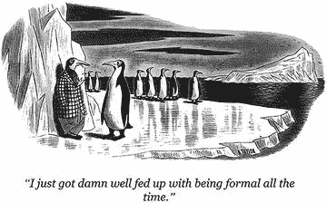
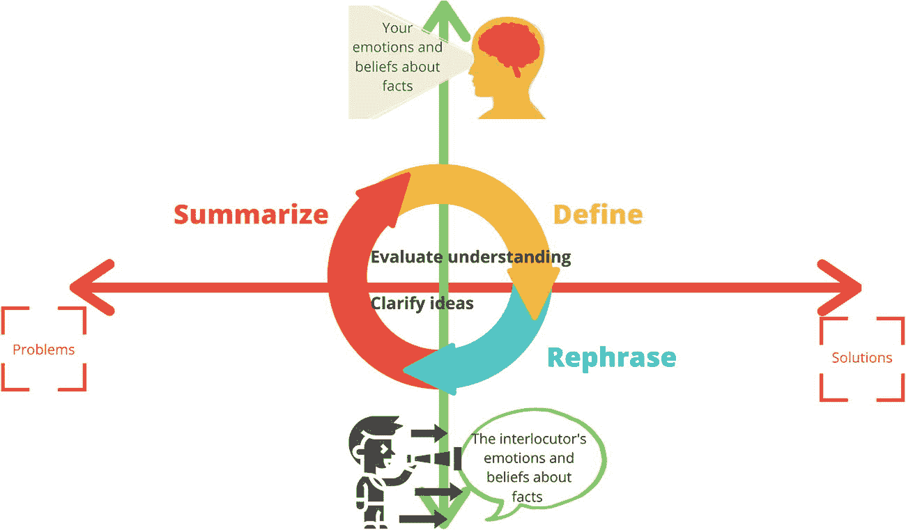
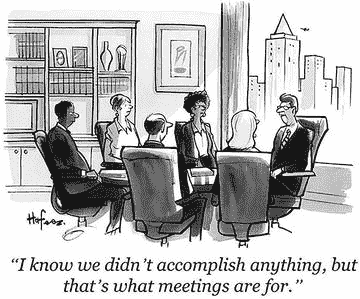
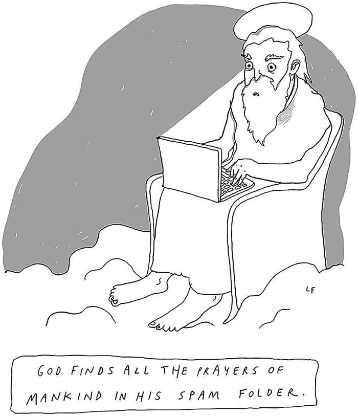
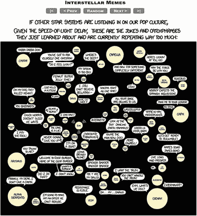
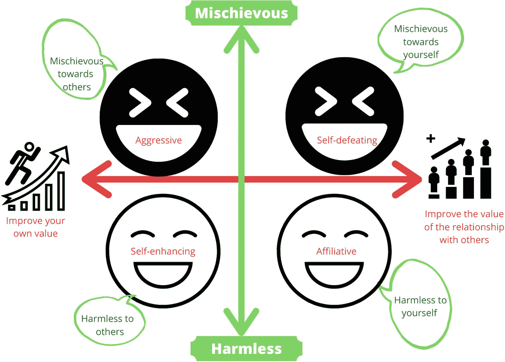

## 17. 用即兴幽默引导反馈对话

### 成为略带幽默感的人

掌权者们都认同幽默在工作中的益处。在商业环境中，人们希望听到领导者开些玩笑，正如《财富》杂志对 329 名财富 500 强 CEO 进行的一项调查所示，97%的 CEO 认同幽默在商业中的重要性。^(²¹⁰) 有幽默感的领导者能够提高员工在工作中的投入度和创造力。^(²¹¹) 此外，一种对风趣言行持开放态度的职场文化，会激励每个人尽可能展现自己的幽默。

工作投入度决定了人们在职场中的表现。那些更频繁体验到工作满意度的专业人士，更有可能展现出“组织自发性”，从而帮助同事并提出建设性意见。^(²¹²) 而且，当领导者对错误做出幽默评论时，会鼓励“同舟共济”的思维方式，提升员工留存率，并激发创新行为和态度。

创造过程不仅关乎新颖且有用想法的产生与实施，也关乎你如何阐述自己的想法。在反馈对话中，运用幽默是邀请双方（创造者和评估者）进行更深层次理解、修正观点以及共同解决问题的一种方式。^(²¹³)

你可能会想，“*我到底是不是天生的喜剧演员？*” 本书的意图并非将读者培养成著名幽默家。目标是通过理解如何在与上级、平级和下级的日常交往中利用亲身经历，成为一个更有趣的人。成为一个有趣的创造者，关键在于你愿意在与那些你想建立信任的人对话时，展现你的幽默感。

幽默并非我的强项，但我确实喜欢逗身边人开心。所以，我会固执而自发地编造一些有趣的言论，让我的听众会心一笑。当然，也有搞砸的时候。比如有一次，我拜访一位潜在客户，他指着墙上的一张照片——那是现在的 CEO 五岁时与当时 CEO 握手的照片。我脱口而出：“*她那时候看起来可爱多了。*” 然而，当我看到自己确实能让一些人发笑时，那种美妙的感觉让我上瘾。因此，我愿意一次次重新开始。

同样地，只要你准备好在一场反馈对话中，率先提起某个情境中幽默的一面，这就足够了。它能营造出一种心理安全感、投入式创造力和理性坦诚的氛围。每次对话中的一个笑话，或许就能让所有人放下固守己见。

你身边最有趣的人是谁？你能从他们身上学到什么？

一张照片中，一只企鹅穿着正装面对另一只企鹅，身后还有一队企鹅排队，图片配文是：“*我真的受够了整天这么一本正经。*”

正如我们从上述《纽约客》漫画中看到的，^(²¹⁴) 创造幽默的专家们善于利用情境中的元素，并将其组合起来产生幽默效果。这也是你可以通过三个步骤练习养成的习惯：进入玩乐状态、做好准备、保持灵活。第一步是让自己进入营造轻松氛围的情绪状态。第二步是训练自己即兴说出幽默评论的能力。第三步是尝试不同类型的幽默，这些幽默在特定情境下可能更受对话者的欣赏。

温馨提醒一下。经历这三个步骤并不意味着你会变成一个笑话大王。你更可能会体验到更多这样的时刻：你惊讶地发现自己说出的话能带来短暂的愉悦，并让人暂时摆脱对话的严肃性。

总而言之，在对话中使用幽默就像在合唱团里唱歌。总得有人起个正确的调子。你能成为那个人吗？让我们一起来创造欢乐时刻吧。

#### 第一步：进入玩乐的心态

你是否注意过，当你不由自主地冒出幽默话语时，自己通常处于何种心态？情绪会影响你观察事物有趣一面并将其传达给他人的倾向。^(²¹⁵) 如果你和大多数人一样，那么在感到压力、烦躁或焦虑时，幽默是最后才会自然流露的东西。

玩乐心态或愉悦的自发性，是一种情感状态，它能使你重新构建情境，让你和身边的人将这些情境体验为有趣、启发思考或富有个性。^(²¹⁶) 玩乐的心态是播种幽默种子的肥沃土壤。同时，在你开口说话之前，你身上那种玩乐的能量就已经在触动着对话者的潜意识。

要培养富有弹性的玩乐心态，按照第 16 章所述的方法，记录一本“俏皮话日记”，是在选定情境下有意识进入活泼心态的绝佳开端。或者，你也可以选择练习用幽默的视角重新解读日常情境。例如，你散步时能看到什么可以被解读为有趣的事？或者在一个无聊的会议上？又或者当你站在超市排队时？

有一天，在结束一天紧张的工作后，我出去散了一会儿步，想放空一下头脑。没过多久，我就注意到身边越来越多的人穿着运动装。而我穿着牛仔裤，感觉自己像个异类。我甚至想象出当地报纸的头条会写着：“*震惊！业余步行者闯入我们森林小径。*”

当你习惯于在非正式场合中发现自身经历与他人行为之间的喜剧性反差时，就可以进入下一阶段了。你可以开始在工作情境中观察有趣的角度。在反馈对话中，你可以选择在三个关键时刻切换到玩乐心态。

- 当你介绍项目的理念，即你的“为什么”时。你为何选择这个特定的挑战？

- 当你阐述你所设计的解决方案——其优缺点及目标受众时。

- 当你邀请对话伙伴分享他们对某个具体问题（例如你提出的解决方案的利弊）的看法时。

当讨论投入的能量水平下降时，就是时候引入一些玩乐元素了。这标志着一次短暂休息，让大家带着微笑重新调整思绪。

#### 第二步：准备好为诙谐评论留出空间

这一步的目标是习惯自发地描述你从某个情境中看到的趣味点。此前，我们列举了反馈对话中的三个关键节点。每个节点又包含三个阶段的发展过程：（1）开场，明确对话目标；（2）中间部分，为了深入讨论而复述对方话语；（3）结尾，总结已讨论的要点，以确保与对话者达成共识。同时，总结也标志着一部分讨论的结束，并引出下一个话题。（见图 17-1）

一幅展示反馈对话中三个关键节点（即：定义、复述和总结）的示意图。

**图 17-1** 对话中的过渡节点

# 通过幽默深化对现实的理解

当你在定义、复述和总结观点时，其中往往包含着一些大多数时候未被注意到的隐含假设。不过，你可以通过幽默将这些隐含的假设变得清晰可见。这里向你介绍三种策略，帮助你更清晰地认识自身现实或对方的现实。

## 三种幽默策略

- **以微笑开场** – 指的是有能力用一个关于自己的有趣开场白来引出话题。目标是帮助听者与你建立联系。
  例如，你可以先聊聊自己的工作习惯。“这个项目让我白天像海狸一样辛勤工作，晚上睡得像个木头人。我发现自己最爱的晨间活动变成了：按掉闹钟继续睡。”通过强调你生活中那些与普遍认可的`productivity`习惯不同之处，你将听者引入你的世界，同时为对话奠定一个有趣的基调。你有什么样的习惯或经历，可以拿来与成功模板进行有趣的对比呢？
  另一种以幽默口吻开启对话的方式是嘲笑那种被审视的恐惧。“我们总被要求去发现他人工作的局限。而我的工作完美无瑕。”这句讽刺的评论影射了不确定性，而这种不确定性正是创新者、科学家、艺术家、创业者等工作生活中不可或缺的一部分。玩弄这种对未知的恐惧与你的态度之间的反差，能让你在对话者眼中更具亲和力。
  在对话的开端，你还可以利用个人经历与公认为‘`真理`’之间的哪些其他反差元素呢？

- **请再说一遍** – 指的是邀请对话者重新措辞他们的评论。目标是双重确认你对关键观点的理解是否准确。
  复述就是用不同的方式再说一遍，以便在对话中达成对某个关键点的共同理解。当你复述时，背后假设是你已经理解了对方传达给你的核心信息。有时，对话会遇到混乱局面，双方都以为在谈论同一件事，实则不然。当你觉得讨论中存在歧义时，可以这样问：“你说的（……复述对方的话……）是什么意思？”
  作为一种幽默的替代方案，你可以基于你听到的内容与对方实际所说内容之间的偏差，加上一句愚蠢、奇怪或诙谐的评论。^(217) “你是说，我听到的那个意思吗？” “在我听来，这有点像‘求救信号’。”等等。作为备选方案，当你感觉对话变得过于混乱时，也可以随时准备好一幅现成的漫画来展示。
  
  一张 6 人围坐桌边的照片，下方文字为："我们知道我们没完成任何事，但这就是开会的目的。" ^(218)
  当你在讨论中感到迷失时，这通常是个好迹象，说明很多想法正在碰撞。幽默的介入能帮助对话者在厘清自己思路的同时保持积极心态。

- **认同式微笑** – “那么，我们目前讨论到的内容是……”、“到目前为止，我觉得我们看的像是同一本书的封面。”总结性的句子能告知对话者，是时候进入下一个话题或结束本次讨论了。你如何用一种为过渡时刻注入新能量的方式，来总结对话中取得的进展呢？
  你可能会发现最初的期望与对话中出现的主题之间存在差异。“在这次讨论中，你让我意识到我需要沉住气，把截止日期延后。”或者“这次谈话开始时，我很紧张你会指责我在没有测试的情况下就对这个新想法投入太多，是‘`本末倒置`’。”
  此外，你也可能经历过这样的时刻，即意识到自己的情绪、信念与对方的存在差异。“我不得不咬紧牙关，承认你说得对，当你提到……”这些有趣的回顾颂扬了信息交流中的亮点。如你所见，在前面的一些例子中，我们使用了习语。在恰当的语境中使用习语也能产生有趣的效果。
  美国散文家、幽默作家 E·B·怀特曾指出关于笑话的一个重要真理：“解释一个笑话就像解剖一只青蛙。你能更好地理解它，但青蛙在这个过程中死了。”确实，当你没有立刻领会一个笑话时，深究其笑点的逻辑并不会让你笑出来。恰恰相反，你可能会因为最初没听懂而感觉越来越笨。但有一个例外：当你想要培养自己的幽默感时，理解某个特定笑话的机制是对你创造欢笑潜力的投资。
  在反馈对话的开场白、中间部分和结尾中运用一些幽默元素，能为创作者划定一个围绕敏感且严肃话题（即创作过程中的下一步该做什么？）的轻松边界。

## 第三步：灵活适应，选择合适的幽默风格

如果你喜欢跟朋友讲黄段子，是什么让你觉得在专业场合也适合这样用呢？笑话关乎个人品味和价值观。通常，你在闲暇时讲的笑话与在工作场合讲的笑话在得体性上是有区别的。即使在长期的专业关系中，比如导师与学员之间，幽默也可能适得其反。那么，如何在反馈对话中讲出一个能被良好接受的笑话呢？
首先，维护评价者的心理地位感。为此，要找出你与对话者共同拥有的核心信念和知识。其次，培养一种能够连接人心的幽默风格。第三，留意对话者的情绪状态。第四，要准备好接受你的幽默不被欣赏的时刻。

### 通过精心策划笑话内容来维护对话者的地位感

这里所说的地位，指的是一个人感受到自己被他人重视的主观感受，而非职业角色带来的地位。在对话中，大脑会无意识地监测他人对你的重视程度。当你感到被欣赏时，你会产生积极的情绪。当你感到被批评或嘲笑时，你的大脑会释放皮质醇，这是一种压力荷尔蒙，会阻碍你的创造性思维。在讲笑话时，为了引发笑声，听众需要感觉自己的地位在上升。相反，这些笑话会让他们感觉良好。
有时，正式的地位会扭曲人们对如何有效运用幽默的认知。例如，当听众认为自己与处于权力地位的人（如领导与下属、教授与学生、导师与学员）存在工作关系时，幽默的发起者可能很难预判笑话对接收者产生的情绪影响。^(219)
在 2001 年的一项研究中，学生和教授对于教授使用幽默来激励学生、激发思考和巩固知识的程度存在认知分歧。^(220) 80%的教授报告称他们会使用幽默来实现这些教育目标。然而，只有 55%的学生认同这一看法。
你更愿意邀请谁来交流对你创意工作的看法：是同行、导师、新朋友，还是用户群体的代表？无论他们的职业地位如何，作为一个创作者，将自己感知并定位为平等的一方对你最有利。克服使用幽默时可能存在的优越感或自卑感偏见的一种方法是问自己：“为什么这句话能鼓舞他人？”，“为什么这条评论能让他们感到有趣或解压？”
创作有趣的评论，归根结底在于致力于说出真相，并关心如何让对话者感到被重视。而每一则幽默的背后，恰好都存在着一个被普遍认可的共识。例如，让我们看看下面这则以`上帝`为主人公的《纽约客》漫画。^(221)

一张老人坐在那里抱着笔记本电脑的照片，配文是：上帝发现所有“制造”的祈祷都在他的垃圾邮件文件夹里。
你和对话者是否信仰同一位上帝？如果对话者是不可知论者或无神论者呢？那么，假设你和对话者宗教信仰都不太严格，这个笑话为何会在对话的特定时刻具有相关性呢？因此，当一个笑话能够唤起与当前情境相关的共同信念、价值观和知识时，它才是恰当的。
2006 年的一项研究采访了本科生，询问他们课堂上恰当和不恰当幽默的实例。^(222) 学生们识别出 1315 个由教师在课堂上创造的幽默时刻，其中 774 个时刻符合语境。与课程内容相关的有趣评论和行为被认为是最恰当的幽默（占 47%）。基于性别、种族、宗教、性取向或政治立场来侮辱学生或其他与学生认同的人，则被认为是不恰当的幽默。
这些发现同样适用于工作环境。因此，为了维护对话者的地位感，稳妥的做法是坚持使用与讨论主题相关、且属于专业领域内众所周知的事实笑话，如下面这则 xkcd 漫画《星际迷因》所示。

一幅以不同大小的圆圈代表太阳周围恒星系统的图像，并配有一个链接的评论框，其中引用了每颗恒星的话。^(223)
其笑点在于：“我们开发超光速旅行最大的动力是，它能让我们提前道歉。”对恒星系统以及过去三十年流行文化有基本了解的人会觉得这则漫画很有趣。
简而言之，为了确保你和听众都能感到愉悦，要根据你与听众共有的信念和知识来寻找有趣的评论和故事。你对你潜在的评估者所处的现实了解多少？

***可选练习 3：*** 绘制与对话者的共同领域
由于笑话依赖于共享的隐性知识和信念，在重要对话之前，一个有用的练习是花几分钟时间独处，回顾一下你对即将见面之人的了解。
个人价值观 `_____` ， `_____` ， `_____` 等等。
生活状况 `_____` ， `_____` ， `_____` 等等。
知识领域 `_____` ， `_____` ， `_____` 等等。
兴趣爱好 `_____` ， `_____` ， `_____` 等等。
幽默的内容必须从上述五个领域中选取其一。

### 培养激发创造力的幽默感

运用幽默需要自信。你习惯使用的幽默风格是什么？在日常生活中使用幽默的倾向由两个目标触发：提升自身价值，或提升与他人关系的价值。^(224) 实现这些目标有两种风格：无害的方式和恶作剧的方式（见图 17-2）。

4 种幽默风格的四个象限：上方为恶作剧风格——攻击性和自贬型；下方为无害风格——`自我增强型`和`亲和型`，及其影响。
图 17-2 幽默风格
每个人在不同程度上都拥有四种幽默风格，它们与个性特征和情绪状态直接相关。
当你想要肯定自我，并以和善的态度表达自己的观点时，你使用的是`自我增强型`风格。这种风格最常在独处时被使用。它通过有趣的叙述来重构你的视角，以应对困境和消极心态，或提升你的趣味性。
当你想要突出特定关系的价值，同时建立自己的有利地位时，你使用的是`亲和型`风格。这种风格在工作场合与人相处时会表现出来。
`自我增强型`和`亲和型`风格与无害的、引人发笑和感到愉悦的倾向相关。不幸的是，以下两种风格则更具危害性。

当你倾向于抬高自己，并以伤害他人的方式表达时，你使用的是`攻击型`风格。它表现出对他人感受的缺乏尊重，带有嘲讽、取笑和羞辱的口吻。在社会群体中，使用敌对类型的玩笑，如戏弄或挖苦，可以将其他群体中的个体排斥在外，建立权力和地位差异，并对公认的社会规范产生强烈吸引力。因此，它会加剧社会分裂，形成一种“优越的我们”对抗“失败的他们”的局面。金发美女笑话、宗教和政治派别笑话就是这种风格的例子。

第四种风格，即`自贬型`风格，表现为当你抬高他人却贬低自己时的情形。这意味着你愿意拿自己开涮，甚至到了让人感到不适的程度，让自己成为笑柄。

这四种风格中，哪一种是你的主要倾向？哪一种风格能改善你在工作场合中与互动对象的关系？例如，实验室研究发现，有证据支持这样的假设：观察`自嘲`式幽默的个体会体验到更高水平的创造力。相比之下，经历嘲讽式幽默的参与者更倾向于从众并害怕失败。^(²²⁵)

在组织环境中，如果员工对领导者存在信任，领导者使用自我增强型幽默可以提升员工的个人创造力。^(²²⁶) 此外，在一对一谈话中，无论员工的自尊水平和自我效能感如何，领导者使用`攻击型`幽默都会降低员工对领导者的信任感知和绩效表现。^(²²⁷) 相比之下，当领导者使用`亲和型`幽默时，他们传递出谦逊——缩小了领导者与团队之间的地位差异——以及正直——行为与组织价值观保持一致。

总之，无论你与家人朋友相处的幽默风格如何，也无论你的职位高低，在旨在拓宽他人思维的对话中，`亲和型`和`自贬型`风格是更具共情力且更安全的选择。一条经验法则是：“`自嘲`，而非嘲笑他人。”

`亲和型`和`自贬型`风格可以成为有力的沟通方式，以提升创造性解决问题的能力、信任和亲社会行为——这些品质正是你希望那些评价你原创想法的人所具备的。与他人一同欢笑，而不是嘲笑他人。

## 现在是即兴幽默的好时机吗？

幽默需要两人配合才能实现。因此，你需要学会敏锐地捕捉适合微笑和欢笑的情绪氛围。当听者心情不佳时，幽默有时可能被视为有益或有害。

你的趣味性会触发幽默时刻。然而，接收方对幽默的解读可能成就或破坏这个笑话。如果对话者正专注于要得到一个严肃的回答，那么欢笑的机会就会被浪费。在听者没有预料到时用幽默回应，可能会暂时影响你的可信度。我们有两种方法可以防范这种风险，并通过幽默收获联系、活力和创造力的益处：

1.  如何判断对话者是否准备好接受一个笑话？要探测他们对欢笑的开放程度，你可以选择关注对话中的两种行为：

    *   此刻你面对评估者是否感到心理安全？

    *   听者提出有趣问题的频率有多高？

    氛围越友好，参与度越高，他们准备好欢笑的可能性就越大。

2.  你可以通过事先声明一句轻松的话语来为对话者做好准备，例如：“让我告诉你一件有趣的事”、“这个想法有一个有趣的转折……”、“我饶有兴致地发现……”等等。

    这些预告性陈述可能会减弱喜剧效果，但能通过设定期望来弥补。最坏的情况不过是对话者忽略它们，然后继续讨论其他想法。

当然，你可能会误判他人的情绪以及他们在提供反馈时承担的责任程度。因此，决定是否在谈话中运用幽默的关键因素，在于你感觉与评估者之间临时建立的联系有多深。当感觉合拍时，就准备好开玩笑吧。

### 当对方不觉得好笑时该如何应对

照片中，一男一女坐在桌子一侧，对面坐着一个人。照片两侧各有一个带引文的评论框。^(²²⁸)

你上一次试图逗人发笑却以失败告终是什么时候？你一定知道那会让人感到丢脸或尴尬。^(²²⁹) 当你主动带头引发笑声时，其实是在面对当下挑战时，含蓄地发出建立人际联结与团结的邀请。因此，你承担着对方可能不接受邀请的风险，从而变得脆弱。如果这种风险成真，那就糟了！笑话选得太差了。

与此同时，听笑话就像一场智力测试。当听者意识到自己没听懂时，他们会感到不适。*“我为什么没听懂？”* 或者他们可能会心存评判。*“你这小滑头……”*，把你的幽默解读为一种意图让自己处于优越地位的方式，甚至更糟，将其视为一种言语攻击。

当对方因未能理解幽默而产生挫败感时，你该如何应对？幽默被误解的原因有很多：拒绝进入轻松嬉戏的状态、对词语和经历不熟悉、对信息流失去注意力等。不可避免的结果是你与对方之间瞬间失去了联结。当你察觉到自己的幽默并未让对方受用时，道歉或额外解释笑话只会让对话的中断更加糟糕。

关键在于重新建立对方的心理地位感。为此，你可以先总结一下到目前为止讨论中已达成共识的内容，以及尚未涉及的话题。帮助对方重获掌控感，并让你看起来无害，这一点很重要。为此，你可以让对方决定接下来哪些想法值得关注。

运用幽默和倾听幽默，与其说是一场共同知识的考验，不如说是一场是否愿意暂时玩乐的考验。幸运的是，在一段以信任为基础的关系中，对话由情感联结的起起落落构成。所以，这种动态迟早会恢复。

在接下来的章节中，我们将探讨如何通过类比和想象性思维来激发听者的参与度。
