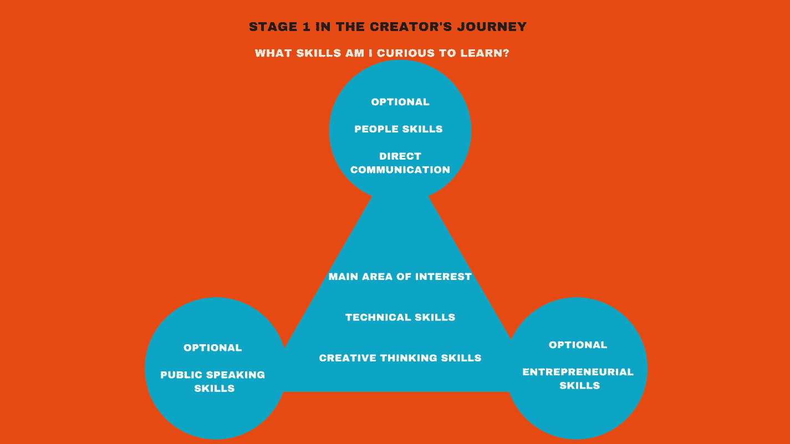

# 8. 与新的好奇心不期而遇

> *我走过漫长旅程，才意识到超现实主义艺术摄影是表达自我的方式。*
>
> ——艺术家、摄影师达莎·皮尔斯

我们来思考一个由作家大卫·福斯特·华莱士写的当代寓言：*“有两条小鱼正在游动，它们偶然遇到一条从对面游来的大鱼，大鱼向它们点头致意说，‘早上好，孩子们。今天的水怎么样？’两条小鱼继续游了一会儿，然后其中一条终于看向另一条，问道，‘水到底是什么东西？’”*^(¹¹⁶)

类似地，我们也许会问自己：*“自我到底是什么？更不用说创造性自我了！”* 你的个性、生活环境以及周遭环境，都在持续影响着你能创造什么。**运气**有力量唤醒你的创造性自我。**由你决定如何应对。** 当我阅读《`wired to create`》这本书时，我产生了一个冲动的想法：*“我要设计一门创造力课程。”* 我感到迫切需要更深入地理解创造力的心理学。而学习一个主题，还有什么比教授它更好的方式呢？

发现对一个主题——无论是智力上的、哲学上的、艺术性的、创业的、环境的还是精神层面的——有浓厚兴趣，是一个改变人生的时刻。它触发了创作者的旅程，支撑着工作身份的重新构建。^(¹¹⁷) 与圣经中约拿的故事做个类比，作为创作者在新角色中的第一个项目，就相当于约拿**旅程**的开端，那时他开始听到**上帝的声音**。当你开始参与那些让你以创造性方式思考和行动的新活动时，你的创造性角色身份便开始形成。

*“水到底是什么东西？”*，两条小鱼感到疑惑。就像小鱼一样，水无意识地是他们身份的一部分，我们与某些人（同事、亲戚、朋友）相处的时间越长，或者从事特定活动（工作、爱好）的时间越久，我们的自我意识就越可能围绕这些人、活动甚至物理环境的特征而形成。如果你曾出差参加会议，并在酒店的健身房锻炼，你是否曾想念过自己常去的健身房？这就是周遭环境成为你身份一部分时的感觉。

我们身边亲近的人与活动，会不知不觉地、毋庸置疑地成为那个“我”的一部分。谁是“我”？我的身体？我的思想？我的工作？那些志愿活动？那个很难欣赏自己的人？因此，个人层面的“我”是围绕独特的生理特征、情感、心理能力、个人价值观和兴趣构建的，这些特质让你在平常的环境中独一无二——无论优缺点。

谁是“我”？我的家庭？我的社区？我对某些人的爱或恨？社会层面的“我”围绕人际关系形成和发展——*“我认为哪些人是我亲密圈子的一部分？”* ——以及群体归属感——*“我属于哪个国家、机构、种族？”*

简而言之，当你在某些人身边感到自在，并被某些活动所吸引时，你就知道自己是谁。然而，**有时，我们活跃的群体中的那些活动和人们，恰恰可能强烈地提醒你“我”不是谁**。例如，达莎·皮尔斯想成为一名视觉艺术家，但与他人的比较让她觉得自己需要追赶的目标太过遥不可及。

*“我一直对视觉艺术感兴趣，并试图找到自己的媒介。小时候我画了很多画，后来我上了一所面向儿童的 art school，在那里我学习从雕塑到油画的一切。从这所学校毕业后，我觉得自己根本没有天赋，我比那里的其他所有人都差远了。”*

对达莎和我们所有人来说，伟大之处在于我们在其他方面拥有更强的能力，只是当下未能察觉。与个人“我”相关的有三种可能的自我，它们能塑造正在成长的创造者：

-   **现实自我**基于你当下拥有的技能，有助于你在当前角色中表现。

-   **应该自我**基于有影响力的人（如父母）的期望。这些是我们出于责任感或义务感而锻炼的能力。你的父母认为你在某个特定领域应该高于平均水平。日后，你的上司可能对你应该从事何种工作抱有期望。

-   **理想自我**基于我们希望拥有的素质和能力。这里蕴藏着我们的希望与抱负。这种可能的自我是未来创造性行动的重要驱动力。^(¹¹⁸)

这三种自我在指导我们的行动和决策时，会协商各自的优先级。为了从“我是那个放弃了成为艺术家的人”转变为“我是那个希望成为艺术家的人”，当偶然或机缘巧合伸出援手时，理想化的创造性自我需要占据主导地位。

就像那两条小鱼一样，我们最终可能会陷入一种生活境况，其中某个物体或某个人能唤醒我们对创作技能或智识兴趣的新好奇心。例如，老鱼向两条小鱼提出了环境问题。它们会进一步探究如何在水里定位自己吗？只要这种好奇心唤醒了它们的理想自我，小鱼就可以选择**探索水是什么**。

与达莎艰难地重塑自我成为艺术家不同，对其他艺术家来说，投身于新的兴趣会更顺利、更迅速，芬兰力量金属乐队 Stratovarius 的作曲人马蒂亚斯·库皮艾宁就是见证。^(¹¹⁹)

> *“十五年前，我只是个吉他手，并不认为自己是个制作人或作曲家。但像作曲这样的工作是在十年前开始的，当时我加入了这支乐队，并很快意识到乐队里的其他人对作曲没有那么大的动力。从那以后，大部分作品都出自我的笔下。当时有需求，我回应了那个需求。当你有一个集体的艺术召唤，就会对某样东西产生需求，然后有人会担起那个角色。我的情况正是如此。”*（原文如此）

当出生于保加利亚、居住德国的个人创业者彼得·伊万诺夫在跨国公司管理层工作了 20 年后，正考虑做些不同的事情时，他遇到了一个人，这人向他推荐了一本书。*“我读了盖洛普的《优势识别器 2.0》，”* 那个人对彼得说。*“我制定了行动计划，然后换了工作。”*

对很多人来说，`Strengths Finder` 可能毫无意义，但这本书激发了彼得的好奇心。*“哦，这很有趣，我们来试试看，”* 他思索着。*“所以，我就做了，结果令我惊讶的是，我的第一大优势是‘输入’。他们称之为‘输入’，但实际指的是创造力。就是不断地想出新的点子。你的想法永远不会枯竭。有时候想法太过天马行空，都是些烂主意，完全没效率，但你会产生大量的想法，而这就是我。”*

一旦彼得意识到自己作为“点子王”的优势，他就有了力量，通过开发一套管理远程团队的方法论，朝着职业转变迈出了第一步。

与一部相机的偶然邂逅，重新点燃了达莎成为视觉艺术家的兴趣。*“所以，我放弃了成为艺术家的想法，直到大概十年甚至更久以后，我找到了一台相机，”* 达莎说。*“那甚至不是我的相机，是我从朋友那里借来的。我感觉，是的，这就是我需要做的，只是去捕捉事物的样子，然后告诉别人，‘嘿，世界上有如此多的美好’。”*

**当理想化的创造性自我已经超越了现实自我**，创造者旅程的第一个里程碑就到达了。我们可能会在渴望成为新人的同时，又恐惧这种想法，并**在一个新的兴趣领域从一张白纸开始。** ^(¹²⁰) 新的创作好奇心伴随着一个自我信任的挑战。从 1 分（“我觉得我总需要别人的许可才能过自己的生活”）到 5 分（“别人怎么看待我的行为不关我的事”），在别人认可你的选择之前，你有多容易信任你内在的创造者？

那位通过和学生玩球类游戏来教授新语法规则的老师。那些希望有一本手册让孩子在课堂上遵守的家长。那些无论杂货还是新家，都在网上购买一切所需物品的千禧一代。那些更喜欢实体店购物、触摸产品、并看着卖家眼睛的婴儿潮一代。

世界在处理事情的老方式和新方式之间，一直存在着霸权之争。而且，这类冲突内化在我们每个人的心中，并在我们遇到新兴趣的那一天显现出来。当你执行一个关于新业务、创新产品、演讲、书籍、视频等的想法时，当下的你和可能的你之间的拉扯，会引起不安。

一方面，做熟悉的事情、和认识的人在一起，这种确定性带来了舒适感。你依恋于那个完成了你迄今为止所做的一切（能力、成就和人际关系）的自我版本。这是你身上已经获得他人认可的那部分。

另一方面，你开始怀疑，由机缘巧合的好奇心所触发，自己身上存在着某种潜力，它打破了外部认可的链条。因此，在第一次实验性的创作中，你发现自己身处一片未知的领域，在那里你构建新的技能和人际关系。在那里，你自己尚且不知道自己的能力极限。还未可知。

**过去的你和可能的你之间的内心冲突，谁会赢？** 是对过往经历的熟悉感，还是那个温柔地告知你存在一个潜力尚待证明的兴趣的直觉？这取决于此刻你决定更信任谁。有些创作者可能会经历 **约拿情结**：害怕对那个承诺展现我们创造潜能的角色采取具体行动。

在每个有抱负的创造者心中，**当下自我**和**创造性自我**的声音会建立起**一种新的关系，一个新的“我”**。当你每次在创作过程中体验自己时，信任将形成并巩固。每一次新的活动，都是对当前自我的告别——告别我们在那次偶然邂逅之前所熟知的自己——也是对投身于新活动的全新创造性自我的谦逊欢迎。*“这可能是新的我吗？”* 你可能在想。达莎先是接触了家庭摄影，接着是婚礼摄影。*“这就像一个发展的过程，”* 达莎说。*“我不认为它是一蹴而就的事。所以我开始对客观现实感兴趣，记录我所看到周围的事物，捕捉瞬间。”*

一旦开始，对你创造性自我的渐进探索，将带你从一个创作行为走向另一个，直到你明白你的尼尼微是什么、在哪里。

## 练习 3：你是谁？

1.  想象你正在一个社交活动上。请用一句话描述你会如何告诉别人你的职业。

2.  假如你在一艘飞往另一个星系的航天飞机上。你周围全是你从未谋面的人。你会如何向他们介绍自己，以便他们了解你的价值观？

3.  你坐在书桌前，盯着一张白纸。请写出十个句子来回答这个问题：“我是谁？”

4.  在你对前面几个场景的回答中，你注意到了哪些相似之处？

5.  在前述情境中，你注意到自己的答案有哪些不同之处？

6.  这些答案揭示了关于你个人身份和工作身份的哪些信息？

## 练习 4：你的创作领域是什么？

1.  如果有的话，你希望在什么话题上提出自己的观点？

### 新的创作好奇心，一套需要掌握的新技能

当幸运降临，你发现了一个新的兴趣点，理想自我便会接管，并开始积极运用新角色所需的一套特定技术能力。核心技能可能需要一些次要能力来巩固你作为该兴趣领域创作者的地位。这些次要能力可能是什么呢？

*“真的，如何培养你的创造力？如果你拥有它，如何善待自己，以便充分利用它？”* 彼得·伊万诺夫问道。首先，要促进你的天赋发展，你可能需要专注于培养创造性思维技能，这将为你的作品带来某种 *“难以言喻的特质”*。

激发创造性思维的一种方法是花时间进行支持特定创造性思维过程的练习。^(¹²¹) 例如，为了提升你的想象力，你可以问自己 **“如果……会怎样？”的问题**。思考这些后果会扰乱你在特定情况下一直遵循的方法中的步骤顺序。假设你对最近一直在烘焙的巧克力卷感到厌倦了，你可以问自己：*“如果我把奶油放在外面做一个巧克力卷会怎样？哪种奶油比较合适？”*

假设你是一位雄心勃勃的企业家，想要为收入模式集思广益，你可以问自己：*“如果我只有 3 个客户而不是 30 个，会怎样？我的商业模式会发生什么变化？”* 提出“如果……会怎样？”的问题，会让人联想到偏离习惯性思维的其他未来情境。

此外，根据创作领域的不同，你可能需要考虑以下 **三组支持传达你所创造价值的酌处技能**：(1) 社交技巧，如同理心、慷慨和社交网络技能，使你学会如何在个人层面上与他人建立联系；(2) 创业艺术，如销售能力和商业思维；(3) 公开演讲的娴熟技巧，以便面向更广泛的受众，并分享你作为创作者的世界观（参见图 8-1）。

图片展示了创作者旅程第一阶段中三项可选技能，包括人际交往能力（直接沟通）、创业技能和公开演讲技能。

**图 8-1** 创作者的可选技能

在知识创业中，这些次要技能集中的任何一项都可能成为创作者的核心技能。例如，考虑到彼得·伊万诺夫对管理远程团队的兴趣，人际交往技能成为了他的主要专长。此外，在担任高管教练和演讲者的头几年，他学会了掌握新的商业能力，比如销售，而这起初对他来说是有些勉强的。

*“例如，作为一名高级经理，我从来不需要做销售。我需要向利益相关者推销概念，但从未需要完成涉及财务等的交易。这对我来说很困难。但是，相信其价值，你便会踏入其中，学习，变得耐心，一切就这样发展起来了。”*

无论你的创作者角色如何，你可能也需要培养一些创业技能。这意味着要习惯于向他人推销你所创造的价值。从彼得的例子可以看出，除非你能够授权，否则创业领域的技能可能并非你的兴趣所在，但如果你想成为一名成功的创作者，这些技能又是必需的。如果你无法说服潜在客户购买你的产品，那还有谁能呢？

对我来说，说服客户的首选方式是通过演讲活动。站在舞台上谈论你专业领域的关键话题，这是一个透明的过程，能让听众更容易决定是否想要与你合作。

哪些核心技能能帮助你最初的好奇心转化为具体的新产品？哪些次要技能是你认为虽不情愿却又必需的？至此，创作者旅程的第一部分结束，第二部分开始。

脚注 1 2 3 4 5 6