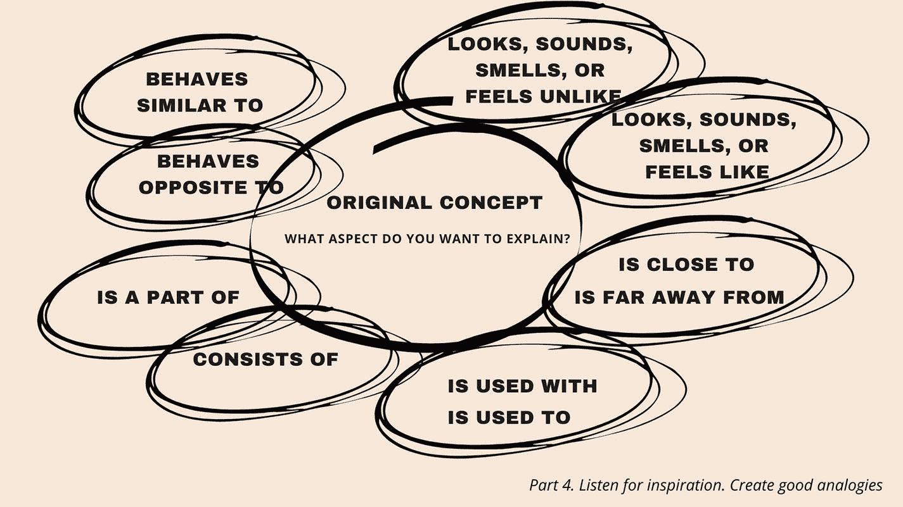

## 18. 在倾听中汲取灵感

### 何为灵感心态？

赫尔辛基新开了一家室内游乐场。它为婴幼儿提供启发式教育游戏室，与当时市场上已有的运动型游乐场截然不同。每个房间都烙印着设计师的灵魂。

我带儿子们去过那里几次。有一次，我们正要离开时，店主走过来询问我们的体验。她的眼中闪烁着自豪的光芒。我犹豫了几秒钟。*“我该说她想听的话，还是该说我的真实想法？”*

我开始讲述我喜欢这个空间的地方。可我一提到，在我看来，门票价格太高了，她的脸顿时阴沉下来。她开始进入说教模式，大谈家庭预算以及父母可以如何节省开支来负担游乐场的门票费用。

思考反馈对话时，一个富有成效的方式是将其视为一个收集更多信息的机会，这些信息是你原本可能接触不到的。与其采取防御姿态，随时准备反驳，你可以选择一种灵感心态。目标是根据对方提出的顾虑，确定可能的行动方案，或许还能捕捉到一些自发的幽默时刻。但什么是灵感？

《韦氏词典》给出的一个释义是*“一种神圣的影响力或作用于人的行为，被认为能使此人接受并传达神圣的启示。”* 在这个定义中，隐含着三个特征：（1）存在一个传达信息的外部来源；（2）接收者承认这一信息，并因此采取行动，该行动在灵感来袭前是难以想象的；（3）个体价值感得到提升。

的确，古希腊人认为灵感并非在你需要时降临，而是缪斯女神准许时才降临。^(²³⁰) 宙斯与谟涅摩绪涅的九个女儿，会允许某些在诗歌、音乐、舞蹈、历史、天文学等领域有天赋的凡人接触到神圣的思想。例如，如果你想变得更有趣，就应向喜剧缪斯塔利亚祈求，以获得源源不断的幽默创意。如果你对历史感兴趣，克利俄则会指导你的学习。

从 1 分（*像一根乏味的铅笔*）到 5 分（*像一条潺潺的小溪*），你每天感受到的灵感程度有多少？一个梦想、一本书、一首歌、一次巧合，或与一位特别的人（如老板、老师、导师、意见领袖）的预定会面，都能激发你采取新行动的决心。一些研究创造力的心理学家和神经科学家认为，灵感是一种先于创造性想法产生的动机状态，无论艺术领域还是非艺术领域，它都会促使你去寻求信息、获取知识。^(²³¹)

灵感会出其不意地降临，并让你行动起来。它让你感到振奋，对主动改变充满热情。这些积极情绪会转化为对灵感主题——一个新想法或新问题——高度且持久的投入。因此，灵感就像你帆上的风，引领你从创造过程的起点走到终点。

被缪斯选中意味着什么？根据《韦氏词典》的定义，能够听到来自外部来源信息的人所具备的素质，正是灵感的第三个决定性特征。如果灵感不是一种意志行为，那么你需要做些什么才能获得缪斯的青睐呢？

### 拥抱灵感的艺术：在对话中激发创造力

你或许无法控制灵感何时降临，但可以主动将其引入生活。通过参观博物馆或学习新领域技能等开放体验，你能激发思维。你越让自己接触陌生的想法和经历，就越有可能获得灵感并表达新观点。^(²³²) 然而，如果新体验对你而言如同水过鸭背，灵感便不会发生。你需要让自己乐于接受新鲜事物，即使并非一见钟情或一听倾心。特别是在反馈对话中，你可能需要训练探索他人想法的能力，克制急于否定对方的冲动。^(²³³)

你可能会想：“等等！如果我对别人的评论不那么挑剔，又如何辨别哪些内容对发展我的原创想法有用呢？”在对话中偶尔暂缓判断，就像呼吸间微小的停顿，让你能够继续下一次呼吸。减少评判能让你从评价者的经验和知识所提供的丰富视角中，重新审视自己的观点。

让自己更容易接受灵感的第一步，是观察你在倾听时的情绪和反应。当你意识到自己对某人的观点产生强烈反应时，在心里数 1、2、3，然后叹一口气。“塔利亚，请帮我按住叫嚣的判断！”给你的灵感起个名字——“伙伴”“宝贝”“嘿，你”等等——一个对你有意义、能减弱你否认批评冲动的名字。

如果灵感是吹动帆船的风，你需要知道如何掌舵——也就是你的思维——以充分利用讨论中涌现的想法。你希望如初衷般抵达对话的终点：成为一个拥有开放心智的创造者。

古希腊人再次说对了：他们认为记忆女神摩涅莫绪涅是缪斯女神的母亲。你在对话中越能调节评判的力度，就越可能在你所听到的内容与记忆中的知识或个人经历之间建立令人惊讶的联系。

让自己更容易接受灵感的第二步，是进行远程联想的能力。灵感或许不是意志的行为，但可以是通过语言激活记忆的行为。基于此，在下一节中，你将了解如何在表达复杂思想时更频繁地运用类比。

## 使用类比理清复杂概念与思想

> “我尽我所能解释了，”珀佩特说，“我想我用蛋糕打了个比方。”
> “嗯，那一定奏效了，”威格特说，“谁不喜欢一个巧妙的蛋糕类比呢？”
>
> —— 艾琳·莫根斯坦，《夜间马戏团》^(²³⁴)

类比是一种创造性思维能力，通过比较两个概念 **A** 和 **B** 来解释某个观点。**A** 是**主概念**，对听者而言是新的，需要被解释。**B** 是**模型**，对说话者和听者来说都熟悉。

这里有两个类比的例子：

*“好的演讲应该像女人的裙子：足够长以覆盖主题，又足够短以引起兴趣。”* —— 温斯顿·丘吉尔

*“我喜欢把世界想象成一台大机器。你知道，机器从来不会有任何多余的零件。它们拥有恰好所需的数量和类型的零件。所以我认为，如果整个世界是一台大机器，那么我在这里一定有某种原因。而这也意味着你在这里也一定有其原因。”* —— 布莱恩·塞尔兹尼克，《雨果的秘密》

在丘吉尔的类比中，目标是通过将 `A`（好的演讲）与 `B`（女人的裙子）进行比较，强调令人难忘的修辞的关键功能。在塞尔兹尼克关于人生目的的类比中，个体的生命（`A`）被比作机器零件（`B`）。

类比是一种沟通工具，当你清楚想要传达的字面信息时，它能很好地发挥作用。类比思维从先前知识和经验的推论开始，从而得出更易于听者理解的解释。挑战在于，有缺陷的类比可能比澄清观点带来更多困惑。那么，让我们来看看一个好类比的三个要求，好吗？

### 选择熟悉的参考模型

首先，要做出一个好的类比，你需要事先了解与你对话的人的一些基本细节。丘吉尔和塞尔兹尼克的类比面向的是怎样的听众？

温斯顿·丘吉尔面对的是一群对公共演讲感兴趣的男性听众。女性可能未必对这个类比感兴趣，但男性同行最能理解。至于塞尔兹尼克，他面向的是寻找人生意义的人们。因此，使用类比时，最好选择听者能够产生共鸣的特定知识、经历或生活情境。

*“谁不喜欢一个巧妙的蛋糕类比呢？”* 每个人一生中至少都吃过一次好蛋糕——即使是不喜欢甜食的人。**熟悉度**应成为选择模型（`B`）以比较原概念（`A`）的标准。然后，听者需要充分了解 `B` 的角色和功能，才能更深入地理解 `A`。

从某种意义上说，类比类似于内部笑话——只有拥有共同知识的特定群体或社区成员才能理解其中的幽默。同样，类比需要听众对模型有共同的理解，才能洞察说话者选择通过类比描述的原概念。

除了政治家和作家，科学家也使用熟悉的类比模型来阐述观点。在《相对论的意义》中，爱因斯坦这样表达他对无法直接观察的现象如何被体验者塑造的看法：*“观念的世界与我们的经验本质的独立性，就像衣服与人体形态的独立性一样微小。”*

总而言之，做好类比的第一条规则是：从日常生活中的物体，或从你和听者共同拥有的知识、经历领域中选择模型。

***可选练习 4：观众变了，类比也得变***

*想一想你现在的正式头衔。想象你要向一个 4 岁的孩子描述它。你会把它比作什么，让你的小听众理解你的工作？*

*做一名 ______ 就像 ______。*

*如果你想让你的祖父理解你的工作呢？*

*做一名 ______ 就像 ______。*

*跟一个穴居人谈话呢？*

*做一名 ______ 就像 ______。*

*例如，对穴居人来说，职业角色可以比作小神祇。例如，程序员可以解释为能让无生命物体独立思考的半神；领导者像是寻求救赎的堕落之神；政治家像是梦想全能的上帝助手。*

### 检查 `A` 与 `B` 的内部一致性

这难道是在拿苹果和橘子做比较？好的类比需要满足的第二个条件是确保**原始概念 (`A`) 与模型 (`B`) 之间的相似性成立。**

让我们将隐含的要点明确化。一个概括性的类比陈述听起来是这样的：“**具有 `A1` 特征的 `A` 就像具有 `B1` 特征的 `B`**”以及“**具有 `A2` 特征的 `A` 就像具有 `B2` 特征的 `B`**”。

为使这个类比具有内部一致性，特征与概念之间必须存在相似的关系，也就是说，`A` 与 `A1` 的关系必须与 `B` 与 `B1` 的关系相同。如果我们解构上述陈述的隐含意义，其听起来如下：**“`A1` 和 `A2` 与 `A` 之间的关系，类似于 `B1` 和 `B2` 与 `B` 之间的关系。”**

让我们回到丘吉尔的类比中，这个例子阐释了一个简单的类比。*“好的演讲应该像女人的裙子；长度足以覆盖主题，同时短到能激起兴趣。”* 在这里，原始概念（好演讲）的属性是 `A1`（长演讲）和 `A2`（短演讲）。模型概念（女人的裙子）的属性是 `B1`（长裙）和 `B2`（短裙）。它之所以是个好类比，是因为原始对象和模型对象的属性有两个共同功能——既要点覆盖，又能激发兴趣。

在科学、技术以及其他专业领域，通常需要付出努力才能理解、想象并将自己与抽象思想的本质联系起来。从这个角度来看，就需要更多**具有解释力且内容丰富的类比**。换句话说，原始概念越复杂，构建一个强有力的类比就越关键。

目标对象和原始对象的属性需要根据它们与各自对象**在共享关系上的一致性**来选择。^(²³⁵) 主旨概念 (`A`) 和模型 (`B`) 必须至少有一个共同功能，且至少有一个不同的特征。共享关系越多，共享属性越少，这个类比就越有用。

这种一致性在以下类比的结构中得到了体现：*“人体细胞就像一所大学。”* 这是一个具有解释力且内容丰富的类比，包含了五个不同的共同功能。

-   大学的目的是向年轻人传授并传播知识，使他们能为社会的良好运转做出贡献。人体细胞的目的是生长和复制自身，以维持你的生命。
-   和大学一样，每个人体细胞都有其专长：神经元、红细胞、免疫细胞等。
-   大学有领导团队，他们负责制定学生毕业前需要掌握哪些信息的指令。细胞有一个细胞核，其中容纳了你的 `DNA`（遗传密码），它包含了关于你的身高、头发等以及身体正常机制的基本信息。
-   大学里有训练有素的教育者，他们将本领域的核心知识传授给学生。细胞中有特殊的蛋白质，能够读取 `DNA` 链上的信息，并将其转化为一种称为 `mRNA` 的特殊分子，然后这种分子会被运送到细胞的另一个“器官”——核糖体。核糖体读取 `mRNA` 并按照指令生成蛋白质。^(²³⁶)
-   核糖体类似于教师与学生分享的教学材料、指导方法和隐性知识的总和。同样地，当学生毕业并踏入社会从事他们所学专业的工作时，蛋白质也开始在细胞内蠕动，并与其他蛋白质相互作用，以维持它们所负责的身体部位的功能。

这五个功能都指向同一个解释目标——细胞为了生存而创造和共享信息的特性。因此，它们满足了一致性的标准。

简而言之，无论你想解释的概念是制作一个好蛋糕还是人生的意义，重要的是**有意识地选择你想通过类比来阐明的核心原理**。在处理复杂概念时，那些在原始概念和模型之间具有更多共同功能的扩展类比会非常有用。

***可选练习 5：** 描述一个特定的工作挑战*

*回想一个最近遇到的、具有挑战性但你最终成功处理了的工作经历。你会用什么类比来强调它既复杂又有解决的乐趣？*

***可选练习 6：** 用类比来表达创造力带来的感受*

*想象一位记者邀请你参加访谈并问道：“富有创造力是什么感觉？”*

*“对我来说，富有创造力就像 ____________________ 。”*

*对我来说，富有创造力就像在炎热的夏日喝一杯莫吉托。它令人神清气爽，带来一种自由的感觉。*

### 确保 A 与 B 之间的比较有效

最后，**特征与模型/原始概念**之间存在**三种类比关系**，它们确保已知概念与较不为人知的概念之间的比较是有效的。

前几天，我儿子问：“妈妈，什么是 `CPU`？”我没有去定义计算机的中央处理部件，而是用了类比。“`CPU` 之于计算机，就如同大脑之于你的身体。”`CPU` 和大脑都处理信息，并引导行动。

每一种关系 `A:A1` 都有一个你选择用来沟通的功能。在本节剩余部分，让我们来解析示例类比中**特征与原始/模型之间的关系类型**。

1.  未知概念 (`A`)，即 `CPU`，与更大的系统，即计算机 (`A1`)，之间存在**部分与整体的关系**。`A` 是 `A1` 的一部分。`CPU` 是计算机结构的一部分。
    在塞尔兹尼克的生命目的类比中，被解释的概念，你的生命 (`A`)，与环境，即世界 (`A1`)，之间也存在相同的部分与整体关系。你的生命是社会集体的一部分。它有一个目标，专为某个特定社群而设计。
    在人类细胞与大学的类比中，主要对象，即细胞，与其特征之间存在一种相反的关系，即**整体与部分**的关系。细胞核、`DNA`、`mRNA` 和核糖体都是细胞结构的组成部分。
2.  在精彩演讲的类比中，特征 (`A1`)——长度——是被解释概念 (`A`)——一场精彩演讲——的**一个属性**。一次好的演讲不能太长，也不能太短。
3.  最后，在爱因斯坦的类比中，存在一种**依赖关系**。主要概念 (`A`) 依赖于属性 (`A1`)。我们直接的经验塑造了我们头脑中形成的想法。

如果你已经完成了练习 4、5 和 6，那么原始概念和模型与它们的特征之间存在何种关系？

到目前为止，我们详细讨论了模型“像”原始概念的类比。此外，还存在类比物“不像”沟通目标的类比。以下是作家约翰·格林在《寻找阿拉斯加》中写的一个例子：“如果人像雨，那我就是毛毛雨，而她是一场飓风。”

这里，重点在于区分，以强调你想描述的概念的独特之处。因此，主要概念与其特征之间的关系，与模型及其特征之间的关系是相反的。

毛毛雨是一种轻微的降水，雨滴比雨小。它暗示着温柔和包容的存在。飓风则是强风暴雨，覆盖范围较小。它是一种你只想远观的现象。

为什么将苹果与橙子比较被视为有缺陷的类比？它们都属于水果类别，但并非同一科属。苹果属于蔷薇科，橙子属于芸香科。它们在味道、触感、外观和气味上的特征使它们无法比较。

尽管天生不同，橙子和苹果也可以用于一个好的类比来表达个人偏好的差异，例如在知识获取方面。“就像有些人喜欢苹果而另一些人喜欢橙子一样，有些人喜欢统计数据而另一些人喜欢奇闻轶事。”苹果和橙子都可以充饥，同样，故事和数据也可以满足人们对信息的好奇心。

简而言之，你可以将想要描述的新概念看作一个由元素组成的系统，或者是物体和事件网络的一部分。它还具有一些功能。^( 1 ) 基于这种观点，你首先要选择你想通过类比来解释的未知概念的原理（见图 18-1）。然后，你会识别出那些对相应原理起到和谐作用的元素或物体。

特征与原始概念之间良好类比关系的结构图。一个好的类比是在两个冲突目标之间达成的平衡，例如，对某个想法的好恶。

**图 18-1** 好的类比

使用类比需要良好的记忆力、同理心和批判性思维，以便在介绍新想法时能唤起熟悉的“相似”和“不同”。这有助于在进行反馈对话时，提前准备好能描述核心概念的类比。诸如“让我给你打个比方……”、“这就好比……”、“这与……是一样的”、“这和……没什么不同”等表达方式，都是很好的开场白。

室内游乐场的主人本可以将那次反馈对话视为从客户角度探索可行服务的机会。例如，他们可以问：“把这个游乐场想象成你孩子大脑的健身房。你会希望有哪些服务？你愿意为此支付多少钱？”

总而言之，只要有机会澄清或探索具有挑战性的想法，就要敢于使用类比来帮助他人更好地理解你，并让他们成为你产品开发的协作者。

**可选练习 7：掌握类比**

*想想工作中三个主要概念。它们是物体、活动还是过程？它们最重要的特征/功能是什么？你能将它们比作什么日常物体、活动或过程？*

*你下次计划的会议是什么时候？什么时候是引入你精通的类比的好时机？*

脚注 1 2 3 4 5 6 7 8
