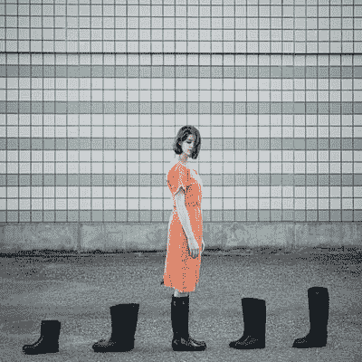
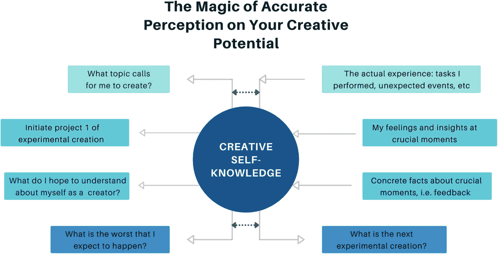
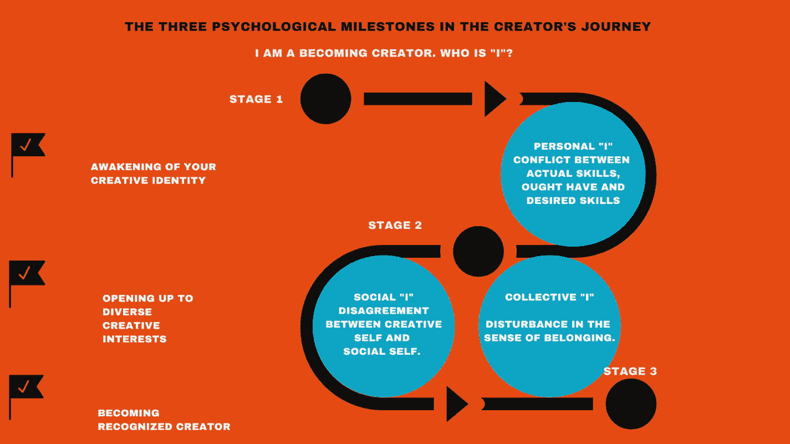

# 9. 允许自己为不同的受众创作

我可以在哪些领域进行创作？这个阶段对应于**约拿旅程**的一部分，即他在大鱼腹中度过三天三夜。约拿在是否接受上帝使命上的内心挣扎，是理想创作自我与旧自我之间激烈谈判的时期。

当你的产品满足了终端用户意识到的具体需求时，你向创作者新身份的过渡在心理上会更加顺畅。例如，当彼得收集到经验证据表明虚拟团队管理是公司的一个切实痛点时，他撰写了第一本关于*虚拟权力团队*的书。然而，对于像达莎·皮尔斯这样处理受众可能甚至没有意识到的无形需求的创作者来说，未来创作自我与过去的期望和熟悉感之间的霸权争夺仍在继续。因此，达莎很难相信自己选择了超现实艺术摄影，因为这种图像会激发观者头脑中的无意识活动。

*“所以，当我开始对创造这个超现实世界感兴趣时，我非常专注于这一点。在某个时候，我也曾挣扎于‘人们不需要这个’，当你展现真实的情感，记录真实的感受、生活的真实瞬间时。比如战地摄影师，那很重要，而无论我做什么，都根本不重要。谁想看它们呢？烤面包很重要，做这类事情则不重要。”*

当你的创新产品的可行性存在不确定性时，自我怀疑便会潜入创作者内心的对话，以确保你不是在徒劳地浪费时间。我为什么要创作这个？好吧，它对我似乎很重要，但为什么对别人来说也是必要的呢？

这是创作者内心对话的关键阶段，此时需要诚实。如果创作对你来说很重要，那就去做吧，享受你小小心灵的自由展现。如果你根本不在乎你的最终产品为何能让他人受益，那你更像是一个休闲创作者。你之所以做你正在做的事，是因为那是你寻找乐趣、处理情绪或管理生存危机的方式。那就继续享受你的创意时刻吧。

但假设你关心与他人分享你的创作成果，因为你觉得与世界有联系。在这种情况下，不断寻求你实验性创作对自身意义与他人能从中获得价值之间的平衡至关重要。你需要主动测试别人为什么会对你所创造的东西感兴趣。当你坚持进行新的创作行为时，创作自我可能会被“应该的”社会自我或集体自我所干扰。

## “自我”的社会性处于动荡之中

你的创作带来了什么影响？对于任何创作者而言，不仅仅是达莎，当你开始投身于新的创意活动时，来自你内心深处的自我怀疑会被放大，这些声音源于你亲近圈子的期望，或源于你基于以往工作经历而产生的自身期望。^(¹²²)

以下是一些关于“正在成为的创意自我”与“社会性自我”之间对话的例子：

> “我以前是这个领域的专家——比如说，市场营销。我亲眼目睹了广告如何提升销售额。现在我该如何衡量自己创作的影响力？”进步是用情感回报和经济回报来衡量的，而在一段时间内，你只能满足于前者。

> “我是父母的孩子，他们把我培养成一个拥有稳定工作的女儿。那我现在为什么又要做自由职业项目呢？”你将不得不学会做一个更具独立思想的人。

> “男人是家里的顶梁柱。我怎么能放下工作去整理自己的职业规划呢？”全球社会已发展到这样一个阶段：在接受过大学及高等教育的夫妻中，双方会轮流扮演家庭经济支柱的角色，而另一方则花时间去探索和自我重塑。^(¹²³)

尽管某些社会对个人重塑更为包容，但亲历者仍可能感到自己像是在经历一场严酷的考验。*“你，这个创意自我，怎么敢扮演一个积极主动的角色？”* 你内心那个顺从的一面这样告诫着你，它反映了你潜意识里认同的某些重要人物的声音。这些你脑海中他人声音与创意自我声音之间的内心对话，可能会让你分心，无法专注于你作为创作者所能取得的成就。

幸运的是，对于达莎和那些关注她作品的人来说，在向她朋友借了相机之后，长达数年的内心辩论终于有了一个圆满的结局：*“不，我还是要这样做。”* 她投身于超现实艺术摄影，并承担了这样一个风险：这类作品的需求量远低于家庭和婚礼摄影。

一幅艺术摄影作品，画面中一个女孩站在路上。女孩穿着一条 A 字裙和靴子。在她身前和身后，分别放置了四种不同尺码的靴子。^(¹²⁴)

## “自我”的一部分是集体性的

对于其他创作者来说，创意“自我”与需要归属于某个机构的“自我”之间可能存在一种内心对话。每一次实验性的创作，都在重塑这种归属感。当你开展新项目时，你会与新人及新的工作文化互动，而这些互动可能会也可能不会给你带来归属感或成员认同感。你可能会确信自己的工作是有价值的。然而，你可能觉得自己与那些做类似工作的人不属于同一个群体。

几年前，一位二十七八岁的女性维奥联系了我。“热情洋溢”这个形容词最能概括她的个性。维奥当时正逐渐适应服务设计师这一新职业角色。她向我寻求帮助，想解答一个问题：*“我的位置在哪里？”*

几年前，维奥移居芬兰，从事程序员工作。随着时间的推移，她越来越强烈地感到需要找到一种更好的方式与担任管理职位的人沟通。她听一位朋友说起硕士课程的学习经历，立刻意识到那正是她一直在寻找的项目。当她联系我时，她已经获得了新的学位，并且以服务设计师的身份工作了几个月。然而，她仍觉得自己在团队中格格不入。

在尝试不同角色的最初几年里，“自我”的集体部分会感到不安。在内心最脆弱的时刻，维奥的情绪在对过去所从事活动的依恋、对现状的不适以及探索其他工作环境的好奇心之间摇摆不定。

在起起伏伏中，让她感到安慰的想法是：她是一个渴望在团队中工作的创意个体。但*“我的位置在哪里？”* 这个问题却让她不得安宁。维奥的探索之旅仍在继续。*“为什么服务设计合我的口味？”“在这个角色中，我的创造力是如何体现的？”*

假设你确实找到了自己的领域，并且某个特定的创意角色与你相得益彰，但你仍需找到那个能让你尽情创作的工作环境。*“作为一名服务设计师，是表达我创造力的一个令人满意的角色。但哪种组织文化能让我有宾至如归的感觉？我能与哪些志同道合的人组队？”* 当维奥换到另一家公司工作时，她仍在思考这些问题。

自欺欺人会让我们透过恐惧的镜片或一厢情愿的镜片来看待事物。无论如何，我们都无法看到最适合我们创造潜力的地方。准确感知创作的召唤需要内在的功课，这基于对外部行动以及与之相关的思想、情感和行为的仔细观察（见图 9-1）。

一幅关于准确审视自身创造潜力的思维导图。它包括关键时刻的感受与洞察、关键时刻的具体事实以及实际体验。

**图 9-1** 创意自我认知

不同的是，在选择特定项目时形成的初始期望可能会妨碍我们看到随之而来的直接体验。当你开始内化你的创意自我认知时，你可能会意识到，自己曾误以为已经找到了作为创作者的专注点。而现实中，你仍需去发现你想得到认可的那些创意能力。

在这个阶段，请随意在不同的项目中尝试运用你作为创作者的核心技能。欣然接受他人的创作邀请。拥抱脑海中涌现的自发好奇心。好奇心是难得的，所以不要浪费任何一个。它们会引领你找到自己的领域。反思与主动实验相结合，会带来清晰度和创意上的自我接纳。*“我从这个创意项目中学到了什么？”“这些是我愿意认同的挑战吗？”*

你的创意自我认知的增长速度，慢于实验性创作的数量。*“我对创造自己的世界和自己的现实越来越感兴趣，”* 在尝试了婚礼和家庭摄影后，达莎说道。如今，她自豪地称自己为超现实艺术摄影师。至于彼得·伊万诺夫，他以虚拟权力团队专家的身份撰写了他的第二本书。

*“就是这样！这就是我，这就是我将要与世界分享的。”* 为了作为创作者成功走完第二阶段，当你对你的创作选择感到由衷满足时，你将必须学会何时该固执地完成某个特定项目，何时该寻找其他更能准确反映你创造潜力的事物。

### 练习 5：作为创作者的归属感

在我作为创作者的这一发展阶段，我所拥有的工作经历让我与那些属于以下类别的创作者产生了共鸣：

* 活动家

* 艺术家

* 企业家

* 环保主义者

* 领导者

* 表演者

* 哲学家

* 研究员

* 科学家

* 如果是其他人，那么是谁 _____

## 像天才一样；懂得何时灵活变通，何时坚持不懈

> *没有什么比发现一个无法用现有观念解释的事实更令人愉悦的了。*
>
> ——塞西莉亚·佩恩

塞西莉亚·佩恩在上述引言中提到的愉悦感，是一种回报，是你在针对一个棘手问题进行了长时间认知努力后，所获得的短暂胜利时刻。正如我们所见，即便是超级聪明的人，把好奇心转化为能力也绝非易事。

你通常会对什么事情感到好奇？你是否曾好奇星星是由什么构成的？塞西莉亚好奇过，并在 20 世纪 20 年代中期取得了一项革命性的发现，当时科学界震惊地得知，恒星和太阳主要由氢和氦这两种最轻的化学元素构成。^(¹²⁵)

你是否曾尝试将一个平面分割成小的几何图案？荷兰版画艺术家毛里茨·科内利斯·埃舍尔就做过。结果，他的插画颠覆了我们对确定性和真理的预期，例如，当我们看着一个地板时，下一秒才意识到它也可能是一个天花板。

面对创造性成就，我们往往会产生敬畏之情。但我们又对创造天才的日常生活了解多少呢？塞西莉亚·佩恩有一个丈夫和两个孩子。塞西莉亚和她的丈夫谢尔盖·加波施金都是科学家。他们过去常陷入婚姻冲突，其中争论的一个常见原因是家庭收入有限。其他时候，他们无法就谁因职业原因何时该去哪里达成一致。所以，当她去参加科学活动时，他就得留在家里照看孩子。^(¹²⁶)

至于埃舍尔，他一直在与孤独感作斗争。“生活是一所学校，我们在其中练习孤独，”他在 1955 年写道。他不得不与家人隔离。他如此全神贯注，以至于不想看到周围的人。有时他会为此感到内疚。然后，当缜密的思维过程结束，新想法在印刷品上可见时，人们却无法理解他的符号语言。因此，他感到“我在这里独自徘徊，”“为什么没有人能在触动我如此之深的事物中发现美？” ^(¹²⁷)

这些与你的生活有什么共同点？佩恩和埃舍尔的平凡经历传递了一个与其工作一样具有深远影响的信息。因此，我们理解了他们在生活的不完美中提升自我的能力，以便专注于那些激起他们好奇心的问题。

如果你等待完美的时机，你可能永远创造不出任何东西。相反，你需要灵活地接受新的兴趣，并坚持不懈地练习所需的技能。

### 灵活变通，为新奇好奇心腾出空间

1919 年，塞西莉亚正式成为伦敦纽纳姆学院自然科学专业的学生。当时一位著名的教授——爱丁顿教授，将要讲授他关于日食的研究。纽纳姆学院有四名学生有入场券，但塞西莉亚不在其中。

在最后一刻，一位有票的学生去不了。那个学生恰好是塞西莉亚的朋友。于是，最终塞西莉亚得以参加了爱丁顿的讲座，这是一次改变人生的经历。回到房间后，她能凭记忆写下演讲内容。在接下来的三个晚上，她都无法入睡。

这场讲座让她精神崩溃，并让她意识到自己对生物学不再感兴趣。物理学是她的新热情所在。然而，现在改学天文学（属于数学分支）为时已晚。因此，她用了两年而不是三年的时间完成了自然科学专业的学习。与此同时，她自学了物理学和天文学。

当她参加物理高级课程时，她是房间里唯一的女性。按照传统，女性必须坐在前排。于是，她只好独自坐在前排，听着所有男学生跺脚，并在教授进入房间时对他的问候报以热烈的掌声。

“……每次上课，我都恨不得钻进地缝里。直到今天，我在教室里还会本能地尽可能坐到后排，”塞西莉亚写道。^(¹²⁸)

至今，塞西莉亚仍是最杰出的女性天文学家之一。她对天文学的强烈热爱促使她跨越了性别界限，并在多年后离开祖国英国前往美国。

几年前，我第一次参加一个销售研讨会。因为我想销售自己的课程，但又非常不擅长销售，所以我想了解更多关于如何提高销售流程效率的方法。活动在城里一个我不常去的地方举行。所以，我迷路了，到得有点晚。当我推开门时，演讲者正在台上。但当我看到台下全是男性观众时，我惊得目瞪口呆。他们中的一些人，包括演讲者，都把目光转向了我。我想立刻转身以最快的速度跑掉。然而，我用尽最后一丝力气，轻轻点了点头，开始走向最后一排，想象自己是一只老鼠。

你上一次在最后一刻对下一步要学什么表现出灵活性是什么时候？你当时不得不面对的障碍是什么？那次经历的结局是什么？销售研讨会之后，我向演讲者做了自我介绍，并约了一次会面，探讨雇佣他做我的销售教练的可能性。

最终，我决定把时间花在对创造性身份的深入研究上，而不是磨练我的销售能力。这个决定并非源于男性参与者带来的威胁感。相反，他们中的一些人相当友好，并邀请我一起喝啤酒。也不是因为我不相信与销售教练合作的价值。相反，这是更准确地看清在我的人生旅程中愿意采取的下一步行动的结果。我宁愿花更多时间写作，而不是去主持培训。

### 坚持创作的毅力

作为创作者，在第二阶段中派上用场的一大技能，就是在经济回报并不丰厚时，依然保持创作的纪律性。当埃舍尔发现了他对用重复的动物图形来分割平面这一游戏的挚爱时，他会为了一个新想法而彻夜不眠，苦苦思索其中的排列规律。在他独立的艺术生涯的前三十年里，评论家们认为他的作品过于沉闷、过于理智，且缺乏情感。然而，每当他产生一个让他怀疑自己是否能把想法转化为原创象征符号的新点子的时，他都会毫不犹豫地开始新的创作过程。

“你画的是墙纸，”据说他父亲曾这样说过，尽管他确实在经济上支持了埃舍尔三十年，而那段时间埃舍尔的作品收入微薄。^(¹²⁹) 他的成功大约在 1951 年到来，当时美国的期刊，如《时代》、《生活》和《科学美国人》，开始刊登关于他作品的文章。^(¹³⁰) 在最后二十年里，他获得了来自世界各地的多数评论家和买家的积极评价。

当你产生一个新的创作念头时，在准备好与潜在受众分享之前，你会打磨它多久？当我开始写这本书时，我向一位密友提起了这件事。她非常兴奋，并支持阅读前几章。两年后，当我告诉她我正在重写书稿时，她开始质疑我是否真能写完这本书。

当你埋头于创作过程的耐心，超过了朋友们支持你项目的热情时，这表明你是一个在不断进行合适实验性创作的创作者。

成为创作者的前两个阶段，主要是关于如何协调你的创造性自我、社会性自我和集体性自我之间的内心斗争。这关乎频繁地试验，以检验你作为创作者的可行兴趣点。你如何知道，在哪个对你意义重大、对受众有用的特定创作项目上，该何时停止、何时坚持？

## 创作的四种个人需求

在创作者之旅的第二阶段，你可能会面临两种相互竞争的兴趣，从而带来新的困境。应该追随哪种好奇心？这个难题会延迟你专注于自己创作核心的时刻。

在我的第一阶段，出于对情商的探索欲，我从学术界转行成为了知识领域的个人创业者。我作为教练的第一个项目是设计和引导课程《幸福的选择》。其目标是帮助参与者培养建立高质量人际关系所需的人际交往技能——同理心、感恩和慷慨。这个实验被认为是成功的。参与者们欣赏这些兼具信息性和体验性的工作坊。与此同时，我也开启了对创造力心理学的好奇探索。

令我惊讶的是，创造力对我的吸引力更强烈。于是，我全心全意地投入到第二个课程《选择你的创造潜能》的设计中。该课程引导参与者找出生活中那些需要更多创造力的领域。但第二次，尽管我付出了所有营销努力，参加课程的兴趣者仅有五位。

接下来该怎么办？是继续一个广受欢迎，但主题是你次优选择的课程？还是继续一个对终端用户吸引力较小，但却是你自身最感兴趣的课程？

如果你发现自己正面临类似的困境，并且选择权只落在你一人肩上，那么回归到你的创作需求上可能会有所帮助。^(¹³¹) 创作的需求是人类的核心理念。从事创作行为能赋予人生意义，这种意义可能源于治愈或改善与你相关的现实的某些方面——无论是物质的、情感的，还是精神的元素。

荷兰格罗宁根大学生物医学工程教授赫尔德·桑托斯主要致力于减轻人们的病痛。

“我认为，如果你相信自己在做有意义的事情——以我们为例，我们正努力通过解决问题来影响社会，比如这里讨论的健康问题——这实际上会给你动力，让你每天早晨醒来，去工作，并付诸实践。”

对于其他一些创作者，比如达莎·皮尔斯来说，他们的创作首先植根于对自我的关爱，其次才是对健康社会功能的关怀。

“在我开始摄影之前，我有很多挣扎。我不是一个非常快乐的人，”达莎说。“我创作艺术的第一个原因是，是的，我成为了一个更好的人，因此与人相处也更令人愉快。我是一个更好的母亲、女儿和朋友。

其次，我的艺术激励人们去创作属于自己的东西。可能不是一张照片或一幅画，它可以是一个蛋糕、一座花园、一栋建筑，或是治愈癌症的方法。

第三，我的艺术也帮助人们找到内心的平静，并重新获得对（有时是狂乱的）情绪的控制力。因此，从这个意义上说，如果他们被积极的创造欲望所赋能，他们破坏周围事物的消极动力就会减少。如果更多的人想要创造而非毁灭，那么希望世界上的仇恨、痛苦和愤怒就会减少。这有点理想化，但这帮助我走过了艺术之路。”

在解释创作的内在动机时，创造力研究者使用个人价值观和兴趣模型来探究是什么驱动创作者投身创作活动。^(¹³²) 例如，最近一项关于创作需求的研究采访了 24 位专业创作者，了解他们如何体验创作过程。^(¹³³fu#fn133)) 他们确定了六个主题来解释是什么驱使我们在注重传统和惯例的环境中创作——美、力量、发现、交流、个性和愉悦。这项研究的一个关键启示是，核心个人价值观与强烈兴趣之间的协同作用决定了创作者的抉择。

由于创作者是愿意为社会带来新颖和原创内容的人，本书从神经科学的角度探讨了大脑如何在习惯性环境中处理社会互动。^([¹³⁴) 因此，有四种可能的需求会滋养你的创造性生命力，助你完成创作行为：对自主的热爱、对公平的渴望、对关联性的需求，以及留下个人价值观遗产的意愿。哪一个会定义你呢？

### 对自主性的热爱

你或许已经意识到，在工作中必须拥有心理上的自由与掌控感。^(¹³⁵) 正如彼得·伊万诺夫所说，你投身于创意项目，是因为它们对你而言有意义、充满挑战且引人入胜。

“如今，作为一位创业者、一位讲述自身主题的演讲者、一位书籍作者，我的创造力得到了完全释放。因此，我可以做任何能想象到的事，并且我认为这将为观众带来最佳的价值。”

自主性也意味着你在创造过程中可以自由地做出重要决策。“一首新歌是否失败，由谁来决定？”我问马蒂亚斯·库皮艾宁，他是芬兰力量金属乐队灵云乐队的吉他手、作曲家和制作人。

“我是第一道把关人，”马蒂亚斯回答道。“如果我觉得这首歌还不错，就会把它呈现给乐队其他成员。但这通常意味着，在我呈现之前，需要先创作出十首歌。”

在创造过程中渴望独处，并不意味着你在精神上完全独立。毕竟，你希望自己的作品——无论是歌曲、小工具还是书籍——能引起特定受众的兴趣。而你在创作时，脑海中会选定一位受众代表。

“……实际上，我们工作圈里有句口头禅：‘卡洛斯会喜欢什么？’”马蒂亚斯继续说道。“卡洛斯是个典型的墨西哥人，大概 26 岁，出身不好但热爱金属乐。这家伙就站在前排。他喜欢非常直白的东西。你要记住，他英语不太行。所以我们都在想：‘卡洛斯会认可吗？’我们称之为卡洛斯因素。当然，卡洛斯是第四道把关人。”

达莎偏好超现实艺术摄影而非家庭摄影，是出于情感宣泄的需求。她自主的创作过程产出的照片，能够触动那些与某种特定美感——想象世界之美、所见超越肉眼所见之美——产生共鸣的人。

从外部观察者的角度看，创作者似乎与世界隔绝，但你本人并非如此感受。当你体验到自我感减弱、与比自己更宏大的事物——也就是你创作的主题——的连接感增强时，你就能进入一种心流状态。^(¹³⁶) 那些你不担心他人如何看待自己作品的时刻，也就是所谓的心流状态，会增强你作为独立创作者的自主性。

至于我本人面对“该深入开发哪门课程”的困境，我选择将《激发你的创造潜能》这门课程重新设计成了三门新课程，分别面向三类不同的受众：组织变革的领导者、生命科学领域的博士生，以及在文化适应中挣扎的个人。一位营销策略师可能会说，这三种不同的需求将你定位成了三个不同市场中的创作者。这话没错。

然而，从心理学角度来看，在创作者的旅程第二阶段，品牌认知并非最关键。相反，首要任务是尝试不同的项目，直到你对自己愿意接受的创作者身份有所领悟。就我而言，我主持的创造力课程越多，就越开始动念要写这本书。这标志着我作为创作者的旅程第二阶段的结束。

有趣的是，在《激发你的创造潜能》第一期课程结束几个月后，我惊喜地听说，有一位学员在参加课程时开始着手写书了。这提醒我们，在每一次实验性创作中，对于何为得失，你需要三思。

总而言之，自主感驱使你从事那些你觉得本质上就有意义的活动。同时，在创作时心中装着受众，这是人之常情，所以要选对代表。不过，每当你收到客户的反馈时，想想马蒂亚斯。你是第一个决定将哪些意见融入自己作品的人。

#### 对公平的渴望

你有着强烈的是非观念。马特·利伯曼的一项研究表明，体验公平感所激活的大脑区域，与吃巧克力时激活的区域相同。^(¹³⁷) 牛奶巧克力、黑巧克力还是原味巧克力，你最喜欢哪一种？正如巧克力对不同味蕾有不同的风味，公平感也因观察特定情境的每个人而感知各异。

想象一下，你看到一匹马在拉车。你会为马感到难过吗？还是你会为乘客有了一辆能载着他们从一处到另一处的交通工具而感到欣慰？

有些人关心一群人是否得到了应得的回报，而另一些人则关心动物或自然元素是否受到了尊重。我们创造的一切，都是对我们最关心的事物或人的献礼，以期带来一丝公正。

`“如果更多女性担任领导职位，我们的世界会变得更好，”` 图莉亚·洛佩斯在她的书《高跟鞋中的领导力》中写道。^(¹³⁸) `“正如那句格言所说，帮助一个女人，就是帮助一个社区，因为她所获得的，通常会与家人和社区分享。”`

在与担任管理职位的女性共事二十年之后，图莉亚观察到一些削弱女性力量并误导女性的思维模式。她关于恢复领导层性别平等的观点是：`“你作为女性的声音，拥有超乎想象的强大力量。”` 她最新的项目是提高人们对阻碍女性职业发展的职场偏见意识。

以下哪个主题会让你跃跃欲试，想要立刻投入其中？

- 工作场所的包容性与多样性

- 为弱势背景儿童提供教育机会

- 管理创新

- 回收系统

- 其他 _____

还有哪些关于公平的主题会让你热血沸腾，想要用它来掀起波澜（直译：把城市染成红色或用它涂鸦）？

#### 归属感的需求

你通常喜欢他人，但哪些人是与你产生共鸣、让你感到有动力去帮助的呢？他们将是与你通过共同创造而建立联系的人——你作为发起者，而他们作为开发者，处于这个连续体的另一端。

`“在我人生的这个阶段，我受到感召，去接触并支持那些将工作置于自身健康、人际关系和幸福之上的、有上进心的女性，”` 帕梅拉·汤普森在她的书《学会与生活共舞：高成就女性指南》中写道。^(¹³⁹)

帕梅拉本人在创办咨询和教练业务之前和之后，都曾日复一日地工作。她认为，成为母亲拯救了她。她得以与工作保持更多距离，并注意到工作对她身体造成的健康损害。同时，通过她的孩子，她学会了全然活在当下的体验。

这些个人经历促使她想要防止其他高成就女性精疲力竭。于是，她开始撰写关于创造性生活实践的文章，例如身体智慧、艺术表达以及与核心价值观保持一致，这些实践能让人生更加平衡和清晰。

`“创造性生活社群”` 是帕梅拉这本书的核心要义。它关乎建立一个由全球各地女性组成的社群，她们都抱有相似的承诺：过一种能在我们自身、家庭、工作场所及更广阔范围内找到内心平静的生活。

至于达莎，当她提出新的自我表达项目时，她开始对激励年轻人产生兴趣，希望他们能在自己的生活中创造出所爱之物。

`“……我也向他人展示，你不必对自己现在所做的事感到不快乐。如果你想创造一些东西，无论它看起来多么疯狂，你仍然可以做到，这是可能的。这也是我如何看待自己的角色。现在我也在教书，这在我生命中是一件非常非常重要的事。”`

简而言之，当你追求某个特定的创造性兴趣时，你这样做是为了那些你内心真正有动力的活动，也是为了发展一个让你有归属感和被欣赏感的社群。每个项目，都是你播下的社会变革的种子。

#### 留下个人价值观遗产的意图

你需要为下一代建立紧密的联系并提供指导。因此，你挑战自己，通过灌输一套引领性的信念体系，在你的家庭、种族环境或公司文化中创造积极的改变。

这种创造的需求源于你对所出身的家庭和文化的爱，正如我们从哈丽特·法格霍尔姆关于她不断演变的自我意识的证词中所见。

`“我是芬兰讲瑞典语的少数族裔的一部分，最近我一直在探索自己的身份。特别是今年夏天，我回到我出生的博滕区家乡，那里是粗犷的群岛，条件艰苦，人们必须相互协作才能生存。所以，我的根在那个社群，一个非常强大的社群，带着一种强烈的文化认同，其中又有些矛盾的元素。我现在意识到，创造力正是在这些元素交织、并且与自然紧密相连的地方得以滋养的。”`

此外，哈丽特意识到，她与孩子和丈夫的关系是她身份认同的核心。

`“我很高兴看到，作为母亲，我能够改变我们家庭的文化，让它变得更加开放，允许更多情感的表达和分享……这对我来说是一种自豪感，我成功完成了这种内在的转变，而我在自己的专业工作中也在做同样的事，我也能在我自己的家庭中做到。”`

她最新的项目之一是关于自爱与自我觉察的播客《存在的喜悦》。如果你要创建自己的播客，在其中推广一种作为遗产的核心个人价值观，你会给它起什么标题呢？

我会创建一个名为《自发性与延续性》的播客。目标是探讨如何在成人与儿童的日常互动中塑造创造力，从而培养孩子们对社群的归属感。

有一天，我看着我的儿子们和他们的朋友玩耍，于是我开始追他们，想给被抓到的人一个吻。孩子们很喜欢，并想把这个游戏叫做“偷吻贼”。之后，他们连续好几天都要求再玩这个游戏。他们的反应鼓励了我，于是我们尝试了即兴讲故事，作为另一种共度美好时光的方式。我们轮流创作关于一个 10 岁男孩保罗的故事，他喜欢弹吉他，并在附近的街道巡游。保罗的问题在于他 5 岁的弟弟帕维尔，他渴望在每一场演出中展示自己的舞步。

总而言之，这种自发的互动是连接现在和未来几代人的桥梁。它是一份遗产，最好地情况下，会被捕捉到新的社会行为中，并在家人和朋友间延续下去。最低限度，它也是作为童年记忆储存的片刻欢乐。

个人价值观——情感意识、连结、创造力等——被认为是必要的，它们体现在人际互动和文化体系中，通常通过神话、音乐、民间故事、文学和社交媒体来传递。

如果播客对你没有吸引力，你希望创造什么来作为你与下一代之间的纽带？在某些非洲文化中，编辫子是一种创造性的连接方式，也是代际之间表达爱的方式。你的遗产会是什么呢？

`“我们是生活在你们之前的创造者。我们被（你的价值观）赋能`

-   情感上的可得性
-   同情心
-   能力
-   独立性
-   人人平等
-   信念
-   宽恕
-   知识
-   权力和权威
-   勇于冒险
-   财富，等等

`我们希望你们享受我们留下的这个世界。”`

在你作为创意专家的这个发展阶段，哪种心理需求在驱使你去创造？

-   对自主的热爱
-   公平感
-   归属感的需求
-   留下引导性价值观提醒的意图

在实验性的创作之间，你或许可以退后一步，审视一下你作品中反映的信息。你接下来想创造什么，为什么？为了成功发现新药，赫尔德·桑托斯教授相信永不放弃。永不言弃意味着，当你没有得到预期结果时，你可以找到另一种方法，因为你看到了自己行动的意义。当一扇门关闭时，如果你看不到窗子打开，那就发明一扇。欢迎来到创造者的世界！

脚注 1 2 3 4 5 6 7 8 9 10 11 12 13 14 15 16 17 18

### 坚定你的创作专注力

培养创造型身份的第三个阶段，在于向他人证明你的创作对他们有何价值，并维持自己的角色地位。这对应了约拿的旅程——当大鱼将他吐在旱地上，他便启程前往尼尼微。

成熟的创作者需要不断获得客户、老板、评论家、粉丝等人的认可。从这个角度看，创作者若能偶尔打破常规与既定流程，将大有裨益。正如达莎在回答是否对当下超现实艺术摄影师职业生涯感到满意时所言：

`“我不能说满意，因为随着我作为专业人士和艺术家的成长，我看到还有很多很多需要学习的东西。并非说我能在职业生涯中达到某个点，然后说‘好了，我终于完成了’。`

`大概一两年之前，我或许有过那种感觉——当时我觉得挺放松的——但我很快意识到，如果抱着那种心态停滞不前……这与我所做的高质量作品无关——只是，如果我就待在那里，我会彻底停滞。对艺术家、对任何人来说，这都意味着死亡。”`

当你乐于学习并探索表达职业创造力的新方式时，你会让追随多年的观众大吃一惊。此外，即便你已有人气，或许仍需吸引新的受众。这需要你探索激进的创造力。

*“我开始隐约觉得，在如何传递这些内容方面，我不知道该如何跳出固有思维，”* 领导力沟通专家约翰·贝茨说，*“我是做一个‘培训培训师’项目，让人们在不同国家获得授权？还是在大公司内部做一个‘培训培训师’项目，训练那些已经在做沟通工作的人？或者我该只专注于线上培训？但怎样才能产生最大的影响力呢？*

*我刚才说的这些，都是人们正在做的常规事情。我能做哪些跳出常规的事？我如何给这个领域带来新颖独特的东西？”*

成熟的创作者需要允许自己去发现那些值得自己专注、而同行却未关注的问题。以问题为驱动力，意味着你要将自己确立为跨学科交叉点上的专家，从而能够运用另一领域的学科思维和方法论，来审视某个领域中正在被攻克的问题。这正是埃舍尔所做的。

埃舍尔沉醉于几何学的对称法则，用以创作美学图像，尽管他在 1959 年写给儿子的信中说，自己在数学和艺术的世界里都感到格格不入。

*“我开始说一种很少有人能理解的语言。这让我愈发感到孤独。数学家们或许很友好、感兴趣，还会像父亲般拍拍我的背，但最终，在他们眼里我不过是个笨手笨脚的人。‘艺术圈’的人则大多感到恼怒。”* ¹⁴⁰

埃舍尔确实与艺术家和数学家共享两个特质：对解谜的迷恋以及解谜时的毅力。*“我能怎么办呢？”* 他写信给儿子，*“当这种问题如此吸引我，让我无法释怀时……我忍不住要嘲笑所有那些坚不可摧的确定性。你确定地板不能是天花板吗？”*

有些创作者，比如达莎·皮尔斯，在作为超现实艺术摄影师的相对早期阶段，就找到了一群志同道合的伙伴一起工作。*“找到能一起创作的人，这总是非常鼓舞人心。在合作与融合中，我能从他人身上学到很多。”*

对于像埃舍尔这样的创作者而言，若找不到一群与你同样痴迷于你所关注的问题的人，那种归属感的缺失，便可能是对你承诺于那些构成成熟创作者身份的兴趣与技能的终极考验。正如我们所知，埃舍尔通过了考验。

图 10-1 总结了创作者内在自我的旅程。它始于发现某个好奇心时充满意义的巧合。接着，你开始创造前所未有的事物，比如我开设一门关于创造力的课程，达莎投身婚礼摄影，彼得决定将他的管理经验转化为咨询专长。起初，如果你的粉丝俱乐部只有两位创始成员——你的妈妈和她的猫——那就算幸运了。这个阶段是对自我怀疑的考验。你是否有足够的自信，在新的角色中培养出精通的技能？

**图 10-1** 内在之旅

从第一阶段到第二阶段的转变，发生在你主动尝试不同的创作兴趣和受众之时。家人会评判你的选择。其他人——同事、潜在客户和竞争对手——则会评估你工作的成果。然而，最激烈的斗争来自你内心，在你创造性自我、应然社会自我和集体自我的声音之间。每一个创作过程，都是对未来可能成为的多个创造性自我中做出选择的考验。你或许能扮演好某个特定的创作者角色，但这个角色能让你满足吗？

当创作者致力于某个特定的创作焦点时，就进入了向第三阶段的进化。创造性自我的主导地位会诱使你接受一种新的工作生活方式，以及与周遭人建立联系的新方式——无论是在个人还是职业层面。每一步，外部的评价都将成为你对自己作为创作者的选择日益增强的自信心的补充衡量标准。

### 他们幸福地生活在反馈循环中

*“我并不把自己太当回事儿，”* 一位朋友在一次作家会议上曾这样说。如今，他已是多部语言类著作的作者和编辑。2017 年，他入围了哈蒙德·豪斯国际文学奖。^(¹⁴¹) 当时，我们正专注于互评稿件，我没有追问他的意思。然而，这句话多年来一直萦绕在我心头。不把自己的创作者角色太当回事，究竟意味着什么？

当你认真对待某人或某事时，你是在表明他们值得你尊重。那么，当你的潜意识提醒你某个细节没有处理好，让你在夜里因胸痛惊醒时，你又怎能对此视而不见呢？

在实施一个新想法时，接收反馈是必要的一步。然而，在他人批评你的成品之前，你对自己进展的快慢已有看法。最脆弱的时刻，莫过于你发现自己又深陷于另一个需要解决的难题。你甚至还没接近完成最终产品；像往常一样，截止日期就在眼前。你如何才能在这些时刻保持冷静，而不被纠结于最精细的细节所消耗？

答案是：你无法做到。你需要深入挖掘，直到找到令人满意的解决方案。诀窍在于留意潜在自我价值感的变化。在你与新的难题搏斗时，对自己能力和行为的无意好恶，会长期影响你的心理机能、整体效率和创造性思维。^(¹⁴²) 当你为一个难以捉摸的解决方案苦苦挣扎时，你最终可能会想：*“而且我连长得都不好看！”*

成为一名创作者，意味着将大量的思考和情感投入到把一个想法转化为成品的过程中。要是我们能在需要时挥动魔法棒，将想法变为现实就好了！例如，对于芬兰作曲家马蒂亚斯·库皮艾宁来说，创作一分钟歌曲的失败与成功比例大约是 70/30。

*“如果我能成功创作出一首真正的好歌，那在此之前我必须失败 10 次。但那些失败的 10 次中产生的素材，我以后可以用，或者修改它，所以素材永远不会浪费。我会回收利用。我想说这是一个漫长的过程。有时，仅仅制作一首三分半钟的歌可能就需要我一个月的时间。或者有时，制作一首十分钟的歌，只需要我两周时间。这也取决于我有什么样的灵感，或者我是否对自己所做的事情有清晰的愿景。通常，我完全不知道自己在做什么。”*

特别是当你把自己创作的材料视为自身的延伸时，每一次创作过程都会拨弄你的自我价值感，即你对自己作为创作者的能力的想法和感受。请按 1（*这完全不是我*）到 5（*这太像我*）的等级，对以下陈述进行评分：

*“对我来说，出色地完成工作的感觉与获得认可同样重要。”*

*“总的来说，我对自己的创作表现感到满意。”*

*“对我来说，接受反馈是提升技能的机会。”*

平均分越高，自我价值感就越平衡，这有助于保持更专注、乐观，并坚持寻找解决方案。^(¹⁴³) 你认为你的自尊水平如何：高、低、还是中等？它是否连续多日保持不变？还是说，自我价值感会在同一天内根据情况而波动？

过高的自尊——*“我可以成为任何我想成为的人”，“我不会受失败影响”，“我有很多值得骄傲的地方”，“我不会犯错”*——可能会导致忽视来自潜意识的微妙提示。因此，你可能会错失改进产品的机会。相反，过低的自尊——*“当我开始一个我在意的项目时，我经常担心自己能否完成”，“我通常对自己的表现感觉不好”，“我有时认为我的想法不重要”，“我有时觉得自己不够好，不配当创作者”*——会让你更容易陷入自我怀疑、焦虑和抑郁，这会扼杀你的创造性思维和在实施原创想法时的应变能力。

正如文森佐·切鲁洛教授所注意到的，作为创作者，耐心地辛勤工作直到获得自己可以接受的结果是一种美德。

*“我是一个非常有耐心的人。科学是一段充满失败的漫长旅程。所以，当我将自己与其他科学家或同事比较时，我注意到的一点是，我相当有耐心，并且能很好地接受失败，我认为这是在科学领域取得成功的关键。正如我常对学生说的：‘这是一份每年只有一天很棒，其余 364 天都让你非常沮丧的工作。’”*

从某种意义上说，各个专业领域的创作者都像花朵。在它们的意识层面上，尽管气候变化带来了令人困惑的信号，花朵仍尽力尊重自身的自然周期。^(¹⁴⁴) 它们可能每年提早几天开花，但它们确实从冬眠中醒来。它们在日出时张开花瓣，在日落时合拢。

同样，来自潜意识、指出你创作过程中暂时性问题的信号，其存在是有原因的。它们值得尊重、关注并采取行动。随之而来的沮丧、恐慌以及自尊的过山车式波动，需要耐心和温柔的鼓励。

你与你创作的主题之间的联系感越强，你就越容易贬低自己的自我价值。在那种“你本可以做得更多更好”的崩溃感背后，是对某种超越自身的事物的关怀和投入。这就是创作过程的本质：时而陷入困境，时而重回正轨。每次都要控制好你的自尊。

至今，对于我的朋友说他“不把自己太当回事”可能暗示了什么，我只能进行推测。不过，我冒昧将这句话解读为一种提醒，提醒我们倾听持续不断的反馈——包括自己和他人——并相信自己有能力据此采取行动的重要性。这是一个个人目标，当你处理创作过程中的不满和失败感时，它非常有用。它能将焦点从你自己身上移开，放到下一个要执行的任务上。

简而言之，你的工作是创造，在碰壁时保持耐心，并追求健康的自尊水平。要足够高，以便在每一次失败中都能看到运用你创作者技能的开端；也要足够低，以避免对自身能力和成果的夸大评价。*“你只需让你身体里那柔软的动物去爱它所爱的东西，”* 诗人玛丽·奥利弗写道。所以，让你对工作的热爱，比从不断获得认可中产生的骄傲更为重要。

## 第 2 部分 总结——学会像创造者一样生活

创造者是这样一种人：他们对某个知识领域或经验产生了强烈的好奇心，并选择投身于创造行为。无论是科学家、企业家、艺术家还是某一领域的专家，你都会因期待向观众呈现一个令人惊喜且有价值的产品而备受激励。

在培养创造者内在自我认知的过程中，有三个关键里程碑：

1.  当**“机缘巧合”**让你注意到某种**“创造性的好奇心”**时——比如我对《天生会创造》这本书的兴趣、达莎对相机的兴趣，以及彼得决定做个人优势测试。在这关键的时刻，你可以选择进一步探索这份好奇心，也可以对它视而不见。

2.  当你**接受了自己作为创造者的使命**，但为了寻找一个你准备好去拥抱的角色，而为不同的受众尝试不同的项目时。我为不同用户创建的课程，以及达莎对婚礼和家庭摄影的探索，都说明了这个阶段。

## 3. 当你`投身于一个你希望获得认可的创造领域`时。

对达莎来说，这个阶段始于她找到了一种与自己偏爱超现实美学摄影的方式和平共处的方法。

你发现自己目前处于哪个阶段？

尽管作为创造性人才有其独特性，所选择的领域也有其特殊性，但养成以下五个习惯对于进化到认可阶段尤为重要：

*   发现强烈兴趣需要`辅助技能`，这些技能能强化创造者在兴趣领域的形象。例如，刻意练习创造性思维、创业、人际交往或公开演讲技能，可以帮助创造者与可能的受众建立联系并向他们学习。

*   在追随新好奇心时保持`灵活性`。要有意愿和勇气腾出时间来培养那些会打乱现有项目的新能力。

*   `坚持实验性创作`。在每一个项目中，将你的想法付诸实践的决心必须超越对外部认可的渴求。

*   `识别对创造的`心理需求，这有助于创造者与自己的创造选择达成和解。

*   对创造过程多一点`耐心`，比获得认可时的`骄傲`更重要。

在上面提到的习惯中，你觉得哪些对于你当前的工作环境而言，即使不紧急，也是重要的需要采纳的？

在下一部分，我们将探讨内在观察的习惯，以增加在创造者身份形成的第一阶段，产生“啊哈！”时刻的可能性，从而进行实验性创作。

脚注 1   2   3   4   5