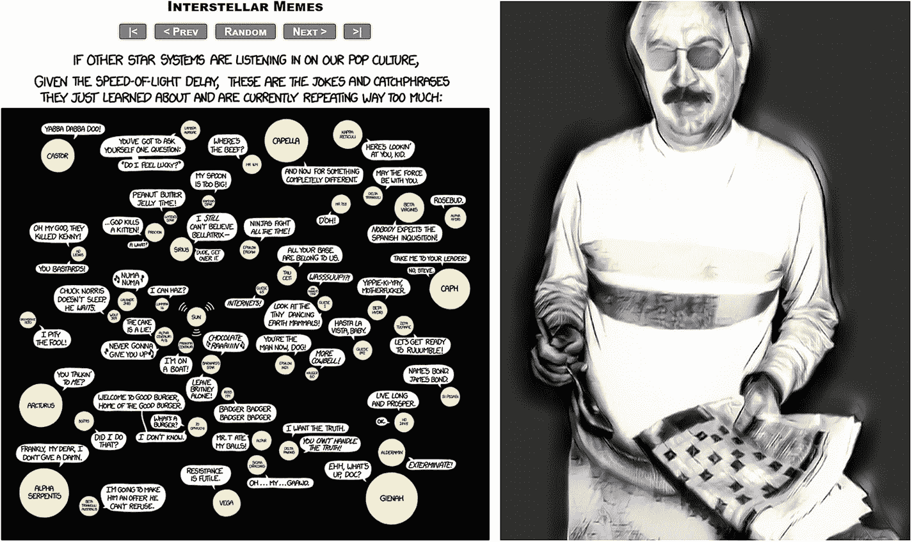
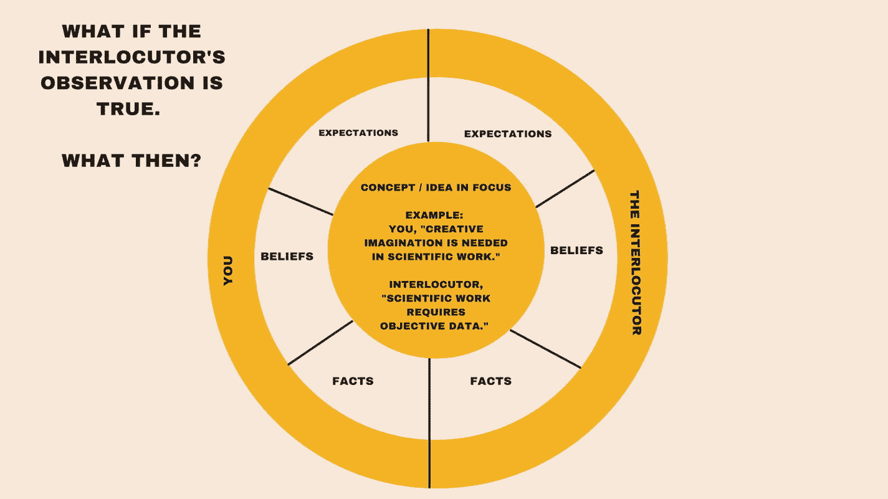

## 19. 听出想象力

> *当我不必与人交谈时，我的想象力运转得更好。*
>
> ——小说家 [帕特里夏·海史密斯](https://www.goodreads.com/author/quotes/7622.Patricia_Highsmith)

大多数时候，我们认为想象是一种头脑活动，当你独自思考时，它会不受阻碍地流动。本节讨论如何在反馈对话中让我们的想象力发挥作用。用类比说话，是基于将你听到的内容与你已知的知识联系起来，以更好地解释当前的想法。听出想象力，则是关于将你听到的内容转化为一种可能性。它关乎利用一个触发点来问“如果……会怎样”的问题，向未来的情景敞开思维。

### 何为想象力？

莎士比亚曾写道：“整个世界是一个舞台，所有的男男女女不过是演员而已。”^(²³⁸) 不仅如此，每个男人和女人都拥有内在生活，在其中他们创造自己偏爱的舞台，配有演员、冲突、资源和理想结局。

比较心理学的研究已识别出人类和动物共有的几种认知能力，如记忆、社会推理、物理推理、沟通和共情。^(²³⁹) 然而，构建替代情境、设想和推测未来情况的能力，是使我们区别于动物物种的显著特征之一，通常被称为“`想象力`”。

让我们以观察这张照片为例，来说明构建替代情境的能力。

一张红丝绒蛋糕的照片，上面写有文字“`爱自己`”，并点缀着一颗草莓和一颗樱桃，置于右手掌上的圆形碟子中。^(²⁴⁰)

你可以“看到”除了实际情况之外，还可能发生什么。想象一下自己咬一口这块蛋糕会怎样？会是什么味道？回答这些问题会让你考虑自己尚未经历过的行动方案。

此外，你可以预见到这些行动可能带来的后果。如果你尝到的是一块带有蛋白霜的樱桃蛋糕呢？你会喜欢面团柔软与蛋白霜酥脆之间的对比吗？凭借想象性思维，你可以进行`心理模拟`，推测可能事件的因果关系。你是否开始流口水了？你已经在想象中，或者说用眼睛“吃”下了这块蛋糕。享受这种感觉吧。如果你对这块蛋糕的图片无动于衷，那可能是因为你想象出的味道并不合你的口味。

想象力并非凭空产生。它是由对你具有重要意义的内外部因素触发的。它汲取过去的经验和知识，并受改变、发现或在物理世界中创造这一欲望的驱动。^(²⁴¹) 你现在是否在考虑烤一个合自己口味的蛋糕？一旦你识别出一个与自身产生共鸣的未来情境，你就会受到激励，将其变为现实。

窥探人脑的结构，我们可以在默认模式网络中看到想象力的痕迹。默认模式网络是一个连接左右半球的脑神经网络，用于编码和检索个人信息及假设性事件。一旦你将自己投射到一个未来情境中，它便成为你的一部分，即你的`情景预见能力`。它为你内在舞台剧的剧目库增添了新的内容，让你对未来充满希望或恐惧。因此，你可以重温一个偏好的未来构想，并在决定将其变为现实时加以改进。假如你在蛋糕里加些酒呢？

除了回忆过去和展望未来，想象力在默认模式网络中还有第三个关键方面，即考虑他人的想法和观点。^(²⁴²) 如果有孩子想吃一块蛋糕，你还能加酒吗？

综上所述，我们将想象力定义为：一种摆脱过去所作所为的束缚，立足于当下，以便为造福群体而探索可能未来的能力。

#### 想象力等同于幻想吗？

对于德国诗人、哲学家和科学家歌德而言，幻想是直觉体验世界、观察自然隐藏机制的先决条件。那么，让我们来直面这个显而易见的问题。当你想到想象力时，脑海中会浮现哪些同义词？想象力与幻想在多大程度上可以互换？

从最终结果的角度来看，想象力基于这样一种能力：在特定的时空里，思考某个尚未成真但具有成为现实潜力的事物（如事件、概念、产品）。当一个想象的事件（如社会变革）成为趋势时，追随者将直接体验到它。一个想象的产品可以成为原型或创新，被受众所使用。

幻想则是小说作家所擅长的，他们通过自己的技艺创作故事和人物，让读者在阅读书籍的过程中与之产生关联，并将自己投射到相应的世界中。因此，幻想源于思考某个感觉真实的事物（如事件、物体、人物）的能力。尽管如此，它在特定的时空里并不具有物理形态。这种真实感源于创作者和读者脑海中唤起的心理意象和情感。

当读者读完一本小说时，故事和人物依旧停留在纸面上。有些可能会在读者记忆中逗留更久，但迟早会在现实的人际互动中被有血有肉的真实人物所取代。而对于作家来说，新的幻想正在等待他们。

因此，幻想是想象力的一种形式，是某些行业（如艺术）中至关重要的一种思维类型。艺术家达莎·皮尔斯小时候就画满了精灵和怪异生物的世界。她对窗外的风景或其他事物不感兴趣。成年后，她通过超现实主义艺术摄影重新找回了童年的兴趣，她不仅捕捉她眼中的世界，还想邀请人们进入她的超现实世界。

*“超现实主义艺术摄影意味着，你在我的艺术中看到的，并非你能在周围的客观现实中看到的，”*达莎说，*“基本上，我的艺术会让人们感到惊喜。里面总会有这种超现实的元素。”*

为了在你非艺术的领域中享受想象力的多种益处，你不应该错误地将幻想等同于想象力。^(²⁴³) 不过，如果幻想对你来说是自然而然的思考方式，你也不应刻意避免。例如，如果你是游戏程序员，你可以尽情幻想，为产品构想出一个引人入胜的愿景。假设你是一名研究者，对研究课题有一些假设。那么，总的来说，这些关系最终需要在受物理原理和人类文化支配的宇宙中被证明是有效的。

总之，幻想是想象力的一种类型，在艺术和非艺术领域的构思阶段都大有裨益。^(²⁴⁴) 此外，想象力还有其他形式。^(²⁴⁵) 关于不同类型的想象力，你需要了解些什么，以增强你在物理世界中进行创造的潜力呢？

#### 三种催生新想法的想象力活动

有两种想象性思维能将我们带离“现状”，走向“可能”：`心理意象`——通过图像、身体动作或其他感官模式（如嗅觉或听觉）进行想象——以及`反事实思维`——将已发生的事件与假设事件进行对比。这些思维模式在以下三种心理活动之一中被激活：`白日梦`、`思绪漫游`和`视角转换`。

作为补充说明，还有其他涉及意识状态改变的想象力活动，其中一些是功能性的——做梦、冥想、使用致幻剂——而另一些则功能性较弱——幻觉、妄想、灵魂出窍体验。^(²⁴⁶) 本节不讨论这些改变的意识状态中的想象力类型。

##### 白日梦

想象一个你喜欢的地方。想象一个你爱的人。想象一段最近的快乐回忆。这些都是白日梦的例子，它是一种能唤起情感、身体知觉、声音或味觉的想象。你可以独自进行，也可以和一群人一起进行。例如，你可以决定独自在办公室里做白日梦，作为工作间隙的休息。或者，你也可以在工作坊中做白日梦，由引导者带领你获得更丰富的感官体验。

在白日梦中，注意力向内引导，并伴随着与当前情境无关的自发性思绪（即刺激独立性）。你的情绪、意图和注意力焦点是白日梦的关键要素，这些要素能有益于创造过程。^(²⁴⁷)

一种常见的白日梦方式始于自发地选择一个特定的地方，一个让你感到放松、安全或愉悦的地方。你想象自己参加一个期望会有积极结果的活动。你看到自己在与人们交谈。从这一刻起，你的想象便不受限制。你着手构思各种行动——你自己的和他人的——以及那些有助于达成期望结果的细节。

例如，在反馈会议之前，你可以在脑海中预演不同的场景，思考如何开启对话。接着，你可以模拟你可能会被问到的问题以及你能提供的答案。同时，你也可以对着镜子排练，当你听到一些不如预期乐观的反馈时该如何反应。最后，你可以想象当你的想法得到认同时的那种良好感觉。

## 思绪漫游

思绪漫游与白日梦相似，因为它也需要内在集中的注意力。但与白日梦不同，神游始终是一种独自的、自发性的活动。这不像你可以决定：“好了，现在似乎是进行思绪漫游的完美时机。”然后你坐在沙发上，有目的地沉浸于特定的思绪中。

对于有创造力的人来说，神游可能发生在围绕某个感兴趣的问题进行密集的知识获取之后。你无法选择思绪漫游，而是思绪漫游选择了你。当你从事一些不太费神的事情（例如打扫房间）时，你的注意力会不由自主地飘向对你个人意义重大的想法。然而，思绪漫游是一种常见的心理状态，它也可能发生在你从事更费神但不太有趣的任务时，比如阅读一份枯燥的工作报告。^(²⁴⁸) 你的大脑会突然决定，理解你正在读的内容并不那么重要。

从你当下所做的事，到你的大脑在那一刻认定最相关的话题，这种自动切换会导致一种元认知暂时失效的状态。你会失去对自己所思所行的觉察。一方面，你可能会错过屋里某处的灰尘，或报告中的某些信息。另一方面，你可能梳理清楚了一些关于你大脑无意间所想之重要事务的问题。

总而言之，思绪漫游源于解决个人重大事件的渴望，例如一个具有挑战性的创意问题。它为“啊哈”时刻的到来提供了一个酝酿阶段。

说个有趣的事实，在我写这本书时，我儿子经常问：“妈，你在生我气吗？”每次我都回答：“没有，我只是在想事情。”所以我知道自己思考时的表情是什么样子。我也不敢说自己在孩子面前心不在焉是件值得骄傲的事。但思绪漫游就是这样，它让人无法抗拒。

## 换位思考

`换位思考`是一种能力，指通过不同的视角来思考某个特定概念或情境，例如他人的观点、时间的变迁或真相的不同呈现形式。采纳他人的视角，也被称为`认知共情`，涉及理解他人可能对这个概念或情境了解什么的能力——他们的经历、情感和知识。而考虑时间与潜在假设，换位思考则要求具有改变心智框架的灵活性，将自己置于由不同规则支配的遥远过去或遥远未来的情境中。

`换位思考`可以独自进行，也可以在对话中进行。它可能不自觉地发生。有时，它也可以是有计划地、在另一个人在场的情况下进行。

这三种想象活动——白日梦、思绪漫游和换位思考——可以根据三个关键要素来区分：

1.  **想象活动是如何在脑海中启动的？** 我们可以有**自发**或**刻意**的想象片段，它们分别在没有或有我们意识引导的情况下发生。
2.  **进行想象活动的个人身处何种社交环境？** 我们可以进行**独自**或**社交性**想象，它们分别在没有或有他人积极参与的情况下发生。
3.  **想象活动的刺激物是什么？** 我们可以体验到**想象的感觉活动**，这种活动基于在缺乏适当刺激时感知事物的能力，例如在四周寂静时想象听到某段旋律的声音。或者，我们也能体验到**创造性想象**的片段，它包括通过联想或分离来对想法进行自发的组合，刻意否定至少一个被普遍认为是真实层面的方面。

以下摘自马塞尔·普鲁斯特的《追忆似水年华》的片段，说明了当下的感官刺激——一种熟悉的味道——如何不由自主地触发角色的童年记忆。

```
就在我认出了那浸在她给我的椴花茶里的小玛德莱娜蛋糕的滋味时（尽管我还不知道，而且必须等到很久以后才发现为什么这个回忆会让我如此快乐），刹那间，我那栋临街的、她房间所在的灰色旧屋，就像舞台布景一样升起来，与为父母建在后面、对着花园的小楼连在了一起…… 恰如日本人玩的那种游戏，他们把一个瓷碗装满水，浸入一些小纸片，那些纸片在浸湿之前毫无特点和形状，可一旦浸湿，它们就会伸展、弯曲，染上色彩，显出独特的形状，变成花朵、房屋或人物，变得清晰可辨，同样，那一刻，我们花园里和斯万先生公园里所有的花朵，维冯纳河上的睡莲，村里的善良人们和他们的小屋，教区教堂，以及整个贡布雷和它的四周，一切都有了应有的形状和实体，城镇和花园，所有这一切，都从我那杯茶中浮现了出来。
```

此外，一种强烈的感觉——视觉的、听觉的、运动的或嗅觉的——若与过往经历结合，可能催生采取新行动的欲望。正如玛德莱娜蛋糕的味道能带回童年时期小镇和人们的生动细节一样，它也可能引发对未来的一瞥，比如住进新家或与久违的朋友重逢。这样一来，这部小说便会拥有不同的情节和人物发展轨迹。

# 排版后的内容

除了感官触发因素外，想象行为也可能由对公认真理的隐藏假设的突然识别所触发。这种令人惊讶的发现激励创作者付出努力，在某个社群或知识领域中引入新想法。²⁴⁹ 以下照片是传递幽默想法的创造性想象的两个示例。



一张照片：左侧是《星际迷因》，右侧是一位老人假装失明，手拿笔在填写报纸上的填字游戏。

在左侧，我们可以看到 xkcd 漫画《星际迷因》，其中在每个星系中都有一些居民，他们拾取地球上不同年代的流行文化短语。就大多数天文学家共享的现实而言，目前普遍认为地球是唯一存在生命的行星。

在右侧，我们可以看到这样一个场景：主人公假装成一位失明的人在填写纵横填字游戏，而实际上他并非如此。你注意到他打算用来填写谜题的“那支笔”了吗？

总结一下，如果声音、身体动作或一块玛德琳蛋糕碎屑触发了感官想象，那么扭曲的现实规则则触发了创造性想象。最终，这两类刺激都能引发创意。自发性与刻意性、独处性与社交性、感官性与创造性想象，描述了三种想象形式（白日梦、走神和观点采择）发生的时间和方式。哪一种对你来说更自然？

白日梦和走神活动主要是感官意象活动。另一方面，观点采择主要是一种反事实思维类型的想象。在下一节中，我们将讨论观点采择如何能够滋养参与反馈对话者的想象力。

### 对话式想象

在本节中，我们不会过多讨论白日梦和走神——尽管它们在创意过程中是激发创造力的强大练习。相反，我们希望理解如何通过影响参与者心智框架的转变来激发想象性思维。因此，我们将详细阐述“对话式想象”，我们将其定义为：生成自发性反事实问题的能力，这些问题将对话推向一个假设性层面，在此你和你的对话者共同探讨可能挑战当前对讨论主题理解的未来可能性。

从神经认知的角度来看，对话式想象需要默认模式网络、认知控制网络和语义认知网络之间的相互作用。换句话说，当你倾听关于你原创作品的反馈时，你会无意识地将你所听到的与你所知道的、你所做的以及你未来计划要做的事情进行比较。这种比较可能导致新的愿景或对当前实施策略的修改。

`心理时间旅行`、`角色扮演`、`对比信念`和`证伪假设`是你可以有效处理已知信息并改变对讨论要点的看法的策略。

#### 时间视角

心理时间旅行是一个很好的策略，它提醒我们：今天被认为理所当然的事物，在昨天可能曾是革命性的想法或物体。让我们思考以下谜语：

“有一种古老的发明，至今仍被世界许多地方使用，它能让人们穿墙而过。它是什么？”

你上一次仔细观察一扇门并想“哇，这扇门真了不起”是什么时候？每天，我们匆忙地打开和关闭那么多铰链门或推拉门，几乎从未想过它们尚未存在的时代。更有可能的是，你使用或听到过这样的隐喻表达，如“在每一段关系中，我都会留下一扇敞开的门”，或者“你永远不知道紧闭的门后会发生什么。”

在生活的其他各个方面，过去和未来都通过当下的创造性想象连接起来。以下是一些对话式想象的例子，它们可能引发围绕“我的产品的优势是什么？”这一问题的习惯性思考：

* “如果我在一年前问你这个问题，你会怎么回答？”
* “如果我在十年前问你这个问题，你会怎么回答？”
* “如果我在五年后问你这个问题，可能的答案是什么？”
* “如果我在十五年后问你这个问题，可能的答案是什么？”

你并不是期望从对话者那里得到正确或错误的答案。相反，目标是放松对经验和知识的执着，避免固守于你所知道的或评估者的立场，从而为你的创意项目中的新行动可能性腾出空间。

每个人都能“看见”未来的可能性，只要花时间反思诸如“十年前我觉得不可能、而如今已成为我日常生活一部分的事情是什么？”这样的问题。

#### 进行角色扮演

模仿他人可以让你摆脱固守某一观点的困境。角色扮演——即灵活地设身处地站在他人的角度，并表现得如同你就是那个人——是一种有益的练习，可以生成与关注主题相关的新的解释和视角。

在反馈对话中，角色扮演可以通过“如果……会怎样”的问题来启动。假设你与一位有创业背景的人交谈，你可以问：“如果阿里安娜·赫芬顿在这里，她会做什么？”或者“如果埃隆·马斯克在这里，他会想什么？”如果评估者是一位物理学家，你可以问：“如果斯蒂芬·霍金在这里，他会想什么？”或者“如果理查德·费曼在这里，他会想什么？”

以上提到的名字可能你一个都不熟悉，这没关系。前面的例子强调了榜样个人意义的关键方面。当你想要激励某人对一个问题进行不同思考时，需要从说话者和听者共同熟悉的专业领域中挑选榜样。他们需要具有相关性，以激发跳出框架的思考。

有效的角色扮演参与会导致思维框架的改变。这意味着你从思考“2 + 2 的和是多少？”开始，最终转而思考“哪些数字加起来等于 4？”可能是 `-1000 + 1004`，`1 + 1 + 2`，`-1 + 5 + 0`，还是 `1/2 + 7/2`？

#### 对立的信念

当一位值得信赖的人评价你的创作时，其观察会打开一片充满可能性的空间。假如对话者恰好发现了一个能成为你项目成功关键之处的细节呢？当然，现实中没有人（哪怕是先知）能为你提供所有答案。然而，为了拓宽你对项目现状的认知，你不妨将他人意见视作一场对立观点的博弈。

当评估者的信念与你对事实的认知产生冲突时，你可以选择进入一种思维模式——将对方的陈述视为假设。假如对话者的观察是正确的，即便你心存疑虑呢？那又会怎样？`“如果……那么”`的思维模式能打开心理空间，让你探究那些本不会出现在脑海中的深层问题。（见图 19-1。）



这个圆形示意图聚焦了这一理念，并将其归类为期望、信念和事实，用以判断观察是否属实。

**图 19-1**

`如果——那么思维`

让我们通过角色扮演来设想：你是一名年轻的天文学研究者。下班后，你和另一位研究员同事去喝啤酒。席间，你提出了这样一个问题：*“在你所做的工作中，需要运用多少想象力？”*

与这个问题相关的任何观点背后，都隐藏着一套复杂的组合：（1）关于什么才是道德上正确的科学思维的信念，（2）对有助于产生研究想法的行动的期望，以及（3）证实这些信念和期望有效性的事实或经验。

你的朋友态度坚决。在研究中使用想象力是一种亵渎。随着讨论深入，他讲述了自己曾沉迷于想象性思维来撰写研究计划书的经历。遗憾的是，那最终成了一场徒劳无功的追逐，还错失了一次资助机会。

你该如何回应？这正是运用`“如果……那么”`思维的好时机。如果他的解读是正确的——即研究计划书需要的是可验证的数据——那么对你“想象力对天文学研究者至关重要”的信念而言，这意味着什么？

`“如果……那么”`思维会引出更多问题。如果科学研究确实提供客观数据，而对你来说，想象性思维又是一种天生能力，那么问题就来了：*“在研究过程中，想象的可能性需要在哪个节点转化为描述宇宙机制的数学公式？”* 这意味着，无论你多么想在研究中检验那些富含想象力的想法，最终的研究成果都必须得到数学上严谨的公式支撑。

这个场景说明，你越允许自己与他人观点碰撞、灵活思考，心中关于自身项目的问题就会越多。在对话的这个阶段，不知答案时提出问题的能力，比已然拥有答案更为重要。假如你的天文学研究项目最终变成一本科幻小说呢？那么，你的想象力又需要忠实于何种真理？

关键在于，在任何创作领域，接纳评估者的信念并将其与你自身信念融合，都会导致概念上的拓展。你会提出那些能让你的观点发生意外转折的问题。而当你决定寻求答案时，这些问题将接受现实的检验。

**可选练习：** *回想最近一次你与某人观点分歧的讨论。对方使用的主要论点是什么？*

*在整个练习过程中，请试着搁置你的判断。从那个假设出发，完成这个句子：“如果这是真的，那么这改变了我对 ________ 的看法。”*

*“如果这个改变是真的，那么它改变了 __________。”*

*请将上述过程重复三次。第五个假设看起来是什么样？接下来，你最感兴趣的是什么？是重新审视你的一些初始信念？还是阅读更多能强化其中某些信念的信息？*

*通过这个练习，你可以验证哪些信念对你至关重要，以及哪些信念你愿意重新审视。*

#### 推翻限制

> *“我能做到任何我能想象的事，而且我认为这能为受众带来最佳价值。”*
>
> — 独立创业者兼作家，彼得·伊万诺夫

在对话中激发想象力思维的第四种也是最后一种策略，是推翻限制，即注意并否定基本事实的能力。事实真的如此吗？在物理世界中进行创造和创新都基于种种限制。这些限制，比如客户的需求或竞争对手的供给，都是创作者（尤其在商业、技术、健康和科学领域）运用想象力的锚点。

限制建立在假设之上。例如，当一位企业家思考为受众提供最佳价值时，其中隐含的假设是受众知道自己需要或渴望什么。客户真的知道自己需要什么吗？“假若”这类问题能将关于现实的假设转化为一种替代情境的推演。

*“假若客户并不知道呢？假若我创造出一款客户会觉得出乎意料地有用的产品呢？那会是什么样的产品？”*

*“假若我现有产品的价值可以延伸到那些我尚未涉足过的客户群体或地理区域呢？”*

于是，对彼得来说，新冠疫情的爆发为获取更广泛的客户群打开了机遇之门。考虑到他在管理虚拟远程团队方面的专长，当全球企业开始居家办公时，他已准备好提供解决方案，帮助他们在新的虚拟环境中驾驭协作。
