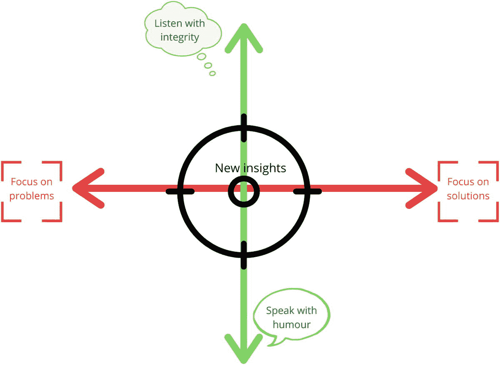
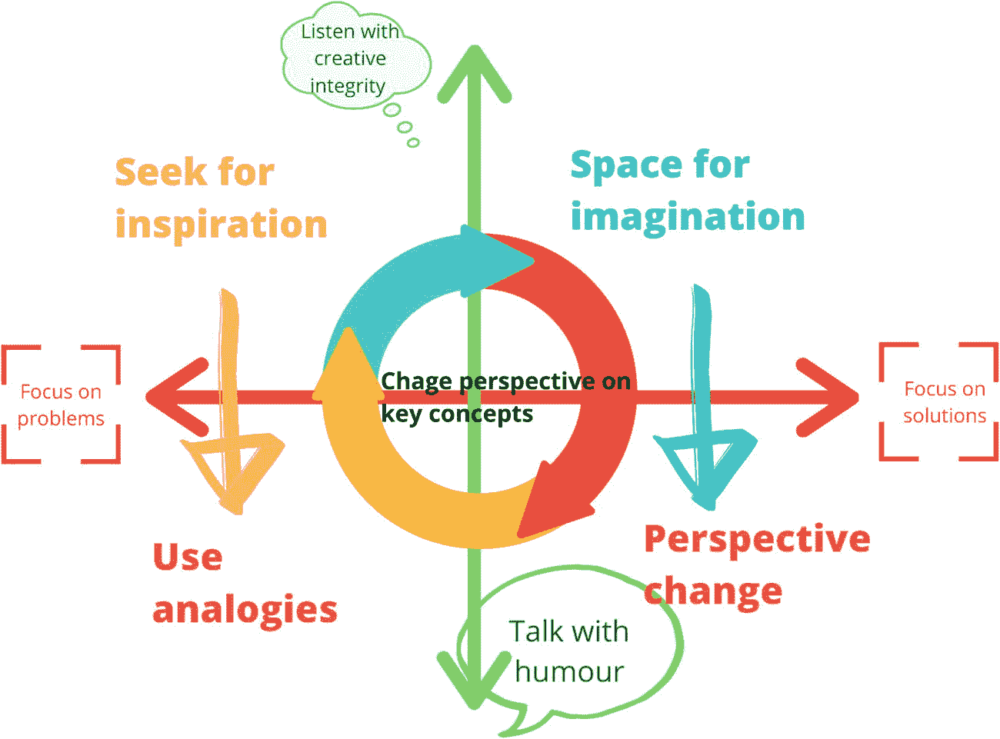

# 第四部分：在反馈对话中采用创造性沟通风格

## 15. 创造性沟通风格的三大原则

### 何时何人与何人讨论你的想法

> *作为创业者，你塑造自己的品牌，打造自己的产品，创造你提供的价值。我说“你创造”，但这并非你一个人的事。这从我做起，因为我有点内向，我需要启动一个渠道，让这些想法和能量流动起来，将其具象化，然后获得反馈并改进。特别是当涉及价值时，你需要与客户进行碰撞，否则你可能会完全偏离方向。*
>
> ——独立创业者兼图书作者，彼得·伊万诺夫

正如彼得所指出的，在创业中，新产品的开发始于最初的想法。尽管如此，仍需经过与潜在客户共同创造的阶段，以确保想法的可行性。在任何其他专业领域，新想法都不会存在于真空中。它们源自外部，经由你传递给特定的受众。

我们产生想法并非为了想法本身，而是为了娱乐、改进或创新。并且，除了产生想法的人之外，必须有其他人看到其效用。创业者产品的价值在于目标客户愿意为其付费。拥有新研究想法的科学家可能希望得到团队的验证。心怀变革倡议的专家可能希望与上级领导进行探讨。挑战在于为建设性对话创造条件——既包含批判性思维也包含积极思维——从而打磨新想法。

尤其是在成为公认创造者的前两个阶段，当你还未完全内化领域的精妙之处时，你需要讨论你的新想法，以确保其具备有用性的可能性。与其他产生新想法的人一样，你倾向于“爱上”自己的点子。因此，你可能过于执着，无法看清其预期的全部效用。

在最初对某个产品、理论或倡议产生灵感的那一刻，到受众与之互动的时刻之间，存在三次创造性沟通的机会——即让你的想法与可能的顿悟产生共鸣。首先，当你产生一个新想法并思考“别人会怎么看我这个想法？”时，你可以独自焦虑和反复思量。或者，你也可以与那些与你没有竞争关系的同行分享。

其次，有一个实验阶段——当你开发原型时。在这个阶段，与具备必要知识、能够提供意见的导师或资深专家交谈会让你受益匪浅。

第三，在实施阶段之后，当客户与最终产品互动时，你可以就受众中代表性成员的体验发起对话。

你如何知道该选择谁来讨论你的新想法？他们可以是你紧密社交圈内备受尊敬的专家。此外，你可能希望扩展你的社交网络。为此，你或许可以尝试与那些可靠、聪明且富有同理心、但你之前未曾交流过的人展开讨论，并寻找共同点。

你精心挑选的人是一位赏识你能力的专家。反过来，你也重视他们的能力，并相信他们有倾听的能力。与一个不怎么看重你，或者之前表现出缺乏同理心或思维僵化的人，很难进行高质量的对话。当然，坦白说，你也有可能看错人。然而，赏识、信任和联系通常是可靠的选择。

简而言之，创造性沟通风格的第一条原则是：明智地选择反馈的时机以及提供反馈的对象。当别人的意见是出于帮助你而传达时，它们可以让你看清在创作过程的关键阶段需要修改什么，甚至还能为你开启意想不到的新项目。

### 成为参与式的故事讲述者

反馈对话的核心目的是通过他人的视角来审视你想法可行性。每一次评估对话都意味着你期望审阅者能提供深刻的见解。除非你选择跟一棵树说话，否则你该如何激发听者对你想法的兴趣呢？

创造性沟通风格的第二条原则是：成为你作品的故事讲述者，带着准备充分的简洁而引人入胜的要点来参加反馈会议。情节是什么？主要角色是谁？他们想要达成什么目标？他们面临的障碍是什么？

最重要的是，故事讲述者擅长什么？他们善于发现能在故事线中加入出人意料转折的时机，从而牢牢抓住听众。与那些通常带着预先准备好的讲稿对着听众演讲的人不同，在对话中，当你察觉到讨论变得乏味或紧张时，你必须即兴发挥。这也正是你作为参与式故事讲述者的角色更具挑战性的原因。

有人说，地狱里充满美好的意图，而天堂里则充满善行。在我们说话和聆听的过程中，新的目标会自发地在脑海中浮现，并可能与对话开始时设定的目标偏离。从社会神经科学的角度看，在对话过程中，大脑能够捕捉到即时的威胁，这些威胁或许真实，或许不真实，但它们无疑会让你或你的对话伙伴处于防御状态。这种心态会阻碍你专注于寻找解决方案，使你执着于在对话动态中所感知到的风险。

作为一个故事讲述者，你必须持续监控对话者在谈话中的兴趣水平。你要创造条件，让你自己和对话伙伴的大脑都保持在一种易于接受的状态，这种状态以好奇、愉悦和兴趣为特征。这样，参与的各方才能敞开心扉，接收和吸收新的信息。

简而言之，一个参与式的故事讲述者确保听众不断地被想法所激发。然而，你能否成功营造一场引人入胜的对话，取决于你具备怎样的说与听的能力。

现在，我们将转向创造性沟通风格的第三个也是最后一个原则，它涉及采用“创造性正直”的心态。这指的是带着创造性正直去倾听，以及带着幽默感去表达（见图 15-1）。

**图 15-1** 建设性对话

### 创造性诚实心态

> *“要像小孩子一样，在事实面前坐下，准备放弃一切先入为主的观念，谦卑地跟随自然，无论它将你引向何种深渊，否则你将一无所获。”*
>
> *——生物学家托马斯·亨利·赫胥黎，论不偏不倚的理解*

前文引言强调了先入为主的观念是学习的无形障碍。尽管赫胥黎指的是科研中的科学思维，但在引导反馈对话时，同样的思维方式也大有裨益。当你带着“学一点未知”的意图开启对话时，或许应当推迟对你所听到的内容妄下结论。此外，赫胥黎还谈到谦逊的态度是学习的助推器。认识到我们实际所知比自认为的要少，我们就能选择保持好奇而非焦虑——尤其在对话中那些脆弱时刻，当我们消化论点中的关键部分时更是如此。

在研究中，超越既定规则进行观察的能力是发现新事物的根本驱动力。而在对话中，倾听则是了解那些你不知道自己需要知道的事情的关键。倾听也分不同层次：一种是“我假装在听，但其实只想听到自己的声音”；另一种是“我全神贯注，对意外之事持开放态度”。前一种倾听方式我们不学就会；至于后一种参与对话的方式，则需要反复练习才能成为第二天性。对此，我们可以通过两种方式将思绪锚定在当下。首先，关注与你对话之人的言辞、肢体语言和情绪^(183)——他们在表达什么？

其次，你可以倾听自己的感受、情绪和反应。事实上，良好的倾听是一种对内心对话的觉察练习。而当内心对话被浓烈情绪的迷雾笼罩时，正是“诚实”介入的时机。

当情绪激动显示你感觉自己受到威胁时，就该提醒自己：你致力于学习新事物，而非仅仅证实对话开始时已有的信念。不过，坦白说，获得对自己信念的确认，感觉就像吃下一块巧克力蛋糕——当下让你愉悦，但第二天站上体重秤时，未必还是好感觉。

社会心理学家、人本主义哲学家埃里希·弗洛姆将“诚实”定义为坚守自身价值观的能力，尤其是在价值观受到挑战的时刻^(184)。因此，诚实意味着无论顺境逆境，你的价值观与行动之间始终保持一致。

创造力是你的核心价值观之一吗？如果是，那么“创造性诚实”可以通过激发你的创造性思维来挽救你的对话，营造富有启发性的交流氛围。你上一次受到批评（甚至更糟，你的想法被否决）是什么时候？你是如何反应的？在这些篇幅中，我们将详细阐述如何更多地运用创造性思维来表达你的想法，并重新解读你所听到的内容。这是一种“带着诚实去倾听”的心态：你愿意接受对话中那些令人不适的时刻，并主动开启视角的转换——首先从你自己的视角开始，即那些与你创意点子相关的、关于可能实施策略的一组假设^(185)。

因此，创造性沟通风格的第三条原则是：以“创造性诚实”的心态，像讲故事的人一样对待每一次反馈对话。这意味着在成为一个有魅力的演说家之前，先成为一个神奇的倾听者。

带着创造性诚实去倾听，意味着识别出那些可以用微笑点亮气氛的瞬间（见图 15-2）。同时，它也意味着抓住机会，通过使用类比来澄清被误解的概念。最后同样重要的是，它还涉及捕捉那些对可能解决方案进行假设性思考的时机。在接下来的章节中，我们将详细阐述图 15-2 中的三个核心概念：幽默、类比和视角转换。

创造性诚实心态核心概念示意图，包括幽默、灵感、想象力、类比和视角转换。
**图 15-2** 创造性诚实

脚注 1 2 3