# 第一部分：你的创造力与活动之间的契合

# 1. 创造者的四种类型

> *我们的信念指引着欲望，并塑造着行动。*
>
> —查尔斯·桑德斯·皮尔士，博学家

什么是创造者？联合国教育、科学及文化组织（UNESCO）对创造者的定义是：

……任何创作、赋予创造性表达、或再现艺术作品的人；**视其艺术创作为自身生活的核心部分；为艺术文化的发展做出贡献**；并且**要求被认可**为艺术家，无论其是否受雇佣或合作关系约束。

该定义强调参与艺术活动是成为创造者的核心要素。

《韦氏词典》的定义则更为包容。创造者是“**创造**（[create](https://www.merriam-webster.com/dictionary/creates)）新事物或原创事物的人”。作者、创立者、发起者、创始人和生成者都是其同义词。什么是“新”和“原创”？简言之，创造新事物指的是提出一个此前不存在的解决方案，或发现一个他人未曾注意的问题。创造原创事物指的是相比现有解决方案，提出令人眼前一亮的解决方案。

是的，艺术家是最令人难忘且被广泛认可的创造者。但除此之外，还有其他类型。创造者是创造出能为购买者带来增值价值的产品的人。创造者是在热门话题上著书立说，并加入原创故事和视角的人。创造者可以是在组织中发起变革倡议、从经历过变革的其他组织中汲取灵感的人。最后，创造者也可以是参与对话并帮助他人获得“顿悟”时刻的人。

基于此观点，在本书中，我们拓宽了**创造者**的定义：**指在传统上被公认为创意产业内外的知识或专长领域中进行探索的个人**。关键在于，创造者接受自身创造力，并对其注入新视角的领域感到真诚投入。同样重要的是，所有这些类型的创造者都有一个共同点：他们能够找到认可其新颖性和原创性的受众。

例如，**创造者可以是一位科学家**，其学术生涯依赖于撰写推动其知识领域理解的研究论文。在本书中，我们将一窥两位大学教授在职业生涯中均已晋升为正教授时，如何看待自己与创造力的关系。

**创造者可以是一位企业家**，其财务成功取决于为客户创造价值的能力。我采访了经验丰富的企业家，他们将分享对自身创造力的理解如何引导他们选择创业作为职业。

最后同样重要的是，**创造者可以担任专家角色**，例如销售工程师奥斯卡·桑托拉拉，他致力于在演讲和著书方面脱颖而出，主题是如何呈现令观众惊叹的产品演示。

艺术家、科学家、企业家和技术专家是四种类型的创造者，他们对创造者扩大化定义中有三个共同点。

(1) **你与工作建立联系的方式**。在联合国教科文组织的定义中，创造者视其艺术创作为生活的核心。在本书中，创造者也可以是将**某项使命的实现**——无论是科学、社会、创业还是精神层面的——视为自身不可分割的一部分的人。^(²⁹) 无论是否具有艺术性，你**热爱你的使命**以及完成使命所需的工作。

(2) 你理解**个人创造力**在你与工作互动、产生惊喜想法的过程中所起的**核心作用**。

你认识到创造力在你专业角色中的重要性。例如，一些创业者明白自己的优势在于能产生大量创意，以打造新产品、营销文案和销售策略。

因此，成为创意生成者有助于业务发展。你可能会想：“嗯，其他特质对商业成功也至关重要。”没错，作为创业者，精通人脉拓展、说服力以及帮助你达成交易和交付优质产品的核心能力都至关重要。

然而，正如维生素 C 能增强免疫系统一样，你的创造性思维能激发那些让你的业务蓬勃发展的活动。因此，你越是将创造力视为必需的个人优势，并在工作中为其留出空间，就越有可能得到客户、老板、同行等的认可。

(3) **愿意主动进行个人成长和跨学科学习**。

*“过去，我的男友们曾问我：‘你为什么要做所有这些事？为什么要去上那些与你工作无关的课程？’”沟通架构师图莉亚·洛佩斯说。“我回答：‘嗯，我不知道，我就是好奇。’但生活向我证明，未来总有一天，无论你学到什么，都会派上用场。所以，这从来都不是浪费时间。”*

像图莉亚一样，创造者是主动投入新学习、无需等待外界认可的人。作为创造者，你肩负的责任不仅仅是复制他人的成果。因此，你培养出了勇气去承担一个在你亲密圈子里可能无人尝试过的新项目。

本书介绍了芬兰作曲家马蒂亚斯·库皮艾宁，他讲述了自己艺术创造力的发展历程。十多年前，当他作为一名吉他手加入力量金属乐队 Stratovarius 时，他曾有机会学习一项新技能：作曲。至今，马蒂亚斯的歌曲累计流媒体播放量已超过 3200 万次。

摄影师达莎·皮尔斯在拥抱自己成为超现实艺术摄影师的召唤之前，经历了漫长的内心挣扎之旅。在整本书中，你将听到她那段时期最温柔的回忆与反思。

因此，**创造者是人类经验与知识的先驱**。他们绘制着自身尚不熟悉的领域，对未知之广阔充满好奇。他们真诚地渴望学习新技能，并在那些能为周围环境带来新颖且有意义成果的项目中重塑自己的知识。

你今天对创造什么感兴趣？你明天又会对创造什么感兴趣呢？

## 只要有希望，就有机会将你的角色塑造成创造者

> *我从不认为自己做不到。我只思考，如何才能做到？*
>
> ——图莉亚·洛佩斯，“勇敢发声与领导力学院”创始人

创造性自我颠覆的机会始于最初的观察，随后是对于促成改变的希望。

你最喜欢自己的哪些特质？充满希望是其中之一吗？

当你希望为世界带来一些新颖而有意义的事物时，你便获得了内在驱动力，去寻求如何从“此地”抵达“彼处”的解决方案。³⁰ *此地*是当下，你感到工作生活中有所缺失的地方。*彼处*可能是下一个小时，当你允许自己做些从未尝试过的事情，并慢慢发现那些让你成为创造者的想法。

希望对你来说意味着什么？

通往定制的创意专家角色这一自我发现之路，可能需要数年的试错。然而，心怀希望并非天真地等待有人邀请你参与一个项目，而自己却在刷着最爱的连续剧。

心怀希望，是将自己视为人生的主角。是把自己看作未来发生在自己身上美好事件的主要促成者。一个有希望的人会制定计划，并愿意为实现更美好的未来而努力奋斗。

图莉亚·洛佩斯是本书中介绍的十位创意专家之一，她是一位从一种创造者角色转变为另一种创造者的专业人士。从*此地*到*彼处*的道路显然既非直截了当，也非可预测，这一点从她的职业历程中可见一斑——这段历程最终引领她成为如今的“自信沟通架构师”。

*“我总是主动请缨去做事。从不认为自己做不到某件事。这是一种非常好的技能。你不怀疑自己。但有时候也因此碰壁。这没关系。因为，我在建筑学方面的训练也强化了这一点。作为一名建筑师，你必须相信，必须坚信你脑海中的构想能够成为现实。”*

图莉亚毕业于巴西戈亚斯天主教大学建筑与城市规划专业，之后获得研究生奖学金前往西班牙工作。几年后，她在爱尔兰从事 IT 项目管理。然而，她感到自己需要做一些有创意的事情。

她辞去工作，研究巴西和西班牙的珠宝市场。2005 年，她在巴塞罗那开设了自己的珠宝店。然而，当 2008 年全球经济危机来袭时，图莉亚不得不关闭店铺，再次重塑自我。

她学会了不执着于事物，*“好吧，这并非我所期望，”*她说。于是，她一边上课学习新技能，一边思考：*“我的使命是什么？”*

通往*彼处*——也就是作为创造者的使命——有许多可能的路径。希望提供了情感能量和责任感，促使你每天投入认知努力，去规划下一步行动。

你或许在亲密关系中展现出创造力。你的创造力可能是一种重要的情感宣泄方式。但要成为创造者，你需要渴望将自己新颖或独创的贡献带入专业领域，并因此获得认可。你如何看待自己当前的工作及其相应的地位和任务？以下每个句子描述了人们可能持有的工作取向。哪一句最能引起你的共鸣？

*   对我来说，工作就是朝九晚五的差事。我只做最低限度的要求。下午五点之后才开始生活。
*   对我来说，工作是一份事业。我做得比预期更多。例如，领导角色很适合我。
*   我的工作有意义。我常常能看到自己努力带来的影响。
*   对我来说，工作是一种使命。我在岗位上运用的技能是我的命脉。

你希望如何与自己的工作相处？

当工作被视为事业、意义来源或天职时，可能会有四种类型的洞察触发你作为创造者的未来（见图 1-1）。

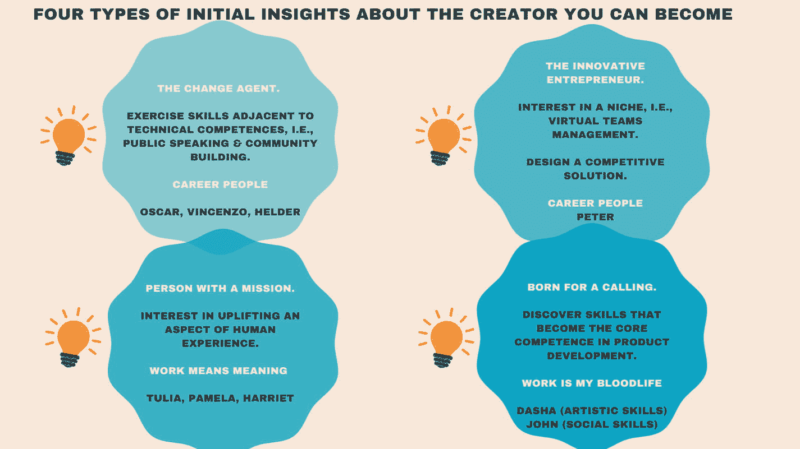

一张图片，展示了激发个人成为创造者未来的四种洞察类型。四种类型的创造者是：1）变革推动者。2）创新企业家。3）具有使命感的人。4）生而为使命。

**图 1-1** 四种类型的创造者

*   一些将工作视为事业的人可能会主动改善其当前所在组织或其他专业社区的工作文化或流程的某些方面。因此，除了技术技能，他们还培养了辅助技能，这些技能推动他们扮演起变革推动者的角色。

本书介绍的其中三位创意专家是走在职业道路上，将其创造性人格发展为变革推动者的个人。奥斯卡·桑托拉拉是一家专注于数字身份管理软件公司的销售工程师。文森佐·塞鲁洛是赫尔辛基大学药物研究项目的负责人。赫尔德·桑托斯是格罗宁根大学生物医学工程教授。

奥斯卡·桑托拉拉在担任讲师时发现了自己对沟通技巧的兴趣。从公开演讲开始，他对写作技巧产生了兴趣，这促使他出版了两本书：《创建并交付杀手级产品演示》和《震撼科技舞台》。作为一名图书作者，奥斯卡作为销售工程师的可信度得到了提升。

公开演讲是文森佐会花时间参与的活动。他向学生或学术同仁讲述科学研究和作为科学家的生活。例如，在 TEDx 赫尔辛基大学的演讲《创造力会传染！》中，文森佐倡导对科学问题抱持一种好奇、开放，并且“以一种专注的方式保持不专注”的视角。³¹

赫尔德·桑托斯在同辈中是独一无二的。在他分享研究团队的休闲时光或介绍新成员时，他构建社群的能力在其 LinkedIn 信息中显而易见。此外，赫尔德是一位慷慨的领导者，他鼓励团队成员协作，并对个人成员表示赞赏。

*   你是否拥有一种经过验证的新解决方案，可以帮助不止一个组织改进其流程和实践？那么，你可以像彼得·伊万诺夫那样，作为独立创新者踏上创业之路，他专长于为国际虚拟团队提供管理培训。多年来，[彼得](https://www.peter-ivanov.com/profile/)开发了一套行之有效的方法，名为[“十大基石”](https://www.peter-ivanov.com/virtual-power-teams/)，用于领导远程、混合或虚拟团队。该技术承诺能更快交付项目、降低成本，并让组织为未来做好准备。2012 年，它获得了“全球 IT 互联奖”。

*   你可能是那种具有使命感的人。在这种情况下，你的精力会投入到探索创业追求中，并承诺提升人类生存的某些方面。例如，图莉亚·洛佩斯找到了自己的使命：支持女性领导者勇敢发声。帕梅拉·汤普森支持以心灵为中心的领导者拥抱变革，以产生积极影响。哈里特·法格霍尔姆探索共创，引导人们释放创造冲动并进行有意识的进化。

*   第四种驱使你定制自己作为创意专家角色的洞察，是你直觉自己生来就是为了一种使命。当你发现自己被一套技能所吸引时，你就获得了证实直觉的证据。你可能意识到自己想参与培养艺术技能，就像达莎·皮尔斯那样，她致力于超现实主义艺术摄影。另一方面，你可能意识到自己擅长软技能，比如约翰·贝茨的倾听能力，这使他能够支持大公司的高层领导者，让他们的演讲达到“TED 演讲”水准。

在这四种探索你与生俱来的创造力的方式中，你对哪一种最抱有希望？是在当前角色中允许更多创造性思维，从而推进你的职业生涯？是探索你作为创新或社会企业家的潜力？还是专注于特定技能，使你成为细分领域的专家？

是否可能存在第五种方式——属于你自己的方式？是什么可能触发你，激励你将自己重塑为一名创意专家？

让我们来看看创造力对于创造力研究者以及本书中介绍的创造者意味着什么。在这个过程中，你也会厘清为什么创造力是一种多侧面的人类能力。

**脚注** 1 2 3

## 个人创造力的定义

### 外部视角：研究人员如何研究创造力

在创造力研究人员中，一个标准定义是：创造力是指建立不寻常联系、并从事特定习惯的能力，这些习惯能够带来新颖、有用且令人惊喜的成果（例如，想法、项目、倡议、产品）。^(³²) 因此，创造力可以指一种思维方式、一个过程以及一个结果。让我们逐一详细探讨。

#### 创造力作为一种思维方式

创造力是一种思维方式，当面临意想不到或全新的情况时会被触发。其核心在于将想法进行不寻常的关联，以解决新问题、创作故事、运用类比、进行即兴发挥等。

得益于磁共振成像（MRI）和脑电图（EEG）技术的出现，我们了解到创造性思维并不仅仅涉及通常被认为富有创造力、充满激情、生动且富有诗意的右脑。^(³³) 创造性思维同样需要左脑的参与，左脑负责分析、实践和组织。例如，在一项使用脑电图记录 32 名爵士乐手在吉他即兴演奏时脑波的研究中，质量更高的演奏表现似乎与左脑区域的活动相关。^(³⁴)

根据对大脑现实更准确的描述，创造性思维涉及跨越左右半球的三个脑区，并且需要认知系统（有意识与无意识）和情绪的联合激活，以处理非常规和创造性的任务。它包含两种信息处理模式：1) 对正在发生的事情开放地探索其替代意义和解释；2) 从可能的想法中选择一个来适应具体情境。

因此，第一种模式是一种开放的、发散性的或生成性的思维模式，与大脑的默认模式网络（也称为想象力网络）相关联。^(³⁵) 第二种创造性思维模式是一种封闭的、收敛性的或评估性的思维模式，能够激活大脑的执行控制网络。在一项对 25 名年轻人进行功能性磁共振成像（fMRI）脑部监测的研究中，显示了这两个网络之间存在功能连接，同时还与第三个网络相连。^(³⁶)

当研究人员向受试者展示日常物品（例如，砖头、雨伞）并要求他们想出这些物品不寻常且有创造性的用途时，他们观察到在任务开始阶段，第三个脑网络——突显网络——与默认模式网络的耦合活动增加。

突显网络就像想象力网络和执行控制网络之间的一座桥梁，它负责决定在创造性任务中持续寻找原创想法的动机水平。当这个脑系统检测到默认模式网络生成的、有前途的想法时，它会将这些想法推送给执行控制网络进行进一步处理。^(³⁷)

简而言之，创造性思维意味着灵活地将注意力转向我们的内在体验，然后再转向外部，以跟踪相关的外部信息，从而取得进展，并为一项任务提出有用且独创的解决方案。所有这些都在前意识层面发生，直到我们最终想到一个令人满意的想法。

**在日常生活中，你的创造性思维可能会如何表现出来？** 2019 年夏天，我和家人在一个杜鹃花园散步，我停下来给一朵高山玫瑰拍了张特写。

“妈妈，花朵是你最好的朋友，”儿子说。

我确实爱花，也爱给它们拍照。但我从未想过它们是我的朋友。

我回答说：“确实，花朵让我感觉很好。”

“但它们怎么能让你感觉好呢？”八岁的儿子好奇地问。“它们没有声音。它们不能和你说话。”

我们的对话围绕“你怎么知道某人是不是你的朋友”这个话题继续展开。多亏了我的儿子，我现在意识到，花朵通过它们的沉默，成为了韧性、感恩和美的源泉。无论是心情放松还是悲伤，花朵都能激发我的创造性思维。默认模式网络与认知控制网络之间的“探戈”诠释了花朵的物理特征。而结果就是一种短暂的美好体验，被捕捉在一首小诗中，留给我自己。

在生活中，有些创造性任务需要更多的努力和投入，比如看着孩子们打架，或者在工作中准备一场新的演示文稿。

我们来看第一个假设场景。你的孩子们打起来了。你看着冲突升级，决定制止。然后，突然灵光一现。“你们知道吗？！今天，我看到一个家伙在街上走的时候裤子掉了，”你说。

再想象另一个场景：你必须准备一份新的工作演示文稿。这是你第一次谈论一个新话题。这个话题让你既兴奋又害怕。你该如何创作内容，让你的同事们能够理解并与这个主题产生共鸣？

在这两种情况下，你的创造性思维会自发地认识到那些机会——当你想到在对话中运用巧妙的措辞转折，或在内容创作中加入出人意料的转折时。正是你的创造性思维发明了幽默的评论，并决定了在合适的时机说出它们，以分散孩子们打架的注意力。也正是创造性思维为演示文稿中的概念和故事情节提供了类比。

正如我们从创造性思维的神经学描述中所看到的，创造力涉及大脑中想象力网络、执行控制网络和突显网络之间的连接。这三个网络之间功能连接的强度越高，用于解决创造性任务的创造性思维就越强。^(³⁸)

在日常生活中，我们都有机会运用创造性思维来采取积极的行动。除了大喊大叫，还有哪些创造性的方法可以制止孩子们打架？

下次你的老板让你就一个新话题做演示，即使你可能毫无头绪，也要说“好”。创造性思维始于对缺乏现成解决方案的新挑战持开放态度。然后，你会通过思考定义核心概念的创造性方法来逐渐适应这个挑战。

#### 创造力即过程

创造力也可以指代产生原创想法或产品的创造过程。在上述两个假设情境中——孩子们之间一触即发的冲突和一场需要准备的新演示——一场神经过程的交响乐正在你的大脑中演奏。如果你能变成一粒 0.01 毫米的纳米机器人，在你自己的脑袋里旅行，你会目睹这场交响乐的演奏，并能听到你创造过程的“音乐”。

这场交响乐将由三组创造性脑网络成员之间的内部对话组成——默认脑网络、认知控制网络和显著性网络。以下是纳米机器人在你看到孩子们打架时会听到的神经过程的极度简化的解读：

-   “评估”成员：“我们要解决的问题是什么？‘这些孩子可能会严重伤害对方。’”

-   “开放接受新信息”成员：“我们有什么解决方案？”

-   “发散思维”成员：“提高嗓门。”

-   “评估”脑网络：“这就是你能想到的全部了吗？”

-   “发散思维”成员：“站到他们中间去。”

-   “评估”成员：“你的脸可能会挨一膝盖。还有其他想法吗？”

-   “发散思维”成员：“哈！告诉他们，‘今天，我看到一个人走在街上，他的裤子掉了。’”

-   “评估”脑网络：“我们怎么知道这个想法更好？”

-   “开放接受新信息”成员：“孩子们对屁股很着迷。”

-   “评估”成员：“好吧，我们冒个险，就用这个主意。‘那家伙内裤上印着达斯·维达。’”

你给出了创造性的回应，希望能驱散孩子们打架的情绪。导向最终回应的创造性思维流在几秒钟内发生（仍处于无意识状态）。

至于第二个场景，为新演示准备内容需要一个更长的创造过程。实际上，这是一个杂乱无章的过程，但基于一个结构化的描述，它分六个步骤展开，如图 2-1 所示^(³⁹)。

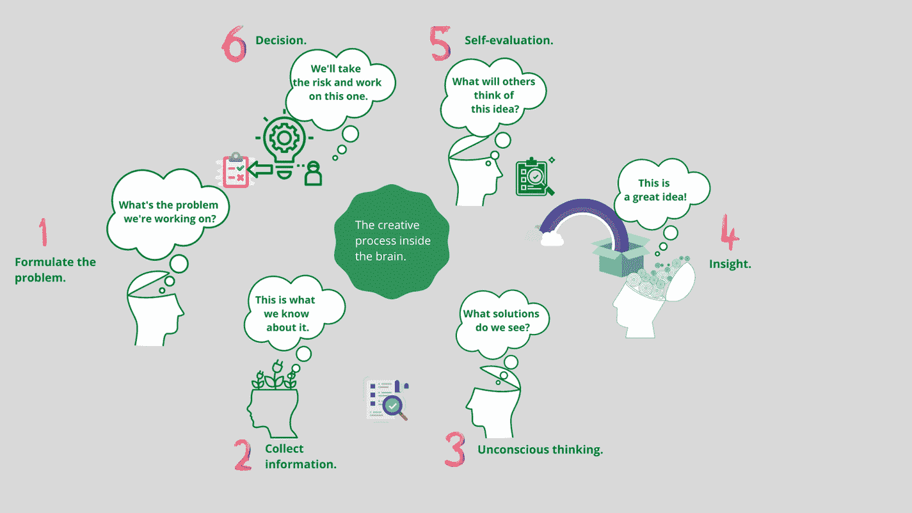

图 2-1 创造过程的六个阶段：1. 问题阐述。2. 信息收集。3. 无意识思考。4. 顿悟。5. 自我评估。6. 决策。

前两个步骤是问题阐述和信息收集阶段。你首先识别并定义将要解决的问题。然后，你获取关于他人在相关主题上已做了哪些工作的信息和知识。

接着是一段**酝酿期**。在这个第三步，你并没有直接处理演示文稿。其他活动可能让你的手脚忙个不停，但你的大脑在寻找令人满意的解决方案。尤其是当你做一些不太费神的事情，比如在家擦地板时，大脑会处理相关的有意识和无意识信息。

酝酿期之后是**顿悟**——那个“尤里卡”时刻，此时无意识的联系不经任何意志努力就穿透了意识的表面。这就是你对演示文稿的整体结构有了想法的时候。

在第五步，你的大脑**评估**这个顿悟是否值得追求。这是过程中自我反思的部分，你问自己：“我的同事们会怎么看待我的演示？”

创造过程的第六步包括**实施**这个顿悟，这需要花费最多时间。这是你需要决定用什么视觉元素和措辞来介绍概念，并撰写演示文稿脚本的阶段。

每一个创造过程都可能有许多迭代，不同步骤之间也可能有许多循环。根据我们处理的具体情况，可能需要许多顿悟，我们可能不得不回到第一步的信息获取阶段。

从头开始准备一个新演示的创造过程平均可持续一周。然而，其他创造过程，例如因一朵花启发而创作一首单行诗，可能短至几秒钟。

当我们直觉地感到自己有创造的潜能时，自我发现需要很多年。直接的环境，包括其中的人脉和可用资源，可以促进或抑制创造者在创造性自我发现中所涉及的心理和个人因素。

**积极参与和实验**是成为创造者的创造过程的支柱。然而，我们时不时的又会发现自己回到了准备阶段。**下一个可以检验我创造潜力的项目可能是什么？**

#### 创造力即成果

创造力也可以是一个用来指代提出新想法并实施所产生的结果的词。在这种情况下，创造力变得需要接受评判。为什么某个特定的群体会从新想法中受益？

-   当一位老师引入一种新的教学方法时，学生的学习体验是否得到了改善？

-   当一个创新团队设计出一款智能手表时，哪些人愿意为之付费？

-   当你在生日贺卡上写了一条幽默的信息时，它让收卡人感到开心了吗？

外部环境中的其他人会反馈你的创造有多新颖、有洞察力和有价值。重大的创造行为，如创新的教育方法或智能手表，或微小的创造行为，如给你在乎的人写一张有趣的生日贺卡，都需要在目标受众眼中通过适切性和新颖性的检验。

从创造者的角度来看，创造性行为及产出的效用部分在于看到对目标受众产生的积极影响。例如，当你的孩子们被印有达斯·维达的内裤吸引而分心时，你可以暗自庆祝。你的创造性干预奏效了。你帮助孩子们避免了互相伤害。此外，对创造者而言，增强的能力感是创造过程的另一个有价值的成果。

因此，在期待得到你的受众认可之前，你需要**获得自我认可才能进行实验性创造**。这是本书所采取的观点：自我验证优先于外部验证。然而，无论你选择专注于何种实验性创造，**注意区分对他人有用和对自己有用这两者的区别**可能是件好事。

让我们考虑以下场景。你写了一首诗，这对你来说是一种抚慰的体验。其他人与你的诗产生共鸣了吗？

你正在加入一个利用虚拟现实治疗创伤的项目^(⁴⁰)。最终产品将使人们受益。但你对项目的贡献满足了你创造的需要吗？

你所从事的实验性创造需要在预期的对他人有用和对己有用之间取得谨慎的平衡。这是对他人慷慨与接纳自己身为创造者这种特质之间的谨慎平衡。

总而言之，创造力研究者将创造力定义为一种涉及连接大脑左右半球的三个脑网络的思维类型。其次，创造力可以被视为一个包含六个阶段的过程，始于获取相关问题的信息，终于实施一个新的想法。第三点，也是最后一点，创造力是一种能改变你日常生活并为他人的生活带来改变的成果。

接下来，让我们采用由内而外的视角，通过那些靠提出新想法谋生的专业人士的眼睛来看待问题。科学家、企业家、艺术家和工程师是如何理解他们自己的创造力的？

### 由内而外的视角：知名创作者如何谈论他们的创造力

在日常生活中，大多数人不会刻意思考自己的创造力何时以及如何显现。在最好的情况下，也许别人会评论道：“哇！你处理孩子们之间冲突的方式真有创意。”或者“恭喜！你的演示文稿制作得非常有创意。”借助他人的反馈，我们能更清楚地认识到自己的创造个性与潜能。当缺乏外部反馈时，用语言描述创造力对你意味着什么，是发现你内心关于创造力的潜在信念系统的绝佳替代方案。

让我们听听本书所介绍的专家们如何定义自己的创造力。

-   **作为听见音乐或写出诗歌的能力：**

    *   芬兰作曲家**马蒂亚斯·库皮艾宁**说：“我在脑海中听到一个旋律，就把它写下来，”“然后我所做的——如何构建整首歌曲——是一种更技术性的方法。这与创造力无关。***唯一重要的就是我脑海中那个简单的旋律，那就是我的创造力。***”

    *   领导力沟通专家**约翰·贝茨**说：“创造力！我脑海中浮现出很多事情。”“首先想到的是，我记得在乐队唱歌时，我把自己看作一个诗人，我随身带着一支铅笔和一个小笔记本。每当一个短语击中我，或者我看到或听到一些有趣或美丽的事物，我就会停下来，把它记在笔记本上。其中很多内容后来都成为了我创作的歌曲。”

-   **作为改变看待障碍视角的能力：**

    *   沟通架构培训师**图利亚·洛佩斯**说：“***创造力对我来说意味着什么，以及它如何帮助了我，就是一种看待的方式。***”“创造力让你不再把障碍视为障碍，视为阻挡你前进的东西，而是将它们视为挑战，需要你找到更好、更有创意的解决方案。这就是我看待创造力的方式，它让你允许自己为一个特定问题带来不同的视角和不同的答案。”

-   **作为构思许多新想法和新概念的能力：**

    让我们转向培训虚拟远程团队的独立创业者**彼得·伊万诺夫**。对彼得来说，创造力是关于“……***以新的方式组合***，提出一个新概念***。***”这是一个迷人的过程，这大概就是我们人类与甚至更智能的学习机器之间的区别。显然，我们有能力想象出全新的东西，并将其变成激发他人灵感的有形事物。”

    *   赫尔辛基大学教授兼药物研究项目负责人**文森佐·塞鲁洛**说：“那是很久以前，在遇到你之前，我开始思考，也许，也许我是有创造力的。”“我觉得有一件事是任何人都无法窃取的，那就是无论如何都会涌现出的想法数量，我无法停止。就像你不想出汗时却仍在出汗。你无论如何都会出汗，而且你越想它，就越出汗。
    
    *   另一个例子是我前美国老板的话，他是一位伟大的科学家，与非常优秀的科学家一起工作。我不认为自己是一位伟大的科学家。我只是觉得自己是一个充满好奇心、渴望学习的人。但我记得有一次他对我说：‘啊，你是我合作过的最高产的科学家之一！’但他指的不是发表成果，而是***在产生想法方面***。”

-   **作为偏离惯常行事方式并勇于实验的能力：**

    *   药物纳米技术教授**赫尔德·桑托斯**说：“是的……嗯……我认为，对我来说，创造力的含义，”“也从我们所做的研究中得出，意味着试图思考一种解决问题的新方法。例如，我们知道有一种疾病。我们以癌症为例，因为大家对它更熟悉。所以我们试图探究这个问题。如果我们使用某些方法会怎样？如果我们以一种尚未尝试过的方式应用我们的知识，例如，试图解决这个问题会怎样？所以在某种程度上，它是在创造一种新的方法、新的途径，来在我们这里解决健康问题。”

    *   超现实主义美术摄影师**达莎·皮尔斯**说：“大概是看不到界限，”“并且总是实验、尝试新方法，无论你的领域是什么，无论你做什么，无论你是科学家，还是哪怕只是缝制衣服，那都是创造力。”

-   **作为为自己和他人以有意义的方式表达自我的能力：**

    *   广播节目主持“催化变革的女性领袖”的**帕梅拉·汤普森**将创造力描述为“挖掘我右脑的创造性，并通过自我将其表达出来，无论那看起来是什么样子。”

    *   销售工程师**奥斯卡·桑托拉利亚**说：“我将创造力视为一项技能。”“我想每个人都拥有它，但有些人开发了这项技能。你小时候可能已经很有创造力了，而根据你发展的程度，你可以变得非常擅长，或者你可能忘记了，根本就没有发展它。或者当你成年后，你开始发展它。所以，我把它看作一项技能。
    
    *   我认为这是一项非常重要的技能。例如，如今有些人谈论故事，他们说我们人类渴望故事。你可能听说过。但人们记住并代代相传的故事，都是经过一定创造力塑造的。因为生活中有些事情发生在你身上，如果你不以一种吸引人的方式讲述或书写，它就会被遗忘。所以，你如何构思它，如何书写它，至关重要。因此，大多数故事之所以无法流传，原因就在于此。”

    *   独立创业者**哈里特·法格霍尔姆**说道：“这是一个非常非常复杂的话题。对我来说，它是生命的创造冲动。”她帮助人们释放他们创造性的感官知识。“我已经从自己和我的客户那里了解到，你需要激活创造冲动。例如，*抑郁*可能就是那种创造冲动被压抑的结果，以至于你不明白那是你生命能量的来源。它是精神的源泉。人类精神是创造性的。我们从定义上就是创造性的。我们被设计为具有创造性的。”

从以上定义可以看出，受访者的创造力深受其工作经历的影响。当你在艺术领域有经验时，创造力被理解为艺术创造力。当你在经常需要解决问题的环境中工作时，创造力被视为产生原创且实用想法的能力。当你是一个通过情感感知和表达与环境互动的人时，创造力就是一种生活方式。

自我认知在个体层面意义重大，因为它既能预测创造性成就，也能预测为发展特定创造潜能而付出努力的动机。^(⁴¹) 因此，我们接受以下对创造力作为**自我感知创造力**的定义：

## “个人评估”

“个人评估”，涉及一个个体在多大程度上认为自己拥有产出他们认为是创造性成果所需的特质和过程，以及关于那些让他们感觉能激发创造力的环境的感知。” ^(⁴²)

换句话说，自我感知创造力就是你在多大程度上认为自己是一个具有特定品质和能力的创造性个体，并且有动力去付诸行动以改善现实的某个方面。自我认知是由直接经验塑造的。当直接经验不那么有利时，你可能会对自己的创造潜能感到困惑。当你增加了对创造力的理解、你自信能施展的技能以及你贡献力量的场所三者之间的一致性时，你的创造身份认同就会发展起来（见图 2-2）。

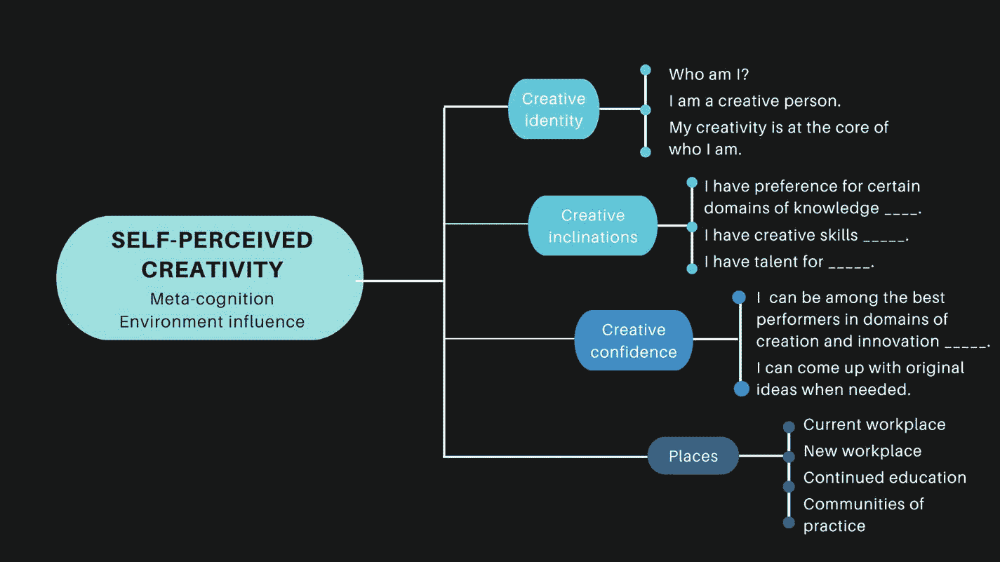

自我感知创造力各种分类的示意图，包括：1. 创造身份认同 2. 创造倾向 3. 创造自信 4. 场所。

**图 2-2** 将创造力定义为自我感知创造力

在下一章中，我们将讨论社会刻板印象如何可能影响你当前对自身创造力的理解，以及什么样的习惯可以让你对自身潜藏的创造力的新方面敞开心扉。

脚注

1 2 3 4 5 6 7 8 9 10 11

## 3. 若要更新你对创造力的看法，请将隐性的偏见显性化

### 与创造力相关的两种方式

对创造力的哪些方面于你而言至关重要有更高层次的认知，会对你所从事的工作类型以及你能产生的影响力产生巨大影响。^(⁴³) 沟通架构师图莉亚·洛佩斯发现，自己从小就对绘画有着特殊的兴趣。进入大学后，她发现申请与自身素描能力相关的专业更为容易。

“我从来没有像高中毕业时那样迷茫过，不知道未来该做什么，” 图莉亚说，“我知道自己会成为一名建筑师。”

像图莉亚这样，在普遍被认为具有创造性的行业（建筑、设计、电影、音乐、视频游戏、视觉艺术等）中磨练自身创造技能的人，很可能会将创造力视为他们核心自我的一部分。

“我与创造力的关系非常非常紧密，因为我的专业背景是建筑学，如果你没有创造力，你就无法成为建筑师。对我来说，创造力一直是我的一部分，现在也是，” 图莉亚坦言。

在人生的后期，当她认识到自己对新技能的偏好时，一个创造性自我发展的新阶段开始了。

“我从西班牙搬到爱尔兰学习英语，原本计划返回西班牙或巴西，但最终我在爱尔兰待了 13 年。我进入了 IT 领域，因为那是在 1994 年，当时爱尔兰正成为欧洲的软件中心。所以这是一个学习 IT、计算机等相关知识的大好机会。我从未涉足非常技术性的领域，但我的技术知识足以让我理解某些事物是如何运作的，于是我开始为巴西市场翻译软件程序。

我进入这个领域是出于好奇，同时也看到了学习新东西的机会，而且报酬非常丰厚。所以，我在那里待了十多年，在那里我也发现了自己另一项技能，那就是与人合作和领导他人的能力。这或许是出于工作需要，但我感觉自己有与人共事的天赋。

因此，我在工作中承担了越来越多的责任，先是担任团队负责人，然后是项目协调员，接着是项目经理，职位不断提升。”

这个学习周期将图莉亚带到了另一个职业十字路口，她渴望在工作中做一些更具创造性的事情。于是，她走上了创业之路，在巴塞罗那开了一家珠宝店。

随着你步入成年，当某项特定的创造能力变得引人注目时，它会影响到创造性创业的选择。例如，创意创业者和自由职业者通过他们作为插画师、网页设计师、平面设计师、摄影师、视频制作人、品牌传播专家等专业技能来创造价值。

在他们的“春天”（事业初期），另一些人则选择学习创意领域之外的技能。例如，彼得·伊万诺夫在保加利亚的索菲亚大学学习数学。在德国担任了多年 IT 经理后，他在中年时期才意识到自己的创造力。

“一切都始于这样一个认识：其实创造力就是我的优势。这个认识来自外部，但一旦你相信它，一旦你通过回顾过去并发现确实验证了这一点，你就能够创造更多能量，然后它就会变成真正的优势。”

当彼得对自己发挥想法产生者这一能力越来越有信心时，他转换了赛道，开始了创业生涯。

“我最大的优势是提出新概念，并让它们具有市场价值，能够从客户的角度看问题……然后想出能吸引他们的正确信息。”

当创造力被视为一种个人优势时，它会改变你看待自己职业可能性的视角，例如那些需要高水平创造性思维能力的创业项目。

你与自身创造力的关系处于何种位置？你更像图莉亚还是更像彼得？像图莉亚这样，童年时期就有创造性经历的人，更倾向于将创造力视为他们自我本质的一个方面。像彼得这样接受过分析训练的人，则更可能将创造力视为一种个人资源、自我身份的延伸以及一种能够帮助他们达到最佳表现的心理工具。你属于哪一类？创造性自我发展的起点，在于你意识到创造力对你的效用——那种帮助你在生活中蓬勃发展的心理力量（见图 3-1）。

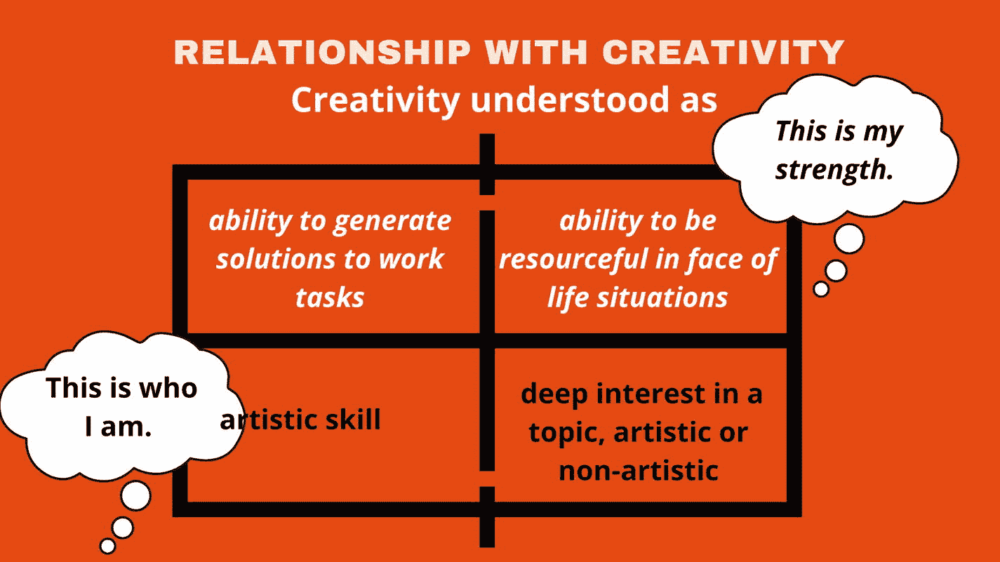

一幅说明创造性自我发展的插图，将其描绘为：为工作任务生成解决方案的能力、在面对生活情境时足智多谋、艺术技能以及对艺术或非艺术话题的浓厚兴趣

**图 3-1** 与你的创造力之间的关系

正如访谈中所揭示的，创造力作为一种个人优势可以从两个角度来理解：

1. 你是一位创造性思考者。你喜欢应对新的工作挑战，并因能为这些任务提出解决方案而引人注目。
2. 你是一个足智多谋的人。你在应对生活障碍时展现出的才智让自己和他人感到惊讶。

在这两种看待自身创造力的方式中，你与哪一种最为契合？这是实现你创造性个人身份的起点。它对有意识的创造性自我发展至关重要，包括两个扩展意识的阶段。有些人停留在第一阶段，此时，对自己创造性思考能力和足智多谋的认识，使他们在工作或个人生活中的社交互动中更加自信。但对另一些人来说，意识到创造力是一种个人优势，使得他们能够在打造个人职业品牌或寻求新的领导职位时将其体现出来。

或者，还有第二条路径可以触发有意识的创造性自我发展，那就是当你开始感觉到创造力是你身份的核心部分时。因此，你可能处于以下两种情况之一：

1. 你对某项特定的创造性技能已经崭露头角。你迫不及待地想在下一个空闲时间创作一段旋律、写作、拍照、跳舞、绘画等等。最近一次（如果有的话）能够体现你艺术创造力倾向的经历是什么？
2. 你深入钻研一个主题，使你成为一个对其中细节和要点充满智慧的学习者。你是那种认为美好生活在于拥有一个热衷主题的人。你最近一次（如果有的话）能够描述你智力创造力倾向的经历是什么？

在发现某个艺术/智力兴趣的第一阶段，你可能更愿意将其发展成一种爱好或副业。白天你是善于分析的人，夜晚你则是艺术家/狂热读者。你对自己以这种方式生活感到满足。

对于另一些有更高追求的人来说，随着学习的深入，他们达到了创造性成长的第二个里程碑。之后，他们会进入专业阶段，在这个阶段，他们承接的项目能在新的兴趣领域内带来情感、财务和声誉上的回报。

在下一节中，我们将了解科学家塞西莉亚·佩恩的创造力，她代表了一类具有智力兴趣的人，于 1925 年在天文学领域为女性开辟了道路。

### 当对创造力的信任超越权威

> 这并非我第一次感到因身为女性而被忽视。
>
> ——塞西莉亚·佩恩，《自传》，第 223 页

13 岁时，塞西莉亚投身于许多创造性活动，她认为这些活动是“我晚期童年的命脉”。她为贫困家庭的孩子们出演莎士比亚的《哈姆雷特》，这给了她公开演讲的信心。她绘制散步时发现的植物，这锻炼了她的观察力和准确性。她练习不同的诗歌风格，如十四行诗和回旋曲，这教会了她写作的技巧。表演、绘画和写诗为她日后成为一名科学家做好准备。

当她决定追随自己对天文学的兴趣时，普遍的观念是，女性身份不适合科学家生活。天文学领域的女性从事着枯燥的数据收集和分类工作，以便男性能够从事最激动人心的研究。

塞西莉亚·佩恩证明了，一位富有创造力的女性能够像男性同行一样，应对家庭职责的压力并取得科学突破。她的秘诀是什么？

“如果我的工作有任何价值，那就在于将先前毫无关联的事实联系起来，并从中看出模式。这样的工作需要记忆力和想象力……” ^(⁴⁴)

她对自身创造力的信任得到了回报。现在，我们知道人类和恒星有一个共同点——氢。但她的男上司用了三年时间才相信她的发现。

在她的博士论文中，塞西莉亚进行了独创性的计算，表明恒星中的氢比地球上的更为丰富。然而，在 20 世纪 20 年代，当她的“证明被两位天文学权威——哈洛·沙普利和亨利·诺里斯·罗素——以怀疑态度接受”时，她让自己被说服，认为自己的数据可能出错了。

这两人是谁？沙普利证明了太阳更靠近银河系的边缘而非中心。他是罗素的学生之一。罗素的主要贡献是在 20 世纪初使物理学成为天文学研究的核心，从而建立了现代理论天体物理学。 ^(⁴⁵)

在与这两位天文学界巨擘通信后，塞西莉亚在她的论文中添加了一段话，声明她推断出的恒星氢丰度“高得离谱，几乎可以肯定是不真实的。” ^(⁴⁶)

三年后，当罗素本人通过自己的计算得出相同结果时，佩恩的发现才被承认为对天文学科学的重要贡献。

尽管让自己受到男性权威的恐吓并对自己的计算产生怀疑，塞西莉亚·佩恩仍凭借她对哪些问题值得研究和解决的“直觉”，坚持为天文学和天体物理学做出独创性贡献。以下是她如何在文章《论身为女性》中描述自己做出与“源头”（她称之为伟大思想的源泉）保持联系的决定：

# 科学界的女性角色与创造力

*“当我审视科学界时，我脑海中浮现出今天在该领域工作的许多女性，她们扮演着修女和护士的角色。她们不被允许——她们被认为不适合——直接接触那源头，无论你称之为上帝还是宇宙。（但就在我写作时，这种情况正在改变。）在这方面，我没有什么可抱怨的。我一直直接接触着那源头。没有其他凡人替我做出过智力上的决定。我可能报酬过低，可能多年占据从属职位，但我的灵感源泉始终是直接的。”* ^(⁴⁷)

佩恩的性别确实延迟和限制了她的职业发展机会。当时普遍认为男性应在哈佛天文台担任领导职务。最终，当哈洛·沙普利从哈佛学院天文台台长的职位上退休时，她的工作才被注意到。当唐纳德·门泽尔接替他后，塞西莉亚感到自己被当作一位科学家同行对待，薪水也翻了一番。在唐纳德的领导下，她被提名为哈佛大学天文学系主任。

在过去二十年里，晋升教授职位的女性比例，以及表彰女科学家的奖项数量，都有了总体增长。^(⁴⁸) 然而，像诺贝尔奖这样享有盛誉的科学奖项，却因“缺乏性别和种族多样性”而受到批评。^(⁴⁹) 女性科学家和不同族裔的科学家继续获得较少的认可，这与他们研究的质量毫无关系。

纵观发明史，女性同样有动力利用创造力来回应人类的需求。^(⁵⁰) 只是在文艺复兴时期之前，大多数社会中的女性不能拥有财产，并被剥夺了受教育权和法律上的独立性。没有知识、资源和支持，要在科学、技术和其他创新领域取得非凡成就便更加困难。

`塞西莉亚职业发展的故事` 教给我们两个宝贵的道理：

1.  激发我们好奇心的想法，能够超越他人对我们所能成就的偏见。塞西莉亚的满足感源于她对天文学由衷的着迷。

    “接受它（科学事业）吧，只有当别无他物能让你满足时，”塞西莉亚建议年轻人，尤其是年轻女性，“因为很可能你得到的正是别无他物。你的回报将是你攀登时不断拓宽的地平线。如果你获得了那份回报，你将别无所求。” ^(⁵¹)

    让我们想想轮子的发明。你认为这个想法是谁想出来的？是男人还是女人？或者是个孩子？还是一个家庭出于更快、更聪明地搬运收成的需要而进行的头脑风暴？我们进化过程中带着偏见，关于谁能成为精明的发明家、备受赞誉的作家，或有天赋的咖啡师。问题是，你是否认为自己有能力为现有的社会问题实施独创性的解决方案？

2.  至关重要的，是将我们的创造力运用到工作任务中。塞西莉亚的创造力在于她选择那些他人未能注意到的问题的直觉，以及她寻找解决方案的记忆力和想象力。

    对创造力的信任始于何处？我们任何人——无论是否在科学领域内——所需要的是一种无法言说的直觉，即我们能够在我们称之为现实的某个微小方面带来积极改变。

    按照别人认为我们应该做的方式去从事项目更容易。成为一个团队成员是安全的，每个成员都有预先分配的任务，并且对你被期望做什么有一定清晰度。但你是否在做与你的创造力相匹配的工作？

    对创造力的信任始于对你直觉的信任，那种无需明确认知便能知晓的感觉。你知道自己生来就是为了成为某种更宏大事物的一部分。然而，你可能在主动性与留在能带来安全感项目中的愿望之间左右为难。接下来，让我们探讨一下可能阻碍你以创造力引领自己的潜在社会偏见。

## 让你对适合自己的创意角色感到困惑的性别刻板印象

我的小儿子加入了一个音乐社团。第一天，我问他："你喜欢你的老师吗？"

"那不是老师，"他回答说，"那是个男的。"

这则轶事反映了性别刻板印象是如何基于你周围注意到的模式，在早期且不由自主地形成的。确实，在我儿子参加贝斯吉他课之前，他碰巧遇到的老师无一例外都是女性。

如果由他来负责为他参加的课程招聘教师，会怎么样呢？

我们来快速测试一下你的性别偏见，好吗？考虑以下领域：科技、商业、科学、设计和全球议题。想象一下，你想听一场讲座，以了解每个领域的最新趋势。你觉得由谁来讲最新的议题更合适？男性还是女性？

隐性的社会偏见会影响我们的信念，即谁有能力胜任组织中的特定角色，或者谁有资格谈论创新想法。当涉及到需要高水平创造性思维的工作时，人们更倾向于将创造力与男性而非女性联系在一起。2015 年的一篇[论文](http://pss.sagepub.com/content/early/2015/09/17/0956797615598739.abstract)提供了提示性证据，表明在某些情境下——比如 TED 演讲、创新领导力——创造性思维的倾向似乎与表现出自主性和冒险精神的行为相关，而这些品质通常被视为男性的特征。^(⁵²)

在招聘情境中，招聘者可能会投射出无意识的心理过程，这些过程决定了他们对`典型的富有创造力的人的刻板印象`的期望。例如，一位竞争领导职位的女性可能被视为不如男性候选人创新。一位男性建筑师可能被认为比女性候选人更有能力。反之亦然，女性时装设计师可能被视为比男性同行更具创造力。

他人的偏见对于评估我们在所承担的专业角色中的表现至关重要。基于性别角色的隐性期望影响着`对观察到的行为的解读`。一个表现出主动性的男性，其行为会被视为创造力的体现。你会如何看待在小组讨论中起主导作用的女性？似乎存在着一种对女性和男性创造力的无意识偏见，这使得他人对新想法的接受程度，取决于他们是否认为这个人与他们的愿景相匹配。

此外，他人的性别偏见会影响我们对自己所能取得成就的信心。例如，研究表明，社交暗示——词语、身体动作、面部表情、语调、说话节奏等——会成为`刻板印象威胁`，孩子们从老师那里接收到这些信号，进而影响他们在课堂上的表现。^(⁵³) 基于一组亚裔美国女孩的研究，记录了刻板印象的正面或负面影响。当这些学龄前女孩被微妙地提醒她们的民族背景时，她们在数学测试中表现更好。然而，当同一组女孩被提醒她们的性别时，她们的表现就趋于平常。

Karwowski 等人（2015）的研究表明，教师对中学生创造力的评分，与学生一学期后对自身创造力的理解存在显著关联。^(⁵⁴) 男孩认为自己更有数学创造力，而女孩则认为自己更有语言任务方面的创造力。到成年时，我们不断积累着由无意识主导的`内嵌的态度`，这些态度`塑造了我们的行动`。^(⁵⁵)

Tierney 和 Farmer (2004) 的研究表明，主管对员工创造力的期望，塑造了员工对其能在工作角色中发挥创造力的信念。^(⁵⁶) 虽然现实地看，你计划的成功取决于那些掌握着你所需资源的人，但就你在专业角色中的表现而言，明确自己的创造力并信任自己的核心能力更为重要。

根据一系列研究，男性和女性在创造力测试中的表现似乎没有任何性别差异，例如发散思维、诗歌创作任务和讲故事任务。^(⁵⁷) 年龄组从五年级学生到 75 岁以上的成年人不等。这些发现表明，男性和女性的大脑都具备创造性运作的机能，并且都能进行创造性表现。

为了在生活中健康地运作，男性和女性都需要被做自己的意愿所驱动。^(⁵⁸) 不幸的是，关于社会期望男性和女性扮演何种角色的偏见是生活的一部分。因此，与它们共存的最有效方式，是将它们视为镜子，帮助我们识别自己倾向于作为创造者承担新角色的情境。

每当新的能力吸引你时，你可能会意识到内心的紧张、羞耻或怀疑。然而，这些感觉是一个信号，表明你可以继续前进，在选择适合你创造力的能力时，测试你的主动性。

沟通架构师图莉亚·洛佩斯认为，富有创造力意味着通过改变策略来实现目标，从而灵活思考。

“……我认为创造力，首先是一种能力，而在此能力背后，是一种信念，即你可以通过多种不同的方式完成某些事情。要达到最佳结果，并非只有一种方法。”

认识和接纳自己的创造力对于发展个体的自我意识至关重要。^(⁵⁹) 关键在于辨别哪些项目适合你的创造潜力。你越是在思维上展现出灵活性，你就越能尝试不同的角色，从而更好地理解你内心创造力的召唤。一次只关注一个项目，你将重新调整航向，走上那条你在合适角色中成为富有创造力之人的道路。

在与那位男贝斯老师共度一个学期后，我的儿子忘记了他曾经认为老师都是女性。相反，他有了一个新的梦想：有一天，他也想成为一名音乐老师。在他所学到的所有可能扮演的角色中，为什么偏偏是音乐老师，是什么启发了他？

这位贝斯老师为学习动机做了一件简单但影响深远的事情。他允许我的儿子决定在课上练习什么曲子。因此，我的孩子体验到了在学习演奏乐器时拥有自主感是什么滋味。自主感会激发任何人的主动性，从而促使人投身于某个特定角色，至少在一段时间内如此。随着我的儿子长大，他很可能会投身于其他他想象自己在社会中占据的角色。

从 1 分（完全不同意）到 5 分（完全同意），你在多大程度上将以下四种思维类型与你的创造性思维联系起来？

*   *想象性思维* – 我经常思考关于自己生活的未来情景，即使我知道并非所有情景都能成为现实。

*   *好奇心* – 当我不理解某事时，我会收集并消化信息以满足我的求知欲。

*   *灵感* – 我是一个容易受到启发的人，在与他人交谈、阅读书籍或散步时都能获得新想法。

*   *动力* – 我是那种在个人和职业发展中不惧怕挑战的人。

你评分最高的是哪种思维类型？你能想到最近一次能证明它的经历吗？

接下来，让我们探讨一下你的老师可能如何影响了你对自己创造力的认知。

## 灵活运用创造力原型

教师对他们所教导的孩子们的创造力有何种理解？1995 年的一项研究调查了教师对具有创造力的学生所具备个人品质的看法。^(⁶⁰)

在第一轮研究中，教师拿到了一份与高创造力和低创造力相关的个性特征清单。针对每一项特质，他们需要回答以下问题：“您认为以下各项特征对于一个具有创造力的 8 岁孩子来说，其典型程度如何？” 例如，制定规则、冲动、不循规蹈矩、情绪化、进取以及敢于冒险，这些都是最典型的创造性行为。另一方面，一个富有创造力的孩子最不常见的特质包括包容、务实、可靠、逻辑性强、性情温和等。

在第二轮研究中，教师对他们最喜欢和最不喜欢的学生进行了品质评定。好奇心和冒险精神是最不受欣赏的创造性行为。此外，当教育工作者可以自由列举创造性人格的特征时，他们往往将最喜欢的学生评价为他们的`创造力原型`。这项研究的受访者是否可能将富有创造力的学生与最喜欢的学生混淆了呢？

2019 年的一项研究发现，15 名波兰中学教师对具有创造力的男孩和具有创造力的女孩持有不同的看法。^(⁶¹) 你认为谁会被评价为勤奋、细致、系统、坚持不懈、冷静、按计划行事、始终如一、顺从、遵守各种规章制度且避免风险？谁又会被描述为冲动、独立、打破常规、勇敢、愿意冒险、能够捍卫自己的观点、自信、个性鲜明且自发主动？^(⁶²)

根据这项研究，教师的信念符合`“男孩作为创新者或艺术型创造力”的形象`以及`“女孩作为适应者和服从型创造力”的体现`^(⁶³) （见图 3-2）。

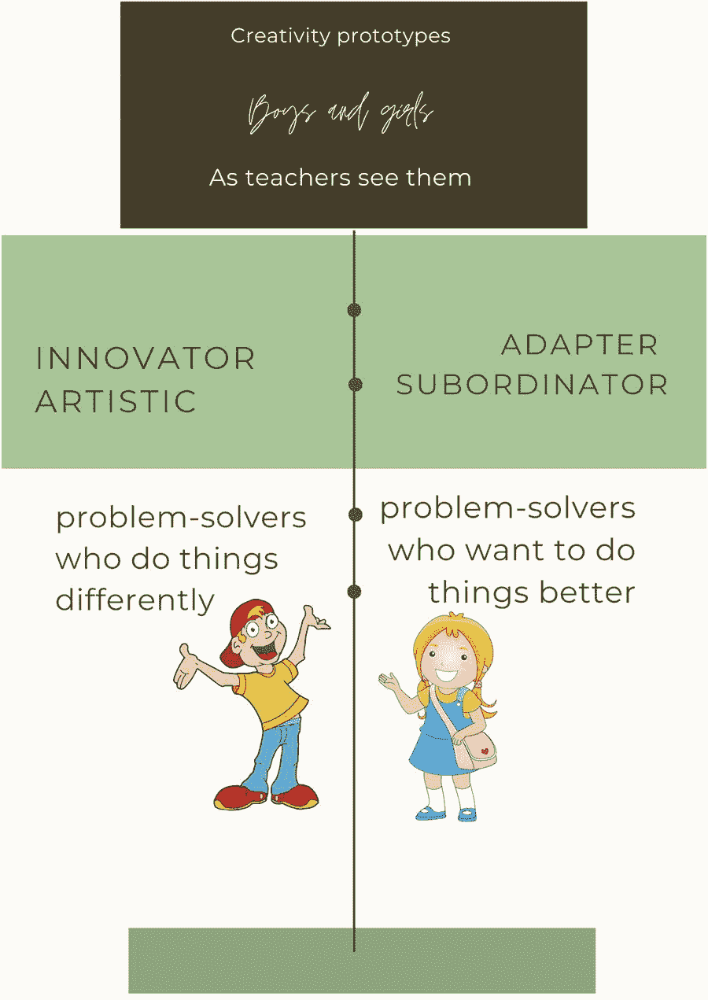

一幅说明教师关于创造力原型的插图：男孩是创新者或艺术型，女孩是适应者或服从型。

图 3-2

男孩与女孩的创造力原型对比

`创新者`倾向于通过违背某一领域的公认原则来另辟蹊径。另一方面，`适应者`则在现有框架内提出新想法。你见过一位冲动、公然反对既定规则的女性吗？又是否认识一位喜欢遵守规章制度并对情感感兴趣的男性呢？

你可能会想，“他们是证明规则的例外。” 人类大脑的功能之一就是处理信息并将其归入熟悉的类别。这正是大脑应对周围世界复杂性的方式。当新信息进入时，它会被无意识地比较并导向“正确”的类别。

有一件事是确定的。我们自身内部以及外部世界都存在如此多的复杂性和多变性。成为一个有创造力的人，就是要解决融入群体与发现自我个性之间的张力。即使是音乐家，也拥有各自鲜明的个性和思维风格。^(⁶⁴) 例如，一项研究发现，弦乐演奏者通常更容易忧虑、随和、尽责，并且更善于自我控制。相比之下，另一项研究中，木管乐器演奏者更外向，在调节情绪方面有更多困难。此外，键盘演奏者似乎更内向，而歌手则更外向、独立且敏感。

由于在理解自己的创造性思维偏好和特质时，我们所有人都倾向于给他人和自己贴标签，那么我们不妨发明一个新的类别——`“我独特的创造类型”`。为了界定这个新类别的边界，我们需要一些以自己独特方式在创造力上鼓舞人心的人作为例子。在你认识并敬佩的所有人中，谁是有创造力的人？你特别喜欢他们的哪些品质？

我认识的最有创造力的人之一是我的一个朋友，他是一位首席警官。他对自己所做的事情充满热情。他知道幽默是他的长处，并将其作为一种领导工具来维持与下属的关系。他的冲动使他在紧急情况下能成为得力的问题解决者。在所有这些品质中，我在他对突发状况的自发反应中看到了自己的影子。

“我内心有一部分会说，嗯，我不是一个有创造力的人，”领导力沟通专家约翰·贝茨说，“我的穿着不够怪异，你知道的，就像那种刻板印象，‘你很有创意，我不是’。”

约翰明智地揭示了一个迷思：有创造力的人都是古怪的。我们中的一些人可能对创造力的原型抱有这种隐藏的信念或任何其他隐含的看法。同时，你并不认为自己符合这种形象。我那位当警察的朋友，将自己描述为一个不循规蹈矩的人。他为自己在工作中成为一个创新的问题解决者而自豪。同时，他也乐于遵守他所服务的小镇的地方文化和传统。事实上，他的行为是`创新者`与`适应者`类型的混合体。他是一个穿着传统主义者外衣的不墨守成规者。

总而言之，试图将自己硬塞进`创新者`或`适应者`的类型，是在浪费你的创造力。相反，要专注于发展你自己的创造风格——你的创造性思维偏好和习惯——并围绕着一个核心需求：找到对某项活动的热忱投入。

### 回顾学生时期形成的创造力

超现实主义艺术摄影师达莎·皮尔斯（Dasha Pears）是一位渴望寻找幸福，从而挣脱“乖乖女”模式的女性。

*“成长过程中，上学时，我总是遵守规则。我是最优秀的学生。我总是为功课做好准备。我喜欢在全班同学面前发言。我一直是最出色的女孩。我一直是妈妈最乖的女儿。”*

*“之后，当我开始工作时，我遵守所有——不是规则，不是命令——而是老板告诉我的一切。我花了一段时间才摆脱这种状态，并告诉自己，‘我其实可以创造自己的规则’。”*

达莎在她人生的某个时刻决定进行一次颠覆性的转变，投身于摄影，如下面这张图片所示。

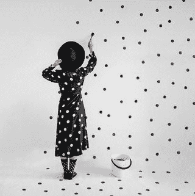一位身着黑色波点连衣裙、头戴帽子的女性正在墙上画一个黑点。白色的墙壁和旁边地板上也散布着黑点。 ^(⁶⁵)

你对自身创造性思维能力、个性及职业可能性的认知程度，在很大程度上取决于你在课堂上获得的创造力机会。就此而言，必须满足两个条件：（1）曾经有老师帮助你扮演课堂上有创造力的学生角色；（2）老师们自己愿意承担创造性教育者的角色，并理解这一角色所蕴含的内容。^(⁶⁶)

#### (1) 你在课堂上扮演了有创造力的学生角色。

为了将创造性思维能力转化为职业生涯中的核心技能，年轻人在接受学习任务时如果能应用自身创造性思维，将会从中受益。如果你在学生时代就已经习惯于在学习任何科目时运用想象力、好奇心、直觉和批判性思维，那么过上充实人生的可能性就会更高。这是创造性自我认知的路径，学生可以在此过程中探索自己创造力的长处和短板。

你最早听到“创造力”这个词的记忆是什么？那是我在高中的第三年，在一次数学课上，老师称赞我在一次测验中表现出的创造力。那是我第一次听到有人把`“创造力”`和`“解决问题”`放在同一个句子里。它带有积极的含义。即使现在，我依然记得当时的困惑，“`数学`、`创造力`和我有什么关联？”

接下来的二十年里，我都没找到答案。那时我唯一明白的是，我喜欢解数学题。创造力这部分则是一个暂时被遗忘的谜团。现在我知道，我们中有些人天生具有数学创造思维的倾向。^(⁶⁷)

那些不喜欢数学的人又怎样呢？在这种情况下，为了让这些孩子有机会看到数学之美，可以将数学呈现为日常问题解决方案的来源。此外，可能的话，数学练习题可以设计成鼓励多种正确答案的形式，例如，哪两个数相加等于 5？最后，当小测验能激发发散性思维时，孩子们就有机会更深入地参与到寻找解决方案中去。

在任何学科的学习中，若能有机会运用其创造性思维，孩子们都能从中受益。此外，可以鼓励他们独立思考，判断何时应该基于天赋倾向（`保持原创性`）选择深入学习的科目，而何时又应该选择基础水平的科目，因为这对生活有益（`遵循常规`）。

做自己热爱且认为合适的事，与承担作为社会成员有责任去基本了解的事情之间，必须存在某种平衡。也许数学不是你的偏爱，但当你购买家具时，理解高、长、宽的概念可能会派上用场。^(⁶⁸)

在 1 到 5 分的范围内，你在探索创造性自我认知之路时得到了多少支持？分数越高，你越有可能在步入成年早期时就清楚自己热衷的领域。同时，你肯定已经养成了将创造性思维应用于学习任务的习惯，甚至自己都未曾察觉（例如，一个数学问题、一个历史项目、撰写一份报告等）。

你的教育者中，谁在教学中表现出了创造性行为？例如，在一项 2014 年的研究中，36 名伊朗英语教师被问及是否通过采取以下行为来围绕其学科开发学生的潜力：

1. *“引导学生寻找新的学习方法、进行预测和解决问题。”*

2. *“提供无压力的环境，帮助学生培养发散性和创造性思维。”*

3. *“将课堂部分时间用于学生参与、真实任务和自主探索。”*

教师们的自我认知与他们在课堂上的实际表现并不相符。^(⁶⁹) 他们对这三种行为评价很高，而课堂观察员则评价很低。换句话说，参与者创造个人发展机会的实际行为比他们自己认为的要少。

盲点或许可以解释这些发现。有时，他人能更好地识别一些我们自己未察觉的行为。或者，可能是观察员未能像教师意图的那样去识别这些行为。这项研究揭示了建立促进创造力的学习环境的困难——观察者可能会误解创造性的想法和行为。

假设你作为观察者回到高中时代，哪些科目让你感到被鼓励去问“*为什么*”？在哪些话题上你的想法得到了表扬？你是否碰巧选择了其中某个领域进行专攻？

归根结底，即使老师们在学生学习某一科目时激发了他们的主动性和胜任感，最终的决定权仍在于学生是否信任自己天生的兴趣。

*“`数学`、`创造力`和我有什么关联？”*

我很清楚地意识到，解数学题是我高中时最喜欢的活动之一。但同时，我认为只有天才儿童才应该投身数学。既然我不是那样的孩子，我决定不再深入发展对数学的兴趣。

#### (2) 老师们自己承担起创造性教育者的角色。

当教育者有动力为学生提供激发其在学习中创造力的机会时，他们就会决定*以*创造性方式进行教学。教育者便成为了应用创造力的榜样。

教师对自己创造力的看法是怎样的？这些看法如何影响他们的教学行为？教师认知自身创造能力的方式，塑造了他们所采用的教学方法。

在一项 2019 年对台湾五所医疗保健学校 53 名教师进行的研究中，作者测试了自我感知的创造性人格特质——想象力、好奇心、冒险精神——水平是否能预测其自我感知的创造性教学行为。^(⁷⁰) 这项研究中的教师此前接受过关于激励和激发与医疗保健产品开发相关的创造性思维的培训。

## 研究概述

该研究测量了参与者感知的人格特质水平和创造性教学行为。护理学院的教师认为自己越有好奇心，就越有可能在教学中采用任何创造性行为。然而，他们并不认为自己的想象力或冒险精神会影响教学行为。

这些发现表明，受访者会在教学情境中使用他们认为合适的创造性行为。在台湾文化中，教师可能更倾向于强调他们认为角色所期望的品质，例如权威性。因此，他们不太愿意展示自己的个性。

在全世界任何文化中，创造性教学都意味着根据你的创造性人格，向特定的学生群体教授特定的学科内容。它需要定制教学材料的勇气。例如，从高中时代起，我清楚地记得数学杂志的封面，上面有我老师推荐解决的问题。然而，我不记得我们本应按照课程学习的课本封面。

我并没有成为数学家，但从数学教学中留下的是：当你对一个主题感兴趣时，你可以自己决定读什么书。同样，在你选择感觉正确的东西之前，你可以去研究不同专家对同一问题的看法。同样，你的教育者给你带来的个性化教学方法可能已经成为你收集信息的内隐或外显风格的一部分。

最后，创造性教学意味着当课堂中出现意想不到的岔路时，要有自发性去探索想法。例如，自发性学习已成为我的一部分。每当我突然产生好奇心，我就会放下之前的计划去追随意想不到的事情。你呢？你从老师那里借鉴了哪些创造性学习习惯，并在职业生涯中延续了下来？

### 开启你内在的创造性多样性

高中毕业二十年后，我拜访了我以前的罗马尼亚语老师，他是一位威严的人物，对他所教的学科有着毕生的热情。在回忆往事时，他停下来对我说：“你是那种只要想学就能学好任何东西的学生。”

那是我关于自主感的一个重要的“啊哈！”时刻。我曾经一直相信，权威人士比我更清楚我擅长什么。因此，别人更适合为我选择适合我的任务。我曾热衷于为别人建议的问题提出新的解决方案和倡议。但我没有自行选择问题的自由。所以，这就是一个有内在动力但自主感受抑制的个体的样子。

让我们做以下测试。让我们想象一下，你的老板意外地为你提供了公司中的一个新职位。以下哪种反应更可能是你的：1）我能胜任这个责任吗？（责任感）；2）新工作会令人着迷吗？（自主性）。

当你是一个具有较高责任感的人时，你习惯于因感知到的外部力量而参与活动。^(⁷¹) 因此，你可能会对自己的创造性选择感到有些困惑。是时候重新获得你的自主感，并在你内在的创造力与工作之间带来更多和谐了。

对你来说，为工作带来更多创造力意味着什么？这个问题建立在两个假设之上。首先，你是那种对在职业角色中发展创造性身份感兴趣的人。其次，你相信你可以自由地参与由感知到的创造力驱动的新活动。

当你把自己看作一个富有想象力的人时，将更多创造力带到工作中意味着你可以灵活地参与新的思维习惯，例如：

*   花时间做白日梦，构想那些对你有意义和相关性项目。这将增强你的勇气，去投入那些你可能会错过的、实际上可以带来成功结果的主题。

*   养成通过否定你所知或所见的基本假设来问自己“如果”问题的习惯。我们常常专注于找到正确答案并坚持它。相反，当我们花时间问一些基本问题，比如“这是真的吗？”和“我为什么认为它是真的？”时，我们通过问题来训练我们的思维。我们学会在脑海中定义和重新定义问题。我们学会识别哪些问题值得花时间。

*   花时间构建由你的同理心思维驱动的假设情景。一种方法是，将焦点转移到项目中的特定利益相关者及其需求和能力上。这会为他们可能的行动和你的反应带来新想法。其次，当你将视角转移到问题的技术要素上时，你就为识别解决方案创造了空间。爱因斯坦的思想实验，比如想象他在一列行驶的火车上观察闪电如何击中，或者一个人在下落的电梯中如何体验重力，就说明了这种思维方式。

越频繁地参与这些思维练习，你就越能对可能的自我版本以及你可以创造的可能的现实持开放态度。^(⁷²)

你可以将自己视为那种需要每天通过灵感体验来获得新鲜感的人。^(⁷³) 这样，你会很自在地为自己创造一个仪式，通过践行以下三个原则之一来唤起你的缪斯：

*你需要与所面临的技术问题保持一定的心理距离*。这要求你定期更新自己常读的信息来源列表。当你感到卡壳时，可以玩一些思维游戏，比如思考某个来自你专业领域之外的想法或概念，如何能应用到你的工作中。例如，企业家彼得·伊万诺夫撰写他的第一本书时，就是将带领远程团队的关键技巧，嵌入到一个关于虚构人物伯恩德及其虚拟团队的故事中。^(⁷⁴) 在这个案例中，彼得将虚构故事写作的原则，与团队成员身处不同实体办公室和时区所带来的现实挑战结合了起来。

或者，你也可以通过选择工作中的某个主要概念或对象，并思考它们如何能在其他情境中被运用，来改变你对试图解决的技术问题的看法。例如，如果你必须制作一个面向你孩子的教育类 YouTube 视频，你会如何讲述你的问题？

*在职业、业余爱好和社交方面参与多样化的活动*。^(⁷⁵) 研究表明，极具创造力的科学家似乎既能同时专注于核心研究项目，也能处理诸如评审稿件和项目申请等次要任务。此外，他们似乎更经常参与富有创意的业余爱好，并在会议或其他社交活动中交流想法。

*练习发现新颖之处的*能力。富有创造力的科学家更有可能在休闲阅读中发现能用于当前研究问题的有趣内容。你如何才能对你周围的新颖事物更具接纳性呢？

通过经常阅读其他学科领域的书籍，你会接触到针对重要问题的互补性视角。在工作期间出去散个短步，能增强你观察、嗅闻和聆听周围世界的能力，让你从思绪中抽离出来。其目的是让你的大脑有时间进行酝酿，同时训练它对你日常环境中的新方面产生兴趣。^(⁷⁶)

为工作带来更多创造力还意味着什么？有些人的创造力围绕着他们运用特定创作技能的能力，比如绘画、讲故事或写作。将这些技能中的任何一种带入工作，意味着采用新的技巧来执行和交付你的任务。

最后，带来更多创造力意味着以好奇心的形式，让你的创造性人格更多地展现出来，去寻求新的体验。于是，你便开始了一场超越角色期望的个人探索之旅，去探索新技术、流程、方法或理念。

总而言之，在工作中发挥更多创造力，需要评估在当前工作环境下，上述思维习惯中你最倾向于尝试哪一种。是你的想象力倾向？灵感仪式？特定的创作技能？还是拓宽你的专长？

在工作中向你的创造性多样性敞开心扉的核心前提是，**好奇心**是潜在的激励力量，它能够恢复你的自主感和主动性，从而发展你的创造潜能。我们现在来讨论一些个人策略，通过这些策略，你可以展现你创造性人格的这一核心特质。在组织环境中，你允许自己展现什么样的好奇心？

### 创造力，在于对你认为值得追随的好奇心进行反复审视

在上一节的研究中，教师们并非个例，他们认为并非所有创造性的习惯都适合教学情境。他们认可自己的好奇心，却不认可自己的想象力或冒险精神。探索表达好奇心的不同方式，意味着要意识到你认为什么是值得投入的恰当学习。

根据组成理论，个人提出新颖且有用想法的能力受到三个内在组成成分和一个外部成分——社会环境——的影响。^(⁷⁷) 这三个内在组成成分分别是：（1）领域相关技能，如专业知识和专业技能；（2）创造性思维技能，例如灵活思考；人格特质，如经验开放性；以及持之以恒的工作方式；以及（3）内在任务动机。要使创造力得以显现，这些成分必须同时存在并相互影响。社会环境能够影响创造力的每一个内在组成成分——新的专业知识、创造性思维技能以及内在动机。

创造力的触发点是获取专业领域内的必要知识。例如，你可以采取积极主动的学习态度，沉浸在以下方面的好奇心之中：

- *不同的职业* ——“每当我遇到有趣的新朋友，我都会想象自己扮演他们的角色。”

- *创造性韧性的故事* ——“每周一次，我会寻找一位有创造力的人的故事，听听他们讲述自己在实现想法过程中的高潮与低谷。”

- *新概念* ——“当我听到一个新概念时，我会在日历上安排时间去查阅它。我会找一位我信任的人分享我的学习心得。”

- *新想法* ——“每当我有了新想法，我都会花时间写下可能的实施方案（即使我不确定能否立即付诸行动）。”

这四种好奇心的表达方式中，哪一种最吸引你？想象自己处于不同的身份角色，以及聆听有创造力的人的韧性故事，是最稳妥的入门选择。你感受到的环境不确定性越高，就越会发现，以开放心态拥抱新体验——比如花时间学习新概念或写下关于发展新想法的笔记——更具挑战性。

`Mueller et al. (2012)` 的研究表明，尽管研究参与者在感到有动力去减少不确定性时对体验持开放态度，但这却带来了对创造力的负面联想，使得他们不那么容易识别出一个有创意的想法。^(⁷⁸) 这一发现表明，强加的目标会降低自发参与创造性行动的自我决定感。^(⁷⁹)

这就是为什么心理安全感是重视创造力的机构的基本要求之一。但即使在有利于创造力的文化中，当大脑感知到某些环境威胁时，它也更倾向于从事同样熟悉的活动，而不是新的体验。因此，你可以在不那么有利的条件下激励自己学习新东西，方法是回答这个问题：“从长远来看，什么是最有益的？是利用现有能力学习，还是承担颠覆性学习的风险？”

在回答这个问题时，请警惕过往成就的陷阱。并非只有环境中的感知威胁会让我们偏好已知的事物而非未知的事物。例如，`Audia and Goncalo (2007)` 的研究表明，过去创造性成就的经验可能成为一道重要的界限，阻碍有创造力的人提出颠覆性的想法。^(⁸⁰)

一旦个人产生了一个创意想法，未来的创造性努力都会从这个最初的想法的角度出发。因此，为了让个人在未来增加创意想法的多样性，用来自相近或遥远领域的新专业知识更新现有知识至关重要。知识的动态吸收增加了原创想法的出现。因此，你可以像养成度假习惯一样，养成颠覆性学习的习惯。

那些让你感觉自己像个新手的频繁学习经历，其预期效用是什么？`Mueller et al. (2012)` 的研究结果还揭示，对我们能表现得多好、或期望获得多少经济回报的不确定性，也让我们将创造力与生活中可有可无的方面联系起来，而不是必需品。更多地投入你的好奇心，会发展出你的专业感。这是一个关于身份成长和心理健康的问题。而将其视为奢侈品还是必需品，则由每个人自己来评估。

要去从事你以前没做过的活动的想法，比如`我会抽出时间学习商业模式`或`我会报名参加即兴表演课`，会在创造者的心中制造紧张感。个人改变的心理动因，是挑战你创造力极限的好奇心。然而，你也可能因为害怕错过那些安全且成功的活动而退缩，这些活动你必须放弃，才能专注于新的学习。当预期的情感收益比感知到的风险更具说服力时，你就会被激励在职业生涯中做出一些改变。但究竟是什么构成了做不同事情的情感驱动力？

现在是时候审视一下你所观察到的冲动模式了，作为有创造力的人，这些模式将引导你走向新的活动。

脚注 1 2 3 4 5 6 7 8 9 10 11 12 13 14 15 16 17 18 19 20 21 22 23 24 25 26 27 28 29 30 31 32 33 34 35 36 37 38

## 创造冲动

## 创造性活动的四种潜在诱惑

> `当我意识到自己的首要优势是输入和创造力时，我便开始顺应这股浪潮，于是我的书诞生了。我从未想过自己会成为一名作家。`
>
> ——独立创业者彼得·伊万诺夫

你内心深处何种力量，可能会将你推向一项全新的创造性活动，使之与你此前在职业生涯中从事的任何项目都截然不同？

在神经科学文献中，记载了因神经损伤而经历剧烈生活变迁的案例。其结果是，他们产生了一种无法抑制的创作驱动力，去绘画、写诗或弹钢琴。^(⁸¹)

汤米·麦克休是一位爱尔兰建筑工人，曾饱受偏头痛之苦。中风发作那天，他正坐在马桶上看报纸，突然感到头部左侧一阵爆炸般的剧痛。他的妻子发现他倒在地上，赶紧将他送往医院，外科医生为汤米的大脑进行了长达十一小时的手术。

当他术后恢复意识时，他的行为、想法和动机发生了根本性的改变。他突然能够欣赏从病房窗户看到的美丽景色了。^(⁸²) 几天后，他产生了一种想要押韵的冲动。随后，他的大脑开始超负荷运转，充满了旧日自我所不知的细节、信息和知识，而这些新生的自我却无法抑制地将其先以文字、后以绘画的形式表达出来。

拿起画笔这件事，是汤米旧日自我从未想过的事情。令人惊讶的是，他的新自我如此沉迷于绘画，以至于用层层颜料涂满了家中的墙壁、地板和家具。绘画给了他一种幸福感。

虽然对于汤米的确切触发因素——是丰富的想法和概念流提供了灵感，还是多巴胺的增加导致了对使他快乐的事物产生无法控制的驱动力——存在一些推测，但可以肯定的是，各自相应的触发因素将他变成了一位艺术家。

在成为画家之前，乌克兰人瓦列拉·赫里沙宁梦想着在职业联赛中打篮球。一种神经系统问题影响了他的运动和协调能力，使他无法继续自己的运动员生涯。`"令人惊讶的是，有一天我醒来时发现自己正在画画。这就像一股清新的空气，我想重获新生，"` 瓦列拉说道。^(⁸³) 他现在能左右手并用，同时使用双手绘画和作画，正如他在电视直播节目中展示的那样。他的作品挂在许多国家人们的家中。

汤米从建筑工人到诗人、画家的转变，以及瓦列拉发现自己绘画天赋的故事，让我们不禁思考自己的大脑——就我们所知，我们很幸运地拥有相对健康的大脑。在记忆、语言表达和社会认知这些不再受到抑制的通路中，究竟隐藏着怎样的创造倾向？

一个富有创造力的人，是其内在倾向于为自身物理空间带来新事物的神经关联的集合体。你的创造倾向在生物学上根植于大脑的奖赏系统，该系统激励你出于学习的乐趣去寻求新的体验。^(⁸⁴) 对一项颠覆个人常规活动的驱动力，是由`创造冲动`决定的，它包括对你在新情境中所经历的刺激产生的一种`突然而强烈的情感`，如敬畏、兴奋或慌乱。这种冲动既强化了你的感受，又驱使你付诸行动。当你与外部世界互动时，你的大脑会吸收他人情感、行为和事件的感知（见图 4-1）。结果，对于一些人来说，最初的冲动是去修复情感——自己或他人的；而对于另一些人，则是解决某个特定的外部问题。

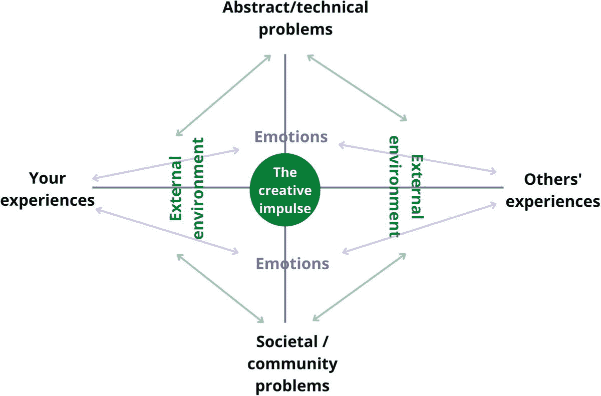

这幅关于创造冲动的图解，分别展现了你和他人的体验（两侧），以及抽象和社会问题（上下方）。

**图 4-1** 创造冲动

要了解自己能成为何种类型的创造者，你可能需要留意那些使某一特定行动比其他任何创造性活动都更具吸引力的`冲动`。我们越是允许自己投入其中，我们的职业身份就越是围绕它而形成，接下来你就会听到自己说：`"我是一名 ______ 方面的创意专家。"` 我们学会了如何像`内容创造者`、`产品创造者`或`积极变革创造者`那样思考和行动。

在忙碌的一天中，是什么让你停下脚步并陷入思索？试着避免过度思考，而是凭直觉回答：

- 我在物理环境中注意到的细节，例如
  - 天空颜色的变化
  - 城市的声音
  - 冰箱里冰块的形成
  - 按下电梯按钮时发出的声音
- 人们的情感和经历
- 你自己的情感、思想和内心独白
- 社会新闻

当你参与某些事件时，某些方面会迅速引起你的注意。例如，在接下来的几天里，你可能会意识到你的思绪不断回到某个关于你个人生活、他人生活、社会趋势或个人情感无关且客观的物质世界细节（例如秋天树叶变色的生物机制）的挑战上。

根据你对生活哪个细节产生的情感变得更为突出和频繁，你可能会体验到`四种类型的创造冲动`（见图 4-2）。

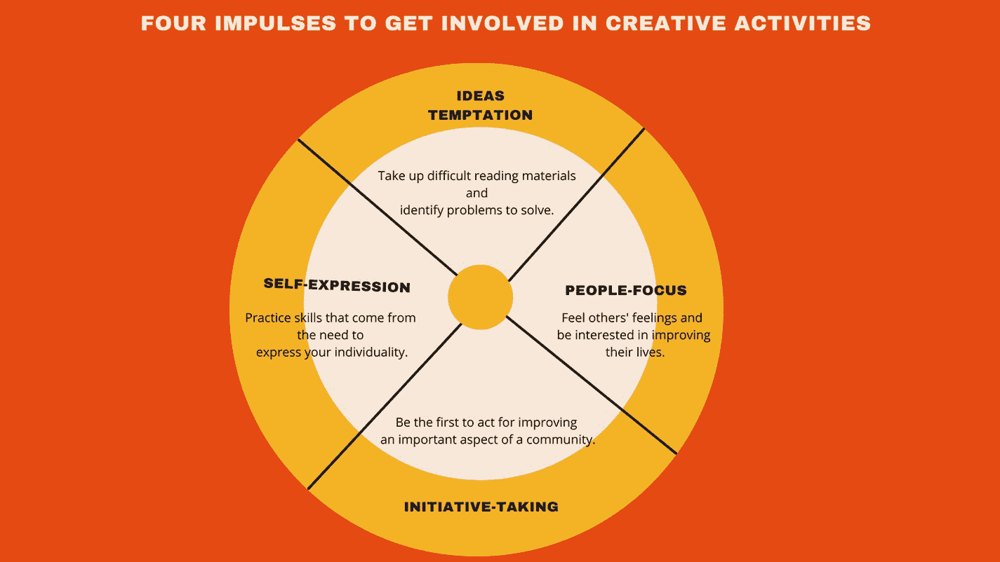

一幅圆形图解，展示了四种类型的创造冲动：自我表达、主动行动、关注他人、思想诱惑，并附有说明。

**图 4-2** 创造冲动说明

### (1) 自我表达

这种冲动是汤米·麦克休、瓦列拉·赫里沙宁以及其他因神经系统疾病而从非艺术人士转变为痴迷于绘画、写作或音乐技能的标志性案例背后所蕴含的艺术成果的驱动力。

健康的大脑同样天生具有对创造性表达的不懈驱动力。`达莎·皮尔斯`的超现实摄影和`哈里特·法格霍尔姆`关于有意识共同创作的作品，都源于她们对自我表达的倾向。你如何知道自己是否有这种倾向？

你大部分时间都在处理与内在自我相关的信息。例如，你倾向于谈论那些深深触动你的生活经历，如人际关系、工作、爱情、童年、死亡等。

当你发现表达自我能带来慰藉时，你自己的情感和经历便成为创作源泉，创造出他人能够产生共鸣并可能体验到情感净化的作品。因此，你被那些能帮助你发展特定知识和技能、表达细致入微观点，并成为文字、声音或图像炼金术士的活动所吸引。

回报来自于分享你的价值观和信念体系，获得理解，并与观众建立联系。或者恰恰相反，你的创造性产品可以是你从世界中抽离的信号。对自我表达的渴望可以点燃各种艺术工作和公开演讲活动，体现你认为值得传达的信息。

### (2) 主动行动

在康复期间，汤米·麦克休发现了和他一样经历过大脑修复的人，他们不知道如何表达，也不知道该向谁诉说自己的经历。他对这一观察结果变得异常热衷，并开始发表演讲，讲述中风幸存者如何接纳自己的新思维。`"我们需要能够谈论发生在我们身上的奇怪事情，因为在康复过程中获得一点支持与理解可以带来百分之百的改变，"` 汤米说道。^(⁸⁵)

### 你如何知道自己拥有主动进取型的大脑？

你会注意到，自己的注意力常常集中在社会或商业的某个方面，并强烈渴望看到其得到改善。因此，你自愿去影响和动员他人，提升他们的技能，以便采取集体行动。

回报来自于看到你所发起的行动产生成果时的愉悦感。这种倾向可以引导你走向领导岗位、社会创业、生态创业以及维权活动。例如，`图莉亚·洛佩斯`的工作坊就植根于这样一种倾向：为那些在表达想法时需要增强信心的女性提供领导力支持。

### (3) 创意诱惑

你是一个思考者，无论是在抽象、哲学还是技术层面。解决复杂问题——无论是与生活相关的还是概念性的——是你大脑最喜爱的运动，尤其是当你预见到这些问题可能具有发明或创新潜力时。

回报来自于发现新信息、拓展某个领域、社群或文化中已知真理边界的喜悦。哲学家、研究人员和工程师主要通过这种冲动来定义，但也包括科学、技术和知识领域的创业者。例如，销售工程师`奥斯卡·桑托拉`关于推销技术产品的书籍，就源于他将晦涩的想法分解成易于理解的技术信息的倾向。^(⁸⁶)

### (4) 以人为本

关心和支持他人的福祉与个人发展，是你的天性。就像机械工程师喜欢设计、维护和改善汽车引擎的运转一样，你想要提升人们的生活。

回报来自于能够与他人建立联系，并为他们提供机会去深入了解自己的能力。这种导向可能会让你从事直接与那些你希望改善其生活的人们一起工作的专业角色。**帕梅拉·汤普森**的研讨会专注于通过关注身体如何体验不确定性来拥抱个人与组织变革，这彰显了她对人们健康的关怀。

### 你呢？

这四种冲动中，哪一种对你最有意义？一个小建议：当你阅读某种冲动的描述时，若感受到一丝解放感，那便是个人意义的信号。可能会有哪些新颖的活动被激发出来呢？

让我们从一系列被认为能体现日常创造力的简明活动入手，来看看当前实际参与创造活动的现状。^(⁸⁷) 在以下活动中，哪些是你在**业余时间**参与过的体验？请圈出你在**成年后至少做过一次**的活动。

#### 自我表达

*   我参加过写作工作坊。
*   我参加过视频剪辑工作坊。
*   我参加过绘画工作坊。
*   我在戏剧演出中扮演过角色。
*   我会演奏一种乐器。

#### 主动进取

*   我喜欢为自身以外的事业而工作。
*   我是工作中新计划的首批志愿者。
*   我参加过商业创意生成工作坊。
*   我参加过创业项目。
*   我协助过镇上新公共活动的策划。

#### 创意诱惑

*   我喜欢深入阅读我主要专业领域之外的各种主题。
*   我拆解过电脑或其他机械设备，仅仅因为我想把它们重新组装起来。
*   为了乐趣，我为初级机器人设备编写过程序。
*   为了好玩，我进行过实验性设计，比如曼妥思加健怡可乐或冰块染色实验。
*   我使用算术来解决实际问题。

#### 以人为本

*   我参加过提升沟通技巧的工作坊。
*   我经常给朋友写幽默的信息。
*   我喜欢让别人对自己感觉良好。
*   我喜欢激励人们实现他们的目标。
*   与人们交谈时，我会指出他们的优势。

请回到列表顶部，并圈出你在**职业背景**中至少做过一次的活动。这些活动指向你**当前的职业创造力**。你在某个类别中标注的活动越多，相应的创造倾向在你工作身份中的烙印就越深。

你可能已经意识到工作中驱动你的创造冲动。然而，你在业余时间实践的创造倾向中，蕴含着大量未被探索的潜力。通过对比你业余时间从事的创造性活动类型与工作中的创造性任务，你就能揭示出**你对自己认为可以创造什么并以此获得报酬的假设**。

再看一下上面的列表，哪一项活动是你希望在工作中更常体验到的？你是否在想，“*是的，但是……*”？帮自己一个忙，避免提出关于组织障碍的理由。相反，想象你在一个没有约束的文化中工作。

为了发挥你作为创造性人才的潜力，你或许要找到方法，让那些促使你从事业余活动的创造冲动，成为驱动工作活动的动力。

软件工程师可能会认为，分析性解决问题是他们擅长且舒适的基本技能。那么，像他们这样的人，在多大程度上会考虑制作一个关于程序员生活一天的搞笑视频？

科学家们可能默认研究方法是他们的领域。他们成为受人尊敬的科学领袖的几率有多大？当我问赫尔德·桑托斯教授，除了研究之外，还有什么活动需要他的创造力时，他回答道：“*如果我想告诉你或其他不太熟悉我们工作的人，我们必须在信息传达方式上具有创造力。因为如果我们使用研究中同样的方式，他们不会理解。所以，即使是在沟通方式上，你也必须有创意。你不能只是放个图表在那里，就期望人们能理解。因此，在过去的几个月甚至一年里，我感兴趣的一件事就是如何让一个非常复杂的领域变得更容易理解。因为，对普通大众来说，科学仍然是一个大黑箱，要想把它带到他们的认知水平，让他们完全理解我们在说什么，你必须用正确的方式沟通。*”

赫尔德的经历表明，当创作者意识到次要冲动——在赫尔德的案例中是主动进取——他们就会受到激励，去重新设计自己当前作为创作者角色的工作任务。

总而言之，要警惕关于你可以在角色中采纳哪些新活动的假设。从 1 分（*我完全不在乎*）到 5 分（*我为此而活*），对于你的职业生活，以下方面有多重要：

*   自我表达
*   主动进取
*   创意诱惑
*   以人为本

了解你赋予各种可能创造倾向的价值，将会让你对触手可及的新活动大开眼界。

## 通过协调创造力对幸福感与工作角色的重要性，探索你的创造驱动力

在小学高年级的最后两年，我发现了数学的乐趣。然而，我对成为一个优秀问题解决者的信心有些动摇。你看，五年级时，数学老师认为我有颗鸽子般的脑子。接着，到了七年级，我开始上另一位数学老师的课，他会对我推理解题的过程表示赞赏。由于信心大增，我在高中选择了数学和物理方向。

整个高中期间，我代表学校参加数学奥林匹克竞赛，但水平不足以跻身顶尖选手之列。在毕业考试中，我取得了全校最高分——9.2 分（满分 10 分）。然而，我并没有继续深造数学，因为我认为自己不够聪明，无法获得数学高级学位。

在天文学家塞西莉亚·佩恩的所有兴趣中，数学是她最热爱的学科。讽刺的是，当全家搬到伦敦后，新来的数学老师让她陷入了“神经质的恐慌，并因此产生了一种我一直未能完全克服的对该学科的心理障碍。”^(⁸⁸) 数学曾是她的希望，但在新学校，希望变成了失望。

塞西莉亚通过另一条路径——植物学、物理学和化学——继续怀抱对科学教育的希望。与她不同，我不仅放弃提升自己的数学技能，也停止相信自己有能力保持任何其他方面的好奇心。

**在这种情况下，创造驱动力，即出于好奇心寻找活动的欲望，被阻断了。** 像罗纳德·贝盖托这样的创造力专家称此为 **“创造性挫败”** ，即在经历负面表现结果后，失去追求创造性抱负的意愿。^(⁸⁹) 结果，你失去了信心，无法找到新的让你心动且擅长的事物。就像你第一次深爱某人，但不久后分手一样。你觉得自己再也感受不到爱了。

你的好奇心是创造可能性的丰富源泉。哪些创造冲动与你当前的专业技能和兴趣相匹配？在挑战他人的固有信念之前，创造者首先需要挑战自己，挑战他们的自我信念和价值观。^(⁹⁰)

在 1 分（完全不重要）到 5 分（非常重要）的尺度上，你的创造力对你自在做自己有多重要？将你的创造潜力发展成职业对你有多重要？图 4-3 描述了三种可能阻碍你激发创造潜力的信念——情形 1、2 和 3。**然而，当你揭示自己对自己讲述的故事时，仍有希望解锁你的创造驱动力。**

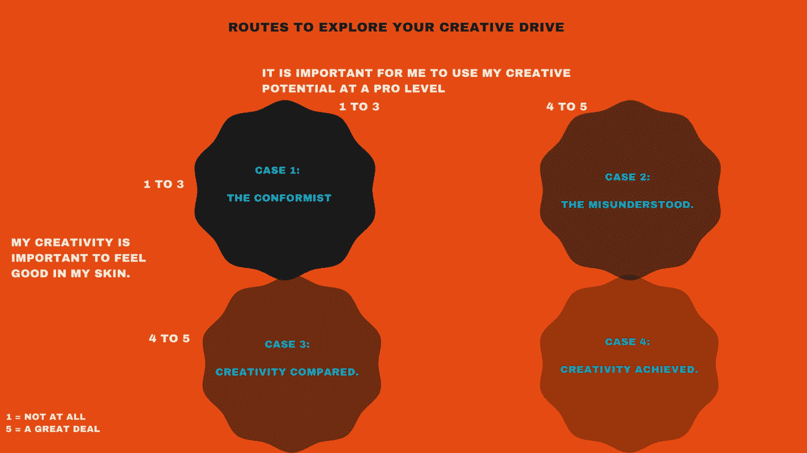

**图 4-3** 克服创造性挫败

### 叙事 1：做一个顺从者

你倾向于认为自己没有创造力，并且不认为过有创造性的生活有什么价值。然而，顺从是你性格中很大的一部分。因此，你会沿着他人早已开辟的道路前行。^(⁹¹) 你可能潜藏着创造性的兴趣，但你看不出有什么理由要努力探索自己的创造力，无论是作为爱好还是在工作中。

从我记事起，我就一直崇拜我的祖母。结果，在青少年早期，我想通过自己实现她成为医生的梦想。然而，当我偶然发现自己有恐血症时，事情变得显而易见：我不是当医生的料。我的潜力在别处。

顺从可能源于想让所爱之人开心的愿望。顺从可能源于懒得付出额外努力去坚持自己的偏好。顺从可能源于害怕受到惩罚。我们选择符合父母和有影响力的照顾者期望的职业角色，原因有很多，有时这些原因相互交织。

无论你倾向于顺从的原因是什么，只要你潜意识地困在其中，你就会错过了解自己创造性一面的机会。

### 叙事 2：你感到被误解

你知道自己是一个从不缺乏想法的人。但遗憾的是，你遇到的怀疑可能超出了你的承受能力。结果，你陷入沮丧，执着于自己的想法并责怪他人。这就是创造力的销售陷阱。

创造专家在交流新颖想法时，会面临他人有意识或无意识的信念。例如，在我主持的一次培训会议中，我调解了一场产品经理与全国总经理之间的讨论，产品经理提出了一个创新想法。现场充满了双方的挫败感，气氛紧张得仿佛能用刀切开。“*你为什么不去向总部提这个想法？*”总经理在某个时刻建议道。

你猜产品经理做了什么？由于高层管理团队否决了他之前提出的创新想法，他选择不向董事会汇报这个最新的想法。同样，你可能也对你周围的人感到失望，因为他们不接纳你的改进建议。“*傻瓜，他们懂什么？！*”或者“*我何必自找麻烦？*”当你产生优越感或自卑感时，你便失去了幸福感以及以不同方式思考的意愿。

“*这次会有什么不同？*”你可能会想。创意不会自己推销出去。而除了你，还有谁能成为你想法的最佳推销员？所以，下次你为一个绝妙想法感到兴奋时，不妨仔细想想：***何时、向谁、以及如何谈论你的想法***？

天文学家塞西莉亚·佩恩的故事表明，环境——专家群体、公司文化、领导力、可用资源——可以加速或延迟你的创造性成就。然而，她克服了这些障碍，这得益于她坚信自己是研究恒星特性的合适人选，以及她为研究寻找新想法的能力。

首先，塞西莉亚很清楚自己在英国无法拥有科学家的职业生涯，这也是她移居美国的原因。你可能也想在其他环境、团队和组织中探索自己的角色。就像彼得·伊万诺夫，从管理职位转向创业。或者像约翰·贝茨，将创业重点转向领导力沟通。

### 叙事 3：你将自己的创造力与他人进行比较

你在工作环境和日常生活中都看重创造力。你认识到进步、新视角和实验带来的好处，这一切都始于对当前做事方式的审视。但你自己缺乏信心，认为自己不具备挑战现状所需的人格、智力和能力。

“*我不够优秀，成不了数学家，*”18 岁的我这样告诉自己。“*我永远也成不了亨利·庞加莱。*”同样，当你将自己的能力与你所在领域最伟大头脑的能力进行比较时，你可能会灰心丧气。

在这种情况下，我们可能需要重新审视并校准 **我们对创造性成就的期望**。当我们从事需要创造性思维的活动时，可能有四种结果：**大 C 创造力**、**专业 C 创造力**、**小 c 创造力**和**微 c 创造力**。^(⁹²)

#### 大 C 创造力

**大 C 创造力** 是大多数人（包括我的长子）在回答“谁是富有创造力的人”时所想到的。大 C 创造力建立在这样的期望之上：做出伟大的作品，做出爱因斯坦式的贡献，从而颠覆特定领域并推动全球社会的进步。这种创造性成就源于一个人有能力注意到环境中必要但不紧急的问题，并全身心投入寻找解决方案。当答案被找到时，它们会改变某个知识领域的基本假设、改变文化中的现状，或像互联网改变我们生活那样，给人们的生活带来根本性变革。

> “当然，另一件我一直试图教导或告诉学生的事情是，让问题来引导我们，而不是让解决方案来引导，”文森佐·塞鲁洛教授说。“你想解决什么问题？忘掉你擅长什么。大多数科学家都非常以解决方案为导向。我有一个解决方案，让我们看看我能用这个解决方案解决什么样的问题。我知道怎么写，我能用它做什么？相反，我认为我需要写一本关于创造力的书。让我看看我是否擅长写作。这完全是另一回事，结果可能完全不同，因为你是从提出问题开始的。而当你面对一个问题时，你甚至不在乎自己是否擅长，你会之后再去寻找解决方案。”

一些具备大 C 创造力的人，他们的雕像被竖立在城市中，他们的作品被收录进教科书。我们生活在他们的影响之下。然而，即使是这些人，他们最负盛名的成就，也可能是在数十年致力于核心与次要想法之后才出现的。^(⁹³)

把创造力想象成一份礼物。当你收到的礼物，与周围其他人相比，包装得更小时，你会怎么做？你会接受它，还是立刻拒绝它？你可能具备也可能不具备实现大 C 成就的能力。更重要的是你能否找到一个让你充满好奇、想要探究的有趣问题。

#### 专业 C 创造力

> “我认为创造力有不同的方面，”领导力沟通专家约翰·贝茨说。“比如，当我听到‘创造力’时，我脑海中浮现的是‘无中生有’。那一定得是件非常了不起的事。然而，创造力还有其他方面。比如，也许你没有创造所有这些部分，但如果你以一种独特、特别的方式将它们组合在一起，那也是创造力。”

约翰的直觉颇有道理。当他谈到以独特的方式将所有部分组合在一起时，他描述的正是**专业 C 创造力**。它能为某个社群或专业领域内的特定问题提供实用的解决方案。此外，正如格罗宁根大学生物医学工程教授赫尔德·桑托斯所描述的，其中一些解决方案可以带来知识的渐进增长。

> “…你创造了一种解决某类问题的新方法。所以，就我们的领域而言，就是创造一种解决健康问题的新途径。”

在完成财务会计信息系统硕士课程后，我对自身创造能力的看法发生了转变。我意外地获得了一个攻读博士学位的机会。读博曾是我认为遥不可及的事情。

> “我打赌你能做到，”教授仿佛看穿了我的心思般说道。我毫不犹豫地接受了这个挑战，但同时也在想：“真的吗？我真的能做到吗？”当我踏入博士研究的挑战时，我学会了不再执着于成为最优秀的人。相反，我挑战自己去寻找有趣的课题。

总之，当你因专业 C 类型的创造性成就的前景而感到无所适从时，请反其道而行之。要对自己抱有信心，即便因怀疑自己不够聪明或能力不足而犹豫不决，也要投身于学习过程。

#### 小 c 创造力

第三类创造性成就，**小 c 创造力**，或称为日常创造力，体现在创造性的爱好中，例如演奏音乐、表演、写作、烹饪、绘画、DIY 家居改造等。这种形式需要你对某事物有浓厚的兴趣、具备一定相关技能基础，并拥有一些自发性和行动自由。其成果对创造者本人及其小范围的受众来说，是令人惊喜、有趣且富有意义的。

> “对我来说，另一种创造力的感觉就是和乐队一起现场演奏音乐，”约翰·贝茨补充道。“那真的是一件非常棒的事情。我们一起演奏了很长时间，我们真的达到了演奏歌曲非常纯熟的地步。”

我自己的剧本创作爱好也体现了小 c 创造力。这些剧本由一个业余剧团搬上舞台，在赫尔辛基为少数英语戏剧爱好者演出。

小 c 创造力由表达自己或他人情绪的主导倾向所触发。例如，在以下情境中，你会在哪里看到自己的影子？

*   有时我有一些情绪，最好的处理方式是把它们写进一首诗、一首歌、一篇博客文章或一个虚构故事里。^(⁹⁴)
*   有时，他人的经历深深触动/困扰/逗乐了我，让我自然而然地产生灵感去写一首诗、一首歌、一篇博客文章或一个虚构故事。
*   我的情绪驱动我在一天中最平凡的时刻过上充满创意的生活。
*   一项创造性的爱好会给我能量来应对生活。
*   我需要以一种鼓舞人心的方式来布置我的家居空间。

被动参与创造性活动，比如参观博物馆、去听音乐会或观看戏剧，并不算作小 c 创造力。如果你在上述活动中看不到自己的影子，那么你更可能属于那种在解决工程、科学或技术问题中体现实践创造力的类型。

#### 迷你 c 创造力

与小 c 创造力非常接近的是**迷你 c 创造力**，这是第四种个人层面的创造性成果，它关乎“对经历、行为和事件进行新颖且具有个人意义的诠释”。^(⁹⁵) 迷你 c 创造力关乎在不同情境中识别即兴发挥的机会，例如在谈话中或像约翰·贝茨描述的那样在乐队中演奏音乐。

> “我们彼此心领神会……作为一个乐队，我们配合得非常紧密。那感觉绝对妙不可言，就像是一种超脱的心境。这是我所知道的、最接近于与他人心灵相通的感觉。那真是太棒了，感觉极富创造力。”

迷你 c 创造力关乎与身边的人同步当下，并回应那些无拘无束的即兴言语，为自己和他人释放能量、欢乐与灵感。**增强你的迷你 c 创造力是解锁你创造动力的关键**，并能增加你投入新学习活动的机会。这意味着你要成为自己创造冲动的**积极观察者**。

你最近是否曾在一次谈话中想到，“对，我也是！我也是。我也想创造类似的东西”？那是关于什么主题的谈话？

*   工具
*   数据
*   抽象概念
*   一群人

几年前，我路过一家书店的橱窗，注意到一则公告：“每周六下午 1 点，我们为各界人士组织一个关于灵性的讨论小组。” 我惊讶地发现自己竟然想道：“对，我也是！我也想创建一个属于我自己的小组，主题由我来定。”

你越能注意到模仿他人项目，但将其转化为自己独特创意的倾向，你就越能为自己创造机会，**在感兴趣的领域获得更多知识和更深入的参与**。

### 叙事 4：实现创造力

你可能多年来一直有意识地锻炼自己的创造性思维、技能和兴趣。如今，你已确立了一项创造性的抱负，这成为你职业身份的核心。在此阶段，大多数时候，当有人带着问题来找你时，你会**按需创造**，并提供解决方案。

*“我认为创造力有着如此广阔的空间、需求和余地，是我以前从未充分认识、也未予肯定的，”*领导力沟通专家约翰·贝茨反思道。*“创造力体现在哪里？体现在产品是什么？体现在我们如何营销它。我们如何向人们介绍它？体现在我们如何提供客户服务。体现在我们如何构建这笔交易？我们如何制定一份让双方都满意并愿意继续合作的合同？那全都是创造力。”（原文如此）*

此外，成熟的创造者可以通过向次要的创造性冲动保持开放，采取**对创造性行动的积极主动态度**，例如芬兰作曲家马蒂亚斯·库皮亚宁所展现的主动精神。

*“如今，音乐家想仅靠一件事获得收入要困难一些。对我来说，弹吉他并不能支付我的账单。我必须在它之外做很多其他事情。由于互联网和其他类似因素，音乐行业正在发生巨变。你必须以那种方式保持创造性，你必须能够从不同来源获得收入。”*

一旦选择了特定的创造者角色，你与创造力的关系便会持续受到人际关系、经济以及社会事件的影响。

在本节中，我们揭示了如何重新思考我们的“魔力”，以便在专业层面开发创造潜力的方法。下一节将讨论在工作情境中寻找全新创造性冲动的三种策略。

脚注 1 2 3 4 5 6 7 8 9 10 11 12 13 14 15

## 5. 发现全新创造性冲动的三条途径

在成年期的特定阶段，**人格特质**、**创造性的偏好与兴趣**以及**环境影响**的发展可能会重新调整，促使我们将创造潜力与工作更和谐地融合在一起。例如，企业家哈里特·法格霍姆在四十多岁时从教师岗位转型创业。

*“我滋养着自己充满创造力的部分，”* 拥有自我表达创造性冲动的哈里特补充道。*“因为我现在知道，它带给我最多的快乐、自由和意义。当然，我不知道我的工作还能产生什么其他结果。我能表达多少创造力？我不知道自己的极限在哪里。我在意识进化方面的主要导师，芭芭拉·马克思·胡巴德，她一直拓展自己直到 88 岁，然后去世了。”*

你创造得越多，作为企业家、艺术家、科学家、领导者等，你的创造潜力就越多样化。那么，让我们戴上**侦探帽子**，开始追踪你身上**创造性冲动的迹象**，好吗？

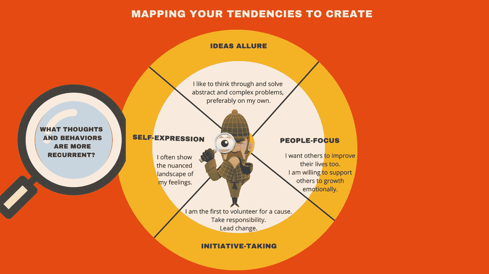

一张用于检测创造性冲动（如自我表达、主动精神、关注他人和想法吸引力）的反复出现的思维和行为示意图。

**图 5-1** 与创造性冲动相关的思维和行为

### 情感可用性并非艺术家专属

# 创造力与情感

在社会中，创造力仍主要被理解为艺术创造力。^(⁹⁶) 例如，朱莉娅·卡梅伦的《艺术家之路》^(⁹⁷) 是探讨如何通过强化作为艺术家（包括 aspiring 诗人、作家、画家、舞者等）的身份认同感，来发现和恢复创造性自我的最畅销书籍之一。创造力的这种艺术偏见赋予了具有自我表达冲动的人们力量，但也可能成为非艺术家的心理障碍。将创造力与艺术沉浸和艺术天赋隐性关联，可能导致我们许多人偏离拥抱个人创造力，而这些创造力往往体现在对主动、关注人或想法的倾向性上。

*“如果我没记错的话，在文艺复兴时期及之前，‘艺术’和‘艺术家’这两个词还不存在，”* M.C. 埃舍尔在 1965 年 3 月 5 日接受希尔弗瑟姆市文化奖时说道。^(⁹⁸) *“当时的建筑师、雕塑家和画家仅仅被视为某种手艺的从业者。”*

是的，画家、音乐家、小说作家、建筑师和设计师是我们中的艺术家。然而，在更广泛的创造者家族中，他们只是其中一个群体，在这个家族中我们还能找到科学家、企业家和细分领域专家。非艺术人士也可以拥有创造性的个性，比如顽固的执着、雄心和冲动，只是不同的环境因素导致了这些特质。费斯特（2001）认为，自然选择的压力导致了应用于技术、科学和工程领域的创造力形式，而性选择则影响了艺术创造力。^(⁹⁹) 因此，值得思考的是：我们如何能敞开心扉，信任那些支撑非艺术创造力的创造性冲动？

对于技术、科学和工程领域的专家来说，拥有艺术技能对于他们在各自领域提出原创产品和计划有多重要？

*“现在我思考得非常广泛，允许这些联想涌现，”* 企业家哈里特·法格霍姆说。*“当然，创造力与艺术有关。创造力也与艺术表达有关。但它不一定就是艺术本身。那是结果。但创造力也可能关乎创新、新思维，等等。”*

当我问作曲家马蒂亚斯·库皮亚宁，他在生活的哪些其他领域看到了创造力的成果时，他回答道：

*“我有一个很好的例子，这个智利朋友，他来赫尔辛基时基本上一无所有。他租了一个 2x2 米的小仓库之类的地方，在那里制造效果器。现在，他经营着全世界最大的效果器产业之一，去年净利润 350 万美元。他在不到十年内就取得了这样的成就。*

*他对自己想要什么有清晰的愿景，并执行了它。这正是他长期想做的事情。在这种情况下，这与创造力有关吗？是的，有关。你需要一个产品，你需要有创造力来制作实际的产品，并且你必须相信自己的产品。*

*你不能只卖垃圾。但是，当你的产品准备好了，需要把它卖出去时，那又更像是一种商业和技术方法了。当然，你还需要运气。*

*产品开发是创造性的、艺术性的过程。没错，”* 马蒂亚斯总结道。

艺术表达和艺术过程指的是什么？艺术表达指的是通过艺术作品表达情感。^(¹⁰⁰) 艺术家构思其作品的情感表达力——比如爱、悲伤、怀旧。最终作品捕捉情感越到位，对观众的影响就越强烈。因此，艺术表达是衡量艺术、音乐、舞蹈和写作创作质量的一个标准。

### 创作过程与情感能力

艺术创作过程，实际上是艺术家敞开心扉接纳自身情感，并允许这些情感引导他们实现愿景的创造过程。因此，艺术表达与艺术过程可能是艺术家们视为取得成就所必需的术语。然而，对于像销售工程师奥斯卡·桑托拉拉这样的其他专业人士而言，他们可能并不认同这两个概念。

奥斯卡认为自己的创造力水平，在 0 到 10 分的量表上，能达到 7 分这个不错的级别。但他并不觉得自己的主要工作需要创造力。

*“你会把哪些活动归类为创造性活动？”* 我问奥斯卡。

*“一切与艺术相关的事物都需要大量的创造力，”* 奥斯卡回答道。*“这可能是最需要创造力的领域，但也不仅限于此。还有其他领域。其中之一是广告。很明显，要做好广告需要大量的创造力。同样，人们只会记住那些优秀的广告。有些广告确实非常出色，但这需要大量的工作。此外，还有音乐、写作。还有，如果你留意一场演讲，比如政治家的演说，要想脱颖而出也需要很多创造力。大多数演讲都很无聊，人们根本记不住。但那些出色的演讲都充满了创造力。”*

对奥斯卡来说，创造力似乎主要与艺术、广告和公共演讲中的沟通情境相关。他强调，最杰出的作品是那些创作者玩弄文字、结构和节奏，从而让人们产生情感共鸣的作品。

**当你认为自己是艺术家时，你就有可能抑制自己的创造力，而这种创造力可能正是你对某项活动的兴趣与情感表达能力的独特结合**。因此，你可能会忽视创造的冲动，错失原创性的成就。

奥斯卡可能不认为自己是艺术型的人，但他确实认识到自己在科技舞台上的公开演讲中具有创造潜力。任何非艺术领域的创作者也都能在自己感兴趣的领域找到潜力，并通过个人的主动性和渐进式创新做出贡献。

任何专业领域都需要创新。为了推广创新，新产品需要给采纳者留下最初印象和持久影响。因此，我们可以探讨原创产品对目标受众的情感影响。同样重要的是，我们可以强调非艺术创作者利用自身情感能力来推出显著改进的产品或创新服务的必要性。

情感能力指的是在创作过程中，能够思考和推理情感，并借助情感进行思考的能力。诚然，艺术家的情感表达和激情在他们的作品中更为明显。但实际上，所有类型的创造性人才，包括科学家、工程师、领导者和企业家，如果他们希望在自己选择的领域有所作为，都需要对事业抱有情感能力和激情。^(¹⁰¹)

在创作过程中，情感是如何被运用和管理的呢？文森佐·塞鲁洛教授在为公开演讲做准备时，需要创造积极情绪来激发自己的创作灵感。他描述了自己如何通过想象自己站在观众面前来激发内心情感。

*“我不知道该把情感放在哪里，我曾尝试在 TEDx 演讲之前，与其他被认为是创造力专家的人交谈，”* 文森佐说道。*“我不知道该把情感放在哪里，但我必须说，对我来说，尝试唤起情感效果非常好。*

*假设我将在大学里做一个主题演讲，一个他们正在筹备的大型活动，我要在那里发表演讲。对我来说，想出一些原创的、精彩的点子，或者让自己的创造力稍微迸发出来的方法，就是把自己置于那个场景中。准备演讲时，我实际上已经身临其境，我仿佛已经看到观众，他们正看着我，我能感受到他们的专注（或紧张）。这是一种积极的情绪，我认为积极的情绪能给我带来我想要看到的色彩或景象。”*

有时，沮丧或无聊等负面情绪会将注意力和思维引向环境中需要解决问题的方面。然后，认知灵活性会帮助我们用不同的方式看待熟悉的事物或信息。例如，图莉亚之所以能成为一位传播领域的企业家，正是因为她能够对搬到苏黎世后开始参加的社交活动的形式感到不满，并据此采取行动。

*“所以，当我参加苏黎世的这些活动时，我注意到了一件事。它们有一个固定的模式，一种典型的社交活动。通常有一位演讲者，通常是女性，带着一个话题，她们来了，做演讲，通常还有一顿丰盛的晚餐，然后就结束了。很多时候，当演讲者有一个很好的话题，一些我之后想和对方聊聊的有趣内容时，我感到很不尽兴。*

*我感觉这中间存在巨大的鸿沟，我开始观察到这种情况发生在好几个不同的活动中。一边是演讲者，专家在那里，另一边是作为听众的你，你也在那里，两者之间没有桥梁。这让我很困扰，因为我觉得，如果你来了，分享了一些东西，听众很享受，他们当然想和你交流。如果你就这样走了，这工作就好像只做了一半。”*

图莉亚创业的新方向始于她想要建立一种不同的演讲者与听众之间联系的渴望。

*“所以长话短说，这成了我的标志性活动——‘敬畏峰会’。我从 2014 年开始举办，在苏黎世办了四次，然后在巴塞罗那举办了两次，还在葡萄牙的波尔图举办了一次。明年我想把它带到慕尼黑，我们拭目以待。”*

**是的，艺术家需要艺术表达。但来自各行各业创作者的都必须认识到与情感共舞的三种方式（见图 5-2）。**

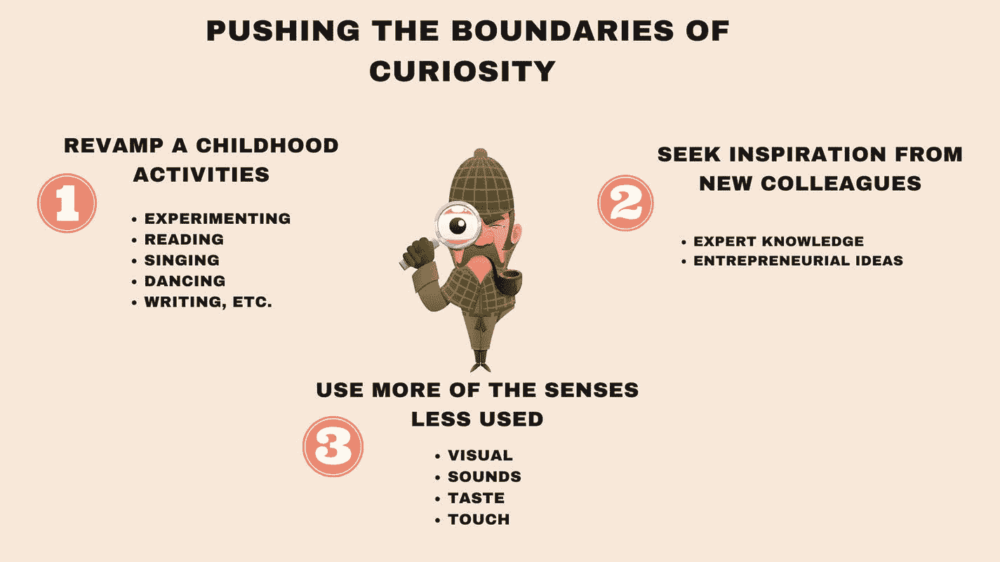

*一组三个活动的示意图，通过改造童年活动、从新同事处寻求灵感以及使用较少使用的感官来激发好奇心。*

**图 5-3** 好奇心的来源

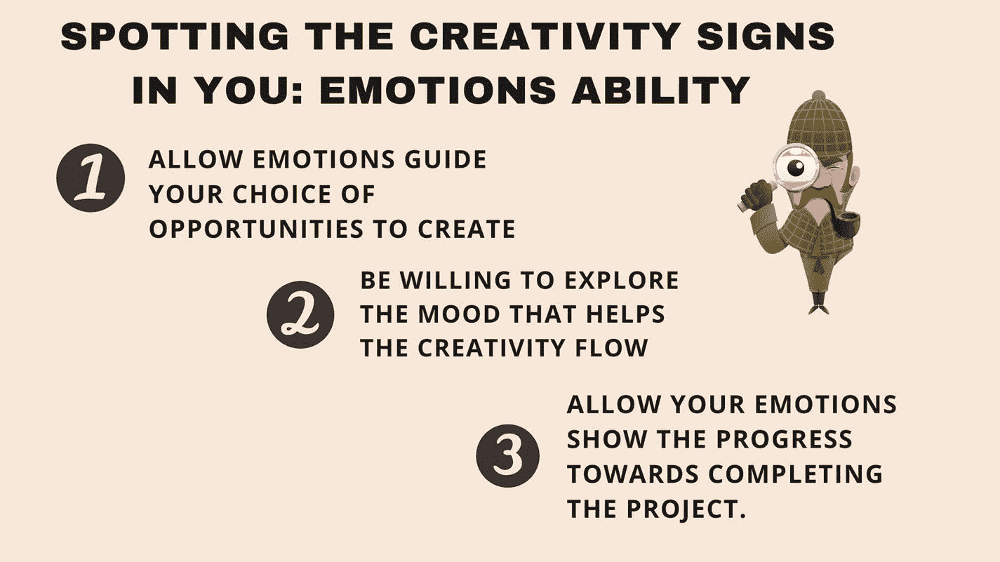

*三种运用情感以发现创造力迹象的方式的示意图。*

**图 5-2** 情感能力

**第一**，他们需要理解自己的**情感**如何代表关于新的创造机遇的**信号**。例如，感受到积极的挑战感可能是接手一个与你以往经历截然不同的新项目的好迹象。

**第二**，一旦创作过程启动，他们需要认识到要激活**哪种情感**（例如，快乐、恐惧或愤怒）来管理自己的**创造力流程**。例如，积极情绪可以增强认知灵活性——即在不同想法之间切换的难易程度。但另一方面，消极情绪可以增强找到解决方案的毅力。

**第三**，他们需要理解自己的**情感**如何代表关于**达成结果**所需付出的**努力**的线索。积极的情绪表明完成目标的某个新里程碑即将达成。消极情绪则表明需要采取更多行动才能到达下一个里程碑。

总而言之，当你渴望在科学、技术、工程、创业等领域做出贡献时，你并不需要认为自己是个艺术家。然而，你确实需要了解自己的情感，以及它们对你创作过程的选择和质量所起的作用。

### 打破你的好奇心模式

我的高中数学老师特别喜欢我的一个课堂习惯。他说我经常问`为什么？`。根据我们各自不同的动机、认知和神经生物学过程，每个人在好奇心的展现方式、选择学习的内容以及如何应对日常情境上都独具特色。值得注意的是，富有创造力的人往往是充满好奇心的人，这一点体现在他们的创造性成就、个性和职业中。

好奇心也分很多种。想象一下这样一个场景：你的邻居刚收到一件新家具的送货，你就不请自去地登门了。这种行为背后的动机可能是“爱管闲事式的好奇心”，它根植于因日常信息缺口而产生的无聊状态。然而，这并非本书所要探讨的好奇心。^(¹⁰²)

还有第二种好奇心，它源于成长和学习的需要。渴望理解你所敬重之人的工作；乐于学习你擅长领域之外的新主题；勇于接受新项目，并知道这将让你更了解自己，至少是了解自己的时间管理能力。这些是“创造性好奇心”，它们推动着学习循环向前发展。

研究人员开始认识到，有创造力的人展现好奇心的方式存在微妙的现实差异。^(¹⁰³) 有些富有创造力的人会对世界表现出高度的开放性，就像图莉亚·洛佩斯对新社交经历的偏好那样。

*“在我十几岁的成长过程中，那是一段非常艰难的时期。那段时间我的创造力非常非常旺盛，我想去探索各种事物……别人告诉你‘哦，这行不通的’，‘你不该这么做’，这些都没关系。但如果你对某件事感到一种特别的吸引力，你就必须去尝试。”*

到了成年后，她依然保持好奇，并且“乐于接受感官输入”。

*“每样东西都在闪闪发光，有时我感觉自己像个孩子。我丈夫对我说，我不只是看东西，我还得去摸它们，有时候还得去闻它们。我是个非常喜欢触碰事物的人。”*

求知和理解的欲望驱使着其他富有创造力的人。对于像文森佐·切鲁洛这样的人——一位研究新型癌症疫苗的免疫学教授——这种实验倾向反映了他的好奇心。

*“当然，创造力帮了我很多。我喜欢探索各种想法……”文森佐说道，“实际上就在最近，我回想起我 6 岁时的一件事。当时我在父亲的药店里，我计划制造硫化氢，在地板上烧出一个洞，这样我就能进入我们家楼下的玩具店了。对于一个 6 岁的男孩来说，我觉得这是个非常有创意的想法。虽然我没成功，但很多其他事情都是这样的。”*

当你深思一个概念性问题时，因信息不全而产生的挫败感会促使你努力去寻找解决方案。我以前在数学课上总问“为什么”，因为我真心想理解解题背后的推理过程。就像听到一首心爱的旋律时感觉很好一样，当所有信息片段都各归其位时，会有一种成就感。

考虑到多年来积累的职业经验，我们每个人都可能已经意识到“那些有助于推动我们职业成就的好奇心”。具有艺术背景的创造性人士更倾向于通过身体去体验，探索感官经验。而具有科学背景的创造性人士则更倾向于沉浸于思考之中，被知识上的好奇心所驱动。此外，我们这些从事与艺术或科学无关职业角色的人，则是上述“好奇心模式”的混合体。

第一种模式由源于“新体验”（如社交互动或物理场所）的情感和感觉构成。^(¹⁰⁴) 当你能在早晨咖啡的香气中看到美，感到需要一种创造性的出口，或者喜欢沉思发生在你身上的事时，你可能就倾向于通过感官和直觉来探索环境。

第二种模式则由“新想法”构成——关于改进和创新的想法，你随处都能看到它们，甚至在度假时也不例外。

在剑桥大学纽纳姆学院读大学期间，塞西莉亚·佩恩的学习动力源于成为一名教师、与他人分享科学学习乐趣的渴望。1917 年，当她即将毕业时，她偶然读到一本新出版的书，海伦·汉密尔顿写的《完美的女教师：一个关于承诺与实现的故事》。^(¹⁰⁵) 这本关于女性教育、狭隘嫉妒和有限职业前景的讽刺诗集，让塞西莉亚感到当老师是*“比死亡更糟糕的命运”*。^(¹⁰⁶) 当她意识到自己的兴趣在于研究而非教授科学时，她的命运便已注定。

我们每个人可能拥有的创造性好奇心都比自己目前意识到的要多。为了拓展好奇心的边界，我们探讨“三种可能触发意外的创造冲动的来源”：童年活动、新同事以及那些较少使用的感官。

### 童年活动

你可能失去了童年，但并未失去你的好奇心。你小时候是什么样的孩子？是喜欢在家庭聚会上跳舞唱歌的年轻人？是满足于独处看书的孩童？还是同龄人中最受欢迎的孩子？哪些科目曾让你追问“为什么”？你能否在当下的生活情境中寻找那些能够替代过往消遣方式的可能性？

写作似乎是我在不同阶段表达不同好奇心的活动。14 岁时，我将自己的幻想倾注于短篇小说和诗歌。二十多岁的时候，我撰写了描述企业信息系统应用的学术论文。与此同时，我还加入了一个由不同年龄和职业经历的人组成的写作小组，我们每周聚会，创作诗歌和小说。如今，在我四十岁出头的时候，我正在写这本书。

什么样的童年活动曾让你心驰神往？要想重拾那份体验，你需要了解镇上合适的实践社群。哪些是你可能想去看看的呢？

### 走出专业领域

敞开心扉，接受新的社交互动，即使你内心可能有些保留。

领导力沟通专家约翰·贝茨说：“我以前总是埋头于商业，因为你知道，每个人都在追逐金钱。”“在我亲自尝试之前，我完全不知道商业竟然可以如此富有创造力、有趣和引人入胜。它是最具创造性的行为之一。”

约翰克服了他对商业活动的负面偏见。然而，你可能也对其他一些职业持有一些不利的看法。例如，在一个大型组织中，存在着诸如“业务发展”、“销售”、“会计”、“人力资源”、“助理”等特定工作，这些工作在其他专家眼中可能带有无意识的偏见。

这种偏见会影响互动的质量，以及你与那些被认为价值较低的角色人士交往的开放性。例如，会计通常被看作是无聊且内向的，对吗？如果你遇到一个有着酷炫爱好的会计，相比之下，反而让你觉得自己生活乏味，那又会怎样呢？

让我们来做个小练习，好吗？首先，想一个与你在公司的工作直接相关的职位。然后，再想一个与你的工作关联度不高的职位。

如果你要和这些人中的一位共进午餐，你会邀请谁？为什么？

如果你在日程中为这两种角色的人都安排一次“好奇午餐”呢？假设你的邀请都得到了确认，你就有机会通过一个你平时可能不会遇到的人，去接近新的专业领域。也许你的同理心会在好奇心之前被唤醒。敞开心扉去体验同理心，是连接有趣之人的宝贵动力，他们可能以持续学习等形式，成为新想法的源泉。

何不列出五个你（在公司内外）非常看重的专业角色？再列出五个你评价很差的专业角色？

如果你每个月抽出两次时间，在你的日程中为这两类专业人士都安排一次“好奇午餐”呢？

### 更多使用那些被用得较少的感官

在你目前的专业角色中，你使用最多的是什么：你的头脑还是你的感官？如果是前者，从视觉、听觉、味觉和触觉这四种感官中选择一个，来引导你学习一项新技能。如果是后者，选择另一种感官，或者更大胆一点，去对一个你几乎一无所知的知识领域产生兴趣。

天底下有太多值得去看和体验的事物。如果一位摄影师对情绪神经科学深深着迷会怎样？如果一位科学家对表演课程产生了兴趣会怎样？在这些好奇心的驱使下，他们处理核心任务的方式会发生什么变化？会为哪些颠覆性的活动留出空间？

总而言之，你可能想要挖掘自己童年时期偏爱的活动，以发现你的创造冲动。寻求与同事的新互动，特别是那些你起初认为不太重要的角色。对用得较少的感官或智力说“是”。（见图 5-3。）

## 承担风险，为颠覆性活动投入时间

“所以，当我决定成为一名创业者，离开学校里安稳的职位、薪水和所有福利时，我跳入的只有虚无，只凭对自己的信任，”企业家哈丽特·法格霍姆说。“我必须说，这绝非易事，一点也不。因为我直面了自己所有的局限。我不得不在自己的创造力中寻找信任……”

在承担起专业创作者这个新角色之前，会经历许多需要做出微小决策的时刻，去从事那些会颠覆你生活的活动。例如，假设你向你的生活伴侣宣布一些类似这样的话：

“我在工作之外接了一个自由职业项目。这会让我的周末变得很忙。”

“我在考虑休个假，以便更清楚地规划下一步的职业发展。”

“我在考虑做兼职，去学点新东西。”

创作者是情感上的风险承担者。^(¹⁰⁷) 你可能预期自己会面临哪些风险呢？

### 他们会怎么看我？

你可能从学校继承并遗忘的一个遗产是：生活中的挑战只有一个正确答案。有多少次你害怕在考试中给出错误答案？在某种信念体系中，你可能深信生活要么就是一次做对，要么就是余生都要受到惩罚。

我的小儿子现在正在学习吹小号。他的乐队在他就读的流行与爵士音乐学院参加了一场音乐会。在一首歌曲中，他有两次比乐队其他成员早了几秒钟开始演奏。这两次他都及时调整了过来，并按照排练的样子继续演奏。但音乐会结束后，他情绪崩溃了。“大家都觉得我是个傻瓜，”他说着，哭了一个小时。你能想起自己有过类似经历的时刻吗？

你是一项活动的初学者，并且与观众分享你学到的东西。这对于一个有创造力的人来说，是第一项具有挑战性的情感风险。幸运的是，我的儿子，他的老师过来和他谈了谈。她说：“你想知道我在最近一场音乐会上犯了多少错误吗？”他点了点头，然后老师在他耳边低语了几句。

“他们会怎么看我？”这是一个开始探索新事物的人内心痛苦且频繁出现的问题。即使你成为一名公认的创作者，错误也难免会发生。在你每次感觉自己失败时，你越能快速地学会如何与自己和睦相处，你在接下来的创作过程中需要背负的心理包袱就越少。我喜欢把错误看作是一种考验，考验你有多想把一项新技能变成一门精通的本领。

### 何时能期待你的行为得到你所爱之人的认可

谁不希望被自己在乎的人认为自己是安全的、健全的、被接纳的呢？但是，做一些更具反叛精神、打破常规的事情，正如摄影师达莎·皮尔斯所说，可能会动摇你与所爱之人之间的某些关系。例如，当你告诉你的伴侣：“亲爱的，接下来的两个周末我不在家，我要去当地图书馆学习，”在你伴侣听来，这可能更像是：“亲爱的，我接下来的两个周末要去火星旅行。”

你可能希望拥有一种神奇的劝说技巧，能当场说服你周围的每一个人。最重要的问题是，你是否认可自己为获取新领域知识所做出的那些微小决定。随着时间的推移，当你与亲近的人分享你发现过程中的喜悦和悲伤时，他们会逐渐理解并给予支持。尤其是在他们看到你成功的时候。

## 平衡个人长期利益与他人的短期利益

你每天做的核心活动有哪些？哪些是紧急的？你一天中核心活动与紧急活动的时间比例是多少？50/50？40/60？还是 60/40？

回答这些问题，将帮助你组织每日的活动结构，更审慎地平衡个人长期利益与他人的即时利益，平衡说“好的，我可以帮这个忙”和“不，现在对我来说不是合适的时间。”为了更深入地理解你内心创造的冲动，你或许需要为那些重要但不紧急的活动留出空间，这些活动正是你感兴趣的、具有颠覆性的活动。^(¹⁰⁸)

> “当机会来临时，我真的会问自己：‘这真的是我现在想投入精力的方向吗？’”咨询师兼教练帕梅拉·汤普森说道。“在我人生的这个阶段，我非常注重创造空间，因为奥阿娜，我发现，为了培育创造力，我们需要空间，我们不能一直忙、忙、忙，把日程排得满满当当。
>
> ……而最近这次机会真的让我静下心来思考：‘我现在的优先事项是什么？’你知道的，这件事也伴随着挑战，而挑战就在于要摆脱那种旧有模式。”

当你认识到一项新活动有潜力带来你希望在自己内心和周围看到的改变时，你需要对这个机会说“好”。诚然，对那些已不再符合你未来身份定位的项目说“不”，意味着要放弃眼下的收入来源。而说“好”，它们又会占用你发展长期技能的时间。是选择眼前更多的金钱，还是成为未来的内容创作者？该选哪一个？

## 目标是内在转变

有些新项目会带来预期的外部影响，但不会引导你向自己本该成为的创造者角色进行内在转变。这类项目是我们自愿去体验的实验性创作，旨在寻求自我表达、关注他人、主动进取和创意吸引力这些倾向之间的和谐融合。这种融合定义了你内心的创造者。

因此，第四项风险在于，将时间投入到那些能让你更接近成为一位专注创造者感受的实验性创作中。每一个项目都会让你获得更多信息，去重新评估自己能创造什么，以及你面向的特定受众是谁，正如帕梅拉·汤普森所见证的那样，她在关注他人和自我表达倾向之间取得了平衡。

> “最近有人邀请我为一个新倡议做贡献。那是我很看重其工作的人。她邀请我加入她正在开发的一个新平台，持续提交大师课，并成为那个社群的一部分。我不得不好好静下心来思考：‘这会占用我多少时间？’我还得想：‘这真的是我现在的目标、我的主要目标市场吗？’我发现，在过去 6 到 8 个月里，我的目标市场已经转变为那些以内心为中心的领导者与变革者，帮助他们拥抱变化。”

这就是为什么花时间在实验性创作上是值得的。这个过程会揭示出关于你自身角色或受众的、意想不到的深刻见解。

> “创造力也意味着你是主动的，而非被动的，”企业家哈里特·法格霍尔姆沉思道。“你是一个行动者。最重要的是，你意识到 ‘我是一个创造者’ 。因此，当我想激励人们接触他们内心的创造者时，我会问：‘你想创造什么？你现在正在创造什么？
>
> 我们无时无刻不在创造。但问题是，我们是清醒地、有意识地去做，还是对自己正在创造什么毫无察觉？”

对于一项新的实验性创作，你愿意承担风险到什么程度？

- 以 1（完全不确定）到 5（极其确定）为尺度，你对环境中存在一个你能够贡献自己视角的问题，有多大**把握**？

- 以 1（可以等等）到 5（最高优先级）为尺度，你对解决该问题有多**迫切**？

- 以 1（完全不愿意）到 5（已准备好）为尺度，你有多大**意愿**去克服找出解决方案过程中的不确定性？

总而言之，做出扮演一个新创造者角色的决定并非凭空发生。相反，它是由一系列关于以下事项的小决定所铺垫的：

- 尽管一路犯错，仍要花足够时间在一项新活动上，直至掌握它。

- 为你认为对自己有益的事情，站出来面对你所爱的人。

- 谨慎地守护你的长期利益，抵御短期金钱回报的诱惑。

- 保持与你内心那位创造者的对话。

脚注 1 · 2 · 3 · 4 · 5 · 6 · 7 · 8 · 9 · 10 · 11 · 12 · 13

## 6. 前往新好奇心引领的工作空间

> 环境是我们相遇的地方；是所有人共同利益所在；是我们唯一共享的事物。
>
> ——伯德·约翰逊夫人

到目前为止，我们一直像侦探一样遵循策略来发掘创造冲动，并重新思考你是什么样的创造者。现在，我们将注意力转向那些能够培养你创造倾向的环境类型。假设你意识到自己对自我表达、人类福祉、概念性问题或社会挑战产生了意想不到的好奇心。你如何能识别出那些可以巩固知识并练习新技能的机构环境？

`约翰·霍兰德`提出了职业生涯决策领域研究最多、应用最广的理论之一。^(¹⁰⁹) 该理论以人格因素影响职业选择为前提，预测个人能力与工作特征之间的和谐度越高，工作中的成就、持久性和满意度就越高。因此，存在六种匹配领域：`现实型（R）`、`研究型（I）`、`艺术型（A）`、`社会型（S）`、`企业型（E）`或`常规型（C）`环境。

我们来快速做个游戏。以下活动你与哪一项最相关（更多地从什么活动适合你的角度思考，而不是你擅长什么）：“推广产品”、“修理电脑”、“为新项目准备预算”、“参加人力资源课程”、“开发产品”或“在乐队中演奏”。^(¹¹⁰) 这与你当前角色的契合度如何？契合度越低，就越需要寻找能容纳你创造力的角色。

工程类工作属于`现实型`职业。`研究型`职业基于对生物学、数学、哲学、精神病学和物理学等领域的兴趣。`艺术型`工作包括演员、各类设计师（室内、平面、时装）以及记者。我们在`社会型`职业中能找到教练、顾问、管理者、心理学家和教师。企业主、领导者、投资者和销售人员属于`企业型`。第六类，也就是最后一类，`常规型`角色包括会计师、财务分析师和统计学家。

随着时间的推移，这些职业会形成习惯性的思维方式、核心能力以及你所坚持的一套信念。一种新的创造好奇心会带你进入这样一种情境，你可以问自己：“如果我成为了一个从未设想过的人会怎样？”以及“我如何创造机会来测试新技能？”一种新的好奇心越具有颠覆性，在作为创造者投身于不同道路之前，先在小范围内尝试相关的新角色就越重要。

创造冲动的觉醒为你提供了结合新旧技能并探索新型工作环境的机会。每一次尝试都能揭示出你不断发展的创造性自我令人惊讶的活动偏好。

*   ➣  你可能会意识到对以下方面的兴趣：解决与*人造物功能*相关的问题——如电脑、信息系统、基础设施——或*保护自然界中的事物*——如植物、动物、海洋等。

对现实的这两个方面中的任何一个产生兴趣，都可能将你推向`现实型环境（R）`，在这种环境中，需要用*技术技能*来解决具体而非抽象的情况。你变成了“修理王菲利克斯”，《无敌破坏王》电影中迪士尼的主角之一。菲利克斯用他的神奇锤子可以修复尼克乐园建筑中的任何损坏。你的技术技能就是你的锤子。尼克乐园建筑就是你找到问题并用你的锤子解决的空间。^(¹¹¹)

作为修理王菲利克斯式的专家，你依赖于分析性思维。此外，你会面临以前从未处理过的问题，而根深蒂固的思维和方法已不足以应对。^(¹¹²) 因此，除了技术技能之外，你还可以选择培养*创造性解决问题的能力*，正如销售工程师`奥斯卡·桑托拉亚`所描述的那样。

*“我的一项技能来自我的学习经历，因为我一开始学的是工程学，那就是解决问题的能力。这帮助我在技术方面变得更加熟练，学习新事物，对新事物产生兴趣，并能够在秘鲁和这里的芬兰为不同的公司服务。直到今天，解决问题仍然是我日常工作的重要组成部分。”*

如果你想了解更多关于数字身份（即你留在网上的踪迹）的信息，`奥斯卡`是值得请教的人。因此，为了测试你在现实型环境中解决维护问题的创造力，请找出第一个“尼克乐园建筑”以及那里的人们，成为他们心目中的专家。

*   ➣  对抽象思维和概念性问题的新偏好将引导你关注*问题发现*，这将带你进入`研究型环境（I）`。像教授`文森佐·塞鲁洛`和`赫尔德·桑托斯`这样挑战科学突破的创造者，就处于这样的环境中。他们的工作不仅仅是解决医疗保健问题，还要发现那些值得投入时间和金钱去深究的问题。在此，培养*创新研究技能*至关重要。

同时，`研究型环境`中的创造性思维倾向于*哲学思考*，基于形而上学、认识论或价值论来剖析关于基本真理的论点。什么是现实？我们有自由意志吗？个人价值观是如何形成和受影响的？这类思考会让你成为潮流引领者，并将你带入创新的环境。

为了在`研究型环境`中获得直接经验，就像有些人去健身房一样，你可以加入你凭直觉认为还有更多值得探索的领域的讨论小组。

*   ➣  当你屈服于自我表达的倾向时，你会投入到某一种特定艺术技能（`A`）的练习中。你出演了你的第一个角色。你创作了一首曲子。你编辑了你的第一张概念照片。受众的选择与练习的技能同样重要。

*“如今，艺术与市场营销也紧密相连，”* 超现实主义艺术家`达莎·皮尔斯`说。*“商业本身就是一种艺术形式，因此，作为一个艺术家，要成功且有影响力，要用你的艺术打动别人并产生影响，一个人通常必须是一个聪明且富有创造力的企业家。”*

从事艺术技能，使你能够选择将艺术兴趣与`企业型`、`现实型`或`研究型`环境融合。主要环境是你创作的空间。补充环境是分享你所创造之物的空间。前者提供表达自由，后者则带有约束。这两个环境之间的互动，是测试作为一名艺术家的新身份的可行空间。

*   ➣ 你可能会发现对人际的兴趣，这会带你进入*社会型环境（S）*。结果，你变成了一个“人际修复师”。这种倾向要求你具备让周围人感到心理安全的能力。此外，它还会激励你提升沟通技巧，以治愈、培养或教育他人。

通常，提升他人福祉的兴趣会与自我表达相辅相成，正如帕梅拉·汤普森和哈里特·法格霍尔姆的创业活动所反映的那样。

> “……我通过教练辅导和我所谓的‘变革的艺术’体验式工作坊，帮助变革者拥抱变革，”帕梅拉说道。

> “我运用动作、绘画、写作、歌唱和声音，”哈丽特说道。“这些都是其表达形式，让你能领悟创造冲动。如今，我的最新项目是激发个体的创造力，见证一个年过五旬之人，例如，开始通过艺术绽放光彩，这真是一段奇妙的旅程。”

真正契合这里的创作者，是那些通过其联结力、共情力和慈悲心来塑造周围世界的人。这听起来像是在说你吗？

*   ➣ 当你*忍不住想要主导*时，你可能会对与*进取型环境（E）*相关的问题产生兴趣。在这里，我们看到像约翰·贝茨、图利亚·洛佩斯和彼得·伊万诺夫这样足智多谋的实干家，他们在他人的使命中提供支持。以软技能（情商能力）或硬技能（机器学习、数据可视化、`TypeScript` 或 `Kotlin` 编程等）形式存在的*小众技能*将成为你销售的产品。此外，*说服技巧*在引导他人走向你的个人目标时会派上用场。一步步地，每个创业项目都会强化你透过责任、地位和权力的视角看待世界的倾向。

*   我们在前面提到的五个维度之外，增加了*精神环境（s）*。在这里，我们拥有那些依赖自我表达、并受到激励去加强与更高无形力量（如上帝或宇宙）联结的创意人士。这些创作者可以是拥有*更深层觉知与智慧*的精神导师、冥想老师、祭司或人生教练。哈丽特·法格霍尔姆的活动就依赖于这个维度。

总而言之，调整后的霍兰德模型帮助我们评估主导创造倾向与可以进行试验的新型工作环境之间的匹配度（见图 6-1）。

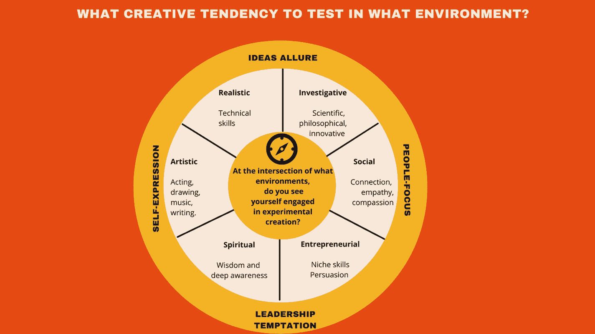

一个展示创造倾向与不同类型工作环境的环形图。圆环的外表面包含 4 个阶段，内表面包含 6 个阶段。

**图 6-1** 创造性环境的交叉点

到目前为止，你直接体验过哪些类型的 RIASEs 环境？在不太熟悉的环境中进行试验是至关重要的。在投身于某个特定的创意兴趣之前，你就像一场戏剧的导演，巧妙选择舞台并规划场景细节，以求对观众产生最大影响。此外，在最终确定最能让你最佳潜力闪耀的类型之前，你可以通过在同一或不同舞台上策划几出戏码而获益。一路走来，你将学会识别那些能平衡个人意义与可实现性的环境。

第二部分将讨论用于发展创造性身份的自我颠覆习惯。

### 第一部分总结

本书的这一部分帮助你反思，为何你会以现在的方式理解自己的创造力，以及你可以养成哪些探索习惯来发展你的创造潜力。自我感知的创造力，是指对自己创造技能、兴趣以及使你能够创造新颖或原创作品的物理/虚拟空间的认知。在你目前对个人创造力的理解之下，存在着两个根本的创造性意识层面。你可以将创造力视为你身份的强项或核心部分。

当你把创造力视为创意的源泉时，你可以选择在你当前的职位或一些副业中更频繁地表达你的想法。当你将创造力视为你存在的核心时，你会被激励去参与更具颠覆性的活动，从而让你在某个感兴趣的领域成为有抱负的创作者。然而，如果创造力定义了你的身份，但你尚未找到自己的热情所在，那么观察你的创造冲动或许能帮助你弥合这一差距。

你的潜能可以植根于你感知并表达强烈情感的能力——无论是你自己的还是他人的——或者植根于你在外部环境中发现亟待解决问题的才能。为了清晰起见，你可以培养新的习惯来探索那些蛰伏的创造冲动，具体如下：

*   识别像沮丧、无聊或绝望之类的情绪可能预示着一次实验性的创作。
*   发现新的好奇心模式。
*   建立内外部的成功标准，以决定一个实验性项目是否符合你希望成为的那类创作者。

这些关于自我探索的新习惯，为更深层次的创造性意识铺平了道路。

对于天文学家塞西莉亚·佩恩来说，当她决定列出自己想要研究的问题清单时，她作为研究者的新阶段就开启了。什么事件可能触发你不断演变的创造性自我的新循环？

*   教你舞台表现力的课程
*   需要推介的创业想法
*   发布征稿启事的期刊
*   欢迎新成员加入的专业社群
*   向你求助解决困境的同事

这些机会中的任何一个都可能是你开启新的创造动力的契机。而且它们可能近在咫尺。

#### 自我探索练习：为你走向创造性自我发展的下一阶段定位

**练习一：绘制那些带给你意义感的经历**

即使目前你可能并非特别擅长某项活动，但你愿意在空闲时间尝试哪些活动？请按个人意义的大小为每项活动赋予一个数字序号：

*   演奏乐器
*   表演
*   绘画
*   写诗
*   写短篇小说
*   撰写关于以下主题的事实性文章：
    *   历史
    *   经济
    *   社会
    *   某个科学领域 ______
    *   其他 ______
*   发明某个东西 ______
*   从零开始编程一个网站
*   设计自己的衣服
*   在观众面前演讲关于 ______
*   保护当地的传统和仪式 ________
*   在某个小社区 ______ 发起改善活动
*   独自研究关于 ______ 的新项目
*   在一个新的专家小组中合作研究关于 _______

**练习二：新的可能角色**

在我职业生涯的这个阶段，我憧憬与以下某个角色相关的新体验：

*   艺术家
*   活动家
*   教练
*   创业者
*   环保主义者
*   领导者
*   管理者
*   心理学家
*   研究员
*   科学家
*   其他 ________

**练习三：创造性职业抱负**

考虑到你在练习二中选择的角色，它与你在练习一中选出的活动如何匹配？这种匹配属于以下哪种职业策略？

*   职业转型，成为创意专家 ____________
*   职业发展，晋升到更高职位 ___________
*   职业转变，成为自由职业者 __________ 或创业者 __________

**供思考的问题**

在你的创造性职业道路上，匹配那些带给你意义感的经历与新可能的角色，下一步可能是什么？

*免责声明：* 这些练习旨在帮助你开阔视野，认清自己在情感创造或实践创造方面的工作取向。然而，请对其结果持保留态度。培养个人与工作创造力和谐感的最佳方式是，持续对你的创造冲动进行试验。

脚注 1 2 3 4

