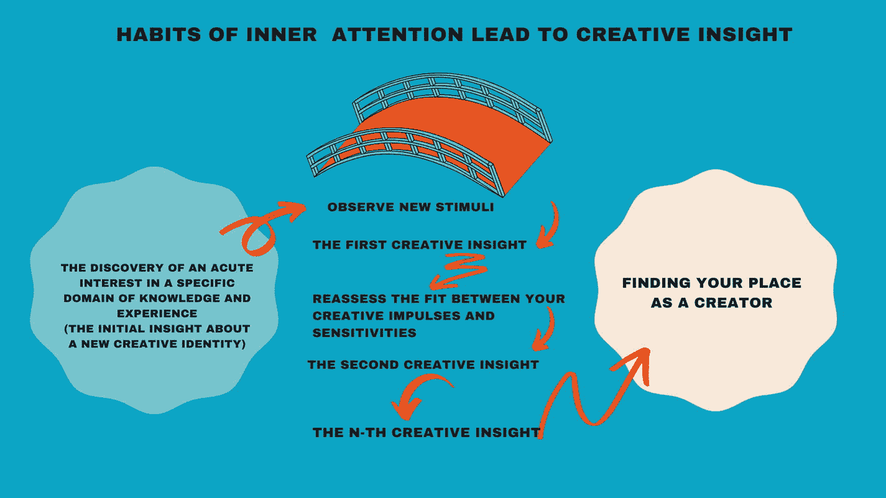
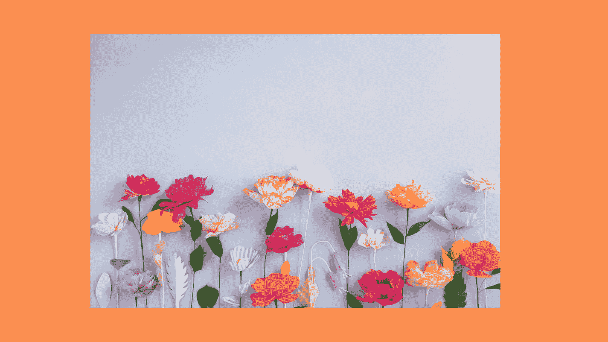
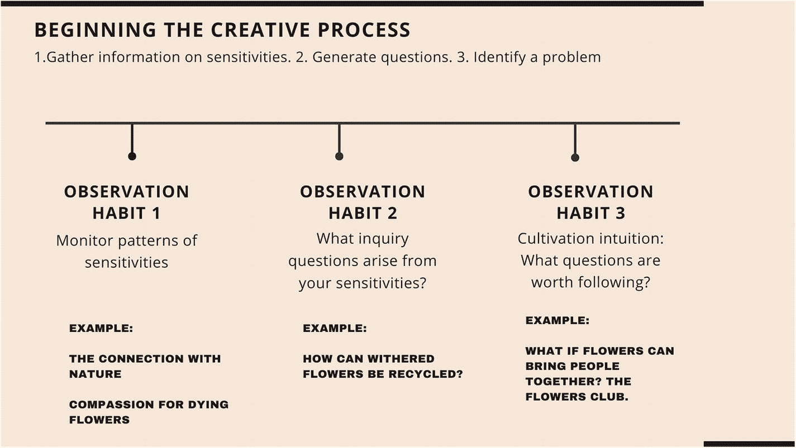
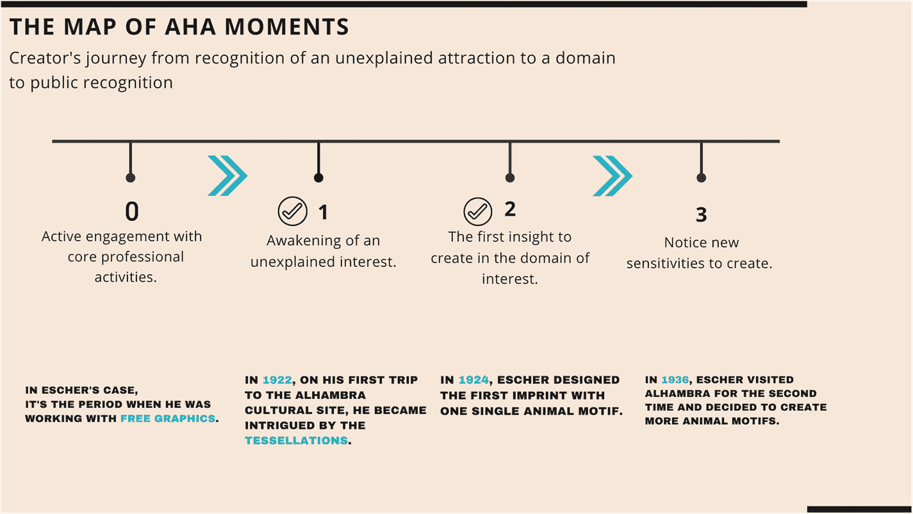
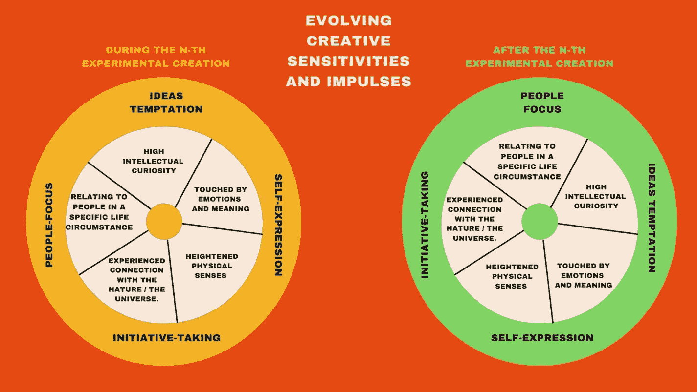

# 第三部分：为创造性洞见铺垫心智

## 11. 为什么内在观察的习惯能强化作为创造者的身份

> *我曾达到一个感觉像是缺失了什么东西的阶段。但我并不知道那会是什么。*
> 
> ——图利亚·洛佩斯，Speak Up and Lead Academy 创始人

在本书的第一部分，我们讨论了学校和工作经历如何影响你对自己创造力的信念，以及创造力在你生命中所扮演的角色。创造性挫折和沮丧可能会阻止你积极发展作为创造者的职业道路。在第二部分，我们勾勒出了创造性自我、理想自我和当前自我之间的内心对话，这导致了能够强化你创造性身份的自我颠覆习惯。

这第三部分的目的是理解如何在一个新的兴趣领域对新信息保持开放态度，这可以逐步引导你获得关于实验性创作的初步洞见。

“洞见”，也被称为“啊哈！”或“尤里卡！”时刻，是当你在理解自己的创造目的时，意识发生的一种意想不到的转变。“洞见就像是来自潜意识的礼物。”^(145) 它们可能感觉是突然出现的，但它们是潜意识深处多年来漫无目的的精神活动的结果。

拥抱作为创造者的新角色的最初洞见，是你认识到自己的“那杯茶”是一个新的创造领域——无论是艺术、工程、科学、技术、创业、领导力等。它可以是你目前活跃领域的一个非常密切相关的领域。或者，它也可以是一个如同地球到月球般距离的领域。当你熟悉了这个新领域后，你的创造潜力在指导你选择参与的活动时就会变得更加决定性。

为了获得关于你是哪种类型创造者的新洞见，你可能需要以一种不同的方式，由内而外地关注你所看到的东西。激活你的内在意识可以增强你发现创造机会的能力。当细微的线索进入你的感知，并触发你理解一切的冲动时，创造过程就开始了。

在发现一个吸引你的词语、声音、想法或事件，与找到自己作为创造者的位置之间，有许多次实验性创作的经历（见图 11-1）。当你开始创造你内心那个创造者希望因此获得认可的产品时，你就可以恭喜自己了。你找到了自己作为创造者的“独特之处”。在那之前，每一次实验性创作，你都在精炼你的创造焦点。



一个过程图，展示了发现一个强烈兴趣，随后经历多次实验性创作，最终通向创造性洞见。

图 11-1

第 N 次创造性洞见

在第 N 次创造性洞见时，你将进入作为创造者的协调区域，在这里，你的创造冲动、兴趣领域、表达媒介和环境之间达成了和谐。成为创造者是一个自我发现的过程，一次一个创造行为。

### 对特定领域的吸引力

无论你想在哪个领域做出贡献，仅仅获取所有相关信息并知道如何处理它们是不够的。要提高成为公认创造者的可能性，你需要对知识领域或实践的某个特定方面产生一种高度敏锐的兴趣——心理学家米哈伊·契克森米哈赖称之为精神能量 ^(146)。你需要感受到与相应领域的思想和实践之间的联系。但这并非与环境元素的那种常规统一感，那种感觉让你觉得自己是环境的一部分，比如“观察花朵是一种放松的方式。”

你需要做的远不止于此。你需要屈从于你的敏感性，即对那些细微差别的感知，这些差别促使你为它增添一些东西，使其成为你的创作，比如“花朵是我为他人创造有意义故事的演员。” ^(147)

有哪些活动是让你觉得放松而想要参与的？有哪些感兴趣的话题能挑动你的思绪，让你想要参与并为观众进行创作？你的创造力潜力就蕴藏在后一类兴趣之中。

埃舍尔以其对将平面分割成重复的、可识别的小图形的“游戏”的热爱而闻名。他是如何接纳这份热爱的呢？

“我朝着那个方向迈出的第一个直觉性一步，早在我还是哈勒姆建筑与装饰艺术学院的学生时就已迈出。那是在我了解阿尔罕布拉宫的摩尔人马约利卡马赛克之前，那些马赛克给我留下了深刻的印象。” ^(148)

直觉性的选择先于发现强烈的兴趣。对埃舍尔而言，这一阶段在 1936 年他第二次前往西班牙时结束，那时摩尔人在墙壁和地板上使用数学抽象图案的做法让他更加着迷。

强烈的兴趣发展的第二阶段，始于你运用刻意策略来获取新知识并培养你的爱好。当埃舍尔从第二次阿尔罕布拉宫之旅归来后，数学界有人告诉他，将平面有规律地分割成全等图形是几何晶体学研究的一部分。^(149) 因此，他开始对阅读相关专题文章产生兴趣。最终他“敢于，也就是说，着手解决在受特定维度限制的封闭平面内表达无限性的问题。” ^(150)

要将强烈的兴趣转化为创造行为，需要数年如一日的执着承诺去学习、质疑现有的知识和实践，并训练你的技能。接纳你天生的敏感性，会为你提供一次又一次进行创造的内在驱动力。

“任何一个有点天资的小学生或许都比我画得好，” 埃舍尔在 1955 年 11 月 2 日写给儿子亚瑟的信中写道，“但在大多数情况下，他们所缺少的是那种将其变为现实的顽强渴望，那种执拗地咬紧牙关说，‘虽然我知道这不可能做到，但我无论如何都要去做’的劲头。”

这种向敏感性的屈从，将改变你与周围人和资源互动的方式。

### 带你内心的创造者约会几次，观察新的敏感性

1924 年，也就是埃舍尔第一次看到阿尔罕布拉宫马赛克几何图案两年后，他进行了第一次涉及平面规则分割的实验性创作。那是在一块布上印上单一动物主题的图案。他将它与其他作品一起展出。但并未成功。

当我们想要扮演创造者的角色，与新的创造性敏感性保持一致时，感觉就像是在冒很大的风险。风险引发恐惧。恐惧导致模棱两可。感到不确定或怀疑会扼杀创造性思维。

尽管理解了新角色的好处，但要获得信任去创造你以前从未做过的东西，并非一蹴而就之事。你至少坠入过爱河一次，不是吗？你第二天就和那个人结婚了吗？假设对方也有同样的感觉，你们肯定经历过一段约会的时期，去发现彼此之间敏感的层次。同样，你可以通过许多次创造行为来培养你的新兴趣。

如同在恋爱关系中，脆弱性才能带来信任。我们需要愿意向创造性的一面敞开心扉。只有那时，我们才能与自己的敏感性亲密接触，而这些敏感性会温柔地引导我们走向作为创造者的新体验和能力。

正是在 1936 年，埃舍尔第二次阿尔罕布拉宫之旅后，他重新开始尝试动物形状的创作。到 1939 年，他已经收集了大量关于动物图案的试验作品，这成为他最成功的早期作品之一《对称作品 25》的灵感来源。

埃舍尔本人认为他的设计《莱顿市政厅水彩稿》最能体现他对平面规则分割的兴趣。这件作品创作于 1941 年，艺术家得益于“委托创作的人们所给予的最大程度的自由。” 此后，对平面规则拼合的研究引导他设计出表达发展、循环或转化的作品。

当一段浪漫关系转变为婚姻时，你承担了开启新生活的风险，而爱人占据了中心位置。同样，当你让你的创造性一面占据主导时，你将通过创造者的眼睛，通过新的观察习惯来看待世界，这些习惯为进入校准区铺平了道路。

创作音乐是马蒂亚斯·库皮埃宁的创造领域。
超现实美术摄影是达莎·皮尔斯的校准区。
设计新疫苗是文森佐·塞鲁洛的游乐场。
文化转型是哈里特·法格霍尔姆的游乐场。
纳米生物材料是赫尔德·桑托斯的游乐场。
领导力沟通是约翰·贝茨的游乐场。
公众演讲是奥斯卡·桑托利亚拉的游乐场。
在不确定中领导是帕梅拉·汤普森的游乐场。
虚拟团队管理是彼得·伊万诺夫的游乐场。
将女性的声音带上舞台是图莉亚·洛佩斯的游乐场。

你准备好在哪里发挥你的知识或经验作为游乐场，去冒险并实践你作为创造者的技能呢？

脚注 1 2 3 4 5 6

## 12. 追随你的美感

> *一切知识始于感官，进而抵达理解，终结于理性。*
> 
> ——伊曼努尔·康德

在我出生的罗马尼亚文化中，有一个传统：当婴儿满一岁时，母亲会准备一个托盘，上面摆放着各种物品，比如书、笔、钱、车钥匙、手机、牙刷、梳子、镜子、剪刀等。婴儿面对托盘，选择一件物品。大人们则会解读这个选择，它成为对其未来职业的预言。

这个以营造节日氛围为主要目的的仪式背后，隐含着一个认知：人类天生就对环境中的特定物体具有一系列敏感性。对我们中的一些人来说，需要花费数年时间才能理解并依循自己的敏感性行事。

敏感性是指在特定情境下，对能激发躯体反应的某些刺激所进行的知觉性投入。高水平的敏感性与创造力相关。高度敏感的人似乎更容易接受感官输入，也更了解自身内部和外部环境中正在发生的事。要成为一名创造者，意味着你成为那种更愿意花时间在一个兴趣领域内去理解这些敏感性的人。发现敏感性的意义，是一种新的思维习惯，它为初出茅庐的创造者做好了首次创造行动的准备。

一旦你与自己朝向某一领域的心理能量达成和解，对敏感性的感知和关注便成为引导创造性能量的两个重要大脑功能。大脑不断消化着各种信息片段，其中一些对你当前的任务很重要，另一些则不然。然而，大脑会过滤掉一些与即时目标不太相关，但被识别为对你的创造意图至关重要的信息。通过一个灵活的注意力处理系统，这些信息仍会被传递到短期记忆中，在那里等待生理反应。尤其是在创造过程的早期阶段——问题探索与识别——创造者能够即时识别出意外的敏感性模式，这便开启了创造性洞察的路径。

能为你的创造性事业揭示重要信息的，会是哪些创造性敏感性呢？人们常说，美存在于观者的眼中。对何为美丽、新颖、迷人的感知，对每位创造者而言都是独一无二的，它基于以下六种敏感性：

1.  **人际联结**，领导力沟通专家约翰·贝茨描述如下。
    “……这很有趣，因为敏感性在我的工作环境中产生了影响。敏感性在商业、识人方面帮了我大忙。我认为，一些对我的成功起到重要作用的软技能，就是同理心和真正地倾听。我能倾听别人说的话，并能将其复述出来，但表述得更加简洁、更令人难忘。”

如果你像约翰一样，就很容易感知他人的情绪和动机。这使你能够建立深厚而有意义的关系。因此，对话的质量对你而言，就如同美食对他人的重要性一样。你在人际互动中看到了美。

## 2. 扩展联结感

当你看着狗或猫的眼睛时，你是否觉得它们懂你？你会在给植物浇水时对它们说话吗？与“人际联结”密切相关，另一种创造性敏感性的来源可以是对动物、其他自然元素，或超越生死的更高智慧的**扩展联结感**。

## 3. 感官的微妙感受

对美的第三种敏感性是**感官的微妙感受**。你享受所见到的事物在味道、气味、声音、动作或视觉上的细微差别。例如，敏锐的味蕾可以成为厨艺、香水制作或酿酒天赋的源泉。同样，敏锐的视觉感知可以是任何视觉艺术形式（如绘画、雕塑、摄影、设计等）中天才表演者背后的秘密。

## 4. 易被触动

最近哪部电影让你泪流满面，而别人却铁石心肠？**易被触动**是美的第四个来源。你与自己的情绪合拍，并被他人的一个手势、一场舞蹈表演、一首歌、一部戏剧等探索和表达生命意义的作品深深打动。

## 5. 智识敏感性

你可能是这样一类人：对于抽象概念和系统（如模型和理论），你感受到非凡的美感，尤其是当它们解释了对你具有特殊意义的现实层面时。

## 6. 对环境需求的觉察

你观察周围环境中未被满足但相关的需求——他人的生活状况、特定社区、工作场所等——而这些需求可能被其他人所忽视。结果，你想要参与其中，致力于一个新的商业理念、社会创业，或一个提高公众意识的项目，比如格蕾塔·通贝里的环保行动主义。

这六种敏感性中，哪一种定义了作为创造者的你？发现自身创造性敏感性的一种方法是问自己：“我在周围环境中注意到了哪些创造行为，并且想要模仿它们？”

作家兼神经学家奥利弗·萨克斯在他的著作《意识之河》中写道：“我们所有人都在某种程度上从他人、从我们周围的文化中借用。思想弥漫在空气中，我们可能会在不经意间挪用这个时代的短语和语言。问题不在于‘借用’或‘模仿’，不在于‘派生’或‘受影响’这一事实，而在于我们用借用、模仿或派生来的东西做了什么；我们将其同化到何种深度，如何将其吸收进自身，并将其与自己的经历、思想和情感相结合，如何使其与自身产生关联，并以一种全新的、属于自己的方式将其表达出来。”

你能够将他人的思想同化到自身经历中的深度，取决于你的敏感性。然后，你会越来越关注那些过去可能被你忽略的信息片段。因此，你会发现创造性生活的新意义，这些意义体现于你内在与外在觉察之间的匹配之中，它们召唤着你去创造（见图 12-1）。

!`[](img/532400_1_En_12_Fig1_HTML.jpg)`

一幅比较内在与外在敏感性的插图，描绘了重叠区域，即创造冲动的空间。

图 12-1

匹配内在与外在敏感性

摩尔艺术家曾启发埃舍尔的作品。有哪些创造者及其项目让你心动，想要将其适应于自身环境？尝试一下，不要过度思考这些行动的利弊得失。

有些人细数自己的恩惠。你也可以盘点那些能催生出实验性创作的敏感性。

### 习惯一：观察自身感受的修炼

随着时间的推移，内在感受与外在感受之间的交互作用会磨砺你的创作焦点，摄影师达莎·皮尔斯便是见证。她曾一度考虑承接那些由社会责任感所驱动的艺术项目。

> “我认为自己的职业兴趣在于成为一名更有意识、更具责任感的艺术家。不只是表达我个人的感受、情感和意象，还要让人们思考那些可以改变的社会问题，并吸引他们的关注——那会非常棒。我还没达到那个境界，我原以为这种意识会自然而然地出现在人们身上，但从我的例子来看，并非如此。”

最终，情感感受占了上风。

> “多年来，我逐渐形成了一种风格，现在称之为‘心理现实主义’。通过我的艺术，我将情感和不同的心理状态变得可感知，并将它们带入现实世界。我试图借此帮助人们接纳自身的全部，包括光明与黑暗两面，与它们和平共处，而非与之对抗或试图隐藏，但也不让它们肆意妄为。这是我的理念，我的目标是尽可能多的人能通过视觉艺术的形式受到触动。”

为了在基于你创作感受的各个项目之间实现更有效的过渡，你可以选择保留一份个人记录（比如日志），记录下那些在你专注于特定任务时能引发情绪增强的刺激因素——词语、图像、想法、声音。

环境线索有助于巩固记录你创作感受的习惯。线索是向大脑发出信号的信息，提示它在特定情境下需要改变行为方式。首先，选择那些对你有意义、能让你进入正确心境、并对你说“现在是时候以不同的方式聆听和观察了”的信号。其次，你可以选择自己偏好的活动，以创作者的视角去体验。以下是线索和活动的三个示例：

1.  你的信息来源是什么？假设你有最喜欢的播客，不妨在身边备好纸笔。然后，在收听时随时准备记下可能的新概念和想法。

2.  例如，在长时间高度集中地获取知识后，你通常会做什么？不如设置一个提醒闹钟，出去散散步。留意周围发生的一切。你是否注意到街头刺激与先前吸收的信息之间可能存在某种关联？

3.  当你参加公共活动时，与你交往的是什么人？不妨尝试至少找一个看似有趣的新人交谈。把这段对话设想成一场探索新现实的游戏。想象与你交谈的人头顶上方悬浮着一颗行星。讨论得越深入，就越有可能绘制出他们的经历、信念与价值观的宇宙。你从这个人身上学到了什么，可以用于自己的创作抱负？

有了这样的框架，你就能观察并捕捉到自己在任何学习体验中自然涌现的想法。当你所见或所闻与内心感受产生共鸣时，你就会经历一次“顿悟”。这是一种“这就是我接下来要创造的东西”的想法。

#### 源于自我好奇——可选练习一

**哪一项活动对你有意义，你每周都会参与，并且希望在其中追踪反复出现的创作感受？**

*在方便的时候，选择三周时间，在你分别参与这些活动时，记录下那些能激发你感受的词语、图像、想法和声音。*

*写下以下句子：*

**“在接下来的 3 周内（填入日期），当我参与这项活动（说出名称）时，我将留意那些让我兴奋或好奇的词语、图像和想法。”**

*把这句话放在家中或办公室里显眼的位置。*

*活动结束后，立刻选择一个能启发你的实体场所，并准备好必要的工具——笔、纸和胶水——这样你就可以把它们添加到拼贴画中。* “在日期 ______，我开始思考 ______。”

*在三周结束后，休息一周。之后，再回到你的拼贴作品上。你在收集到的信息片段中看到了什么样的模式？*

### 习惯二：质疑你的解读

> 重要的不是你看什么，而是你看到了什么。
>
> ——亨利·大卫·梭罗

如果我们放大“看”这个行为的过程，它就是这样展开的。当你看向某样东西——一个物体、一片风景、一张图表等——你的目光会落在某个元素上，这个元素被认为是与其他部分相比最相关、最特别、最引人注目或最有趣的。这种对突出细节的关注会触发一连串的思绪。在创作过程中，触发点与你随后所做的解读同样重要：即对你所看到事物的诠释。而这种解读又基于脑海中浮现的事实知识和个人记忆。

简而言之，感知会导致自动化的解读。让我们做个思维实验，好吗？当你看到下面这张照片时，第一眼吸引你的是什么？请花几秒钟，记下你脑海中浮现的想法。



一幅排列成条纹图案的人造花的照片，用于理解观察者的感知。

假设有第三位观察者，对他而言，那朵带有条纹图案的花是第一个引人注目的东西。对这个解读会伴随着意义构建过程：*“这对我来说意味着什么？”*

*“啊！我不喜欢人造花。”* 这个人可能在想。接着，后续的思绪可能是：*“这些花没有一朵是真的，”* *“我喜欢自然的花，”* *“也许我该买一些，”* *“但是，当它们凋谢时我会感到难过，”* *“我怎样才能在我的公寓里欣赏自然的花，而又不会在它们被扔进垃圾堆时感到惋惜呢？”，* *“怎样才能回收干花呢？”*

第三位观察者的思绪可能会以一个问题结束：*“我们能拿凋谢的花做些什么？”*

回到你刚才写下的那串思绪，它肯定与第三位观察者假想的思绪不同。这个思维实验说明了人类大脑如何从我们所看到的任何事物中编造故事。

大脑是一个故事讲述者，一个喋喋不休的唠叨鬼，它不断地对在特定情境中被认为至关重要的词语、声音和身体感觉进行解读。尤其是当我们处于一个新环境时，这个“故事讲述者”会更加警觉地去理解正在发生的事，并提出应对方法。

当我们对一种新情况感到好奇时，当这个“故事讲述者”编造出一个精彩的解读时，问题就会产生，并激发寻找答案的欲望。所有这些都可以在感知到吸引注意力的刺激物后的几秒钟内发生。“故事讲述者”唤醒了“提问者”，后者会打断我们之前可能正在做的任何事情。于是，“提问者”介入其中，理清这个吸引力的意义。

让我们回到将花朵视为美的普遍象征这一概念，以及每个人类大脑在解读时是如何独一无二的。例如，一位对周围细节及其如何影响情绪有着特殊观察力的诗人，花朵之美可以这样激发他的好奇心和惊叹：

*“你对我有秘密要倾诉吗？*
*你可以诉说；我会守口如瓶。*
*你的绿叶是秘密吗？*
*你的芬芳是语言吗？”*

——摘自阿尔弗雷德·德·缪塞《致一朵花》

而对于一个兼具理性敏感、视觉敏感和易被触动能力的人来说，花朵之美可以被这样解读：

*“我能欣赏一朵花的美，”* 物理学家理查德·费曼说。*“花朵的颜色进化是为了吸引昆虫为其授粉，这个事实很有趣；这意味着昆虫能看到颜色。这又引出另一个问题：这种审美感是否也存在于低等生物中？为什么它是审美的？科学带来的所有这些有趣问题，只会增添花朵带来的兴奋、神秘和敬畏。”* ^(¹⁵⁶)

对于上述两种关于花朵之美的解读，你更认同哪一种——诗人的还是科学家的？有没有可能，这两种观点恰好与你创作自我的不同侧面产生了共鸣？

关注花朵的外部元素，会引出诗意的表达。关注花朵的微观元素，则形成了科学的探究。创作者脑海中这两个声音——解读者和提问者——之间的协作，决定了在创作过程的准备阶段所应扮演的角色和从事的活动。

*“我们能拿凋谢的花做些什么？”* 那位被认为对自然有敏感之心的第三位观察者，可能会这样问自己。

这个思维实验指出了关注源于新发现的敏感性模式的问题的重要性。某些问题感觉越有意义，获取新知识和新体验的冲动就越强烈。新的学习体验会引发一连串的问题，进一步的信息获取，最终带来创造某物的第一个洞见。

总而言之，当你发现对现实的某个方面产生了强烈的兴趣时，你可以选择勤勉地观察自己在相应领域的敏感性。留意你的解读。会涌起哪些令人惊叹的问题呢？

***可选练习 2：*** *回顾你在上一个练习中收集的创造性敏感性模式，你脑海中浮现出了哪些探究性问题？*

### 习惯三：培养直觉，确定该聚焦哪些问题

我们内在的觉知、敏感度和注意力世界，包裹在充满好奇的问题之中，这些问题一旦经过创造性直觉的审视，便会推动我们进行实验性的创作。

假设在我们的思维实验中，“我们能拿枯萎的花做什么？”这个问题对第三方观察者而言充满了意义。此外，如果有一种直觉的推动力促使我们去跟进这个问题，创作者就会开始以新颖的方式与环境互动，收集新信息并提出新问题。“目前有哪些回收花的举措？”

对这个问题充满好奇并想得到答案是一回事，因为你能从发现花卉产业的新信息中获得满足感。然而，感觉渴望启动一个回收花卉用于新用途的创业项目，则是另一回事。

要完成从“我很好奇想了解更多关于 ______”到“我渴望创造 ______”的思维跳跃，我们需要有那种*直觉*，推动我们采取特定的创造性行动，例如踏出第一步，去建立一个艺术倡议、一个手工艺小组，或任何源于对将枯萎花朵改造产生兴趣的创业想法。

在研究现有举措的过程中，关于创造一个干花世界的直觉推动力会唤醒其他创造性敏感度，比如人际连接感。与对自然的广泛连接感相结合，这两种敏感度会引向新的问题，例如“我能做什么不同的事情？”以及“如果花能连接人与人呢？”这将催生一个洞见，比如：“我要创办一个鲜花俱乐部！”

洞见是连接探索与实施这两个创造阶段的粘合剂。鲜花俱乐部类似于读书俱乐部，区别在于它通过共情和地理故事来连接人们。讨论不是围绕某一本书，而是围绕参与者带来的枯萎花束展开。

“你买这些花的那天有什么特别之处？”

“如果这些花能看见你意识的颜色，那会是什么颜色？”

“如果花能闻到你买它们那天的心情，那气味会是什么样？”

“这些花喜欢什么样的气候？”

“采摘它们的人是谁？”

“他们的一天是什么样的？”

“参与物流运输的人有哪些？”等等。

围绕这些问题的讨论，将成为那些动手用凋谢之花制作装饰品的人们之间无形的纽带。

从一个问题——“我们能拿枯萎的花做什么？”——到一个实验性创作的洞见——“我要发起一个鲜花俱乐部的倡议。”——这之间的鸿沟，正是由创造性直觉来填补的。没有它，就不会有任何行动。（见`图 12-2`。）



说明开始创作过程的三个步骤，分别对应观察习惯 1、2 和 3，并附有示例。

`图 12-2` 导致实验性创作洞见的内在观察习惯总结

#### 什么是直觉，为什么它很重要？

直觉是你内在的指引，是一种无需证据的知晓感，它会告诉你该跟进哪些创造性的敏感度和问题。例如，我的直觉告诉我，我对创造力的心理学感到好奇。它在我写这本书的过程中指引着我。

“对你而言，直觉是什么？”我问生物医学工程教授埃尔德·桑托斯。

“我认为它是某种……在内心深处，你知道‘我应该朝这个方向走，我应该这样做。’所以，简单来说：一个在你内心的小声音，当你有点怀疑的时候告诉你……‘我做对了吗？我该不该往这个方向走？’所以我认为直觉正是如此，是你内心自我告诉你，如果你是这样想的，并且你认为这是该走的路，那就去做吧。

我甚至可以说：不要太理性，要更直觉一些……我不知道这样说是否合理，因为有时候你想得太多，反而会开始阻碍事情。但直觉是另一回事，它来自你的内在[自我]。因为如果我过于理性，我实际上可能会失去直觉，”埃尔德总结道。

这是领导力沟通专家约翰·贝茨描述他理解的直觉的方式。

“这是个好问题。基于我从事的工作，我的第一个想法是，你的直觉是你的古哺乳动物脑，它真正地切入现实。它能看见事物。它能注意到你从未有意识地注意到的模式。但它能与沟通，不过它没有语言。它必须通过一种直觉来与你沟通。

所以我认为直觉的一部分，是我大脑中那个如此古老、如此深刻地以动物本能方式连接的部分，它能捕捉到我无法有意识地接收到的环境信号。我很确定，我所发展出的一些东西，正是因为我古老的脑注意到了人们对事物的反应，并帮助我构思出一些可以与之配合、应对或解答的东西等等。我确实认为，逻辑脑与那个完全没有逻辑、不讲道理、没有语言、古老的大脑部分之间存在协作。它会通过足够的感觉和直觉，把这些想法抛给我的意识脑。”

因此，对我们一些人来说，直觉是无意识的智慧，其根源在于大脑进化出的对环境做出反应的能力。^(¹⁵⁷) 描述直觉的另一种方式是将其视为我们肠道与大脑之间的沟通。在《心智成长之谜》一书中，丹尼尔·西格尔将大脑定义为头颅中的大脑，“头脑”，与肠道输入——“肠脑”以及心脏输入——“心脑”整合在一起。^(¹⁵⁸) 头脑的右半脑会受到来自肠脑和心脑的数据的影响。这些输入构成了身体的智慧，并塑造了我们的情绪状态。

因此，头脑的右半脑处理我们的情绪状态以及我们所处情境的要旨。但它不具备语言功能。拥有为我们所体验之物赋予词语能力的是左半脑。因此，左右脑之间的协作可以帮助我们理解我们是谁，以及在特定语境下我们如何与环境相关联。

当我们身处新情况，没有足够的信息或过往经验可以比较，又必须迅速决定如何应对时，这种大脑半球间的交流有助于我们对所见之物、何为真实以及采取何种行动来成功应对局势做出快速评估。我们就称其为“本能直觉”，如何？

##### 直觉在决策中的作用

一个人规避不确定性的程度越高，就越不愿意冒险倾听自己直觉的声音。^(¹⁵⁹) 倾听直觉就像玩多米诺骨牌游戏。家庭文化和密切的社会关系会影响人们模仿基于直觉的判断。相应地，宏观文化力量，如文化、政治制度和历史，可以影响父母和看护人运用直觉并将其传递给孩子的程度。例如，在大多数西方社会，经济变革将重要性从服从权威转向依赖个人判断、主动性和责任心。^(¹⁶⁰)

*“对我来说，这是一个非常棘手的问题和话题，因为我认为我基本上是在没有直觉、也从不关注直觉的环境中长大的。”*达莎·皮尔斯说。*“现在我正努力培养它。我不知道这与我的艺术有何关联。我只是试图对我生活中遇到的事物有所感受，在做任何决定时都是如此，不仅仅是艺术方面。而谈到我的艺术，我只是凭感觉行事，我从不称之为直觉。我什么也不叫它，这就是我创作的方式，这是我的过程。”*

当你由强势的权威型父母抚养长大时，你就习惯于听从他人的声音。那么，相信自己的本能直觉为何重要？从大脑的神经整合来看，我们天生就具备直觉。从童年起，它就能为决策带来相关信息。然而，如果不能理解本能直觉如何运作，我们就无法发展出作为个体的独特身份。如果我们忽视内心的声音，就会对自己的潜力感到困惑，并破坏我们深刻感受生活的能力。

*“但我认为，当你不得不在几件事情之间做出选择时，直觉的作用会更明显，”*达莎继续说道。*“有两个选择对其他人来说可能很明显，但你却选了第三种。人们会问‘为什么？’但你仍然这么做，因为你有感觉。*

*我想，我仍然没有这种感觉。”*

当我们决定投入哪个创意想法，以及在实施过程中，是直觉引导我们的注意力指向有益的行动。因此，理解我们的直觉会让我们受益。诚然，直觉并不总能指引我们关注最准确的信息。^(¹⁶¹) 但在不确定的情况下，它们是我们最佳的表现工具。挑战在于勇于冒险，并对其保持开放态度。

##### 追随直觉的勇气

由于直觉涉及一种无法用逻辑解释的感觉，因此需要有勇气在获得进一步证据之前追随它。例如，科学工作可能是一个你认为没有直觉容身之地的环境。但赫尔德·桑托斯却持相反观点：

*“因为我们是科学家，有时我们会认为——这也是我多年前的想法——直觉不应该是科学家思维的一部分。而现在我觉得这完全是错的。但我必须说，如果我和一些同事或教授讨论这件事，他们会告诉我，我的想法不对。因为他们认为，在科学中你不能使用直觉。但事实并非如此。你可以，而且在某些情况下，这实际上是更好的做事方式。*

*我的妻子在这方面帮了我很多，多年来我也学到了更多，因为有时你会遇到这些——就像你说的——矛盾，这时你该怎么办？如果你不够坚定……你还需要一点自信。*

*但我认为人们有时有点缺乏自信。所以他们害怕冒险，所以更多地转向理性的一面。”*

你上次想*“凭直觉行事”*或*“先搁置一下，考虑考虑”*是什么时候？这些俗语表明了身体体验对做决策的重要性。如果人类思想是心智、身体和环境动态互动的结果，那么创造性思维也并非仅仅在大脑中形成。^(¹⁶²)

##### 通过身体对直觉保持开放

身体通过其感觉运动能力影响对信息的感知，从而参与认知的形成。因此，要对你的直觉保持开放，你可以从学习感知身体的信号开始。

独自一人时，你可以通过频繁注意自己对那些对你有意义的词语（例如“母亲”、“童年”、“成功”等）的身体反应，来练习观察身体的感觉。此外，如果你希望有人督促你，你可以寻求受过个人指导训练的专业人士的帮助，比如帕梅拉·汤普森。

“多年前我学习过以身体为中心的教练技术……”帕梅拉说。“我的许多客户都是成功人士和非常聪明的人。他们往往依赖于逻辑性的左脑，所以我帮助他们通过学习正念、身体扫描和漫无目的的行走冥想，重新与自己的身体建立连接……我相信，你的身体总是知道真相。”

民间智慧“跟随你的直觉”虽已是陈词滥调，但它确实提醒我们要以尊重的方式与身体互动。我们不应将身体仅仅视为从A点到B点的载体，而应将其视为智慧和直觉的来源。我们越是学会运用直觉——根据情境不同，它可能被感知为确定感或恐惧感——就越能信任自己，并为自己的行为承担责任。

### 可选练习 3：信任的前与后

当你参加公共活动时，选择一个陌生人交谈，心中想着：“这个人看起来值得信任。”讨论结束时，重新审视你最初的想法。这个人仍然值得信任吗？在你看来，是什么信息让他们变得可靠？如果有的话，有什么证据与你最初的直觉相矛盾？你想和他们保持联系吗？

你可能会决定忽略谈话中收集到的证据，继续依赖你的直觉。你可能会决定假装从未与那个人交谈过。或者，在做出决定之前，你可能会再见面几次。你会选择哪种策略？

如果你多次重复这个练习，你就会明白是什么驱使你去和一个陌生人交谈。是因为与那个人在一起时，你无意识地感到舒服，因为他们与你群体中的某些人拥有共同特征？还是因为他们引人入胜？感知到人与情境的相似性，并不意味着是你的本能直觉——一种信任感——在引导你。恰恰相反，直觉可能正在引导你进入一场充满挑战的对话，让你既感到紧张，又确信这将是一次有益的经历。当你跟随直觉时，你将穿过针眼，摆脱无效的偏见，到达另一边，对新的人和新的信息更加开放。

## 如何辨别你的创意直觉

当你追随一种创作敏感性时，它可能会引向另一种。然后，你就会有多种相互竞争的敏感性，促使你去创作。继续以花艺俱乐部的假设场景为例，几个月后，创作者可能会意识到自己对枯萎花卉摄影产生了喜爱，同时对花卉的记忆也日益增长兴趣。结果，他们可能会想：“我应该从事抽象摄影，还是花卉科学？”

与其他创作困境一样，如果没有直觉思维，我们可以列举出两条潜在行动路径的所有利弊，却仍然无法决定哪一条是最适合的选择。直觉的好处在于，它能帮助你做出对自己有意义且毫不费力、无需深思熟虑的决定。^((163))

需要提醒一句。我们应小心不要将直觉与洞察力混淆。洞察力意味着“看穿”现有信息的数量，并为当前问题或情况提供解决方案。直觉则使你能够筛选哪些信息值得考虑，以洞察生活中的问题。此外，还有像编程这样的分析性问题，则需要通过逻辑和推理才能获得洞察力。

选择一种创作行动而放弃另一种，例如在抽象摄影或花卉栽培之间做出抉择，属于更复杂的创作身份发展问题。对于这类人生问题，可能存在不止一种解决方案，也没有具体的决策步骤。通过努力找到令人满意的解决方案（即发现下一个创作机会），可以交给直觉，更准确地说是交给**创作直觉**。^((164))

创作直觉是一种“知道”的感觉，产生于知识与经验以新颖方式组合之时。它是一种“模糊的预期感知，能将创作工作引向一个有希望的方向”。^((165)) 这种对真理的预期感知是形成洞察力的关键输入，是创作过程中的“啊哈！”时刻。

简而言之，创作直觉服务于创作过程的推进。而本能直觉则用于处理日常的模糊情境。例如，在交通中，当你预料到旁边车道的司机会不打转向灯超车时，本能直觉就会派上用场。它让你能对无意识的线索做出反应，并在当下情境中自发行动。创作直觉则让我们能审视所见与已知之间的联系，以辨别哪些信息和行动路径有助于创作过程。

换个角度看，创作直觉是潜意识智能在发挥作用，探索未来的有利结果。本能直觉则可视为内隐记忆在发挥作用，利用当下的有利结果。从认知过程的角度来看，创作直觉与发散性思维相关，而本能直觉则与聚合性思维相关。

最后，创作直觉从刺激到反应需要更长的处理时间，而本能直觉则在感知刺激后立即产生。因此，可能需要很长时间来吸收知识和经验，直到我们的创作直觉在创作过程的准备阶段开始引导我们。

创作直觉是一种令人安心的感觉，仿佛来自你的外部，告诉你“相信这个方向”。感觉就像有人在为你加油，这让人记忆深刻。为了进一步了解某个选择如何对你的创作兴趣有益，你需要投入相应的行动。

挑战在于，我们可能会将创作直觉的声音——甚至对那些直觉极强的人也是如此——与恐惧或希望等其他情绪混淆。因此，在现实生活中，你可能需要加深对自己身体如何感知这些情绪的意识。学会区分它们，可以成为你倾听世界的新方式。

为了说明在创作直觉、本能直觉、恐惧和一厢情愿的想法中，如何调谐到身体的细微感受，我们来做一个练习，好吗？

```
对自己重复七遍“是”。
对自己重复七遍“否”。
对自己重复七遍“真相”。
对自己重复七遍“梦想”。
```

哪些身体区域会有所感受？说“是”时，你可能会在胃部（本能直觉感受到的地方）有些感觉。“否”则在骨盆处产生共鸣，那里是感受不到情感支持的地方。“真相”一词在喉咙处被感知。因此，当你对某个可能的行动产生创作直觉时，对自己大声说出来。如果喉咙感到放松，说明这个行动是有利的。“梦想”一词属于一厢情愿的想法，可能会让胸部区域放松。

在日常生活中，你的感受会交织在身体的交感神经系统（激发兴奋）和副交感神经系统（激发放松）中。“我应该从事抽象摄影还是园艺学？”在这个创作可能性困境的场景中，假设的创作者可以选择花些时间同时研究摄影和花卉生物学。他们会犯错，但也会学会观察自己在创作直觉、恐惧和一厢情愿的想法中的直接体验。

在探索了这两条可能的道路后，如果这位假设的创作者最终选择了抽象摄影，他们可能会成为这个细分领域或情感领域（如艺术治疗）的新晋艺术家。如果他们致力于园艺学，则可能成为植物学知识的内容创作者。最终，他们对花卉的创作敏感性可能不会带来任何新的创作者角色。相反，他们可能会将摄影作为一种滋养日常健康的创作爱好。正如当时的创作者数量一样，从这个困境中能产生的创作成果也是多种多样的。

总之，我们生来就有一套直觉智能的神经体系，它在人际关系和微观文化背景中得以发展或受到限制。作为创作者，同时发展本能直觉和创作直觉是有益的。本能直觉是对刺激的即时反应。创作直觉则是一种情感认知，是一种确信：选择某个行动——特定的新知识和技能——将在未来结出果实，即使不知道最终结果会是什么。挑战在于保持谦逊，并学会辨识你身体发出的信号——关于创作直觉、对未知的恐惧，或对预期结果过于乐观的想法。

脚注 1 2 3 4 5 6 7 8 9 10 11 12 13 14 15

## 13. 管理情绪，追随直觉

至此，我们已经论证，为了增加实验性创作中产生原创想法的几率，我们需要用一种与以往不同的方式看待环境。这意味着要养成观察创造性敏感点、提出探寻性问题并做出直觉选择的习惯。这些新习惯将我们的注意力引向那些可控的因素，从而找到自己作为公认创作者的定位。然而，我们似乎并不总是有心情去遵从直觉行事。

研究表明，积极的情绪会促使我们对自身的创造性直觉更有信心。一项2003年的研究调查了情绪状态对判断三词组合（如“山羊、通过、绿色”）关系一致性的直觉能力的影响。^(¹⁶⁶) 研究结果表明，积极情绪能激活记忆中远距离的词语联想，从而提升直觉判断的连贯性。相反，消极情绪则会引发邻近联想和词义主导，从而削弱直觉判断的连贯性。

在另一项研究中，那些更能觉察自身情绪并经历特定情绪（无论是高度积极还是轻度消极）的决策者，更倾向于运用直觉。^(¹⁶⁷) 因此，在创作过程的探索阶段，当你沉浸于感兴趣的新知识或新体验时，学会提升自我觉察并调节积极情绪，有助于促进直觉决策。

有一则关于兔子和乌龟的寓言。乌龟邀请兔子赛跑，兔子自信地接受了。令兔子惊讶的是，当它即将冲过终点线时，却发现乌龟早已在那里了。^(¹⁶⁸)

发生了什么？兔子低估了乌龟的品质——它一步接着一步，不停歇地前进。而兔子则从未怀疑过自己会不是第一个到达的。所以当它感到疲倦时，便毫不犹豫地打了个盹。

乌龟也感到疲惫，但它依靠毅力稳步前行，对兔子的嘲笑置之不理。因此，我们应当像寓言中的乌龟一样，通过信赖创造性直觉来过滤杂音、聚焦于完成创作的关键事项，从而走上创作者之路。倘若你的创造性直觉成为你的力量，那会怎样？

在本节的余下部分，我们将探讨情绪管理的习惯，为引导创作者之路的直觉之声留出更多空间。作为附带效应，你的情绪健康也会得到提升。

### 习惯四：情绪、心境与随之而来的故事

情绪和心境是情感体验的两个层面。情绪与特定刺激（物体、人或事件）直接相关。例如，你看到下面这张照片时的反应就是情绪的表现。


一张照片，白天时分，一个人站在码头尽头，四周是山间环绕的水域。

情绪是对心境的暂时干扰。它们如同惊雷，强烈而短暂。而心境——乐观、无聊、抑郁——则持续时间更长，从数天到数月不等。相比于情绪，心境如同慢火，不那么强烈，但会占据我们更多的信息处理容量。当你观察上面的照片时，你当前的心境越积极，你可能观察到的细节就越多。此外，心境还会影响情绪反应，以及我们如何解读照片中所见。让我们测试一下这种相互关联如何运作。码头尽头的那个人可能在做什么？

一个心情愉悦的人可能会想："码头尽头的那个人正在等朋友开船来接她去参加派对。"一个心情悲伤的人可能会想："码头尽头的那个人正在哀叹自己的孤独。"一个刚上完冥想课的人可能会想："码头尽头的那个人正在做白日梦。"

每个看这张照片的人都有自己的独特解读。基于这个例子，进一步留意你的心境如何影响对刺激的自发反应，以及大脑编造出的自动故事，是很有用的。因此，在自己可控的范围内，照料好自己的心境是值得的。

心境影响着你的生活体验质量和你所憧憬的景象。例如，本书中我们认识的那位假设创作者可能会想："我是该花时间创建我的抽象摄影作品集，还是报一门植物品种的入门课？"如果你也面临类似的困境，那么无论你作为创作者选择哪条路，都要确保决定是基于内在有意义的兴趣，而非源于对不够优秀的恐惧或扎根于自大狂的宏大梦想。

***可选练习四：*** *在练习一中，你被邀请选择一项对你而言有意义的活动（无论是工作还是空闲时间），并在进行该活动时，记下那些令你印象深刻的可能想法、物体、声音等。*

*本练习旨在连续三周，在每次进行该活动时记录你的初始心境。*

***"在接下来的三周内（填写日期），当我进行这项活动（命名活动）时，我将留意那些让我兴奋或好奇的词语、图像和想法。"***

***"在 ______（日期），我有 ______、______、______ 的感受。我开始思考 ______。"***

*当你完成这项任务并查看记录时，你能发现所记录的感受与想法之间存在任何关联吗？对你而言，哪些心境更富于创造力？在获取知识之前，你如何能让自己进入这些心境？*

### 习惯五：练习感恩——在惊喜与惊吓中

相比积极事件，消极事件更容易在脑海中停留，且持续时间更长。例如，你会花多少小时或多少天反复咀嚼与某人的不愉快互动？而如果有人以美好方式让你惊讶，你又沉浸在那份喜悦中多久？此外，环境中的不祥信号在大脑感知处理系统中会获得优先权，需要立即采取行动。研究表明，词语的情感内容会影响阅读，因为大脑会优先关注那些能激起强烈情绪的材料，而非中性价值的词语。^(¹⁶⁹)

当你从有抱负的创作者过渡到成熟的创作者时，与你互动的一些人可能会通过提供有用的信息、资源和支援来加速你的进步。而另一些人则是对你成功决心的考验。^(¹⁷⁰) 几年前，赫尔辛基市资助的一个融合项目的项目经理请我为一群刚移居芬兰的外国求职者开设一门课程。

当时，我作为一名创造力教练，仅有几个月的经验。尽管知道文化适应并不是我最想关注的领域，我还是接受了这个邀请。我无法抗拒去测试个人优势训练会受到那些首要目标是维持生计的人如何欢迎。

尽管预测并准备好新举措可能遇到的困难是有益的，^(¹⁷¹) 但体验中的自我总会找到一种方式让叙述中的自我措手不及。我努力调整课程以适应目标受众。然而，在第二次工作坊期间，我感觉到空气中有些不和谐的气氛。之后，项目协调员告诉我，有两名参与者对课程幻灯片提出了投诉。那一刻我才意识到，我设计内容时仿佛是在与拥有硕士学位的人合作，而实际上 80%的课程参与者连学士学位都没有。

沉浸在新项目中出错的事情上，可能会导致精神麻痹和慢性压力。因此，为了保持你的健康和工作质量，明智的做法是反复思考发生在你身上的好与坏。

对你来说，在创造性活动中成功意味着什么？简而言之，成功指的是两种结果。一种是外在成功，体现在获得认可、财富、影响力等方面。另一种是内在成功，在本书中我们将其定义为：能够在创作过程的关键时刻，就什么是重要的关注点，建立建设性内心对话的能力。你花多少时间思考你的外在成功标准？你又花多少时间关注与进展或进展不足相关的想法和情绪？

“当我感到被这个新项目卡住时，如果有的话，我可以怎样不同地思考和行动？”当你致力于维持现有客户、吸引新客户，或与有影响力的人建立联系却遇到障碍时，拥有这样的心态会很有帮助：“从这个瓶颈中，我能学到什么？”

对于一个天生容易被消极事物吸引的大脑来说，这虽然看似违反直觉，但要在所选道路上作为创作者前进，学会沉浸在生活中已有的美好之中会让你受益。因此，感恩是我们需要的一种习惯。用感恩的心态对待每一次经历和每个人，就像一场寻找隐藏宝石的游戏。每一个未达成的期望背后，都有一段重要信息需要你去解码，它将为你开启下一步行动。

感恩是一种情绪或思考，当一个人、运气或神圣的干预支持你达成目标时，这种情绪或思考便可能出现。感恩的体验至少带来三种心理益处。首先，它能激发你的创造性思维。因此，更多可能性会浮现在你的脑海中。^(¹⁷²) 其次，它可以帮助你重构参与社交互动时的期望，从而重建你的心理和社会资源。第三，它能防止有害行为，比如放弃或责怪自己或他人。简而言之，感恩能让你看到丰富的解决方案。

有两个时刻你可以选择练习感恩思维——当你收到意想不到的帮助时，以及当事情没有按计划进行时。当你成为善意的接收者时，那些降临在你身上的恩惠可能会被忽视，除非你让自己的身心去享受它们。最近有什么一件事、一句话、一个举动，对你产生了暂时的积极影响？它不必与你的创作追求相关。即便是最微小的日常善意，比如某个人的微笑，也值得你留心。

至于更大的慷慨之举，当另一个人确实花时间做了有助于你推进创作项目的事情时，你是否能花点时间思考一下，如果没有这位恩人的努力，你的项目现状会是怎样？你越少将他人的帮助视为理所当然，就越能看到那些在创作者之路上伴随你的好运。

在接受帮助时感到感激的能力，是人类天性中跨文化共有的遗传编码。因此，在某种程度上，我们所有人都会时不时地自然地感到感恩；例如，在看日落或收到意外的加薪时。然而，对感恩的真正考验是在事情没有按你预想发展时。当你期待掌声时，却遭到了烂番茄的迎面攻击。就我而言，我本以为课程内容会受到赞赏，却听到了投诉。

当你期待从外部获得好处却没有得到时，失望、痛苦和沮丧自然会随之而来。此外，由于负面情绪更粘人且持续时间更长，你可能会陷入一种视野狭窄的状态，看到所选道路上一片漆黑。这样的时刻正是为现状练习感恩的绝佳时机。

为外国求职者开设的个人优势课程消耗了我大量情绪能量。放弃本可以是一个合理的选择。但我选择将课程材料与参与者经历之间的不匹配，视为一次练习谦逊和同理心的机会。因此，我决定改变剩余课程的内容。当你通过感恩来重构一个不想要的局面时，你会发现一种隐藏的自我力量。我由此发现了基于受众最新信息来利用零星时间定制材料的能力。课程结束时，协调员给了我一份意外的奖金，而课程参与者则给我写了一张“我们爱你”的卡片。

“从这个瓶颈中，我能学到什么？”假设你有兴趣将感恩思维转变为一种忠诚的心智习惯，那么有四个起点可以帮助你重构僵局时刻，并照亮该情境中实际存在的美好。

1.  更大的图景。当前的挑战属于你自愿承担责任的一个项目。清晨醒来时，知道自己可以自由选择有益于个人成长的活动，这难道不是一种特权吗？

2.  过往的成功。你已经取得了哪些里程碑？你必定是经历了一系列的小胜利才走到今天感到受困的境地。这些成就中可能反映了你怎样的个人品质？其中是否有某种优势可以用于当前的情境？

例如，创造性的品质，如**同理心**和**假想思维**，可以帮助你为当前的障碍带来耳目一新的视角。当前项目中的关键受益者是谁？如果你去询问他们在这个项目中看到的**价值**，又会怎样？这些问题将能让你转换视角，通过他人的期望来看待这个项目。

当我决定重做课程内容时，我询问项目协调员，如果她处在我的位置会怎么做。她推荐了一本书。我读了那本书，它给了我新的想法。

1.  无论顺境逆境都支持你的亲近之人。当前的困难，有他人相伴会比孤身一人更易承受。说出你的烦恼。在不担心被以千百种负面方式解读的情况下宣泄一下，是一种疗愈。在你的生活中，有哪些人可以让你依靠着哭泣？我的孩子们就是我遇到难题时最有同理心的倾听者。

2.  从对项目的思考中抽身休息几天。最后，重构你对困境看法的第四种方式，是**感恩能够呼吸**。呼吸是一份珍贵的礼物，是当你不知该往何处去时，可以躲避恐慌的庇护所。只要你还能够行走在地球表面，那么创造性的行动就还有希望。有时，你需要与一个项目“脱钩”，才能以新的方式与之建立联系。那么，花几天时间，特别关注一下你与呼吸的连接，仿佛这是你生命的唯一目的，怎么样？

在陷入僵局时，这四种重构思维的方式中，哪一种对你来说最为自然？让我们专注于将呼吸视为生命的本质能量，在事情不尽如人意时，对它心怀感激。你是不是想翻个白眼，叹口气说：“哦，拜托。别再提什么呼吸练习了！”那把小棉球塞进鼻孔里呢？感觉如何？

一天之中，你有多少次将注意力转向内在，去检查呼吸在你体内的旅程？在哪些情况下，你会有耐心做十次深呼吸，像给气球充热气一样填满你的腹部？这样的活动能连接你的身心，让你的潜意识更聪明地工作。

总结来说，在你可能感知到威胁的情境中，也同样潜藏着大量的美好。当你在失望时刻交织进感恩的思绪时，你就为积极的情绪和创造性思维奠定了基础。你会注意到在目标上取得更多进展。你会更好地准备去应对不愉快事件带来的焦虑。你会更有动力去调整你的策略，以实现创造性的追求。^(¹⁷³)

我正在结束为移民求职者授课的教室中关闭电脑，这时一位参与者走近我。“您有一分钟时间吗？”她问道。

我点了点头，她继续说道。“在课程期间我一直对一件事感到好奇，但没敢在众人面前说出来。烹饪是一种天赋吗？我能认为自己有烹饪天赋吗？”

### 习惯 6：自我评判与自我同情的比例

# 洞察、思辨与自我同情

**洞察**是创意过程的第三个阶段，紧随问题探索和酝酿阶段之后。到目前为止讨论的内在观察习惯，旨在增加“尤里卡！”时刻的可能性，即当你发现一个有趣的、需要解决的问题时。洞察之后，便迎来了**思辨**的时刻，你与自己讨论这个被识别出的问题是否有价值、是否值得投入。心理学家米哈伊·契克森米哈伊认为这个阶段是自我批评和极度不安的时期，要决定是否继续将新想法付诸实施。^(¹⁷⁴)

此外，当我们以微观视角审视初始“尤里卡”之后的创意过程时，我们会意识到，在最终产品被物化之前，创作者的大脑会持续对其工作的质量和进展进行评估，这个过程以微小的“提炼性洞察”为标志。^(¹⁷⁵) 因此，自我批评持续构成创作者内心独白的主题，直到创作者对将要分享给受众的成果感到某种程度的满意为止。从你意识到工作现状中有些方面令你不满的那一刻起，一直到产生渐进式洞察的那一刻，你会经历情感上的痛苦、烦躁和绝望。

这些时刻类似于母亲分娩新生儿前的阵痛时光。一个美妙的想法即将被物化。你渴望接纳它。但是，就像胎儿在母亲子宫内需要时间一样，新的解决方案也在回避你。这种经历是折磨人的。“我怎么了？”“为什么我想不清楚这个难题？”等等。

评判的声音因为担心你无法按时交付期望的质量而惊恐万分。同时，创造性的直觉试图让你平静下来。它告诉你请放心，很快就会有新的行动，但它没有明确告诉你那是什么。我们想成为寓言中的乌龟。我们想驯服内在的批评者，而不是被它驯服。

## 自我同情

**自我同情**是一种技能，即在感觉失败的时刻对自己抱以理解，而不是严苛地评判自己。^(¹⁷⁶)

自我同情的想法可以像一块跳板，为你注入新的能量，启动次级创意过程的新循环，这个循环嵌入在以“大愿景洞察”为标志的更宏大过程中。“愿我能尊重实验性创作过程中的痛苦经历。” 这不是为低成就寻找借口和理由的方式，而是一种当你对自己的表现不满意时避免自我鞭挞的方法。

你可能不习惯善待自己——善待自己的情绪、思想和行为——但你可以学会通过温柔对待自己最高期望的方式，来避免项目中的倦怠。在担心完成工作前就死去的恐惧之后，作为创作者，你最惧怕的是什么？是感觉自己一无是处的恐惧。是向环境敞开心扉，结果可能导致自己难堪、被评判和被拒绝的恐惧。是做出错误决定的羞愧。是冒着浪费时间和金钱却走进死胡同的风险。

你可能会想：“我宁愿被恐惧麻痹，也不愿通过自我同情来降低自己的表现标准。” 然而，研究显示恰恰相反。一项自我同情干预训练表明，158 名平均年龄为 25 岁的学生在课程结束后的六个月随访中，实现自身全部潜力的渴望有所增加。^(¹⁷⁷)

自我关怀的人与不够自我关怀的人有着同样高的目标，但与后者不同的是，他们也认识到目标有时是会被修改的。在其他研究中，高度自我关怀的人被发现比低自我关怀的参与者有更少的动机焦虑和更少的拖延行为。^(¹⁷⁸) 此外，那些从自我关怀的角度反思某次考试失败的人，相比于那些被告知要用维护自尊的方式来应对初次不佳表现的参与者，会在第二次考试上投入更多时间学习。

此外，那些容易自我批评的人在自我关怀的促进下，会获得创造力的提升。^(¹⁷⁹) 你需要自我关怀来克制自我批评，让创造力得以流淌。因此，养成自我关怀的习惯可能会派上用场。例如，你可以选择哪个自我批评的想法需要被缓解。下次当你情绪低落时，把它当作一位朋友。请它喝杯啤酒，问它：“怎么了？”

## 可选练习 5

**可选练习 5：** 下次当你感到创作陷入僵局时，你可能发现自己正在与内疚、自我怀疑、不足感或羞愧的情绪作斗争。为你所体验到的这些情绪，花一点时间进行自我关怀的短暂休息。

这些情绪可能指向什么样的信息？是否存在一些有用的事实，能更新项目的现状？你准备采取的下一步是什么？

通常，对缺乏进展感到糟糕是由某种特定的恐惧所驱动。验证你所识别出的任何恐惧。向它们表达理解。感谢它们关心你的生存。有些恐惧，比如害怕失去经济保障，可以通过更明智的时间管理和储蓄等实际措施来应对。其他一些恐惧，比如害怕失去声誉，如果你是一个创作者，就需要学会与之共存。然后问自己：“好的，接下来该执行什么创作任务？”

如果你发现自己想要放弃怎么办？情绪低落是创作者身份的一部分。稍微睡一会儿或吃点巧克力会有帮助，这样当困难来临时，你内心坚强的那部分就能继续前行。

最后，提醒自己注意呼吸。从留意呼吸的节奏开始，并与之玩味。轻柔地呼吸，然后加快，然后再轻柔。活跃的呼吸就是灵感。灵感是希望、是可能性、是改变。你即将通过内心的批评者，对自己的困境获得新的理解。给自己一个大大的拥抱，并说：“愿我相信自己创造性的直觉来引领方向。” 这种思维能增强你的心理能量，帮助你产生接下来的洞见，从而推动新想法的实现。

脚注 1   2   3   4   5   6   7   8   9   10   11   12   13   14

## 14. 接下来是什么？重新评估将驱动你走向下一个项目的创意敏感度

在这一部分，我们讨论了内在注意力习惯，这些习惯连接了创作者旅程中的两个关键时刻：对专业领域产生浓厚兴趣的觉醒，以及创造出与你以往任何作品都不同的颠覆性事物的最初洞见。完成第一个创作行动后，你会对自己的创意敏感度和冲动有更深刻的认识，你可以基于这些认识重新评估下一个创作愿景（见图 14-1）。



一个创作者旅程中“顿悟”时刻的示例。该图谱包含 4 个阶段（0 - 3）。0 - 积极参与核心专业活动。1 - 一种无法解释的兴趣的觉醒。2 - 在感兴趣的领域内进行创作的最初洞见。3 - 注意到用于创作的新敏感点。

图 14-1 “顿悟”时刻图谱

“惊奇之人，会发现自己本身就是个奇迹，” 埃舍尔如是说。^(¹⁸⁰) 埃舍尔对摩尔人镶嵌画的兴趣，说明了要为那些未必与现有项目相符的、以创意敏感度形式存在的惊奇留出时间的重要性。错配程度越大，向新创作领域的过渡时间就越长。埃舍尔花了 12 年时间——从 1924 年到 1936 年——来精炼他对将一个平面分割成全等图形的迷恋，并确立了自己在这一艺术细分领域（如今被称为“埃舍尔主义”）的创作者地位。^(¹⁸¹) 如果要在三维虚拟空间中进行设计，埃舍尔又会对什么感兴趣呢？

作为一名创作者，对自己的创意敏感度和冲动感到好奇，能增进你与某个兴趣领域细微之处的亲密感，而这正是未来创意洞见的基本驱动力。创意敏感度展现了你能与之共鸣的美。创意冲动则将注意力引向环境中那些你的敏感模式能发挥作用的可供性要素。

在每一次实验性创作中，关注重要事物的能力由大脑中的两种注意机制决定：自上而下和自下而上。^(¹⁸²) 自上而下的注意系统，由先前的经验、当前的创作目标、知识和技能所代表，它与自下而上的注意系统（由可能的创意敏感度和冲动所代表）不断交流。除了发现当前项目中感兴趣的内容外，你大脑的感知系统还能捕捉到对未来创作行动有价值的东西。

在下图中，你可以看到外圈上的四种创意冲动类型。在内圈，你可以看到五种创意敏感度类型。



在第 n 次实验性创作期间及之后，创作活动的两个对照圆环。圆环内表面包含 5 种创意敏感度类型，外表面包含 4 种创意冲动类型。

想一想你最近一次实验性创作的核心创作活动。请通过你的创意敏感度视角，完成以下活动清单。

### 自我表达活动

- 我参加了一个主题为 ------ 的作家工作坊。

- 我报名参加了一个主题为 ------ 的视频编辑工作坊。

- 我参加了一个侧重于 ------ 的绘画课程。

- 我开设了一个关于 ------ 主题的博客/播客/YouTube/Vimeo 频道。

- 我尝试创作了一部名为 ------ 的剧本。

- 我创作了人生中第一首 ------ 风格的曲子。

### 主动倡议

- 我参加了一个侧重于 ------ 的创业项目。

- 我参加了一个侧重于 ------ 的领导力项目。

- 我为镇上策划一个新的公共活动做出了贡献。我的角色是 ------。

- 我创建了一个关于 ------ 相关技术能力的课程。

- 我在目前工作单位之外发起了一个主题为 ------ 的社区项目。

- 我在我所在的组织内，以 ------ 的身份制定了一个变革管理项目。

### 解决问题类活动

- 我阅读了许多关于一个新主题 ------ 的书籍。

- 我参加了一个产品开发课程 ------。

- 我构建了一些可以被视为该领域发明的东西 ------。

- 我设计了新的实验，以加深对 ------ 问题的理解。

- 我想出了一个独特的解决方案来解决 ------ 问题。

### 个人与专业成长活动

- 我参加了一个专注于 ------ 的教练辅导项目。

- 我为担任以下角色的个人策划并主持了一个关于沟通技巧的工作坊：------、------、------ 等。

- 我设计了一个特别侧重于 ------ 的正念课程。

- 我为面临以下挑战 ------ 的个人，精心打造了一门软技能课程 ------。

- 我自愿加入了我公司的变革管理项目。我的角色是 ------。

### 不属于以上四类、但你想补充的活动有哪些？

回顾你最近的实验性创作，你所进行的活动中，哪些感觉是对的？哪些感觉不太对？

有什么令人惊讶且独特的元素吸引了你的注意，并且你很好奇想在下一个实验性创作中探究一下？

现在，让我们回到那个在枯萎花朵中发现美的假设创作者场景。假设这个人对植物如何形成冬季记忆、如何从环境中捕捉线索以便在春天开花，产生了高度的求知欲。这引导了他们的第一次实验性创作，比如说，一篇关于这个主题的博客文章。

如果前图中的两个圆环——黄色的（已知的冲动和敏感度）和绿色的（可能的冲动和敏感度）——可以随机旋转，会怎么样？这是创作者与环境进行随机性交互的一个视觉类比，这种交互可能导致颠覆性敏感度的觉醒。对先前及新发现的敏感度强度进行重新校准，会激发采取新创作活动的冲动。在假设场景中，想象一下，在写完那篇博客文章后，这位创作者对植物的记忆产生了更强烈的求知欲。这可能导致一种主导性的研究冲动，表现为获取实验植物学方面的科学知识。

如果对细胞记忆的高度科学兴趣，唤醒了对那些遭受疾病或创伤的人的共情，又该如何？这两种敏感度的兼容性，可能产生一种冲动，促使人们参与创作活动，以改善特定群体的情感福祉。

如果还有另一种创意敏感度被唤醒——比如情感与意义，或视觉敏感度——并且感觉比已经运用的求知欲更引人入胜，那会怎样？这将引导创作者走向自我表达，这成为主导的创意冲动，并通过一种艺术媒介来表达，例如为摄影比赛拍照。

最后，如果那个想象中的创作者与他们所研究的植物经历了一系列直接的、有联系的体验，又会怎样？这种敏感度可能会将他们推向环保主义方向，促使他们主动采取行动。凭借他们的求知欲，他们可以向公众提出基于事实的论点，说明气候变化如何影响花卉的生命周期。

这一系列想象出来的场景，展示了创意敏感度、冲动和活动之间无休止的相互作用，而这种相互作用是由周遭环境和社会中不可预测的事件所推动的。

本书的这一部分倡导内在注意力的思考习惯的重要性，这些习惯能为你的心智做好准备，迎接创意洞见。"我的目的地不再是一个地方，而是一种新的看待事物的方式，" 法国作家马塞尔·普鲁斯特曾如是说。发现新的敏感模式、审视自己的解读、理解自己的创作直觉、管理自己的情绪，是创作者“活在当下”的方式。

在本书的下一部分，也是最后一部分，我们将讨论如何在反馈对话中实现高度投入。

```
脚注 1 2 3
```

