# 第四部分：在反馈对话中采用创造性沟通风格

## 15. 创造性沟通风格的三大原则

### 何时何人与何人讨论你的想法

> *作为创业者，你塑造自己的品牌，打造自己的产品，创造你提供的价值。我说“你创造”，但这并非你一个人的事。这从我做起，因为我有点内向，我需要启动一个渠道，让这些想法和能量流动起来，将其具象化，然后获得反馈并改进。特别是当涉及价值时，你需要与客户进行碰撞，否则你可能会完全偏离方向。*
>
> ——独立创业者兼图书作者，彼得·伊万诺夫

正如彼得所指出的，在创业中，新产品的开发始于最初的想法。尽管如此，仍需经过与潜在客户共同创造的阶段，以确保想法的可行性。在任何其他专业领域，新想法都不会存在于真空中。它们源自外部，经由你传递给特定的受众。

我们产生想法并非为了想法本身，而是为了娱乐、改进或创新。并且，除了产生想法的人之外，必须有其他人看到其效用。创业者产品的价值在于目标客户愿意为其付费。拥有新研究想法的科学家可能希望得到团队的验证。心怀变革倡议的专家可能希望与上级领导进行探讨。挑战在于为建设性对话创造条件——既包含批判性思维也包含积极思维——从而打磨新想法。

尤其是在成为公认创造者的前两个阶段，当你还未完全内化领域的精妙之处时，你需要讨论你的新想法，以确保其具备有用性的可能性。与其他产生新想法的人一样，你倾向于“爱上”自己的点子。因此，你可能过于执着，无法看清其预期的全部效用。

在最初对某个产品、理论或倡议产生灵感的那一刻，到受众与之互动的时刻之间，存在三次创造性沟通的机会——即让你的想法与可能的顿悟产生共鸣。首先，当你产生一个新想法并思考“别人会怎么看我这个想法？”时，你可以独自焦虑和反复思量。或者，你也可以与那些与你没有竞争关系的同行分享。

其次，有一个实验阶段——当你开发原型时。在这个阶段，与具备必要知识、能够提供意见的导师或资深专家交谈会让你受益匪浅。

第三，在实施阶段之后，当客户与最终产品互动时，你可以就受众中代表性成员的体验发起对话。

你如何知道该选择谁来讨论你的新想法？他们可以是你紧密社交圈内备受尊敬的专家。此外，你可能希望扩展你的社交网络。为此，你或许可以尝试与那些可靠、聪明且富有同理心、但你之前未曾交流过的人展开讨论，并寻找共同点。

你精心挑选的人是一位赏识你能力的专家。反过来，你也重视他们的能力，并相信他们有倾听的能力。与一个不怎么看重你，或者之前表现出缺乏同理心或思维僵化的人，很难进行高质量的对话。当然，坦白说，你也有可能看错人。然而，赏识、信任和联系通常是可靠的选择。

简而言之，创造性沟通风格的第一条原则是：明智地选择反馈的时机以及提供反馈的对象。当别人的意见是出于帮助你而传达时，它们可以让你看清在创作过程的关键阶段需要修改什么，甚至还能为你开启意想不到的新项目。

### 成为参与式的故事讲述者

反馈对话的核心目的是通过他人的视角来审视你想法可行性。每一次评估对话都意味着你期望审阅者能提供深刻的见解。除非你选择跟一棵树说话，否则你该如何激发听者对你想法的兴趣呢？

创造性沟通风格的第二条原则是：成为你作品的故事讲述者，带着准备充分的简洁而引人入胜的要点来参加反馈会议。情节是什么？主要角色是谁？他们想要达成什么目标？他们面临的障碍是什么？

最重要的是，故事讲述者擅长什么？他们善于发现能在故事线中加入出人意料转折的时机，从而牢牢抓住听众。与那些通常带着预先准备好的讲稿对着听众演讲的人不同，在对话中，当你察觉到讨论变得乏味或紧张时，你必须即兴发挥。这也正是你作为参与式故事讲述者的角色更具挑战性的原因。

有人说，地狱里充满美好的意图，而天堂里则充满善行。在我们说话和聆听的过程中，新的目标会自发地在脑海中浮现，并可能与对话开始时设定的目标偏离。从社会神经科学的角度看，在对话过程中，大脑能够捕捉到即时的威胁，这些威胁或许真实，或许不真实，但它们无疑会让你或你的对话伙伴处于防御状态。这种心态会阻碍你专注于寻找解决方案，使你执着于在对话动态中所感知到的风险。

作为一个故事讲述者，你必须持续监控对话者在谈话中的兴趣水平。你要创造条件，让你自己和对话伙伴的大脑都保持在一种易于接受的状态，这种状态以好奇、愉悦和兴趣为特征。这样，参与的各方才能敞开心扉，接收和吸收新的信息。

简而言之，一个参与式的故事讲述者确保听众不断地被想法所激发。然而，你能否成功营造一场引人入胜的对话，取决于你具备怎样的说与听的能力。

现在，我们将转向创造性沟通风格的第三个也是最后一个原则，它涉及采用“创造性正直”的心态。这指的是带着创造性正直去倾听，以及带着幽默感去表达（见图 15-1）。

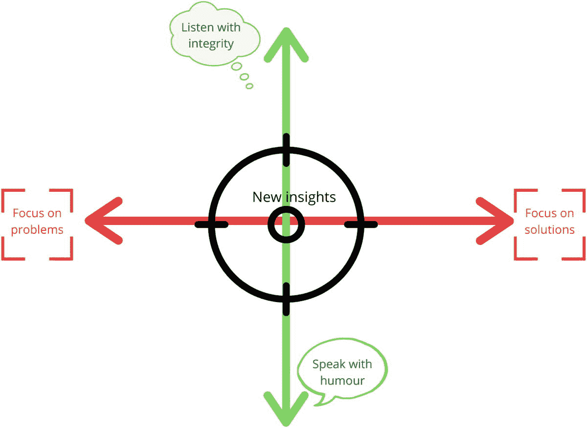
**图 15-1** 建设性对话

### 创造性诚实心态

> *“要像小孩子一样，在事实面前坐下，准备放弃一切先入为主的观念，谦卑地跟随自然，无论它将你引向何种深渊，否则你将一无所获。”*
>
> *——生物学家托马斯·亨利·赫胥黎，论不偏不倚的理解*

前文引言强调了先入为主的观念是学习的无形障碍。尽管赫胥黎指的是科研中的科学思维，但在引导反馈对话时，同样的思维方式也大有裨益。当你带着“学一点未知”的意图开启对话时，或许应当推迟对你所听到的内容妄下结论。此外，赫胥黎还谈到谦逊的态度是学习的助推器。认识到我们实际所知比自认为的要少，我们就能选择保持好奇而非焦虑——尤其在对话中那些脆弱时刻，当我们消化论点中的关键部分时更是如此。

在研究中，超越既定规则进行观察的能力是发现新事物的根本驱动力。而在对话中，倾听则是了解那些你不知道自己需要知道的事情的关键。倾听也分不同层次：一种是“我假装在听，但其实只想听到自己的声音”；另一种是“我全神贯注，对意外之事持开放态度”。前一种倾听方式我们不学就会；至于后一种参与对话的方式，则需要反复练习才能成为第二天性。对此，我们可以通过两种方式将思绪锚定在当下。首先，关注与你对话之人的言辞、肢体语言和情绪^(183)——他们在表达什么？

其次，你可以倾听自己的感受、情绪和反应。事实上，良好的倾听是一种对内心对话的觉察练习。而当内心对话被浓烈情绪的迷雾笼罩时，正是“诚实”介入的时机。

当情绪激动显示你感觉自己受到威胁时，就该提醒自己：你致力于学习新事物，而非仅仅证实对话开始时已有的信念。不过，坦白说，获得对自己信念的确认，感觉就像吃下一块巧克力蛋糕——当下让你愉悦，但第二天站上体重秤时，未必还是好感觉。

社会心理学家、人本主义哲学家埃里希·弗洛姆将“诚实”定义为坚守自身价值观的能力，尤其是在价值观受到挑战的时刻^(184)。因此，诚实意味着无论顺境逆境，你的价值观与行动之间始终保持一致。

创造力是你的核心价值观之一吗？如果是，那么“创造性诚实”可以通过激发你的创造性思维来挽救你的对话，营造富有启发性的交流氛围。你上一次受到批评（甚至更糟，你的想法被否决）是什么时候？你是如何反应的？在这些篇幅中，我们将详细阐述如何更多地运用创造性思维来表达你的想法，并重新解读你所听到的内容。这是一种“带着诚实去倾听”的心态：你愿意接受对话中那些令人不适的时刻，并主动开启视角的转换——首先从你自己的视角开始，即那些与你创意点子相关的、关于可能实施策略的一组假设^(185)。

因此，创造性沟通风格的第三条原则是：以“创造性诚实”的心态，像讲故事的人一样对待每一次反馈对话。这意味着在成为一个有魅力的演说家之前，先成为一个神奇的倾听者。

带着创造性诚实去倾听，意味着识别出那些可以用微笑点亮气氛的瞬间（见图 15-2）。同时，它也意味着抓住机会，通过使用类比来澄清被误解的概念。最后同样重要的是，它还涉及捕捉那些对可能解决方案进行假设性思考的时机。在接下来的章节中，我们将详细阐述图 15-2 中的三个核心概念：幽默、类比和视角转换。

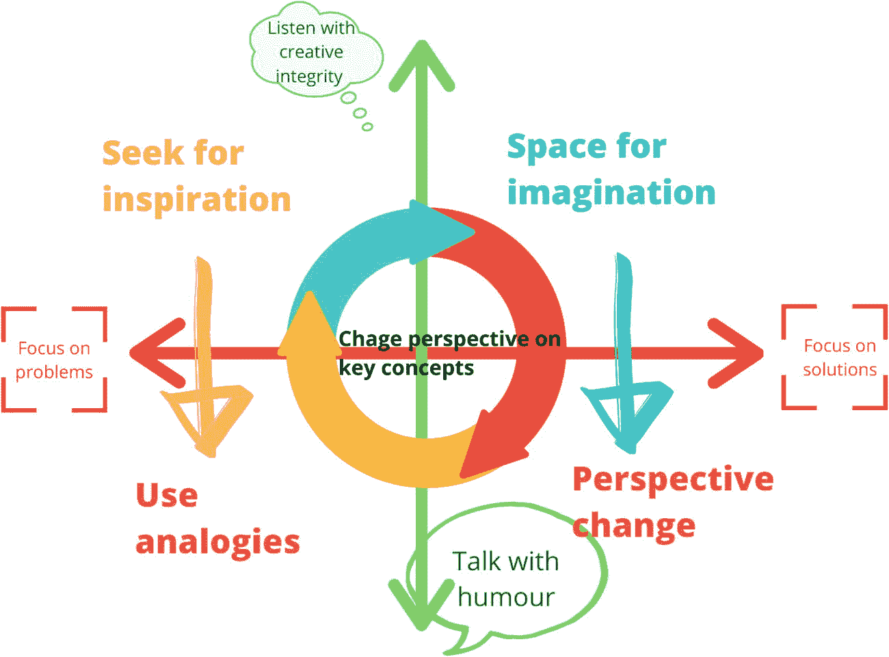

创造性诚实心态核心概念示意图，包括幽默、灵感、想象力、类比和视角转换。
**图 15-2** 创造性诚实

脚注 1 2 3

# 16. 用幽默来交谈

## 什么是幽默？

“你认为哪些特质帮助你取得了如今的成就？”我曾这样问过本书采访的创作者们。

`坚持`、相信自我和`创造力`是被提及最多的特质。其他被个别提及的技能包括：拥抱变化、持续学习、好奇心、共情力、勤奋、兴趣、动力、耐心、目标导向和自我反思。但没有人提到幽默。

当赫尔辛基的一群学龄前儿童被鼓励思考自己的优势时，13 个孩子中有 7 个表示幽默感是他们最突出的特质之一。你呢？你的幽默感是低于平均水平还是高于平均水平？

研究者将幽默定义为“一种智力游戏的形式；即与想法玩耍”^(186)。幽默是一种连接两个或更多人——制造幽默的人和接收幽默的人——的社交活动。制造幽默在于注意到你觉得有趣的事物，并渴望与他人分享。理解幽默则是听到或看到某些东西后不由自主地发笑。回应幽默比创造幽默更容易。你是在工作或家庭中讲笑话的那个人吗？还是你更愿意被有幽默感的人包围？

从 1 分（“从未想过”）到 5 分（“我活着就是为了让别人笑”），在一天中，能说出让别人发笑的话语对你来说有多重要？在对话中增添更多幽默的起点，是愿意去发现缓和气氛的机会。幽默感在生命早期（大约两岁左右）就开始形成，这对儿童社交和认知能力的发展至关重要^(187)。如果有机会，你可以问问父母你小时候是个什么样的孩子：是笑得肆无忌惮的那种吗？还是那种让大人们开怀大笑的小丑？

幽默是一种包含两种思维能力（洞察力和发散思维）的创造力形式^(188)。首先，幽默需要洞察力——即通过情境细节快速看出解决方案（也就是有趣之处）的能力。洞察发生在当你对某个问题所掌握的信息进行心理重构，从而突然理解解决方案时。

让我们以邓克（1945 年）的蜡烛问题为例来展示幽默场景。心理学家卡尔·邓克邀请参与者进行一项实验：将一支蜡烛固定在墙上。实验对象拿到一盒火柴、一盒图钉和一支蜡烛（见图 16-1）。

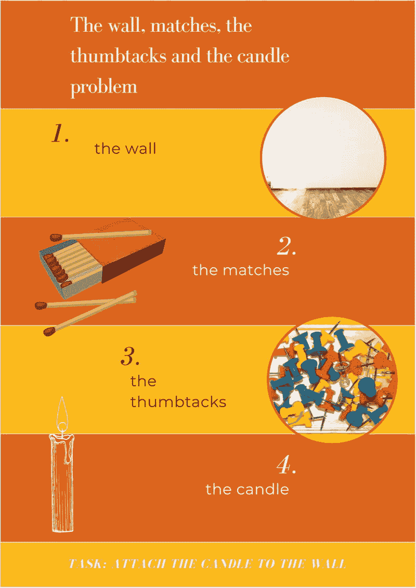

图片展示了一面墙壁和供实验者使用的三种材料（邓克的蜡烛问题）。材料包括一盒火柴、图钉和一支蜡烛。任务目标是将蜡烛固定在墙上。

`图 16-1 邓克的问题`

现在请花几秒钟思考如何解决这个问题。准备好了吗？

解决方案是：清空图钉盒，将其固定在墙上，作为蜡烛的支撑物。那么，如果你在解谜时想让别人发笑呢？你可能会尝试直接用图钉把蜡烛钉在墙上，或者融化蜡烛将其粘在墙上。

产生幽默的洞察力是什么？那些看着你实施这些“另类方案”的人可能会觉得好笑——前提是他们已经看出了正确答案。

其次，幽默需要发散思维，以及在新情境中发现新功能的能力——比如将空图钉盒用作蜡烛底座。学龄前儿童最擅长发现物体的多种用途^(189)。这些小人类热衷于将手中的物体想象成其他东西，并投入特定的游戏。对他们来说，一根棍子可以是剑；或者骑着一根杆子就是在骑马。

伯根和鲁斯塔（2018）认为，创造幽默的能力是伴随着玩耍和创造性行为的发展而演化的，因为它有助于在应对日常问题和危机时提供新视角^(190)。尽管幽默的表达和欣赏方式因个体所处的环境而异，但幽默的存在似乎是一种重要且普遍的人类体验。

## 幽默从何而来？

当儿童开始了解他们的物理和社会环境时，他们会在看到与自己现有知识不符的刺激情境下发笑，以此展示自己的理解。在认知发展的每个阶段，幽默都伴随着我们对所见所闻视角转变的洞察。“我看到了 X。我预期 Y。然而，我看到了 Z 发生。Z 与 Y 相反。我笑了。”Y 与 Z 之间的这种不匹配被称为“失谐”。

一个四岁孩子骑着棍子玩耍是健康的嬉戏行为。一个成年人骑着棍子，那八成是母亲在逗孩子玩，或者，是一个巨蟒剧团的喜剧演员^(191)。因此，失谐就是我们预期看到的与实际看到的之间的差异。意识到这种失谐——理解那个与最初假设相矛盾的笑点——是引发笑声的关键。^(192)

儿童不断发展的发散思维能力使他们不仅能创造出物体使用上的新失谐，还能在身体动作、语言和声音的运用上创造出新的失谐。例如，把一根香蕉放在嘴前假装它是一个大大的微笑，这既能让他们自己开心，也能逗乐别人。^(193)

尽管幽默起源于肢体游戏，但随着儿童自我意识的增强并开始观察他人的行为，幽默的运用变得更加多样化，并与其他形式的游戏——物理游戏、语言游戏、想象游戏、社会戏剧游戏等——同步发展。^(194) 根据麦吉的说法，失谐发展的第四阶段也是最后阶段，被称为文字游戏或“多重含义”阶段，大约在孩子 7 岁时形成，此时他们获得了更高的认知复杂度，比如玩弄想法和比喻性语言的能力，以及注意到因果关系的能力。^(195)

一个十岁的孩子可以通过在棍子末端系上一些草来进行假装游戏。这根装饰过的棍子可以扮演老师的角色，孩子可以向它倾诉所有他们不敢当面直言的事情。孩子可能会独自玩耍，从不向任何人透露他们想象中的对话，也可能与朋友分享这个游戏。

笑话之后通常是笑声，但并非总是如此。与此同时，孩子们开始内化他人不同的视角。那个十岁的孩子知道他的朋友可能会觉得有趣，但老师不会。老师如果发现自己被比作一根棍子，可能会觉得好笑，也可能不会，尽管这个幽默确实揭示了课堂中心理安全感的缺失。

“我正在读一本关于反重力的书。我根本放不下它。”^(196) “多重含义”阶段贯穿整个青春期。我们带着已经形成的幽默风格步入成年，这风格源于两个方面。首先，源于你自身以及他人对身体动作、语言、声音和心理状态之间感知到的失谐的个人倾向。

其次，取决于照料者和更广泛的文化背景，到了青春期，我们会吸纳两种主要幽默类型的组合。一些青少年可能每天都会使用幽默，有时是积极的，有时则带有攻击性。^(197)

“让我们把工作放在一个高不可及的基座上吧。”“努力工作让你保持健康，但懒惰也不会要你的命。”这些都是伴随我成长的讽刺幽默的例子。无论我们是在何种幽默形式中成长起来的——肢体幽默、双关、反讽、讽刺、观察式幽默等等——幽默感会通过我们一生中那些有影响力的社交互动而持续发展。^(198)

总结一下，幽默源于在两个不协调的物体、想法或词语含义之间建立非显而易见的联系。在语言幽默中，最初的信息设定了语境，激活了听者对接下来内容的认知和预期。意识到初始预期与笑点中提供的最新信息之间的失谐，会带来惊讶和笑声。

“我和一个 45 度角吵了一架。它是个锐角。”^(199)

***可选练习 1：*** *步骤 1 – 你最喜欢通过哪些来源消费幽默？*

*   *单口喜剧节目*
*   *幽默网站*
*   *漫画*
*   *喜剧电影*
*   *其他 _____*

*连续五天，确保每天至少听到/读到一个笑话。*

*步骤 2 – 每天改编一个笑话。*

*对于你喜欢的每个笑话，你能如何改编它以符合你日常生活中的某次经历？*

*步骤 3 – 笑话创作日记 – 创作你自己的笑话。*

*在连续五天模仿你喜欢的笑话之后，选择一周时间，记录下每天工作中遇到的概念或物体。例如，45 度角可能是一个程序员生活中的日常需求。针对每个概念/物体，尽可能多地写下它的特性。同时，记下你应用该概念/物件的目标是什么。*

*在达成目标的过程中可能遇到哪些挑战？针对每个挑战，尝试想出一个隐喻。这将成为你笑话的语境。在上述双关语中，隐喻是“吵架”。接下来，思考当天概念或物件的哪些特性符合这个隐喻的含义？*

*“我和一个 145 度角吵了一架。它是个钝角；我很快就赢了。”*

*不必担心是否能制造出哄堂大笑的效果。只要你能够习惯识别出一个书呆子式笑话所需的基本要素，那就足够了。*

## 人们何时笑得最畅快？

你今天至少笑过一次吗？你什么时候更想开怀大笑？是在黎明破晓时，还是在夜幕降临时？1999 年一项针对 30 名男性和 50 名女性（年龄在 17 至 79 岁之间）的研究表明，人们对幽默的兴致会随着时间推移而增加，尤其在傍晚时分。^(200) 特别是，年轻参与者报告在一天结束时笑的次数是年长参与者的两倍多。

在考察幽默的不同来源（即兴反应、媒体、复述笑话以及回忆过往趣事）时，大约 88%的笑声发生在与他人共处时，而非独处时（12%）。与研究中男性相比，女性在与他人相处时表现出更高频率的即兴笑声。

在考察笑声的发起者时，大约 64%的笑声是对他人幽默的回应。参与者本人仅发起了 36%的幽默时刻。

一个有趣的发现是：衰老似乎对笑的倾向有负面影响，但这仅体现在研究中的女性身上。24 岁以下的女性平均每天笑 22.7 次，而 60 岁以上的女性平均每天仅笑 11.7 次，恰好是前者的一半。

这可能意味着，年纪越大，你发现值得笑的事情就越少。对年长女性笑声频率显著下降的另一种解释是：退休后与人社交的机会减少，听到或使用幽默的场合也相应变少。平均而言，女性比她们的丈夫活得更久——尽管该研究并未记录参与者的婚姻状况。

总而言之，这些发现强化了“笑声是一种社会现象”的观点：大多数笑声都源自一种冲动，且发生在与他人相处时。那么，是哪些情境、哪些人，能激发你讲出有趣的话呢？

“一个点喝醉了，对一个球说了什么？‘我打赌你现在走不直了。’”

***可选练习 2：*** *第 4 步——笑话创作日记——在朋友中测试你的幽默*

*假设你连续五天，每天精心创作一个新手笑话，那么现在你应该已经掌握了五个笑话。你最引以为傲的是哪一个？哪三位朋友愿意倾听你的得意之作？下次和他们见面时，准备好分享你的幽默吧。*

*之后，在你日记里记下自己作为笑话创作者的感受。同时，记录下朋友们的反应。*

你可以将练习 1 和练习 2 重复进行两次（这样总共会额外增加四周）。在你和朋友之间的互动中，你是否注意到了由此带来的益处（如果有的话）？

### 积极幽默在工作场景中的益处

> *除人类外，没有动物会笑。*
> 
> ——亚里士多德，《论动物各部分》（第 29 页）

从 1 分（*分散注意力*）到 5 分（*悦耳动听*），你有多喜欢在工作中听到笑声？幽默是人的天性。

我幽默表现的光辉时刻之一，是在一次商业创意生成研讨会上。那次研讨会在一个创业加速中心的开阔空间举行。参与者们齐声欢笑，笑声传到隔壁办公室，吸引了一些原本没打算加入的人前来参加。

运用幽默和聆听幽默能提升创造性思维能力。在一项针对学校教师幽默感的调查中，教师的幽默与四项创造性思维技能显著相关：想象力、灵活性、独创性和开放性思维。^(²⁰¹) 运用恰当的幽默似乎能鼓励学生在涉及创造性思维的任务中表现更佳——如`托伦斯创造性思维测验`——学生的内在动机、理解水平以及课堂学习材料的注意力均有所提升。^(²⁰²) ^, ^(²⁰³)

其他实验研究表明，当人们因观看喜剧或意外收到糖果而产生积极情绪时，与中性或消极情绪相比，他们表现出更强的认知灵活性，从而能够更创造性地解决问题。^(²⁰⁴) 积极情绪的体验有助于更高效地组织和整合记忆，并使思考、规划和判断更为有效。^(²⁰⁵)

在创意过程的构思阶段，运用积极幽默同样具有显著的认知和情感益处。例如，一项关于产品设计过程的研究发现，即兴喜剧演员在产生新产品创意时，比专业产品设计师多想出了 25%的创意。原因何在？即兴表演训练中的练习会激发联想思维，而这是在酝酿想法时所需要的。在同一项研究中，当一组 11 名设计师在头脑风暴会议前接受了即兴喜剧训练后，他们提出的创意数量平均增加了 37%。^(²⁰⁶)

这些发现佐证了与幽默相关的自发愉悦感能促使人们更广泛、更灵活地思考。此外，幽默还能通过社交效应增强组织内的创造力。^(²⁰⁷) 表达幽默能在对话中维持心理安全感，缩短人与人之间的社交距离，并有效管理潜在冲突。

在工作中运用幽默表明你关心自己的工作以及共事的人。同时，这也显示出你对自己的信心以及与你想要逗乐的人之间的熟悉程度。在一项针对 279 名斯洛文尼亚护士的研究中，受访者被问及在与患者对话中是否愿意使用幽默——包括双关语和其他类型的言语表达。^(²⁰⁸) 使用幽默的护士报告说，她们对护理职业的归属感增强，并将幽默视为辅助患者的另一种工具。

幽默不仅具有与同一组织内同事建立社会纽带的功能，也能与陌生人建立联系。你最近是否听过一场演讲，演讲者在第一分钟就用其风趣才智迷住了你？当人们运用幽默时，他们会透露一些自己对重要事务的价值观和看法。我们因此会迅速对他们形成印象。而且，我们往往喜欢那些通过幽默表达出类似生活观的外人。顺便说一句，共同的价值观和相似的经历解释了为什么你喜欢某些喜剧演员，而不喜欢其他。

当别人由衷欣赏你的幽默时，他们很可能会认为你更值得信赖、更可信、更诚实，即使你运用幽默的意图是为了说服。轻松愉快的氛围能使人在做商业决策时更能接受和反思反驳意见。^(²⁰⁹)

在商业创意生成研讨会结束时，一位活动组织者过来与我交谈，说道：“*希望你能再来和我们一起工作。*”几周后，一位参与者写信给我。他在研讨会期间产生了一个商业创意。如今，他是一家商业中心的创始人，该中心汇聚了欧洲的扩展现实新兴公司与生态系统。

简而言之，幽默增添了趣味，促使人们跳出框框思考。同时，只要通过幽默表达的价值观和经历能引起接收者的共鸣，他们就会在情感上与发起者更加亲近。

脚注 1 2 3 4 5 6 7 8 9 10 11 12 13 14 15 16 17 18 19 20 21 22 23 24

## 17. 用即兴幽默引导反馈对话

### 成为略带幽默感的人

掌权者们都认同幽默在工作中的益处。在商业环境中，人们希望听到领导者开些玩笑，正如《财富》杂志对 329 名财富 500 强 CEO 进行的一项调查所示，97%的 CEO 认同幽默在商业中的重要性。^(²¹⁰) 有幽默感的领导者能够提高员工在工作中的投入度和创造力。^(²¹¹) 此外，一种对风趣言行持开放态度的职场文化，会激励每个人尽可能展现自己的幽默。

工作投入度决定了人们在职场中的表现。那些更频繁体验到工作满意度的专业人士，更有可能展现出“组织自发性”，从而帮助同事并提出建设性意见。^(²¹²) 而且，当领导者对错误做出幽默评论时，会鼓励“同舟共济”的思维方式，提升员工留存率，并激发创新行为和态度。

创造过程不仅关乎新颖且有用想法的产生与实施，也关乎你如何阐述自己的想法。在反馈对话中，运用幽默是邀请双方（创造者和评估者）进行更深层次理解、修正观点以及共同解决问题的一种方式。^(²¹³)

你可能会想，“*我到底是不是天生的喜剧演员？*” 本书的意图并非将读者培养成著名幽默家。目标是通过理解如何在与上级、平级和下级的日常交往中利用亲身经历，成为一个更有趣的人。成为一个有趣的创造者，关键在于你愿意在与那些你想建立信任的人对话时，展现你的幽默感。

幽默并非我的强项，但我确实喜欢逗身边人开心。所以，我会固执而自发地编造一些有趣的言论，让我的听众会心一笑。当然，也有搞砸的时候。比如有一次，我拜访一位潜在客户，他指着墙上的一张照片——那是现在的 CEO 五岁时与当时 CEO 握手的照片。我脱口而出：“*她那时候看起来可爱多了。*” 然而，当我看到自己确实能让一些人发笑时，那种美妙的感觉让我上瘾。因此，我愿意一次次重新开始。

同样地，只要你准备好在一场反馈对话中，率先提起某个情境中幽默的一面，这就足够了。它能营造出一种心理安全感、投入式创造力和理性坦诚的氛围。每次对话中的一个笑话，或许就能让所有人放下固守己见。

你身边最有趣的人是谁？你能从他们身上学到什么？

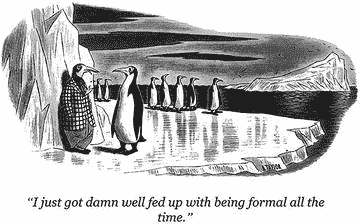一张照片中，一只企鹅穿着正装面对另一只企鹅，身后还有一队企鹅排队，图片配文是：“*我真的受够了整天这么一本正经。*”

正如我们从上述《纽约客》漫画中看到的，^(²¹⁴) 创造幽默的专家们善于利用情境中的元素，并将其组合起来产生幽默效果。这也是你可以通过三个步骤练习养成的习惯：进入玩乐状态、做好准备、保持灵活。第一步是让自己进入营造轻松氛围的情绪状态。第二步是训练自己即兴说出幽默评论的能力。第三步是尝试不同类型的幽默，这些幽默在特定情境下可能更受对话者的欣赏。

温馨提醒一下。经历这三个步骤并不意味着你会变成一个笑话大王。你更可能会体验到更多这样的时刻：你惊讶地发现自己说出的话能带来短暂的愉悦，并让人暂时摆脱对话的严肃性。

总而言之，在对话中使用幽默就像在合唱团里唱歌。总得有人起个正确的调子。你能成为那个人吗？让我们一起来创造欢乐时刻吧。

#### 第一步：进入玩乐的心态

你是否注意过，当你不由自主地冒出幽默话语时，自己通常处于何种心态？情绪会影响你观察事物有趣一面并将其传达给他人的倾向。^(²¹⁵) 如果你和大多数人一样，那么在感到压力、烦躁或焦虑时，幽默是最后才会自然流露的东西。

玩乐心态或愉悦的自发性，是一种情感状态，它能使你重新构建情境，让你和身边的人将这些情境体验为有趣、启发思考或富有个性。^(²¹⁶) 玩乐的心态是播种幽默种子的肥沃土壤。同时，在你开口说话之前，你身上那种玩乐的能量就已经在触动着对话者的潜意识。

要培养富有弹性的玩乐心态，按照第 16 章所述的方法，记录一本“俏皮话日记”，是在选定情境下有意识进入活泼心态的绝佳开端。或者，你也可以选择练习用幽默的视角重新解读日常情境。例如，你散步时能看到什么可以被解读为有趣的事？或者在一个无聊的会议上？又或者当你站在超市排队时？

有一天，在结束一天紧张的工作后，我出去散了一会儿步，想放空一下头脑。没过多久，我就注意到身边越来越多的人穿着运动装。而我穿着牛仔裤，感觉自己像个异类。我甚至想象出当地报纸的头条会写着：“*震惊！业余步行者闯入我们森林小径。*”

当你习惯于在非正式场合中发现自身经历与他人行为之间的喜剧性反差时，就可以进入下一阶段了。你可以开始在工作情境中观察有趣的角度。在反馈对话中，你可以选择在三个关键时刻切换到玩乐心态。

- 当你介绍项目的理念，即你的“为什么”时。你为何选择这个特定的挑战？

- 当你阐述你所设计的解决方案——其优缺点及目标受众时。

- 当你邀请对话伙伴分享他们对某个具体问题（例如你提出的解决方案的利弊）的看法时。

当讨论投入的能量水平下降时，就是时候引入一些玩乐元素了。这标志着一次短暂休息，让大家带着微笑重新调整思绪。

#### 第二步：准备好为诙谐评论留出空间

这一步的目标是习惯自发地描述你从某个情境中看到的趣味点。此前，我们列举了反馈对话中的三个关键节点。每个节点又包含三个阶段的发展过程：（1）开场，明确对话目标；（2）中间部分，为了深入讨论而复述对方话语；（3）结尾，总结已讨论的要点，以确保与对话者达成共识。同时，总结也标志着一部分讨论的结束，并引出下一个话题。（见图 17-1）

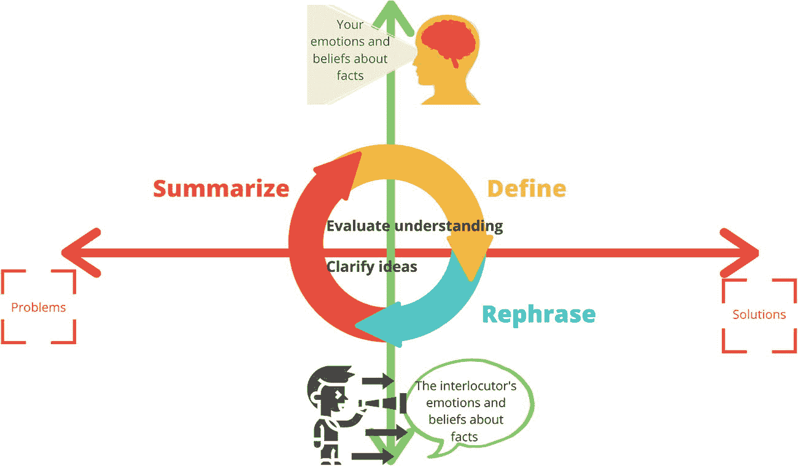一幅展示反馈对话中三个关键节点（即：定义、复述和总结）的示意图。

**图 17-1** 对话中的过渡节点

# 通过幽默深化对现实的理解

当你在定义、复述和总结观点时，其中往往包含着一些大多数时候未被注意到的隐含假设。不过，你可以通过幽默将这些隐含的假设变得清晰可见。这里向你介绍三种策略，帮助你更清晰地认识自身现实或对方的现实。

## 三种幽默策略

- **以微笑开场** – 指的是有能力用一个关于自己的有趣开场白来引出话题。目标是帮助听者与你建立联系。
  例如，你可以先聊聊自己的工作习惯。“这个项目让我白天像海狸一样辛勤工作，晚上睡得像个木头人。我发现自己最爱的晨间活动变成了：按掉闹钟继续睡。”通过强调你生活中那些与普遍认可的`productivity`习惯不同之处，你将听者引入你的世界，同时为对话奠定一个有趣的基调。你有什么样的习惯或经历，可以拿来与成功模板进行有趣的对比呢？
  另一种以幽默口吻开启对话的方式是嘲笑那种被审视的恐惧。“我们总被要求去发现他人工作的局限。而我的工作完美无瑕。”这句讽刺的评论影射了不确定性，而这种不确定性正是创新者、科学家、艺术家、创业者等工作生活中不可或缺的一部分。玩弄这种对未知的恐惧与你的态度之间的反差，能让你在对话者眼中更具亲和力。
  在对话的开端，你还可以利用个人经历与公认为‘`真理`’之间的哪些其他反差元素呢？

- **请再说一遍** – 指的是邀请对话者重新措辞他们的评论。目标是双重确认你对关键观点的理解是否准确。
  复述就是用不同的方式再说一遍，以便在对话中达成对某个关键点的共同理解。当你复述时，背后假设是你已经理解了对方传达给你的核心信息。有时，对话会遇到混乱局面，双方都以为在谈论同一件事，实则不然。当你觉得讨论中存在歧义时，可以这样问：“你说的（……复述对方的话……）是什么意思？”
  作为一种幽默的替代方案，你可以基于你听到的内容与对方实际所说内容之间的偏差，加上一句愚蠢、奇怪或诙谐的评论。^(217) “你是说，我听到的那个意思吗？” “在我听来，这有点像‘求救信号’。”等等。作为备选方案，当你感觉对话变得过于混乱时，也可以随时准备好一幅现成的漫画来展示。
  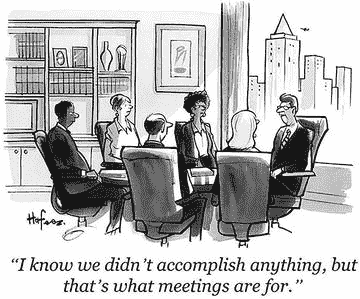
  一张 6 人围坐桌边的照片，下方文字为："我们知道我们没完成任何事，但这就是开会的目的。" ^(218)
  当你在讨论中感到迷失时，这通常是个好迹象，说明很多想法正在碰撞。幽默的介入能帮助对话者在厘清自己思路的同时保持积极心态。

- **认同式微笑** – “那么，我们目前讨论到的内容是……”、“到目前为止，我觉得我们看的像是同一本书的封面。”总结性的句子能告知对话者，是时候进入下一个话题或结束本次讨论了。你如何用一种为过渡时刻注入新能量的方式，来总结对话中取得的进展呢？
  你可能会发现最初的期望与对话中出现的主题之间存在差异。“在这次讨论中，你让我意识到我需要沉住气，把截止日期延后。”或者“这次谈话开始时，我很紧张你会指责我在没有测试的情况下就对这个新想法投入太多，是‘`本末倒置`’。”
  此外，你也可能经历过这样的时刻，即意识到自己的情绪、信念与对方的存在差异。“我不得不咬紧牙关，承认你说得对，当你提到……”这些有趣的回顾颂扬了信息交流中的亮点。如你所见，在前面的一些例子中，我们使用了习语。在恰当的语境中使用习语也能产生有趣的效果。
  美国散文家、幽默作家 E·B·怀特曾指出关于笑话的一个重要真理：“解释一个笑话就像解剖一只青蛙。你能更好地理解它，但青蛙在这个过程中死了。”确实，当你没有立刻领会一个笑话时，深究其笑点的逻辑并不会让你笑出来。恰恰相反，你可能会因为最初没听懂而感觉越来越笨。但有一个例外：当你想要培养自己的幽默感时，理解某个特定笑话的机制是对你创造欢笑潜力的投资。
  在反馈对话的开场白、中间部分和结尾中运用一些幽默元素，能为创作者划定一个围绕敏感且严肃话题（即创作过程中的下一步该做什么？）的轻松边界。

## 第三步：灵活适应，选择合适的幽默风格

如果你喜欢跟朋友讲黄段子，是什么让你觉得在专业场合也适合这样用呢？笑话关乎个人品味和价值观。通常，你在闲暇时讲的笑话与在工作场合讲的笑话在得体性上是有区别的。即使在长期的专业关系中，比如导师与学员之间，幽默也可能适得其反。那么，如何在反馈对话中讲出一个能被良好接受的笑话呢？
首先，维护评价者的心理地位感。为此，要找出你与对话者共同拥有的核心信念和知识。其次，培养一种能够连接人心的幽默风格。第三，留意对话者的情绪状态。第四，要准备好接受你的幽默不被欣赏的时刻。

### 通过精心策划笑话内容来维护对话者的地位感

这里所说的地位，指的是一个人感受到自己被他人重视的主观感受，而非职业角色带来的地位。在对话中，大脑会无意识地监测他人对你的重视程度。当你感到被欣赏时，你会产生积极的情绪。当你感到被批评或嘲笑时，你的大脑会释放皮质醇，这是一种压力荷尔蒙，会阻碍你的创造性思维。在讲笑话时，为了引发笑声，听众需要感觉自己的地位在上升。相反，这些笑话会让他们感觉良好。
有时，正式的地位会扭曲人们对如何有效运用幽默的认知。例如，当听众认为自己与处于权力地位的人（如领导与下属、教授与学生、导师与学员）存在工作关系时，幽默的发起者可能很难预判笑话对接收者产生的情绪影响。^(219)
在 2001 年的一项研究中，学生和教授对于教授使用幽默来激励学生、激发思考和巩固知识的程度存在认知分歧。^(220) 80%的教授报告称他们会使用幽默来实现这些教育目标。然而，只有 55%的学生认同这一看法。
你更愿意邀请谁来交流对你创意工作的看法：是同行、导师、新朋友，还是用户群体的代表？无论他们的职业地位如何，作为一个创作者，将自己感知并定位为平等的一方对你最有利。克服使用幽默时可能存在的优越感或自卑感偏见的一种方法是问自己：“为什么这句话能鼓舞他人？”，“为什么这条评论能让他们感到有趣或解压？”
创作有趣的评论，归根结底在于致力于说出真相，并关心如何让对话者感到被重视。而每一则幽默的背后，恰好都存在着一个被普遍认可的共识。例如，让我们看看下面这则以`上帝`为主人公的《纽约客》漫画。^(221)
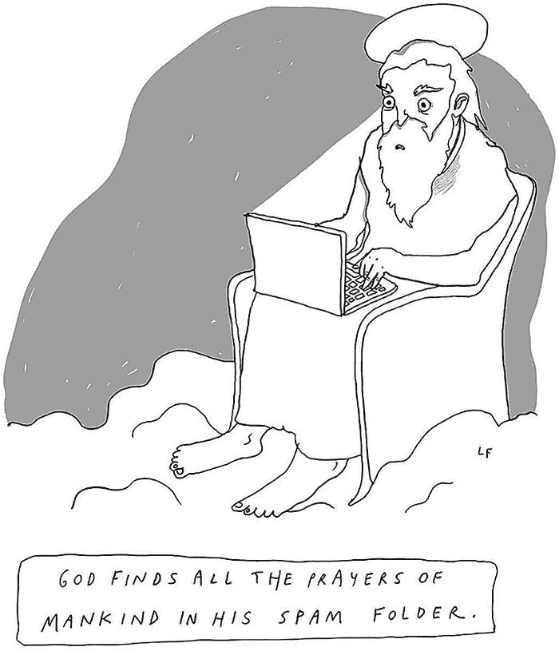
一张老人坐在那里抱着笔记本电脑的照片，配文是：上帝发现所有“制造”的祈祷都在他的垃圾邮件文件夹里。
你和对话者是否信仰同一位上帝？如果对话者是不可知论者或无神论者呢？那么，假设你和对话者宗教信仰都不太严格，这个笑话为何会在对话的特定时刻具有相关性呢？因此，当一个笑话能够唤起与当前情境相关的共同信念、价值观和知识时，它才是恰当的。
2006 年的一项研究采访了本科生，询问他们课堂上恰当和不恰当幽默的实例。^(222) 学生们识别出 1315 个由教师在课堂上创造的幽默时刻，其中 774 个时刻符合语境。与课程内容相关的有趣评论和行为被认为是最恰当的幽默（占 47%）。基于性别、种族、宗教、性取向或政治立场来侮辱学生或其他与学生认同的人，则被认为是不恰当的幽默。
这些发现同样适用于工作环境。因此，为了维护对话者的地位感，稳妥的做法是坚持使用与讨论主题相关、且属于专业领域内众所周知的事实笑话，如下面这则 xkcd 漫画《星际迷因》所示。
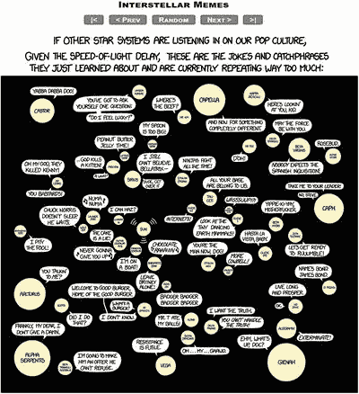
一幅以不同大小的圆圈代表太阳周围恒星系统的图像，并配有一个链接的评论框，其中引用了每颗恒星的话。^(223)
其笑点在于：“我们开发超光速旅行最大的动力是，它能让我们提前道歉。”对恒星系统以及过去三十年流行文化有基本了解的人会觉得这则漫画很有趣。
简而言之，为了确保你和听众都能感到愉悦，要根据你与听众共有的信念和知识来寻找有趣的评论和故事。你对你潜在的评估者所处的现实了解多少？

***可选练习 3：*** 绘制与对话者的共同领域
由于笑话依赖于共享的隐性知识和信念，在重要对话之前，一个有用的练习是花几分钟时间独处，回顾一下你对即将见面之人的了解。
个人价值观 `_____` ， `_____` ， `_____` 等等。
生活状况 `_____` ， `_____` ， `_____` 等等。
知识领域 `_____` ， `_____` ， `_____` 等等。
兴趣爱好 `_____` ， `_____` ， `_____` 等等。
幽默的内容必须从上述五个领域中选取其一。

### 培养激发创造力的幽默感

运用幽默需要自信。你习惯使用的幽默风格是什么？在日常生活中使用幽默的倾向由两个目标触发：提升自身价值，或提升与他人关系的价值。^(224) 实现这些目标有两种风格：无害的方式和恶作剧的方式（见图 17-2）。
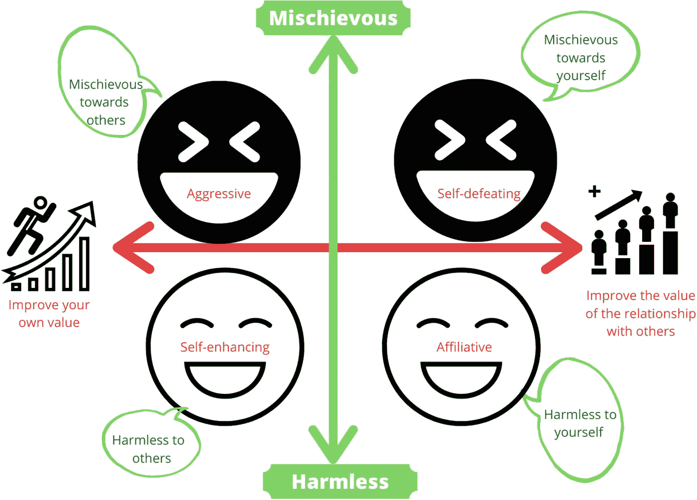
4 种幽默风格的四个象限：上方为恶作剧风格——攻击性和自贬型；下方为无害风格——`自我增强型`和`亲和型`，及其影响。
图 17-2 幽默风格
每个人在不同程度上都拥有四种幽默风格，它们与个性特征和情绪状态直接相关。
当你想要肯定自我，并以和善的态度表达自己的观点时，你使用的是`自我增强型`风格。这种风格最常在独处时被使用。它通过有趣的叙述来重构你的视角，以应对困境和消极心态，或提升你的趣味性。
当你想要突出特定关系的价值，同时建立自己的有利地位时，你使用的是`亲和型`风格。这种风格在工作场合与人相处时会表现出来。
`自我增强型`和`亲和型`风格与无害的、引人发笑和感到愉悦的倾向相关。不幸的是，以下两种风格则更具危害性。

当你倾向于抬高自己，并以伤害他人的方式表达时，你使用的是`攻击型`风格。它表现出对他人感受的缺乏尊重，带有嘲讽、取笑和羞辱的口吻。在社会群体中，使用敌对类型的玩笑，如戏弄或挖苦，可以将其他群体中的个体排斥在外，建立权力和地位差异，并对公认的社会规范产生强烈吸引力。因此，它会加剧社会分裂，形成一种“优越的我们”对抗“失败的他们”的局面。金发美女笑话、宗教和政治派别笑话就是这种风格的例子。

第四种风格，即`自贬型`风格，表现为当你抬高他人却贬低自己时的情形。这意味着你愿意拿自己开涮，甚至到了让人感到不适的程度，让自己成为笑柄。

这四种风格中，哪一种是你的主要倾向？哪一种风格能改善你在工作场合中与互动对象的关系？例如，实验室研究发现，有证据支持这样的假设：观察`自嘲`式幽默的个体会体验到更高水平的创造力。相比之下，经历嘲讽式幽默的参与者更倾向于从众并害怕失败。^(²²⁵)

在组织环境中，如果员工对领导者存在信任，领导者使用自我增强型幽默可以提升员工的个人创造力。^(²²⁶) 此外，在一对一谈话中，无论员工的自尊水平和自我效能感如何，领导者使用`攻击型`幽默都会降低员工对领导者的信任感知和绩效表现。^(²²⁷) 相比之下，当领导者使用`亲和型`幽默时，他们传递出谦逊——缩小了领导者与团队之间的地位差异——以及正直——行为与组织价值观保持一致。

总之，无论你与家人朋友相处的幽默风格如何，也无论你的职位高低，在旨在拓宽他人思维的对话中，`亲和型`和`自贬型`风格是更具共情力且更安全的选择。一条经验法则是：“`自嘲`，而非嘲笑他人。”

`亲和型`和`自贬型`风格可以成为有力的沟通方式，以提升创造性解决问题的能力、信任和亲社会行为——这些品质正是你希望那些评价你原创想法的人所具备的。与他人一同欢笑，而不是嘲笑他人。

## 现在是即兴幽默的好时机吗？

幽默需要两人配合才能实现。因此，你需要学会敏锐地捕捉适合微笑和欢笑的情绪氛围。当听者心情不佳时，幽默有时可能被视为有益或有害。

你的趣味性会触发幽默时刻。然而，接收方对幽默的解读可能成就或破坏这个笑话。如果对话者正专注于要得到一个严肃的回答，那么欢笑的机会就会被浪费。在听者没有预料到时用幽默回应，可能会暂时影响你的可信度。我们有两种方法可以防范这种风险，并通过幽默收获联系、活力和创造力的益处：

1.  如何判断对话者是否准备好接受一个笑话？要探测他们对欢笑的开放程度，你可以选择关注对话中的两种行为：

    *   此刻你面对评估者是否感到心理安全？

    *   听者提出有趣问题的频率有多高？

    氛围越友好，参与度越高，他们准备好欢笑的可能性就越大。

2.  你可以通过事先声明一句轻松的话语来为对话者做好准备，例如：“让我告诉你一件有趣的事”、“这个想法有一个有趣的转折……”、“我饶有兴致地发现……”等等。

    这些预告性陈述可能会减弱喜剧效果，但能通过设定期望来弥补。最坏的情况不过是对话者忽略它们，然后继续讨论其他想法。

当然，你可能会误判他人的情绪以及他们在提供反馈时承担的责任程度。因此，决定是否在谈话中运用幽默的关键因素，在于你感觉与评估者之间临时建立的联系有多深。当感觉合拍时，就准备好开玩笑吧。

### 当对方不觉得好笑时该如何应对

照片中，一男一女坐在桌子一侧，对面坐着一个人。照片两侧各有一个带引文的评论框。^(²²⁸)

你上一次试图逗人发笑却以失败告终是什么时候？你一定知道那会让人感到丢脸或尴尬。^(²²⁹) 当你主动带头引发笑声时，其实是在面对当下挑战时，含蓄地发出建立人际联结与团结的邀请。因此，你承担着对方可能不接受邀请的风险，从而变得脆弱。如果这种风险成真，那就糟了！笑话选得太差了。

与此同时，听笑话就像一场智力测试。当听者意识到自己没听懂时，他们会感到不适。*“我为什么没听懂？”* 或者他们可能会心存评判。*“你这小滑头……”*，把你的幽默解读为一种意图让自己处于优越地位的方式，甚至更糟，将其视为一种言语攻击。

当对方因未能理解幽默而产生挫败感时，你该如何应对？幽默被误解的原因有很多：拒绝进入轻松嬉戏的状态、对词语和经历不熟悉、对信息流失去注意力等。不可避免的结果是你与对方之间瞬间失去了联结。当你察觉到自己的幽默并未让对方受用时，道歉或额外解释笑话只会让对话的中断更加糟糕。

关键在于重新建立对方的心理地位感。为此，你可以先总结一下到目前为止讨论中已达成共识的内容，以及尚未涉及的话题。帮助对方重获掌控感，并让你看起来无害，这一点很重要。为此，你可以让对方决定接下来哪些想法值得关注。

运用幽默和倾听幽默，与其说是一场共同知识的考验，不如说是一场是否愿意暂时玩乐的考验。幸运的是，在一段以信任为基础的关系中，对话由情感联结的起起落落构成。所以，这种动态迟早会恢复。

在接下来的章节中，我们将探讨如何通过类比和想象性思维来激发听者的参与度。

## 18. 在倾听中汲取灵感

### 何为灵感心态？

赫尔辛基新开了一家室内游乐场。它为婴幼儿提供启发式教育游戏室，与当时市场上已有的运动型游乐场截然不同。每个房间都烙印着设计师的灵魂。

我带儿子们去过那里几次。有一次，我们正要离开时，店主走过来询问我们的体验。她的眼中闪烁着自豪的光芒。我犹豫了几秒钟。*“我该说她想听的话，还是该说我的真实想法？”*

我开始讲述我喜欢这个空间的地方。可我一提到，在我看来，门票价格太高了，她的脸顿时阴沉下来。她开始进入说教模式，大谈家庭预算以及父母可以如何节省开支来负担游乐场的门票费用。

思考反馈对话时，一个富有成效的方式是将其视为一个收集更多信息的机会，这些信息是你原本可能接触不到的。与其采取防御姿态，随时准备反驳，你可以选择一种灵感心态。目标是根据对方提出的顾虑，确定可能的行动方案，或许还能捕捉到一些自发的幽默时刻。但什么是灵感？

《韦氏词典》给出的一个释义是*“一种神圣的影响力或作用于人的行为，被认为能使此人接受并传达神圣的启示。”* 在这个定义中，隐含着三个特征：（1）存在一个传达信息的外部来源；（2）接收者承认这一信息，并因此采取行动，该行动在灵感来袭前是难以想象的；（3）个体价值感得到提升。

的确，古希腊人认为灵感并非在你需要时降临，而是缪斯女神准许时才降临。^(²³⁰) 宙斯与谟涅摩绪涅的九个女儿，会允许某些在诗歌、音乐、舞蹈、历史、天文学等领域有天赋的凡人接触到神圣的思想。例如，如果你想变得更有趣，就应向喜剧缪斯塔利亚祈求，以获得源源不断的幽默创意。如果你对历史感兴趣，克利俄则会指导你的学习。

从 1 分（*像一根乏味的铅笔*）到 5 分（*像一条潺潺的小溪*），你每天感受到的灵感程度有多少？一个梦想、一本书、一首歌、一次巧合，或与一位特别的人（如老板、老师、导师、意见领袖）的预定会面，都能激发你采取新行动的决心。一些研究创造力的心理学家和神经科学家认为，灵感是一种先于创造性想法产生的动机状态，无论艺术领域还是非艺术领域，它都会促使你去寻求信息、获取知识。^(²³¹)

灵感会出其不意地降临，并让你行动起来。它让你感到振奋，对主动改变充满热情。这些积极情绪会转化为对灵感主题——一个新想法或新问题——高度且持久的投入。因此，灵感就像你帆上的风，引领你从创造过程的起点走到终点。

被缪斯选中意味着什么？根据《韦氏词典》的定义，能够听到来自外部来源信息的人所具备的素质，正是灵感的第三个决定性特征。如果灵感不是一种意志行为，那么你需要做些什么才能获得缪斯的青睐呢？

### 拥抱灵感的艺术：在对话中激发创造力

你或许无法控制灵感何时降临，但可以主动将其引入生活。通过参观博物馆或学习新领域技能等开放体验，你能激发思维。你越让自己接触陌生的想法和经历，就越有可能获得灵感并表达新观点。^(²³²) 然而，如果新体验对你而言如同水过鸭背，灵感便不会发生。你需要让自己乐于接受新鲜事物，即使并非一见钟情或一听倾心。特别是在反馈对话中，你可能需要训练探索他人想法的能力，克制急于否定对方的冲动。^(²³³)

你可能会想：“等等！如果我对别人的评论不那么挑剔，又如何辨别哪些内容对发展我的原创想法有用呢？”在对话中偶尔暂缓判断，就像呼吸间微小的停顿，让你能够继续下一次呼吸。减少评判能让你从评价者的经验和知识所提供的丰富视角中，重新审视自己的观点。

让自己更容易接受灵感的第一步，是观察你在倾听时的情绪和反应。当你意识到自己对某人的观点产生强烈反应时，在心里数 1、2、3，然后叹一口气。“塔利亚，请帮我按住叫嚣的判断！”给你的灵感起个名字——“伙伴”“宝贝”“嘿，你”等等——一个对你有意义、能减弱你否认批评冲动的名字。

如果灵感是吹动帆船的风，你需要知道如何掌舵——也就是你的思维——以充分利用讨论中涌现的想法。你希望如初衷般抵达对话的终点：成为一个拥有开放心智的创造者。

古希腊人再次说对了：他们认为记忆女神摩涅莫绪涅是缪斯女神的母亲。你在对话中越能调节评判的力度，就越可能在你所听到的内容与记忆中的知识或个人经历之间建立令人惊讶的联系。

让自己更容易接受灵感的第二步，是进行远程联想的能力。灵感或许不是意志的行为，但可以是通过语言激活记忆的行为。基于此，在下一节中，你将了解如何在表达复杂思想时更频繁地运用类比。


## 使用类比理清复杂概念与思想

> “我尽我所能解释了，”珀佩特说，“我想我用蛋糕打了个比方。”
> “嗯，那一定奏效了，”威格特说，“谁不喜欢一个巧妙的蛋糕类比呢？”
>
> —— 艾琳·莫根斯坦，《夜间马戏团》^(²³⁴)

类比是一种创造性思维能力，通过比较两个概念 **A** 和 **B** 来解释某个观点。**A** 是**主概念**，对听者而言是新的，需要被解释。**B** 是**模型**，对说话者和听者来说都熟悉。

这里有两个类比的例子：

*“好的演讲应该像女人的裙子：足够长以覆盖主题，又足够短以引起兴趣。”* —— 温斯顿·丘吉尔

*“我喜欢把世界想象成一台大机器。你知道，机器从来不会有任何多余的零件。它们拥有恰好所需的数量和类型的零件。所以我认为，如果整个世界是一台大机器，那么我在这里一定有某种原因。而这也意味着你在这里也一定有其原因。”* —— 布莱恩·塞尔兹尼克，《雨果的秘密》

在丘吉尔的类比中，目标是通过将 `A`（好的演讲）与 `B`（女人的裙子）进行比较，强调令人难忘的修辞的关键功能。在塞尔兹尼克关于人生目的的类比中，个体的生命（`A`）被比作机器零件（`B`）。

类比是一种沟通工具，当你清楚想要传达的字面信息时，它能很好地发挥作用。类比思维从先前知识和经验的推论开始，从而得出更易于听者理解的解释。挑战在于，有缺陷的类比可能比澄清观点带来更多困惑。那么，让我们来看看一个好类比的三个要求，好吗？

### 选择熟悉的参考模型

首先，要做出一个好的类比，你需要事先了解与你对话的人的一些基本细节。丘吉尔和塞尔兹尼克的类比面向的是怎样的听众？

温斯顿·丘吉尔面对的是一群对公共演讲感兴趣的男性听众。女性可能未必对这个类比感兴趣，但男性同行最能理解。至于塞尔兹尼克，他面向的是寻找人生意义的人们。因此，使用类比时，最好选择听者能够产生共鸣的特定知识、经历或生活情境。

*“谁不喜欢一个巧妙的蛋糕类比呢？”* 每个人一生中至少都吃过一次好蛋糕——即使是不喜欢甜食的人。**熟悉度**应成为选择模型（`B`）以比较原概念（`A`）的标准。然后，听者需要充分了解 `B` 的角色和功能，才能更深入地理解 `A`。

从某种意义上说，类比类似于内部笑话——只有拥有共同知识的特定群体或社区成员才能理解其中的幽默。同样，类比需要听众对模型有共同的理解，才能洞察说话者选择通过类比描述的原概念。

除了政治家和作家，科学家也使用熟悉的类比模型来阐述观点。在《相对论的意义》中，爱因斯坦这样表达他对无法直接观察的现象如何被体验者塑造的看法：*“观念的世界与我们的经验本质的独立性，就像衣服与人体形态的独立性一样微小。”*

总而言之，做好类比的第一条规则是：从日常生活中的物体，或从你和听者共同拥有的知识、经历领域中选择模型。

***可选练习 4：观众变了，类比也得变***

*想一想你现在的正式头衔。想象你要向一个 4 岁的孩子描述它。你会把它比作什么，让你的小听众理解你的工作？*

*做一名 ______ 就像 ______。*

*如果你想让你的祖父理解你的工作呢？*

*做一名 ______ 就像 ______。*

*跟一个穴居人谈话呢？*

*做一名 ______ 就像 ______。*

*例如，对穴居人来说，职业角色可以比作小神祇。例如，程序员可以解释为能让无生命物体独立思考的半神；领导者像是寻求救赎的堕落之神；政治家像是梦想全能的上帝助手。*

### 检查 `A` 与 `B` 的内部一致性

这难道是在拿苹果和橘子做比较？好的类比需要满足的第二个条件是确保**原始概念 (`A`) 与模型 (`B`) 之间的相似性成立。**

让我们将隐含的要点明确化。一个概括性的类比陈述听起来是这样的：“**具有 `A1` 特征的 `A` 就像具有 `B1` 特征的 `B`**”以及“**具有 `A2` 特征的 `A` 就像具有 `B2` 特征的 `B`**”。

为使这个类比具有内部一致性，特征与概念之间必须存在相似的关系，也就是说，`A` 与 `A1` 的关系必须与 `B` 与 `B1` 的关系相同。如果我们解构上述陈述的隐含意义，其听起来如下：**“`A1` 和 `A2` 与 `A` 之间的关系，类似于 `B1` 和 `B2` 与 `B` 之间的关系。”**

让我们回到丘吉尔的类比中，这个例子阐释了一个简单的类比。*“好的演讲应该像女人的裙子；长度足以覆盖主题，同时短到能激起兴趣。”* 在这里，原始概念（好演讲）的属性是 `A1`（长演讲）和 `A2`（短演讲）。模型概念（女人的裙子）的属性是 `B1`（长裙）和 `B2`（短裙）。它之所以是个好类比，是因为原始对象和模型对象的属性有两个共同功能——既要点覆盖，又能激发兴趣。

在科学、技术以及其他专业领域，通常需要付出努力才能理解、想象并将自己与抽象思想的本质联系起来。从这个角度来看，就需要更多**具有解释力且内容丰富的类比**。换句话说，原始概念越复杂，构建一个强有力的类比就越关键。

目标对象和原始对象的属性需要根据它们与各自对象**在共享关系上的一致性**来选择。^(²³⁵) 主旨概念 (`A`) 和模型 (`B`) 必须至少有一个共同功能，且至少有一个不同的特征。共享关系越多，共享属性越少，这个类比就越有用。

这种一致性在以下类比的结构中得到了体现：*“人体细胞就像一所大学。”* 这是一个具有解释力且内容丰富的类比，包含了五个不同的共同功能。

-   大学的目的是向年轻人传授并传播知识，使他们能为社会的良好运转做出贡献。人体细胞的目的是生长和复制自身，以维持你的生命。
-   和大学一样，每个人体细胞都有其专长：神经元、红细胞、免疫细胞等。
-   大学有领导团队，他们负责制定学生毕业前需要掌握哪些信息的指令。细胞有一个细胞核，其中容纳了你的 `DNA`（遗传密码），它包含了关于你的身高、头发等以及身体正常机制的基本信息。
-   大学里有训练有素的教育者，他们将本领域的核心知识传授给学生。细胞中有特殊的蛋白质，能够读取 `DNA` 链上的信息，并将其转化为一种称为 `mRNA` 的特殊分子，然后这种分子会被运送到细胞的另一个“器官”——核糖体。核糖体读取 `mRNA` 并按照指令生成蛋白质。^(²³⁶)
-   核糖体类似于教师与学生分享的教学材料、指导方法和隐性知识的总和。同样地，当学生毕业并踏入社会从事他们所学专业的工作时，蛋白质也开始在细胞内蠕动，并与其他蛋白质相互作用，以维持它们所负责的身体部位的功能。

这五个功能都指向同一个解释目标——细胞为了生存而创造和共享信息的特性。因此，它们满足了一致性的标准。

简而言之，无论你想解释的概念是制作一个好蛋糕还是人生的意义，重要的是**有意识地选择你想通过类比来阐明的核心原理**。在处理复杂概念时，那些在原始概念和模型之间具有更多共同功能的扩展类比会非常有用。

***可选练习 5：** 描述一个特定的工作挑战*

*回想一个最近遇到的、具有挑战性但你最终成功处理了的工作经历。你会用什么类比来强调它既复杂又有解决的乐趣？*

***可选练习 6：** 用类比来表达创造力带来的感受*

*想象一位记者邀请你参加访谈并问道：“富有创造力是什么感觉？”*

*“对我来说，富有创造力就像 ____________________ 。”*

*对我来说，富有创造力就像在炎热的夏日喝一杯莫吉托。它令人神清气爽，带来一种自由的感觉。*

### 确保 A 与 B 之间的比较有效

最后，**特征与模型/原始概念**之间存在**三种类比关系**，它们确保已知概念与较不为人知的概念之间的比较是有效的。

前几天，我儿子问：“妈妈，什么是 `CPU`？”我没有去定义计算机的中央处理部件，而是用了类比。“`CPU` 之于计算机，就如同大脑之于你的身体。”`CPU` 和大脑都处理信息，并引导行动。

每一种关系 `A:A1` 都有一个你选择用来沟通的功能。在本节剩余部分，让我们来解析示例类比中**特征与原始/模型之间的关系类型**。

1.  未知概念 (`A`)，即 `CPU`，与更大的系统，即计算机 (`A1`)，之间存在**部分与整体的关系**。`A` 是 `A1` 的一部分。`CPU` 是计算机结构的一部分。
    在塞尔兹尼克的生命目的类比中，被解释的概念，你的生命 (`A`)，与环境，即世界 (`A1`)，之间也存在相同的部分与整体关系。你的生命是社会集体的一部分。它有一个目标，专为某个特定社群而设计。
    在人类细胞与大学的类比中，主要对象，即细胞，与其特征之间存在一种相反的关系，即**整体与部分**的关系。细胞核、`DNA`、`mRNA` 和核糖体都是细胞结构的组成部分。
2.  在精彩演讲的类比中，特征 (`A1`)——长度——是被解释概念 (`A`)——一场精彩演讲——的**一个属性**。一次好的演讲不能太长，也不能太短。
3.  最后，在爱因斯坦的类比中，存在一种**依赖关系**。主要概念 (`A`) 依赖于属性 (`A1`)。我们直接的经验塑造了我们头脑中形成的想法。

如果你已经完成了练习 4、5 和 6，那么原始概念和模型与它们的特征之间存在何种关系？

到目前为止，我们详细讨论了模型“像”原始概念的类比。此外，还存在类比物“不像”沟通目标的类比。以下是作家约翰·格林在《寻找阿拉斯加》中写的一个例子：“如果人像雨，那我就是毛毛雨，而她是一场飓风。”

这里，重点在于区分，以强调你想描述的概念的独特之处。因此，主要概念与其特征之间的关系，与模型及其特征之间的关系是相反的。

毛毛雨是一种轻微的降水，雨滴比雨小。它暗示着温柔和包容的存在。飓风则是强风暴雨，覆盖范围较小。它是一种你只想远观的现象。

为什么将苹果与橙子比较被视为有缺陷的类比？它们都属于水果类别，但并非同一科属。苹果属于蔷薇科，橙子属于芸香科。它们在味道、触感、外观和气味上的特征使它们无法比较。

尽管天生不同，橙子和苹果也可以用于一个好的类比来表达个人偏好的差异，例如在知识获取方面。“就像有些人喜欢苹果而另一些人喜欢橙子一样，有些人喜欢统计数据而另一些人喜欢奇闻轶事。”苹果和橙子都可以充饥，同样，故事和数据也可以满足人们对信息的好奇心。

简而言之，你可以将想要描述的新概念看作一个由元素组成的系统，或者是物体和事件网络的一部分。它还具有一些功能。^( 1 ) 基于这种观点，你首先要选择你想通过类比来解释的未知概念的原理（见图 18-1）。然后，你会识别出那些对相应原理起到和谐作用的元素或物体。

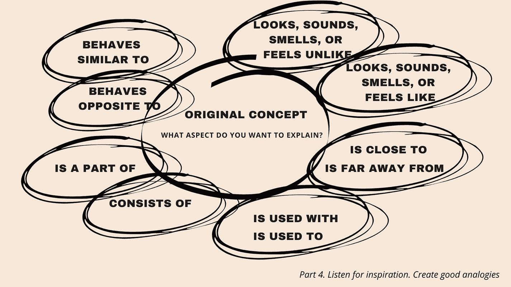

特征与原始概念之间良好类比关系的结构图。一个好的类比是在两个冲突目标之间达成的平衡，例如，对某个想法的好恶。

**图 18-1** 好的类比

使用类比需要良好的记忆力、同理心和批判性思维，以便在介绍新想法时能唤起熟悉的“相似”和“不同”。这有助于在进行反馈对话时，提前准备好能描述核心概念的类比。诸如“让我给你打个比方……”、“这就好比……”、“这与……是一样的”、“这和……没什么不同”等表达方式，都是很好的开场白。

室内游乐场的主人本可以将那次反馈对话视为从客户角度探索可行服务的机会。例如，他们可以问：“把这个游乐场想象成你孩子大脑的健身房。你会希望有哪些服务？你愿意为此支付多少钱？”

总而言之，只要有机会澄清或探索具有挑战性的想法，就要敢于使用类比来帮助他人更好地理解你，并让他们成为你产品开发的协作者。

**可选练习 7：掌握类比**

*想想工作中三个主要概念。它们是物体、活动还是过程？它们最重要的特征/功能是什么？你能将它们比作什么日常物体、活动或过程？*

*你下次计划的会议是什么时候？什么时候是引入你精通的类比的好时机？*

脚注 1 2 3 4 5 6 7 8

## 19. 听出想象力

> *当我不必与人交谈时，我的想象力运转得更好。*
>
> ——小说家 [帕特里夏·海史密斯](https://www.goodreads.com/author/quotes/7622.Patricia_Highsmith)

大多数时候，我们认为想象是一种头脑活动，当你独自思考时，它会不受阻碍地流动。本节讨论如何在反馈对话中让我们的想象力发挥作用。用类比说话，是基于将你听到的内容与你已知的知识联系起来，以更好地解释当前的想法。听出想象力，则是关于将你听到的内容转化为一种可能性。它关乎利用一个触发点来问“如果……会怎样”的问题，向未来的情景敞开思维。

### 何为想象力？

莎士比亚曾写道：“整个世界是一个舞台，所有的男男女女不过是演员而已。”^(²³⁸) 不仅如此，每个男人和女人都拥有内在生活，在其中他们创造自己偏爱的舞台，配有演员、冲突、资源和理想结局。

比较心理学的研究已识别出人类和动物共有的几种认知能力，如记忆、社会推理、物理推理、沟通和共情。^(²³⁹) 然而，构建替代情境、设想和推测未来情况的能力，是使我们区别于动物物种的显著特征之一，通常被称为“`想象力`”。

让我们以观察这张照片为例，来说明构建替代情境的能力。

一张红丝绒蛋糕的照片，上面写有文字“`爱自己`”，并点缀着一颗草莓和一颗樱桃，置于右手掌上的圆形碟子中。^(²⁴⁰)

你可以“看到”除了实际情况之外，还可能发生什么。想象一下自己咬一口这块蛋糕会怎样？会是什么味道？回答这些问题会让你考虑自己尚未经历过的行动方案。

此外，你可以预见到这些行动可能带来的后果。如果你尝到的是一块带有蛋白霜的樱桃蛋糕呢？你会喜欢面团柔软与蛋白霜酥脆之间的对比吗？凭借想象性思维，你可以进行`心理模拟`，推测可能事件的因果关系。你是否开始流口水了？你已经在想象中，或者说用眼睛“吃”下了这块蛋糕。享受这种感觉吧。如果你对这块蛋糕的图片无动于衷，那可能是因为你想象出的味道并不合你的口味。

想象力并非凭空产生。它是由对你具有重要意义的内外部因素触发的。它汲取过去的经验和知识，并受改变、发现或在物理世界中创造这一欲望的驱动。^(²⁴¹) 你现在是否在考虑烤一个合自己口味的蛋糕？一旦你识别出一个与自身产生共鸣的未来情境，你就会受到激励，将其变为现实。

窥探人脑的结构，我们可以在默认模式网络中看到想象力的痕迹。默认模式网络是一个连接左右半球的脑神经网络，用于编码和检索个人信息及假设性事件。一旦你将自己投射到一个未来情境中，它便成为你的一部分，即你的`情景预见能力`。它为你内在舞台剧的剧目库增添了新的内容，让你对未来充满希望或恐惧。因此，你可以重温一个偏好的未来构想，并在决定将其变为现实时加以改进。假如你在蛋糕里加些酒呢？

除了回忆过去和展望未来，想象力在默认模式网络中还有第三个关键方面，即考虑他人的想法和观点。^(²⁴²) 如果有孩子想吃一块蛋糕，你还能加酒吗？

综上所述，我们将想象力定义为：一种摆脱过去所作所为的束缚，立足于当下，以便为造福群体而探索可能未来的能力。

#### 想象力等同于幻想吗？

对于德国诗人、哲学家和科学家歌德而言，幻想是直觉体验世界、观察自然隐藏机制的先决条件。那么，让我们来直面这个显而易见的问题。当你想到想象力时，脑海中会浮现哪些同义词？想象力与幻想在多大程度上可以互换？

从最终结果的角度来看，想象力基于这样一种能力：在特定的时空里，思考某个尚未成真但具有成为现实潜力的事物（如事件、概念、产品）。当一个想象的事件（如社会变革）成为趋势时，追随者将直接体验到它。一个想象的产品可以成为原型或创新，被受众所使用。

幻想则是小说作家所擅长的，他们通过自己的技艺创作故事和人物，让读者在阅读书籍的过程中与之产生关联，并将自己投射到相应的世界中。因此，幻想源于思考某个感觉真实的事物（如事件、物体、人物）的能力。尽管如此，它在特定的时空里并不具有物理形态。这种真实感源于创作者和读者脑海中唤起的心理意象和情感。

当读者读完一本小说时，故事和人物依旧停留在纸面上。有些可能会在读者记忆中逗留更久，但迟早会在现实的人际互动中被有血有肉的真实人物所取代。而对于作家来说，新的幻想正在等待他们。

因此，幻想是想象力的一种形式，是某些行业（如艺术）中至关重要的一种思维类型。艺术家达莎·皮尔斯小时候就画满了精灵和怪异生物的世界。她对窗外的风景或其他事物不感兴趣。成年后，她通过超现实主义艺术摄影重新找回了童年的兴趣，她不仅捕捉她眼中的世界，还想邀请人们进入她的超现实世界。

*“超现实主义艺术摄影意味着，你在我的艺术中看到的，并非你能在周围的客观现实中看到的，”*达莎说，*“基本上，我的艺术会让人们感到惊喜。里面总会有这种超现实的元素。”*

为了在你非艺术的领域中享受想象力的多种益处，你不应该错误地将幻想等同于想象力。^(²⁴³) 不过，如果幻想对你来说是自然而然的思考方式，你也不应刻意避免。例如，如果你是游戏程序员，你可以尽情幻想，为产品构想出一个引人入胜的愿景。假设你是一名研究者，对研究课题有一些假设。那么，总的来说，这些关系最终需要在受物理原理和人类文化支配的宇宙中被证明是有效的。

总之，幻想是想象力的一种类型，在艺术和非艺术领域的构思阶段都大有裨益。^(²⁴⁴) 此外，想象力还有其他形式。^(²⁴⁵) 关于不同类型的想象力，你需要了解些什么，以增强你在物理世界中进行创造的潜力呢？

#### 三种催生新想法的想象力活动

有两种想象性思维能将我们带离“现状”，走向“可能”：`心理意象`——通过图像、身体动作或其他感官模式（如嗅觉或听觉）进行想象——以及`反事实思维`——将已发生的事件与假设事件进行对比。这些思维模式在以下三种心理活动之一中被激活：`白日梦`、`思绪漫游`和`视角转换`。

作为补充说明，还有其他涉及意识状态改变的想象力活动，其中一些是功能性的——做梦、冥想、使用致幻剂——而另一些则功能性较弱——幻觉、妄想、灵魂出窍体验。^(²⁴⁶) 本节不讨论这些改变的意识状态中的想象力类型。

##### 白日梦

想象一个你喜欢的地方。想象一个你爱的人。想象一段最近的快乐回忆。这些都是白日梦的例子，它是一种能唤起情感、身体知觉、声音或味觉的想象。你可以独自进行，也可以和一群人一起进行。例如，你可以决定独自在办公室里做白日梦，作为工作间隙的休息。或者，你也可以在工作坊中做白日梦，由引导者带领你获得更丰富的感官体验。

在白日梦中，注意力向内引导，并伴随着与当前情境无关的自发性思绪（即刺激独立性）。你的情绪、意图和注意力焦点是白日梦的关键要素，这些要素能有益于创造过程。^(²⁴⁷)

一种常见的白日梦方式始于自发地选择一个特定的地方，一个让你感到放松、安全或愉悦的地方。你想象自己参加一个期望会有积极结果的活动。你看到自己在与人们交谈。从这一刻起，你的想象便不受限制。你着手构思各种行动——你自己的和他人的——以及那些有助于达成期望结果的细节。

例如，在反馈会议之前，你可以在脑海中预演不同的场景，思考如何开启对话。接着，你可以模拟你可能会被问到的问题以及你能提供的答案。同时，你也可以对着镜子排练，当你听到一些不如预期乐观的反馈时该如何反应。最后，你可以想象当你的想法得到认同时的那种良好感觉。

## 思绪漫游

思绪漫游与白日梦相似，因为它也需要内在集中的注意力。但与白日梦不同，神游始终是一种独自的、自发性的活动。这不像你可以决定：“好了，现在似乎是进行思绪漫游的完美时机。”然后你坐在沙发上，有目的地沉浸于特定的思绪中。

对于有创造力的人来说，神游可能发生在围绕某个感兴趣的问题进行密集的知识获取之后。你无法选择思绪漫游，而是思绪漫游选择了你。当你从事一些不太费神的事情（例如打扫房间）时，你的注意力会不由自主地飘向对你个人意义重大的想法。然而，思绪漫游是一种常见的心理状态，它也可能发生在你从事更费神但不太有趣的任务时，比如阅读一份枯燥的工作报告。^(²⁴⁸) 你的大脑会突然决定，理解你正在读的内容并不那么重要。

从你当下所做的事，到你的大脑在那一刻认定最相关的话题，这种自动切换会导致一种元认知暂时失效的状态。你会失去对自己所思所行的觉察。一方面，你可能会错过屋里某处的灰尘，或报告中的某些信息。另一方面，你可能梳理清楚了一些关于你大脑无意间所想之重要事务的问题。

总而言之，思绪漫游源于解决个人重大事件的渴望，例如一个具有挑战性的创意问题。它为“啊哈”时刻的到来提供了一个酝酿阶段。

说个有趣的事实，在我写这本书时，我儿子经常问：“妈，你在生我气吗？”每次我都回答：“没有，我只是在想事情。”所以我知道自己思考时的表情是什么样子。我也不敢说自己在孩子面前心不在焉是件值得骄傲的事。但思绪漫游就是这样，它让人无法抗拒。

## 换位思考

`换位思考`是一种能力，指通过不同的视角来思考某个特定概念或情境，例如他人的观点、时间的变迁或真相的不同呈现形式。采纳他人的视角，也被称为`认知共情`，涉及理解他人可能对这个概念或情境了解什么的能力——他们的经历、情感和知识。而考虑时间与潜在假设，换位思考则要求具有改变心智框架的灵活性，将自己置于由不同规则支配的遥远过去或遥远未来的情境中。

`换位思考`可以独自进行，也可以在对话中进行。它可能不自觉地发生。有时，它也可以是有计划地、在另一个人在场的情况下进行。

这三种想象活动——白日梦、思绪漫游和换位思考——可以根据三个关键要素来区分：

1.  **想象活动是如何在脑海中启动的？** 我们可以有**自发**或**刻意**的想象片段，它们分别在没有或有我们意识引导的情况下发生。
2.  **进行想象活动的个人身处何种社交环境？** 我们可以进行**独自**或**社交性**想象，它们分别在没有或有他人积极参与的情况下发生。
3.  **想象活动的刺激物是什么？** 我们可以体验到**想象的感觉活动**，这种活动基于在缺乏适当刺激时感知事物的能力，例如在四周寂静时想象听到某段旋律的声音。或者，我们也能体验到**创造性想象**的片段，它包括通过联想或分离来对想法进行自发的组合，刻意否定至少一个被普遍认为是真实层面的方面。

以下摘自马塞尔·普鲁斯特的《追忆似水年华》的片段，说明了当下的感官刺激——一种熟悉的味道——如何不由自主地触发角色的童年记忆。

```
就在我认出了那浸在她给我的椴花茶里的小玛德莱娜蛋糕的滋味时（尽管我还不知道，而且必须等到很久以后才发现为什么这个回忆会让我如此快乐），刹那间，我那栋临街的、她房间所在的灰色旧屋，就像舞台布景一样升起来，与为父母建在后面、对着花园的小楼连在了一起…… 恰如日本人玩的那种游戏，他们把一个瓷碗装满水，浸入一些小纸片，那些纸片在浸湿之前毫无特点和形状，可一旦浸湿，它们就会伸展、弯曲，染上色彩，显出独特的形状，变成花朵、房屋或人物，变得清晰可辨，同样，那一刻，我们花园里和斯万先生公园里所有的花朵，维冯纳河上的睡莲，村里的善良人们和他们的小屋，教区教堂，以及整个贡布雷和它的四周，一切都有了应有的形状和实体，城镇和花园，所有这一切，都从我那杯茶中浮现了出来。
```

此外，一种强烈的感觉——视觉的、听觉的、运动的或嗅觉的——若与过往经历结合，可能催生采取新行动的欲望。正如玛德莱娜蛋糕的味道能带回童年时期小镇和人们的生动细节一样，它也可能引发对未来的一瞥，比如住进新家或与久违的朋友重逢。这样一来，这部小说便会拥有不同的情节和人物发展轨迹。

# 排版后的内容

除了感官触发因素外，想象行为也可能由对公认真理的隐藏假设的突然识别所触发。这种令人惊讶的发现激励创作者付出努力，在某个社群或知识领域中引入新想法。²⁴⁹ 以下照片是传递幽默想法的创造性想象的两个示例。

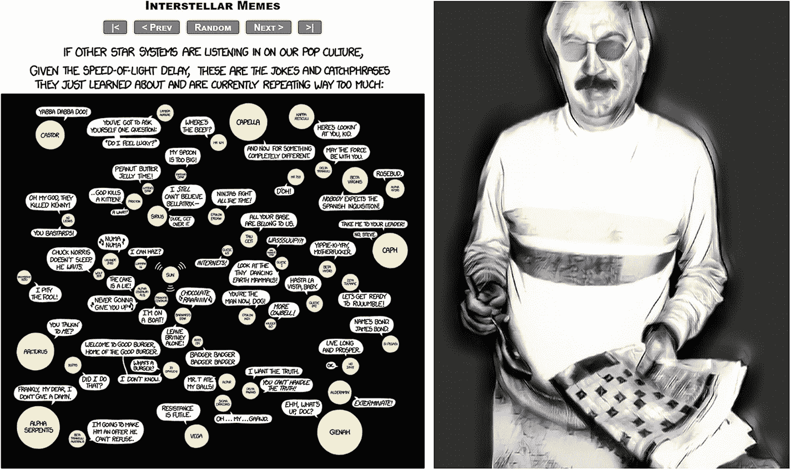

一张照片：左侧是《星际迷因》，右侧是一位老人假装失明，手拿笔在填写报纸上的填字游戏。

在左侧，我们可以看到 xkcd 漫画《星际迷因》，其中在每个星系中都有一些居民，他们拾取地球上不同年代的流行文化短语。就大多数天文学家共享的现实而言，目前普遍认为地球是唯一存在生命的行星。

在右侧，我们可以看到这样一个场景：主人公假装成一位失明的人在填写纵横填字游戏，而实际上他并非如此。你注意到他打算用来填写谜题的“那支笔”了吗？

总结一下，如果声音、身体动作或一块玛德琳蛋糕碎屑触发了感官想象，那么扭曲的现实规则则触发了创造性想象。最终，这两类刺激都能引发创意。自发性与刻意性、独处性与社交性、感官性与创造性想象，描述了三种想象形式（白日梦、走神和观点采择）发生的时间和方式。哪一种对你来说更自然？

白日梦和走神活动主要是感官意象活动。另一方面，观点采择主要是一种反事实思维类型的想象。在下一节中，我们将讨论观点采择如何能够滋养参与反馈对话者的想象力。

### 对话式想象

在本节中，我们不会过多讨论白日梦和走神——尽管它们在创意过程中是激发创造力的强大练习。相反，我们希望理解如何通过影响参与者心智框架的转变来激发想象性思维。因此，我们将详细阐述“对话式想象”，我们将其定义为：生成自发性反事实问题的能力，这些问题将对话推向一个假设性层面，在此你和你的对话者共同探讨可能挑战当前对讨论主题理解的未来可能性。

从神经认知的角度来看，对话式想象需要默认模式网络、认知控制网络和语义认知网络之间的相互作用。换句话说，当你倾听关于你原创作品的反馈时，你会无意识地将你所听到的与你所知道的、你所做的以及你未来计划要做的事情进行比较。这种比较可能导致新的愿景或对当前实施策略的修改。

`心理时间旅行`、`角色扮演`、`对比信念`和`证伪假设`是你可以有效处理已知信息并改变对讨论要点的看法的策略。

#### 时间视角

心理时间旅行是一个很好的策略，它提醒我们：今天被认为理所当然的事物，在昨天可能曾是革命性的想法或物体。让我们思考以下谜语：

“有一种古老的发明，至今仍被世界许多地方使用，它能让人们穿墙而过。它是什么？”

你上一次仔细观察一扇门并想“哇，这扇门真了不起”是什么时候？每天，我们匆忙地打开和关闭那么多铰链门或推拉门，几乎从未想过它们尚未存在的时代。更有可能的是，你使用或听到过这样的隐喻表达，如“在每一段关系中，我都会留下一扇敞开的门”，或者“你永远不知道紧闭的门后会发生什么。”

在生活的其他各个方面，过去和未来都通过当下的创造性想象连接起来。以下是一些对话式想象的例子，它们可能引发围绕“我的产品的优势是什么？”这一问题的习惯性思考：

* “如果我在一年前问你这个问题，你会怎么回答？”
* “如果我在十年前问你这个问题，你会怎么回答？”
* “如果我在五年后问你这个问题，可能的答案是什么？”
* “如果我在十五年后问你这个问题，可能的答案是什么？”

你并不是期望从对话者那里得到正确或错误的答案。相反，目标是放松对经验和知识的执着，避免固守于你所知道的或评估者的立场，从而为你的创意项目中的新行动可能性腾出空间。

每个人都能“看见”未来的可能性，只要花时间反思诸如“十年前我觉得不可能、而如今已成为我日常生活一部分的事情是什么？”这样的问题。

#### 进行角色扮演

模仿他人可以让你摆脱固守某一观点的困境。角色扮演——即灵活地设身处地站在他人的角度，并表现得如同你就是那个人——是一种有益的练习，可以生成与关注主题相关的新的解释和视角。

在反馈对话中，角色扮演可以通过“如果……会怎样”的问题来启动。假设你与一位有创业背景的人交谈，你可以问：“如果阿里安娜·赫芬顿在这里，她会做什么？”或者“如果埃隆·马斯克在这里，他会想什么？”如果评估者是一位物理学家，你可以问：“如果斯蒂芬·霍金在这里，他会想什么？”或者“如果理查德·费曼在这里，他会想什么？”

以上提到的名字可能你一个都不熟悉，这没关系。前面的例子强调了榜样个人意义的关键方面。当你想要激励某人对一个问题进行不同思考时，需要从说话者和听者共同熟悉的专业领域中挑选榜样。他们需要具有相关性，以激发跳出框架的思考。

有效的角色扮演参与会导致思维框架的改变。这意味着你从思考“2 + 2 的和是多少？”开始，最终转而思考“哪些数字加起来等于 4？”可能是 `-1000 + 1004`，`1 + 1 + 2`，`-1 + 5 + 0`，还是 `1/2 + 7/2`？

#### 对立的信念

当一位值得信赖的人评价你的创作时，其观察会打开一片充满可能性的空间。假如对话者恰好发现了一个能成为你项目成功关键之处的细节呢？当然，现实中没有人（哪怕是先知）能为你提供所有答案。然而，为了拓宽你对项目现状的认知，你不妨将他人意见视作一场对立观点的博弈。

当评估者的信念与你对事实的认知产生冲突时，你可以选择进入一种思维模式——将对方的陈述视为假设。假如对话者的观察是正确的，即便你心存疑虑呢？那又会怎样？`“如果……那么”`的思维模式能打开心理空间，让你探究那些本不会出现在脑海中的深层问题。（见图 19-1。）

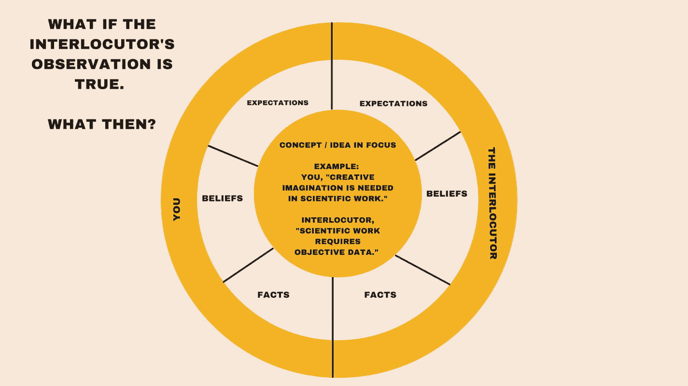

这个圆形示意图聚焦了这一理念，并将其归类为期望、信念和事实，用以判断观察是否属实。

**图 19-1**

`如果——那么思维`

让我们通过角色扮演来设想：你是一名年轻的天文学研究者。下班后，你和另一位研究员同事去喝啤酒。席间，你提出了这样一个问题：*“在你所做的工作中，需要运用多少想象力？”*

与这个问题相关的任何观点背后，都隐藏着一套复杂的组合：（1）关于什么才是道德上正确的科学思维的信念，（2）对有助于产生研究想法的行动的期望，以及（3）证实这些信念和期望有效性的事实或经验。

你的朋友态度坚决。在研究中使用想象力是一种亵渎。随着讨论深入，他讲述了自己曾沉迷于想象性思维来撰写研究计划书的经历。遗憾的是，那最终成了一场徒劳无功的追逐，还错失了一次资助机会。

你该如何回应？这正是运用`“如果……那么”`思维的好时机。如果他的解读是正确的——即研究计划书需要的是可验证的数据——那么对你“想象力对天文学研究者至关重要”的信念而言，这意味着什么？

`“如果……那么”`思维会引出更多问题。如果科学研究确实提供客观数据，而对你来说，想象性思维又是一种天生能力，那么问题就来了：*“在研究过程中，想象的可能性需要在哪个节点转化为描述宇宙机制的数学公式？”* 这意味着，无论你多么想在研究中检验那些富含想象力的想法，最终的研究成果都必须得到数学上严谨的公式支撑。

这个场景说明，你越允许自己与他人观点碰撞、灵活思考，心中关于自身项目的问题就会越多。在对话的这个阶段，不知答案时提出问题的能力，比已然拥有答案更为重要。假如你的天文学研究项目最终变成一本科幻小说呢？那么，你的想象力又需要忠实于何种真理？

关键在于，在任何创作领域，接纳评估者的信念并将其与你自身信念融合，都会导致概念上的拓展。你会提出那些能让你的观点发生意外转折的问题。而当你决定寻求答案时，这些问题将接受现实的检验。

**可选练习：** *回想最近一次你与某人观点分歧的讨论。对方使用的主要论点是什么？*

*在整个练习过程中，请试着搁置你的判断。从那个假设出发，完成这个句子：“如果这是真的，那么这改变了我对 ________ 的看法。”*

*“如果这个改变是真的，那么它改变了 __________。”*

*请将上述过程重复三次。第五个假设看起来是什么样？接下来，你最感兴趣的是什么？是重新审视你的一些初始信念？还是阅读更多能强化其中某些信念的信息？*

*通过这个练习，你可以验证哪些信念对你至关重要，以及哪些信念你愿意重新审视。*

#### 推翻限制

> *“我能做到任何我能想象的事，而且我认为这能为受众带来最佳价值。”*
>
> — 独立创业者兼作家，彼得·伊万诺夫

在对话中激发想象力思维的第四种也是最后一种策略，是推翻限制，即注意并否定基本事实的能力。事实真的如此吗？在物理世界中进行创造和创新都基于种种限制。这些限制，比如客户的需求或竞争对手的供给，都是创作者（尤其在商业、技术、健康和科学领域）运用想象力的锚点。

限制建立在假设之上。例如，当一位企业家思考为受众提供最佳价值时，其中隐含的假设是受众知道自己需要或渴望什么。客户真的知道自己需要什么吗？“假若”这类问题能将关于现实的假设转化为一种替代情境的推演。

*“假若客户并不知道呢？假若我创造出一款客户会觉得出乎意料地有用的产品呢？那会是什么样的产品？”*

*“假若我现有产品的价值可以延伸到那些我尚未涉足过的客户群体或地理区域呢？”*

于是，对彼得来说，新冠疫情的爆发为获取更广泛的客户群打开了机遇之门。考虑到他在管理虚拟远程团队方面的专长，当全球企业开始居家办公时，他已准备好提供解决方案，帮助他们在新的虚拟环境中驾驭协作。

# 第四部分：想象未来与对话艺术

“假若这个限制并非限制呢？”这类问题可以激发你的思维，前提是你愿意暂且放下现有计划几分钟。^(²⁵⁰) 更多前瞻性问题能够引发心智模拟，其起点是识别并拓展关于关键最终用户、知识、技能、可用资源或预期事件（政治、社会、技术、经济等方面）的假设。

*哪些*可能是即将发生的重大社会变革？
*有哪些*可能的解决方案你可以创造？
*它们*为谁而设？
*受益者*会在哪里享受新产品？在工作中还是闲暇时？在他们生病时还是学习时？当他们去太空旅行时？等等。
*需要哪种*产品与用户的互动？物理的、数字的，还是混合的？
*产品*何时能准备好？今年，两年后，等等。
*开发这样一款产品*需要哪些资源？
*你将在何种环境中*工作？物理环境、在线环境，还是两者兼有？

对前述问题的回答中，都嵌入了基本假设。我们以资源为例。你会用什么资源来开发新产品？可能有两种假设。你可以认为所有资源都在公司内部，或者你指望与能提供缺失资源的外部承包商或专家签订协议。在任何自由市场中，都存在竞争。典型的商业思维是，必须靠更聪明的策略击败竞争对手，对吧？然而，是否存在某种方式可以打破这一原则呢？假若某个竞争对手能够帮助提供开发新产品所需的部分资源或工作呢？谁会感兴趣，又为何会感兴趣？

这些答案可能会催生出新的解决方案和行动，这些方案和行动不同于过去所采取的方式，从而导向创新产品。

在反馈对话中，你可能会遇到对话者提出某些担忧的情况。例如，可能涉及到方法论、预测、客户接受度等问题。这些担忧正是需要处理的限制。

首先，要挑出背后的事实。然后，邀请评估者一起进行假设性的探索。“我明白你的担忧是基于这个事实。但假若情况恰恰相反呢？”讨论替代现实可以加深你对自身创造过程中“可供性”与“偶然性”的元认知。反事实思维对于你的创造性思维而言，就如同种子之于肥沃的土壤。当时机成熟时，它们会催生出一条切实可行的行动路线。

简而言之，想象未来现实的第四种方式，就是去探究那些你和你的对话者视作限制的事实与信息。而且，你无需等待下一次类似新冠的危机才去想象可能发生的事。只需在接下来与合适之人的对话中去探索即可。

## 想象力的误会幽默能挽救对话

2001 年，实验心理学家理查德·怀斯曼与英国科学协会合作，开展了一项科学搜寻，意图找到全世界最搞笑的段子。^(²⁵¹) 在收到 4 万个段子，并由来自 70 个国家的 35 万人评分后，以下这个段子荣登最搞笑榜首：

> “两个猎人走进森林，其中一人突然倒下。他似乎停止了呼吸，双眼呆滞。另一个人掏出手机，拨打了急救电话。
> 他气喘吁吁地说：‘我的朋友死了！我该怎么办？’
> 接线员说：‘冷静，我能帮你。首先，我们得确认他是不是真死了。’
> 电话那头一片寂静，随后传来一声枪响。
> 接着那人又拿起电话问：‘好了，接下来怎么办？’”

这个段子是由一位英国精神病学家提交的。当怀斯曼联系他时，他解释说，自己常讲这个段子来逗病人开心。当人们听到有人总是做出比自己更蠢的事情时，会感觉好一些。

这两个猎人的段子展示了一种现象：基于误解的假设所形成的想象力，是如何驱使我们在千分之一秒内就行动起来，而毫不怀疑我们听到的内容是否正确。

让我们再看看怀斯曼寻找最搞笑段子过程中的另一个获奖作品，这次是“知名科学家提交的最佳段子”类别。这个段子由诺贝尔奖得主、化学教授哈里·克鲁托爵士提交：

> “一个男人在街上走，看到另一个人牵着一条非常大的狗。男人问：‘你的狗咬人吗？’
> 另一个人回答：‘不，我的狗不咬人。’
> 第一个人于是拍了拍那条狗，手被咬断了，他大喊道：‘你刚不是说你的狗不咬人吗！’
> 另一个人回答：‘那不是我的狗。’”

这两个男人谈论的是两条不同的狗。同样地，接线员和猎人对“首先，我们得确认他是不是真死了”这句话的理解也截然相反。

这两个段子揭示了这样一个秘诀：对他人的话产生想象中的理解如何催生幽默——当想象中的视角与话语实际所指的准确视角发生冲突时。幽默始于对一个事件或刺激的初步理解，随后在包袱部分出现与之矛盾的重新解读。^(²⁵²) 正如想象力为我们创造幽默那样，在日常对话中，想象力的理解也可能将我们导向建设性或非建设性的结果。

在对话中，当你误解了最初的信息刺激时，你的大脑会编造一个故事，这在你后续倾听说话者时会让你感到困惑。这就是**想象力鸿沟**——当你未能积极倾听时，你的大脑巧妙编造出的那个故事。^(²⁵³) 对话的质量因此大打折扣。你上次遇到这种情况是什么时候？你又是怎么做的？

在罗马尼亚文化中有句谚语：“聋子只听得见顺耳的话。” 人们很容易听错一个词，并在上下文中赋予它一个想象的含义。我们填补对方话语中空白的方式，往往是依据我们过去的经历、知识或个人预期。这种人类心智现象在 1954 年的美国文化中有了一个名字——**蒙德格林**。

作家西尔维亚·赖特在《哈珀杂志》的一篇文章中创造了“蒙德格林”这个词。她描述自己是如何听错 17 世纪民谣《善良的莫里伯爵》中的一句歌词。^(²⁵⁴) “他们杀死了莫里伯爵，将他放在草地上。” 和 “他们杀死了莫里伯爵，和蒙德格林女士。” 这两句话会让人产生两种截然不同的心理画面，不是吗？前者是原词，后者则是西尔维亚听到的版本。

当你在一次对话中开始怀疑自己要么听错了，要么误解了某句话时，这种觉察本身就带有潜在的欢愉性。如果你能把它提出来，你就抓住了一个机会，用一点点笑声和观点上的一致，来取代一次误解。

一次反馈对话是关于评估一个创意项目的完成度。对错误采取一种宽松但坦诚的态度，提醒我们要专注于对那些本可以做得更好的地方抱有宽容，并敢于探索那些可以采取不同做法的地方。

> “当我不必与人交谈时，我的想象力运作得更好，”小说家[帕特里夏·海史密斯](https://www.goodreads.com/author/quotes/7622.Patricia_Highsmith)写道。然而，当你与人交谈时，这种对话中的想象力会带来意想不到的想法，而这些想法在独处时是无法产生的。

## 第 4 部分总结

本书的第四部分也是最后一部分基于这样一个假设：在作为创作者的前两个发展阶段，你可能尚未完全掌握如何在自身兴趣与受众需求之间取得平衡。基于此，你或许需要与值得信赖的同辈、导师以及潜在终端用户展开一对一对话，以检验他们对你创作成果预期效用的看法。无论你是企业家、研究员还是创新专家，你的创作完整性都是反馈对话质量的指导原则。

带着创作完整性去倾听，意味着捕捉灵感和想象力思维的契机。与此同时，带着创作完整性去倾听还涉及运用幽默来围绕严肃话题营造轻松氛围。用幽默的方式说话并不会削弱对话的重要性。恰恰相反，它能带来令人耳目一新的间歇，让你重新审视那些关键细节。

短暂接触幽默评论能激发创造性思维。幽默的运用不仅是跳出框架思考的指标，更是其催化剂。幽默理解能力越强，接收者的创造力就越高。因此，幽默是一种能在对话中提升问题解决能力的创造性思维形式。

我们日常体验到的幽默中，约有 70% 来自即兴对话式幽默。它包括讲述关于自身经历的趣闻轶事或评论。在本书中，我们讨论了构建幽默的基本要素——这些要素本身并无幽默感，但付诸实践时，能激发你妙语连珠的潜能。

有些人——如脱口秀演员、演员、作家——天生具备让大量观众发笑的才能。而有些人身边总会聚集家人、朋友和同事，因为他们善于从平淡无奇的事件中发现并表达有趣的一面。你也是如此。你是一位创作者。你的目标是提升自己的言语幽默感，以便在整个反馈对话过程中保持开放心态。你可以通过三个步骤来实现：变得有趣、做好准备、灵活把握发现并适时说出趣事的时机。

首先，培养一种愉悦的自发性，帮助你以有趣的方式重新诠释日常经历。其次，在对话的关键节点运用幽默：定义概念时、重新措辞时或总结观点时。第三，学会敏锐感知他人对你幽默感的接受程度。幽默既能拉近距离也能疏远关系。我们高度珍视那些擅长逗我们发笑的人，但也会疏远那些言辞可能伤害我们的人。

哪种幽默感更可能被视为无害？无论你与家人朋友开玩笑的风格如何，也无论你的职业地位怎样，在对话中使用能提升他人关系价值或降低自身价值的幽默，都是一种富有同理心的选择。基本原则是：“嘲笑**自己**，而不是嘲笑**他人**。”

反馈对话是一个获取更多信息的良机，其信息量远超你原本可能接触到的范围。你和对话者越是对各种想法保持开放态度，就越能产生具有建设性的创意。在对话过程中，有些时刻敞开心扉接受新想法是自然而然的事。然而，有些时候，作为对话的引导者，你需要刻意努力来维持对话的开放性。

运用类比可以帮助你更清晰地传达抽象、复杂或难以理解的概念。然而，务必确保不要进行“苹果与橙子”式的比较，以免进一步混淆听众。概念越复杂，构建一个恰当的类比就越重要。我们探讨了创建有效类比的三个规则：为模型概念选择熟悉的领域、检查两个被比较概念各自的内部一致性，以及确保比较本身的有效性。

从大脑处理过程的角度来看，使用类比会触发你听到的内容与已知知识之间的关联。另一方面，带着想象力去倾听，则是将听到的内容转化为一种在当前环境中尚未被察觉的可能性。

在所有想象形式中，我们重点关注了“对话式想象”，即生成自发的反事实问题，将讨论带入假设层面的能力。其目的在于在选定一个可能实现的场景并将其转化为现实之前，转变对可能、可行或不可能未来的视角。心理时间旅行、角色扮演、信念对比和假设证伪，是将讨论引入假设层面的四种策略。

心理时间旅行可以提醒我们，今天习以为常的事物——比如一扇门——在过去曾是革命性的发明。通过角色扮演，我们可以模拟具有相关背景和经验的其他人物。将评估者对某个观点内在真理的信念与你自己的信念进行对比，可能会引发概念扩展，从而开启对未曾预料到的可能行动的心智。事实果真如此吗？

假设证伪是对话式想象的第四种方法，它能揭示现有项目的局限性。企业家可以根据客户需求来构建产品。但如果客户自己都不知道想要什么呢？“如果……会怎样？”这样的问题能将事实转化为一个替代情景的演练。如果不是客户，那么还有谁能更准确地预见社会变革呢？

挑战关于你所在时代可能性的假设，可以让你看到替代性的未来情景。在最坏的情况下，它们能验证你的未来计划。在最好的情况下，这种想象力练习能够催生出下一个创新产品。

“想象缺口”——例如“你的狗咬人吗？”这类误解或“空耳”体验——为本书的这一最后部分画上句号。对话的讽刺之处在于，我们误解他人的频率远超我们的想象。因此，当你意识到自己脑海中构建的故事与说话者所说的内容不同时，在对话中提及这一点会很有用。

当你敢于说出你自以为听到的内容与对方实际所说内容之间的有趣差异时，你便展示出自己在用心倾听。当你们一起开怀大笑时，你们便在共同创造新的想法。即便没有其他收获，你也能因坦诚而在倾听者心中加分，从而维护彼此关系中的信任。

脚注 1 2 3 4 5 6 7 8 9 10 11 12 13 14 15 16 17 索引 A 抽象摄影/花卉栽培 文化适应 强烈兴趣 亲和型风格 攻击型幽默 认同微笑 顿悟时刻 类比挑战 丘吉尔 日常物品 例子 特征与模型/原始概念 好主意 先天差异性 笑话/幽默 男性同行 大师 塞尔兹尼克 共享功能 相似之处 说话 动物图案 艺术创造力 艺术表达 艺术过程 艺术家 艺术疗法 自主性 意识 B 信念 大 C 创造力 生物医学工程 金发女郎笑话 身体中心教练 以身体为中心的决策过程 自下而上的注意网络 企业 C 塞鲁洛教授，文森佐 童年记忆 丘吉尔的类比 认知能力 认知控制网络 认知共情 集体自我 喜剧训练 沟通 实验阶段 实施阶段 新想法 社区活动 比较心理学 成分理论 作曲 概念拓展 有意识的创造性自我发展 意识 一致性 约束 建设性对话 对话 对话式想象 反事实问题 反事实思维 创造 创造性行动 好奇心 创造性多样性 假设 创造性人格 创造性技能 好奇心 参与脑力练习 原则 阅读书籍 回忆 短暂散步 技术问题 测试 思考习惯 工作环境 创造性天才 创造性“我” 创造性身份 创造性想象 创造性冲动 活动 分析性问题解决 方面 意识 体验 想法 诱惑 主动性 人群 焦点 研究方法 自我表达 类型 创造性正直 创造性意图 创造性直觉 创造性受挫 成就型创造力 比较，创造力 顺从型好奇心 定义 被误解 量表 有创造力的人 创造性个体 创造性问题解决技能 创造性过程 大脑设定 神经过程 支柱 自我发现 步骤 创造性特质 创造性自我 创造性自我意识 创造性自我发展 创造性自我认知 创造性敏感度 创造性敏感性 创造性思维 大脑区域 脑电波 创造性任务 默认模式网络 执行网络 表达内在体验 神经描述 积极行动 突显网络 场景 触发 用途 创造性工作 创造力 活动 艺术 偏见 教室 采用 行为 条件 学习任务 动机 机会 人格特质 教学 定义 抑郁 体验 表达自己 外部反馈 性别刻板印象 参见“性别刻板印象” 想法/概念 音乐/诗歌 障碍 组织 结果 个人优势 亲阶段 关系 自我认知 情境 故事 事物/实验 触发 信任 创造力专家 创造力原型 适配者 男孩 对比 女孩 大脑功能 有创造力的个体 创新者 不顺从者 特质 创造者角色 创造者 能力 建筑师 方面 沟通技巧 社区建设技能 作曲家 创造力专家 定制 定义 企业家 经验/知识 希望 人类存在 冲动 洞察力 机会 摄影师 公开演讲 责任 销售工程师 科学家 工作倾向 创造者之旅 创造者的可选技能 批判性思维 文化转型 好奇心 童年活动 成分理论 概念性问题 情感益处 引人入胜的体验 实验 表达 频繁学习片段 想法 想象行为 较少使用的感官 细微的现实 过去表现模式 专业经验 专业领域 心理安全 感官输入 社交体验 来源 女性教育 好奇心 D 达莎的艰辛重塑 白日梦 依赖关系 设计新疫苗 侦探帽 对话 破坏性活动 行动 益处 内部转变 思维 邓克尔问题 E 教育目标 有效参与 起泡的 弹性嬉戏 脑电图（EEG） 内嵌态度 情感能力 情感唤醒 情感可用性 艺术沉浸/艺术天赋 认知灵活性 创造过程 创造力专家 创新 自然选择压力 负面情绪 社交活动 情商 情感敏感性 情绪 同理心 丰富化类比 企业家 创业 环境线索 既定创造者 实验性创作 解释性类比 扩展类比 外在成功 F 法格霍尔姆，企业家哈丽特 公平感激活 推翻假设 推翻约束 熟悉度 幻想 恐惧 反馈对话 反馈对话 修复型角色 灵活性 基本假设 幽默评论 G 性别刻板印象 信心 创造力领域 期望 感受 健康运作 招聘情境 个体感受 动机 负面/正面效应 专业角色 评分 社会偏见 思维类型 慷慨 天才 亲和力 巧合 能力 创造者 文化背景 企业家 事件 物化 重塑 机缘巧合 几何晶体学 给予反馈 语法规则 感恩思维 感恩 直觉大脑 H 习惯性思维 哈蒙德故居 国际文学奖 头部大脑 半脑间沟通 人类细胞-大学类比 人际连接 人本主义哲学家 人类思维 幽默 行为 有益/有害 课堂 信心 创造 定义 发散思维 表达与欣赏 智力 体育活动 积极 拒绝 社会联系 来源 风格 思维能力 言语 工作 幽默语气 飓风 假设性思维 I 如果-那么思维 想象 活动 大脑网络 对话式 定义 幻想 强烈感觉 内部/外部因素 心理模拟 回忆过去 研究 资源/工作 感官行为 社会/单独 自发/有意 时间视角 想象差距 想象性思维 冲动 不协调 个性 先天差异性 创新产品 洞察力 灵感 特征 定义 体验 观察情绪 远程关联 本能直觉 正直心态 智力兴趣 智力敏感性 强烈好奇心 内部成功 个体内成分 内在动机 直觉 直观直觉 伊万诺夫，彼得 J 笑话 愉悦心情 K 键盘手 库皮艾宁，马蒂亚斯 L 笑 领导力沟通 在不确定中引领 学习周期 学习任务 最轻化学元素 轻降水 倾听 小 c 创造力 孤独 洛佩斯，图利亚 M 宏观文化力量 磁共振成像（MRI） 掌握技能 匹配内外敏感度 心理活动 心理意象 心理模拟 心理时间旅行 元认知 偏头痛 思维游荡 迷你 c 创造力 欢乐潜能 蒙德格林 情绪 动机 音乐家 N 纳米生物材料 负面情绪 负面事件 负面感受 负面情绪 神经系统问题 神经整合 神经科学文献 非艺术人士 第 N 次创造性见解 O 观察到的行为 职业创造力 不祥信号 溶瘤病毒疗法 开放微笑 P, Q 皮尔斯，达莎 个人与职业成长 活动 个人事件 人格特征 个人重塑 个人优势 采纳视角 说服客户 彼得·伊万诺夫的兴趣 摄影 身体感官 嬉戏/**愉悦** 政治关联笑话 积极情绪 积极事件 积极情绪 问题探索与识别 问题解决 专业 C 创造力 产品开发 职业发展 专业创造者 渐进式探索 精神能量 心理益处 心理激励因素 心理过渡 公开演讲 R 种族多样性 现实主义环境 接收反馈 识别阶段 宗教笑话 远程关联 重述 角色扮演 罗马神话 S 桑托拉利亚，奥斯卡 桑托斯，赫尔德 科学教育 科学家 次要技能 自我欣赏 自我同情 自我批评 自我欺骗 自嘲型幽默 自嘲风格 自我发现 自我怀疑 自我效能 自我增强风格 自尊 自我探索 练习 活动 职业策略 经历 角色 自我表达 活动 自我认知 自我感知创造力 自我价值 塞尔兹尼克的类比 语义认知网络 延伸连接感 敏感性 创造力 感知与注意力 类型 对环境中需求的认识 容易被感动 人际连接 智力敏感性 延伸连接感 身体感官的细微性 感官想象 感官触发 偶然的好奇心 偶然性 共享功能 短篇故事 相似性 社会行为 社会想象 社会神经科学 社会心理学家 社会责任 软件工程师 单独想象 演讲者-听众连接 刻板印象威胁 讲故事者 斯特拉迪瓦里 弦乐演奏者 主观感受 超现实艺术摄影 T 技术能力 十大基石 汤普森，帕梅拉 思想 时间视角想象 自上而下的注意系统 转变时刻 U 不熟悉的想法 联合国教育、科学及文化组织（UNESCO） 平常心态 V 言语幽默 虚拟环境 虚拟远程团队 虚拟团队管理 视觉敏感性 脆弱性 W, X, Y, Z 意愿 一厢情愿的思维 木管乐器演奏者 工作投入 工作空间 艺术技能 职业决策 创造性意识 创造性冲动 创造性思维 创造者 主导创意 工程工作 霍兰德模型 机构环境 职业 RIASEC 环境 自我颠覆习惯 自我表达 脚注 1 2