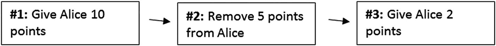

# 区块链

特别感谢 Vojta Drmota 为本章节撰稿。

*区块链技术*，有时也被称为*分布式账本技术*，是技术领域最新的创新之一。它在金融、法律、经济学、数学、哲学和计算机科学等众多领域都有应用。本章将介绍其基础知识。

## 区块链简介

现代技术的支柱之一就是数据的存储方式。由于可用数据量巨大，以易于日后访问的方式存储数据非常重要。你可能会选择用电子表格来存储个人预算，行列分明，便于直观浏览。许多拥有海量数据的公司将其存储在关系数据库中，这些数据库类似于电子表格，但也易于通过编程方式导航。*区块链*只是另一种数据存储方式。

存储在区块链中的数据被打包成*区块*，这些区块链接在一起形成一条线性链条：即区块链。可以将区块链想象成一本书，整本书代表区块链，每一页代表一个区块。区块链中的区块像书页一样编号，从第一个区块（称为*创世区块*）开始，一直到最后一个。这里的页码，代表了区块在区块链中的位置，被称为*区块高度*。书页大小统一，因此能容纳预定最大数量的单词。同样，区块链中的区块具有统一的数据存储容量，能存储预定最大数量的数据。

总的来说，读者在翻阅一本书时会认为有两件事是理所当然的。首先，读者认为书中应该有的每一页都确实存在。如果一个学生买了一本历史教科书，其中关于第二次世界大战的章节，甚至几页内容缺失了，那么这个学生就会失去关键信息。换句话说，我们期望相同版本的书籍包含完全相同的信息。这一期望同样适用于区块链。特定区块链的每个副本都必须包含所有相关的区块——从而包含所有相关数据——才能成为*有效*的。否则，共享一个区块链来存储数据的两方将会拥有相互矛盾的数据源。其次，我们认为书中页面的顺序是正确的。例如，如果一个学生试图理解二战的时间线，而关于战争结束的页面毫无逻辑地出现在战争起因页面之前，他就会被误导。由于数据通常遵循逻辑顺序，因此需要按逻辑存储。这也适用于区块链中的区块：包含你花费比特币数据的区块不能出现在包含你收到比特币数据的区块之前——那意味着你还没赚到比特币就开始花费了。因此，为了使区块链*有效*，区块的顺序必须保持不变。

区块链*有效*意味着什么？答案涉及区块链最初作为一种数据存储方式出现的根本原因。在区块链上存储数据并不能让一家公司比使用传统数据库存储更多的数据。在区块链上存储数据也不能让公司比传统数据库更高效地导航数据。那么，为什么会有人想要在区块链上存储数据呢？在区块链上存储数据的优势在于其独特的能力，即允许多个独立方将数据添加到共享的数据存储中。因此，区块链有时被称为*分布式数据库*。例如，十家维护疫苗接种记录的私营公司可以将这些记录存储在区块链上以共享数据，从而确保没有客户重复接种同一种疫苗。当参与公司中至少有一多数同意区块链正在适当地存储数据时，该区块链就是*有效*的。你将在本章后续部分了解到这具体意味着什么。


为什么这些公司不能共享一个由其中一家公司拥有所有权的中央数据库呢？它们当然可以这样做，而这正是区块链诞生之前的主要解决方案。然而，中央数据库解决方案有一个主要缺点：存在单点故障。如果负责管理服务器的公司意外关闭了服务器怎么办？如果该公司没有妥善备份数据库，导致所有数据突然丢失怎么办？如果该公司决定将另一家公司排除在系统之外，并单方面撤销其访问权限怎么办？换句话说，中央数据库解决方案要求所有参与方信任一个单一的中央权威机构。另一方面，如果数据存储在区块链上，则无需一个单一的中央权威机构来维护中央数据库的服务器。相反，这十家公司各自维护一份数据副本，并独立验证任何新增疫苗接种记录的有效性。这种无需依赖中央实体即可集体存储和检索数据的特性，被称为*去中心化*。参与区块链的每个个人或机构被称为一个*节点*。

### 区块长什么样？

*区块*是区块链的基本支柱。它们存储所有信息，并通过链接在一起形成区块链。区块链中的每个区块都由一个*数字指纹*表示，该指纹是该区块的唯一标识，可用于在区块链中明确无误地识别该区块。数字指纹的工作原理与人类指纹非常相似。人类可以通过其指纹被明确无误地识别，这意味着如果有人犯罪现场留下了指纹，调查人员可以利用这些指纹与数据库中先前收集的指纹进行比对。然而，仅凭指纹本身无法识别出这个人：指纹数据库需要包含指纹与其他身份识别信息（例如人名和面部照片）之间的映射关系。区块的数字指纹工作原理相同：无法从区块的数字指纹中推断出区块内的任何数据，但可以通过其数字指纹在区块链中明确地识别一个区块。这在检查区块链的某个副本是否缺少任何区块时非常有用。

除了自身的数字指纹和包含的任何数据外，每个区块还包含其前一个区块的数字指纹。区块链是一种线性数据结构，这意味着每个区块都被*追加*到另一个区块上，并且最多只有一个区块随后被追加到它后面。区块通过存储它们所追加到的区块的数字指纹引用来链接在一起，这也使得维护和验证区块的正确顺序变得容易。

数字指纹只是一个 64 字符长的十六进制数。以下是数字指纹的一个示例：

```
0f978112ca1bbdcafac231b39a23dc4da786eff8147c4e72b9807785afee48bb
```

*十六进制数字系统*与人类常规使用的十进制系统不同，它包含具有 16 个值（0–f）的数字，而不是 10 个值（0–9）。使用十六进制系统是因为它可以用比十进制系统更少的字符来表示更多的数字。这有利于数据存储效率。例如，十六进制系统中仅用三位数字可以表示的最大可能数字是`fff`。在十进制系统中，这个数字是 4095，这远大于十进制系统中最大的三位数 999。

### 挖矿的科学

*挖矿*可能是区块链技术中最难以捉摸的概念。让我们首先理解挖矿所填补的需求。回顾一下十家私营公司使用区块链共享其客户疫苗接种记录数据库的例子。没有中央权威机构，没有单独一家公司负责维护数据库并确保其中所有数据都正确存储和准确无误。相反，这十家公司各自审查所有传入数据并维护区块链的本地副本。如果没有中央权威机构来规定，这些公司如何就添加哪些数据以及丢弃哪些数据达成一致？参与区块链的这十家公司需要就添加哪些数据达成*共识*或协议。挖矿是多个节点之间达成此共识的一个过程。它首创于比特币加密货币，这是区块链技术的第一个广泛应用。比特币的挖矿过程将在本章后面解释，但在所有区块链中，挖矿过程的核心部分是创建区块的数字指纹。

数字指纹的创建涉及密码学，而密码学 heavily 依赖于数学。数字指纹是通过对区块数据运行*哈希函数*来创建的。哈希函数接收任何输入数据（通常是文本），对数据应用数学算法，并输出一个唯一代表输入数据的值。比特币区块的数字指纹是通过对区块数据运行 `SHA256` 算法（一种由美国国家安全局(NSA)设计的哈希函数）来创建的。`SHA256` 接收任意大小的数据作为输入，操作这些数据，并输出一个 64 字符长的十六进制数，称为*哈希值*。无论输入数据的大小如何，输出总是 64 个字符长。输入数据中的任何变化都会产生一个新的、唯一的哈希值，并且实际上，两个不同的输入不可能产生相同的哈希值。这使得检测区块数据是否被篡改变得非常容易。因此，一个区块数据的哈希值，通俗地称为该区块的*数字指纹*，被用作区块标识符。表[16-1]显示了一些从任意输入数据生成的数字指纹示例：

**表 16-1. 数字指纹示例**

| 输入数据 | 数字指纹：`SHA256` 哈希值 | 备注 |
| --- | --- | --- |
| `a` | `ca978112ca1bbdcafac231b39a23dc4da786eff8147c4e72b9807785afee48bb` | 一个字符产生一个 64 字符长的哈希值。 |
| `Blockchain` | `ef7797e13d3a75526946a3bcf00daec9fc9c9c4d51ddc7cc5df888f74dd434d1` | 一个完整的单词产生同样长度的哈希值。 |
| `Blockchains` | `99cf6497afaa87b8ce79a4a5f4ca90a579773d6770650f0819179309ed846190` | 单词中的一个微小变化会产生一个全新的哈希值。 |
| `The favorite number of the fox was 44.` | `f70d31700c3c122331538f9b389a10217e0bd1cc0694b67a5c7b4f02c17b6198` | 无论输入数据的长度如何，哈希值总是 64 个字符长。 |

你可能听说过挖矿是一个*计算密集型过程*。然而，从任何输入数据（如上述数据）生成哈希值只需要不到一秒钟的时间，并且可以在不消耗过多计算机资源的情况下完成。换句话说，生成哈希值本身*不*是一个计算密集型过程。使挖矿成为计算密集型过程的原因是，需要从输入数据中生成特定类型的哈希值，才能为区块创建有效的数字指纹。例如，在比特币区块链中，这需要从区块数据生成一个数值小于给定*目标值*的哈希值。关于挖矿过程的更多信息，可以在本章的比特币部分找到。


术语 `miner` 用于表示参与挖矿过程的各方。然而，“矿工”一词并不能很好地说明其工作的目的。矿工的主要目的是在缺乏中央权威的情况下维护区块链的有效性。如上所述，矿工需要经历一个计算密集型过程，才能找到新区块的数字指纹。这个过程替代了中央权威（中央权威会规定哪些区块是有效的，并且包含应附加到区块链的数据）。具体如何实现这一目标，不同区块链有所差异，但最流行的方法见于比特币区块链，本章后续将详细说明。矿工并非坐在桌前逐个迭代哈希值的个人：矿工是在（性能非常强大的）计算机上运行的软件，该软件会自动以每秒数百万、数十亿甚至数万亿次的速度迭代哈希值。这些计算机由独立的个人或公司拥有，他们通常因运行挖矿软件而获得奖励。例如，在比特币中，矿工每为新区块找到有效的数字指纹，就能创建并收到新的比特币。因此，他们通过履行矿工的职责，既能生成新币，也能赚钱。然而，并非所有区块链在新区块被找到时都允许矿工生成新币，有些区块链甚至根本不设矿工奖励。在这种情况下，矿工被称作 `验证者`。

## 区块链的不可篡改性

区块链有时被称为 `账本`，源于其记录数据修改的方式。试想一下，在电子表格或传统数据库中，你会如何更改某个值，比如用户的银行账户余额。你很可能直接覆盖该单元格或数据字段，用新值替换旧值。这种修改数据的方法在区块链上是行不通的。你不会覆盖区块中的数据，而是向区块链附加一个新区块来修改该数据。因此，就像账本一样，区块链记录了有史以来发生的每一次数据变更。区块链的这一固有属性被称为 `不可篡改性`。请注意，这并非意味着区块链不能增长：恰恰相反，区块链之所以不可篡改，正是因为其允许修改所持数据的唯一方式就是通过添加新区块，即通过增长来实现。比特币区块链大约每 10 分钟增加一个区块，但一旦某个区块经过验证并附加到区块链上，理论上它就应该永远保持不变。图 16-1 展示了这一过程的一个示例。



图 16-1. 区块链上的数据修改

如果我们把图 16-1 视为一个区块高度为 3 的区块链的当前状态，那么 Alice 目前有 7 分。请注意，我们并没有简单地更新第一个区块中 Alice 当前的总分数，而是每次她的总分改变时都添加了一个新区块。因此，区块链起到了一个包含交易历史或数据操作历史的账本的作用。由于其不可篡改的特性，区块链有时被称为 `不可篡改账本`。

区块内的数据以及区块的顺序（称为`区块顺序`）都是不可篡改的。在上面的例子中，由于加法是可交换的，顺序似乎无关紧要，但区块链通常由复杂的规则管理，这些规则要求不可变的顺序。例如，假设管理上述区块链的一条规则是：任何用户都不允许拥有超过 10 分。如果顺序被以某种方式打乱，并且区块 #2 和区块 #3 交换了位置，那么 Alice 在现在的第二个区块中就会有 12 分，这将使该区块出错。这个错误的区块，被称为`无效区块`，会使整个区块链失效。因此，理论上，区块顺序和区块数据在区块链中都不应更改。

## 去中心化

如前所述，区块链是一种有吸引力的数据存储方式，因为它允许多个独立的参与方在缺乏中央权威的情况下共享一个数据库。这意味着没有数据的主副本，没有决定可以或应该添加什么数据的中央权威，也没有单点故障。这种网络被称为`去中心化网络`，因为它缺少一个中心枢纽。这种网络与大多数社会的结构方式相悖。以美元等货币为例：它由一个中央政府支持，由中央银行控制，并通过充当中心化中介的银行进行交易。当我们使用美元时，我们信任这些中心化机构能够诚信行事，并履行其承诺的职责。一旦中央银行未能履行其职责，货币就会崩溃。例如，2008 年津巴布韦的货币政策导致了恶性通货膨胀，津巴布韦元失去了其所有实际价值，就发生了这种情况。另一方面，像比特币这样运行在区块链上的货币，没有中央政府或中央银行来控制其功能。相反，区块链技术被用来将这些传统上中心化的角色分散给共同维护网络的矿工。换句话说，区块链技术允许存在一个`无需信任的网络`，在这个网络中，你无需信任任何人，却仍能确信系统的完整性。

尽管在区块链技术之上构建的去中心化网络有许多好处，但也需要牢记缺乏中央权威所带来的影响。如果你不小心将比特币发送给了错误的人，或者觉得自己被骗了，没有中央权威可以求助以追回你的比特币。同样，也没有银行可以为你的资金安全作担保，或协助你进行大额转账。去中心化网络移除了中心化网络中中央权威提供的安全保障，让个人只能依靠自己。在参与去中心化网络时，特别是那些涉及高风险的网络，这是需要牢记的一个重要考量。目前，构建在区块链上最流行的去中心化网络是比特币加密货币。


### 比特币：区块链技术的起源

比特币是一种 *加密货币*，是一种数字货币形式，它利用区块链实现了去中心化的货币功能。因此，比特币以及大多数加密货币，都是区块链技术的一种应用——目前也是最流行的应用。比特币是最古老的加密货币，当前市值已超过十亿美元。事实上，区块链技术正是源于比特币的诞生：比特币的创造者——一位笔名为 *中本聪* 的匿名个人或团体——发明了区块链技术，作为比特币的交易账本。在此发明之前，数字货币要么是中心化控制的，要么极易被操纵和摧毁。直到比特币问世后，人们才意识到区块链技术在其他领域的潜力。

比特币于 2008 年问世，当时中本聪发表了一篇题为“比特币：一种点对点的电子现金系统”的白皮书。一年后的 2009 年，中本聪发布了第一版比特币代码。该代码以 *开源* 形式发布，意味着任何人都可以阅读并为其提出改进建议，这促成了程序员群体以社区驱动的模式持续优化比特币代码。中本聪的发布是在一个面向点对点技术爱好者的在线论坛上完成的。*点对点技术* 是一种无需中心化权威机构或服务器即可运行的技术。法币（例如美元）并不是点对点网络，因为银行扮演了中心权威的角色，负责监管所有交易、货币存储及发行。如前所述，比特币是一个没有中心权威机构的点对点网络，任何个体或机构都无法决定交易的有效性，也无法拥有关闭系统的权力。因此，比特币是一个 *去中心化网络*。

中本聪在比特币中的关键发明是 *工作量证明算法*，它奠定了比特币网络达成共识的基础，换句话说，就是该网络如何就哪些交易有效、哪些无效达成一致。在法币体系中，这并非问题，因为银行会集中规定交易的有效性：如果你试图用自己没有的资金转账，或者试图“双花”你的钱，你的银行会阻止你这么做。因此，在使用法币时，你信任银行作为中心权威机构对交易有效性做出正确判断。然而，在比特币中，*信任是去中心化的*，这意味着你无需信任网络中的任何人，却仍能确信不会发生任何无效交易（例如有人窃取你的比特币）。为了实现这一点，中本聪发明了工作量证明机制，通过该机制达成 *分布式共识*，使比特币网络就一套规定交易有效性的规则达成一致。这些规则基于数学，特别是密码学。

要理解比特币的分布式共识，了解比特币网络的一些基本构成至关重要。比特币网络的用户大致可分为两组。第一组是更广泛的群体，由发送和接收比特币的普通用户组成；第二组是较小的群体，由 *矿工* 组成，他们的工作是验证交易并将其打包成区块，然后附加到比特币区块链上。理论上，任何人都可以成为矿工，从而为比特币的分布式共识做出贡献。

矿工有切实的激励继续执行挖矿新块的工作。每当矿工成功挖出一个新区块，他们就能获得 *区块奖励*。区块奖励是预先设定的比特币数量，这些比特币在新区块中产生并直接发送给矿工。这种特殊类型的交易被称为 *Coinbase 交易*。目前，每个新区块会生成 12.5 个比特币并直接发送给矿工。区块奖励每产生 210,000 个区块减半一次。除了区块奖励，区块的矿工还能获得该区块中包含的所有 *交易手续费*。每一笔比特币交易都包含一笔交易手续费，由发送比特币的用户设定并支付。设定的手续费越高，交易在比特币区块链上被确认的速度就越快，因为矿工有更大的动力将其打包进自己的区块。

接下来，我们将逐步解析比特币作为一种货币，在无中央银行或政府的情况下如何运作。

## 比特币如何运作

比特币作为货币的运作过程可以抽象为五个步骤。

### 第一步：创建新交易

爱丽丝想为她购买的新车向鲍勃发送 5 个比特币。通常情况下，如果爱丽丝使用法币（如美元），她的银行会将资金转移到鲍勃的银行。爱丽丝的银行会从她的账户中扣除这笔钱，而钱会出现在鲍勃的银行账户中。然而，使用比特币时没有银行，因此转移比特币的过程截然不同。让我们来看看它是如何发生的。

首先，每个比特币用户都有一个 *私钥*，该私钥必须保持个人私密。私钥用于签署用户发起的所有交易。这是比特币的重要组成部分，因为在没有银行的情况下，它充当了用户控制自己资金的机制。每个用户在发送比特币时，都会使用自己的私钥来验证其对比特币的所有权。换句话说，这个私钥用于解锁用户的比特币。如果私钥丢失或被盗，用户将失去对其比特币的访问权限。

*私钥* 是一个由 64 字符组成的随机十六进制数（请注意，这不同于区块的数字指纹）。没有一个中央数据库来存储所有现有的私钥。如果你担心有人可能生成与你正在使用的相同的私钥——别担心！可用的私钥数量为 `2²⁵⁶` 个，比我们宇宙中的原子数还要多。有人随机生成与你相同的私钥的概率，比你此刻走出门被一架掉落的钢琴砸死的概率还要低。

*公钥* 是通过椭圆曲线密码学（一种高级密码学方法）从私钥生成的。这个公钥随后会被进行哈希和编码处理，为每个用户创建一个唯一的 *比特币地址*。比特币地址是公开的，因为它是你接收比特币的地址。在我们的例子中，鲍勃必须将自己的比特币地址提供给爱丽丝（表 16-2）。

| 私钥 | `e9873d79c6d87dc0fb6a5778633389f4453213303da61f20bd67fc233aa33262` |
| 比特币地址 | `1BoatSLRHtKNngkdXEeobR76b53LETtpyT` |

爱丽丝通过使用她的私钥创建一笔比特币交易的 *加密签名* 来验证她对 5 个比特币的所有权。这个加密签名作为证据，证明爱丽丝确实向鲍勃发送了属于她的 5 个比特币。任何矿工都可以通过使用爱丽丝的公钥验证交易数据，来确认这笔交易确实是爱丽丝签署的。因此，爱丽丝永远不需要分享她的私钥。

一旦爱丽丝签署交易，她的 *比特币客户端*（爱丽丝用于处理比特币支付的软件）就会通过 *Gossip 协议* 将这笔包含发送给鲍勃信息的比特币交易广播给比特币矿工。


#### 第二步：矿工验证交易

每个矿工在接收到该交易后，会通过（其中包括）检查爱丽丝是否确实拥有 5 个比特币可供花费来验证它。这需要遍历比特币区块链，并从爱丽丝收到的比特币中扣除她已花费的所有比特币。请记住，区块链是一本记录所有历史交易的不可篡改账本。这意味着，如果一个矿工从第一个区块开始，读取每个区块的数据直至最新区块，他或她就能够计算出爱丽丝的余额。

#### 第三步：交易等待被挖掘

一旦矿工验证了交易，它就会被存储在每个矿工的`内存池`中。`内存池`是一个本地数据存储区，用于保存所有等待被打包成区块并添加到比特币区块链的有效交易。请注意，当交易位于`内存池`中时，它并不在比特币区块链上，也就是说，它还不是一笔已确认的比特币交易。存放在`内存池`中的交易正等待被挖掘成区块并附加到区块链上。

#### 第四步：交易被打包成区块、挖掘并附加到区块链

交易是如何从`内存池`中取出，挖掘成区块，并附加到区块链上的呢？这涉及到一些复杂性，因为我们需要确保每个矿工不会向区块链添加不同的区块，并且交易是有效的。换句话说，所有矿工需要验证交易并就他们都将添加的同一区块达成一致，且无需中央权威机构指示他们该怎么做。让矿工达成一致的一种方法是让他们参与一个随机游戏，这个游戏只有一位获胜者，并且要求他们在游戏过程中验证交易。当那位矿工获胜时，交易即被验证，该矿工便获得了将自己的区块添加到区块链的权利。其他所有人都必须同意执行相同操作。我们称这个游戏为“比特币工作量证明算法”。

作为此类游戏的一个例子，想象一个游戏，玩家 A 想一个 1 到 10 之间的数字。玩家 B 的任务是猜出这个数字，但每次尝试只能猜一个数字。假设玩家 A 是随机想数字的，那么玩家 B 没有确定性方法可以找出这个数字。简单来说，她只能猜。这种猜测方式被称为`暴力`猜测。如果玩家 C 随后加入游戏，但每次尝试可以有两次猜测机会而不是一次，那么统计上来说，她猜中数字的速度会比玩家 B 快。这是因为随着猜测频率的增加，`暴力`猜测可以变得更高效。

矿工在尝试寻找一个有效区块的数字指纹时，会参与类似的`暴力`猜测游戏。为了开始这个过程，矿工从`内存池`中选择任意数量的交易。然后，矿工会附加一些必要数据，例如当前的`时间戳`，并将所有数据通过 SHA256 哈希算法运行。得到的哈希值就是`区块哈希`，也被称为区块的数字指纹。这种选择交易并将它们哈希以创建区块的过程被称为`挖矿`。矿工如何知道他或她是否找到了有效的区块哈希呢？如果`区块哈希`的数值低于当前的`目标`值，该区块就被认为是有效的，可以附加到比特币区块链上。见表 16-3。一种比较 SHA256 哈希的十六进制值与`目标`值的直观方法是查看前导零：哈希值开头零越多，其数值越小。

表 16-3. 基于目标值判断区块哈希的有效性

| 示例目标值 | 000000000000000000365a170000000000000000000000000000000000000000 |
| :--- | :--- |
| 无效区块哈希 | 000f6497afaa87b8ce79a4a5f4ca90a579773d6770650f0819179309ed846190 |
| 有效区块哈希 | 0000000000000000000000000000a4a5f4ca90a579773d6770650f0819179309 |

从统计上来看，大多数时候，矿工会找到一个大于`目标`值的哈希值，从而生成一个无效区块，无法附加到比特币区块链上。为了生成一个新的`区块哈希`，矿工可以更改区块中交易的排列顺序，从`内存池`中选择一组新的交易，或者——这也是首选方案——向区块数据中添加一个随机数，称为`随机数（nonce）`。请记住，输入数据的最小变化都会产生一个新的哈希值，因此矿工可以遍历不同的`随机数`值，以产生截然不同的哈希值。

矿工们以每秒数万亿次哈希的`哈希率`迭代运算，通常使用专用硬件，竞相成为找到下一个有效`区块哈希`的人。矿工迭代哈希的速度越快（就像玩家 C 每次尝试有更多猜测机会一样），他或她找到有效数字哈希的可能性就越大。这种计算密集型过程被称为`工作量证明`，因为一旦矿工找到了一个哈希值，它就能证明该矿工为挖掘下一个区块所付出的工作量。

一旦矿工找到了有效的`区块哈希`，该区块就会被广播到比特币网络，其他矿工对其进行验证并将其附加到他们各自的比特币区块链版本上。


#### 步骤 5：其他矿工验证包含该交易的区块

虽然挖矿是一个计算密集型的过程，但验证一个区块是否有效却是一项简单的工作。一旦其他矿工收到已挖出的区块，他们需要做的全部验证工作就是通过`SHA256`算法运行一次。如果该区块的哈希值低于目标值，矿工们就会接受该区块为有效，并将其附加到他们本地持有的区块链副本上。至此，该区块已被*确认*。如果这听起来像是一个非常复杂的过程，那确实如此。如果你想创建一个不需要中心权威机构的过程，你就需要富有创意，并且在这种情况下，你需要掌握技术。不过，这里有一个权衡——为了创建一个去中心化系统，矿工们需要参与的“游戏”会拖慢处理速度。交易无法像某些人希望的那样被快速处理，这就是为什么有些人开始创建他们自己版本的区块链，正如本章稍后讨论的那样。

一旦一个区块被附加到区块链上，想要移除或更改它几乎是不可能的。一个区块在区块链中的深度（以其后面区块的数量来衡量）越深，移除或更改该区块就越困难。回想一下，区块包含指向前一个区块的链接；因此，为了重新挖出一个深度为 5 个区块的区块（这是一种描述更改区块内容过程的技术性说法），攻击者不仅需要重新挖出该区块，还需要挖出其后的 4 个区块以及在重新挖矿期间添加到区块链上的任何新区块。实际上，单个矿工不可能拥有足够的电力输出来产生足够高的哈希率以发动这样的攻击。

因此，一个区块在区块链中的深度越深，它就越不可篡改，爱丽丝和鲍勃也就越能确信他们的交易得到了安全的批准。一个区块在区块链中的深度越深，就被认为拥有越多的*确认数*。因此，一个深度为 5 个区块的区块被认为有五个确认。一笔交易在*六个确认*后被认为是安全、最终的。

这五步流程展示了数千名独立矿工遵循的简单规则，以异步方式就比特币区块链的状态达成共识。*比特币区块链的状态*是一种表述每个用户持有多少比特币的技术性说法。该过程是异步的，因为永远没有一个时间点会举行选举或进行裁决来规定区块链状态的一致意见。相反，工作量证明算法旨在充当一种彩票，决定哪个矿工能生产下一个区块并因此延长区块链。因此，在这个去中心化网络中，无需信任银行之类的中央权威机构。

## 比特币的价格

*比特币的价格*由供需关系决定。在任何给定的时间点，比特币的价值等于其最近一次交易中的交易价格。例如，如果爱丽丝向鲍勃发送半个比特币，价格为 500 美元，那么在该时间点一个比特币的价格就是 1000 美元。比特币可以在在线*交易所*（例如 Coinbase 或 Bitstamp）购买。大多数交易所通过汇总最新交易的价格来确定比特币的价格。

由于没有中央银行通过货币政策控制比特币的价值，比特币迄今为止一直承受着高*价格波动性*。许多比特币批评者认为，价格不稳定阻碍了比特币作为交换媒介被主流采用，反而使之成为一种投机工具。比特币的支持者则认为，随着比特币使用量的增加，价格波动性将会降低。如果更多商家开始接受比特币支付，寻求将比特币兑换回法定货币的用户就会减少。这将降低投机水平，并开始稳定价格。然而，目前比特币和许多其他加密货币面临着高度的价格不稳定。

## 存储与丢失比特币

用户将比特币存储在称为*钱包*的软件程序中。尽管名称如此，钱包实际上并不存储你的比特币；相反，它们扫描比特币区块链，以计算出你通过私钥可以访问多少比特币。钱包软件还负责生成私钥，并为比特币用户创建相应的公钥和地址。

你的比特币可以通过两种方式被*盗取*。第一种方法涉及窃贼获取你的私钥。一旦窃贼获得了私钥，他们就可以使用它们将与这些私钥关联的所有比特币转移给自己。第二种方法涉及黑客入侵交易比特币的交易所服务器。大多数交易所将当前正在交易的比特币的私钥存储在一个数据库中。如果黑客获得了该数据库的访问权限，他或她就可以将与这些私钥关联的任何比特币转移给自己。

比特币网络本身容易受到攻击，主要是恶意矿工发起的攻击。其中最著名的此类攻击被称为*51%攻击*。回想一下，比特币网络中的共识是分布式的，许多独立的矿工遵循简单的规则来产生新区块。如果一个矿工决定不遵守规则并开始挖出其他无效的区块，比特币网络将直接忽略他或她，除非这个持不同意见的矿工构成了*多数*。在这里，多数是通过哈希率来衡量的，这意味着如果一个矿工，或一组合谋的矿工，控制了超过 51%的产生新区块的能力，他们就可以决定哪些区块被生产出来。在这种情况下，恶意矿工可以撤销交易并多次花费他们的比特币。结果，比特币网络的去中心化特性被破坏。由于矿工数量庞大，对比特币发动 51%攻击非常困难，因为发动这样一次攻击需要投入巨量的能源（主要是电力）。一个攻击者需要奥地利全国的电力输出来发动这样一次攻击。迄今为止，还没有已知的针对比特币网络的 51%攻击实例。

然而，确实发生过少数矿工不同意管理比特币的某些规则并决定修改它们的情况。当一群矿工不同意比特币网络分布式共识所遵循的规则时，他们可能会选择不再作为矿工参与该网络。这被称为*分叉*，因为持不同意见的矿工从比特币区块链中分离出来，开始构建他们自己的区块链，这意味着创建了一种新的加密货币。最著名的比特币分叉发生在 2017 年 8 月 1 日，当时创建了加密货币比特币现金。从比特币网络分离出来创建比特币现金的矿工们，反对的规则之一是比特币的共识规则规定有效区块的最大大小为 1 MB。这些矿工希望增加区块大小，以便增加一个区块中可以验证的交易数量。比特币现金区块的区块大小被增加到了 8 MB。


### 未来展望

许多技术精湛的开发者持续致力于改进比特币代码。目前，大部分工作聚焦于提升比特币交易的速度和效率。一项名为*闪电网络*的新技术正在开发中，它将使得极小额的交易能够在网络中即时发送。同时，大量工作也在推动比特币的认知普及和应用。尽管比特币价格波动剧烈，但其波动率仍低于委内瑞拉国家法定货币——玻利瓦尔。这导致许多人将其储蓄兑换成比特币，因为它比美元更容易获取。此外，委内瑞拉的一些商家已开始接受比特币支付。传统中心化机构在维持法定货币体系上越乏力，我们就越能预期比特币的采用率将提升。

## 区块链的世界

加密货币迄今为止是*最*流行的区块链应用，这主要归因于区块链在追踪数字资产所有权方面的卓越能力。自比特币诞生以来，无数新加密货币涌现，其中有的更为可靠。每种新加密货币都运行在各自独立的区块链上，拥有自己的用户和矿工网络。尽管新加密货币带来了不同程度的创新，但大多数至少在概念上基于比特币。例如，门罗币（Monero）通过混淆存储在区块链上的交易数据来提供隐私交易功能。另一种加密货币达世币（Dash）则旨在降低比特币的交易成本并提高交易速度。这些加密货币各自运行在独立的区块链上，需要使用专门的软件。目前已有数千种加密货币；然而，并非所有加密货币都能兑现其承诺。大多数加密货币因无法获得足够的发展动力而消亡，或被证实为欺诈项目。

### 以太坊

后比特币时代最著名的加密货币是以太币（Ether），它构建在*以太坊*区块链之上。以太坊区块链之所以被称为生态系统，而非像比特币那样仅为加密货币，是因为以太坊提供的远不止加密货币。在以太坊上，用户可以上传将在区块链上运行的代码片段。这之所以有用，是因为它允许任何可编程的任务——不仅仅是货币交易——以去中心化的方式进行记录、验证和执行。正如比特币消除了货币领域中金融机构的中心化权威，以太坊也能消除任何监管数字资产的机构的中心化权威。

让我们看一个例子。想象一下合同律师在制定和执行双方之间的法律协议时所扮演的角色。律师最相关的任务包括监督合同的完整性、确保合同签署后不被更改，以及在条件满足时执行合同协议。这听起来像是律师是一个中心化权威和单点故障点吗？确实如此。如果律师腐败或犯错，合同就可能被操控。换句话说，签署合同的双方都信任律师能忠实地履行其职责：这是一个中心化网络。

如果合同改用代码编写并上传到以太坊区块链，那么它将由以太坊网络上的每个矿工以编程方式强制执行。这并不意味着矿工会穿越到现实世界强迫一方遵守合同。然而，他们确实提供了一个可证明的记录，表明根据合同应该做什么。因此，正如比特币旨在取代银行作为金融中介，以太坊也旨在取代合同执行机构作为协议的中介。这些在以太坊区块链上运行的程序被称为*智能合约*。当多个智能合约交互形成更复杂的程序时，这被称为*去中心化应用*或*dApp*。去中心化应用不必花哨：它们可以是一套简单的规则，例如“收到 0.5 个以太币时就繁殖一只新的猫咪”。这实际上是当下最流行的以太坊 dApps 之一 —— 一款名为 CryptoKitties 的游戏中的规则示例。

### 首次代币发行

*首次代币发行*（*ICOs*）在区块链世界引起了大量炒作和争议。可以把 ICO 想象成类似于不受监管的首次公开募股（IPO）。然而，想进行 ICO 的公司出售的不是股票，而是*代币*。ICO 中可以出售两种类型的代币：*实用代币*和*证券代币*。实用代币更受欢迎，因为它们大多不受法律监管。当你购买实用代币时，你并非购买公司的股份，而是购买一种折扣币，可用于在公司 dApp 上线时与之交互。例如，在以太坊平台上，以太币用于支付矿工处理智能合约中的交易，因此以太币既可以视为实用代币，也可以视为加密货币。另一方面，持有证券代币意味着你享有公司的某些所有权。这类代币在 ICO 中不太流行，因为它们受立法机构监管。ICO 完全不受监管，这意味着公司可以自主决定想要出售的代币数量，自行设定代币价格，并几乎可以向任何人出售。

2014 年中期，在以太坊平台上线前一年，6000 万个以太币通过预售出售给了投资者，这成为了后来在以太坊平台上发起的众多 ICO 中的第一个。然而，ICO 可以在任何区块链平台上进行。仅 2017 年，公司就通过 ICO 筹集了高达 32.5 亿美元的资金。作为 ICO 的投资者，在购买任何代币之前进行尽职调查至关重要。由于缺乏监管，没有任何法规能阻止一家公司在通过 ICO 出售代币赚钱后消失，并且不兑现其路线图上的任何承诺。过去已有许多 ICO 骗局，安全地 navigating ICO 领域至今仍是一项艰巨的任务。

### 超越加密货币的区块链

区块链技术的其他流行应用存在于*去中心化供应链*和*去中心化产权转移*领域。这两种应用都利用了区块链为个人提供数字资产所有权或实物资产数字表示的能力。例如，智能合约可用于处理房地产交易，最大程度减少经纪人的参与，同时由区块链记录谁拥有什么财产。同样，通过在区块链上表示商品并要求每个供应商在加工时间和地点进行加密签名，可以使供应链更高效。因此，可以有效地追踪商品在供应链中的流动，直至其源头，并识别有问题的供应商。此外，还存在完全去中心化某些供应链的雄心，这将意味着零售商直接从生产商处购买商品。能源部门是此类去中心化的一个特别突出的行业，例如，屋顶装有太阳能电池板的房主可以将多余能源出售给邻居。其中一些区块链，如果由私人公司运营，并对谁能成为节点或矿工施加控制，则被称为*私有区块链*，因为参与分布式共识仅限私人方。虽然私有区块链实现完全去中心化的能力有限，但它们仍然可用于在多个参与者之间分配权力和信任。


## 结语

区块链技术让我们能够构建去中心化且无需信任的网络，以全新方式将人与企业连接起来。区块链可用于创建无中央权威的网络，在降低管理成本的同时增强供应链安全性。区块链技术的发展方向，或许最有力地体现在中本聪在第一个比特币区块中留下的信息中：

> *《泰晤士报》2009 年 1 月 3 日 财政大臣濒临第二次银行救助边缘*

这条引用自 2009 年某期《泰晤士报》头条的信息，尖锐地批判了我们有时对中心化机构盲目信任的行为。当这些机构未能履行职责时，往往是普通用户为此付出代价——正如市民最终要为濒临倒闭的银行买单。区块链技术让我们能够构建功能完善的网络，同时规避与中央权威相关的风险。

