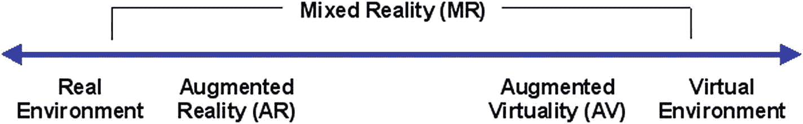
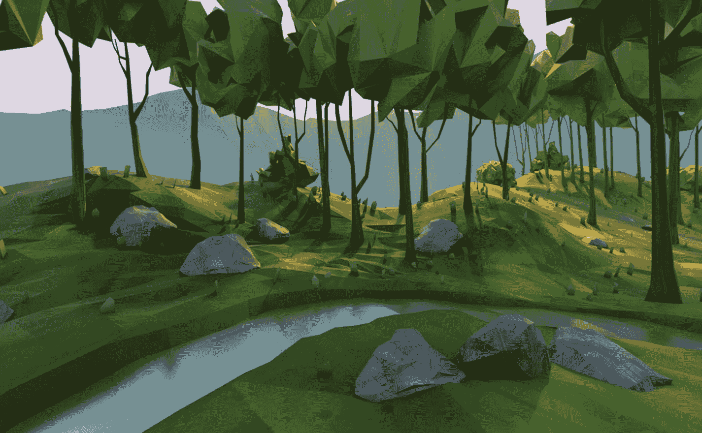
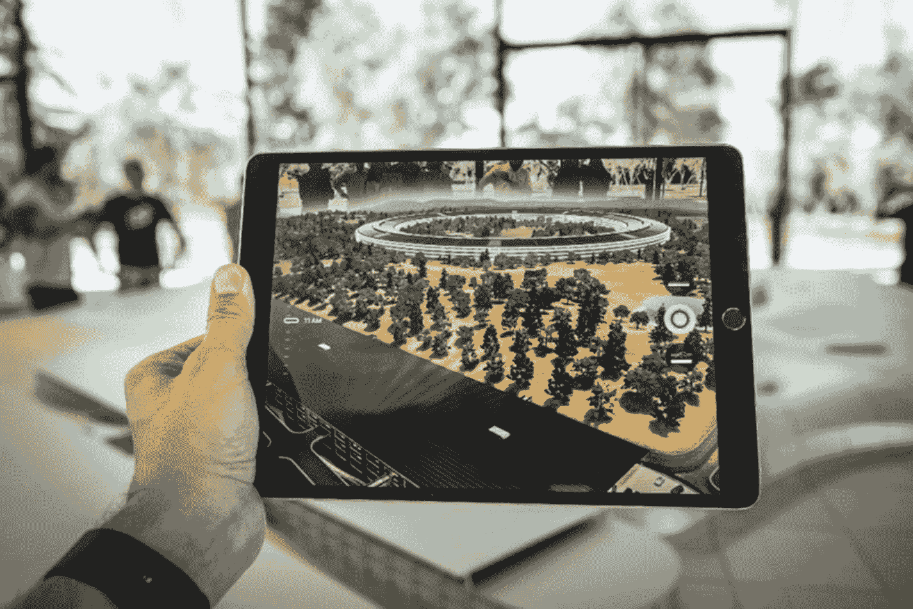

# 17. 虚拟现实与增强现实

特别感谢 Khoi Le 参与撰写本章。

叮。电梯门打开，眼前展开壮丽的天际线……然后你低头看去。你正站在一栋百层高楼的边缘。脚下，一块木板从你面前的边缘向外延伸六英尺。“走上去，”一个声音说道。尽管理智告诉你这很危险，你还是慢慢挪动脚步，一步一惊心地向前移动。当你走到木板边缘时，感到胃部一阵痉挛，几乎失去平衡。但你在四周呼啸的风声中稳住了身体。“从木板上跳下去，”那个声音说道。此时大多数人会因恐惧而僵在原地，拒绝跳下木板。你为什么要跳下去摔死呢？然而你知道自己此刻正身处虚拟现实之中，这一切都通过佩戴在脸上的头显设备看到。你身处教室，根本不可能受伤。你当然应该跳下木板。但你的双脚却因恐惧而无法移动。

这个木板体验展示了*沉浸式媒体*的力量——它能欺骗你的大脑，让你相信计算机生成的数字内容就是真实的。*虚拟现实（VR）* 能创造出看似真实的完全数字化世界。与之密切相关的领域是*增强现实（AR）*，它能创建出令人信服的逼真数字对象，仿佛它们就是真实世界的一部分。`VR` 和 `AR` 构成了许多人称之为“沉浸式媒体”的两端。

为什么称之为“沉浸式”媒体？想象你正在意大利庞贝古城遗址中穿行。这些建筑在数千年前就已毁坏。幸运的是，你佩戴着增强现实头显。除了看到废墟之外，还有全息投影——根据历史研究还原的建筑数字复制品——叠加在废墟之上。由于这种体验是空间性的，且数字结构在正确的地形语境中叠加在现实世界上，它增强了你的现实感知。沉浸式媒体通过将看似真实的数字对象环绕在你周围，为你带来全新的体验。

传统媒体是“扁平”媒体，是在纸张或屏幕上的平面体验。沉浸式媒体是空间性的——它们存在于三维空间中。你可以将沉浸式媒体想象为图 17-1 所示的谱系，从仅感知真实环境中真实物体的现实，到仅感知虚拟环境中虚拟物体的虚拟现实。

图 17-1。 现实-虚拟连续体，引自 Paul Milgram 1994 年的论文

*混合现实（`MR`）* 是虚拟与现实之间的“混合”，涵盖了谱系中的其余部分。例如，人行道（现实世界）上的宝可梦（虚拟对象）就属于“混合现实”。相反，在虚拟客厅（虚拟世界）中感知到的真实椅子（真实物体）也属于“混合现实”。增强现实属于混合现实，因为它呈现了虚拟叠加层，即叠加在现实世界上的对象。想象一下，看着某人时，看到他们的名字悬浮在头顶上方。

许多人还用总称 *`XR`* 来指代沉浸式媒体，其中 `X` 是“虚拟”“增强”“混合”或人们想到的任何其他词语的占位符，“`R`”代表“现实”。`XR` 释放了*体验*的潜能。正如互联网促进了*信息*的编目、分发和民主化，`XR` 也承诺为*体验*带来同样的变革。学习海洋知识的学生可以潜入水下；外科医生、四分卫和警察可以在逼真的场景中进行训练；任何人都可以通过体验叙利亚难民、印度农村妇女或无家可归者的生活片段来获得同理心。`VR`/`AR` 是一套新的媒体，通过它们我们可以体验连接、故事、娱乐和教育。

在本章中，我们将通过定义 `VR`/`AR` 的五个领域来探索沉浸式媒体。首先，我们将探讨使空间体验如此独特的“新维度”。然后，我们将研究“沉浸式内容”，分析 `VR`/`AR` 体验中存在的不同类型内容，并探索内容创作流程。了解内容之后，我们将看到当今的“硬件”如何通过追踪技术让我们消费这些内容。掌握了追踪原理，我们就能发现化身和虚拟人类如何在 `VR`/`AR` 中代表“虚拟的你”。最后，我们将探讨人们如何通过“元宇宙”与虚拟环境互动。这五个部分将为你提供关于 `VR`/`AR` 所需了解的一切知识。

## 新维度

要理解虚拟现实和增强现实的工作原理，我们必须深入探究沉浸式媒体的核心：`3D`。本节将首先探讨立体视觉，即人类视觉感知三维空间的方式。然后我们将了解计算机如何创建三维场景，以及技术的局限性如何影响 `VR`/`AR` 体验。

### 立体视觉

如果你闭上一只眼睛，将手指举到面前，然后换另一只眼睛闭上，手指的位置看起来仿佛发生了改变。每只眼睛从略微不同的角度观察世界。你的大脑会将这两幅图像结合起来，为你提供一个包含深度信息的统一图像。深度信息告诉你物体有多远，这使你能够感知三维空间。你的眼睛看到两幅图像，然后大脑将其合并的过程，被称为*立体视觉*。立体视觉，简称“立体”，正是让经典 `3D` 电影看起来像是从平面屏幕中向你弹出来的原因。红蓝眼镜会向你展示同一幅图像中略微不同的视角，从而为你提供深度信息。类似地，`VR`/`AR` 头戴设备会为你的每只眼睛绘制一幅略有不同的图像，以提供你对深度和空间的感知，这一过程被称为*渲染*。

渲染发生在*图形处理单元*（也称为*`GPU`*）中，它是计算机中专注于在屏幕上绘制图像的专用处理器。`GPU` 在屏幕上绘制的速度有限，因此当你转动头部时，它会争分夺秒地为你实时渲染场景。

虽然你无法有意识地察觉，但你的眼睛速度极快，能够捕捉到持续时长仅为两百分之一秒的图像。这意味着 `GPU` 需要能够跟上你的视觉系统；如果 `GPU` 无法足够快地将新视图渲染到屏幕上，你的视觉系统就会混乱。当 `GPU` 跟不上时，你的眼睛会看到滞后的旧图像。如果你之前正在环顾四周，但现在静止不动，你的眼睛仍然会看到移动的图像。相反，如果你之前没有移动，但现在正在环顾四周，你的眼睛会看到静止的图像。因此，你的前庭系统（负责平衡和运动）告诉大脑的信息，与你的视觉系统告诉大脑的信息不同。就像晕船一样，前庭系统和视觉系统之间的这种冲突会导致不适。在 `VR`/`AR` 中，这种恶心感被称为*模拟器晕动症*。

根据图像的复杂程度，`GPU` 会以一定的速度进行绘制，这个速度被称为*每秒帧数*，即 `FPS`。一个以 `60 FPS` 运行的 `GPU` 意味着它每秒可以绘制 60 个不同的视图。`GPU` 的 `FPS` 直接影响 `VR`/`AR` 体验。为了确保用户不会感到不适，开发者通常会将移动设备中较小 `GPU` 的目标设定为 `60 FPS`。`60 FPS` 是最低舒适度，但也是大多数小型 `GPU` 能够绘制的最高速率。在 `GPU` 更大的计算机上，开发者可以奢侈地将目标设定为至少 `90 FPS`，以确保所有用户都能获得舒适的 `VR`/`AR` 体验。

在 `VR`/`AR` 头戴设备（被称为*头戴式显示器*（`HMD`））中，每只眼睛看到的是不同的图像，以实现立体视觉，并让用户能够感知深度和空间。虽然典型的手机或电脑一次只需显示一幅图像，但 `HMD` 必须同时显示两幅不同的图像。由于这种双屏显示，`GPU` 必须每秒绘制场景的两个版本，这使其效率减半。因此，要让你获得可接受的 `VR`/`AR` 体验，`GPU` 的性能需要强大一倍。由于依赖 `GPU` 进行密集计算的人工智能行业取得了进步，直到最近，足够强大的 `GPU` 才变得足够便宜，从而打开了消费级 `VR`/`AR` 的大门。即便如此，在构建 `VR`/`AR` 内容时，也必须采取必要的预防措施来优化渲染管线，以避免模拟器晕动症。

## 沉浸式内容

`VR`/`AR` 内容的两种主要形式是计算机图形和视频。计算机图形是由计算机创建的视觉效果。视频则是在 `180` 度半球或 `360` 度球体内播放的录制内容，你可以在其中环顾四周。我们将探讨如何制作每种内容，以及每种形式各自的用途。

### 计算机图形内容

在计算机图形学中，“`3D` 模型”由几个需要了解的关键术语来描述。*网格*类似于金属丝雕塑，作为 `3D` 模型的框架。网格由称为*多边形*的面组成。每个 `3D` 模型都有一个“多边形数量”，即*多边形数*，它显示了模型中的多边形数量。多边形数高的模型因此更精细，这会使 `GPU` 工作更吃力，可能导致以较低的 `FPS` 进行渲染。这些 *`FPS` 下降*会导致延迟，进而引发模拟器晕动症。为了应对这种现象，许多 `VR`/`AR` 艺术家使用*低多边形*风格（如图 17-2 所示），这种风格使用的多边形数量非常少。这能让 `GPU` 更容易渲染，同时也形成了独特的外观。最早的计算机 `VR` 设备不得不使用由线框立方体构成的低多边形环境，这些环境看起来像是没有表面。

图 17-2. Google Daydream Home 采用了低多边形艺术风格^(³⁶)

为了控制模型表面的外观，艺术家会使用材质。材质包裹在金属丝雕塑上，就像覆盖在雕塑框架上的皮肤一样。材质通常由一个或多个纹理（决定皮肤上的图案和颜色）以及一个或多个着色器（控制材质在屏幕上的显示方式）组成。例如，一个反射着色器会显示从模型上发出的光线。

### 如何制作 3D 模型

既然你已经知道网格、多边形和材质构成了 `3D` 模型，我们可以探索两种常见的创建 `3D` 模型的方法。

我们要看的第一种方法是手动创建 `3D` 模型。`3D` 艺术家使用非常复杂的 `3D` 建模软件，在 `3D` 空间中手动排列每个多边形。他们还会创建材质、纹理和着色器，以改变网格的外观。这是一个极其劳动密集型的过程，需要专业知识和敏锐的细节洞察力。为了优化 `VR`/`AR` 模型，`3D` 艺术家需要特别留意多边形数量。

### 摄影测量法创建 3D 模型

另一种创建 3D 模型的方法是`摄影测量法`。你从多个不同角度拍摄目标对象（比如一座雕像）的照片。然后，摄影测量软件可以推断出物体的形状。摄影测量法对于获取真实世界物体的精细模型非常有用，如果以所需的精细度对这些物体进行建模，会耗时过长或不可行。

### 动画简述

一旦你制作好了模型，你可能想让它`动起来`（静态的小狗可没什么意思！）。大多数动画软件使用`关键帧`，即模型将在其间移动的某些重要位置。例如，如果你有一只挥动的手臂，你可以为手臂创建一个向右倾斜的关键帧。然后，在第二个关键帧中，你可以将手臂设置为向左倾斜。动画软件会计算出如何让手臂从第一个关键帧（向右倾斜）移动到第二个关键帧（向左倾斜），这样手臂就会从右向左移动，看起来像是在挥手。对于具有复杂运动系统的复杂模型来说，制作动画极其复杂。

### 体积捕捉法创建带动画的 3D 模型

动画的一种替代方案是`体积捕捉`，它类似于摄影测量法的动态版本。体积捕捉通常使用超过一百台摄像机同时拍摄照片，因此它可以处理移动的物体和人物，以创建一种“3D 视频”。体积捕捉非常适合录制预定义的序列，例如舞蹈动作。

### 沉浸式视频

`沉浸式视频`内容是 VR/AR 内容的另一种表现形式。VR/AR 中的视频与普通视频非常相似，但你可以环顾四周。想象一张环绕你的全景照片。这些视频通常使用 360 度相机或特殊的 360 度相机支架拍摄，它们会拍摄多张图像并将其`拼接`在一起。`拼接`是指寻找图像之间的重叠部分并对其排列，使其看起来像一张图像的过程。沉浸式视频对新闻业很有用，因为它可以将人们带入世界的另一个地方或他人的生活环境。对于探索而言，它不太有用，因为用户无法四处移动，只能观看。

现在我们了解了 VR/AR 内容，接下来看看硬件如何让我们能够观看和移动。

## 硬件

虚拟现实和增强现实在很大程度上依赖于硬件体验。除了头戴式显示器（HMD）之外，VR/AR 还使用追踪系统，并可能包含手部控制器等其他硬件组件。最需要理解的是`追踪`，即硬件如何知道你的位置以及你正在看向哪里。我们将探讨不同类型的追踪，以及不同 VR/AR 系统在追踪方面的差异。

### 追踪

为了正确渲染 VR/AR 视图，计算机需要知道你在看向哪里，以及你相对于虚拟环境所处的位置。这两个数据点定义了追踪能力的两个主要级别：`三自由度`和`六自由度`。

### 自由度 (DOF)

想象一个只能上下滑动的灯光调光器，这个调光器就只有一个自由度。它只能垂直移动。类似地，一个地球仪有一个自由度：它可以绕一个轴旋转。现在，想象一款像《超级马里奥兄弟》这样的游戏。马里奥可以左右跑，也可以跳上跳下。这就有两个自由度。自由度就是系统中可以在一定范围内变化的任何值。

VR/AR 具有三个自由度：`俯仰`、`偏航`和`翻滚`。抬头看天花板和低头看地面，这是绕 X 轴旋转，即前后旋转。向左看和向右看，这是偏航，即绕 Y 轴旋转。将头向左和向右倾斜，让耳朵靠近肩膀，绕 Z 轴旋转就是翻滚。这三个自由度是 3DOF VR/AR 唯一记录的，因此 3DOF VR/AR 只会根据你看向的位置改变视图。即使你向前移动，看起来也像站在原地不动。但你可以随意转动头部。因此，大多数 3DOF 体验不希望您四处移动，而只是环顾四周。你可以把它理解为“转椅式 XR”。

有了`6DOF`，你就解锁了额外的三个自由度：沿 X、Y 和 Z 轴的移动。换句话说，你可以前后、左右移动，还可以蹲下或跳上跳下。6DOF VR/AR 会根据你的观看位置和所处位置改变视图。我们称之为“走步式 XR”。

更具体地说，3DOF 和 6DOF 描述了特定硬件组件的能力。例如，一个 3DOF 手部控制器可以像激光笔一样指向不同角度，但它无法追踪手部的位置。另一方面，6DOF 手部控制器可以准确追踪手部的方向和位置。

那么，计算机是如何知道你在看哪里以及你所在的位置的呢？知道你在看哪里很容易。`陀螺仪`是手机和 VR/AR 头戴式显示器内部的小型仪器，可以判断设备的朝向。然而，找出你所在的位置极其困难。

想象一下在漆黑的外层空间驾驶一艘宇宙飞船。你如何知道自己的位置，甚至是否在移动？在黑暗中行驶，就是计算机在现实世界中确定设备在 3D 空间位置时所做的事情。计算机无法看见，因此无法判断设备的位置或是否在移动。所以我们处在黑暗之中。如果远处有灯光，你可以根据这些灯光判断自己的相对位置。或者，如果你能突然看到前方所有的小行星和行星，你就能看到自己相对于它们的运动方式。如果计算机有参考点，它就能知道自己的位置。计算机获得参考点有两种方式。一种方式是外部的参考点向计算机发送关于其位置的信号；这被称为`由外向内追踪`。另一种方式是计算机内部的处理过程向外寻找环境中的参考点；这被称为`由内向外追踪`。

### 由外向内 vs. 由内向外追踪

在 Oculus Rift 和 HTC Vive 中使用的`由外向内追踪`是目前最常见的追踪方法。外部传感器放置在您的桌子上或墙上，作为参考点，就像我们太空例子中的远处灯光一样。它们通过向头戴显示器内部的传感器发送信号来实现这一点。根据这些数据，处理器可以随时间对头戴显示器的位置进行三角测量。由外向内追踪非常精确，但需要连接并设置外部传感器。由外向内追踪会将你限制在传感器所在的区域内。

设置传感器可能很繁琐，移动你的 VR 设备（电脑、传感器、HMD）也是一项大工程。此外，在有限的空间内使用 AR 头戴显示器将毫无意义，因为 AR 的强大之处在于提供关于世界的信息。解决方案是将追踪系统放入头戴显示器内部，这被称为`由内向外追踪`。由于 HMD 使用内部摄像头和深度传感器来感知环境并计算 HMD 相对于一切物体的位置，因此没有外部传感器。现在宇宙飞船可以看到小行星并计算出其相对位置。这个过程被称为`SLAM`，即同步定位与地图构建，机器人、自动驾驶汽车也使用它来了解自己在现实世界中的位置。无需外部传感器，一切变得更加方便和便携。由内向外追踪减少了电线和设置工作，使 VR 更容易普及。此外，由内向外追踪对于 AR HMD 来说极其重要，因为它能让设备在世界中自由移动。

在增强现实中，一种普遍的追踪方法是`基于标记的追踪`。顾名思义，基于标记的追踪使用物理标记来帮助追踪。标记是一张特定的图像（通常是二维码），印在卡片上。不过，标记也可以是徽标甚至一幅画。设备上的摄像头可以识别这种图案，并在该图像上渲染出一个 3D 模型。基于标记的追踪感觉像是一种 6DOF 体验，因为卡片上的图像可以在所有六个自由度上移动，因此渲染在卡片上的 3D 模型也可以随之移动。然而，算法实际上并不知道设备的位置，只知道被追踪标记的位置。基于标记的追踪非常准确，但最终缺乏关于环境的背景知识，而这些知识将使未来的 AR 变得非常强大。如今，大多数 AR 追踪都会实现某种形式的`SLAM`（我们之前讨论过的），因为它可以在没有标记和外部传感器的情况下实现。然而，对于某些受限的使用场景（如课堂），基于标记的追踪可以带来流畅的用户体验。

### VR 系统

既然我们了解了追踪的工作原理以及存在哪些类型的追踪，接下来让我们专门看看不同种类的虚拟现实系统。

#### 智能手机 VR

最流行的虚拟现实形式是基于智能手机的虚拟现实。智能手机 VR 的工作原理是，在手机屏幕上渲染出两幅图像，您可以通过放大镜片观看，镜片通常位于一个容纳手机的头戴式显示器（HMD）外壳内。智能手机 VR 最常用于观看 360 度视频。它通过手机陀螺仪实现 3DOF 跟踪，如您所知，陀螺仪用于测量方向。最近，智能手机 VR 也出现了 3DOF 手持控制器。该领域的知名产品包括`Google Cardboard`、`Daydream`以及`Samsung GearVR`。尽管智能手机 VR 相当普及，但其体验无法与 PC VR 相媲美。

#### PC VR

PC VR 需要一台配备强大 GPU 的 Windows 电脑，并连接一个 VR 头戴式显示器（HMD）。PC VR 分为两种类型：有线式（HMD 通过线缆连接电脑）和无线式（无需线缆）。大多数 VR 游戏开发者都在制作 PC VR 游戏。在 PC VR 上玩游戏是一种令人难以置信的体验。由于 GPU 更大，且凭借强大的计算能力和强制性的外部传感器，其追踪精度更高，所以图形效果极为出色。VR 游戏厅几乎全部使用 PC VR 系统，大多数大学也使用 PC VR 系统进行研发。此外，PC VR 是目前唯一拥有 6DOF 手持控制器的 VR 系统。最流行的系统是`Oculus Rift`和`HTC Vive`。然而，PC VR 成本极高，因为您必须拥有一台配备高级 GPU 的电脑、一个高级耳机，以及一个宽敞的、空置的使用空间。它运输不便，且使用前需要设置。为了让 VR 更普及，独立式 VR 应运而生。

#### 独立式 VR

VR 硬件生态系统中最新的产品是独立式虚拟现实。独立式 VR 将所有必要的硬件组件（如屏幕、GPU 和处理器）都集成在 HMD 内部，无需外部手机或电脑。独立式 VR 是市场上最紧凑、最便携、最具成本效益的解决方案。有支持 3DOF 和 6DOF 追踪的独立式 HMD。例如，`Oculus Go`配备 3DOF HMD 和 3DOF 控制器。`HTC Vive Focus`配备 6DOF HMD，但其控制器仅为 3DOF。2019 年晚些时候，`Oculus Quest`将发布。它将是首款配备 6DOF 控制器的商用消费级 6DOF HMD。独立式虚拟现实是向消费级虚拟现实迈出的重要一步，因为人们现在可以购买一台设备并立即体验 VR。

## AR 系统

与 VR 类似，AR 也有几种不同类型的系统。

### 6DOF 头戴式显示器（HMD）

这类 HMD 能够显示存在于真实世界空间中的 3D 图形。您可以围绕物体移动，HMD 使用由内而外的追踪技术来确定您的位置，并锚定数字对象，仿佛它们就存在于您的空间中。该领域的主要参与者是`Microsoft HoloLens`、`Meta`和`Magic Leap`。

### 平视显示器（HUD）

如果您知道钢铁侠看到的景象，那么这类 HMD 就与之非常接近。它们将信息（通常是文本或基础图像）叠加到您面前的世界中。然而，这些信息并非作为物体渲染到您的世界中，而仅仅是显示在您的眼前。这对于需要查看信息但双手无法持握手机或平板的工业工作者非常有用。类似地，需要了解速度信息的滑雪者或摩托车手也可以佩戴这类显示 HMD。这类 HMD 的一个流行术语是智能眼镜。您可能听说过的一个智能眼镜品牌是`Google Glass`。

### 6DOF 移动 AR

与移动 VR 不同，移动 AR 实际上指的是基于手机的增强现实。移动 AR 利用手机摄像头读取真实世界，然后在显示在手机屏幕上的画面中叠加显示 3D 图形（图 17-3）。例如，宜家有一款应用，可以让您看到虚拟家具（如椅子）出现在您的客厅中。移动 AR 使用 6DOF 无标记追踪，因此您可以像在真实世界中一样围绕椅子移动。

图 17-3.

iPad 上的移动 AR 展示一片数字森林^(³⁷)

移动 AR 依赖于特定的、功能强大的 AR SDK。`Vuforia`是一个大型软件套件，用于图像检测、标记追踪和其他有用的需求。尽管`Vuforia`对于更高级的 AR 功能仍然强大且有用，但苹果的`ARKit`和谷歌的`ARCore`近期已成为底层领域的主力，因为它们针对硬件进行了优化，并使用 SLAM 技术实现了出色的无标记 6DOF 由内而外追踪。

面对 VR/AR 领域中纷繁复杂的硬件系统，人们很容易感到困惑。但请记住，主要区别在于追踪方式：3DOF（转椅式 XR）与 6DOF（行走式 XR），以及由外向内追踪（外部传感器）与由内向外追踪（SLAM）。

## 虚拟世界中的你

虚拟现实的力量之一在于让你能够成为任何你想成为的人。你还将在 VR 和 AR 中与大量虚拟角色互动。在 VR/AR 中代表某人的形象称为化身。尽管化身可以是任何形态，但大多数化身都是人形的，因为这能准确地映射到现有的追踪系统（即用六自由度追踪头部和双手的系统）。

此外，人们通常更愿意将自己表现为人形，也更能接受看到其他人类以人形化身出现，这种人形化身被称为虚拟人。化身在虚拟现实和增强现实中极为普遍，因为当我们进入一个虚拟空间时，我们需要一个个人化的具象来向同一虚拟空间中的其他人展示自己。根据传播与媒体研究者布拉斯科维奇和贝伦森的观点，虚拟人展现出多种“真实感”。

### 照片级真实感

如果你照镜子、观看高清视频或照片，你所看到的具有极高的照片级真实感。它看起来就像一个真实的人：就是你自己。在 VR/AR 中，由于图形技术以及被称为“恐怖谷”的现象，很少出现照片级真实的化身。现代计算机图形能力是非凡的，并且越来越接近制作出逼真的虚拟人。然而，在 VR/AR 头戴设备中，渲染成本仍然很高，因此大多数系统无法负担生动、逼真的细节。

此外，当虚拟人接近真实人类的外观时，“恐怖谷”效应会引起不适。恐怖谷的一侧是卡通风格的虚拟人，另一侧是完全逼真的虚拟人。人类通常在恐怖谷的两侧都感到舒适，但恰恰在中间地带，即虚拟人几乎与真人无异时，人们会感到不适。恐怖谷的一个绝佳例子是电影《极地特快》（2004）中令人毛骨悚然的角色，这给观众带来了极大的不适感。这种不适源于我们的大脑在生物学上天生就倾向于识别他人。在恐怖谷中，我们的大脑无法判断一个图像是否是真实的人类，从而令我们感到不安。因此，近乎照片级真实的虚拟人通常会被避免使用。

大多数 VR/AR 体验，如《Rec Room》（2016），都使用卡通风格的虚拟人、非人类表征，或者佩戴头盔或面具的人类表征。那么，你可能会问，如果化身看起来不像真人，VR/AR 还有什么价值呢？事实上，照片级真实感并非最重要的真实感类型。行为真实感对感知真实性的影响要大得多。

### 行为真实感

虽然真实感衡量的是“看起来真实吗？”，但行为真实感衡量的是“行为上真实吗？”即使一个虚拟形象看起来不像真人，但如果它的行为像真人，你就会像对待真人一样对待它。想一想与`Alexa`或`Siri`交谈。你会用到许多与和人交谈时相同的行为举止。VR 在虚拟形象的行为真实感方面面临的主要挑战在于追踪。由于 AR 和 VR 追踪系统本质相似，但 VR 追踪稍显成熟，因此我们将重点关注 VR 追踪的虚拟形象。对于大多数 6DOF PC VR 系统，你只能追踪头部和双手的六个自由度。然而，你可能希望展示虚拟人的整个身体，以显示完整的运动范围。你可能希望肢体语言能够传达出来，希望肘部以逼真的方式移动，或者希望当你操控的虚拟形象走动时腿部能够移动。为了从头部和双手推导出整个身体，人们使用了逆向运动学，也称为 IK。IK 算法利用头部和双手的位置及旋转来推断肘部和臀部的位置。行为真实感仍然面临许多挑战，例如面部表情。如何让嘴巴在说话时正确运动、创造逼真的眼球运动以及实现精细的手部行为，都是当今正在解决的问题。

## 元宇宙

既然我们拥有了自己的一个表征，那么让我们来探索虚拟世界。虚拟现实和增强现实之所以是强大的媒介，是因为临场感，一种“身临其境”的心理感觉。许多体验过深度临场感的人会记得，摘下头显后会感到极度迷失方向，因为他们现在身处自己的客厅，而不是在城堡顶端与敌人战斗。那么，虚拟环境中哪些不同的元素有助于产生临场感呢？

一个虚拟环境包含许多组成部分。由于 VR/AR 目前主要是一种视听体验，下面讨论的主要组成部分将是空间音频以及环境的主要视觉元素，包括场景布景和天空盒。

### 空间音频

空间音频是声音在现实世界中的工作方式。VR/AR 是一种空间媒介，因此空间音频非常契合。在具有空间音频的体验中，当一辆虚拟救护车从你身边疾驰而过时，你会听到警笛声渐强再渐弱。如果你身处 VR/AR 环境中，并将右耳靠近一个虚拟音响，你右侧耳机中的音乐声会增大。空间音频有助于营造氛围和临场感，因为它复制了人类在现实世界中感知声音的方式。

### 场景布景

场景布景是一个游戏开发术语，被引入到虚拟环境的设计中。场景布景是那些让体验感觉真实的微小细节。场景布景可以是 AR 中你办公桌上的一只虚拟咖啡杯，或者是你所站的 VR 客厅角落里一盆濒死的室内绿植。所有这些小物件都为虚拟环境增添了特色和真实感。

### 天空盒

在虚拟现实中，有些虚拟环境会设置在户外场景中，比如城市或森林。天空盒是一张图像，它决定了 VR 中地平线和天空的呈现方式。“天空盒”这个名称源于这样一个事实：一个巨大的立方体环绕着你，立方体的六个面各自有不同的照片。顶面通常是一张天空的图像，四个侧面展示的是地平线，底面则是地面的图像——大多数人看不到底面，因为虚拟环境通常已经包含了地面。天空盒不一定是盒状，它们也可以是巨大的半球体。

### 触觉与交互

当你的身体参与到 VR/AR 体验中时，会产生更强的临场感。为了通过身体参与来增强临场感，创作者应该在环境中构建交互，并配备触觉反馈。

#### 控制器

你的手仿佛就在虚拟环境中的感觉被称为手部临场感。在 AR 环境中，你能够看到自己面前的双手，因此手部临场感通常不成问题。然而，在 VR 环境中，头显会遮挡你看到自己双手的视线，这可能会让你感觉双手似乎不存在了。虚拟现实中的手部控制器极大地增强了临场感，因为它们同时赋予了用户能动性和心理上的身体转移。当一个人开始感觉到自己拥有一个并非自己身体的所有权时，就会发生身体转移。身体转移增强了临场感，因为如果你拥有了自己虚拟形象的身体，你就可以在虚拟环境中引发各种事件。你拥有了能动性。能动性是指用户影响其环境的控制程度。例如，你可以设计一种体验，让用户能够把物体从桌子上撞落。在 VR 中与环境交互并伴有触觉反馈，能增强能动性，从而提升临场感。

#### 触觉反馈

*触觉反馈*指的是为用户再现触觉的力或振动。你可能体验过的最常见的触觉反馈是在手机键盘上打字时的震动感。类似地，在虚拟现实中，最常见的触觉反馈形式来自于当你触摸一个虚拟物体时会振动的控制器。其他类型的触觉反馈包括：通过一个特殊编程的加热风扇感受温度（当你靠近虚拟火焰时，它会向你脸上吹热风）、感受像墙一样的真实物理物体（位置与虚拟墙壁重合），以及通过特殊的触觉设备感受阻力。在沉浸式媒体中进行触觉交互能驱动能动性以及与体验的连接，因为触觉可以唤起情感。想象一下被虚拟子弹击中或被虚拟拥抱环绕的体验。

## 在 VR 中移动：移动模式

移动指的是在虚拟环境中四处移动的行为。不幸的是，在你撞上房间的墙壁或到达连接电脑与头显的线缆尽头之前，移动距离无法超过 `10` 英尺。你正在探索的虚拟世界远大于 `10` 英尺——那么，如果你无法正常地在其中走动，该如何探索虚拟世界呢？VR 中有多种移动方法，但人们一直在尝试新颖且有创意的方式：传送、基于手部的移动和无限跑步机。最常见的移动方式是*传送*。你只需将控制器对准远处地面上的一个点，然后就会立即出现在那里。

然而，传送可能会破坏临场感。还有一些其他的移动实验，例如攀爬的概念。由于你在 VR 中只有头部和双手，许多人尝试用手的输入来进行移动。攀爬涉及使用手部控制器抓住虚拟地面或墙壁，然后拉动自己在环境中移动。此外，还有许多用于移动的硬件实验。虽然不是必需的，但硬件外设可以增强 VR 体验。一个有趣的概念是*无限跑步机*，它允许你朝任何方向奔跑，同时身体停留在原地。目前，有几种不同的移动硬件迭代，例如一种“碗状”装置，你需要穿着滑溜的鞋子在里面跑；或者是一种可以向不同方向（前、后、左、右）移动的跑步机，并因此能够以不同速率进行“对角线”移动。

## 在增强现实中移动：AR 云

在增强现实中移动与现实中的移动相同，因为虚拟环境存在于你的真实世界环境中。这里的问题不在于你如何在空间中移动，而在于空间相对于你在哪里被渲染。想象一下，你把一个虚拟杯子放在桌子的角落。你戴着 AR 眼镜的朋友走过时，如何才能看到同一个位于桌子边缘的虚拟杯子？她的 AR 眼镜必须识别出她和你身处同一个房间，并且识别出你放置虚拟杯子的那张确切桌子。为了在全球范围内实现无处不在的、共享的增强现实，我们需要`AR 云`。`AR 云`是我们世界的一对一映射，本质上是地球上所有地点和空间的数字副本。`AR 云`必须跟踪我们世界中所有的 `3D` 空间数据和网格，以及所有使用 `AR` 的用户及其位置，以便构建大规模的多用户体验。尽管这还有很长的路要走，但它将使得一个强大的数字层能够叠加在现实世界之上。与此同时，大规模的多用户 `AR` 体验无法利用 `3D` 模型的精确定位或无处不在的多用户功能，这限制了 `AR` 可能的共享体验。

“元宇宙”在不断发展，以上所有组成部分对于创造强大的沉浸式体验都至关重要。如果我们要生活在一个数字与现实的界限模糊的世界里，那么让我们构建一个良好的融合体。

## 结论

时间是 `2049` 年。每个人都戴着隐形眼镜，可以让他们看到到处渲染的数字物体。你可以观看孩子生日的 `360` 度视频，或者查看你想购买的新房子的 `3D` 模型。在商店里，看起来完美逼真的增强现实虚拟人站在柜台后面，准备为你点单。你的朋友可以在世界各地留下只有你能看到的秘密信息。你可以舒适地在家中通过光束传送到办公室，或者拜访世界另一端的家人。

虚拟现实和增强现实将会持续存在。尽管沉浸式媒体涉及许多术语和概念，但本章涵盖了 `VR/AR` 中所有需要了解的核心思想。我们探讨了由 `GPU` 渲染、通过立体视觉感知的三维体验的概念。我们比较了代表我们世界的视频和构成新世界的 `3D` 计算机图形模型。我们了解了 `3DOF` 转椅体验和 `6DOF` 走动体验之间的区别，并介绍了当今存在的各种沉浸式系统，例如独立的 `VR/AR`。第四部分涵盖了虚拟化身，探讨了虚拟人类设计中摄影真实感与行为真实感之间的关系。最后，我们以 `VR/AR` 的环境和交互作为结尾，学习了增强临场感的不同方面。你已经准备好走出去，自信地谈论沉浸式媒体以及它如何成为下一代人机交互。现在，你已经完全沉浸其中了。

脚注 `1` `2`